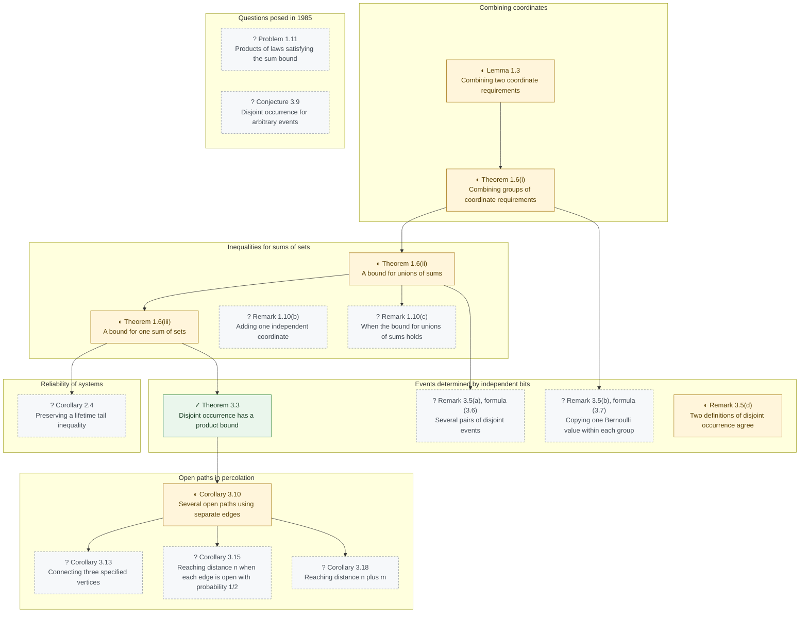

# Inequalities with applications to percolation and reliability

**J. van den Berg, H. Kesten**

[Formalization guide](../../guides/bk-1985.md) · [Paper catalogue](../../../README.md)

**✓ Certified** · **◐ Restricted** · **○ Not in this release** · **? Not assessed**

A status applies to the scope stated below. Arrows point from a result to a result whose proof uses it.

Graph presentation based on Scott Armstrong’s visual paper design for [*Homogenization at a polynomial scale in high contrast*](https://scottnarmstrong.github.io/hcp-visual-paper/).

## Progress

| Paper result | Formalization |
| --- | --- |
| **Lemma 1.3** Combining two coordinate requirements | **◐ Restricted** [Lean certificate](https://github.com/cjanjigi/LPP/blob/5a3c7a612144b68468559ea1800bf7f39a5d3ef1/ProbabilityBasics/Foundations/BK/Lemma13.lean#L194) |
| **Theorem 1.6(i)** Combining groups of coordinate requirements | **◐ Restricted** [Lean certificate](https://github.com/cjanjigi/LPP/blob/5a3c7a612144b68468559ea1800bf7f39a5d3ef1/ProbabilityBasics/Foundations/BK/Theorem16.lean#L135) |
| **Theorem 1.6(ii)** A bound for unions of sums | **◐ Restricted** [Lean certificate](https://github.com/cjanjigi/LPP/blob/5a3c7a612144b68468559ea1800bf7f39a5d3ef1/ProbabilityBasics/Foundations/BK/Theorem16.lean#L220) |
| **Theorem 1.6(iii)** A bound for one sum of sets | **◐ Restricted** [Lean certificate](https://github.com/cjanjigi/LPP/blob/5a3c7a612144b68468559ea1800bf7f39a5d3ef1/ProbabilityBasics/Foundations/BK/Theorem16.lean#L232) |
| **Remark 1.10(b)** Adding one independent coordinate | **? Not assessed** |
| **Remark 1.10(c)** When the bound for unions of sums holds | **? Not assessed** |
| **Corollary 2.4** Preserving a lifetime tail inequality | **? Not assessed** |
| **Theorem 3.3** Disjoint occurrence has a product bound | **✓ Certified** [Lean certificate](https://github.com/cjanjigi/LPP/blob/5a3c7a612144b68468559ea1800bf7f39a5d3ef1/ProbabilityBasics/Statements/BK.lean#L326) |
| **Remark 3.5(a), formula (3.6)** Several pairs of disjoint events | **? Not assessed** |
| **Remark 3.5(b), formula (3.7)** Copying one Bernoulli value within each group | **? Not assessed** |
| **Remark 3.5(d)** Two definitions of disjoint occurrence agree | **◐ Restricted** [Box occurrence is contained in the paper operation](https://github.com/cjanjigi/LPP/blob/5a3c7a612144b68468559ea1800bf7f39a5d3ef1/ProbabilityBasics/Foundations/BK/Witness.lean#L205) · [Reverse inclusion for increasing events](https://github.com/cjanjigi/LPP/blob/5a3c7a612144b68468559ea1800bf7f39a5d3ef1/ProbabilityBasics/Foundations/BK/Witness.lean#L229) |
| **Corollary 3.10** Several open paths using separate edges | **◐ Restricted** [Finite-coordinate family inequality](https://github.com/cjanjigi/LPP/blob/5a3c7a612144b68468559ea1800bf7f39a5d3ef1/ProbabilityBasics/Statements/BK.lean#L163) · [Countable-coordinate family inequality](https://github.com/cjanjigi/LPP/blob/5a3c7a612144b68468559ea1800bf7f39a5d3ef1/ProbabilityBasics/Statements/BK.lean#L279) |
| **Corollary 3.13** Connecting three specified vertices | **? Not assessed** |
| **Corollary 3.15** Reaching distance n when each edge is open with probability 1/2 | **? Not assessed** |
| **Corollary 3.18** Reaching distance n plus m | **? Not assessed** |
| **Problem 1.11** Products of laws satisfying the sum bound | **? Not assessed** |
| **Conjecture 3.9** Disjoint occurrence for arbitrary events | **? Not assessed** |

Result statements, notation and certificate scope

### Lemma 1.3

**Combining two coordinate requirements**

Replacing requirements on two equally distributed independent coordinates by a requirement on their sum can only decrease the probability.

Let $D$ be either $\mathbb N_0=\{0,1,2,\ldots\}$ or $[0,\infty)$. For $x,y\in D^n$, $x\le y$ means $x_i\le y_i$ for every $i$. A set $A\subseteq D^n$ is increasing if $x\in A$ and $x\le y$ imply $y\in A$.

For sets $A,B\subseteq D^n$, their sum is $A+B=\{a+b:a\in A,\ b\in B\}$, where vectors are added coordinate by coordinate.

A probability law $\nu$ on $D$ is new better than used if $\nu([s+t,\infty))\le\nu([s,\infty))\nu([t,\infty))$ for every $s,t\in D$. This is the meaning of “NBU” in the paper.

All sets called Borel are measurable for the usual topology on $D^n$. Probabilities of sums or images use the completed probability measure, which also makes every subset of a null Borel set measurable.

Let $\mu=\bigotimes_{k=1}^n\mu_k$, where every $\mu_k$ is a new-better-than-used law on $D$. Fix distinct $i,j\in\{1,\ldots,n\}$ with $\mu_i=\mu_j$. For an increasing Borel set $A\subseteq D^n$, define $A^*_{ij}=\{x:\exists a\in A,\ a_i+a_j\le x_i,\ a_k\le x_k\text{ for }k\notin\{i,j\}\}$. There is no restriction on $x_j$.

For every increasing Borel set $A\subseteq D^n$, $$\mu(A^*_{ij})\le\mu(A).$$

**Formalization scope.** The released certificate covers $D=\mathbb N_0$. It does not state the case $D=[0,\infty)$.

*Source location* p. 557.

### Theorem 1.6(i)

**Combining groups of coordinate requirements**

Requirements on several equally distributed coordinates can be combined into one requirement on their sum, separately within each group.

Let $D$ be either $\mathbb N_0=\{0,1,2,\ldots\}$ or $[0,\infty)$. For $x,y\in D^n$, $x\le y$ means $x_i\le y_i$ for every $i$. A set $A\subseteq D^n$ is increasing if $x\in A$ and $x\le y$ imply $y\in A$.

For sets $A,B\subseteq D^n$, their sum is $A+B=\{a+b:a\in A,\ b\in B\}$, where vectors are added coordinate by coordinate.

A probability law $\nu$ on $D$ is new better than used if $\nu([s+t,\infty))\le\nu([s,\infty))\nu([t,\infty))$ for every $s,t\in D$. This is the meaning of “NBU” in the paper.

All sets called Borel are measurable for the usual topology on $D^n$. Probabilities of sums or images use the completed probability measure, which also makes every subset of a null Borel set measurable.

Let $\mu=\bigotimes_{i=1}^n\mu_i$, with every $\mu_i$ new better than used. Let $\mathcal F$ be a partition of $\{1,\ldots,n\}$ into nonempty classes. Choose $r_F\in F$ for each $F\in\mathcal F$, and assume $\mu_j=\mu_{r_F}$ whenever $j\in F$.

For an increasing Borel set $A\subseteq D^n$, put $A^*=\{x:\exists a\in A,\ \sum_{j\in F}a_j\le x_{r_F}\text{ for every }F\in\mathcal F\}$. Coordinates of $x$ not chosen as representatives are unrestricted.

For every such $A$, $$\mu(A^*)\le\mu(A).$$

**Formalization scope.** The released certificate proves this for nonnegative integer coordinates. The nonnegative real-coordinate case is outside its statement.

*Source location* p. 558.

### Theorem 1.6(ii)

**A bound for unions of sums**

For independent coordinates with the stated one-dimensional tail inequality, a union of sum events is no more likely than the corresponding event on two independent copies.

Let $D$ be either $\mathbb N_0=\{0,1,2,\ldots\}$ or $[0,\infty)$. For $x,y\in D^n$, $x\le y$ means $x_i\le y_i$ for every $i$. A set $A\subseteq D^n$ is increasing if $x\in A$ and $x\le y$ imply $y\in A$.

For sets $A,B\subseteq D^n$, their sum is $A+B=\{a+b:a\in A,\ b\in B\}$, where vectors are added coordinate by coordinate.

A probability law $\nu$ on $D$ is new better than used if $\nu([s+t,\infty))\le\nu([s,\infty))\nu([t,\infty))$ for every $s,t\in D$. This is the meaning of “NBU” in the paper.

All sets called Borel are measurable for the usual topology on $D^n$. Probabilities of sums or images use the completed probability measure, which also makes every subset of a null Borel set measurable.

Let $\mu=\bigotimes_{i=1}^n\mu_i$, with every $\mu_i$ new better than used. Let $q\ge1$ and let $A_1,\ldots,A_q,B_1,\ldots,B_q\subseteq D^n$ be increasing Borel sets. The law $\mu\otimes\mu$ is the joint law of two independent vectors, each with law $\mu$.

$$\mu\!\left(\bigcup_{r=1}^q(A_r+B_r)\right)\le(\mu\otimes\mu)\!\left(\bigcup_{r=1}^q(A_r\times B_r)\right).$$

**Formalization scope.** The released certificate covers nonnegative integer coordinates. The paper also allows nonnegative real coordinates.

*Source location* p. 558.

### Theorem 1.6(iii)

**A bound for one sum of sets**

Independent coordinate laws satisfying the one-dimensional tail inequality also satisfy the corresponding vector inequality.

Let $D$ be either $\mathbb N_0=\{0,1,2,\ldots\}$ or $[0,\infty)$. For $x,y\in D^n$, $x\le y$ means $x_i\le y_i$ for every $i$. A set $A\subseteq D^n$ is increasing if $x\in A$ and $x\le y$ imply $y\in A$.

For sets $A,B\subseteq D^n$, their sum is $A+B=\{a+b:a\in A,\ b\in B\}$, where vectors are added coordinate by coordinate.

A probability law $\nu$ on $D$ is new better than used if $\nu([s+t,\infty))\le\nu([s,\infty))\nu([t,\infty))$ for every $s,t\in D$. This is the meaning of “NBU” in the paper.

All sets called Borel are measurable for the usual topology on $D^n$. Probabilities of sums or images use the completed probability measure, which also makes every subset of a null Borel set measurable.

Let $\mu=\bigotimes_{i=1}^n\mu_i$, where each $\mu_i$ is new better than used.

For every pair of increasing Borel sets $A,B\subseteq D^n$, $$\mu(A+B)\le\mu(A)\mu(B).$$

**Formalization scope.** The released certificate proves the nonnegative integer-coordinate case. It does not assert the full nonnegative real-coordinate statement.

*Source location* p. 558.

### Corollary 2.4

**Preserving a lifetime tail inequality**

The sum inequality applies to a vector of independent lifetimes and gives a sufficient condition for a function of those lifetimes to satisfy the same tail inequality.

Let $D$ be either $\mathbb N_0=\{0,1,2,\ldots\}$ or $[0,\infty)$. For $x,y\in D^n$, $x\le y$ means $x_i\le y_i$ for every $i$. A set $A\subseteq D^n$ is increasing if $x\in A$ and $x\le y$ imply $y\in A$.

For sets $A,B\subseteq D^n$, their sum is $A+B=\{a+b:a\in A,\ b\in B\}$, where vectors are added coordinate by coordinate.

A probability law $\nu$ on $D$ is new better than used if $\nu([s+t,\infty))\le\nu([s,\infty))\nu([t,\infty))$ for every $s,t\in D$. This is the meaning of “NBU” in the paper.

All sets called Borel are measurable for the usual topology on $D^n$. Probabilities of sums or images use the completed probability measure, which also makes every subset of a null Borel set measurable.

Let $T_1,\ldots,T_n$ be independent nonnegative real random variables whose laws are new better than used, and write $T=(T_1,\ldots,T_n)$. Let $g:[0,\infty)^n\to[0,\infty)$ be measurable and increasing. For $a\ge0$, set $G_a=\{x:g(x)>a\}$.

(a) For increasing Borel sets $A,B\subseteq[0,\infty)^n$, $$\mathbb P(T\in A+B)\le\mathbb P(T\in A)\mathbb P(T\in B).$$ (b) If $G_{a+b}\subseteq G_a+G_b$ for every $a,b>0$, then $$\mathbb P(g(T)>a+b)\le\mathbb P(g(T)>a)\mathbb P(g(T)>b)\qquad(a,b\ge0).$$ Thus $g(T)$ is new better than used.

**Formalization scope.** This complete corollary, including the condition on $g$, has not yet been matched to a released certificate. The integer-coordinate sum inequality alone does not certify this real-coordinate application.

*Source location* p. 560.

### Theorem 3.3

**Disjoint occurrence has a product bound**

Two increasing events that can be guaranteed by separate sets of coordinates have probability at most the product of their individual probabilities.

Let $I=\{1,\ldots,n\}$ and $\Omega=\{0,1\}^I$. Under $\mathbb P$, the coordinates $\omega_i$ are independent and $\mathbb P(\omega_i=1)=p_i\in[0,1]$. An event $A\subseteq\Omega$ is increasing if $\omega\in A$ and $\omega_i\le\eta_i$ for every $i$ imply $\eta\in A$.

For $K\subseteq I$, let $[\omega]_K=\{\eta\in\Omega:\eta_i=\omega_i\text{ for every }i\in K\}$. Thus $[\omega]_K\subseteq A$ means that knowing just the coordinates in $K$ already guarantees $A$.

Define $A\square B=\{\omega:\exists K,H\subseteq I,\ K\cap H=\varnothing,\ [\omega]_K\subseteq A,\ [\omega]_H\subseteq B\}$. This is disjoint occurrence. For increasing $A,B$, it agrees with the paper's operation $A\circ B$.

For every pair of increasing events $A,B\subseteq\{0,1\}^I$, $$\mathbb P(A\square B)=\mathbb P(A\circ B)\le\mathbb P(A)\mathbb P(B).$$

**Formalization scope.** The released certificate proves the full statement for arbitrary independent Bernoulli parameters $p_i\in[0,1]$.

*Source location* p. 562.

### Corollary 3.10

**Several open paths using separate edges**

The chance of finding several open paths with no shared edges is bounded by the product of the separate path-existence probabilities. The same statement holds for paths with no shared vertices in site percolation.

Let $G=(V,E)$ be a finite or countable graph. In bond percolation each edge $e\in E$ is independently open with a specified probability $p_e\in[0,1]$. A finite path is open if every edge it uses is open.

In site percolation the vertex states are independent instead, and an open path has every vertex open. Two paths are disjoint here if they share no edges in bond percolation, or no vertices in site percolation.

Fix $k\ge1$ and families $\mathcal V_1,\ldots,\mathcal V_k$ of finite paths in $G$. Let $E_i=\{\text{some path in }\mathcal V_i\text{ is open}\}$. Let $D$ be the event that there are open paths $\pi_i\in\mathcal V_i$ for all $i$ which are pairwise disjoint in the sense just defined.

$$\mathbb P(D)\le\prod_{i=1}^k\mathbb P(E_i).$$ The graph may be countably infinite, and each family $\mathcal V_i$ may contain infinitely many paths.

**Formalization scope.** The released certificates prove the inequality for finite families of increasing events on finite or countable independent-coordinate spaces. The translation from graph paths to those events has not been matched to a separate certificate here.

*Source location* p. 564.

### Corollary 3.13

**Connecting three specified vertices**

The probability that three vertices lie in one open cluster is bounded by a sum of products of two-vertex connection probabilities.

Let $G=(V,E)$ be a finite or countable graph. In bond percolation each edge $e\in E$ is independently open with a specified probability $p_e\in[0,1]$. A finite path is open if every edge it uses is open.

Write $u\leftrightarrow v$ when there is a finite open path from $u$ to $v$, and put $\tau(u,v)=\mathbb P(u\leftrightarrow v)$. Vertices are in the same open cluster precisely when they are connected by open paths. The path of length zero makes $\tau(v,v)=1$.

For any $v_1,v_2,v_3\in V$, $$\mathbb P(v_1\leftrightarrow v_2\text{ and }v_1\leftrightarrow v_3)\le\sum_{v\in V}\tau(v_1,v)\tau(v_2,v)\tau(v_3,v).$$ The sum is allowed to be infinite.

**Formalization scope.** A released certificate for this three-vertex graph inequality has not yet been identified.

*Source location* p. 565.

### Corollary 3.15

**Reaching distance n when each edge is open with probability 1/2**

For square-lattice bond percolation with edge-opening probability $1/2$, the chance of reaching distance $n$ is at least $1/(2\sqrt n)$.

The square lattice has vertex set $\mathbb Z^2$ and an edge between $x$ and $y$ whenever $|x_1-y_1|+|x_2-y_2|=1$. Under $\mathbb P_{1/2}$, each edge is independently open with probability $1/2$.

Let $|x|_1=|x_1|+|x_2|$ and $B_n=\{\text{there is an open path from }0\text{ to some }x\text{ with }|x|_1=n\}$. This event concerns the distance reached by the cluster, rather than the number of vertices in it.

For every integer $n\ge1$, $$\mathbb P_{1/2}(B_n)\ge\frac1{2\sqrt n}.$$

**Formalization scope.** A released certificate for this square-lattice probability bound has not yet been identified.

*Source location* p. 566.

### Corollary 3.18

**Reaching distance n plus m**

A connection to distance $n+m$ can be bounded by the expected number of possible first exits to distance $m$, times the largest probability of continuing a further distance $n$.

Let $G=(V,E)$ be a finite or countable graph. In bond percolation each edge $e\in E$ is independently open with a specified probability $p_e\in[0,1]$. A finite path is open if every edge it uses is open.

Let $d(u,v)$ be the smallest number of edges in a path from $u$ to $v$. Put $N_r(v)=\{u:d(u,v)\le r\}$ and $\partial N_r(v)=\{u:d(u,v)=r\}$.

For $r\ge1$, let $P_r(v)=\mathbb P(v\leftrightarrow\partial N_r(v))$. Let $E_r(v)$ be the expected number of vertices $u\in\partial N_r(v)$ for which there is an open path from $v$ to $u$ whose vertices before $u$ all lie in $N_{r-1}(v)$. Set $P_0(v)=E_0(v)=1$, $P_r=\sup_{v\in V}P_r(v)$ and $E_r=\sup_{v\in V}E_r(v)$.

The expected count $E_r(v)$ may be infinite. The inequality is read in the nonnegative extended reals, with $0\cdot\infty=0$.

For all integers $n,m\ge0$, $$P_{n+m}\le E_mP_n.$$ For site percolation, the same inequality holds after defining $P_r(v)$ using an open path from a neighbor of $v$ to $\partial N_r(v)$, and $E_r(v)$ using such paths whose vertices before the final one lie in $N_{r-1}(v)$. The state of $v$ is not required to be open in these modified definitions.

**Formalization scope.** The distance bound and its site-percolation version have not yet been matched to released certificates.

*Source location* p. 567.

### Remark 1.10(b)

**Adding one independent coordinate**

A vector law satisfying the strong sum inequality still satisfies it after adding one independent coordinate whose law satisfies the one-dimensional version.

Let $D$ be either $\mathbb N_0=\{0,1,2,\ldots\}$ or $[0,\infty)$. For $x,y\in D^n$, $x\le y$ means $x_i\le y_i$ for every $i$. A set $A\subseteq D^n$ is increasing if $x\in A$ and $x\le y$ imply $y\in A$.

For sets $A,B\subseteq D^n$, their sum is $A+B=\{a+b:a\in A,\ b\in B\}$, where vectors are added coordinate by coordinate.

A probability law $\nu$ on $D$ is new better than used if $\nu([s+t,\infty))\le\nu([s,\infty))\nu([t,\infty))$ for every $s,t\in D$. This is the meaning of “NBU” in the paper.

All sets called Borel are measurable for the usual topology on $D^n$. Probabilities of sums or images use the completed probability measure, which also makes every subset of a null Borel set measurable.

A law $\rho$ on $D^n$ satisfies the strong sum inequality if $\rho(A+B)\le\rho(A)\rho(B)$ for every pair of increasing Borel sets $A,B\subseteq D^n$. The paper calls this “strongly new better than used”, or “SNBU”. The coordinates under $\rho$ need not be independent.

If $\rho$ is a law on $D^n$ satisfying the strong sum inequality and $\nu$ is a new-better-than-used law on $D$, then $\rho\otimes\nu$ satisfies the strong sum inequality on $D^{n+1}$.

**Formalization scope.** No released certificate has yet been matched to this statement for a general joint law $\rho$. A theorem restricted to independent coordinates does not give this full assertion.

*Source location* p. 559.

### Remark 1.10(c)

**When the bound for unions of sums holds**

The stronger inequality for every finite union of sum events characterizes independent coordinates whose individual laws satisfy the one-dimensional tail inequality.

Let $D$ be either $\mathbb N_0=\{0,1,2,\ldots\}$ or $[0,\infty)$. For $x,y\in D^n$, $x\le y$ means $x_i\le y_i$ for every $i$. A set $A\subseteq D^n$ is increasing if $x\in A$ and $x\le y$ imply $y\in A$.

For sets $A,B\subseteq D^n$, their sum is $A+B=\{a+b:a\in A,\ b\in B\}$, where vectors are added coordinate by coordinate.

A probability law $\nu$ on $D$ is new better than used if $\nu([s+t,\infty))\le\nu([s,\infty))\nu([t,\infty))$ for every $s,t\in D$. This is the meaning of “NBU” in the paper.

All sets called Borel are measurable for the usual topology on $D^n$. Probabilities of sums or images use the completed probability measure, which also makes every subset of a null Borel set measurable.

A law $\rho$ on $D^n$ satisfies the strong sum inequality if $\rho(A+B)\le\rho(A)\rho(B)$ for every pair of increasing Borel sets $A,B\subseteq D^n$. The paper calls this “strongly new better than used”, or “SNBU”. The coordinates under $\rho$ need not be independent.

Here $\rho$ is any probability law on $D^n$; independence of its coordinates is not assumed. The law $\rho\otimes\rho$ describes two independent copies of the whole vector.

The following are equivalent. (1) For every $q\ge1$ and increasing Borel sets $A_1,\ldots,A_q,B_1,\ldots,B_q\subseteq D^n$, $$\rho\!\left(\bigcup_{r=1}^q(A_r+B_r)\right)\le(\rho\otimes\rho)\!\left(\bigcup_{r=1}^q(A_r\times B_r)\right).$$ (2) The law $\rho$ is the product of its one-dimensional marginal laws, and each marginal is new better than used.

**Formalization scope.** The released integer-coordinate theorem proves the sufficient direction. A certificate for the complete characterization in both directions has not yet been matched.

*Source location* p. 559.

### Remark 3.5(a), formula (3.6)

**Several pairs of disjoint events**

The two-event inequality extends to the union of several pairs. The comparison uses two independent configurations with the same law.

Let $I=\{1,\ldots,n\}$ and $\Omega=\{0,1\}^I$. Under $\mathbb P$, the coordinates $\omega_i$ are independent and $\mathbb P(\omega_i=1)=p_i\in[0,1]$. An event $A\subseteq\Omega$ is increasing if $\omega\in A$ and $\omega_i\le\eta_i$ for every $i$ imply $\eta\in A$.

For $K\subseteq I$, let $[\omega]_K=\{\eta\in\Omega:\eta_i=\omega_i\text{ for every }i\in K\}$. Thus $[\omega]_K\subseteq A$ means that knowing just the coordinates in $K$ already guarantees $A$.

Define $A\square B=\{\omega:\exists K,H\subseteq I,\ K\cap H=\varnothing,\ [\omega]_K\subseteq A,\ [\omega]_H\subseteq B\}$. This is disjoint occurrence. For increasing $A,B$, it agrees with the paper's operation $A\circ B$.

Let $q\ge1$, and let $A_1,\ldots,A_q,B_1,\ldots,B_q$ be increasing events in $\Omega$. The measure $\mathbb P\otimes\mathbb P$ is the law of two independent configurations, each with law $\mathbb P$.

$$\mathbb P\!\left(\bigcup_{r=1}^q(A_r\square B_r)\right)\le(\mathbb P\otimes\mathbb P)\!\left(\bigcup_{r=1}^q(A_r\times B_r)\right).$$

**Formalization scope.** A released certificate for this exact finite-union inequality on the Bernoulli cube has not yet been matched. The related integer-coordinate union-of-sums theorem is present.

*Source location* p. 563.

### Remark 3.5(b), formula (3.7)

**Copying one Bernoulli value within each group**

If each possible successful set uses at most one coordinate from each group, copying one Bernoulli value throughout a group cannot increase the probability of success.

Let $I=\{1,\ldots,n\}$ and let $\mathcal F$ be a partition of $I$. Let $\mathcal C$ be a family of subsets $C\subseteq I$ such that $|C\cap F|\le1$ for every $C\in\mathcal C$ and $F\in\mathcal F$. Fix $p\in[0,1]$.

Under $\mathbb P_{\mathrm{ind}}$, all coordinates $\omega_i$ are independent Bernoulli variables with parameter $p$. Under $\mathbb P_{\mathrm{copy}}$, choose independent Bernoulli variables $Z_F$ with parameter $p$, one for each $F\in\mathcal F$, and set $\omega_i=Z_F$ for $i\in F$.

Define $A=\{\omega:\exists C\in\mathcal C,\ \omega_i=1\text{ for every }i\in C\}$.

$$\mathbb P_{\mathrm{copy}}(A)\le\mathbb P_{\mathrm{ind}}(A).$$

**Formalization scope.** A released certificate for this exact comparison of the two Bernoulli laws has not yet been matched. The integer-coordinate theorem used to derive it is present.

*Source location* p. 563.

### Remark 3.5(d)

**Two definitions of disjoint occurrence agree**

On a finite Bernoulli cube, the general coordinate-witness definition agrees with the paper's earlier definition for increasing events. For one increasing and one decreasing event, it equals their intersection.

Let $I=\{1,\ldots,n\}$ and $\Omega=\{0,1\}^I$. Under $\mathbb P$, the coordinates $\omega_i$ are independent and $\mathbb P(\omega_i=1)=p_i\in[0,1]$. An event $A\subseteq\Omega$ is increasing if $\omega\in A$ and $\omega_i\le\eta_i$ for every $i$ imply $\eta\in A$.

For $K\subseteq I$, let $[\omega]_K=\{\eta\in\Omega:\eta_i=\omega_i\text{ for every }i\in K\}$. Thus $[\omega]_K\subseteq A$ means that knowing just the coordinates in $K$ already guarantees $A$.

Define $A\square B=\{\omega:\exists K,H\subseteq I,\ K\cap H=\varnothing,\ [\omega]_K\subseteq A,\ [\omega]_H\subseteq B\}$. This is disjoint occurrence. For increasing $A,B$, it agrees with the paper's operation $A\circ B$.

An event $B$ is decreasing if $\omega\in B$ and $\eta_i\le\omega_i$ for every $i$ imply $\eta\in B$. For $K\subseteq I$, $\mathbf1_K\in\Omega$ is the configuration equal to $1$ exactly on $K$.

For increasing $A,B$, the paper defines $A\circ B$ by splitting the set $K(\omega)=\{i:\omega_i=1\}$ into two parts: $\omega\in A\circ B$ if there is $K\subseteq K(\omega)$ with $\mathbf1_K\in A$ and $\mathbf1_{K(\omega)\setminus K}\in B$.

If $A$ and $B$ are increasing, then $A\square B=A\circ B$. If $A$ is increasing and $B$ is decreasing, then $A\square B=A\cap B$.

**Formalization scope.** The released declarations prove the equality of the two disjoint-occurrence operations for increasing Bernoulli events. The increasing/decreasing intersection assertion is not included in this coverage claim.

*Source location* p. 564.

### Problem 1.11

**Products of laws satisfying the sum bound**

The paper asks whether taking the product of two vector laws preserves the strong sum inequality.

Let $D$ be either $\mathbb N_0=\{0,1,2,\ldots\}$ or $[0,\infty)$. For $x,y\in D^n$, $x\le y$ means $x_i\le y_i$ for every $i$. A set $A\subseteq D^n$ is increasing if $x\in A$ and $x\le y$ imply $y\in A$.

For sets $A,B\subseteq D^n$, their sum is $A+B=\{a+b:a\in A,\ b\in B\}$, where vectors are added coordinate by coordinate.

A probability law $\nu$ on $D$ is new better than used if $\nu([s+t,\infty))\le\nu([s,\infty))\nu([t,\infty))$ for every $s,t\in D$. This is the meaning of “NBU” in the paper.

All sets called Borel are measurable for the usual topology on $D^n$. Probabilities of sums or images use the completed probability measure, which also makes every subset of a null Borel set measurable.

A law $\rho$ on $D^n$ satisfies the strong sum inequality if $\rho(A+B)\le\rho(A)\rho(B)$ for every pair of increasing Borel sets $A,B\subseteq D^n$. The paper calls this “strongly new better than used”, or “SNBU”. The coordinates under $\rho$ need not be independent.

Suppose $\rho$ on $D^n$ and $\nu$ on $D^m$ each satisfy the strong sum inequality. Must $$ (\rho\otimes\nu)(A+B)\le(\rho\otimes\nu)(A)(\rho\otimes\nu)(B) $$ hold for every pair of increasing Borel sets $A,B\subseteq D^{n+m}$?

**Formalization scope.** No certificate correspondence is assessed for this historical question.

*Source location* p. 559.

### Conjecture 3.9

**Disjoint occurrence for arbitrary events**

The paper conjectures the product bound without the assumption that the events are increasing.

Let $I=\{1,\ldots,n\}$ and $\Omega=\{0,1\}^I$. Under $\mathbb P$, the coordinates $\omega_i$ are independent and $\mathbb P(\omega_i=1)=p_i\in[0,1]$. An event $A\subseteq\Omega$ is increasing if $\omega\in A$ and $\omega_i\le\eta_i$ for every $i$ imply $\eta\in A$.

For $K\subseteq I$, let $[\omega]_K=\{\eta\in\Omega:\eta_i=\omega_i\text{ for every }i\in K\}$. Thus $[\omega]_K\subseteq A$ means that knowing just the coordinates in $K$ already guarantees $A$.

Define $A\square B=\{\omega:\exists K,H\subseteq I,\ K\cap H=\varnothing,\ [\omega]_K\subseteq A,\ [\omega]_H\subseteq B\}$. This is disjoint occurrence. For increasing $A,B$, it agrees with the paper's operation $A\circ B$.

For arbitrary events $A,B\subseteq\{0,1\}^I$, the proposed inequality is $$\mathbb P(A\square B)\le\mathbb P(A)\mathbb P(B).$$

**Formalization scope.** No certificate correspondence is assessed for this historical conjecture. The certified increasing-event theorem does not assert this arbitrary-event statement.

*Source location* p. 564.

Source locations for dependency arrows

| Use | Reason | Consumer location |
| --- | --- | --- |
| Lemma 1.3 → Theorem 1.6(i) | The proof of Theorem 1.6(i) uses Lemma 1.3. | p. 558 · Proof of Theorem 1.6(i) |
| Theorem 1.6(i) → Theorem 1.6(ii) | The proof of Theorem 1.6(ii) uses Theorem 1.6(i). | p. 558 · Proof of Theorem 1.6(ii) |
| Theorem 1.6(ii) → Theorem 1.6(iii) | The proof of Theorem 1.6(iii) uses Theorem 1.6(ii). | p. 559 · Proof of Theorem 1.6(iii) |
| Theorem 1.6(iii) → Corollary 2.4 | The proof of Corollary 2.4 uses Theorem 1.6(iii). | p. 561 · Proof of Corollary 2.4 |
| Theorem 1.6(iii) → Theorem 3.3 | The proof of Theorem 3.3 uses Theorem 1.6(iii). | p. 562 · Proof of Theorem 3.3 |
| Theorem 3.3 → Corollary 3.10 | The proof of Corollary 3.10 uses Theorem 3.3. | p. 565 · Proof of Corollary 3.10 |
| Corollary 3.10 → Corollary 3.13 | The proof of Corollary 3.13 uses Corollary 3.10. | p. 565 · Proof of Corollary 3.13 |
| Corollary 3.10 → Corollary 3.15 | The proof of Corollary 3.15 uses Corollary 3.10. | p. 566 · Proof of Corollary 3.15 |
| Corollary 3.10 → Corollary 3.18 | The proof of Corollary 3.18 uses Corollary 3.10. | p. 567 · Proof of Corollary 3.18 |
| Theorem 1.6(ii) → Remark 1.10(c) | The proof of Remark 1.10(c) uses Theorem 1.6(ii). | p. 559 · Proof of Remark 1.10(c) |
| Theorem 1.6(ii) → Remark 3.5(a), formula (3.6) | The proof of Remark 3.5(a), formula (3.6) uses Theorem 1.6(ii). | p. 563 · Proof of Remark 3.5(a), formula (3.6) |
| Theorem 1.6(i) → Remark 3.5(b), formula (3.7) | The proof of Remark 3.5(b), formula (3.7) uses Theorem 1.6(i). | p. 563 · Proof of Remark 3.5(b), formula (3.7) |

