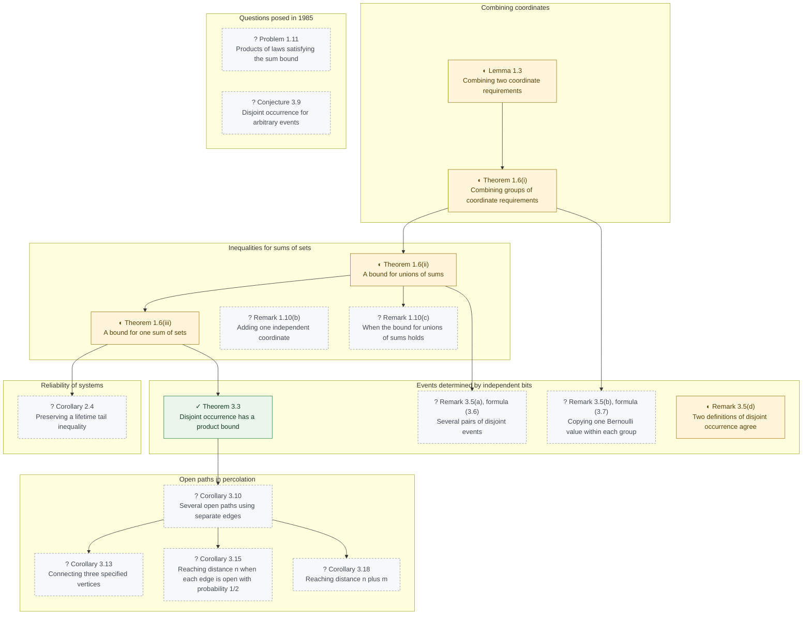

# Inequalities with applications to percolation and reliability

**J. van den Berg, H. Kesten**

[Interactive dependency graph](https://cjanjigi.github.io/LPP/?paper=bk-1985) · [Formalization guide](../../guides/bk-1985.md) · [Paper catalogue](../../../README.md)

**✓ Certified** · **◐ Restricted** · **○ Not in this release** · **? Not assessed**

A status applies to the scope stated below. Arrows point from a result to a result whose proof uses it.

## Progress

| Paper result | Formalization |
| --- | --- |
| **[Lemma 1.3](#lemma-13)** Combining two coordinate requirements | **◐ Restricted** [Integer coordinates only](#lemma-13) [Lean certificate](https://github.com/cjanjigi/LPP/blob/5a3c7a612144b68468559ea1800bf7f39a5d3ef1/ProbabilityBasics/Foundations/BK/Lemma13.lean#L194) · [Discrete tail condition and its equivalence](https://github.com/cjanjigi/LPP/blob/5a3c7a612144b68468559ea1800bf7f39a5d3ef1/ProbabilityBasics/Foundations/BK/NBU.lean#L71) |
| **[Theorem 1.6(i)](#theorem-16i)** Combining groups of coordinate requirements | **◐ Restricted** [Integer coordinates only](#theorem-16i) [Lean certificate](https://github.com/cjanjigi/LPP/blob/5a3c7a612144b68468559ea1800bf7f39a5d3ef1/ProbabilityBasics/Foundations/BK/Theorem16.lean#L135) |
| **[Theorem 1.6(ii)](#theorem-16ii)** A bound for unions of sums | **◐ Restricted** [Integer coordinates only](#theorem-16ii) [Lean certificate](https://github.com/cjanjigi/LPP/blob/5a3c7a612144b68468559ea1800bf7f39a5d3ef1/ProbabilityBasics/Foundations/BK/Theorem16.lean#L220) |
| **[Theorem 1.6(iii)](#theorem-16iii)** A bound for one sum of sets | **◐ Restricted** [Integer coordinates only](#theorem-16iii) [Lean certificate](https://github.com/cjanjigi/LPP/blob/5a3c7a612144b68468559ea1800bf7f39a5d3ef1/ProbabilityBasics/Foundations/BK/Theorem16.lean#L232) |
| **[Remark 1.10(b)](#remark-110b)** Adding one independent coordinate | **? Not assessed** [Coverage note](#remark-110b) |
| **[Remark 1.10(c)](#remark-110c)** When the bound for unions of sums holds | **? Not assessed** [Coverage note](#remark-110c) |
| **[Corollary 2.4](#corollary-24)** Preserving a lifetime tail inequality | **? Not assessed** [Coverage note](#corollary-24) |
| **[Theorem 3.3](#theorem-33)** Disjoint occurrence has a product bound | **✓ Certified** [Coverage note](#theorem-33) [Lean certificate](https://github.com/cjanjigi/LPP/blob/5a3c7a612144b68468559ea1800bf7f39a5d3ef1/ProbabilityBasics/Statements/BK.lean#L326) |
| **[Remark 3.5(a), formula (3.6)](#remark-35a-formula-36)** Several pairs of disjoint events | **? Not assessed** [Coverage note](#remark-35a-formula-36) |
| **[Remark 3.5(b), formula (3.7)](#remark-35b-formula-37)** Copying one Bernoulli value within each group | **? Not assessed** [Coverage note](#remark-35b-formula-37) |
| **[Remark 3.5(d)](#remark-35d)** Two definitions of disjoint occurrence agree | **◐ Restricted** [Only the two-increasing-event identity](#remark-35d) [Box occurrence is contained in the paper operation](https://github.com/cjanjigi/LPP/blob/5a3c7a612144b68468559ea1800bf7f39a5d3ef1/ProbabilityBasics/Foundations/BK/Witness.lean#L205) · [Reverse inclusion for increasing events](https://github.com/cjanjigi/LPP/blob/5a3c7a612144b68468559ea1800bf7f39a5d3ef1/ProbabilityBasics/Foundations/BK/Witness.lean#L229) |
| **[Corollary 3.10](#corollary-310)** Several open paths using separate edges | **? Not assessed** [Coverage note](#corollary-310) [Finite-coordinate family inequality](https://github.com/cjanjigi/LPP/blob/5a3c7a612144b68468559ea1800bf7f39a5d3ef1/ProbabilityBasics/Statements/BK.lean#L163) · [Countable-coordinate family inequality](https://github.com/cjanjigi/LPP/blob/5a3c7a612144b68468559ea1800bf7f39a5d3ef1/ProbabilityBasics/Statements/BK.lean#L279) |
| **[Corollary 3.13](#corollary-313)** Connecting three specified vertices | **? Not assessed** [Coverage note](#corollary-313) |
| **[Corollary 3.15](#corollary-315)** Reaching distance n when each edge is open with probability 1/2 | **? Not assessed** [Coverage note](#corollary-315) |
| **[Corollary 3.18](#corollary-318)** Reaching distance n plus m | **? Not assessed** [Coverage note](#corollary-318) |
| **[Problem 1.11](#problem-111)** Products of laws satisfying the sum bound | **? Not assessed** [Coverage note](#problem-111) |
| **[Conjecture 3.9](#conjecture-39)** Disjoint occurrence for arbitrary events | **? Not assessed** [Coverage note](#conjecture-39) |

## Coverage notes

These short descriptions locate the results and explain certificate coverage. Consult the paper for the full statements and proofs; the formalization guide states the main certified theorems.

### Lemma 1.3

**Combining two coordinate requirements**

For independent coordinates satisfying the tail condition below, combining the requirements on two equally distributed coordinates into one cannot increase the probability of an increasing event. This is the basic comparison used to combine larger groups in Theorem 1.6(i).

For a coordinate $`T`$ taking values in $`\mathbb N_0=\{0,1,2,\ldots\}`$, the discrete tail condition is $`\mathbb P(T\ge s+t)\le\mathbb P(T\ge s)\mathbb P(T\ge t)`$ for every $`s,t\in\mathbb N_0`$. This is equivalent to the paper's increasing-set condition on the integer coordinate space.

An event is increasing if raising coordinates preserves membership. Combining two coordinate requirements replaces their separate values by their sum in one coordinate and leaves the other coordinate unrestricted.

**◐ Restricted**

**Integer coordinates only**

**Paper scope**

The identification comparison is stated for finitely many independent coordinates, either all in $`\mathbb N_0`$ or all in $`[0,\infty)`$. Each law satisfies the paper's tail condition; the two coordinates being combined have the same law.

**Certified scope**

The comparison is proved for every finite product of $`\mathbb N_0`$, with the same independence, tail and equal-law assumptions. No bound on the number of coordinates or on their possible integer values is added.

**Remaining gap**

The linked certificate does not cover noninteger coordinate values, so it does not certify the paper's $`[0,\infty)`$ version.

**Why this scope**

The proof uses the least possible integer sum in each nonempty two-coordinate section. All subsets of a finite product of $`\mathbb N_0`$ are measurable. For real coordinates, the transformed sets require an additional measurability argument. The linked proof establishes the discrete comparison.

**Effect on main results**

Integer coordinates suffice for the fully certified Bernoulli-cube Theorem 3.3, because a zero-one law, viewed as a law on $`\mathbb N_0`$, satisfies the discrete tail condition. The separate real-coordinate disjoint-occurrence extensions are unaffected.

[Lean certificate](https://github.com/cjanjigi/LPP/blob/5a3c7a612144b68468559ea1800bf7f39a5d3ef1/ProbabilityBasics/Foundations/BK/Lemma13.lean#L194) · [Discrete tail condition and its equivalence](https://github.com/cjanjigi/LPP/blob/5a3c7a612144b68468559ea1800bf7f39a5d3ef1/ProbabilityBasics/Foundations/BK/NBU.lean#L71)

*Source location* p. 557.

### Theorem 1.6(i)

**Combining groups of coordinate requirements**

The two-coordinate comparison extends to groups of coordinates. Within each group, all coordinates have the same distribution. Replacing their requirements by a sum in one representative coordinate cannot increase the probability of an increasing event, under the paper's tail condition.

For a coordinate $`T`$ taking values in $`\mathbb N_0=\{0,1,2,\ldots\}`$, the discrete tail condition is $`\mathbb P(T\ge s+t)\le\mathbb P(T\ge s)\mathbb P(T\ge t)`$ for every $`s,t\in\mathbb N_0`$. This is equivalent to the paper's increasing-set condition on the integer coordinate space.

Increasing means preserved when any coordinate is raised. Combining a group replaces its separate requirements by their sum in one chosen representative coordinate; the other coordinates in that group are unrestricted.

**◐ Restricted**

**Integer coordinates only**

**Paper scope**

The grouping comparison is stated for finite products of either $`\mathbb N_0`$ or $`[0,\infty)`$. Coordinate laws satisfy the paper's tail condition and are equal within each group.

**Certified scope**

Every finite partition, every choice of a representative in each group, and every increasing event are covered for coordinates in $`\mathbb N_0`$, under the same law assumptions.

**Remaining gap**

The linked certificate does not cover the corresponding grouping comparison with noninteger coordinates.

**Why this scope**

The proof combines one pair at a time using the integer-coordinate Lemma 1.3. The finite grouping argument is fully proved; its coordinate domain remains $`\mathbb N_0`$ because that is the domain of its comparison input.

**Effect on main results**

The complete grouping statement needed by the Bernoulli proof is certified. No part of Theorem 3.3 is lost; the uncovered case is the paper's separate real-coordinate grouping theorem.

[Lean certificate](https://github.com/cjanjigi/LPP/blob/5a3c7a612144b68468559ea1800bf7f39a5d3ef1/ProbabilityBasics/Foundations/BK/Theorem16.lean#L135)

*Source location* p. 558.

### Theorem 1.6(ii)

**A bound for unions of sums**

For several pairs of increasing sets, the probability of belonging to at least one of their sums is bounded by a corresponding probability for two independent vectors. This strengthens the single-pair product bound and supplies a comparison used later for percolation events.

For a coordinate $`T`$ taking values in $`\mathbb N_0=\{0,1,2,\ldots\}`$, the discrete tail condition is $`\mathbb P(T\ge s+t)\le\mathbb P(T\ge s)\mathbb P(T\ge t)`$ for every $`s,t\in\mathbb N_0`$. This is equivalent to the paper's increasing-set condition on the integer coordinate space.

The sum of two sets is $`A+B=\{a+b:a\in A,\ b\in B\}`$, with coordinatewise vector addition. A set is increasing if raising coordinates preserves membership.

**◐ Restricted**

**Integer coordinates only**

**Paper scope**

The finite union-of-sums comparison allows finitely many independent coordinates in either $`\mathbb N_0`$ or $`[0,\infty)`$, with the paper's tail condition, and any finite family of pairs of increasing Borel sets.

**Certified scope**

All finite coordinate sets and all finite families of pairs of increasing sets are covered in $`\mathbb N_0`$. The product-law and tail assumptions agree with the paper's discrete case.

**Remaining gap**

The version with noninteger coordinate values is outside the linked certificate. There is no additional restriction on the size of the finite event family.

**Why this scope**

The formal proof puts two copies of the integer vector together and applies part (i) to combine the corresponding coordinates. Both copies still take values in $`\mathbb N_0`$, so this argument inherits part (i)'s coordinate restriction.

**Effect on main results**

The full discrete comparison is available for the later Bernoulli arguments. The real-coordinate sum comparison is not supplied by the separate real-coordinate BK extensions, which concern disjoint occurrence rather than sums of sets.

[Lean certificate](https://github.com/cjanjigi/LPP/blob/5a3c7a612144b68468559ea1800bf7f39a5d3ef1/ProbabilityBasics/Foundations/BK/Theorem16.lean#L220)

*Source location* p. 558.

### Theorem 1.6(iii)

**A bound for one sum of sets**

For independent coordinates satisfying the paper's tail condition, the probability of a sum of two increasing sets is at most the product of their probabilities. This is the single-pair consequence of Theorem 1.6(ii), and the starting point for the reliability applications.

For a coordinate $`T`$ taking values in $`\mathbb N_0=\{0,1,2,\ldots\}`$, the discrete tail condition is $`\mathbb P(T\ge s+t)\le\mathbb P(T\ge s)\mathbb P(T\ge t)`$ for every $`s,t\in\mathbb N_0`$. This is equivalent to the paper's increasing-set condition on the integer coordinate space.

The sum is $`A+B=\{a+b:a\in A,\ b\in B\}`$, with coordinatewise addition. Increasing means preserved when coordinates are raised.

**◐ Restricted**

**Integer coordinates only**

**Paper scope**

The product bound for the sum of two increasing Borel sets is stated for finite products of independent coordinates in either $`\mathbb N_0`$ or $`[0,\infty)`$, with the paper's tail condition on every coordinate law.

**Certified scope**

The product bound is proved for every finite product of $`\mathbb N_0`$ under exactly the discrete tail condition and increasing-event assumptions.

**Remaining gap**

The linked certificate does not cover sums of sets in finite products of $`[0,\infty)`$. In particular, it does not by itself certify the paper's real-valued lifetime applications in Corollary 2.4.

**Why this scope**

The proof takes a one-pair family in part (ii). It therefore inherits part (ii)'s integer coordinate domain. The later real-coordinate disjoint-occurrence inequality has a different operation on events and does not supply this real-valued sum comparison.

**Effect on main results**

This is the complete version needed for Theorem 3.3. The proof places the Bernoulli cube inside the integer lattice and applies this bound. The certified Bernoulli inequality, and its separate ordered-product extensions, retain their full stated scope.

[Lean certificate](https://github.com/cjanjigi/LPP/blob/5a3c7a612144b68468559ea1800bf7f39a5d3ef1/ProbabilityBasics/Foundations/BK/Theorem16.lean#L232)

*Source location* p. 558.

### Remark 1.10(b)

**Adding one independent coordinate**

The paper observes that adjoining one independent coordinate preserves the product bound for sums of increasing sets, provided the new coordinate satisfies the stated tail condition. The existing coordinates may depend on one another, so this goes beyond the product-law case of Theorem 1.6.

A set is increasing if raising any coordinate preserves membership. The product bound says that the probability of the sum of two such sets is at most the product of their probabilities; sets are added coordinatewise.

The tail condition for the new nonnegative coordinate $`T`$ is $`\mathbb P(T\ge s+t)\le\mathbb P(T\ge s)\mathbb P(T\ge t)`$ for nonnegative $`s,t`$ in its coordinate space.

**? Not assessed**

The assertion for a general joint law has not been matched to a released certificate. A proof assuming independent coordinates does not by itself cover this claim.

*Source location* p. 559.

### Remark 1.10(c)

**When the bound for unions of sums holds**

The stronger bound for unions of sums characterizes the coordinate laws. The paper states that it holds precisely when the coordinates are independent and each coordinate satisfies its tail condition. This includes a converse, rather than only the sufficient condition proved in Theorem 1.6(ii).

Sets are added coordinatewise. The union-of-sums bound compares membership in at least one such sum with membership of two independent vectors in the corresponding pair of sets.

The sets are increasing, meaning that raising coordinates preserves membership. The coordinate tail condition is $`\mathbb P(T\ge s+t)\le\mathbb P(T\ge s)\mathbb P(T\ge t)`$ for nonnegative $`s,t`$ in the coordinate space.

**? Not assessed**

The released integer-coordinate theorem proves the sufficient direction. A certificate for the complete characterization in both directions has not yet been matched.

*Source location* p. 559.

### Corollary 2.4

**Preserving a lifetime tail inequality**

The sum bound gives a way to verify a tail inequality for a system lifetime built from independent component lifetimes. The construction must preserve coordinatewise order and satisfy the paper's additional condition relating the sets where the lifetime exceeds different thresholds.

A lifetime construction preserves coordinatewise order if increasing any component lifetime cannot reduce the system lifetime.

The tail inequality for a nonnegative lifetime $`T`$ is $`\mathbb P(T>a+b)\le\mathbb P(T>a)\mathbb P(T>b)`$ for nonnegative $`a,b`$.

**? Not assessed**

This complete corollary, including the condition on the lifetime construction, has not yet been matched to a released certificate. The integer-coordinate sum inequality alone does not certify this real-coordinate application.

*Source location* p. 560.

### Theorem 3.3

**Disjoint occurrence has a product bound**

For two increasing events determined by finitely many independent zero-one coordinates, disjoint occurrence has probability at most the product of the two event probabilities. The individual probabilities of a coordinate being one may differ from coordinate to coordinate.

An event is increasing if changing coordinates from zero to one preserves membership.

Disjoint occurrence means that two disjoint sets of coordinates separately guarantee the two events, regardless of the values of all other coordinates.

**✓ Certified**

The released certificate proves the full statement for arbitrary independent Bernoulli parameters $`p_i\in[0,1]`$.

[Lean certificate](https://github.com/cjanjigi/LPP/blob/5a3c7a612144b68468559ea1800bf7f39a5d3ef1/ProbabilityBasics/Statements/BK.lean#L326)

*Source location* p. 562.

### Remark 3.5(a), formula (3.6)

**Several pairs of disjoint events**

The paper extends the two-event comparison to a finite list of pairs. It bounds the probability that some pair occurs disjointly by a corresponding event for two independent configurations. This retains which events were paired, rather than replacing the bound by separate individual probabilities.

The configurations have finitely many independent zero-one coordinates. All events are increasing, so changing zeros to ones preserves membership.

A pair occurs disjointly if disjoint sets of coordinates separately guarantee its two events.

**? Not assessed**

A released certificate for this exact finite-union inequality on the Bernoulli cube has not yet been matched. The related integer-coordinate union-of-sums theorem is present.

*Source location* p. 563.

### Remark 3.5(b), formula (3.7)

**Copying one Bernoulli value within each group**

For the special event families described in this remark, copying a single zero-one value within each coordinate group cannot increase the event probability compared with independent coordinates. Each allowed event requirement uses at most one coordinate from any one group.

Every coordinate has the same probability of being one. In the copied model, one independent zero-one value is drawn per group and assigned to every coordinate in that group.

An event requirement specifies coordinates that must all equal one; the event occurs if at least one of its allowed requirements is satisfied.

**? Not assessed**

A released certificate for this exact comparison of the two Bernoulli laws has not yet been matched. The integer-coordinate theorem used to derive it is present.

*Source location* p. 563.

### Remark 3.5(d)

**Two definitions of disjoint occurrence agree**

The remark compares definitions of disjoint occurrence. For two increasing events, coordinate witnesses agree with the paper's splitting of the open coordinates. For one increasing and one decreasing event, the coordinate-witness operation instead equals the intersection of the events.

For zero-one coordinates, increasing means preserved when zeros change to ones, and decreasing means preserved when ones change to zeros. The operation $`A\mathbin{\square}B`$ requires disjoint coordinate sets that separately guarantee $`A`$ and $`B`$; $`A\cap B`$ is ordinary intersection.

**◐ Restricted**

**Only the two-increasing-event identity**

**Paper scope**

The remark identifies coordinate-witness disjoint occurrence with the paper's operation when both events are increasing. It also identifies coordinate-witness disjoint occurrence with ordinary intersection when the first event is increasing and the second is decreasing.

**Certified scope**

Both inclusions for the two-increasing-event identity are certified on every finite zero-one coordinate space.

**Remaining gap**

The linked certificates cover only the first assertion. The separate identity $`A\mathbin{\square}B=A\cap B`$ for increasing $`A`$ and decreasing $`B`$ has not been matched to a certificate and is not included in this coverage claim.

**Why this scope**

The linked reverse-inclusion theorem assumes that both events are increasing and uses that monotonicity for both events. Its hypotheses do not permit direct substitution of a decreasing second event. A separate comparison with an existing proof or a new formal derivation would be needed to certify the mixed case.

**Effect on main results**

The mixed increasing–decreasing identity is not used by the fully certified Theorem 3.3 for two increasing events. The two-increasing-event equivalence required by that theorem is covered.

[Box occurrence is contained in the paper operation](https://github.com/cjanjigi/LPP/blob/5a3c7a612144b68468559ea1800bf7f39a5d3ef1/ProbabilityBasics/Foundations/BK/Witness.lean#L205) · [Reverse inclusion for increasing events](https://github.com/cjanjigi/LPP/blob/5a3c7a612144b68468559ea1800bf7f39a5d3ef1/ProbabilityBasics/Foundations/BK/Witness.lean#L229)

*Source location* p. 564.

### Corollary 3.10

**Several open paths using separate edges**

The probability of finding several open paths that use separate edges is bounded by the product of the individual path-existence probabilities. The paper treats both finite and countable graphs, and also the version in which open vertices replace open edges.

An edge or vertex is open with its specified probability, independently of all others. A path is open when all its edges, or all its vertices in the vertex version, are open.

Separate paths share no edges in the edge version and no vertices in the vertex version. A prescribed family of possible paths is allowed for each path-existence event.

**? Not assessed**

The finite-family disjoint-occurrence inequality is certified for finite and countable independent-coordinate spaces. This review has not checked the remaining correspondence from open-path events to the full edge- and vertex-percolation corollary. The full corollary is therefore not assessed; its probability-inequality ingredient is certified.

[Finite-coordinate family inequality](https://github.com/cjanjigi/LPP/blob/5a3c7a612144b68468559ea1800bf7f39a5d3ef1/ProbabilityBasics/Statements/BK.lean#L163) · [Countable-coordinate family inequality](https://github.com/cjanjigi/LPP/blob/5a3c7a612144b68468559ea1800bf7f39a5d3ef1/ProbabilityBasics/Statements/BK.lean#L279)

*Source location* p. 564.

### Corollary 3.13

**Connecting three specified vertices**

A connection among three fixed vertices can be bounded by summing over possible branching vertices. For each possible branch, the bound multiplies the three probabilities of connection to it. This converts a three-vertex connection problem into pairwise connection probabilities.

Two vertices are connected when an open path joins them. Each edge is open independently with its specified probability. The branching vertex is summed over all vertices of the graph.

**? Not assessed**

A released certificate for this three-vertex graph inequality has not yet been identified.

*Source location* p. 565.

### Corollary 3.15

**Reaching distance n when each edge is open with probability 1/2**

On the square lattice, when each edge is independently open with probability one half, the paper gives a lower bound on the probability that the origin is connected to distance n. The event measures distance reached, rather than the number of vertices connected to the origin.

The square lattice has vertex set $`\mathbb Z^2`$, with edges joining points whose coordinate differences have absolute values summing to one. The distance of $`x=(x_1,x_2)`$ from the origin is $`|x_1|+|x_2|`$.

Here n is a positive integer, and connection to distance n means an open path from the origin to a vertex at that distance.

**? Not assessed**

A released certificate for this square-lattice probability bound has not yet been identified.

*Source location* p. 566.

### Corollary 3.18

**Reaching distance n plus m**

The probability of reaching a larger graph distance is bounded using the expected number of possible exits at an intermediate distance and a remaining-distance connection probability. The paper also explains the adjusted definitions needed when vertices, rather than edges, are independently open.

Graph distance is the smallest number of edges in a path between two vertices. For a positive integer r, an exit at distance r is a vertex at that distance reached by an open path whose earlier vertices are closer than r.

**? Not assessed**

The distance bound and its site-percolation version have not yet been matched to released certificates.

*Source location* p. 567.

### Problem 1.11

**Products of laws satisfying the sum bound**

This historical question asks whether the product bound for sums of increasing sets is preserved when two independent random vectors are combined. Each vector already satisfies the bound, but its own coordinates are allowed to depend on one another.

A set is increasing if raising any coordinate preserves membership. The sum of two sets consists of their coordinatewise vector sums. The product bound says that the probability of such a sum is at most the product of the two set probabilities.

**? Not assessed**

No certificate correspondence is assessed for this historical question.

*Source location* p. 559.

### Conjecture 3.9

**Disjoint occurrence for arbitrary events**

The paper proposes the disjoint-occurrence product bound for arbitrary events on independent zero-one coordinates. It removes the increasing-event assumption from Theorem 3.3. This node records the conjecture as stated in the paper; it does not assess its subsequent history.

Disjoint occurrence means that disjoint sets of coordinates separately guarantee the two events, regardless of all remaining coordinates. The product bound compares its probability with the product of the two event probabilities.

An event is increasing if changing zeros to ones preserves membership.

**? Not assessed**

No certificate correspondence is assessed for this historical conjecture. The certified increasing-event theorem does not assert this arbitrary-event statement.

*Source location* p. 564.

Source locations for dependency arrows

| Use | Source location |
| --- | --- |
| Lemma 1.3 → Theorem 1.6(i) | p. 558 · Proof of Theorem 1.6(i) |
| Theorem 1.6(i) → Theorem 1.6(ii) | p. 558 · Proof of Theorem 1.6(ii) |
| Theorem 1.6(ii) → Theorem 1.6(iii) | p. 559 · Proof of Theorem 1.6(iii) |
| Theorem 1.6(iii) → Corollary 2.4 | p. 561 · Proof of Corollary 2.4 |
| Theorem 1.6(iii) → Theorem 3.3 | p. 562 · Proof of Theorem 3.3 |
| Theorem 3.3 → Corollary 3.10 | p. 565 · Proof of Corollary 3.10 |
| Corollary 3.10 → Corollary 3.13 | p. 565 · Proof of Corollary 3.13 |
| Corollary 3.10 → Corollary 3.15 | p. 566 · Proof of Corollary 3.15 |
| Corollary 3.10 → Corollary 3.18 | p. 567 · Proof of Corollary 3.18 |
| Theorem 1.6(ii) → Remark 1.10(c) | p. 559 · Proof of Remark 1.10(c) |
| Theorem 1.6(ii) → Remark 3.5(a), formula (3.6) | p. 563 · Proof of Remark 3.5(a), formula (3.6) |
| Theorem 1.6(i) → Remark 3.5(b), formula (3.7) | p. 563 · Proof of Remark 3.5(b), formula (3.7) |

