# Differentiability of the shape function in the planar corner growth model

**Christopher Janjigian, Firas Rassoul-Agha, Timo Seppäläinen**

[Formalization guide](../../guides/differentiability.md) · [Paper catalogue](../../../README.md)

**✓ Certified** · **◐ Restricted** · **○ Not in this release** · **? Not assessed**

A status applies to the scope stated below. Arrows point from a result to a result whose proof uses it.

```mermaid
flowchart TD
  subgraph S0["Where the shape reaches the top weight"]
    R1["◐ Theorem 2.2<br/>Where the shape equals the largest weight"]
  end
  subgraph S1["Paths between specified endpoints"]
    R2["✓ Lemma 2.3<br/>Two linear bounds for the shape"]
    R3["✓ Lemma 3.1<br/>High-weight paths near a prescribed segment"]
    R4["✓ Lemma 3.2<br/>High-weight paths for all endpoint pairs"]
    R5["✓ Proposition 3.4<br/>Paths rarely exceed either linear bound"]
    R17["✓ Lemma A.1<br/>An infinite up-right path through likely events"]
    R18["◐ Lemma B.1<br/>A lower bound for selected path weights"]
    R19["✓ Lemma B.2<br/>Paths joining every pair of endpoints"]
    R20["◐ Lemma B.3<br/>Short paths reaching prescribed points"]
    R26["? Remark 3.3<br/>Choosing short paths after observing low weights"]
    R27["? Remark 3.5<br/>The same bound for strips with any center"]
    R40["? Remark B.4<br/>Why this proof needs a moment above one"]
  end
  subgraph S2["Increasing weights in a finite region"]
    R6["✓ Lemma 4.1<br/>Raising finitely many weights at small probability cost"]
    R7["✓ Lemma 4.2<br/>Crossings of length ⌈s³⌉ become unlikely"]
  end
  subgraph S3["Choosing path lengths"]
    R8["✓ Proposition 4.3<br/>The length where crossing probability becomes small"]
    R9["✓ Lemma 4.4<br/>Infinitely many scales with comparable earlier lengths"]
  end
  subgraph S4["Paths with unrestricted endpoints"]
    R10["✓ Lemma 5.7<br/>Paths between prescribed grid points"]
    R11["✓ Proposition 5.9<br/>An upper weight bound for every path in a rectangle"]
    R21["✓ Lemma B.5<br/>Paths can go around the very negative vertices"]
    R22["✓ Lemma B.6<br/>A lower weight bound for many chosen paths"]
    R23["✓ Lemma B.7<br/>Large positive weights do not spoil the connections"]
    R28["? Remark 5.1<br/>Which connections require changes for unbounded weights"]
    R29["? Remark 5.2<br/>The connecting paths are shorter than the proof needs"]
    R30["✓ Remark 5.3<br/>Choose the connecting paths after locating negative weights"]
    R31["✓ Remark 5.4<br/>The weight error on a short connecting interval"]
    R32["✓ Remark 5.5<br/>Independent crossings with no very large weight"]
    R33["✓ Remark 5.6<br/>The weight error when a crossing needs two connections"]
    R34["✓ Remark 5.8<br/>The grid statement with random endpoints"]
    R35["✓ Remark 5.10<br/>Removing a few endpoint vertices preserves the path bound"]
  end
  subgraph S5["Counting disjoint path events"]
    R12["✓ Lemma 6.1<br/>Probability bound for disjoint path events"]
    R15["✓ Proposition 6.7<br/>Long paths contain few rare subpaths"]
  end
  subgraph S6["Path weights and supporting lines"]
    R13["✓ Lemma 6.3<br/>Paths containing no rare subpath"]
    R14["✓ Lemma 6.5<br/>Weight bound from a count of rare subpaths"]
    R16["✓ Lemma 6.8<br/>Path-weight bounds when the shape has a corner"]
    R24["✓ Lemma B.8<br/>The path bounds with unbounded weights"]
    R25["✓ Lemma B.9<br/>Bounding the contribution of large positive weights"]
    R36["? Remark 6.2<br/>Choosing a scale for unbounded weights"]
    R37["✓ Remark 6.4<br/>The cost of moving across a corner"]
    R38["✓ Remark 6.6<br/>Subtracting the weight above a threshold"]
    R39["✓ Remark 6.9<br/>The large-weight correction stays small"]
    R41["? Remark B.10<br/>Why this proof requires a positive moment above four"]
  end
  subgraph S7["Differentiability"]
    R0["✓ Theorem 2.1<br/>The shape is differentiable"]
  end
  subgraph S8["A counterexample for small moments"]
    R42["✓ Appendix C.1<br/>A law with no finite uniform shape limit"]
  end
  R3 -->|bounded case| R4
  R18 --> R20
  R20 --> R19
  R3 --> R19
  R2 --> R5
  R4 --> R5
  R17 --> R5
  R6 --> R7
  R5 --> R7
  R3 --> R8
  R7 --> R8
  R8 --> R9
  R8 --> R10
  R9 --> R10
  R17 --> R21
  R18 --> R22
  R8 --> R23
  R9 --> R23
  R21 -->|general weights| R10
  R22 -->|general weights| R10
  R23 -->|general weights| R10
  R10 --> R11
  R5 --> R11
  R21 -->|general weights| R11
  R23 -->|general weights| R11
  R12 --> R15
  R11 --> R15
  R8 --> R15
  R13 --> R16
  R14 --> R16
  R13 --> R24
  R8 --> R25
  R1 --> R0
  R15 -->|bounded case| R0
  R16 -->|bounded case| R0
  R24 -->|general weights| R0
  R25 -->|general weights| R0
  R9 --> R15
  R5 --> R27
  R27 --> R11
  R22 --> R30
  R30 --> R31
  R23 --> R32
  R32 --> R33
  R21 --> R33
  R22 --> R33
  R31 --> R34
  R33 --> R34
  R21 --> R34
  R23 --> R34
  R34 --> R35
  R21 --> R35
  R23 --> R35
  R13 --> R37
  R37 --> R16
  R24 --> R38
  R24 --> R39
  R25 --> R39
  classDef certified fill:#eaf6ec,stroke:#2d8544,color:#163b20
  classDef restricted fill:#fff5db,stroke:#a77815,color:#594005
  classDef not_assessed fill:#f6f8fa,stroke:#8c959f,stroke-dasharray:4 3,color:#424a53
  classDef not_in_release fill:#fff,stroke:#8c959f,color:#59636e
  class R0 certified
  class R1 restricted
  class R2 certified
  class R3 certified
  class R4 certified
  class R5 certified
  class R6 certified
  class R7 certified
  class R8 certified
  class R9 certified
  class R10 certified
  class R11 certified
  class R12 certified
  class R13 certified
  class R14 certified
  class R15 certified
  class R16 certified
  class R17 certified
  class R18 restricted
  class R19 certified
  class R20 restricted
  class R21 certified
  class R22 certified
  class R23 certified
  class R24 certified
  class R25 certified
  class R26 not_assessed
  class R27 not_assessed
  class R28 not_assessed
  class R29 not_assessed
  class R30 certified
  class R31 certified
  class R32 certified
  class R33 certified
  class R34 certified
  class R35 certified
  class R36 not_assessed
  class R37 certified
  class R38 certified
  class R39 certified
  class R40 not_assessed
  class R41 not_assessed
  class R42 certified
```

Section 6 first proves the bounded-weight case. The full theorem under the stated moment assumptions uses Appendix B.

Lemma B.2 supplies the general-weight proof of Lemma 3.2. Remark 5.8 changes the endpoints and intervals in the general-weight version of Lemma 5.7.

## Progress

| Paper result | Formalization |
| --- | --- |
| **[Theorem 2.2](#theorem-22)** Where the shape equals the largest weight | **◐ Restricted** [Selected flat-segment conclusions](#theorem-22) [Flat-segment theorem](https://github.com/cjanjigi/LPP/blob/5a3c7a612144b68468559ea1800bf7f39a5d3ef1/Differentiability/Probability/FlatTopRouteH.lean#L64) · [Differentiability at every flat direction](https://github.com/cjanjigi/LPP/blob/5a3c7a612144b68468559ea1800bf7f39a5d3ef1/Differentiability/Probability/FlatTopDifferentiability.lean#L60) |
| **[Lemma 2.3](#lemma-23)** Two linear bounds for the shape | **✓ Certified** [Coverage note](#lemma-23) [Supporting functionals and contact](https://github.com/cjanjigi/LPP/blob/5a3c7a612144b68468559ea1800bf7f39a5d3ef1/LPP_Foundations/Analysis/ShapeSupportingFunctionals.lean#L119) |
| **[Lemma 3.1](#lemma-31)** High-weight paths near a prescribed segment | **✓ Certified** [Coverage note](#lemma-31) [Travel estimate](https://github.com/cjanjigi/LPP/blob/5a3c7a612144b68468559ea1800bf7f39a5d3ef1/Differentiability/Probability/Travel.lean#L29) |
| **[Lemma 3.2](#lemma-32)** High-weight paths for all endpoint pairs | **✓ Certified** [Coverage note](#lemma-32) [General-weight interval connections](https://github.com/cjanjigi/LPP/blob/5a3c7a612144b68468559ea1800bf7f39a5d3ef1/Differentiability/Probability/GeneralIntervals.lean#L51) |
| **[Proposition 3.4](#proposition-34)** Paths rarely exceed either linear bound | **✓ Certified** [Coverage note](#proposition-34) [Uniform rare-fast-crossing bound](https://github.com/cjanjigi/LPP/blob/5a3c7a612144b68468559ea1800bf7f39a5d3ef1/Differentiability/Probability/RareFastCrossings.lean#L40) |
| **[Lemma A.1](#lemma-a1)** An infinite up-right path through likely events | **✓ Certified** [Coverage note](#lemma-a1) [High-density oriented-path theorem](https://github.com/cjanjigi/LPP/blob/5a3c7a612144b68468559ea1800bf7f39a5d3ef1/Differentiability/Probability/HighDensityOrientedPaths.lean#L68) |
| **[Lemma B.1](#lemma-b1)** A lower bound for selected path weights | **◐ Restricted** [Paths confined to a fixed finite region](#lemma-b1) [Bound for paths chosen from low-weight sites](https://github.com/cjanjigi/LPP/blob/5a3c7a612144b68468559ea1800bf7f39a5d3ef1/Differentiability/Probability/GlobalMaskFamilyWeights.lean#L245) · [Conditional single-path bound](https://github.com/cjanjigi/LPP/blob/5a3c7a612144b68468559ea1800bf7f39a5d3ef1/Differentiability/Probability/ConditionalFinitePathWeights.lean#L67) |
| **[Lemma B.2](#lemma-b2)** Paths joining every pair of endpoints | **✓ Certified** [Coverage note](#lemma-b2) [General-weight interval connections](https://github.com/cjanjigi/LPP/blob/5a3c7a612144b68468559ea1800bf7f39a5d3ef1/Differentiability/Probability/GeneralIntervals.lean#L51) |
| **[Lemma B.3](#lemma-b3)** Short paths reaching prescribed points | **◐ Restricted** [One constructed target set](#lemma-b3) [Forward paths to the constructed target set](https://github.com/cjanjigi/LPP/blob/5a3c7a612144b68468559ea1800bf7f39a5d3ef1/Differentiability/Probability/ForwardHeavyAttachmentAsymptotics.lean#L27) · [Backward paths to the constructed target set](https://github.com/cjanjigi/LPP/blob/5a3c7a612144b68468559ea1800bf7f39a5d3ef1/Differentiability/Probability/BackwardHeavyAttachmentAsymptotics.lean#L20) |
| **[Remark 3.3](#remark-33)** Choosing short paths after observing low weights | **? Not assessed** [Coverage note](#remark-33) |
| **[Remark 3.5](#remark-35)** The same bound for strips with any center | **? Not assessed** [Coverage note](#remark-35) [Translation of strip crossings](https://github.com/cjanjigi/LPP/blob/5a3c7a612144b68468559ea1800bf7f39a5d3ef1/Differentiability/Probability/RarefastTranslation.lean#L96) · [Endpoint argument using translated strip bounds](https://github.com/cjanjigi/LPP/blob/5a3c7a612144b68468559ea1800bf7f39a5d3ef1/Differentiability/Probability/ArbitraryEndpointsGeneral.lean#L77) |
| **[Remark B.4](#remark-b4)** Why this proof needs a moment above one | **? Not assessed** [Coverage note](#remark-b4) |
| **[Lemma 4.1](#lemma-41)** Raising finitely many weights at small probability cost | **✓ Certified** [Coverage note](#lemma-41) [Modified-field monotonicity and product law](https://github.com/cjanjigi/LPP/blob/5a3c7a612144b68468559ea1800bf7f39a5d3ef1/Differentiability/Probability/MaximumModifiedFieldLaw.lean#L93) · [Absolute continuity and density bound](https://github.com/cjanjigi/LPP/blob/5a3c7a612144b68468559ea1800bf7f39a5d3ef1/Differentiability/Probability/MaximumKernelRN.lean#L87) · [Good set and conditional independent boosts](https://github.com/cjanjigi/LPP/blob/5a3c7a612144b68468559ea1800bf7f39a5d3ef1/Differentiability/Probability/MaximumKernelGoodSet.lean#L33) · [Strict quantile-gap positivity](https://github.com/cjanjigi/LPP/blob/5a3c7a612144b68468559ea1800bf7f39a5d3ef1/ProbabilityBasics/Probability/MaximumQuantileGap.lean#L120) |
| **[Lemma 4.2](#lemma-42)** Crossings of length ⌈s³⌉ become unlikely | **✓ Certified** [Coverage note](#lemma-42) [Cubic-length crossing rarity](https://github.com/cjanjigi/LPP/blob/5a3c7a612144b68468559ea1800bf7f39a5d3ef1/Differentiability/Probability/TiltLimit.lean#L66) |
| **[Proposition 4.3](#proposition-43)** The length where crossing probability becomes small | **✓ Certified** [Coverage note](#proposition-43) [Short-crossing abundance](https://github.com/cjanjigi/LPP/blob/5a3c7a612144b68468559ea1800bf7f39a5d3ef1/Differentiability/Probability/ShortCrossingAbundance.lean#L336) · [Characteristic lengths and records](https://github.com/cjanjigi/LPP/blob/5a3c7a612144b68468559ea1800bf7f39a5d3ef1/Differentiability/Probability/CharacteristicLengths.lean#L45) |
| **[Lemma 4.4](#lemma-44)** Infinitely many scales with comparable earlier lengths | **✓ Certified** [Coverage note](#lemma-44) [Actual characteristic-length records](https://github.com/cjanjigi/LPP/blob/5a3c7a612144b68468559ea1800bf7f39a5d3ef1/Differentiability/Probability/CharacteristicLengths.lean#L45) · [Deterministic record-scale lemma](https://github.com/cjanjigi/LPP/blob/5a3c7a612144b68468559ea1800bf7f39a5d3ef1/Differentiability/Analysis/RecordScales.lean#L62) |
| **[Lemma 5.7](#lemma-57)** Paths between prescribed grid points | **✓ Certified** [Coverage note](#lemma-57) [Bounded grid connections](https://github.com/cjanjigi/LPP/blob/5a3c7a612144b68468559ea1800bf7f39a5d3ef1/Differentiability/Probability/GridSimultaneous.lean#L138) · [General-weight entrance and exit connections](https://github.com/cjanjigi/LPP/blob/5a3c7a612144b68468559ea1800bf7f39a5d3ef1/Differentiability/Probability/GridSimultaneousGeneral.lean#L50) |
| **[Proposition 5.9](#proposition-59)** An upper weight bound for every path in a rectangle | **✓ Certified** [Coverage note](#proposition-59) [General-weight endpoint estimate](https://github.com/cjanjigi/LPP/blob/5a3c7a612144b68468559ea1800bf7f39a5d3ef1/Differentiability/Probability/ArbitraryEndpointsGeneral.lean#L77) · [Bounded-grid endpoint estimate](https://github.com/cjanjigi/LPP/blob/5a3c7a612144b68468559ea1800bf7f39a5d3ef1/Differentiability/Probability/ArbitraryEndpoints.lean#L151) · [Assembly supplying the grid estimate](https://github.com/cjanjigi/LPP/blob/5a3c7a612144b68468559ea1800bf7f39a5d3ef1/Differentiability/Probability/GeneralOffFlatDifferentiability.lean#L163) |
| **[Lemma B.5](#lemma-b5)** Paths can go around the very negative vertices | **✓ Certified** [Coverage note](#lemma-b5) [Geometry-event probability](https://github.com/cjanjigi/LPP/blob/5a3c7a612144b68468559ea1800bf7f39a5d3ef1/Differentiability/Probability/StairGeometryEvent.lean#L361) · [Trapped component bounds](https://github.com/cjanjigi/LPP/blob/5a3c7a612144b68468559ea1800bf7f39a5d3ef1/Differentiability/Model/StairTrappedComponents.lean#L277) · [Forward greedy path](https://github.com/cjanjigi/LPP/blob/5a3c7a612144b68468559ea1800bf7f39a5d3ef1/Differentiability/Model/Paths/StairGreedyForward.lean#L350) · [Backward greedy path](https://github.com/cjanjigi/LPP/blob/5a3c7a612144b68468559ea1800bf7f39a5d3ef1/Differentiability/Model/Paths/StairGreedyBackward.lean#L69) · [Arrival at the target](https://github.com/cjanjigi/LPP/blob/5a3c7a612144b68468559ea1800bf7f39a5d3ef1/Differentiability/Model/Paths/StairArrival.lean#L148) · [Crossing paths merge](https://github.com/cjanjigi/LPP/blob/5a3c7a612144b68468559ea1800bf7f39a5d3ef1/Differentiability/Model/Paths/TransverseMerge.lean#L107) · [Trimming vertices](https://github.com/cjanjigi/LPP/blob/5a3c7a612144b68468559ea1800bf7f39a5d3ef1/Differentiability/Model/StairTrim.lean#L167) |
| **[Lemma B.6](#lemma-b6)** A lower weight bound for many chosen paths | **✓ Certified** [Coverage note](#lemma-b6) [General-weight staircase path-family theorem](https://github.com/cjanjigi/LPP/blob/5a3c7a612144b68468559ea1800bf7f39a5d3ef1/Differentiability/Probability/StaircaseGeneral.lean#L270) |
| **[Lemma B.7](#lemma-b7)** Large positive weights do not spoil the connections | **✓ Certified** [Coverage note](#lemma-b7) [No heavy vertex in working region](https://github.com/cjanjigi/LPP/blob/5a3c7a612144b68468559ea1800bf7f39a5d3ef1/Differentiability/Probability/HeavyVertexEvents.lean#L65) · [Uniform coarse-block decay](https://github.com/cjanjigi/LPP/blob/5a3c7a612144b68468559ea1800bf7f39a5d3ef1/Differentiability/Probability/HeavyVertexEvents.lean#L255) · [Heavy-trimmed crossing trials](https://github.com/cjanjigi/LPP/blob/5a3c7a612144b68468559ea1800bf7f39a5d3ef1/Differentiability/Probability/HeavyCrossingTrials.lean#L66) |
| **[Remark 5.1](#remark-51)** Which connections require changes for unbounded weights | **? Not assessed** [Coverage note](#remark-51) |
| **[Remark 5.2](#remark-52)** The connecting paths are shorter than the proof needs | **? Not assessed** [Coverage note](#remark-52) [Dyadic length arithmetic](https://github.com/cjanjigi/LPP/blob/5a3c7a612144b68468559ea1800bf7f39a5d3ef1/Differentiability/Analysis/RecordScales.lean#L135) · [Staircase lower-tail bound with the retained length budget](https://github.com/cjanjigi/LPP/blob/5a3c7a612144b68468559ea1800bf7f39a5d3ef1/Differentiability/Probability/GridStaircaseBad.lean#L30) |
| **[Remark 5.3](#remark-53)** Choose the connecting paths after locating negative weights | **✓ Certified** [Coverage note](#remark-53) [General-weight staircase bound](https://github.com/cjanjigi/LPP/blob/5a3c7a612144b68468559ea1800bf7f39a5d3ef1/Differentiability/Probability/StaircaseGeneral.lean#L270) · [Avoiding-path geometry event](https://github.com/cjanjigi/LPP/blob/5a3c7a612144b68468559ea1800bf7f39a5d3ef1/Differentiability/Probability/StairGeometryEvent.lean#L361) |
| **[Remark 5.4](#remark-54)** The weight error on a short connecting interval | **✓ Certified** [Coverage note](#remark-54) [General fine-grid paths](https://github.com/cjanjigi/LPP/blob/5a3c7a612144b68468559ea1800bf7f39a5d3ef1/Differentiability/Model/Paths/GridFineGeneral.lean#L226) · [Half-error input and local cost arithmetic](https://github.com/cjanjigi/LPP/blob/5a3c7a612144b68468559ea1800bf7f39a5d3ef1/Differentiability/Model/Paths/GridFineGeneral.lean#L183) |
| **[Remark 5.5](#remark-55)** Independent crossings with no very large weight | **✓ Certified** [Coverage note](#remark-55) [Heavy-trimmed crossing trials](https://github.com/cjanjigi/LPP/blob/5a3c7a612144b68468559ea1800bf7f39a5d3ef1/Differentiability/Probability/HeavyCrossingTrials.lean#L66) · [Coarse heavy-vertex bounds](https://github.com/cjanjigi/LPP/blob/5a3c7a612144b68468559ea1800bf7f39a5d3ef1/Differentiability/Probability/HeavyVertexEvents.lean#L255) |
| **[Remark 5.6](#remark-56)** The weight error when a crossing needs two connections | **✓ Certified** [Coverage note](#remark-56) [General coarse-grid paths](https://github.com/cjanjigi/LPP/blob/5a3c7a612144b68468559ea1800bf7f39a5d3ef1/Differentiability/Model/Paths/GridCoarseGeneralCost.lean#L27) · [Independent crossing trials](https://github.com/cjanjigi/LPP/blob/5a3c7a612144b68468559ea1800bf7f39a5d3ef1/Differentiability/Probability/HeavyCrossingTrials.lean#L66) · [Arrival path with half-error allowance](https://github.com/cjanjigi/LPP/blob/5a3c7a612144b68468559ea1800bf7f39a5d3ef1/Differentiability/Model/Paths/GridCoarseGeneralArrival.lean#L70) · [Merge and tail with combined error allowance](https://github.com/cjanjigi/LPP/blob/5a3c7a612144b68468559ea1800bf7f39a5d3ef1/Differentiability/Model/Paths/GridCoarseGeneralMerge.lean#L45) · [Assembly of the local cost bound](https://github.com/cjanjigi/LPP/blob/5a3c7a612144b68468559ea1800bf7f39a5d3ef1/Differentiability/Model/Paths/GridCoarseGeneralAssembly.lean#L294) |
| **[Remark 5.8](#remark-58)** The grid statement with random endpoints | **✓ Certified** [Coverage note](#remark-58) [General-weight grid connections](https://github.com/cjanjigi/LPP/blob/5a3c7a612144b68468559ea1800bf7f39a5d3ef1/Differentiability/Probability/GridSimultaneousGeneral.lean#L50) |
| **[Remark 5.10](#remark-510)** Removing a few endpoint vertices preserves the path bound | **✓ Certified** [Coverage note](#remark-510) [General-weight endpoints](https://github.com/cjanjigi/LPP/blob/5a3c7a612144b68468559ea1800bf7f39a5d3ef1/Differentiability/Probability/ArbitraryEndpointsGeneral.lean#L77) · [Endpoint reduction with trimmed paths](https://github.com/cjanjigi/LPP/blob/5a3c7a612144b68468559ea1800bf7f39a5d3ef1/Differentiability/Model/Paths/EndpointReductionGeneral.lean#L138) |
| **[Lemma 6.1](#lemma-61)** Probability bound for disjoint path events | **✓ Certified** [Coverage note](#lemma-61) [Path-event BK inequality](https://github.com/cjanjigi/LPP/blob/5a3c7a612144b68468559ea1800bf7f39a5d3ef1/Differentiability/Probability/PathEventBK.lean#L90) |
| **[Proposition 6.7](#proposition-67)** Long paths contain few rare subpaths | **✓ Certified** [Coverage note](#proposition-67) [Few disjoint stage witnesses](https://github.com/cjanjigi/LPP/blob/5a3c7a612144b68468559ea1800bf7f39a5d3ef1/Differentiability/Probability/LongPathWitnessBound.lean#L46) |
| **[Lemma 6.3](#lemma-63)** Paths containing no rare subpath | **✓ Certified** [Coverage note](#lemma-63) [Witness-free stage defects](https://github.com/cjanjigi/LPP/blob/5a3c7a612144b68468559ea1800bf7f39a5d3ef1/Differentiability/Model/Paths/WitnessFreeStage.lean#L137) |
| **[Lemma 6.5](#lemma-65)** Weight bound from a count of rare subpaths | **✓ Certified** [Coverage note](#lemma-65) [Stage split and defect bound](https://github.com/cjanjigi/LPP/blob/5a3c7a612144b68468559ea1800bf7f39a5d3ef1/Differentiability/Model/Paths/WitnessFreeStage.lean#L58) |
| **[Lemma 6.8](#lemma-68)** Path-weight bounds when the shape has a corner | **✓ Certified** [Coverage note](#lemma-68) [Full-stage estimate](https://github.com/cjanjigi/LPP/blob/5a3c7a612144b68468559ea1800bf7f39a5d3ef1/Differentiability/Model/Paths/StageDefectTotal.lean#L26) · [Total-path estimate](https://github.com/cjanjigi/LPP/blob/5a3c7a612144b68468559ea1800bf7f39a5d3ef1/Differentiability/Model/Paths/StageDefectTotal.lean#L166) |
| **[Lemma B.8](#lemma-b8)** The path bounds with unbounded weights | **✓ Certified** [Coverage note](#lemma-b8) [Stage estimate with excess](https://github.com/cjanjigi/LPP/blob/5a3c7a612144b68468559ea1800bf7f39a5d3ef1/Differentiability/Model/Paths/WitnessFreeStage.lean#L58) · [Full-stage estimate with excess](https://github.com/cjanjigi/LPP/blob/5a3c7a612144b68468559ea1800bf7f39a5d3ef1/Differentiability/Model/Paths/StageDefectTotal.lean#L26) · [Total defect](https://github.com/cjanjigi/LPP/blob/5a3c7a612144b68468559ea1800bf7f39a5d3ef1/Differentiability/Model/Paths/StageDefectTotal.lean#L166) · [Excess bounded by itinerary block sum](https://github.com/cjanjigi/LPP/blob/5a3c7a612144b68468559ea1800bf7f39a5d3ef1/Differentiability/Probability/StageExcessItinerary.lean#L113) |
| **[Lemma B.9](#lemma-b9)** Bounding the contribution of large positive weights | **✓ Certified** [Coverage note](#lemma-b9) [Uniform excess-animal bound](https://github.com/cjanjigi/LPP/blob/5a3c7a612144b68468559ea1800bf7f39a5d3ef1/Differentiability/Probability/ExcessAnimalBound.lean#L51) · [Actual path itineraries](https://github.com/cjanjigi/LPP/blob/5a3c7a612144b68468559ea1800bf7f39a5d3ef1/Differentiability/Probability/StageExcessItinerary.lean#L113) |
| **[Remark 6.2](#remark-62)** Choosing a scale for unbounded weights | **? Not assessed** [Coverage note](#remark-62) [General scale assembly](https://github.com/cjanjigi/LPP/blob/5a3c7a612144b68468559ea1800bf7f39a5d3ef1/Differentiability/Probability/GeneralOffFlatDifferentiability.lean#L175) · [Excess scale eventually small](https://github.com/cjanjigi/LPP/blob/5a3c7a612144b68468559ea1800bf7f39a5d3ef1/Differentiability/Analysis/CornerDefectExcess.lean#L54) |
| **[Remark 6.4](#remark-64)** The cost of moving across a corner | **✓ Certified** [Coverage note](#remark-64) [Extreme and average defect identity](https://github.com/cjanjigi/LPP/blob/5a3c7a612144b68468559ea1800bf7f39a5d3ef1/Differentiability/Model/Paths/DefectAlgebra.lean#L68) · [Witness-free extreme-defect bounds](https://github.com/cjanjigi/LPP/blob/5a3c7a612144b68468559ea1800bf7f39a5d3ef1/Differentiability/Model/Paths/WitnessFreeStage.lean#L137) · [Transverse corner-cost step](https://github.com/cjanjigi/LPP/blob/5a3c7a612144b68468559ea1800bf7f39a5d3ef1/Differentiability/Model/Paths/StageDefectTotal.lean#L87) |
| **[Remark 6.6](#remark-66)** Subtracting the weight above a threshold | **✓ Certified** [Coverage note](#remark-66) [Stage estimate with excess](https://github.com/cjanjigi/LPP/blob/5a3c7a612144b68468559ea1800bf7f39a5d3ef1/Differentiability/Model/Paths/WitnessFreeStage.lean#L58) |
| **[Remark 6.9](#remark-69)** The large-weight correction stays small | **✓ Certified** [Coverage note](#remark-69) [Total defect with excess](https://github.com/cjanjigi/LPP/blob/5a3c7a612144b68468559ea1800bf7f39a5d3ef1/Differentiability/Model/Paths/StageDefectTotal.lean#L166) · [Eventual excess bound](https://github.com/cjanjigi/LPP/blob/5a3c7a612144b68468559ea1800bf7f39a5d3ef1/Differentiability/Probability/StageExcessItinerary.lean#L182) · [Positive linear defect](https://github.com/cjanjigi/LPP/blob/5a3c7a612144b68468559ea1800bf7f39a5d3ef1/Differentiability/Analysis/CornerDefectExcess.lean#L36) |
| **[Remark B.10](#remark-b10)** Why this proof requires a positive moment above four | **? Not assessed** [Coverage note](#remark-b10) [Current cubic-scale excess bound](https://github.com/cjanjigi/LPP/blob/5a3c7a612144b68468559ea1800bf7f39a5d3ef1/Differentiability/Probability/ExcessAnimalBound.lean#L51) · [Current heavy-vertex estimates](https://github.com/cjanjigi/LPP/blob/5a3c7a612144b68468559ea1800bf7f39a5d3ef1/Differentiability/Probability/HeavyVertexEvents.lean#L65) |
| **[Theorem 2.1](#theorem-21)** The shape is differentiable | **✓ Certified** [Coverage note](#theorem-21) [Theorem 2.1](https://github.com/cjanjigi/LPP/blob/5a3c7a612144b68468559ea1800bf7f39a5d3ef1/Differentiability/Statements.lean#L110) · [Assembled proof](https://github.com/cjanjigi/LPP/blob/5a3c7a612144b68468559ea1800bf7f39a5d3ef1/Differentiability/Full/Differentiability.lean#L53) |
| **[Appendix C.1](#appendix-c1)** A law with no finite uniform shape limit | **✓ Certified** [Coverage note](#appendix-c1) [Construction of the lower-tail law](https://github.com/cjanjigi/LPP/blob/5a3c7a612144b68468559ea1800bf7f39a5d3ef1/Differentiability/Probability/LowerTailExampleLaw.lean#L42) · [Lower-tail counterexample](https://github.com/cjanjigi/LPP/blob/5a3c7a612144b68468559ea1800bf7f39a5d3ef1/Differentiability/Probability/LowerTailExample.lean#L383) |

## Coverage notes

These short descriptions locate the results and explain certificate coverage. Consult the paper for the full statements and proofs; the formalization guide states the main certified theorems.

### Theorem 2.2

**Where the shape equals the largest weight**

For weights with finite largest possible value $`M`$, the theorem describes the directions where $`g(\xi)=M`$ and proves differentiability at the ends of that set. Its further classification distinguishes whether the probability of a weight equal to $`M`$ is below, at, or above the oriented percolation threshold.

Here $`M`$ is the smallest real number with $`\mathbb P\{\omega_0\le M\}=1`$, $`p=\mu(\{M\})`$, and $`g_{\rm top}`$ is the directional shape for weights $`\mathbf1\{\omega_z=M\}`$. A direction is $`\xi=(t,1-t)`$ with $`0\le t\le1`$.

In the top-site model a site is open when $`\omega_z=M`$. The critical probability $`p_c`$ is the infimum of the independent open-site probabilities for which an infinite up-right open path from the origin has positive probability.

**◐ Restricted**

**Selected flat-segment conclusions**

**Paper scope**

For a finite upper endpoint $`M`$, the paper identifies $`\{\xi\in\mathcal U:g(\xi)=M\}`$ with $`\{\xi\in\mathcal U:g_{\rm top}(\xi)=1\}`$, classifies this set according to $`p<p_c`$, $`p=p_c`$ and $`p>p_c`$, and proves differentiability at its endpoints.

**Certified scope**

The certificates describe the top-site flat interval through expected open-path edge rates, prove $`g_{\rm top}(\xi)=1\Rightarrow g(\xi)=M`$, and prove differentiability at every interior direction of $`\mathcal U`$ with $`g_{\rm top}(\xi)=1`$. The normalized edge-rate theorem assumes $`0<p<1`$.

**Remaining gap**

These certificates do not give the classification using $`p_c`$. They also do not supply the reverse implication $`g(\xi)=M\Rightarrow g_{\rm top}(\xi)=1`$, or equivalently the strict inequality $`g(\xi)<M`$ outside the top-site flat set.

**Why this scope**

The released flat-segment proof works with the shape of the zero-one top-site model and expected positions reached by its open paths. Its statements do not identify these quantities with the critical percolation probability. No reason for omitting those further identifications is recorded in the inspected modules.

**Effect on main results**

The full Theorem 2.1 is certified. Its proof separates directions by $`g_{\rm top}(\xi)=1`$ or $`g_{\rm top}(\xi)<1`$; it does not need the missing classification or reverse implication.

[Flat-segment theorem](https://github.com/cjanjigi/LPP/blob/5a3c7a612144b68468559ea1800bf7f39a5d3ef1/Differentiability/Probability/FlatTopRouteH.lean#L64) · [Differentiability at every flat direction](https://github.com/cjanjigi/LPP/blob/5a3c7a612144b68468559ea1800bf7f39a5d3ef1/Differentiability/Probability/FlatTopDifferentiability.lean#L60)

*Source location* Theorem 2.2.

### Lemma 2.3

**Two linear bounds for the shape**

The left and right derivatives of the concave shape give two linear upper bounds for $`g`$. Both touch $`g`$ at the chosen interior direction, and each approximates $`g`$ to first order from its own side.

A supporting linear function is a linear function that is at least $`g`$ everywhere in $`\mathbb R_{\geq0}^2`$ and equals $`g`$ at the direction under consideration.

**✓ Certified**

Both supporting bounds, their contact with the shape, and their one-sided first-order approximation are certified. This deterministic result uses continuity, homogeneity and concavity of the shape.

[Supporting functionals and contact](https://github.com/cjanjigi/LPP/blob/5a3c7a612144b68468559ea1800bf7f39a5d3ef1/LPP_Foundations/Analysis/ShapeSupportingFunctionals.lean#L119)

*Source location* Lemma 2.3.

### Lemma 3.1

**High-weight paths near a prescribed segment**

Between any deterministic endpoints separated on scale $`s`$ and staying away from the coordinate directions, a path has weight close to $`g`$ of its displacement and stays close to their straight segment, with probability tending to one. The probability estimate is uniform over the permitted endpoint pairs.

The scale $`s`$ tends to infinity. Both the permitted loss in weight and the permitted distance from the segment are fixed positive multiples of $`s`$.

**✓ Certified**

The certificate covers signed, unbounded weights under the paper's assumptions, with one success-probability bound uniform over all permitted deterministic endpoint pairs.

[Travel estimate](https://github.com/cjanjigi/LPP/blob/5a3c7a612144b68468559ea1800bf7f39a5d3ef1/Differentiability/Probability/Travel.lean#L29)

*Source location* Lemma 3.1.

### Lemma 3.2

**High-weight paths for all endpoint pairs**

With probability tending to one, every point in one specified level interval can be joined to every point in a later interval. All joining paths stay close to their straight segments and collect nearly the shape-predicted weight, on the same event.

A level interval consists of the lattice points on $`z_1+z_2=I`$ between two specified endpoints, for an integer $`I`$.

**✓ Certified**

The complete statement for all endpoint pairs on the same event is certified, including unbounded weights. Lemma B.2 supplies the paper's proof under the general weight assumptions.

[General-weight interval connections](https://github.com/cjanjigi/LPP/blob/5a3c7a612144b68468559ea1800bf7f39a5d3ef1/Differentiability/Probability/GeneralIntervals.lean#L51)

*Source location* Lemma 3.2.

### Proposition 3.4

**Paths rarely exceed either linear bound**

In a strip whose length grows much faster than its width, the probability that any directed path exceeds a supporting linear bound by a fixed multiple of the width tends to zero. Either of the two one-sided supporting functions can be used.

A supporting linear function is a linear function that is at least $`g`$ everywhere in $`\mathbb R_{\geq0}^2`$ and equals $`g`$ at the direction under consideration.

**✓ Certified**

The estimate is certified for either supporting linear function and every fixed strip-width factor. The probability bound is uniform once the width and the length-to-width ratio are sufficiently large.

[Uniform rare-fast-crossing bound](https://github.com/cjanjigi/LPP/blob/5a3c7a612144b68468559ea1800bf7f39a5d3ef1/Differentiability/Probability/RareFastCrossings.lean#L40)

*Source location* Proposition 3.4.

### Lemma A.1

**An infinite up-right path through likely events**

Events indexed by lattice sites admit an infinite up-right path through successful sites with positive probability, provided failures are uniformly sufficiently unlikely and events at well-separated sites are independent. The path starts at the origin, whose event must also succeed.

**✓ Certified**

The full statement is certified on any probability space for event families with the required small failure probability and independence at separated sites. The path starts at the origin, whose event is included.

[High-density oriented-path theorem](https://github.com/cjanjigi/LPP/blob/5a3c7a612144b68468559ea1800bf7f39a5d3ef1/Differentiability/Probability/HighDensityOrientedPaths.lean#L68)

*Source location* Lemma A.1.

### Lemma B.1

**A lower bound for selected path weights**

Choose finitely many paths using only the information of which sites satisfy $`\omega_z<-T`$, and require them to avoid collecting those sites. The lemma bounds the probability that any chosen path has a very negative weight. This permits path selection to depend on the locations of unusually negative weights.

The threshold $`T>0`$ is fixed. Path selection may use all indicators $`\mathbf1\{\omega_z<-T\}`$ but no further weight values. Collected vertices exclude the terminal vertex.

The region $`F`$ is fixed before observing the weights; it must contain the collected vertices for every possible outcome, rather than only the paths observed in one outcome.

Here $`N`$ and $`n`$ are fixed nonnegative integers bounding the number of selected paths and their lengths.

**◐ Restricted**

**Paths confined to a fixed finite region**

**Paper scope**

The selected family contains at most $`N`$ paths of length at most $`n`$. It may depend on all indicators of sites with weight below $`-T`$, and the possible locations of its paths need not fit in one deterministic finite region.

**Certified scope**

The same probability bound is certified when one fixed finite set $`F\subset\mathbb Z^2`$ contains every collected vertex of every possible selected path. The path selection may still inspect the entire set of sites with weight below $`-T`$.

**Remaining gap**

The matched certificate does not cover random path locations with unbounded range and no common finite containing region. Removing that condition would require an additional argument, for example an exhaustion by finite regions; no such extension was found among uses of this certificate.

**Why this scope**

The proof splits the product environment into the finitely many coordinates in $`F`$ and all remaining coordinates, applies the finite-coordinate bound with the outside fixed, then integrates over the outside. This proof is formalized for a fixed finite $`F`$. That is a boundary of the certificate, not a necessity asserted by the paper.

**Effect on main results**

The attachment and connection constructions used in the released main proof each lie in a deterministic finite region. This restriction therefore does not alter the hypotheses or conclusion of Theorem 2.1.

[Bound for paths chosen from low-weight sites](https://github.com/cjanjigi/LPP/blob/5a3c7a612144b68468559ea1800bf7f39a5d3ef1/Differentiability/Probability/GlobalMaskFamilyWeights.lean#L245) · [Conditional single-path bound](https://github.com/cjanjigi/LPP/blob/5a3c7a612144b68468559ea1800bf7f39a5d3ef1/Differentiability/Probability/ConditionalFinitePathWeights.lean#L67)

*Source location* Lemma B.1.

### Lemma B.2

**Paths joining every pair of endpoints**

The simultaneous connection estimate of Lemma 3.2 remains valid for unbounded signed weights under the stated moments. On one event of probability tending to one, all permitted endpoint pairs have paths that remain near their straight segments and collect nearly the shape-predicted weight.

**✓ Certified**

The full simultaneous connection statement is certified for unbounded weights. One success-probability bound works for every permitted deterministic pair of level intervals.

[General-weight interval connections](https://github.com/cjanjigi/LPP/blob/5a3c7a612144b68468559ea1800bf7f39a5d3ef1/Differentiability/Probability/GeneralIntervals.lean#L51)

*Source location* Lemma B.2.

### Lemma B.3

**Short paths reaching prescribed points**

Every point of a level interval can be joined by a short path to one of a suitably spaced finite set of points on a later level, with high probability. All these paths have a small lower bound on their weight. A corresponding construction works in the reverse direction.

A source level interval is a finite interval of lattice points with $`\ell(z)=I`$, where $`I\in\mathbb Z`$. A target set consists of deterministic lattice points on level $`I+m`$, where the integer $`m\ge1`$ is the required path length. “Prescribed” means chosen before observing the weights.

**◐ Restricted**

**One constructed target set**

**Paper scope**

For each source level interval $`\mathcal J`$, the path bounds apply to every prescribed deterministic target set $`\mathcal N`$ satisfying the paper's spacing and endpoint conditions on the later level. The backward statement has the same universal choice of target set.

**Certified scope**

For each source interval the release constructs one target set $`\mathcal N`$ with those geometric conditions, then certifies the forward and backward connections to that set with the paper's path-weight bound.

**Remaining gap**

The difference is between “for every admissible $`\mathcal N`$” and “there exists an admissible $`\mathcal N`$.” A supplied target set cannot be substituted into the existential certificate. The restriction concerns that choice, not the moment assumptions or the path-weight bound.

**Why this scope**

The formal proof combines the construction of a common spaced set of target points with the connection estimate. Its input specifies the source interval, not a preselected target set. The inspected files do not record a reason for not exporting the universal target-set version.

**Effect on main results**

The constructed target sets suffice in the released proof of Lemma B.2 and the later endpoint estimates. The full Theorem 2.1 retains its stated hypotheses and conclusion.

[Forward paths to the constructed target set](https://github.com/cjanjigi/LPP/blob/5a3c7a612144b68468559ea1800bf7f39a5d3ef1/Differentiability/Probability/ForwardHeavyAttachmentAsymptotics.lean#L27) · [Backward paths to the constructed target set](https://github.com/cjanjigi/LPP/blob/5a3c7a612144b68468559ea1800bf7f39a5d3ef1/Differentiability/Probability/BackwardHeavyAttachmentAsymptotics.lean#L20)

*Source location* Lemma B.3.

### Remark 3.3

**Choosing short paths after observing low weights**

For bounded weights, the short connections between level intervals may be deterministic. The general-weight version allows them to depend on the locations of very negative sites.

A level interval consists of the lattice points on $`z_1+z_2=I`$ between two specified endpoints, for an integer $`I`$.

**? Not assessed**

No separate certificate is assigned to this explanation. The mathematical path-connection conclusions are covered by Lemmas 3.2 and B.2.

*Source location* Remark 3.3.

### Remark 3.5

**The same bound for strips with any center**

The strip estimate of Proposition 3.4 extends to any integer starting level and any real center. Enlarging the half-width from $`Rs`$ to $`(R+1)s`$ absorbs the rounding used to place the strip inside a lattice translate of an origin-centered strip.

Here $`s\ge1`$ is the width scale and $`R>0`$ is fixed. The strip's center is measured in the coordinate $`r(z)=z_1-\xi_1(z_1+z_2)`$ for a fixed interior direction $`\xi=(\xi_1,1-\xi_1)`$.

**? Not assessed**

Exact translation for lattice-centered strips and the rounded instances used in Proposition 5.9 are certified. This review has not completed the correspondence for the remark's full arbitrary-real-center quantifier; a missing standalone theorem name does not establish a mathematical restriction.

[Translation of strip crossings](https://github.com/cjanjigi/LPP/blob/5a3c7a612144b68468559ea1800bf7f39a5d3ef1/Differentiability/Probability/RarefastTranslation.lean#L96) · [Endpoint argument using translated strip bounds](https://github.com/cjanjigi/LPP/blob/5a3c7a612144b68468559ea1800bf7f39a5d3ef1/Differentiability/Probability/ArbitraryEndpointsGeneral.lean#L77)

*Source location* Remark 3.5.

### Remark B.4

**Why this proof needs a moment above one**

Discusses a proposed logarithmic-moment alternative to the negative moment of order greater than one. Neither the paper nor this guide claims that the theorem has been proved under that proposed assumption.

**? Not assessed**

This is an explanation of the proof and a proposed weakening of its assumptions. No certificate for the proposed logarithmic-moment result is identified here.

*Source location* Remark B.4.

### Lemma 4.1

**Raising finitely many weights at small probability cost**

A small independent chance to replace each weight by the maximum of itself and a fresh sample raises weights at a controlled probability cost. Outside a small exceptional set of starting values, each selected weight has a uniformly positive chance of a definite increase.

**✓ Certified**

The linked certificates cover the probability cost of modifying the field, the set of weights that can be increased, and the conditional probability and independence of the increases.

[Modified-field monotonicity and product law](https://github.com/cjanjigi/LPP/blob/5a3c7a612144b68468559ea1800bf7f39a5d3ef1/Differentiability/Probability/MaximumModifiedFieldLaw.lean#L93) · [Absolute continuity and density bound](https://github.com/cjanjigi/LPP/blob/5a3c7a612144b68468559ea1800bf7f39a5d3ef1/Differentiability/Probability/MaximumKernelRN.lean#L87) · [Good set and conditional independent boosts](https://github.com/cjanjigi/LPP/blob/5a3c7a612144b68468559ea1800bf7f39a5d3ef1/Differentiability/Probability/MaximumKernelGoodSet.lean#L33) · [Strict quantile-gap positivity](https://github.com/cjanjigi/LPP/blob/5a3c7a612144b68468559ea1800bf7f39a5d3ef1/ProbabilityBasics/Probability/MaximumQuantileGap.lean#L120)

*Source location* Lemma 4.1.

### Lemma 4.2

**Crossings of length ⌈s³⌉ become unlikely**

Outside the directions supported entirely by sites of largest weight, a strip of width proportional to $`s`$ and length $`\lceil s^3\rceil`$ becomes unlikely to contain a crossing whose weight is within a fixed multiple of $`s`$ of the shape prediction.

The scale $`s`$ tends to infinity. A crossing joins the two end levels of the strip and stays inside it; its starting point may vary within the first level.

**✓ Certified**

The complete crossing estimate is certified outside the top-weight flat set, with the paper's strip width, cubic length and weight allowance. A crossing may start anywhere on the strip's first level.

[Cubic-length crossing rarity](https://github.com/cjanjigi/LPP/blob/5a3c7a612144b68468559ea1800bf7f39a5d3ef1/Differentiability/Probability/TiltLimit.lean#L66)

*Source location* Lemma 4.2.

### Proposition 4.3

**The length where crossing probability becomes small**

A crossing with nearly the shape-predicted weight is likely at lengths comparable to the strip width. The first power-of-two length where its probability drops below a fixed threshold grows faster than the width and is bounded above by the cube of the width.

**✓ Certified**

The short-length probability limit and all the threshold-length bounds are certified. The certificate uses the first power-of-two threshold length specified in the paper.

[Short-crossing abundance](https://github.com/cjanjigi/LPP/blob/5a3c7a612144b68468559ea1800bf7f39a5d3ef1/Differentiability/Probability/ShortCrossingAbundance.lean#L336) · [Characteristic lengths and records](https://github.com/cjanjigi/LPP/blob/5a3c7a612144b68468559ea1800bf7f39a5d3ef1/Differentiability/Probability/CharacteristicLengths.lean#L45)

*Source location* Proposition 4.3.

### Lemma 4.4

**Infinitely many scales with comparable earlier lengths**

Infinitely many strip widths have crossing lengths that remain comparable to those at earlier widths. This selects scales where connections built at several smaller widths can be combined without their available lengths decreasing too quickly.

**✓ Certified**

The complete earlier-scale comparison is certified for the threshold lengths defined by the actual crossing probabilities. It is included in the certificate for Proposition 4.3.

[Actual characteristic-length records](https://github.com/cjanjigi/LPP/blob/5a3c7a612144b68468559ea1800bf7f39a5d3ef1/Differentiability/Probability/CharacteristicLengths.lean#L45) · [Deterministic record-scale lemma](https://github.com/cjanjigi/LPP/blob/5a3c7a612144b68468559ea1800bf7f39a5d3ef1/Differentiability/Analysis/RecordScales.lean#L62)

*Source location* Lemma 4.4.

### Lemma 5.7

**Paths between prescribed grid points**

One event supplies many connecting paths at once. For bounded weights, their endpoints are prescribed lattice approximations to points on parallel lines. For unbounded weights, the paper replaces these endpoints by vertices of paths chosen to avoid very negative weights. Both forms have the bounds needed for Proposition 5.9.

**✓ Certified**

Both source formulations are certified. Bounded weights allow all prescribed real-center connections. Unbounded weights use the changed endpoints and connection intervals specified in Remark 5.8, which avoid very negative sites.

[Bounded grid connections](https://github.com/cjanjigi/LPP/blob/5a3c7a612144b68468559ea1800bf7f39a5d3ef1/Differentiability/Probability/GridSimultaneous.lean#L138) · [General-weight entrance and exit connections](https://github.com/cjanjigi/LPP/blob/5a3c7a612144b68468559ea1800bf7f39a5d3ef1/Differentiability/Probability/GridSimultaneousGeneral.lean#L50)

*Source location* Lemma 5.7.

### Proposition 5.9

**An upper weight bound for every path in a rectangle**

With probability tending to one, every directed path in a prescribed large rectangle has weight at most a supporting linear value plus a small multiple of the rectangle's width. Both endpoints may be chosen after the weights are observed. The result holds under the full moment assumptions.

A supporting linear function is a linear function that is at least $`g`$ everywhere in $`\mathbb R_{\geq0}^2`$ and equals $`g`$ at the direction under consideration.

**✓ Certified**

The full all-path estimate is certified under the paper's moment assumptions, for every lattice translate of the prescribed rectangle. The released proof supplies the required crossing lengths and simultaneous connections.

[General-weight endpoint estimate](https://github.com/cjanjigi/LPP/blob/5a3c7a612144b68468559ea1800bf7f39a5d3ef1/Differentiability/Probability/ArbitraryEndpointsGeneral.lean#L77) · [Bounded-grid endpoint estimate](https://github.com/cjanjigi/LPP/blob/5a3c7a612144b68468559ea1800bf7f39a5d3ef1/Differentiability/Probability/ArbitraryEndpoints.lean#L151) · [Assembly supplying the grid estimate](https://github.com/cjanjigi/LPP/blob/5a3c7a612144b68468559ea1800bf7f39a5d3ef1/Differentiability/Probability/GeneralOffFlatDifferentiability.lean#L163)

*Source location* Proposition 5.9.

### Lemma B.5

**Paths can go around the very negative vertices**

With probability tending to one, the obstructions created by very negative weights occur in bounded groups. Paths can then follow a prescribed direction while avoiding those weights, with uniformly bounded displacement from the line. The same construction supplies the endpoint adjustments needed to join these paths to crossings.

**✓ Certified**

The probability estimate and all five geometric conclusions are certified in separate declarations. These include forward and backward avoidance, bounded displacement from a line, joining paths, path intersections and endpoint adjustments, using the neighborhoods specified in the selected draft.

[Geometry-event probability](https://github.com/cjanjigi/LPP/blob/5a3c7a612144b68468559ea1800bf7f39a5d3ef1/Differentiability/Probability/StairGeometryEvent.lean#L361) · [Trapped component bounds](https://github.com/cjanjigi/LPP/blob/5a3c7a612144b68468559ea1800bf7f39a5d3ef1/Differentiability/Model/StairTrappedComponents.lean#L277) · [Forward greedy path](https://github.com/cjanjigi/LPP/blob/5a3c7a612144b68468559ea1800bf7f39a5d3ef1/Differentiability/Model/Paths/StairGreedyForward.lean#L350) · [Backward greedy path](https://github.com/cjanjigi/LPP/blob/5a3c7a612144b68468559ea1800bf7f39a5d3ef1/Differentiability/Model/Paths/StairGreedyBackward.lean#L69) · [Arrival at the target](https://github.com/cjanjigi/LPP/blob/5a3c7a612144b68468559ea1800bf7f39a5d3ef1/Differentiability/Model/Paths/StairArrival.lean#L148) · [Crossing paths merge](https://github.com/cjanjigi/LPP/blob/5a3c7a612144b68468559ea1800bf7f39a5d3ef1/Differentiability/Model/Paths/TransverseMerge.lean#L107) · [Trimming vertices](https://github.com/cjanjigi/LPP/blob/5a3c7a612144b68468559ea1800bf7f39a5d3ef1/Differentiability/Model/StairTrim.lean#L167)

*Source location* Lemma B.5.

### Lemma B.6

**A lower weight bound for many chosen paths**

A family of short paths may be chosen after observing the locations of very negative weights. If it avoids those sites, the probability that any member has an excessively negative weight tends to zero, even when the number of candidate paths grows polynomially with the scale.

**✓ Certified**

The bound is certified for every permitted finite path family selected from the indicators of very negative weights. The certificate preserves the paper's size and length limits and its relation between the counting exponent and the negative moment order.

[General-weight staircase path-family theorem](https://github.com/cjanjigi/LPP/blob/5a3c7a612144b68468559ea1800bf7f39a5d3ef1/Differentiability/Probability/StaircaseGeneral.lean#L270)

*Source location* Lemma B.6.

### Lemma B.7

**Large positive weights do not spoil the connections**

The positive moment assumption controls very large weights throughout the regions used for connections. Requiring each trial rectangle to contain no such weight still leaves a fixed positive crossing probability, and the crossing events in disjoint rectangles remain independent.

**✓ Certified**

The bounds for the large region and the smaller rectangles, and the probability and independence of the modified crossing trials, are all certified. They appear in separate declarations.

[No heavy vertex in working region](https://github.com/cjanjigi/LPP/blob/5a3c7a612144b68468559ea1800bf7f39a5d3ef1/Differentiability/Probability/HeavyVertexEvents.lean#L65) · [Uniform coarse-block decay](https://github.com/cjanjigi/LPP/blob/5a3c7a612144b68468559ea1800bf7f39a5d3ef1/Differentiability/Probability/HeavyVertexEvents.lean#L255) · [Heavy-trimmed crossing trials](https://github.com/cjanjigi/LPP/blob/5a3c7a612144b68468559ea1800bf7f39a5d3ef1/Differentiability/Probability/HeavyCrossingTrials.lean#L66)

*Source location* Lemma B.7.

### Remark 5.1

**Which connections require changes for unbounded weights**

The all-endpoint estimate of Proposition 5.9 holds under the main moment assumptions, including signed unbounded weights. The bounded- and general-weight formulations use different short connections.

**? Not assessed**

This is an explanation of the proof, rather than a separate theorem. The corresponding mathematical statements are recorded at Lemma 5.7, Remark 5.8 and Proposition 5.9.

*Source location* Remark 5.1.

### Remark 5.2

**The connecting paths are shorter than the proof needs**

The deterministic connecting paths have at most $`16C_*s_k`$ steps. The proof retains the weaker bound $`8C_*k^2s_k`$ because it already yields the needed probability estimates; the sharper length observation is not needed for the differentiability conclusion.

Here $`s_k=2^k`$, and $`C_*=50/\min\{\xi_1,1-\xi_1\}`$ for the fixed interior direction $`\xi=(\xi_1,1-\xi_1)`$.

**? Not assessed**

The weaker connecting-path length bound used in the paper's probability estimates is certified. The sharper arithmetic is proved separately, but its combination for every path in the source family has not been fully checked. The weaker bound suffices for Theorem 2.1.

[Dyadic length arithmetic](https://github.com/cjanjigi/LPP/blob/5a3c7a612144b68468559ea1800bf7f39a5d3ef1/Differentiability/Analysis/RecordScales.lean#L135) · [Staircase lower-tail bound with the retained length budget](https://github.com/cjanjigi/LPP/blob/5a3c7a612144b68468559ea1800bf7f39a5d3ef1/Differentiability/Probability/GridStaircaseBad.lean#L30)

*Source location* Remark 5.2.

### Remark 5.3

**Choose the connecting paths after locating negative weights**

The general-weight connection statement allows paths chosen from the locations of very negative sites. All selected paths avoid collecting those sites and satisfy a simultaneous lower weight bound.

**✓ Certified**

The simultaneous lower weight estimate is certified for paths selected from the low-weight indicators. Separate certificates construct the paths and show that their collected vertices avoid all sites below the chosen negative threshold.

[General-weight staircase bound](https://github.com/cjanjigi/LPP/blob/5a3c7a612144b68468559ea1800bf7f39a5d3ef1/Differentiability/Probability/StaircaseGeneral.lean#L270) · [Avoiding-path geometry event](https://github.com/cjanjigi/LPP/blob/5a3c7a612144b68468559ea1800bf7f39a5d3ef1/Differentiability/Probability/StairGeometryEvent.lean#L361)

*Source location* Remark 5.3.

### Remark 5.4

**The weight error on a short connecting interval**

On short grid intervals, the connection follows a path chosen to avoid very negative sites. Its lower weight estimate controls the difference between its weight and either supporting linear value.

The error scale is $`t_k=\varepsilon_0 2^k/k`$, where $`k\ge1`$ is an integer and $`\varepsilon_0>0`$ is fixed. A supporting linear function is a linear upper bound for $`g`$ that agrees with $`g`$ at the direction under consideration.

**✓ Certified**

The short-interval estimate with additive error $`t_k/2`$ follows from the certified path-weight lower bound and transverse-location bound. The final exported grid theorem states the weaker common allowance $`2t_k`$. This changes the presentation of the local estimate, not the paper's mathematical coverage.

[General fine-grid paths](https://github.com/cjanjigi/LPP/blob/5a3c7a612144b68468559ea1800bf7f39a5d3ef1/Differentiability/Model/Paths/GridFineGeneral.lean#L226) · [Half-error input and local cost arithmetic](https://github.com/cjanjigi/LPP/blob/5a3c7a612144b68468559ea1800bf7f39a5d3ef1/Differentiability/Model/Paths/GridFineGeneral.lean#L183)

*Source location* Remark 5.4.

### Remark 5.5

**Independent crossings with no very large weight**

The longer-interval construction uses independent crossings in disjoint rectangles. Requiring the weights in each rectangle to remain below the chosen threshold reduces the success probability by at most half. The probability that every trial fails therefore decreases exponentially in the number of trials.

**✓ Certified**

The reduced success probability, independence across disjoint rectangles and exponential bound on failure of every trial are certified for the modified crossing events.

[Heavy-trimmed crossing trials](https://github.com/cjanjigi/LPP/blob/5a3c7a612144b68468559ea1800bf7f39a5d3ef1/Differentiability/Probability/HeavyCrossingTrials.lean#L66) · [Coarse heavy-vertex bounds](https://github.com/cjanjigi/LPP/blob/5a3c7a612144b68468559ea1800bf7f39a5d3ef1/Differentiability/Probability/HeavyVertexEvents.lean#L255)

*Source location* Remark 5.5.

### Remark 5.6

**The weight error when a crossing needs two connections**

On long grid intervals, a successful crossing is shortened by a bounded number of vertices and joined at both ends to paths avoiding very negative weights. The resulting connection stays in the required strip and has a controlled loss relative to either supporting linear value.

The error scale is $`t_k=\varepsilon_0 2^k/k`$, where $`k\ge1`$ is an integer and $`\varepsilon_0>0`$ is fixed. A supporting linear function is a linear upper bound for $`g`$ that agrees with $`g`$ at the direction under consideration.

**✓ Certified**

The long-interval estimate with additive error $`3t_k/2`$ follows by joining the certified arrival path, trimmed crossing and final connection. The final exported grid theorem permits the weaker common allowance $`2t_k`$. The modified crossing probability and location bound are also certified.

[General coarse-grid paths](https://github.com/cjanjigi/LPP/blob/5a3c7a612144b68468559ea1800bf7f39a5d3ef1/Differentiability/Model/Paths/GridCoarseGeneralCost.lean#L27) · [Independent crossing trials](https://github.com/cjanjigi/LPP/blob/5a3c7a612144b68468559ea1800bf7f39a5d3ef1/Differentiability/Probability/HeavyCrossingTrials.lean#L66) · [Arrival path with half-error allowance](https://github.com/cjanjigi/LPP/blob/5a3c7a612144b68468559ea1800bf7f39a5d3ef1/Differentiability/Model/Paths/GridCoarseGeneralArrival.lean#L70) · [Merge and tail with combined error allowance](https://github.com/cjanjigi/LPP/blob/5a3c7a612144b68468559ea1800bf7f39a5d3ef1/Differentiability/Model/Paths/GridCoarseGeneralMerge.lean#L45) · [Assembly of the local cost bound](https://github.com/cjanjigi/LPP/blob/5a3c7a612144b68468559ea1800bf7f39a5d3ef1/Differentiability/Model/Paths/GridCoarseGeneralAssembly.lean#L294)

*Source location* Remark 5.6.

### Remark 5.8

**The grid statement with random endpoints**

For unbounded weights, the grid connections end on paths selected to avoid very negative sites. The source claims this only for the grid intervals used to reach or leave an endpoint in Proposition 5.9. That modified statement, rather than every prescribed line position, is certified.

**✓ Certified**

The source's modified statement is certified with its selected random endpoints and the specified intervals for reaching or leaving an endpoint. The all-real-center clause of Lemma 5.7 belongs to its bounded-weight formulation.

[General-weight grid connections](https://github.com/cjanjigi/LPP/blob/5a3c7a612144b68468559ea1800bf7f39a5d3ef1/Differentiability/Probability/GridSimultaneousGeneral.lean#L50)

*Source location* Remark 5.8.

### Remark 5.10

**Removing a few endpoint vertices preserves the path bound**

The general-weight all-endpoint estimate retains the conclusion of Proposition 5.9. It permits endpoint adjustments of a bounded number of steps, with negligible discarded weight at the required scale.

**✓ Certified**

The full general-weight conclusion of Proposition 5.9 is certified, together with the endpoint shortening and lower- and upper-connection construction used here.

[General-weight endpoints](https://github.com/cjanjigi/LPP/blob/5a3c7a612144b68468559ea1800bf7f39a5d3ef1/Differentiability/Probability/ArbitraryEndpointsGeneral.lean#L77) · [Endpoint reduction with trimmed paths](https://github.com/cjanjigi/LPP/blob/5a3c7a612144b68468559ea1800bf7f39a5d3ef1/Differentiability/Model/Paths/EndpointReductionGeneral.lean#L138)

*Source location* Remark 5.10.

### Lemma 6.1

**Probability bound for disjoint path events**

For any finite list of high-weight path events, requiring the paths to collect disjoint sets of vertices has probability at most the product of the separate probabilities. The weights may have any real-valued distribution; the terminal vertex of each path is excluded from its collected set.

**✓ Certified**

The full probability inequality for every finite list of these path events is certified, including arbitrary real weight laws and the convention that the terminal vertex is not collected.

[Path-event BK inequality](https://github.com/cjanjigi/LPP/blob/5a3c7a612144b68468559ea1800bf7f39a5d3ef1/Differentiability/Probability/PathEventBK.lean#L90)

*Source location* Lemma 6.1.

### Proposition 6.7

**Long paths contain few rare subpaths**

At a suitably chosen fixed scale, almost surely every sufficiently long path from the origin has fewer than $`\lfloor N/32\rfloor`$ counted subpaths with disjoint collected vertices, where $`N`$ is the number of its full stages. The assertion holds simultaneously for all such paths.

Fix $`\xi=(\xi_1,1-\xi_1)`$ with $`0<\xi_1<1`$. Put $`r(z)=z_1-\xi_1(z_1+z_2)`$; this measures displacement from the line in direction $`\xi`$.

A stage ends when a path first reaches $`2n_*`$ steps or changes its $`r`$ coordinate by at least $`s_*`$. Here $`n_*,s_*>0`$ are fixed length and width scales. A stage ending at one of these thresholds is full; the final shorter piece is a remainder.

The counted subpaths either exceed one of the two supporting linear bounds by $`\eta s_*`$, or cross a specified strip of length $`n_*`$ and half-width $`8s_*`$ with weight greater than $`n_*g(\xi)-Ks_*`$. Here $`\eta,K>0`$ are fixed constants. Disjointness concerns collected vertices, so a terminal vertex may be shared.

**✓ Certified**

The complete simultaneous bound for every path is certified, including the paper's integer rounding. Counting finite collections of disjoint qualifying subpaths gives the same maximum as the source definition.

[Few disjoint stage witnesses](https://github.com/cjanjigi/LPP/blob/5a3c7a612144b68468559ea1800bf7f39a5d3ef1/Differentiability/Probability/LongPathWitnessBound.lean#L46)

*Source location* Proposition 6.7.

### Lemma 6.3

**Paths containing no rare subpath**

A full stage containing none of the counted high-weight subpaths cannot exceed either supporting linear bound by much. If it ends because it reaches the length threshold before the width threshold, its weight lies strictly below the average of the two supporting values.

A supporting linear function is a linear function that is at least $`g`$ everywhere in $`\mathbb R_{\geq0}^2`$ and equals $`g`$ at the direction under consideration.

Fix $`\xi=(\xi_1,1-\xi_1)`$ with $`0<\xi_1<1`$. Put $`r(z)=z_1-\xi_1(z_1+z_2)`$; this measures displacement from the line in direction $`\xi`$.

A stage ends when a path first reaches $`2n_*`$ steps or changes its $`r`$ coordinate by at least $`s_*`$. Here $`n_*,s_*>0`$ are fixed length and width scales. A stage ending at one of these thresholds is full; the final shorter piece is a remainder.

The counted subpaths either exceed one of the two supporting linear bounds by $`\eta s_*`$, or cross a specified strip of length $`n_*`$ and half-width $`8s_*`$ with weight greater than $`n_*g(\xi)-Ks_*`$. Here $`\eta,K>0`$ are fixed constants. Disjointness concerns collected vertices, so a terminal vertex may be shared.

**✓ Certified**

Both supporting-function bounds are certified, including the stronger loss when a stage reaches its length threshold before its width threshold.

[Witness-free stage defects](https://github.com/cjanjigi/LPP/blob/5a3c7a612144b68468559ea1800bf7f39a5d3ef1/Differentiability/Model/Paths/WitnessFreeStage.lean#L137)

*Source location* Lemma 6.3.

### Lemma 6.5

**Weight bound from a count of rare subpaths**

For bounded weights, a stage's weight is bounded using the number of disjoint subpaths that exceed a supporting bound or make a nearly shape-weight crossing. A large excess in the stage's weight therefore requires many such subpaths.

A supporting linear function is a linear function that is at least $`g`$ everywhere in $`\mathbb R_{\geq0}^2`$ and equals $`g`$ at the direction under consideration.

Fix $`\xi=(\xi_1,1-\xi_1)`$ with $`0<\xi_1<1`$. Put $`r(z)=z_1-\xi_1(z_1+z_2)`$; this measures displacement from the line in direction $`\xi`$.

A stage ends when a path first reaches $`2n_*`$ steps or changes its $`r`$ coordinate by at least $`s_*`$. Here $`n_*,s_*>0`$ are fixed length and width scales. A stage ending at one of these thresholds is full; the final shorter piece is a remainder.

The counted subpaths either exceed one of the two supporting linear bounds by $`\eta s_*`$, or cross a specified strip of length $`n_*`$ and half-width $`8s_*`$ with weight greater than $`n_*g(\xi)-Ks_*`$. Here $`\eta,K>0`$ are fixed constants. Disjointness concerns collected vertices, so a terminal vertex may be shared.

**✓ Certified**

The complete stage bound is certified. The certificate counts explicit finite collections of disjoint qualifying subpaths; taking their largest possible size gives the paper's formulation.

[Stage split and defect bound](https://github.com/cjanjigi/LPP/blob/5a3c7a612144b68468559ea1800bf7f39a5d3ef1/Differentiability/Model/Paths/WitnessFreeStage.lean#L58)

*Source location* Lemma 6.5.

### Lemma 6.8

**Path-weight bounds when the shape has a corner**

If the two one-sided slopes of $`g`$ differ, each full stage contributes a positive loss relative to the average supporting function. The number of counted high-weight subpaths controls the possible offsets. Summing this estimate gives the bounded-weight contradiction that rules out a corner of $`g`$.

A supporting linear function is a linear function that is at least $`g`$ everywhere in $`\mathbb R_{\geq0}^2`$ and equals $`g`$ at the direction under consideration.

Fix $`\xi=(\xi_1,1-\xi_1)`$ with $`0<\xi_1<1`$. Put $`r(z)=z_1-\xi_1(z_1+z_2)`$; this measures displacement from the line in direction $`\xi`$.

A stage ends when a path first reaches $`2n_*`$ steps or changes its $`r`$ coordinate by at least $`s_*`$. Here $`n_*,s_*>0`$ are fixed length and width scales. A stage ending at one of these thresholds is full; the final shorter piece is a remainder.

The counted subpaths either exceed one of the two supporting linear bounds by $`\eta s_*`$, or cross a specified strip of length $`n_*`$ and half-width $`8s_*`$ with weight greater than $`n_*g(\xi)-Ks_*`$. Here $`\eta,K>0`$ are fixed constants. Disjointness concerns collected vertices, so a terminal vertex may be shared.

**✓ Certified**

The full-stage and whole-path inequalities are certified for bounded weights. Their unbounded-weight versions, including the correction for large individual weights, are covered by Lemma B.8.

[Full-stage estimate](https://github.com/cjanjigi/LPP/blob/5a3c7a612144b68468559ea1800bf7f39a5d3ef1/Differentiability/Model/Paths/StageDefectTotal.lean#L26) · [Total-path estimate](https://github.com/cjanjigi/LPP/blob/5a3c7a612144b68468559ea1800bf7f39a5d3ef1/Differentiability/Model/Paths/StageDefectTotal.lean#L166)

*Source location* Lemma 6.8.

### Lemma B.8

**The path bounds with unbounded weights**

The stage and whole-path estimates remain valid for weights without a uniform upper bound after adding an explicit correction for the weight collected above a chosen threshold. This separates the contribution of individual large weights from the number of counted high-weight subpaths.

Fix $`\xi=(\xi_1,1-\xi_1)`$ with $`0<\xi_1<1`$. Put $`r(z)=z_1-\xi_1(z_1+z_2)`$; this measures displacement from the line in direction $`\xi`$.

A stage ends when a path first reaches $`2n_*`$ steps or changes its $`r`$ coordinate by at least $`s_*`$. Here $`n_*,s_*>0`$ are fixed length and width scales. A stage ending at one of these thresholds is full; the final shorter piece is a remainder.

The counted subpaths either exceed one of the two supporting linear bounds by $`\eta s_*`$, or cross a specified strip of length $`n_*`$ and half-width $`8s_*`$ with weight greater than $`n_*g(\xi)-Ks_*`$. Here $`\eta,K>0`$ are fixed constants. Disjointness concerns collected vertices, so a terminal vertex may be shared.

For a fixed threshold $`M_0`$, the correction on a path $`\pi`$ is $`\sum_{z\text{ collected by }\pi}(\omega_z-M_0)^+`$, where $`a^+=\max\{a,0\}`$.

**✓ Certified**

The stage, full-stage and whole-path bounds are certified. The correction uses exactly the amount above the weight cutoff, summed over the blocks actually visited by the path.

[Stage estimate with excess](https://github.com/cjanjigi/LPP/blob/5a3c7a612144b68468559ea1800bf7f39a5d3ef1/Differentiability/Model/Paths/WitnessFreeStage.lean#L58) · [Full-stage estimate with excess](https://github.com/cjanjigi/LPP/blob/5a3c7a612144b68468559ea1800bf7f39a5d3ef1/Differentiability/Model/Paths/StageDefectTotal.lean#L26) · [Total defect](https://github.com/cjanjigi/LPP/blob/5a3c7a612144b68468559ea1800bf7f39a5d3ef1/Differentiability/Model/Paths/StageDefectTotal.lean#L166) · [Excess bounded by itinerary block sum](https://github.com/cjanjigi/LPP/blob/5a3c7a612144b68468559ea1800bf7f39a5d3ef1/Differentiability/Probability/StageExcessItinerary.lean#L113)

*Source location* Lemma B.8.

### Lemma B.9

**Bounding the contribution of large positive weights**

Almost surely, the total amount by which weights exceed a chosen threshold is eventually small on every sufficiently long connected collection of relevant blocks. This holds simultaneously for all such collections and therefore controls the correction for every long path.

A block is one of the overlapping rectangles used to contain a stage. Connected collections are joined by neighboring block indices; they need not be fixed before the weights are observed.

**✓ Certified**

The uniform bound over connected block collections and its application to every path are certified. The certificate preserves the source's parameter dependence, with its constant chosen before the direction and scale.

[Uniform excess-animal bound](https://github.com/cjanjigi/LPP/blob/5a3c7a612144b68468559ea1800bf7f39a5d3ef1/Differentiability/Probability/ExcessAnimalBound.lean#L51) · [Actual path itineraries](https://github.com/cjanjigi/LPP/blob/5a3c7a612144b68468559ea1800bf7f39a5d3ef1/Differentiability/Probability/StageExcessItinerary.lean#L113)

*Source location* Lemma B.9.

### Remark 6.2

**Choosing a scale for unbounded weights**

Discusses the parameter choice for unbounded weights, including a scale-dependent upper cutoff and the correction for weights above it. This is a parameter discussion rather than a separate theorem.

**? Not assessed**

This is an explanation of how the proof chooses its parameters, rather than a separately stated theorem. Its correspondence with a separate certificate has not been assessed.

[General scale assembly](https://github.com/cjanjigi/LPP/blob/5a3c7a612144b68468559ea1800bf7f39a5d3ef1/Differentiability/Probability/GeneralOffFlatDifferentiability.lean#L175) · [Excess scale eventually small](https://github.com/cjanjigi/LPP/blob/5a3c7a612144b68468559ea1800bf7f39a5d3ef1/Differentiability/Analysis/CornerDefectExcess.lean#L54)

*Source location* Remark 6.2.

### Remark 6.4

**The cost of moving across a corner**

When the left and right slopes of $`g`$ differ, moving sideways contributes a positive loss relative to their average supporting function. The loss is proportional to the slope difference and to the sideways displacement. This is the quantitative step that makes a corner incompatible with long near-optimal paths.

A supporting linear function is a linear function that is at least $`g`$ everywhere in $`\mathbb R_{\geq0}^2`$ and equals $`g`$ at the direction under consideration.

**✓ Certified**

The quantitative loss caused by reaching the sideways displacement threshold is certified. The discussion of why that loss vanishes when the two slopes agree is explanatory.

[Extreme and average defect identity](https://github.com/cjanjigi/LPP/blob/5a3c7a612144b68468559ea1800bf7f39a5d3ef1/Differentiability/Model/Paths/DefectAlgebra.lean#L68) · [Witness-free extreme-defect bounds](https://github.com/cjanjigi/LPP/blob/5a3c7a612144b68468559ea1800bf7f39a5d3ef1/Differentiability/Model/Paths/WitnessFreeStage.lean#L137) · [Transverse corner-cost step](https://github.com/cjanjigi/LPP/blob/5a3c7a612144b68468559ea1800bf7f39a5d3ef1/Differentiability/Model/Paths/StageDefectTotal.lean#L87)

*Source location* Remark 6.4.

### Remark 6.6

**Subtracting the weight above a threshold**

The general-weight stage estimate contains an explicit correction for weights above a fixed cutoff. It extends the bounded-weight inequality to weights without a uniform upper bound.

Fix $`\xi=(\xi_1,1-\xi_1)`$ with $`0<\xi_1<1`$. Put $`r(z)=z_1-\xi_1(z_1+z_2)`$; this measures displacement from the line in direction $`\xi`$.

A stage ends when a path first reaches $`2n_*`$ steps or changes its $`r`$ coordinate by at least $`s_*`$. Here $`n_*,s_*>0`$ are fixed length and width scales. A stage ending at one of these thresholds is full; the final shorter piece is a remainder.

**✓ Certified**

The one-step and stage inequalities are certified, subtracting exactly the amount above the chosen cutoff at the collected vertices.

[Stage estimate with excess](https://github.com/cjanjigi/LPP/blob/5a3c7a612144b68468559ea1800bf7f39a5d3ef1/Differentiability/Model/Paths/WitnessFreeStage.lean#L58)

*Source location* Remark 6.6.

### Remark 6.9

**The large-weight correction stays small**

The positive moment estimate makes the accumulated contribution above the cutoff smaller than the loss forced by a putative corner. After combining this with the bound on counted high-weight subpaths, every long path still loses a positive amount per stage, contradicting the shape limit.

Fix $`\xi=(\xi_1,1-\xi_1)`$ with $`0<\xi_1<1`$. Put $`r(z)=z_1-\xi_1(z_1+z_2)`$; this measures displacement from the line in direction $`\xi`$.

A stage ends when a path first reaches $`2n_*`$ steps or changes its $`r`$ coordinate by at least $`s_*`$. Here $`n_*,s_*>0`$ are fixed length and width scales. A stage ending at one of these thresholds is full; the final shorter piece is a remainder.

The counted subpaths either exceed one of the two supporting linear bounds by $`\eta s_*`$, or cross a specified strip of length $`n_*`$ and half-width $`8s_*`$ with weight greater than $`n_*g(\xi)-Ks_*`$. Here $`\eta,K>0`$ are fixed constants. Disjointness concerns collected vertices, so a terminal vertex may be shared.

**✓ Certified**

The whole-path estimate, the eventual bound on weights above the cutoff and the resulting positive loss are certified. The claim that this is the proof's only use of a positive moment above order four has not been audited.

[Total defect with excess](https://github.com/cjanjigi/LPP/blob/5a3c7a612144b68468559ea1800bf7f39a5d3ef1/Differentiability/Model/Paths/StageDefectTotal.lean#L166) · [Eventual excess bound](https://github.com/cjanjigi/LPP/blob/5a3c7a612144b68468559ea1800bf7f39a5d3ef1/Differentiability/Probability/StageExcessItinerary.lean#L182) · [Positive linear defect](https://github.com/cjanjigi/LPP/blob/5a3c7a612144b68468559ea1800bf7f39a5d3ef1/Differentiability/Analysis/CornerDefectExcess.lean#L36)

*Source location* Remark 6.9.

### Remark B.10

**Why this proof requires a positive moment above four**

Discusses the positive moment of order greater than four and a conditional improvement under a better crossing-length estimate. That improvement is not asserted as a proved result.

**? Not assessed**

The proposed conditional improvement and the necessary tail condition discussed in this remark have not been matched to certificates. The release proves the theorem with a positive moment of order greater than four.

[Current cubic-scale excess bound](https://github.com/cjanjigi/LPP/blob/5a3c7a612144b68468559ea1800bf7f39a5d3ef1/Differentiability/Probability/ExcessAnimalBound.lean#L51) · [Current heavy-vertex estimates](https://github.com/cjanjigi/LPP/blob/5a3c7a612144b68468559ea1800bf7f39a5d3ef1/Differentiability/Probability/HeavyVertexEvents.lean#L65)

*Source location* Remark B.10.

### Theorem 2.1

**The shape is differentiable**

For independent, identically distributed, nonconstant weights, $`g`$ is differentiable throughout $`\mathbb R_{>0}^2`$ if the negative part has a finite moment of some order greater than one and the positive part has a finite moment of some order greater than four. Atoms and signed weights are allowed.

**✓ Certified**

The full differentiability theorem is certified. The certificate also includes existence and uniqueness of the directional shape, together with the regularity and uniform convergence proved earlier in the paper.

[Theorem 2.1](https://github.com/cjanjigi/LPP/blob/5a3c7a612144b68468559ea1800bf7f39a5d3ef1/Differentiability/Statements.lean#L110) · [Assembled proof](https://github.com/cjanjigi/LPP/blob/5a3c7a612144b68468559ea1800bf7f39a5d3ef1/Differentiability/Full/Differentiability.lean#L53)

*Source location* Theorem 2.1.

### Appendix C.1

**A law with no finite uniform shape limit**

For every $`0<p<1`$, the example gives a weight law with finite negative moment of order $`p`$ but no finite uniform shape limit. Along infinitely many interior endpoints, the last-passage time divided by endpoint distance becomes arbitrarily negative.

The endpoints lie in a fixed cone bounded away from the coordinate axes. The uniform limit concerns all sufficiently distant lattice endpoints in that cone at once.

**✓ Certified**

For every moment order strictly between zero and one, the law's construction, its moment properties and the almost-sure failure of a finite uniform shape limit along the specified interior endpoints are certified.

[Construction of the lower-tail law](https://github.com/cjanjigi/LPP/blob/5a3c7a612144b68468559ea1800bf7f39a5d3ef1/Differentiability/Probability/LowerTailExampleLaw.lean#L42) · [Lower-tail counterexample](https://github.com/cjanjigi/LPP/blob/5a3c7a612144b68468559ea1800bf7f39a5d3ef1/Differentiability/Probability/LowerTailExample.lean#L383)

*Source location* Appendix C.1.

Source locations for dependency arrows

| Use | Source location |
| --- | --- |
| Limiting shape for directed percolation models → Lemma 2.3 | Proof of Lemma 2.3 |
| Limiting shape for directed percolation models → Lemma 3.1 | Proof of Lemma 3.1 |
| Geodesics and the competition interface for the corner growth model → Theorem 2.2 | Proof of Theorem 2.2 |
| Lemma 3.1 → Lemma 3.2 | Proof of Lemma 3.2 |
| Lemma B.1 → Lemma B.3 | Proof of Lemma B.3 |
| Lemma B.3 → Lemma B.2 | Proof of Lemma B.2 |
| Lemma 3.1 → Lemma B.2 | Proof of Lemma B.2 |
| Lemma 2.3 → Proposition 3.4 | Proof of Proposition 3.4 |
| Lemma 3.2 → Proposition 3.4 | Proof of Proposition 3.4 |
| Lemma A.1 → Proposition 3.4 | Proof of Proposition 3.4 |
| Limiting shape for directed percolation models → Proposition 3.4 | Proof of Proposition 3.4 |
| Lemma 4.1 → Lemma 4.2 | Proof of Lemma 4.2 |
| Proposition 3.4 → Lemma 4.2 | Proof of Lemma 4.2 |
| Lemma 3.1 → Proposition 4.3 | Proof of Proposition 4.3 |
| Lemma 4.2 → Proposition 4.3 | Proof of Proposition 4.3 |
| Proposition 4.3 → Lemma 4.4 | Proof of Lemma 4.4 |
| Proposition 4.3 → Lemma 5.7 | Proof of Lemma 5.7 |
| Lemma 4.4 → Lemma 5.7 | Proof of Lemma 5.7 |
| Lemma A.1 → Lemma B.5 | Proof of Lemma B.5 |
| Lemma B.1 → Lemma B.6 | Proof of Lemma B.6 |
| Proposition 4.3 → Lemma B.7 | Proof of Lemma B.7 |
| Lemma 4.4 → Lemma B.7 | Proof of Lemma B.7 |
| Lemma B.5 → Lemma 5.7 | Proof of Lemma 5.7 |
| Lemma B.6 → Lemma 5.7 | Proof of Lemma 5.7 |
| Lemma B.7 → Lemma 5.7 | Proof of Lemma 5.7 |
| Lemma 5.7 → Proposition 5.9 | Proof of Proposition 5.9 |
| Proposition 3.4 → Proposition 5.9 | Proof of Proposition 5.9 |
| Lemma B.5 → Proposition 5.9 | Proof of Proposition 5.9 |
| Lemma B.7 → Proposition 5.9 | Proof of Proposition 5.9 |
| Inequalities with applications to percolation and reliability → Lemma 6.1 | Proof of Lemma 6.1 |
| Lemma 6.1 → Proposition 6.7 | Proof of Proposition 6.7 |
| Proposition 5.9 → Proposition 6.7 | Proof of Proposition 6.7 |
| Proposition 4.3 → Proposition 6.7 | Proof of Proposition 6.7 |
| Lemma 6.3 → Lemma 6.8 | Proof of Lemma 6.8 |
| Lemma 6.5 → Lemma 6.8 | Proof of Lemma 6.8 |
| Lemma 6.3 → Lemma B.8 | Proof of Lemma B.8 |
| Proposition 4.3 → Lemma B.9 | Proof of Lemma B.9 |
| On the subspaces of Lp (p > 2) spanned by sequences of independent random variables → Lemma B.9 | Proof of Lemma B.9 |
| Linear growth for greedy lattice animals → Lemma B.9 | Proof of Lemma B.9 |
| Theorem 2.2 → Theorem 2.1 | Proof of Theorem 2.1 |
| Limiting shape for directed percolation models → Theorem 2.1 | Proof of Theorem 2.1 |
| Proposition 6.7 → Theorem 2.1 | Proof of Theorem 2.1 |
| Lemma 6.8 → Theorem 2.1 | Proof of Theorem 2.1 |
| Proposition 6.7 → Theorem 2.1 | Proof of Theorem 2.1 |
| Lemma B.8 → Theorem 2.1 | Proof of Theorem 2.1 |
| Lemma B.9 → Theorem 2.1 | Proof of Theorem 2.1 |
| Lemma 4.4 → Proposition 6.7 | Proof of Proposition 6.7 |
| Limiting shape for directed percolation models → Lemma 4.2 | Proof of Lemma 4.2 |
| Proposition 3.4 → Remark 3.5 | Proof of Remark 3.5 |
| Remark 3.5 → Proposition 5.9 | Proof of Proposition 5.9 |
| Lemma B.6 → Remark 5.3 | Proof of Remark 5.3 |
| Remark 5.3 → Remark 5.4 | Proof of Remark 5.4 |
| Lemma B.7 → Remark 5.5 | Proof of Remark 5.5 |
| Remark 5.5 → Remark 5.6 | Proof of Remark 5.6 |
| Lemma B.5 → Remark 5.6 | Proof of Remark 5.6 |
| Lemma B.6 → Remark 5.6 | Proof of Remark 5.6 |
| Remark 5.4 → Remark 5.8 | Proof of Remark 5.8 |
| Remark 5.6 → Remark 5.8 | Proof of Remark 5.8 |
| Lemma B.5 → Remark 5.8 | Proof of Remark 5.8 |
| Lemma B.7 → Remark 5.8 | Proof of Remark 5.8 |
| Remark 5.8 → Remark 5.10 | Proof of Remark 5.10 |
| Lemma B.5 → Remark 5.10 | Proof of Remark 5.10 |
| Lemma B.7 → Remark 5.10 | Proof of Remark 5.10 |
| Lemma 6.3 → Remark 6.4 | Proof of Remark 6.4 |
| Remark 6.4 → Lemma 6.8 | Proof of Lemma 6.8 |
| Lemma B.8 → Remark 6.6 | Proof of Remark 6.6 |
| Lemma B.8 → Remark 6.9 | Proof of Remark 6.9 |
| Lemma B.9 → Remark 6.9 | Proof of Remark 6.9 |

