# Differentiability of the shape function in the planar corner growth model

**Christopher Janjigian, Firas Rassoul-Agha, Timo Seppäläinen**

[Formalization guide](../../guides/differentiability.md) · [Paper catalogue](../../../README.md)

**✓ Certified** · **◐ Restricted** · **○ Not in this release** · **? Not assessed**

A status applies to the scope stated below. Arrows point from a result to a result whose proof uses it.

Graph presentation based on Scott Armstrong’s visual paper design for [*Homogenization at a polynomial scale in high contrast*](https://scottnarmstrong.github.io/hcp-visual-paper/).

```mermaid
flowchart TD
  subgraph S0["Where the shape reaches the top weight"]
    R1["◐ Theorem 2.2<br/>Where the shape equals the largest weight"]
  end
  subgraph S1["Paths between specified endpoints"]
    R2["✓ Lemma 2.3<br/>Two linear bounds for the shape"]
    R3["✓ Lemma 3.1<br/>High-weight paths near a prescribed segment"]
    R4["✓ Lemma 3.2<br/>High-weight paths for all endpoint pairs"]
    R5["✓ Proposition 3.4<br/>Paths rarely exceed either linear bound"]
    R17["✓ Lemma A.1<br/>An infinite up-right path through likely events"]
    R18["◐ Lemma B.1<br/>A lower bound for selected path weights"]
    R19["✓ Lemma B.2<br/>Paths joining every pair of endpoints"]
    R20["◐ Lemma B.3<br/>Short paths reaching prescribed points"]
    R26["? Remark 3.3<br/>Choosing short paths after observing low weights"]
    R27["◐ Remark 3.5<br/>The same bound for strips with any center"]
    R40["? Remark B.4<br/>Why this proof needs a moment above one"]
  end
  subgraph S2["Increasing weights in a finite region"]
    R6["✓ Lemma 4.1<br/>Raising finitely many weights at small probability cost"]
    R7["✓ Lemma 4.2<br/>Crossings of length ⌈s³⌉ become unlikely"]
  end
  subgraph S3["Choosing path lengths"]
    R8["✓ Proposition 4.3<br/>The length where crossing probability becomes small"]
    R9["✓ Lemma 4.4<br/>Infinitely many scales with comparable earlier lengths"]
  end
  subgraph S4["Paths with unrestricted endpoints"]
    R10["◐ Lemma 5.7<br/>Paths between prescribed grid points"]
    R11["✓ Proposition 5.9<br/>An upper weight bound for every path in a rectangle"]
    R21["✓ Lemma B.5<br/>Paths can go around the very negative vertices"]
    R22["✓ Lemma B.6<br/>A lower weight bound for many chosen paths"]
    R23["✓ Lemma B.7<br/>Large positive weights do not spoil the connections"]
    R28["? Remark 5.1<br/>Which connections require changes for unbounded weights"]
    R29["◐ Remark 5.2<br/>The connecting paths are shorter than the proof needs"]
    R30["✓ Remark 5.3<br/>Choose the connecting paths after locating negative weights"]
    R31["◐ Remark 5.4<br/>The weight error on a short connecting interval"]
    R32["✓ Remark 5.5<br/>Independent crossings with no very large weight"]
    R33["◐ Remark 5.6<br/>The weight error when a crossing needs two connections"]
    R34["✓ Remark 5.8<br/>The grid statement with random endpoints"]
    R35["✓ Remark 5.10<br/>Removing a few endpoint vertices preserves the path bound"]
  end
  subgraph S5["Counting disjoint path events"]
    R12["✓ Lemma 6.1<br/>Probability bound for disjoint path events"]
    R15["✓ Proposition 6.7<br/>Long paths contain few rare subpaths"]
  end
  subgraph S6["Path weights and supporting lines"]
    R13["✓ Lemma 6.3<br/>Paths containing no rare subpath"]
    R14["✓ Lemma 6.5<br/>Weight bound from a count of rare subpaths"]
    R16["✓ Lemma 6.8<br/>Path-weight bounds when the shape has a corner"]
    R24["✓ Lemma B.8<br/>The path bounds with unbounded weights"]
    R25["✓ Lemma B.9<br/>Bounding the contribution of large positive weights"]
    R36["? Remark 6.2<br/>Choosing a scale for unbounded weights"]
    R37["✓ Remark 6.4<br/>The cost of moving across a corner"]
    R38["✓ Remark 6.6<br/>Subtracting the weight above a threshold"]
    R39["✓ Remark 6.9<br/>The large-weight correction stays small"]
    R41["? Remark B.10<br/>Why this proof requires a positive moment above four"]
  end
  subgraph S7["Differentiability"]
    R0["✓ Theorem 2.1<br/>The shape is differentiable"]
  end
  subgraph S8["A counterexample for small moments"]
    R42["✓ Appendix C.1<br/>A law with no finite uniform shape limit"]
  end
  R3 -->|bounded case| R4
  R18 --> R20
  R20 --> R19
  R3 --> R19
  R2 --> R5
  R4 --> R5
  R17 --> R5
  R6 --> R7
  R5 --> R7
  R3 --> R8
  R7 --> R8
  R8 --> R9
  R8 --> R10
  R9 --> R10
  R17 --> R21
  R18 --> R22
  R8 --> R23
  R9 --> R23
  R21 -->|general weights| R10
  R22 -->|general weights| R10
  R23 -->|general weights| R10
  R10 --> R11
  R5 --> R11
  R21 -->|general weights| R11
  R23 -->|general weights| R11
  R12 --> R15
  R11 --> R15
  R8 --> R15
  R13 --> R16
  R14 --> R16
  R13 --> R24
  R8 --> R25
  R1 --> R0
  R15 -->|bounded case| R0
  R16 -->|bounded case| R0
  R24 -->|general weights| R0
  R25 -->|general weights| R0
  R9 --> R15
  R5 --> R27
  R27 --> R11
  R22 --> R30
  R30 --> R31
  R23 --> R32
  R32 --> R33
  R21 --> R33
  R22 --> R33
  R31 --> R34
  R33 --> R34
  R21 --> R34
  R23 --> R34
  R34 --> R35
  R21 --> R35
  R23 --> R35
  R13 --> R37
  R37 --> R16
  R24 --> R38
  R24 --> R39
  R25 --> R39
  classDef certified fill:#eaf6ec,stroke:#2d8544,color:#163b20
  classDef restricted fill:#fff5db,stroke:#a77815,color:#594005
  classDef not_assessed fill:#f6f8fa,stroke:#8c959f,stroke-dasharray:4 3,color:#424a53
  classDef not_in_release fill:#fff,stroke:#8c959f,color:#59636e
  class R0 certified
  class R1 restricted
  class R2 certified
  class R3 certified
  class R4 certified
  class R5 certified
  class R6 certified
  class R7 certified
  class R8 certified
  class R9 certified
  class R10 restricted
  class R11 certified
  class R12 certified
  class R13 certified
  class R14 certified
  class R15 certified
  class R16 certified
  class R17 certified
  class R18 restricted
  class R19 certified
  class R20 restricted
  class R21 certified
  class R22 certified
  class R23 certified
  class R24 certified
  class R25 certified
  class R26 not_assessed
  class R27 restricted
  class R28 not_assessed
  class R29 restricted
  class R30 certified
  class R31 restricted
  class R32 certified
  class R33 restricted
  class R34 certified
  class R35 certified
  class R36 not_assessed
  class R37 certified
  class R38 certified
  class R39 certified
  class R40 not_assessed
  class R41 not_assessed
  class R42 certified
```

Section 6 first proves the bounded-weight case. The full theorem under the stated moment assumptions uses Appendix B.

Lemma B.2 supplies the general-weight proof of Lemma 3.2. Remark 5.8 changes the endpoints and intervals in the general-weight version of Lemma 5.7.

## Progress

| Paper result | Formalization |
| --- | --- |
| **Theorem 2.2** Where the shape equals the largest weight | **◐ Restricted** [Flat-segment theorem](https://github.com/cjanjigi/LPP/blob/5a3c7a612144b68468559ea1800bf7f39a5d3ef1/Differentiability/Probability/FlatTopRouteH.lean#L64) · [Differentiability at every flat direction](https://github.com/cjanjigi/LPP/blob/5a3c7a612144b68468559ea1800bf7f39a5d3ef1/Differentiability/Probability/FlatTopDifferentiability.lean#L60) |
| **Lemma 2.3** Two linear bounds for the shape | **✓ Certified** [Supporting functionals and contact](https://github.com/cjanjigi/LPP/blob/5a3c7a612144b68468559ea1800bf7f39a5d3ef1/LPP_Foundations/Analysis/ShapeSupportingFunctionals.lean#L119) |
| **Lemma 3.1** High-weight paths near a prescribed segment | **✓ Certified** [Travel estimate](https://github.com/cjanjigi/LPP/blob/5a3c7a612144b68468559ea1800bf7f39a5d3ef1/Differentiability/Probability/Travel.lean#L29) |
| **Lemma 3.2** High-weight paths for all endpoint pairs | **✓ Certified** [General-weight interval connections](https://github.com/cjanjigi/LPP/blob/5a3c7a612144b68468559ea1800bf7f39a5d3ef1/Differentiability/Probability/GeneralIntervals.lean#L51) |
| **Proposition 3.4** Paths rarely exceed either linear bound | **✓ Certified** [Uniform rare-fast-crossing bound](https://github.com/cjanjigi/LPP/blob/5a3c7a612144b68468559ea1800bf7f39a5d3ef1/Differentiability/Probability/RareFastCrossings.lean#L40) |
| **Lemma A.1** An infinite up-right path through likely events | **✓ Certified** [High-density oriented-path theorem](https://github.com/cjanjigi/LPP/blob/5a3c7a612144b68468559ea1800bf7f39a5d3ef1/Differentiability/Probability/HighDensityOrientedPaths.lean#L68) |
| **Lemma B.1** A lower bound for selected path weights | **◐ Restricted** [Mask-dependent family bound](https://github.com/cjanjigi/LPP/blob/5a3c7a612144b68468559ea1800bf7f39a5d3ef1/Differentiability/Probability/GlobalMaskFamilyWeights.lean#L245) · [Conditional single-path bound](https://github.com/cjanjigi/LPP/blob/5a3c7a612144b68468559ea1800bf7f39a5d3ef1/Differentiability/Probability/ConditionalFinitePathWeights.lean#L67) |
| **Lemma B.2** Paths joining every pair of endpoints | **✓ Certified** [General-weight interval connections](https://github.com/cjanjigi/LPP/blob/5a3c7a612144b68468559ea1800bf7f39a5d3ef1/Differentiability/Probability/GeneralIntervals.lean#L51) |
| **Lemma B.3** Short paths reaching prescribed points | **◐ Restricted** [Forward common-net attachments](https://github.com/cjanjigi/LPP/blob/5a3c7a612144b68468559ea1800bf7f39a5d3ef1/Differentiability/Probability/ForwardHeavyAttachmentAsymptotics.lean#L27) · [Backward common-net attachments](https://github.com/cjanjigi/LPP/blob/5a3c7a612144b68468559ea1800bf7f39a5d3ef1/Differentiability/Probability/BackwardHeavyAttachmentAsymptotics.lean#L20) |
| **Remark 3.3** Choosing short paths after observing low weights | **? Not assessed** |
| **Remark 3.5** The same bound for strips with any center | **◐ Restricted** [Translation of strip crossings](https://github.com/cjanjigi/LPP/blob/5a3c7a612144b68468559ea1800bf7f39a5d3ef1/Differentiability/Probability/RarefastTranslation.lean#L96) · [Endpoint argument using translated strip bounds](https://github.com/cjanjigi/LPP/blob/5a3c7a612144b68468559ea1800bf7f39a5d3ef1/Differentiability/Probability/ArbitraryEndpointsGeneral.lean#L77) |
| **Remark B.4** Why this proof needs a moment above one | **? Not assessed** |
| **Lemma 4.1** Raising finitely many weights at small probability cost | **✓ Certified** [Modified-field monotonicity and product law](https://github.com/cjanjigi/LPP/blob/5a3c7a612144b68468559ea1800bf7f39a5d3ef1/Differentiability/Probability/MaximumModifiedFieldLaw.lean#L93) · [Absolute continuity and density bound](https://github.com/cjanjigi/LPP/blob/5a3c7a612144b68468559ea1800bf7f39a5d3ef1/Differentiability/Probability/MaximumKernelRN.lean#L87) · [Good set and conditional independent boosts](https://github.com/cjanjigi/LPP/blob/5a3c7a612144b68468559ea1800bf7f39a5d3ef1/Differentiability/Probability/MaximumKernelGoodSet.lean#L33) · [Strict quantile-gap positivity](https://github.com/cjanjigi/LPP/blob/5a3c7a612144b68468559ea1800bf7f39a5d3ef1/ProbabilityBasics/Probability/MaximumQuantileGap.lean#L120) |
| **Lemma 4.2** Crossings of length ⌈s³⌉ become unlikely | **✓ Certified** [Cubic-length crossing rarity](https://github.com/cjanjigi/LPP/blob/5a3c7a612144b68468559ea1800bf7f39a5d3ef1/Differentiability/Probability/TiltLimit.lean#L66) |
| **Proposition 4.3** The length where crossing probability becomes small | **✓ Certified** [Short-crossing abundance](https://github.com/cjanjigi/LPP/blob/5a3c7a612144b68468559ea1800bf7f39a5d3ef1/Differentiability/Probability/ShortCrossingAbundance.lean#L336) · [Characteristic lengths and records](https://github.com/cjanjigi/LPP/blob/5a3c7a612144b68468559ea1800bf7f39a5d3ef1/Differentiability/Probability/CharacteristicLengths.lean#L45) |
| **Lemma 4.4** Infinitely many scales with comparable earlier lengths | **✓ Certified** [Actual characteristic-length records](https://github.com/cjanjigi/LPP/blob/5a3c7a612144b68468559ea1800bf7f39a5d3ef1/Differentiability/Probability/CharacteristicLengths.lean#L45) · [Deterministic record-scale lemma](https://github.com/cjanjigi/LPP/blob/5a3c7a612144b68468559ea1800bf7f39a5d3ef1/Differentiability/Analysis/RecordScales.lean#L62) |
| **Lemma 5.7** Paths between prescribed grid points | **◐ Restricted** [Bounded grid connections](https://github.com/cjanjigi/LPP/blob/5a3c7a612144b68468559ea1800bf7f39a5d3ef1/Differentiability/Probability/GridSimultaneous.lean#L138) · [General-weight entrance and exit connections](https://github.com/cjanjigi/LPP/blob/5a3c7a612144b68468559ea1800bf7f39a5d3ef1/Differentiability/Probability/GridSimultaneousGeneral.lean#L50) |
| **Proposition 5.9** An upper weight bound for every path in a rectangle | **✓ Certified** [General-weight endpoint estimate](https://github.com/cjanjigi/LPP/blob/5a3c7a612144b68468559ea1800bf7f39a5d3ef1/Differentiability/Probability/ArbitraryEndpointsGeneral.lean#L77) · [Bounded-grid endpoint estimate](https://github.com/cjanjigi/LPP/blob/5a3c7a612144b68468559ea1800bf7f39a5d3ef1/Differentiability/Probability/ArbitraryEndpoints.lean#L151) · [Assembly supplying the grid estimate](https://github.com/cjanjigi/LPP/blob/5a3c7a612144b68468559ea1800bf7f39a5d3ef1/Differentiability/Probability/GeneralOffFlatDifferentiability.lean#L163) |
| **Lemma B.5** Paths can go around the very negative vertices | **✓ Certified** [Geometry-event probability](https://github.com/cjanjigi/LPP/blob/5a3c7a612144b68468559ea1800bf7f39a5d3ef1/Differentiability/Probability/StairGeometryEvent.lean#L361) · [Trapped component bounds](https://github.com/cjanjigi/LPP/blob/5a3c7a612144b68468559ea1800bf7f39a5d3ef1/Differentiability/Model/StairTrappedComponents.lean#L277) · [Forward greedy path](https://github.com/cjanjigi/LPP/blob/5a3c7a612144b68468559ea1800bf7f39a5d3ef1/Differentiability/Model/Paths/StairGreedyForward.lean#L350) · [Backward greedy path](https://github.com/cjanjigi/LPP/blob/5a3c7a612144b68468559ea1800bf7f39a5d3ef1/Differentiability/Model/Paths/StairGreedyBackward.lean#L69) · [Arrival at the target](https://github.com/cjanjigi/LPP/blob/5a3c7a612144b68468559ea1800bf7f39a5d3ef1/Differentiability/Model/Paths/StairArrival.lean#L148) · [Crossing paths merge](https://github.com/cjanjigi/LPP/blob/5a3c7a612144b68468559ea1800bf7f39a5d3ef1/Differentiability/Model/Paths/TransverseMerge.lean#L107) · [Trimming vertices](https://github.com/cjanjigi/LPP/blob/5a3c7a612144b68468559ea1800bf7f39a5d3ef1/Differentiability/Model/StairTrim.lean#L167) |
| **Lemma B.6** A lower weight bound for many chosen paths | **✓ Certified** [General-weight staircase path-family theorem](https://github.com/cjanjigi/LPP/blob/5a3c7a612144b68468559ea1800bf7f39a5d3ef1/Differentiability/Probability/StaircaseGeneral.lean#L270) |
| **Lemma B.7** Large positive weights do not spoil the connections | **✓ Certified** [No heavy vertex in working region](https://github.com/cjanjigi/LPP/blob/5a3c7a612144b68468559ea1800bf7f39a5d3ef1/Differentiability/Probability/HeavyVertexEvents.lean#L65) · [Uniform coarse-block decay](https://github.com/cjanjigi/LPP/blob/5a3c7a612144b68468559ea1800bf7f39a5d3ef1/Differentiability/Probability/HeavyVertexEvents.lean#L255) · [Heavy-trimmed crossing trials](https://github.com/cjanjigi/LPP/blob/5a3c7a612144b68468559ea1800bf7f39a5d3ef1/Differentiability/Probability/HeavyCrossingTrials.lean#L66) |
| **Remark 5.1** Which connections require changes for unbounded weights | **? Not assessed** |
| **Remark 5.2** The connecting paths are shorter than the proof needs | **◐ Restricted** [Dyadic length arithmetic](https://github.com/cjanjigi/LPP/blob/5a3c7a612144b68468559ea1800bf7f39a5d3ef1/Differentiability/Analysis/RecordScales.lean#L135) · [Staircase lower-tail bound with the retained length budget](https://github.com/cjanjigi/LPP/blob/5a3c7a612144b68468559ea1800bf7f39a5d3ef1/Differentiability/Probability/GridStaircaseBad.lean#L30) |
| **Remark 5.3** Choose the connecting paths after locating negative weights | **✓ Certified** [General-weight staircase bound](https://github.com/cjanjigi/LPP/blob/5a3c7a612144b68468559ea1800bf7f39a5d3ef1/Differentiability/Probability/StaircaseGeneral.lean#L270) · [Avoiding-path geometry event](https://github.com/cjanjigi/LPP/blob/5a3c7a612144b68468559ea1800bf7f39a5d3ef1/Differentiability/Probability/StairGeometryEvent.lean#L361) |
| **Remark 5.4** The weight error on a short connecting interval | **◐ Restricted** [General fine-grid paths](https://github.com/cjanjigi/LPP/blob/5a3c7a612144b68468559ea1800bf7f39a5d3ef1/Differentiability/Model/Paths/GridFineGeneral.lean#L226) |
| **Remark 5.5** Independent crossings with no very large weight | **✓ Certified** [Heavy-trimmed crossing trials](https://github.com/cjanjigi/LPP/blob/5a3c7a612144b68468559ea1800bf7f39a5d3ef1/Differentiability/Probability/HeavyCrossingTrials.lean#L66) · [Coarse heavy-vertex bounds](https://github.com/cjanjigi/LPP/blob/5a3c7a612144b68468559ea1800bf7f39a5d3ef1/Differentiability/Probability/HeavyVertexEvents.lean#L255) |
| **Remark 5.6** The weight error when a crossing needs two connections | **◐ Restricted** [General coarse-grid paths](https://github.com/cjanjigi/LPP/blob/5a3c7a612144b68468559ea1800bf7f39a5d3ef1/Differentiability/Model/Paths/GridCoarseGeneralCost.lean#L27) · [Heavy-trimmed independent trials](https://github.com/cjanjigi/LPP/blob/5a3c7a612144b68468559ea1800bf7f39a5d3ef1/Differentiability/Probability/HeavyCrossingTrials.lean#L66) |
| **Remark 5.8** The grid statement with random endpoints | **✓ Certified** [General-weight grid connections](https://github.com/cjanjigi/LPP/blob/5a3c7a612144b68468559ea1800bf7f39a5d3ef1/Differentiability/Probability/GridSimultaneousGeneral.lean#L50) |
| **Remark 5.10** Removing a few endpoint vertices preserves the path bound | **✓ Certified** [General-weight endpoints](https://github.com/cjanjigi/LPP/blob/5a3c7a612144b68468559ea1800bf7f39a5d3ef1/Differentiability/Probability/ArbitraryEndpointsGeneral.lean#L77) · [Endpoint reduction with trimmed paths](https://github.com/cjanjigi/LPP/blob/5a3c7a612144b68468559ea1800bf7f39a5d3ef1/Differentiability/Model/Paths/EndpointReductionGeneral.lean#L138) |
| **Lemma 6.1** Probability bound for disjoint path events | **✓ Certified** [Path-event BK inequality](https://github.com/cjanjigi/LPP/blob/5a3c7a612144b68468559ea1800bf7f39a5d3ef1/Differentiability/Probability/PathEventBK.lean#L90) |
| **Proposition 6.7** Long paths contain few rare subpaths | **✓ Certified** [Few disjoint stage witnesses](https://github.com/cjanjigi/LPP/blob/5a3c7a612144b68468559ea1800bf7f39a5d3ef1/Differentiability/Probability/LongPathWitnessBound.lean#L46) |
| **Lemma 6.3** Paths containing no rare subpath | **✓ Certified** [Witness-free stage defects](https://github.com/cjanjigi/LPP/blob/5a3c7a612144b68468559ea1800bf7f39a5d3ef1/Differentiability/Model/Paths/WitnessFreeStage.lean#L137) |
| **Lemma 6.5** Weight bound from a count of rare subpaths | **✓ Certified** [Stage split and defect bound](https://github.com/cjanjigi/LPP/blob/5a3c7a612144b68468559ea1800bf7f39a5d3ef1/Differentiability/Model/Paths/WitnessFreeStage.lean#L58) |
| **Lemma 6.8** Path-weight bounds when the shape has a corner | **✓ Certified** [Full-stage estimate](https://github.com/cjanjigi/LPP/blob/5a3c7a612144b68468559ea1800bf7f39a5d3ef1/Differentiability/Model/Paths/StageDefectTotal.lean#L26) · [Total-path estimate](https://github.com/cjanjigi/LPP/blob/5a3c7a612144b68468559ea1800bf7f39a5d3ef1/Differentiability/Model/Paths/StageDefectTotal.lean#L166) |
| **Lemma B.8** The path bounds with unbounded weights | **✓ Certified** [Stage estimate with excess](https://github.com/cjanjigi/LPP/blob/5a3c7a612144b68468559ea1800bf7f39a5d3ef1/Differentiability/Model/Paths/WitnessFreeStage.lean#L58) · [Full-stage estimate with excess](https://github.com/cjanjigi/LPP/blob/5a3c7a612144b68468559ea1800bf7f39a5d3ef1/Differentiability/Model/Paths/StageDefectTotal.lean#L26) · [Total defect](https://github.com/cjanjigi/LPP/blob/5a3c7a612144b68468559ea1800bf7f39a5d3ef1/Differentiability/Model/Paths/StageDefectTotal.lean#L166) · [Excess bounded by itinerary block sum](https://github.com/cjanjigi/LPP/blob/5a3c7a612144b68468559ea1800bf7f39a5d3ef1/Differentiability/Probability/StageExcessItinerary.lean#L113) |
| **Lemma B.9** Bounding the contribution of large positive weights | **✓ Certified** [Uniform excess-animal bound](https://github.com/cjanjigi/LPP/blob/5a3c7a612144b68468559ea1800bf7f39a5d3ef1/Differentiability/Probability/ExcessAnimalBound.lean#L51) · [Actual path itineraries](https://github.com/cjanjigi/LPP/blob/5a3c7a612144b68468559ea1800bf7f39a5d3ef1/Differentiability/Probability/StageExcessItinerary.lean#L113) |
| **Remark 6.2** Choosing a scale for unbounded weights | **? Not assessed** [General scale assembly](https://github.com/cjanjigi/LPP/blob/5a3c7a612144b68468559ea1800bf7f39a5d3ef1/Differentiability/Probability/GeneralOffFlatDifferentiability.lean#L175) · [Excess scale eventually small](https://github.com/cjanjigi/LPP/blob/5a3c7a612144b68468559ea1800bf7f39a5d3ef1/Differentiability/Analysis/CornerDefectExcess.lean#L54) |
| **Remark 6.4** The cost of moving across a corner | **✓ Certified** [Extreme and average defect identity](https://github.com/cjanjigi/LPP/blob/5a3c7a612144b68468559ea1800bf7f39a5d3ef1/Differentiability/Model/Paths/DefectAlgebra.lean#L68) · [Witness-free extreme-defect bounds](https://github.com/cjanjigi/LPP/blob/5a3c7a612144b68468559ea1800bf7f39a5d3ef1/Differentiability/Model/Paths/WitnessFreeStage.lean#L137) · [Transverse corner-cost step](https://github.com/cjanjigi/LPP/blob/5a3c7a612144b68468559ea1800bf7f39a5d3ef1/Differentiability/Model/Paths/StageDefectTotal.lean#L87) |
| **Remark 6.6** Subtracting the weight above a threshold | **✓ Certified** [Stage estimate with excess](https://github.com/cjanjigi/LPP/blob/5a3c7a612144b68468559ea1800bf7f39a5d3ef1/Differentiability/Model/Paths/WitnessFreeStage.lean#L58) |
| **Remark 6.9** The large-weight correction stays small | **✓ Certified** [Total defect with excess](https://github.com/cjanjigi/LPP/blob/5a3c7a612144b68468559ea1800bf7f39a5d3ef1/Differentiability/Model/Paths/StageDefectTotal.lean#L166) · [Eventual excess bound](https://github.com/cjanjigi/LPP/blob/5a3c7a612144b68468559ea1800bf7f39a5d3ef1/Differentiability/Probability/StageExcessItinerary.lean#L182) · [Positive linear defect](https://github.com/cjanjigi/LPP/blob/5a3c7a612144b68468559ea1800bf7f39a5d3ef1/Differentiability/Analysis/CornerDefectExcess.lean#L36) |
| **Remark B.10** Why this proof requires a positive moment above four | **? Not assessed** [Current cubic-scale excess bound](https://github.com/cjanjigi/LPP/blob/5a3c7a612144b68468559ea1800bf7f39a5d3ef1/Differentiability/Probability/ExcessAnimalBound.lean#L51) · [Current heavy-vertex estimates](https://github.com/cjanjigi/LPP/blob/5a3c7a612144b68468559ea1800bf7f39a5d3ef1/Differentiability/Probability/HeavyVertexEvents.lean#L65) |
| **Theorem 2.1** The shape is differentiable | **✓ Certified** [Theorem 2.1](https://github.com/cjanjigi/LPP/blob/5a3c7a612144b68468559ea1800bf7f39a5d3ef1/Differentiability/Statements.lean#L110) · [Assembled proof](https://github.com/cjanjigi/LPP/blob/5a3c7a612144b68468559ea1800bf7f39a5d3ef1/Differentiability/Full/Differentiability.lean#L53) |
| **Appendix C.1** A law with no finite uniform shape limit | **✓ Certified** [Construction of the lower-tail law](https://github.com/cjanjigi/LPP/blob/5a3c7a612144b68468559ea1800bf7f39a5d3ef1/Differentiability/Probability/LowerTailExampleLaw.lean#L42) · [Lower-tail counterexample](https://github.com/cjanjigi/LPP/blob/5a3c7a612144b68468559ea1800bf7f39a5d3ef1/Differentiability/Probability/LowerTailExample.lean#L383) |

Result statements, notation and certificate scope

### Theorem 2.1

**The shape is differentiable**

The directional limit shape $g$ has a derivative at every point of the open quadrant, assuming a negative moment of order greater than one and a positive moment of order greater than four. The weight law may have atoms and the weights may take both signs.

Let $e_1=(1,0)$, $e_2=(0,1)$ and $\ell(z)=z_1+z_2$. The order $u\le v$ means $u_i\le v_i$ for $i=1,2$. The site weights $(\omega_z)_{z\in\mathbb Z^2}$ are independent with common probability law $\mu$ on $\mathbb R$. Write $\mathbb P$ and $\mathbb E$ for probability and expectation.

For a real number $a$, write $a^+=\max\{a,0\}$ and $a^-=\max\{-a,0\}$. For $z=(z_1,z_2)$, $|z|_1=|z_1|+|z_2|$ and $|z|_\infty=\max\{|z_1|,|z_2|\}$. The indicator $\mathbf1\{E\}$ is $1$ when $E$ holds and $0$ otherwise.

A directed path $P=(x_0,\ldots,x_k)$ has increments $x_{i+1}-x_i\in\{e_1,e_2\}$, length $|P|=k$ and weight $W(P)=\sum_{i=0}^{k-1}\omega_{x_i}$. Thus the first vertex is included and the last is excluded. For $u\le v$, $L_{u,v}=\max_{P:u\to v}W(P)$.

The shape $g:\mathbb{R}_{\geq 0}^2\to[-\infty,\infty]$ is defined by $g(x)=\lim_{n\to\infty}n^{-1}L_{0,\lfloor nx\rfloor}$ almost surely for every fixed $x\in \mathbb{R}_{\geq 0}^2$, when these deterministic limits exist. Rounding is coordinatewise. The hypotheses of each result determine existence and finiteness. Uniform convergence and the other shape properties are proved separately. Write $\mathcal U=\{(t,1-t):0\le t\le1\}$.

The site weights $(\omega_z)_{z\in\mathbb Z^2}$ are independent with common probability law $\mu$ on $\mathbb R$. They are not almost surely constant. Put $\omega_z^+=\max\{\omega_z,0\}$ and $\omega_z^-=\max\{-\omega_z,0\}$.

For $u\le v$ coordinatewise, $L_{u,v}$ is the maximum of $\sum_{i=m}^{l-1}\omega_{x_i}$ over paths from $u=x_m$ to $v=x_l$ whose steps are $e_1$ or $e_2$.

The shape is defined by $g(x)=\lim_{n\to\infty}n^{-1}L_{0,\lfloor nx\rfloor}$ almost surely for every fixed $x\in\mathbb{R}_{\geq 0}^2$. The assumptions below ensure that these deterministic limits exist and are finite. The event of probability one in this definition may depend on $x$.

Differentiability at $x$ means that there is a vector $v_x\in\mathbb R^2$ for which $g(x+h)-g(x)-v_x\cdot h=o(\|h\|_2)$ as $h\to0$. The vector $v_x$ is the gradient $\nabla g(x)$.

If there are $p_->1$ and $p_+>4$ such that $\mathbb E[(\omega_0^-)^{p_-}]<\infty$ and $\mathbb E[(\omega_0^+)^{p_+}]<\infty$, then $g$ is differentiable at every $x\in\mathbb R_{>0}^2$. Equivalently, it is differentiable at every $\xi=(t,1-t)$ with $0<t<1$.

**Formalization scope.** The full differentiability theorem is certified. The certificate also includes existence and uniqueness of the directional shape, together with the regularity and uniform convergence proved earlier in the paper.

*Source location* Theorem 2.1.

### Theorem 2.2

**Where the shape equals the largest weight**

If the weights have a finite largest possible value $M$, the theorem identifies exactly the directions where $g$ equals $M$. It also proves differentiability at the endpoints of this set.

Let $e_1=(1,0)$, $e_2=(0,1)$ and $\ell(z)=z_1+z_2$. The order $u\le v$ means $u_i\le v_i$ for $i=1,2$. The site weights $(\omega_z)_{z\in\mathbb Z^2}$ are independent with common probability law $\mu$ on $\mathbb R$. Write $\mathbb P$ and $\mathbb E$ for probability and expectation.

For a real number $a$, write $a^+=\max\{a,0\}$ and $a^-=\max\{-a,0\}$. For $z=(z_1,z_2)$, $|z|_1=|z_1|+|z_2|$ and $|z|_\infty=\max\{|z_1|,|z_2|\}$. The indicator $\mathbf1\{E\}$ is $1$ when $E$ holds and $0$ otherwise.

A directed path $P=(x_0,\ldots,x_k)$ has increments $x_{i+1}-x_i\in\{e_1,e_2\}$, length $|P|=k$ and weight $W(P)=\sum_{i=0}^{k-1}\omega_{x_i}$. Thus the first vertex is included and the last is excluded. For $u\le v$, $L_{u,v}=\max_{P:u\to v}W(P)$.

The shape $g:\mathbb{R}_{\geq 0}^2\to[-\infty,\infty]$ is defined by $g(x)=\lim_{n\to\infty}n^{-1}L_{0,\lfloor nx\rfloor}$ almost surely for every fixed $x\in \mathbb{R}_{\geq 0}^2$, when these deterministic limits exist. Rounding is coordinatewise. The hypotheses of each result determine existence and finiteness. Uniform convergence and the other shape properties are proved separately. Write $\mathcal U=\{(t,1-t):0\le t\le1\}$.

The site weights $(\omega_z)_{z\in\mathbb Z^2}$ are independent with common law $\mu$. An up-right path has steps $e_1=(1,0)$ or $e_2=(0,1)$, and its weight is $W(x_{m:n})=\sum_{i=m}^{n-1}\omega_{x_i}$, so its last vertex is not collected. The directional shape is $g(z)=\lim_{n\to\infty}L_{0,\lfloor nz\rfloor}/n$ almost surely for each fixed $z\in\mathbb{R}_{\geq 0}^2$; $L_{u,v}$ is the largest path weight from $u$ to $v$.

The paper assumes that $\mu$ is not concentrated at one point, $\mathbb E[(\omega_0^-)^{p_-}]<\infty$ for some $p_->1$, and $\mathbb E[(\omega_0^+)^{p_+}]<\infty$ for some $p_+>4$, where $t^-=\max(-t,0)$ and $t^+=\max(t,0)$. These assumptions give a finite, continuous, concave shape $g$ with $g(cz)=cg(z)$ for $c\ge0$ and a uniform shape theorem.

Let $M=\inf\{t\in\mathbb R:\mu(( -\infty,t])=1\}$, with $\inf\varnothing=\infty$ and put $\omega^{\rm top}_z=\mathbf1\{\omega_z=M\}$ when $M<\infty$; if $M=\infty$, set these indicators to zero. Let $g_{\rm top}$ be the directional shape for these indicator weights, $\mathcal U=\{(t,1-t):0\le t\le1\}$, and $\mathcal U_{\rm top}=\{\zeta\in\mathcal U:g_{\rm top}(\zeta)=1\}$.

Set $p=\mu(\{M\})$. For independent site variables taking value one with probability $q$ and zero with probability $1-q$, let $R_n$ be the set of points $z\in\mathbb Z^2_{\ge0}$ with $z_1+z_2=n$ that can be reached from the origin by an up-right path whose site variables are all one. Define $p_c=\inf\{q\in[0,1]:\mathbb P_q(R_n\ne\varnothing\text{ for every }n)>0\}$. For $p>p_c$, $\beta_p=\lim_{n\to\infty}n^{-1}\max\{z_1:z\in R_n\}$ on the event that all $R_n$ are nonempty, under the probability law $\mathbb P_p$. This limit is deterministic and lies in $(1/2,1)$.

The uniform approximation used by the proof means that, almost surely, for every $\varepsilon>0$ there is $N<\infty$ with $|L_{0,z}-g(z)|\le\varepsilon|z|_1$ for all $z\in\mathbb Z^2_{\ge0}$ with $|z|_1\ge N$, where $|z|_1=|z_1|+|z_2|$. It is a proved property of the shape, not part of its directional definition.

Assume $M<\infty$. Then $\mathcal U_{\rm top}=\{\zeta\in\mathcal U:g(\zeta)=M\}$ and $g(\zeta)<M$ for $\zeta\in\mathcal U\setminus\mathcal U_{\rm top}$. If $p<p_c$, this set is empty. If $p=p_c$, it is $\{(1/2,1/2)\}$ and $g$ is differentiable there. If $p>p_c$, it is $\{(t,1-t):1-\beta_p\le t\le\beta_p\}$ and $g$ is differentiable at both endpoints.

**Formalization scope.** The released proofs establish differentiability at directions with $g_{\rm top}(\zeta)=1$. The linked interval description does not include the printed classification into $p<p_c$, $p=p_c$ and $p>p_c$. Those cases are therefore not marked as fully certified here.

*Source location* Theorem 2.2.

### Lemma 2.3

**Two linear bounds for the shape**

The linear functions obtained from the left and right derivatives of $g$ bound $g$ from above. Each agrees with $g$ at $\xi$ and approximates it to first order on its own side.

Let $e_1=(1,0)$, $e_2=(0,1)$ and $\ell(z)=z_1+z_2$. The order $u\le v$ means $u_i\le v_i$ for $i=1,2$. The site weights $(\omega_z)_{z\in\mathbb Z^2}$ are independent with common probability law $\mu$ on $\mathbb R$. Write $\mathbb P$ and $\mathbb E$ for probability and expectation.

For a real number $a$, write $a^+=\max\{a,0\}$ and $a^-=\max\{-a,0\}$. For $z=(z_1,z_2)$, $|z|_1=|z_1|+|z_2|$ and $|z|_\infty=\max\{|z_1|,|z_2|\}$. The indicator $\mathbf1\{E\}$ is $1$ when $E$ holds and $0$ otherwise.

A directed path $P=(x_0,\ldots,x_k)$ has increments $x_{i+1}-x_i\in\{e_1,e_2\}$, length $|P|=k$ and weight $W(P)=\sum_{i=0}^{k-1}\omega_{x_i}$. Thus the first vertex is included and the last is excluded. For $u\le v$, $L_{u,v}=\max_{P:u\to v}W(P)$.

The shape $g:\mathbb{R}_{\geq 0}^2\to[-\infty,\infty]$ is defined by $g(x)=\lim_{n\to\infty}n^{-1}L_{0,\lfloor nx\rfloor}$ almost surely for every fixed $x\in \mathbb{R}_{\geq 0}^2$, when these deterministic limits exist. Rounding is coordinatewise. The hypotheses of each result determine existence and finiteness. Uniform convergence and the other shape properties are proved separately. Write $\mathcal U=\{(t,1-t):0\le t\le1\}$.

The site weights $(\omega_z)_{z\in\mathbb Z^2}$ are independent with common law $\mu$. An up-right path has steps $e_1=(1,0)$ or $e_2=(0,1)$, and its weight is $W(x_{m:n})=\sum_{i=m}^{n-1}\omega_{x_i}$, so its last vertex is not collected. The directional shape is $g(z)=\lim_{n\to\infty}L_{0,\lfloor nz\rfloor}/n$ almost surely for each fixed $z\in\mathbb{R}_{\geq 0}^2$; $L_{u,v}$ is the largest path weight from $u$ to $v$.

For this deterministic statement, $g:\mathbb{R}_{\geq 0}^2\to\mathbb R$, is finite and continuous. It is positively homogeneous, meaning $g(cz)=cg(z)$ for $c\ge0$, and concave, meaning $g(tx+(1-t)y)\ge tg(x)+(1-t)g(y)$ for $x,y\in \mathbb{R}_{\geq 0}^2$ and $0\le t\le1$.

Fix $\xi=(\xi_1,1-\xi_1)$ with $0<\xi_1<1$. Write $\ell(z)=z_1+z_2$, $r(z)=(1-\xi_1)z_1-\xi_1z_2$, $e=(1,-1)$, and $\theta_0=\min(\xi_1,1-\xi_1)$. Thus $z=\ell(z)\xi+r(z)e$; $r(z)$ measures the displacement from the line in direction $\xi$ on the same level $\ell(z)$.

Set $\varphi(t)=g(\xi+te)$, $a_-=\varphi'(0-)$ and $a_+=\varphi'(0+)$, the left and right derivatives of this concave function. Define $f_\pm(z)=g(\xi)\ell(z)+a_\pm r(z)$ and $f=(f_-+f_+)/2$.

The notation $q(h)=o(|h|)$ means $q(h)/|h|\to0$ in the stated limit.

For every $z\in\mathbb{R}_{\geq 0}^2$, $f_-(z)\ge g(z)$ and $f_+(z)\ge g(z)$, while $f_-(\xi)=f_+(\xi)=f(\xi)=g(\xi)$. Moreover, $f_-(\xi+he)-g(\xi+he)=o(|h|)$ as $h\uparrow0$, and $f_+(\xi+he)-g(\xi+he)=o(|h|)$ as $h\downarrow0$.

**Formalization scope.** Both displayed inequalities, the equalities at $\xi$, and both one-sided limits are certified. This part of the proof uses only the stated properties of the deterministic function $g$, rather than additional assumptions about random weights.

*Source location* Lemma 2.3.

### Lemma 3.1

**High-weight paths near a prescribed segment**

For any fixed pair of endpoints satisfying the displayed direction and distance bounds, a path can usually stay near the straight segment between them while collecting almost the shape-predicted weight. The probability bound works for every such pair.

Let $e_1=(1,0)$, $e_2=(0,1)$ and $\ell(z)=z_1+z_2$. The order $u\le v$ means $u_i\le v_i$ for $i=1,2$. The site weights $(\omega_z)_{z\in\mathbb Z^2}$ are independent with common probability law $\mu$ on $\mathbb R$. Write $\mathbb P$ and $\mathbb E$ for probability and expectation.

For a real number $a$, write $a^+=\max\{a,0\}$ and $a^-=\max\{-a,0\}$. For $z=(z_1,z_2)$, $|z|_1=|z_1|+|z_2|$ and $|z|_\infty=\max\{|z_1|,|z_2|\}$. The indicator $\mathbf1\{E\}$ is $1$ when $E$ holds and $0$ otherwise.

A directed path $P=(x_0,\ldots,x_k)$ has increments $x_{i+1}-x_i\in\{e_1,e_2\}$, length $|P|=k$ and weight $W(P)=\sum_{i=0}^{k-1}\omega_{x_i}$. Thus the first vertex is included and the last is excluded. For $u\le v$, $L_{u,v}=\max_{P:u\to v}W(P)$.

The shape $g:\mathbb{R}_{\geq 0}^2\to[-\infty,\infty]$ is defined by $g(x)=\lim_{n\to\infty}n^{-1}L_{0,\lfloor nx\rfloor}$ almost surely for every fixed $x\in \mathbb{R}_{\geq 0}^2$, when these deterministic limits exist. Rounding is coordinatewise. The hypotheses of each result determine existence and finiteness. Uniform convergence and the other shape properties are proved separately. Write $\mathcal U=\{(t,1-t):0\le t\le1\}$.

The site weights $(\omega_z)_{z\in\mathbb Z^2}$ are independent with common law $\mu$. An up-right path has steps $e_1=(1,0)$ or $e_2=(0,1)$, and its weight is $W(x_{m:n})=\sum_{i=m}^{n-1}\omega_{x_i}$, so its last vertex is not collected. The directional shape is $g(z)=\lim_{n\to\infty}L_{0,\lfloor nz\rfloor}/n$ almost surely for each fixed $z\in\mathbb{R}_{\geq 0}^2$; $L_{u,v}$ is the largest path weight from $u$ to $v$.

The paper assumes that $\mu$ is not concentrated at one point, $\mathbb E[(\omega_0^-)^{p_-}]<\infty$ for some $p_->1$, and $\mathbb E[(\omega_0^+)^{p_+}]<\infty$ for some $p_+>4$, where $t^-=\max(-t,0)$ and $t^+=\max(t,0)$. These assumptions give a finite, continuous, concave shape $g$ with $g(cz)=cg(z)$ for $c\ge0$ and a uniform shape theorem.

Fix $\xi=(\xi_1,1-\xi_1)$ with $0<\xi_1<1$. Write $\ell(z)=z_1+z_2$, $r(z)=(1-\xi_1)z_1-\xi_1z_2$, $e=(1,-1)$, and $\theta_0=\min(\xi_1,1-\xi_1)$. Thus $z=\ell(z)\xi+r(z)e$; $r(z)$ measures the displacement from the line in direction $\xi$ on the same level $\ell(z)$.

The order $u\le v$ means $u_i\le v_i$ for $i=1,2$. For $u,v\in\mathbb R^2$, $[u,v]=\{(1-t)u+tv:0\le t\le1\}$, and $\operatorname{dist}_1(z,[u,v])=\inf_{y\in[u,v]}(|z_1-y_1|+|z_2-y_2|)$.

The uniform approximation used by the proof means that, almost surely, for every $\varepsilon>0$ there is $N<\infty$ with $|L_{0,z}-g(z)|\le\varepsilon|z|_1$ for all $z\in\mathbb Z^2_{\ge0}$ with $|z|_1\ge N$, where $|z|_1=|z_1|+|z_2|$. It is a proved property of the shape, not part of its directional definition.

Fix $D\ge1$, $0<\theta<\theta_0$ and $\eta,\delta>0$. There are $s_1<\infty$ and $p(s)\to1$, depending only on $D,\theta,\eta,\delta,\mu,\xi$, such that the following holds for all $s\ge s_1$. For any deterministic lattice points $u\le v$ with $s\le\ell(v-u)\le Ds$ and $|r(v-u)|\le(\theta_0-\theta)\ell(v-u)$, with probability at least $p(s)$ there is an up-right path from $u$ to $v$ of weight at least $g(v-u)-\eta s$, and every vertex $z$ on it satisfies $\operatorname{dist}_1(z,[u,v])\le\delta s$.

**Formalization scope.** The displayed conclusion is certified with one function $p(s)$ valid for all deterministic endpoint pairs in the stated range. The certificate permits signed, unbounded weights and in fact needs only a negative moment of order greater than one and $\int_0^\infty\mathbb P\{\omega_0>t\}^{1/2}\,dt<\infty$.

*Source location* Lemma 3.1.

### Lemma 3.2

**High-weight paths for all endpoint pairs**

A single event with probability tending to one provides suitable paths for every endpoint in one level interval and every endpoint in a later level interval.

Let $e_1=(1,0)$, $e_2=(0,1)$ and $\ell(z)=z_1+z_2$. The order $u\le v$ means $u_i\le v_i$ for $i=1,2$. The site weights $(\omega_z)_{z\in\mathbb Z^2}$ are independent with common probability law $\mu$ on $\mathbb R$. Write $\mathbb P$ and $\mathbb E$ for probability and expectation.

For a real number $a$, write $a^+=\max\{a,0\}$ and $a^-=\max\{-a,0\}$. For $z=(z_1,z_2)$, $|z|_1=|z_1|+|z_2|$ and $|z|_\infty=\max\{|z_1|,|z_2|\}$. The indicator $\mathbf1\{E\}$ is $1$ when $E$ holds and $0$ otherwise.

A directed path $P=(x_0,\ldots,x_k)$ has increments $x_{i+1}-x_i\in\{e_1,e_2\}$, length $|P|=k$ and weight $W(P)=\sum_{i=0}^{k-1}\omega_{x_i}$. Thus the first vertex is included and the last is excluded. For $u\le v$, $L_{u,v}=\max_{P:u\to v}W(P)$.

The shape $g:\mathbb{R}_{\geq 0}^2\to[-\infty,\infty]$ is defined by $g(x)=\lim_{n\to\infty}n^{-1}L_{0,\lfloor nx\rfloor}$ almost surely for every fixed $x\in \mathbb{R}_{\geq 0}^2$, when these deterministic limits exist. Rounding is coordinatewise. The hypotheses of each result determine existence and finiteness. Uniform convergence and the other shape properties are proved separately. Write $\mathcal U=\{(t,1-t):0\le t\le1\}$.

The site weights $(\omega_z)_{z\in\mathbb Z^2}$ are independent with common law $\mu$. An up-right path has steps $e_1=(1,0)$ or $e_2=(0,1)$, and its weight is $W(x_{m:n})=\sum_{i=m}^{n-1}\omega_{x_i}$, so its last vertex is not collected. The directional shape is $g(z)=\lim_{n\to\infty}L_{0,\lfloor nz\rfloor}/n$ almost surely for each fixed $z\in\mathbb{R}_{\geq 0}^2$; $L_{u,v}$ is the largest path weight from $u$ to $v$.

The paper assumes that $\mu$ is not concentrated at one point, $\mathbb E[(\omega_0^-)^{p_-}]<\infty$ for some $p_->1$, and $\mathbb E[(\omega_0^+)^{p_+}]<\infty$ for some $p_+>4$, where $t^-=\max(-t,0)$ and $t^+=\max(t,0)$. These assumptions give a finite, continuous, concave shape $g$ with $g(cz)=cg(z)$ for $c\ge0$ and a uniform shape theorem.

Fix $\xi=(\xi_1,1-\xi_1)$ with $0<\xi_1<1$. Write $\ell(z)=z_1+z_2$, $r(z)=(1-\xi_1)z_1-\xi_1z_2$, $e=(1,-1)$, and $\theta_0=\min(\xi_1,1-\xi_1)$. Thus $z=\ell(z)\xi+r(z)e$; $r(z)$ measures the displacement from the line in direction $\xi$ on the same level $\ell(z)$.

A level interval is a set $J=\{z\in\mathbb Z^2:\ell(z)=I,\ \rho_1\le r(z)\le\rho_2\}$, with $I\in\mathbb Z$ and $\rho_1\le\rho_2$. Its length in the $r$ coordinate is $\rho_2-\rho_1$. For a segment $[u,v]$, $\operatorname{dist}_1(z,[u,v])$ is the minimum $\ell^1$ distance from $z$ to a point of that segment.

The uniform approximation used by the proof means that, almost surely, for every $\varepsilon>0$ there is $N<\infty$ with $|L_{0,z}-g(z)|\le\varepsilon|z|_1$ for all $z\in\mathbb Z^2_{\ge0}$ with $|z|_1\ge N$, where $|z|_1=|z_1|+|z_2|$. It is a proved property of the shape, not part of its directional definition.

Fix $D\ge1$, $0<\theta<\theta_0$ and $\eta,\delta>0$. There are $s_1<\infty$ and $p(s)\to1$, depending only on $D,\theta,\eta,\delta,\mu,\xi$, such that the following holds for every $s\ge s_1$. Let $J_1,J_2$ be deterministic level intervals at levels $I_1<I_2$, with $s\le I_2-I_1\le Ds$ and with both $r$-lengths at most $Ds$. Suppose $|r(v-u)|\le(\theta_0-\theta)\ell(v-u)$ for all $u\in J_1$, $v\in J_2$. With probability at least $p(s)$, every such pair has an up-right path from $u$ to $v$ whose weight is at least $g(v-u)-\eta s$ and whose vertices are at distance at most $\delta s$ from $[u,v]$.

**Formalization scope.** The complete statement for all endpoint pairs on the same event is certified, including unbounded weights. Lemma B.2 supplies the paper's proof under the general weight assumptions.

*Source location* Lemma 3.2.

### Proposition 3.4

**Paths rarely exceed either linear bound**

In a strip whose length is much greater than its width, it is unlikely that any path collects more than a supporting linear function predicts, by a fixed multiple of the width.

Let $e_1=(1,0)$, $e_2=(0,1)$ and $\ell(z)=z_1+z_2$. The order $u\le v$ means $u_i\le v_i$ for $i=1,2$. The site weights $(\omega_z)_{z\in\mathbb Z^2}$ are independent with common probability law $\mu$ on $\mathbb R$. Write $\mathbb P$ and $\mathbb E$ for probability and expectation.

For a real number $a$, write $a^+=\max\{a,0\}$ and $a^-=\max\{-a,0\}$. For $z=(z_1,z_2)$, $|z|_1=|z_1|+|z_2|$ and $|z|_\infty=\max\{|z_1|,|z_2|\}$. The indicator $\mathbf1\{E\}$ is $1$ when $E$ holds and $0$ otherwise.

A directed path $P=(x_0,\ldots,x_k)$ has increments $x_{i+1}-x_i\in\{e_1,e_2\}$, length $|P|=k$ and weight $W(P)=\sum_{i=0}^{k-1}\omega_{x_i}$. Thus the first vertex is included and the last is excluded. For $u\le v$, $L_{u,v}=\max_{P:u\to v}W(P)$.

The shape $g:\mathbb{R}_{\geq 0}^2\to[-\infty,\infty]$ is defined by $g(x)=\lim_{n\to\infty}n^{-1}L_{0,\lfloor nx\rfloor}$ almost surely for every fixed $x\in \mathbb{R}_{\geq 0}^2$, when these deterministic limits exist. Rounding is coordinatewise. The hypotheses of each result determine existence and finiteness. Uniform convergence and the other shape properties are proved separately. Write $\mathcal U=\{(t,1-t):0\le t\le1\}$.

The site weights $(\omega_z)_{z\in\mathbb Z^2}$ are independent with common law $\mu$. An up-right path has steps $e_1=(1,0)$ or $e_2=(0,1)$, and its weight is $W(x_{m:n})=\sum_{i=m}^{n-1}\omega_{x_i}$, so its last vertex is not collected. The directional shape is $g(z)=\lim_{n\to\infty}L_{0,\lfloor nz\rfloor}/n$ almost surely for each fixed $z\in\mathbb{R}_{\geq 0}^2$; $L_{u,v}$ is the largest path weight from $u$ to $v$.

The paper assumes that $\mu$ is not concentrated at one point, $\mathbb E[(\omega_0^-)^{p_-}]<\infty$ for some $p_->1$, and $\mathbb E[(\omega_0^+)^{p_+}]<\infty$ for some $p_+>4$, where $t^-=\max(-t,0)$ and $t^+=\max(t,0)$. These assumptions give a finite, continuous, concave shape $g$ with $g(cz)=cg(z)$ for $c\ge0$ and a uniform shape theorem.

Fix $\xi=(\xi_1,1-\xi_1)$ with $0<\xi_1<1$. Write $\ell(z)=z_1+z_2$, $r(z)=(1-\xi_1)z_1-\xi_1z_2$, $e=(1,-1)$, and $\theta_0=\min(\xi_1,1-\xi_1)$. Thus $z=\ell(z)\xi+r(z)e$; $r(z)$ measures the displacement from the line in direction $\xi$ on the same level $\ell(z)$.

Set $\varphi(t)=g(\xi+te)$, $a_-=\varphi'(0-)$ and $a_+=\varphi'(0+)$, the left and right derivatives of this concave function. Define $f_\pm(z)=g(\xi)\ell(z)+a_\pm r(z)$ and $f=(f_-+f_+)/2$.

For $s>0$, $R>0$ and a positive integer $n$, the strip is $\{z\in\mathbb Z^2:0\le\ell(z)\le n,\ |r(z)|\le Rs\}$. A path crossing it has one vertex on each level $0,\ldots,n$; its starting point need not be the origin.

The uniform approximation used by the proof means that, almost surely, for every $\varepsilon>0$ there is $N<\infty$ with $|L_{0,z}-g(z)|\le\varepsilon|z|_1$ for all $z\in\mathbb Z^2_{\ge0}$ with $|z|_1\ge N$, where $|z|_1=|z_1|+|z_2|$. It is a proved property of the shape, not part of its directional definition.

Fix $R>0$, $\varepsilon>0$ and one of $f_-,f_+$, denoted by $f_\sigma$. Then $\mathbb P\{\exists x_{0:n}: |r(x_i)|\le Rs\ (0\le i\le n),\ W(x_{0:n})>f_\sigma(x_n-x_0)+\varepsilon s\}\to0$ along every sequence with $s\to\infty$ and $n/s\to\infty$, where $n$ is a positive integer. Equivalently, for every probability tolerance $q>0$, there are $s_1,N<\infty$ such that this probability is at most $q$ whenever $s\ge s_1$ and $n\ge Ns$.

**Formalization scope.** The conclusion is certified for each of the two functions $f_-$ and $f_+$ and every $R>0$. The released estimate gives a bound uniform over all sufficiently large ratios $n/s$, which implies the displayed sequential limit.

*Source location* Proposition 3.4.

### Lemma 4.1

**Raising finitely many weights at small probability cost**

Independently at each chosen site, replace the weight by the larger of itself and a fresh sample with a small probability $\delta$. The new law has a controlled density relative to the old law, and most weights below the largest possible value have a definite chance to increase by a definite amount.

Let $e_1=(1,0)$, $e_2=(0,1)$ and $\ell(z)=z_1+z_2$. The order $u\le v$ means $u_i\le v_i$ for $i=1,2$. The site weights $(\omega_z)_{z\in\mathbb Z^2}$ are independent with common probability law $\mu$ on $\mathbb R$. Write $\mathbb P$ and $\mathbb E$ for probability and expectation.

For a real number $a$, write $a^+=\max\{a,0\}$ and $a^-=\max\{-a,0\}$. For $z=(z_1,z_2)$, $|z|_1=|z_1|+|z_2|$ and $|z|_\infty=\max\{|z_1|,|z_2|\}$. The indicator $\mathbf1\{E\}$ is $1$ when $E$ holds and $0$ otherwise.

A directed path $P=(x_0,\ldots,x_k)$ has increments $x_{i+1}-x_i\in\{e_1,e_2\}$, length $|P|=k$ and weight $W(P)=\sum_{i=0}^{k-1}\omega_{x_i}$. Thus the first vertex is included and the last is excluded. For $u\le v$, $L_{u,v}=\max_{P:u\to v}W(P)$.

The shape $g:\mathbb{R}_{\geq 0}^2\to[-\infty,\infty]$ is defined by $g(x)=\lim_{n\to\infty}n^{-1}L_{0,\lfloor nx\rfloor}$ almost surely for every fixed $x\in \mathbb{R}_{\geq 0}^2$, when these deterministic limits exist. Rounding is coordinatewise. The hypotheses of each result determine existence and finiteness. Uniform convergence and the other shape properties are proved separately. Write $\mathcal U=\{(t,1-t):0\le t\le1\}$.

The site weights $(\omega_z)_{z\in\mathbb Z^2}$ are independent with common law $\mu$. An up-right path has steps $e_1=(1,0)$ or $e_2=(0,1)$, and its weight is $W(x_{m:n})=\sum_{i=m}^{n-1}\omega_{x_i}$, so its last vertex is not collected. The directional shape is $g(z)=\lim_{n\to\infty}L_{0,\lfloor nz\rfloor}/n$ almost surely for each fixed $z\in\mathbb{R}_{\geq 0}^2$; $L_{u,v}$ is the largest path weight from $u$ to $v$.

Let $\mathcal R\subset\mathbb Z^2$ be finite and $0<\delta<1$. Let $(\widetilde\omega_z)$ be an independent copy of the weights and $(\chi_z)$ independent variables with $\mathbb Q(\chi_z=1)=\delta$ and $\mathbb Q(\chi_z=0)=1-\delta$, independent of both weight collections. Put $\omega'_z=\max(\omega_z,\widetilde\omega_z)$ if $z\in\mathcal R$ and $\chi_z=1$, and put $\omega'_z=\omega_z$ otherwise. Write $\mathbb P'$ for the law of $\omega'$ and $\mathbb Q$ for the joint law of $\omega,\widetilde\omega,\chi$.

Let $F(t)=\mu(( -\infty,t])$, $F^{-1}(q)=\inf\{t:F(t)\ge q\}$ for $0<q<1$, and $M=\inf\{t\in\mathbb R:F(t)=1\}$, with $\inf\varnothing=\infty$. A density $D=d\mathbb P'/d\mathbb P$ means that $\mathbb P'(A)=\mathbb E[D\mathbf1_A]$ for every measurable environment event $A$. If $M=\infty$, the set $\{M\}$ in the formula below is interpreted as empty.

The modified weights satisfy $\omega'_z\ge\omega_z$, their law $\mathbb P'$ is a product law, and a density $D$ exists with $\mathbb E[D^2]\le\exp(3\delta^2|\mathcal R|)$. For $0<\alpha<1$ and $F(t)\le1-\alpha$, define $\psi_\alpha(t)=F^{-1}(F(t)+\alpha/2)-t$. Then $\psi_\alpha(t)>0$. For every $\beta>0$ there are $0<\alpha<1/2$ and $c'>0$ for which $I=\{t<M:F(t)\le1-\alpha,\ \psi_\alpha(t)\ge c'\}$ satisfies $\mu(\mathbb R\setminus(I\cup\{M\}))\le\beta$. Given the original weights, each $z\in\mathcal R$ with $\omega_z\in I$ has conditional probability at least $\delta\alpha/2$ of satisfying $\omega'_z\ge\omega_z+c'$, and these increase events are conditionally independent across sites.

**Formalization scope.** All the displayed assertions are certified across the linked declarations, including the density bound, positivity of $\psi_\alpha$, the common set $I$, and the conditional probability and independence statements.

*Source location* Lemma 4.1.

### Lemma 4.2

**Crossings of length ⌈s³⌉ become unlikely**

For a strip of half-width $8s$ and length $\lceil s^3\rceil$, the probability of a path with weight greater than $\lceil s^3\rceil g(\xi)-Ks$ tends to zero.

Let $e_1=(1,0)$, $e_2=(0,1)$ and $\ell(z)=z_1+z_2$. The order $u\le v$ means $u_i\le v_i$ for $i=1,2$. The site weights $(\omega_z)_{z\in\mathbb Z^2}$ are independent with common probability law $\mu$ on $\mathbb R$. Write $\mathbb P$ and $\mathbb E$ for probability and expectation.

For a real number $a$, write $a^+=\max\{a,0\}$ and $a^-=\max\{-a,0\}$. For $z=(z_1,z_2)$, $|z|_1=|z_1|+|z_2|$ and $|z|_\infty=\max\{|z_1|,|z_2|\}$. The indicator $\mathbf1\{E\}$ is $1$ when $E$ holds and $0$ otherwise.

A directed path $P=(x_0,\ldots,x_k)$ has increments $x_{i+1}-x_i\in\{e_1,e_2\}$, length $|P|=k$ and weight $W(P)=\sum_{i=0}^{k-1}\omega_{x_i}$. Thus the first vertex is included and the last is excluded. For $u\le v$, $L_{u,v}=\max_{P:u\to v}W(P)$.

The shape $g:\mathbb{R}_{\geq 0}^2\to[-\infty,\infty]$ is defined by $g(x)=\lim_{n\to\infty}n^{-1}L_{0,\lfloor nx\rfloor}$ almost surely for every fixed $x\in \mathbb{R}_{\geq 0}^2$, when these deterministic limits exist. Rounding is coordinatewise. The hypotheses of each result determine existence and finiteness. Uniform convergence and the other shape properties are proved separately. Write $\mathcal U=\{(t,1-t):0\le t\le1\}$.

The site weights $(\omega_z)_{z\in\mathbb Z^2}$ are independent with common law $\mu$. An up-right path has steps $e_1=(1,0)$ or $e_2=(0,1)$, and its weight is $W(x_{m:n})=\sum_{i=m}^{n-1}\omega_{x_i}$, so its last vertex is not collected. The directional shape is $g(z)=\lim_{n\to\infty}L_{0,\lfloor nz\rfloor}/n$ almost surely for each fixed $z\in\mathbb{R}_{\geq 0}^2$; $L_{u,v}$ is the largest path weight from $u$ to $v$.

The paper assumes that $\mu$ is not concentrated at one point, $\mathbb E[(\omega_0^-)^{p_-}]<\infty$ for some $p_->1$, and $\mathbb E[(\omega_0^+)^{p_+}]<\infty$ for some $p_+>4$, where $t^-=\max(-t,0)$ and $t^+=\max(t,0)$. These assumptions give a finite, continuous, concave shape $g$ with $g(cz)=cg(z)$ for $c\ge0$ and a uniform shape theorem.

Fix $\xi=(\xi_1,1-\xi_1)$ with $0<\xi_1<1$. Write $\ell(z)=z_1+z_2$, $r(z)=(1-\xi_1)z_1-\xi_1z_2$, $e=(1,-1)$, and $\theta_0=\min(\xi_1,1-\xi_1)$. Thus $z=\ell(z)\xi+r(z)e$; $r(z)$ measures the displacement from the line in direction $\xi$ on the same level $\ell(z)$.

Set $\varphi(t)=g(\xi+te)$, $a_-=\varphi'(0-)$ and $a_+=\varphi'(0+)$, the left and right derivatives of this concave function. Define $f_\pm(z)=g(\xi)\ell(z)+a_\pm r(z)$ and $f=(f_-+f_+)/2$.

Let $M=\inf\{t\in\mathbb R:\mu(( -\infty,t])=1\}$, with $\inf\varnothing=\infty$ and put $\omega^{\rm top}_z=\mathbf1\{\omega_z=M\}$ when $M<\infty$; if $M=\infty$, set these indicators to zero. Let $g_{\rm top}$ be the directional shape for these indicator weights, $\mathcal U=\{(t,1-t):0\le t\le1\}$, and $\mathcal U_{\rm top}=\{\zeta\in\mathcal U:g_{\rm top}(\zeta)=1\}$.

For the crossing estimates in Section 4, the fixed direction is outside the set $\mathcal U_{\rm top}$, meaning $g_{\rm top}(\xi)<1$.

Put $K=100(1+|a_-|+|a_+|)$. For $s\ge1$ and an integer $n\ge1$, let $E(s,n)$ be the event that some up-right path $x_0,\ldots,x_n$ satisfies $\ell(x_i)=i$, $|r(x_i)|\le8s$ for $0\le i\le n$, and $W(x_{0:n})>ng(\xi)-Ks$. The starting point may be any lattice point on level zero in this strip; it need not be the origin.

The ceiling $\lceil t\rceil$ is the smallest integer greater than or equal to $t$.

The uniform approximation used by the proof means that, almost surely, for every $\varepsilon>0$ there is $N<\infty$ with $|L_{0,z}-g(z)|\le\varepsilon|z|_1$ for all $z\in\mathbb Z^2_{\ge0}$ with $|z|_1\ge N$, where $|z|_1=|z_1|+|z_2|$. It is a proved property of the shape, not part of its directional definition.

For the event $E(s,n)$ defined here, $\lim_{s\to\infty}\mathbb P(E(s,\lceil s^3\rceil))=0$.

**Formalization scope.** The full conclusion is certified for directions with $g_{\rm top}(\xi)<1$. The event allows every starting point on level zero inside the strip; it does not impose $x_0=0$. The constants $8$ and $K$ and the length $\lceil s^3\rceil$ agree with the paper.

*Source location* Lemma 4.2.

### Proposition 4.3

**The length where crossing probability becomes small**

Paths of length at most a fixed multiple of $s$ satisfy the crossing event with probability tending to one. The first power-of-two length where that probability falls below $q_0$ is much larger than $s$ and at most $s^3$.

Let $e_1=(1,0)$, $e_2=(0,1)$ and $\ell(z)=z_1+z_2$. The order $u\le v$ means $u_i\le v_i$ for $i=1,2$. The site weights $(\omega_z)_{z\in\mathbb Z^2}$ are independent with common probability law $\mu$ on $\mathbb R$. Write $\mathbb P$ and $\mathbb E$ for probability and expectation.

For a real number $a$, write $a^+=\max\{a,0\}$ and $a^-=\max\{-a,0\}$. For $z=(z_1,z_2)$, $|z|_1=|z_1|+|z_2|$ and $|z|_\infty=\max\{|z_1|,|z_2|\}$. The indicator $\mathbf1\{E\}$ is $1$ when $E$ holds and $0$ otherwise.

A directed path $P=(x_0,\ldots,x_k)$ has increments $x_{i+1}-x_i\in\{e_1,e_2\}$, length $|P|=k$ and weight $W(P)=\sum_{i=0}^{k-1}\omega_{x_i}$. Thus the first vertex is included and the last is excluded. For $u\le v$, $L_{u,v}=\max_{P:u\to v}W(P)$.

The shape $g:\mathbb{R}_{\geq 0}^2\to[-\infty,\infty]$ is defined by $g(x)=\lim_{n\to\infty}n^{-1}L_{0,\lfloor nx\rfloor}$ almost surely for every fixed $x\in \mathbb{R}_{\geq 0}^2$, when these deterministic limits exist. Rounding is coordinatewise. The hypotheses of each result determine existence and finiteness. Uniform convergence and the other shape properties are proved separately. Write $\mathcal U=\{(t,1-t):0\le t\le1\}$.

The site weights $(\omega_z)_{z\in\mathbb Z^2}$ are independent with common law $\mu$. An up-right path has steps $e_1=(1,0)$ or $e_2=(0,1)$, and its weight is $W(x_{m:n})=\sum_{i=m}^{n-1}\omega_{x_i}$, so its last vertex is not collected. The directional shape is $g(z)=\lim_{n\to\infty}L_{0,\lfloor nz\rfloor}/n$ almost surely for each fixed $z\in\mathbb{R}_{\geq 0}^2$; $L_{u,v}$ is the largest path weight from $u$ to $v$.

The paper assumes that $\mu$ is not concentrated at one point, $\mathbb E[(\omega_0^-)^{p_-}]<\infty$ for some $p_->1$, and $\mathbb E[(\omega_0^+)^{p_+}]<\infty$ for some $p_+>4$, where $t^-=\max(-t,0)$ and $t^+=\max(t,0)$. These assumptions give a finite, continuous, concave shape $g$ with $g(cz)=cg(z)$ for $c\ge0$ and a uniform shape theorem.

Fix $\xi=(\xi_1,1-\xi_1)$ with $0<\xi_1<1$. Write $\ell(z)=z_1+z_2$, $r(z)=(1-\xi_1)z_1-\xi_1z_2$, $e=(1,-1)$, and $\theta_0=\min(\xi_1,1-\xi_1)$. Thus $z=\ell(z)\xi+r(z)e$; $r(z)$ measures the displacement from the line in direction $\xi$ on the same level $\ell(z)$.

Set $\varphi(t)=g(\xi+te)$, $a_-=\varphi'(0-)$ and $a_+=\varphi'(0+)$, the left and right derivatives of this concave function. Define $f_\pm(z)=g(\xi)\ell(z)+a_\pm r(z)$ and $f=(f_-+f_+)/2$.

Let $M=\inf\{t\in\mathbb R:\mu(( -\infty,t])=1\}$, with $\inf\varnothing=\infty$ and put $\omega^{\rm top}_z=\mathbf1\{\omega_z=M\}$ when $M<\infty$; if $M=\infty$, set these indicators to zero. Let $g_{\rm top}$ be the directional shape for these indicator weights, $\mathcal U=\{(t,1-t):0\le t\le1\}$, and $\mathcal U_{\rm top}=\{\zeta\in\mathcal U:g_{\rm top}(\zeta)=1\}$.

For the crossing estimates in Section 4, the fixed direction is outside the set $\mathcal U_{\rm top}$, meaning $g_{\rm top}(\xi)<1$.

Put $K=100(1+|a_-|+|a_+|)$. For $s\ge1$ and an integer $n\ge1$, let $E(s,n)$ be the event that some up-right path $x_0,\ldots,x_n$ satisfies $\ell(x_i)=i$, $|r(x_i)|\le8s$ for $0\le i\le n$, and $W(x_{0:n})>ng(\xi)-Ks$. The starting point may be any lattice point on level zero in this strip; it need not be the origin.

Fix a probability threshold $q_0\in(0,1)$ and put $s_k=2^k$. For all sufficiently large $k$, $\lambda_k$ is the first number in $\{1,2,4,8,\ldots\}$ for which $\min\{\mathbb P(E(s_k,n)):n\in\mathbb N,\ \lambda_k/2<n\le\lambda_k\}\le q_0$. The minimum is over positive integers $n$.

The uniform approximation used by the proof means that, almost surely, for every $\varepsilon>0$ there is $N<\infty$ with $|L_{0,z}-g(z)|\le\varepsilon|z|_1$ for all $z\in\mathbb Z^2_{\ge0}$ with $|z|_1\ge N$, where $|z|_1=|z_1|+|z_2|$. It is a proved property of the shape, not part of its directional definition.

For every $C>0$, $\inf_{1\le n\le Cs,\,n\in\mathbb N}\mathbb P(E(s,n))\to1$ as $s\to\infty$. There is $k_0=k_0(q_0,\mu,\xi)$ such that $\lambda_k$ is defined for every $k\ge k_0$, $\lambda_k\le2^{3k}$, $\lambda_k/2^k\to\infty$, and $\mathbb P(E(2^k,n))>q_0$ for every positive integer $n<\lambda_k/2$.

**Formalization scope.** Both the short-length probability limit and every displayed property of the first power-of-two threshold length are certified. The certificate preserves the definition using the first such length, rather than selecting an arbitrary length satisfying the bounds.

*Source location* Proposition 4.3.

### Lemma 4.4

**Infinitely many scales with comparable earlier lengths**

There are infinitely many widths $2^k$ for which the crossing-probability length at each earlier width is not too small compared with the length at width $2^k$. The precise comparison is $\lambda_{k-j}\ge2^{-4j}\lambda_k$.

Let $e_1=(1,0)$, $e_2=(0,1)$ and $\ell(z)=z_1+z_2$. The order $u\le v$ means $u_i\le v_i$ for $i=1,2$. The site weights $(\omega_z)_{z\in\mathbb Z^2}$ are independent with common probability law $\mu$ on $\mathbb R$. Write $\mathbb P$ and $\mathbb E$ for probability and expectation.

For a real number $a$, write $a^+=\max\{a,0\}$ and $a^-=\max\{-a,0\}$. For $z=(z_1,z_2)$, $|z|_1=|z_1|+|z_2|$ and $|z|_\infty=\max\{|z_1|,|z_2|\}$. The indicator $\mathbf1\{E\}$ is $1$ when $E$ holds and $0$ otherwise.

A directed path $P=(x_0,\ldots,x_k)$ has increments $x_{i+1}-x_i\in\{e_1,e_2\}$, length $|P|=k$ and weight $W(P)=\sum_{i=0}^{k-1}\omega_{x_i}$. Thus the first vertex is included and the last is excluded. For $u\le v$, $L_{u,v}=\max_{P:u\to v}W(P)$.

The shape $g:\mathbb{R}_{\geq 0}^2\to[-\infty,\infty]$ is defined by $g(x)=\lim_{n\to\infty}n^{-1}L_{0,\lfloor nx\rfloor}$ almost surely for every fixed $x\in \mathbb{R}_{\geq 0}^2$, when these deterministic limits exist. Rounding is coordinatewise. The hypotheses of each result determine existence and finiteness. Uniform convergence and the other shape properties are proved separately. Write $\mathcal U=\{(t,1-t):0\le t\le1\}$.

The site weights $(\omega_z)_{z\in\mathbb Z^2}$ are independent with common law $\mu$. An up-right path has steps $e_1=(1,0)$ or $e_2=(0,1)$, and its weight is $W(x_{m:n})=\sum_{i=m}^{n-1}\omega_{x_i}$, so its last vertex is not collected. The directional shape is $g(z)=\lim_{n\to\infty}L_{0,\lfloor nz\rfloor}/n$ almost surely for each fixed $z\in\mathbb{R}_{\geq 0}^2$; $L_{u,v}$ is the largest path weight from $u$ to $v$.

The paper assumes that $\mu$ is not concentrated at one point, $\mathbb E[(\omega_0^-)^{p_-}]<\infty$ for some $p_->1$, and $\mathbb E[(\omega_0^+)^{p_+}]<\infty$ for some $p_+>4$, where $t^-=\max(-t,0)$ and $t^+=\max(t,0)$. These assumptions give a finite, continuous, concave shape $g$ with $g(cz)=cg(z)$ for $c\ge0$ and a uniform shape theorem.

Fix $\xi=(\xi_1,1-\xi_1)$ with $0<\xi_1<1$. Write $\ell(z)=z_1+z_2$, $r(z)=(1-\xi_1)z_1-\xi_1z_2$, $e=(1,-1)$, and $\theta_0=\min(\xi_1,1-\xi_1)$. Thus $z=\ell(z)\xi+r(z)e$; $r(z)$ measures the displacement from the line in direction $\xi$ on the same level $\ell(z)$.

Set $\varphi(t)=g(\xi+te)$, $a_-=\varphi'(0-)$ and $a_+=\varphi'(0+)$, the left and right derivatives of this concave function. Define $f_\pm(z)=g(\xi)\ell(z)+a_\pm r(z)$ and $f=(f_-+f_+)/2$.

Let $M=\inf\{t\in\mathbb R:\mu(( -\infty,t])=1\}$, with $\inf\varnothing=\infty$ and put $\omega^{\rm top}_z=\mathbf1\{\omega_z=M\}$ when $M<\infty$; if $M=\infty$, set these indicators to zero. Let $g_{\rm top}$ be the directional shape for these indicator weights, $\mathcal U=\{(t,1-t):0\le t\le1\}$, and $\mathcal U_{\rm top}=\{\zeta\in\mathcal U:g_{\rm top}(\zeta)=1\}$.

For the crossing estimates in Section 4, the fixed direction is outside the set $\mathcal U_{\rm top}$, meaning $g_{\rm top}(\xi)<1$.

Put $K=100(1+|a_-|+|a_+|)$. For $s\ge1$ and an integer $n\ge1$, let $E(s,n)$ be the event that some up-right path $x_0,\ldots,x_n$ satisfies $\ell(x_i)=i$, $|r(x_i)|\le8s$ for $0\le i\le n$, and $W(x_{0:n})>ng(\xi)-Ks$. The starting point may be any lattice point on level zero in this strip; it need not be the origin.

Fix a probability threshold $q_0\in(0,1)$ and put $s_k=2^k$. For all sufficiently large $k$, $\lambda_k$ is the first number in $\{1,2,4,8,\ldots\}$ for which $\min\{\mathbb P(E(s_k,n)):n\in\mathbb N,\ \lambda_k/2<n\le\lambda_k\}\le q_0$. The minimum is over positive integers $n$.

The integer $k_0$ is chosen so that $\lambda_k$ is defined for every $k\ge k_0$. A set of integers is infinite when it has infinitely many distinct members.

The uniform approximation used by the proof means that, almost surely, for every $\varepsilon>0$ there is $N<\infty$ with $|L_{0,z}-g(z)|\le\varepsilon|z|_1$ for all $z\in\mathbb Z^2_{\ge0}$ with $|z|_1\ge N$, where $|z|_1=|z_1|+|z_2|$. It is a proved property of the shape, not part of its directional definition.

There is an infinite set $\mathcal K\subset\{k\in\mathbb N:k\ge k_0\}$ such that, for every $k\in\mathcal K$ and every integer $j$ with $0\le j\le k-k_0$, $\lambda_{k-j}\ge2^{-4j}\lambda_k$.

**Formalization scope.** The complete conclusion is certified for the actual lengths $\lambda_k$ defined by the crossing probabilities. It is included in the same certificate as Proposition 4.3.

*Source location* Lemma 4.4.

### Lemma 5.7

**Paths between prescribed grid points**

With high probability, many pairs of prescribed lattice points can be connected at once. Each connecting path stays in a specified strip and has weight within a stated error of both linear upper bounds for the shape.

Let $e_1=(1,0)$, $e_2=(0,1)$ and $\ell(z)=z_1+z_2$. The order $u\le v$ means $u_i\le v_i$ for $i=1,2$. The site weights $(\omega_z)_{z\in\mathbb Z^2}$ are independent with common probability law $\mu$ on $\mathbb R$. Write $\mathbb P$ and $\mathbb E$ for probability and expectation.

For a real number $a$, write $a^+=\max\{a,0\}$ and $a^-=\max\{-a,0\}$. For $z=(z_1,z_2)$, $|z|_1=|z_1|+|z_2|$ and $|z|_\infty=\max\{|z_1|,|z_2|\}$. The indicator $\mathbf1\{E\}$ is $1$ when $E$ holds and $0$ otherwise.

A directed path $P=(x_0,\ldots,x_k)$ has increments $x_{i+1}-x_i\in\{e_1,e_2\}$, length $|P|=k$ and weight $W(P)=\sum_{i=0}^{k-1}\omega_{x_i}$. Thus the first vertex is included and the last is excluded. For $u\le v$, $L_{u,v}=\max_{P:u\to v}W(P)$.

The shape $g:\mathbb{R}_{\geq 0}^2\to[-\infty,\infty]$ is defined by $g(x)=\lim_{n\to\infty}n^{-1}L_{0,\lfloor nx\rfloor}$ almost surely for every fixed $x\in \mathbb{R}_{\geq 0}^2$, when these deterministic limits exist. Rounding is coordinatewise. The hypotheses of each result determine existence and finiteness. Uniform convergence and the other shape properties are proved separately. Write $\mathcal U=\{(t,1-t):0\le t\le1\}$.

Fix an interior direction $\xi=(\xi_1,1-\xi_1)$ with $0<\xi_1<1$. Put $\ell(z)=z_1+z_2$, $r(z)=z_1-\xi_1\ell(z)$ and $\theta_0=\min\{\xi_1,1-\xi_1\}$. Thus $z=\ell(z)\xi+r(z)(e_1-e_2)$. The coordinate $r$ measures displacement from the line in direction $\xi$ on each level $\ell=I$.

For a directed path $\pi=(x_m,\ldots,x_n)$, with $\ell(x_i)=i$ and increments $e_1$ or $e_2$, write $W(\pi)=\sum_{i=m}^{n-1}\omega_{x_i}$. Its length is $|\pi|=n-m$; the last vertex is not collected.

Let $\widehat g(h)=g(\xi+h(e_1-e_2))$, $a_-=\widehat g'(0-)$ and $a_+=\widehat g'(0+)$. Define $f_\pm(z)=g(\xi)\ell(z)+a_\pm r(z)$ and $H_\pm(\pi)=f_\pm(x_n-x_m)-W(\pi)$. Thus $H_\pm(\pi)\le b$ means exactly $W(\pi)\ge f_\pm(x_n-x_m)-b$. The functions $f_\pm$ are linear upper bounds for $g$.

The paper fixes $\xi$ outside the possible flat segment at the largest weight. Precisely, let $M=\sup\operatorname{supp}\mu$ and let $g_{\rm top}$ be the directional shape for the weights $\mathbf1\{\omega_z=M\}$; if $M=+\infty$, these indicator weights are zero. The condition is $g_{\rm top}(\xi)<1$.

Put $K=100(1+|a_-|+|a_+|)$. For $s\ge1$ and integer $n\ge1$, let $E_z(s,n)$ be the event that a directed path from level $\ell(z)$ to level $\ell(z)+n$ stays in $|r(x_i)-r(z)|\le8s$ and has $W(\pi)>ng(\xi)-Ks$. Its endpoints may vary within those two levels. Write $E(s,n)=E_0(s,n)$.

Fix $q_0\in(0,1)$ and $s_k=2^k$. For all sufficiently large $k$, $\Lambda_k$ is the first power of two such that $\min_{\Lambda_k/2<n\le\Lambda_k}\mathbb P(E(s_k,n))\le q_0$, where $n$ ranges over integers. Proposition 4.3 gives $\Lambda_k\le s_k^3$ and $\Lambda_k/s_k\to\infty$.

Limits in the endpoint argument use the infinite set $\mathcal K$ of indices given by Lemma 4.4. It satisfies $\Lambda_{k-j}\ge2^{-4j}\Lambda_k$ for $k\in\mathcal K$ and $0\le j\le k-k_0$, where $k_0$ is the first index from which Proposition 4.3 applies.

Write $\Lambda_k=2^{m_k}$ and fix $A,R,\varepsilon_0>0$ and an integer $J\ge1$. Set $j_*(k)=\lceil(m_k-1)/4\rceil$, $l_{j,k}=2^{\max\{0,m_k-4j-1\}}$, $w_{j,k}=2^{k-j}$ and $t_k=\varepsilon_0s_k/k$. The indices are $J\le j\le j_*(k)$, and $k\in\mathcal K$ is sufficiently large.

The allowed intervals are $[I,I+l_{j,k}]$ with $I\in\mathcal G_{j,k}=\{I\in l_{j,k}\mathbb Z:|I|\le(A+4)\Lambda_k\}$. A bin with index $h\in\mathbb Z$ is $[hw_{j,k},(h+1)w_{j,k})$; only bins meeting $[-Rs_k,Rs_k]$ are used.

For an integer level $I$ and real $\rho$, $\widehat z(I,\rho)$ is the unique lattice point with $\ell(\widehat z)=I$ and $r(\widehat z)\in(\rho-1,\rho]$. Explicitly, $\widehat z(I,\rho)=(\lfloor\rho+\xi_1I\rfloor,I-\lfloor\rho+\xi_1I\rfloor)$.

Put $C_*=50/\theta_0$. An interval is called fine when $l_{j,k}<8C_*j^2w_{j,k}$ and coarse otherwise. These words distinguish intervals short enough to use a directly constructed connecting path from those on which several independent crossing trials are used.

Assume $|\omega_z|\le M$ almost surely for some $M<\infty$. There is $C_1=C_1(\mu,\xi,K)$ such that, for every fixed $A,R,\varepsilon_0>0$ and integer $J\ge1$, let $C_{k,J}$ be the event that all the following connections exist. For every $J\le j\le j_*(k)$, $I\in\mathcal G_{j,k}$ and $\rho\in[-Rs_k,Rs_k]$, there is a directed path $\pi=(y_I,\ldots,y_{I+l_{j,k}})$ from $\widehat z(I,\rho)$ to $\widehat z(I+l_{j,k},\rho)$ such that $W(\pi)\ge f_\pm(y_{I+l_{j,k}}-y_I)-C_1j^2w_{j,k}-2t_k$ for both signs and $|r(y_i)-\rho|\le C_1j^2w_{j,k}$ at every level. There are $\beta_J\to0$ as $J\to\infty$, depending only on $A,R,q_0$, and $k_1(J)$ such that $\mathbb P(C_{k,J}^c)\le2\beta_J$ whenever $k\in\mathcal K$ and $k\ge k_1(J)$. The source proves this by constructing a smaller event $G_{k,J}\subseteq C_{k,J}$; the displayed formulation does not identify the two events. The general-weight endpoint change is stated in Remark 5.8.

**Formalization scope.** The bounded-weight certificate covers every real $\rho$ in the stated interval. Under the moment assumptions, the certificate instead connects the vertices $\gamma^u(I)$ described in Remark 5.8, only on the intervals used to reach or leave an endpoint. The earlier crossing-probability bounds are supplied separately.

*Source location* Lemma 5.7.

### Proposition 5.9

**An upper weight bound for every path in a rectangle**

After the weights are observed, both endpoints may be chosen anywhere in a prescribed rectangle. With probability tending to one, none of its directed paths has weight more than $\varepsilon2^k$ above either supporting linear function.

Let $e_1=(1,0)$, $e_2=(0,1)$ and $\ell(z)=z_1+z_2$. The order $u\le v$ means $u_i\le v_i$ for $i=1,2$. The site weights $(\omega_z)_{z\in\mathbb Z^2}$ are independent with common probability law $\mu$ on $\mathbb R$. Write $\mathbb P$ and $\mathbb E$ for probability and expectation.

For a real number $a$, write $a^+=\max\{a,0\}$ and $a^-=\max\{-a,0\}$. For $z=(z_1,z_2)$, $|z|_1=|z_1|+|z_2|$ and $|z|_\infty=\max\{|z_1|,|z_2|\}$. The indicator $\mathbf1\{E\}$ is $1$ when $E$ holds and $0$ otherwise.

A directed path $P=(x_0,\ldots,x_k)$ has increments $x_{i+1}-x_i\in\{e_1,e_2\}$, length $|P|=k$ and weight $W(P)=\sum_{i=0}^{k-1}\omega_{x_i}$. Thus the first vertex is included and the last is excluded. For $u\le v$, $L_{u,v}=\max_{P:u\to v}W(P)$.

The shape $g:\mathbb{R}_{\geq 0}^2\to[-\infty,\infty]$ is defined by $g(x)=\lim_{n\to\infty}n^{-1}L_{0,\lfloor nx\rfloor}$ almost surely for every fixed $x\in \mathbb{R}_{\geq 0}^2$, when these deterministic limits exist. Rounding is coordinatewise. The hypotheses of each result determine existence and finiteness. Uniform convergence and the other shape properties are proved separately. Write $\mathcal U=\{(t,1-t):0\le t\le1\}$.

Fix an interior direction $\xi=(\xi_1,1-\xi_1)$ with $0<\xi_1<1$. Put $\ell(z)=z_1+z_2$, $r(z)=z_1-\xi_1\ell(z)$ and $\theta_0=\min\{\xi_1,1-\xi_1\}$. Thus $z=\ell(z)\xi+r(z)(e_1-e_2)$. The coordinate $r$ measures displacement from the line in direction $\xi$ on each level $\ell=I$.

For a directed path $\pi=(x_m,\ldots,x_n)$, with $\ell(x_i)=i$ and increments $e_1$ or $e_2$, write $W(\pi)=\sum_{i=m}^{n-1}\omega_{x_i}$. Its length is $|\pi|=n-m$; the last vertex is not collected.

Let $\widehat g(h)=g(\xi+h(e_1-e_2))$, $a_-=\widehat g'(0-)$ and $a_+=\widehat g'(0+)$. Define $f_\pm(z)=g(\xi)\ell(z)+a_\pm r(z)$ and $H_\pm(\pi)=f_\pm(x_n-x_m)-W(\pi)$. Thus $H_\pm(\pi)\le b$ means exactly $W(\pi)\ge f_\pm(x_n-x_m)-b$. The functions $f_\pm$ are linear upper bounds for $g$.

The paper fixes $\xi$ outside the possible flat segment at the largest weight. Precisely, let $M=\sup\operatorname{supp}\mu$ and let $g_{\rm top}$ be the directional shape for the weights $\mathbf1\{\omega_z=M\}$; if $M=+\infty$, these indicator weights are zero. The condition is $g_{\rm top}(\xi)<1$.

Put $K=100(1+|a_-|+|a_+|)$. For $s\ge1$ and integer $n\ge1$, let $E_z(s,n)$ be the event that a directed path from level $\ell(z)$ to level $\ell(z)+n$ stays in $|r(x_i)-r(z)|\le8s$ and has $W(\pi)>ng(\xi)-Ks$. Its endpoints may vary within those two levels. Write $E(s,n)=E_0(s,n)$.

Fix $q_0\in(0,1)$ and $s_k=2^k$. For all sufficiently large $k$, $\Lambda_k$ is the first power of two such that $\min_{\Lambda_k/2<n\le\Lambda_k}\mathbb P(E(s_k,n))\le q_0$, where $n$ ranges over integers. Proposition 4.3 gives $\Lambda_k\le s_k^3$ and $\Lambda_k/s_k\to\infty$.

Limits in the endpoint argument use the infinite set $\mathcal K$ of indices given by Lemma 4.4. It satisfies $\Lambda_{k-j}\ge2^{-4j}\Lambda_k$ for $k\in\mathcal K$ and $0\le j\le k-k_0$, where $k_0$ is the first index from which Proposition 4.3 applies.

The main assumptions are that $\mu$ is not a point mass, $\mathbb E[(\omega_0^-)^{p'}]<\infty$ for some $p'>1$, and $\mathbb E[(\omega_0^+)^p]<\infty$ for some $p>4$, where $u^-=\max\{-u,0\}$ and $u^+=\max\{u,0\}$.

For fixed $A,R>0$, let $\mathcal R_k=\{z\in\mathbb Z^2:|\ell(z)|\le A\Lambda_k,\ |r(z)|\le Rs_k\}$. A path is contained in this set when every vertex belongs to it.

For every $A,R,\varepsilon>0$, $\mathbb P\{\exists\pi=(x_m,\ldots,x_n)\subset\mathcal R_k:\ W(\pi)>f_+(x_n-x_m)+\varepsilon s_k\text{ or }W(\pi)>f_-(x_n-x_m)+\varepsilon s_k\}\to0$ as $k\to\infty$ through $\mathcal K$. The same convergence holds uniformly for all lattice translates of $\mathcal R_k$.

**Formalization scope.** The full conclusion is certified under the stated moment assumptions, including all lattice translates of $\mathcal R_k$. The released proof supplies the previously established crossing lengths and simultaneous grid connections.

*Source location* Proposition 5.9.

### Lemma 6.1

**Probability bound for disjoint path events**

Requiring several high-weight paths to use disjoint sets of collected vertices has probability at most the product of the separate event probabilities.

Let $e_1=(1,0)$, $e_2=(0,1)$ and $\ell(z)=z_1+z_2$. The order $u\le v$ means $u_i\le v_i$ for $i=1,2$. The site weights $(\omega_z)_{z\in\mathbb Z^2}$ are independent with common probability law $\mu$ on $\mathbb R$. Write $\mathbb P$ and $\mathbb E$ for probability and expectation.

For a real number $a$, write $a^+=\max\{a,0\}$ and $a^-=\max\{-a,0\}$. For $z=(z_1,z_2)$, $|z|_1=|z_1|+|z_2|$ and $|z|_\infty=\max\{|z_1|,|z_2|\}$. The indicator $\mathbf1\{E\}$ is $1$ when $E$ holds and $0$ otherwise.

A directed path $P=(x_0,\ldots,x_k)$ has increments $x_{i+1}-x_i\in\{e_1,e_2\}$, length $|P|=k$ and weight $W(P)=\sum_{i=0}^{k-1}\omega_{x_i}$. Thus the first vertex is included and the last is excluded. For $u\le v$, $L_{u,v}=\max_{P:u\to v}W(P)$.

The shape $g:\mathbb{R}_{\geq 0}^2\to[-\infty,\infty]$ is defined by $g(x)=\lim_{n\to\infty}n^{-1}L_{0,\lfloor nx\rfloor}$ almost surely for every fixed $x\in \mathbb{R}_{\geq 0}^2$, when these deterministic limits exist. Rounding is coordinatewise. The hypotheses of each result determine existence and finiteness. Uniform convergence and the other shape properties are proved separately. Write $\mathcal U=\{(t,1-t):0\le t\le1\}$.

Let $e_1=(1,0)$ and $e_2=(0,1)$. An up-right path $P=x_{m:l}$ has $x_{i+1}-x_i\in\{e_1,e_2\}$ and $\ell(x_i)=i$, where $\ell(z)=z_1+z_2$. Its collected vertices are $V(P)=\{x_m,\ldots,x_{l-1}\}$, and its weight is $W(P)=\sum_{i=m}^{l-1}\omega_{x_i}$. The terminal vertex is excluded.

For each $j\in\{1,\ldots,q\}$, choose a finite family $\Pi_j$ of up-right paths, all lying in a finite vertex set, and a real threshold $\lambda_j(P)$ for every $P\in\Pi_j$. Define $A_j=\{\exists P\in\Pi_j:W(P)>\lambda_j(P)\}$.

Let $D(A_1,\ldots,A_q)$ be the event that paths $P_j\in\Pi_j$ can be chosen with $W(P_j)>\lambda_j(P_j)$ for every $j$ and $V(P_i)\cap V(P_j)=\varnothing$ whenever $i\ne j$. The paths are the witnesses of these events; no other meaning of witness is used.

For independent real site weights with a common law, and every finite list of events just defined, $\mathbb P(D(A_1,\ldots,A_q))\le\prod_{j=1}^q\mathbb P(A_j)$. No moment or continuity assumption on the law is needed for this inequality.

**Formalization scope.** The full probability inequality for every finite list of these path events is certified, including arbitrary real weight laws and the convention that the terminal vertex is not collected.

*Source location* Lemma 6.1.

### Lemma 6.3

**Paths containing no rare subpath**

If a full stage contains none of the paths defining its event $A_b$, its weight cannot exceed either supporting linear value by more than $\eta s_*$. If the stage reaches length $2n_*$ before moving sideways by $s_*$, its weight is at least $\eta s_*$ below the average supporting value.

Let $e_1=(1,0)$, $e_2=(0,1)$ and $\ell(z)=z_1+z_2$. The order $u\le v$ means $u_i\le v_i$ for $i=1,2$. The site weights $(\omega_z)_{z\in\mathbb Z^2}$ are independent with common probability law $\mu$ on $\mathbb R$. Write $\mathbb P$ and $\mathbb E$ for probability and expectation.

For a real number $a$, write $a^+=\max\{a,0\}$ and $a^-=\max\{-a,0\}$. For $z=(z_1,z_2)$, $|z|_1=|z_1|+|z_2|$ and $|z|_\infty=\max\{|z_1|,|z_2|\}$. The indicator $\mathbf1\{E\}$ is $1$ when $E$ holds and $0$ otherwise.

A directed path $P=(x_0,\ldots,x_k)$ has increments $x_{i+1}-x_i\in\{e_1,e_2\}$, length $|P|=k$ and weight $W(P)=\sum_{i=0}^{k-1}\omega_{x_i}$. Thus the first vertex is included and the last is excluded. For $u\le v$, $L_{u,v}=\max_{P:u\to v}W(P)$.

The shape $g:\mathbb{R}_{\geq 0}^2\to[-\infty,\infty]$ is defined by $g(x)=\lim_{n\to\infty}n^{-1}L_{0,\lfloor nx\rfloor}$ almost surely for every fixed $x\in \mathbb{R}_{\geq 0}^2$, when these deterministic limits exist. Rounding is coordinatewise. The hypotheses of each result determine existence and finiteness. Uniform convergence and the other shape properties are proved separately. Write $\mathcal U=\{(t,1-t):0\le t\le1\}$.

Let $e_1=(1,0)$ and $e_2=(0,1)$. An up-right path $P=x_{m:l}$ has $x_{i+1}-x_i\in\{e_1,e_2\}$ and $\ell(x_i)=i$, where $\ell(z)=z_1+z_2$. Its collected vertices are $V(P)=\{x_m,\ldots,x_{l-1}\}$, and its weight is $W(P)=\sum_{i=m}^{l-1}\omega_{x_i}$. The terminal vertex is excluded.

Fix $\xi=(\xi_1,1-\xi_1)$ with $0<\xi_1<1$. Write $r(z)=z_1-\xi_1\ell(z)$, so $z=\ell(z)\xi+r(z)(e_1-e_2)$. Thus $r(z)$ measures displacement from the line in direction $\xi$.

Let $\phi(t)=g(\xi+t(e_1-e_2))$. Put $a_-=\phi'(0-)$, $a_+=\phi'(0+)$, $a=(a_-+a_+)/2$ and $c=(a_--a_+)/2\ge0$. The two linear upper bounds for the shape are $f_\pm(z)=g(\xi)\ell(z)+a_\pm r(z)$, and $f=(f_-+f_+)/2$.

For a path $P$ from $u$ to $v$, set $H_\pm(P)=f_\pm(v-u)-W(P)$ and $H(P)=f(v-u)-W(P)$. A negative value means that the path weight exceeds the corresponding linear reference value. These quantities add when consecutive paths are concatenated. They satisfy $H(P)=\min\{H_-(P),H_+(P)\}+c|r(v-u)|$.

Fix $\eta\in(0,1]$, $s_*\ge1$ and an integer $n_*\ge1$. Put $K=100(1+|a_-|+|a_+|)$. For $b=(j,h)\in\mathbb Z^2$, let $v_b$ be the unique lattice point with $\ell(v_b)=jn_*$ and $hs_*-1<r(v_b)\le hs_*$. Define $B_b=\{z\in\mathbb Z^2:jn_*\le\ell(z)\le(j+3)n_*,\ |r(z)-hs_*|\le4s_*\}$.

The event $A_b$ occurs if at least one of the following paths exists. First, a path $\pi$ entirely in $B_b$ with $H_-(\pi)<-\eta s_*$ or $H_+(\pi)<-\eta s_*$. Second, a path $\pi=x_{(j+1)n_*:(j+2)n_*}$ with $|r(x_i)-r(v_{j+1,h})|\le8s_*$ at every level and $W(\pi)>g(\xi)n_*-Ks_*$. Such a path is called a witness of $A_b$; this means only that it satisfies one of these two explicit conditions.

Split a path into consecutive pieces by stopping a piece $x_{k:l}$ at the first level $l>k$ for which $l-k\ge2n_*$ or $|r(x_l)-r(x_k)|\ge s_*$. A piece ending by this rule is called a full stage. The final piece, if it ends before either condition holds, is the remainder. A cut is longitudinal when $l=k+2n_*$ and $|r(x_l)-r(x_k)|<s_*$; otherwise it is transverse.

Assign the piece $P=x_{k:l}$ to $b(P)=(\lfloor k/n_*\rfloor,\lfloor r(x_k)/s_*\rfloor)$. All its vertices lie in $B_{b(P)}$. Let $m(P)$ be the largest number of subpaths of $P$ that satisfy the defining conditions of $A_{b(P)}$ and have pairwise disjoint sets of collected vertices. For a complete path $P$, let $m_{\mathrm{tot}}(P)$ be the sum of these maxima over all stages and the remainder. A piece is witness-free exactly when $m(P)=0$.

The scale is chosen so that $\mathbb P(A_b)\le2q_0$ for every $b$, where $q_0\in(0,1)$ satisfies $60(2q_0)^{1/32}\le1/2$, and so that $3\eta s_*+|a|(2s_*+2)<Ks_*$. In the bounded-weight argument, $|\omega_z|\le M$ almost surely and $|g(\xi)|+|a|+M\le\eta s_*/2$.

Let $P=x_{k:l}$ be a full stage with $m(P)=0$. Then $H_-(P)\ge-\eta s_*$ and $H_+(P)\ge-\eta s_*$. If its cut is longitudinal, then $H(P)\ge\eta s_*$.

**Formalization scope.** Both displayed lower bounds and the stronger bound for a longitudinal cut are certified.

*Source location* Lemma 6.3.

### Lemma 6.5

**Weight bound from a count of rare subpaths**

For bounded weights, a stage can exceed its supporting linear value only by an amount controlled by the number of disjoint subpaths that satisfy one of the two rare-event conditions.

Let $e_1=(1,0)$, $e_2=(0,1)$ and $\ell(z)=z_1+z_2$. The order $u\le v$ means $u_i\le v_i$ for $i=1,2$. The site weights $(\omega_z)_{z\in\mathbb Z^2}$ are independent with common probability law $\mu$ on $\mathbb R$. Write $\mathbb P$ and $\mathbb E$ for probability and expectation.

For a real number $a$, write $a^+=\max\{a,0\}$ and $a^-=\max\{-a,0\}$. For $z=(z_1,z_2)$, $|z|_1=|z_1|+|z_2|$ and $|z|_\infty=\max\{|z_1|,|z_2|\}$. The indicator $\mathbf1\{E\}$ is $1$ when $E$ holds and $0$ otherwise.

A directed path $P=(x_0,\ldots,x_k)$ has increments $x_{i+1}-x_i\in\{e_1,e_2\}$, length $|P|=k$ and weight $W(P)=\sum_{i=0}^{k-1}\omega_{x_i}$. Thus the first vertex is included and the last is excluded. For $u\le v$, $L_{u,v}=\max_{P:u\to v}W(P)$.

The shape $g:\mathbb{R}_{\geq 0}^2\to[-\infty,\infty]$ is defined by $g(x)=\lim_{n\to\infty}n^{-1}L_{0,\lfloor nx\rfloor}$ almost surely for every fixed $x\in \mathbb{R}_{\geq 0}^2$, when these deterministic limits exist. Rounding is coordinatewise. The hypotheses of each result determine existence and finiteness. Uniform convergence and the other shape properties are proved separately. Write $\mathcal U=\{(t,1-t):0\le t\le1\}$.

Let $e_1=(1,0)$ and $e_2=(0,1)$. An up-right path $P=x_{m:l}$ has $x_{i+1}-x_i\in\{e_1,e_2\}$ and $\ell(x_i)=i$, where $\ell(z)=z_1+z_2$. Its collected vertices are $V(P)=\{x_m,\ldots,x_{l-1}\}$, and its weight is $W(P)=\sum_{i=m}^{l-1}\omega_{x_i}$. The terminal vertex is excluded.

Fix $\xi=(\xi_1,1-\xi_1)$ with $0<\xi_1<1$. Write $r(z)=z_1-\xi_1\ell(z)$, so $z=\ell(z)\xi+r(z)(e_1-e_2)$. Thus $r(z)$ measures displacement from the line in direction $\xi$.

Let $\phi(t)=g(\xi+t(e_1-e_2))$. Put $a_-=\phi'(0-)$, $a_+=\phi'(0+)$, $a=(a_-+a_+)/2$ and $c=(a_--a_+)/2\ge0$. The two linear upper bounds for the shape are $f_\pm(z)=g(\xi)\ell(z)+a_\pm r(z)$, and $f=(f_-+f_+)/2$.

For a path $P$ from $u$ to $v$, set $H_\pm(P)=f_\pm(v-u)-W(P)$ and $H(P)=f(v-u)-W(P)$. A negative value means that the path weight exceeds the corresponding linear reference value. These quantities add when consecutive paths are concatenated. They satisfy $H(P)=\min\{H_-(P),H_+(P)\}+c|r(v-u)|$.

Fix $\eta\in(0,1]$, $s_*\ge1$ and an integer $n_*\ge1$. Put $K=100(1+|a_-|+|a_+|)$. For $b=(j,h)\in\mathbb Z^2$, let $v_b$ be the unique lattice point with $\ell(v_b)=jn_*$ and $hs_*-1<r(v_b)\le hs_*$. Define $B_b=\{z\in\mathbb Z^2:jn_*\le\ell(z)\le(j+3)n_*,\ |r(z)-hs_*|\le4s_*\}$.

The event $A_b$ occurs if at least one of the following paths exists. First, a path $\pi$ entirely in $B_b$ with $H_-(\pi)<-\eta s_*$ or $H_+(\pi)<-\eta s_*$. Second, a path $\pi=x_{(j+1)n_*:(j+2)n_*}$ with $|r(x_i)-r(v_{j+1,h})|\le8s_*$ at every level and $W(\pi)>g(\xi)n_*-Ks_*$. Such a path is called a witness of $A_b$; this means only that it satisfies one of these two explicit conditions.

Split a path into consecutive pieces by stopping a piece $x_{k:l}$ at the first level $l>k$ for which $l-k\ge2n_*$ or $|r(x_l)-r(x_k)|\ge s_*$. A piece ending by this rule is called a full stage. The final piece, if it ends before either condition holds, is the remainder. A cut is longitudinal when $l=k+2n_*$ and $|r(x_l)-r(x_k)|<s_*$; otherwise it is transverse.

Assign the piece $P=x_{k:l}$ to $b(P)=(\lfloor k/n_*\rfloor,\lfloor r(x_k)/s_*\rfloor)$. All its vertices lie in $B_{b(P)}$. Let $m(P)$ be the largest number of subpaths of $P$ that satisfy the defining conditions of $A_{b(P)}$ and have pairwise disjoint sets of collected vertices. For a complete path $P$, let $m_{\mathrm{tot}}(P)$ be the sum of these maxima over all stages and the remainder. A piece is witness-free exactly when $m(P)=0$.

The scale is chosen so that $\mathbb P(A_b)\le2q_0$ for every $b$, where $q_0\in(0,1)$ satisfies $60(2q_0)^{1/32}\le1/2$, and so that $3\eta s_*+|a|(2s_*+2)<Ks_*$. In the bounded-weight argument, $|\omega_z|\le M$ almost surely and $|g(\xi)|+|a|+M\le\eta s_*/2$.

Every stage $P=x_{k:l}$ satisfies $H(P)\ge-\eta s_*-2\eta s_*m(P)$. Equivalently, $W(P)\le f(x_l-x_k)+\eta s_*+2\eta s_*m(P)$.

**Formalization scope.** The displayed bound is certified. The code expresses the count through explicit finite collections of disjoint subpaths; maximizing their size gives the paper’s formulation.

*Source location* Lemma 6.5.

### Proposition 6.7

**Long paths contain few rare subpaths**

At the selected scale, almost surely every sufficiently long path has fewer than $\lfloor N/32\rfloor$ disjoint rare subpaths in total, where $N$ is its number of full stages. The assertion holds simultaneously for every path from the origin.

Let $e_1=(1,0)$, $e_2=(0,1)$ and $\ell(z)=z_1+z_2$. The order $u\le v$ means $u_i\le v_i$ for $i=1,2$. The site weights $(\omega_z)_{z\in\mathbb Z^2}$ are independent with common probability law $\mu$ on $\mathbb R$. Write $\mathbb P$ and $\mathbb E$ for probability and expectation.

For a real number $a$, write $a^+=\max\{a,0\}$ and $a^-=\max\{-a,0\}$. For $z=(z_1,z_2)$, $|z|_1=|z_1|+|z_2|$ and $|z|_\infty=\max\{|z_1|,|z_2|\}$. The indicator $\mathbf1\{E\}$ is $1$ when $E$ holds and $0$ otherwise.

A directed path $P=(x_0,\ldots,x_k)$ has increments $x_{i+1}-x_i\in\{e_1,e_2\}$, length $|P|=k$ and weight $W(P)=\sum_{i=0}^{k-1}\omega_{x_i}$. Thus the first vertex is included and the last is excluded. For $u\le v$, $L_{u,v}=\max_{P:u\to v}W(P)$.

The shape $g:\mathbb{R}_{\geq 0}^2\to[-\infty,\infty]$ is defined by $g(x)=\lim_{n\to\infty}n^{-1}L_{0,\lfloor nx\rfloor}$ almost surely for every fixed $x\in \mathbb{R}_{\geq 0}^2$, when these deterministic limits exist. Rounding is coordinatewise. The hypotheses of each result determine existence and finiteness. Uniform convergence and the other shape properties are proved separately. Write $\mathcal U=\{(t,1-t):0\le t\le1\}$.

Let $e_1=(1,0)$ and $e_2=(0,1)$. An up-right path $P=x_{m:l}$ has $x_{i+1}-x_i\in\{e_1,e_2\}$ and $\ell(x_i)=i$, where $\ell(z)=z_1+z_2$. Its collected vertices are $V(P)=\{x_m,\ldots,x_{l-1}\}$, and its weight is $W(P)=\sum_{i=m}^{l-1}\omega_{x_i}$. The terminal vertex is excluded.

Fix $\xi=(\xi_1,1-\xi_1)$ with $0<\xi_1<1$. Write $r(z)=z_1-\xi_1\ell(z)$, so $z=\ell(z)\xi+r(z)(e_1-e_2)$. Thus $r(z)$ measures displacement from the line in direction $\xi$.

Let $\phi(t)=g(\xi+t(e_1-e_2))$. Put $a_-=\phi'(0-)$, $a_+=\phi'(0+)$, $a=(a_-+a_+)/2$ and $c=(a_--a_+)/2\ge0$. The two linear upper bounds for the shape are $f_\pm(z)=g(\xi)\ell(z)+a_\pm r(z)$, and $f=(f_-+f_+)/2$.

For a path $P$ from $u$ to $v$, set $H_\pm(P)=f_\pm(v-u)-W(P)$ and $H(P)=f(v-u)-W(P)$. A negative value means that the path weight exceeds the corresponding linear reference value. These quantities add when consecutive paths are concatenated. They satisfy $H(P)=\min\{H_-(P),H_+(P)\}+c|r(v-u)|$.

Fix $\eta\in(0,1]$, $s_*\ge1$ and an integer $n_*\ge1$. Put $K=100(1+|a_-|+|a_+|)$. For $b=(j,h)\in\mathbb Z^2$, let $v_b$ be the unique lattice point with $\ell(v_b)=jn_*$ and $hs_*-1<r(v_b)\le hs_*$. Define $B_b=\{z\in\mathbb Z^2:jn_*\le\ell(z)\le(j+3)n_*,\ |r(z)-hs_*|\le4s_*\}$.

The event $A_b$ occurs if at least one of the following paths exists. First, a path $\pi$ entirely in $B_b$ with $H_-(\pi)<-\eta s_*$ or $H_+(\pi)<-\eta s_*$. Second, a path $\pi=x_{(j+1)n_*:(j+2)n_*}$ with $|r(x_i)-r(v_{j+1,h})|\le8s_*$ at every level and $W(\pi)>g(\xi)n_*-Ks_*$. Such a path is called a witness of $A_b$; this means only that it satisfies one of these two explicit conditions.

Split a path into consecutive pieces by stopping a piece $x_{k:l}$ at the first level $l>k$ for which $l-k\ge2n_*$ or $|r(x_l)-r(x_k)|\ge s_*$. A piece ending by this rule is called a full stage. The final piece, if it ends before either condition holds, is the remainder. A cut is longitudinal when $l=k+2n_*$ and $|r(x_l)-r(x_k)|<s_*$; otherwise it is transverse.

Assign the piece $P=x_{k:l}$ to $b(P)=(\lfloor k/n_*\rfloor,\lfloor r(x_k)/s_*\rfloor)$. All its vertices lie in $B_{b(P)}$. Let $m(P)$ be the largest number of subpaths of $P$ that satisfy the defining conditions of $A_{b(P)}$ and have pairwise disjoint sets of collected vertices. For a complete path $P$, let $m_{\mathrm{tot}}(P)$ be the sum of these maxima over all stages and the remainder. A piece is witness-free exactly when $m(P)=0$.

The scale is chosen so that $\mathbb P(A_b)\le2q_0$ for every $b$, where $q_0\in(0,1)$ satisfies $60(2q_0)^{1/32}\le1/2$, and so that $3\eta s_*+|a|(2s_*+2)<Ks_*$. In the bounded-weight argument, $|\omega_z|\le M$ almost surely and $|g(\xi)|+|a|+M\le\eta s_*/2$.

Almost surely there is a finite random integer $N_0$ such that every up-right path $P=x_{0:l}$ from $0$ with $N\ge N_0$ full stages satisfies $m_{\mathrm{tot}}(P)<\lfloor N/32\rfloor$.

**Formalization scope.** The complete bound, for every path at the fixed scale and with the stated integer floor, is certified. The code quantifies over finite collections of disjoint qualifying subpaths, which gives the same maximal count.

*Source location* Proposition 6.7.

### Lemma 6.8

**Path-weight bounds when the shape has a corner**

If the two one-sided slopes of the shape differ, every full stage contributes a positive term to the lower bound for $f(\text{displacement})-W$. Only disjoint rare subpaths can offset that term.

Let $e_1=(1,0)$, $e_2=(0,1)$ and $\ell(z)=z_1+z_2$. The order $u\le v$ means $u_i\le v_i$ for $i=1,2$. The site weights $(\omega_z)_{z\in\mathbb Z^2}$ are independent with common probability law $\mu$ on $\mathbb R$. Write $\mathbb P$ and $\mathbb E$ for probability and expectation.

For a real number $a$, write $a^+=\max\{a,0\}$ and $a^-=\max\{-a,0\}$. For $z=(z_1,z_2)$, $|z|_1=|z_1|+|z_2|$ and $|z|_\infty=\max\{|z_1|,|z_2|\}$. The indicator $\mathbf1\{E\}$ is $1$ when $E$ holds and $0$ otherwise.

A directed path $P=(x_0,\ldots,x_k)$ has increments $x_{i+1}-x_i\in\{e_1,e_2\}$, length $|P|=k$ and weight $W(P)=\sum_{i=0}^{k-1}\omega_{x_i}$. Thus the first vertex is included and the last is excluded. For $u\le v$, $L_{u,v}=\max_{P:u\to v}W(P)$.

The shape $g:\mathbb{R}_{\geq 0}^2\to[-\infty,\infty]$ is defined by $g(x)=\lim_{n\to\infty}n^{-1}L_{0,\lfloor nx\rfloor}$ almost surely for every fixed $x\in \mathbb{R}_{\geq 0}^2$, when these deterministic limits exist. Rounding is coordinatewise. The hypotheses of each result determine existence and finiteness. Uniform convergence and the other shape properties are proved separately. Write $\mathcal U=\{(t,1-t):0\le t\le1\}$.

Let $e_1=(1,0)$ and $e_2=(0,1)$. An up-right path $P=x_{m:l}$ has $x_{i+1}-x_i\in\{e_1,e_2\}$ and $\ell(x_i)=i$, where $\ell(z)=z_1+z_2$. Its collected vertices are $V(P)=\{x_m,\ldots,x_{l-1}\}$, and its weight is $W(P)=\sum_{i=m}^{l-1}\omega_{x_i}$. The terminal vertex is excluded.

Fix $\xi=(\xi_1,1-\xi_1)$ with $0<\xi_1<1$. Write $r(z)=z_1-\xi_1\ell(z)$, so $z=\ell(z)\xi+r(z)(e_1-e_2)$. Thus $r(z)$ measures displacement from the line in direction $\xi$.

Let $\phi(t)=g(\xi+t(e_1-e_2))$. Put $a_-=\phi'(0-)$, $a_+=\phi'(0+)$, $a=(a_-+a_+)/2$ and $c=(a_--a_+)/2\ge0$. The two linear upper bounds for the shape are $f_\pm(z)=g(\xi)\ell(z)+a_\pm r(z)$, and $f=(f_-+f_+)/2$.

For a path $P$ from $u$ to $v$, set $H_\pm(P)=f_\pm(v-u)-W(P)$ and $H(P)=f(v-u)-W(P)$. A negative value means that the path weight exceeds the corresponding linear reference value. These quantities add when consecutive paths are concatenated. They satisfy $H(P)=\min\{H_-(P),H_+(P)\}+c|r(v-u)|$.

Fix $\eta\in(0,1]$, $s_*\ge1$ and an integer $n_*\ge1$. Put $K=100(1+|a_-|+|a_+|)$. For $b=(j,h)\in\mathbb Z^2$, let $v_b$ be the unique lattice point with $\ell(v_b)=jn_*$ and $hs_*-1<r(v_b)\le hs_*$. Define $B_b=\{z\in\mathbb Z^2:jn_*\le\ell(z)\le(j+3)n_*,\ |r(z)-hs_*|\le4s_*\}$.

The event $A_b$ occurs if at least one of the following paths exists. First, a path $\pi$ entirely in $B_b$ with $H_-(\pi)<-\eta s_*$ or $H_+(\pi)<-\eta s_*$. Second, a path $\pi=x_{(j+1)n_*:(j+2)n_*}$ with $|r(x_i)-r(v_{j+1,h})|\le8s_*$ at every level and $W(\pi)>g(\xi)n_*-Ks_*$. Such a path is called a witness of $A_b$; this means only that it satisfies one of these two explicit conditions.

Split a path into consecutive pieces by stopping a piece $x_{k:l}$ at the first level $l>k$ for which $l-k\ge2n_*$ or $|r(x_l)-r(x_k)|\ge s_*$. A piece ending by this rule is called a full stage. The final piece, if it ends before either condition holds, is the remainder. A cut is longitudinal when $l=k+2n_*$ and $|r(x_l)-r(x_k)|<s_*$; otherwise it is transverse.

Assign the piece $P=x_{k:l}$ to $b(P)=(\lfloor k/n_*\rfloor,\lfloor r(x_k)/s_*\rfloor)$. All its vertices lie in $B_{b(P)}$. Let $m(P)$ be the largest number of subpaths of $P$ that satisfy the defining conditions of $A_{b(P)}$ and have pairwise disjoint sets of collected vertices. For a complete path $P$, let $m_{\mathrm{tot}}(P)$ be the sum of these maxima over all stages and the remainder. A piece is witness-free exactly when $m(P)=0$.

The scale is chosen so that $\mathbb P(A_b)\le2q_0$ for every $b$, where $q_0\in(0,1)$ satisfies $60(2q_0)^{1/32}\le1/2$, and so that $3\eta s_*+|a|(2s_*+2)<Ks_*$. In the bounded-weight argument, $|\omega_z|\le M$ almost surely and $|g(\xi)|+|a|+M\le\eta s_*/2$.

A corner at $\xi$ means $c=(a_--a_+)/2>0$. For this result choose $\eta=\min\{1,c/2\}$.

Every full stage $\pi$ satisfies $H(\pi)\ge\eta s_*-4\eta s_*m(\pi)$. Every path $P=x_{0:l}$ from $0$ with $N$ full stages satisfies $H(P)\ge(N-1)\eta s_*-4\eta s_*m_{\mathrm{tot}}(P)$.

**Formalization scope.** Both inequalities are certified for the bounded-weight case stated here. The code also proves their version for unbounded weights, with the additional correction defined in Lemma B.8.

*Source location* Lemma 6.8.

### Lemma A.1

**An infinite up-right path through likely events**

If events fail with sufficiently small probability and events at sufficiently separated lattice sites are independent, then with positive probability an infinite up-right path from the origin visits only sites where the events occur.

Let $e_1=(1,0)$, $e_2=(0,1)$ and $\ell(z)=z_1+z_2$. The order $u\le v$ means $u_i\le v_i$ for $i=1,2$. The site weights $(\omega_z)_{z\in\mathbb Z^2}$ are independent with common probability law $\mu$ on $\mathbb R$. Write $\mathbb P$ and $\mathbb E$ for probability and expectation.

For a real number $a$, write $a^+=\max\{a,0\}$ and $a^-=\max\{-a,0\}$. For $z=(z_1,z_2)$, $|z|_1=|z_1|+|z_2|$ and $|z|_\infty=\max\{|z_1|,|z_2|\}$. The indicator $\mathbf1\{E\}$ is $1$ when $E$ holds and $0$ otherwise.

A directed path $P=(x_0,\ldots,x_k)$ has increments $x_{i+1}-x_i\in\{e_1,e_2\}$, length $|P|=k$ and weight $W(P)=\sum_{i=0}^{k-1}\omega_{x_i}$. Thus the first vertex is included and the last is excluded. For $u\le v$, $L_{u,v}=\max_{P:u\to v}W(P)$.

The shape $g:\mathbb{R}_{\geq 0}^2\to[-\infty,\infty]$ is defined by $g(x)=\lim_{n\to\infty}n^{-1}L_{0,\lfloor nx\rfloor}$ almost surely for every fixed $x\in \mathbb{R}_{\geq 0}^2$, when these deterministic limits exist. Rounding is coordinatewise. The hypotheses of each result determine existence and finiteness. Uniform convergence and the other shape properties are proved separately. Write $\mathcal U=\{(t,1-t):0\le t\le1\}$.

The events $(G_v)_{v\in\mathbb Z^2_{\ge0}}$ are defined on a probability space. Write $\|v-w\|_\infty=\max(|v_1-w_1|,|v_2-w_2|)$. For a fixed integer $\kappa\ge0$, the required independence means that $G_{v_1},\ldots,G_{v_m}$ are independent whenever all distinct pairs satisfy $\|v_i-v_j\|_\infty>\kappa$. An up-right path has increments $(1,0)$ or $(0,1)$.

For every integer $\kappa\ge0$ there is $\zeta(\kappa)>0$ such that the following holds. If the stated independence condition holds and $\mathbb P(G_v^c)\le\zeta(\kappa)$ for every $v\in\mathbb Z^2_{\ge0}$, then $\mathbb P\{\exists(v_i)_{i\ge0}:v_0=(0,0),\ v_{i+1}-v_i\in\{(1,0),(0,1)\},\ G_{v_i}\text{ occurs for every }i\}\,>0$.

**Formalization scope.** The full statement is certified, for every probability space and every event family meeting the displayed conditions. The required path starts at the origin, so the event $G_0$ is included.

*Source location* Lemma A.1.

### Lemma B.1

**A lower bound for selected path weights**

Choose paths after observing only the set $V_T=\{z:\omega_z<-T\}$, and require the paths to avoid collecting vertices of $V_T$. The lemma gives an explicit upper bound for the probability that any selected path has a very negative total weight.

Let $e_1=(1,0)$, $e_2=(0,1)$ and $\ell(z)=z_1+z_2$. The order $u\le v$ means $u_i\le v_i$ for $i=1,2$. The site weights $(\omega_z)_{z\in\mathbb Z^2}$ are independent with common probability law $\mu$ on $\mathbb R$. Write $\mathbb P$ and $\mathbb E$ for probability and expectation.

For a real number $a$, write $a^+=\max\{a,0\}$ and $a^-=\max\{-a,0\}$. For $z=(z_1,z_2)$, $|z|_1=|z_1|+|z_2|$ and $|z|_\infty=\max\{|z_1|,|z_2|\}$. The indicator $\mathbf1\{E\}$ is $1$ when $E$ holds and $0$ otherwise.

A directed path $P=(x_0,\ldots,x_k)$ has increments $x_{i+1}-x_i\in\{e_1,e_2\}$, length $|P|=k$ and weight $W(P)=\sum_{i=0}^{k-1}\omega_{x_i}$. Thus the first vertex is included and the last is excluded. For $u\le v$, $L_{u,v}=\max_{P:u\to v}W(P)$.

The shape $g:\mathbb{R}_{\geq 0}^2\to[-\infty,\infty]$ is defined by $g(x)=\lim_{n\to\infty}n^{-1}L_{0,\lfloor nx\rfloor}$ almost surely for every fixed $x\in \mathbb{R}_{\geq 0}^2$, when these deterministic limits exist. Rounding is coordinatewise. The hypotheses of each result determine existence and finiteness. Uniform convergence and the other shape properties are proved separately. Write $\mathcal U=\{(t,1-t):0\le t\le1\}$.

The site weights $(\omega_z)_{z\in\mathbb Z^2}$ are independent with common law $\mu$. Put $\omega_0^-=\max\{-\omega_0,0\}$. An admissible path takes steps $e_1=(1,0)$ or $e_2=(0,1)$; its weight is $W(x_{m:n})=\sum_{i=m}^{n-1}\omega_{x_i}$, so the final vertex is excluded. The last-passage time $L_{u,v}$ is the largest weight of an up-right path from $u$ to $v$.

The shape $g$ is defined by $g(x)=\lim_{n\to\infty}n^{-1}L_{0,\lfloor nx\rfloor}$ almost surely for each fixed $x\in \mathbb{R}_{\geq 0}^2=\mathbb{R}_{\geq 0}^2$. The appendix uses the proved shape theorem: $g$ is finite, continuous, homogeneous of degree one and concave, and, almost surely, $\sup_{z\in\mathbb Z^2_{\ge0},\,|z|_1\ge R}|L_{0,z}-g(z)|/|z|_1\to0$ as $R\to\infty$. These are proved properties, not additional parts of the definition of $g$.

Assume $\mathbb E[(\omega_0^-)^{p_-}]<\infty$ for some $p_->1$. Write $C_-=\mathbb E\omega_0^-$ and $C_{p_-}=\mathbb E[(\omega_0^-)^{p_-}]$.

For $T>0$ let $V_T=\{z\in\mathbb Z^2:\omega_z<-T\}$ and $\mathcal F_T=\sigma(\mathbf1_{\{\omega_z<-T\}}:z\in\mathbb Z^2)$. A family chosen using only $V_T$ means that the family is measurable with respect to $\mathcal F_T$. Its choice cannot use the actual weight values beyond those indicators.

For a path $\alpha=(x_0,\ldots,x_q)$, its length is $|\alpha|=q$ and its collected vertices are $x_0,\ldots,x_{q-1}$. The integers $N,n\ge0$ bound the number of selected paths and their lengths. The integer $K\ge1$ and real numbers $b,t>0$ are free parameters in the probability bound.

Let $T>0$ satisfy $\mu([-T,\infty))\ge1/2$. Let $\mathcal P$ be an $\mathcal F_T$-measurable family of at most $N$ admissible paths, each with $|\alpha|\le n$ and no collected vertex in $V_T$. Then, for every integer $K\ge1$ and all $b,t>0$, $$\mathbb P\!\left\{\exists\alpha\in\mathcal P:\ W(\alpha)<-2C_-|\alpha|-(K-1)T-t\right\}\le N\left[(2nC_{p_-}b^{-p_-})^K+\exp\!\left\{-\frac{t^2}{2b(2C_-n+t/3)}\right\}\right].$$

**Formalization scope.** The displayed bound is certified when every selected path lies in one fixed, deterministic finite set of lattice sites. The paper's statement does not require such a containing set. Paths may still be chosen by observing the full set $V_T$.

*Source location* Lemma B.1.

### Lemma B.2

**Paths joining every pair of endpoints**

With probability tending to one, every point in the first of two specified level intervals can be joined to every point in the second. Each joining path stays close to the straight segment between its endpoints and has weight at least the shape value minus $\eta s$.

Let $e_1=(1,0)$, $e_2=(0,1)$ and $\ell(z)=z_1+z_2$. The order $u\le v$ means $u_i\le v_i$ for $i=1,2$. The site weights $(\omega_z)_{z\in\mathbb Z^2}$ are independent with common probability law $\mu$ on $\mathbb R$. Write $\mathbb P$ and $\mathbb E$ for probability and expectation.

For a real number $a$, write $a^+=\max\{a,0\}$ and $a^-=\max\{-a,0\}$. For $z=(z_1,z_2)$, $|z|_1=|z_1|+|z_2|$ and $|z|_\infty=\max\{|z_1|,|z_2|\}$. The indicator $\mathbf1\{E\}$ is $1$ when $E$ holds and $0$ otherwise.

A directed path $P=(x_0,\ldots,x_k)$ has increments $x_{i+1}-x_i\in\{e_1,e_2\}$, length $|P|=k$ and weight $W(P)=\sum_{i=0}^{k-1}\omega_{x_i}$. Thus the first vertex is included and the last is excluded. For $u\le v$, $L_{u,v}=\max_{P:u\to v}W(P)$.

The shape $g:\mathbb{R}_{\geq 0}^2\to[-\infty,\infty]$ is defined by $g(x)=\lim_{n\to\infty}n^{-1}L_{0,\lfloor nx\rfloor}$ almost surely for every fixed $x\in \mathbb{R}_{\geq 0}^2$, when these deterministic limits exist. Rounding is coordinatewise. The hypotheses of each result determine existence and finiteness. Uniform convergence and the other shape properties are proved separately. Write $\mathcal U=\{(t,1-t):0\le t\le1\}$.

The site weights $(\omega_z)_{z\in\mathbb Z^2}$ are independent with common law $\mu$. Put $\omega_0^-=\max\{-\omega_0,0\}$. An admissible path takes steps $e_1=(1,0)$ or $e_2=(0,1)$; its weight is $W(x_{m:n})=\sum_{i=m}^{n-1}\omega_{x_i}$, so the final vertex is excluded. The last-passage time $L_{u,v}$ is the largest weight of an up-right path from $u$ to $v$.

The shape $g$ is defined by $g(x)=\lim_{n\to\infty}n^{-1}L_{0,\lfloor nx\rfloor}$ almost surely for each fixed $x\in \mathbb{R}_{\geq 0}^2=\mathbb{R}_{\geq 0}^2$. The appendix uses the proved shape theorem: $g$ is finite, continuous, homogeneous of degree one and concave, and, almost surely, $\sup_{z\in\mathbb Z^2_{\ge0},\,|z|_1\ge R}|L_{0,z}-g(z)|/|z|_1\to0$ as $R\to\infty$. These are proved properties, not additional parts of the definition of $g$.

Assume $\mathbb E[(\omega_0^-)^{p_-}]<\infty$ for some $p_->1$. Write $C_-=\mathbb E\omega_0^-$ and $C_{p_-}=\mathbb E[(\omega_0^-)^{p_-}]$.

Fix $\xi=(\xi_1,1-\xi_1)$ with $0<\xi_1<1$. For $z=(z_1,z_2)$ define $\ell(z)=z_1+z_2$, $r(z)=(1-\xi_1)z_1-\xi_1z_2$, and $\theta_0=\min\{\xi_1,1-\xi_1\}$. Thus $r(z)=0$ on the line through $\xi$, and $\ell$ increases by one at every path step.

A level interval is $\mathcal J=\{z\in\mathbb Z^2:\ell(z)=I,\ r(z)\in[\rho_1,\rho_2]\}$; its length in the $r$ coordinate is $\rho_2-\rho_1$.

For $0<\theta<\theta_0$, the displacement $v-u$ is allowed when $\ell(v-u)>0$ and $|r(v-u)|\le(\theta_0-\theta)\ell(v-u)$. This explicit inequality is what the paper calls “$\theta$-interior.”

Write $|z|_1=|z_1|+|z_2|$ and $\operatorname{dist}_1(z,[u,v])=\inf_{a\in[0,1]}|z-((1-a)u+av)|_1$. The parameters $D\ge1$ and $\theta,\eta,\delta>0$ are fixed; $s$ is the scale that tends to infinity.

Fix $D\ge1$, $0<\theta<\theta_0$ and $\eta,\delta>0$. There exist $s_1<\infty$ and a function $p(s)\to1$, depending only on $D,\theta,\eta,\delta,\mu,\xi$, such that the following holds. Let $\mathcal J_1,\mathcal J_2$ be deterministic level intervals on levels $I_1<I_2$, each of $r$-length at most $Ds$, with $s\le I_2-I_1\le Ds$. Suppose every $u\in\mathcal J_1$, $v\in\mathcal J_2$ satisfies the allowed-displacement inequality above. For $s\ge s_1$, with probability at least $p(s)$, every such pair has an admissible path $x_{u:v}$ satisfying $$W(x_{u:v})\ge g(v-u)-\eta s,\qquad \operatorname{dist}_1(x_i,[u,v])\le\delta s\quad\text{at every vertex }x_i.$$

**Formalization scope.** The full simultaneous statement is certified, with one function $p(s)$ valid for every deterministic pair of intervals meeting the stated conditions. The weights need not be bounded.

*Source location* Lemma B.2.

### Lemma B.3

**Short paths reaching prescribed points**

From every point of a level interval, construct a short path to one of a specified set of points on a later level. With probability tending to one, all these paths can be chosen with weight at least $-\eta s/4$. The reverse-direction version joins points on an earlier level to the interval.

Let $e_1=(1,0)$, $e_2=(0,1)$ and $\ell(z)=z_1+z_2$. The order $u\le v$ means $u_i\le v_i$ for $i=1,2$. The site weights $(\omega_z)_{z\in\mathbb Z^2}$ are independent with common probability law $\mu$ on $\mathbb R$. Write $\mathbb P$ and $\mathbb E$ for probability and expectation.

For a real number $a$, write $a^+=\max\{a,0\}$ and $a^-=\max\{-a,0\}$. For $z=(z_1,z_2)$, $|z|_1=|z_1|+|z_2|$ and $|z|_\infty=\max\{|z_1|,|z_2|\}$. The indicator $\mathbf1\{E\}$ is $1$ when $E$ holds and $0$ otherwise.

A directed path $P=(x_0,\ldots,x_k)$ has increments $x_{i+1}-x_i\in\{e_1,e_2\}$, length $|P|=k$ and weight $W(P)=\sum_{i=0}^{k-1}\omega_{x_i}$. Thus the first vertex is included and the last is excluded. For $u\le v$, $L_{u,v}=\max_{P:u\to v}W(P)$.

The shape $g:\mathbb{R}_{\geq 0}^2\to[-\infty,\infty]$ is defined by $g(x)=\lim_{n\to\infty}n^{-1}L_{0,\lfloor nx\rfloor}$ almost surely for every fixed $x\in \mathbb{R}_{\geq 0}^2$, when these deterministic limits exist. Rounding is coordinatewise. The hypotheses of each result determine existence and finiteness. Uniform convergence and the other shape properties are proved separately. Write $\mathcal U=\{(t,1-t):0\le t\le1\}$.

The site weights $(\omega_z)_{z\in\mathbb Z^2}$ are independent with common law $\mu$. Put $\omega_0^-=\max\{-\omega_0,0\}$. An admissible path takes steps $e_1=(1,0)$ or $e_2=(0,1)$; its weight is $W(x_{m:n})=\sum_{i=m}^{n-1}\omega_{x_i}$, so the final vertex is excluded. The last-passage time $L_{u,v}$ is the largest weight of an up-right path from $u$ to $v$.

The shape $g$ is defined by $g(x)=\lim_{n\to\infty}n^{-1}L_{0,\lfloor nx\rfloor}$ almost surely for each fixed $x\in \mathbb{R}_{\geq 0}^2=\mathbb{R}_{\geq 0}^2$. The appendix uses the proved shape theorem: $g$ is finite, continuous, homogeneous of degree one and concave, and, almost surely, $\sup_{z\in\mathbb Z^2_{\ge0},\,|z|_1\ge R}|L_{0,z}-g(z)|/|z|_1\to0$ as $R\to\infty$. These are proved properties, not additional parts of the definition of $g$.

Assume $\mathbb E[(\omega_0^-)^{p_-}]<\infty$ for some $p_->1$. Write $C_-=\mathbb E\omega_0^-$ and $C_{p_-}=\mathbb E[(\omega_0^-)^{p_-}]$.

Fix $\xi=(\xi_1,1-\xi_1)$ with $0<\xi_1<1$. For $z=(z_1,z_2)$ define $\ell(z)=z_1+z_2$, $r(z)=(1-\xi_1)z_1-\xi_1z_2$, and $\theta_0=\min\{\xi_1,1-\xi_1\}$. Thus $r(z)=0$ on the line through $\xi$, and $\ell$ increases by one at every path step.

A level interval is $\mathcal J=\{z\in\mathbb Z^2:\ell(z)=I,\ r(z)\in[\rho_1,\rho_2]\}$; its length in the $r$ coordinate is $\rho_2-\rho_1$.

Fix $D\ge1$, $\eta>0$ and $0<\kappa\le1/16$ with $\kappa\le\eta/(16C_-+16)$. At scale $s\ge4$, put $m=\lceil\kappa s\rceil$.

Let $\mathcal N=\{z_1,\ldots,z_M\}$ be deterministic points on level $I+m$, ordered so that $a_j=r(z_j)$ increases. The paper calls this set a “net.” Its exact required conditions are $\theta_0m/4\le a_{j+1}-a_j\le\theta_0m/2$ for consecutive points; exactly one $a_j$ is at most $\rho_1-\xi_1m+\theta_0m/2$; and exactly one is at least $\rho_2+(1-\xi_1)m-\theta_0m/2$. The interval $\mathcal J$ has $\rho_2-\rho_1\le Ds$.

For the backward version, prescribe $\mathcal N^-=\{z_1^-,\ldots,z_M^-\}$ on level $I-m$, with increasing $b_j=r(z_j^-)$. The consecutive gaps again lie in $[\theta_0m/4,\theta_0m/2]$. Exactly one $b_j$ is at most $\rho_1-(1-\xi_1)m+\theta_0m/2$, and exactly one is at least $\rho_2+\xi_1m-\theta_0m/2$.

There is a function $p_{\rm att}(s)\to1$, depending only on $D,\eta,\kappa,\theta_0,\mu$, such that, for every $s\ge4$ and every deterministic $\mathcal J,\mathcal N$ meeting these conditions, the following holds with probability at least $p_{\rm att}(s)$. For every $u\in\mathcal J$, there are $\hat u\in\mathcal N$ and an admissible path $\alpha_{u:\hat u}$ such that $$|\hat u-u|_1=m,\qquad |r(\hat u-u)|\le m,\qquad W(\alpha_{u:\hat u})\ge-\eta s/4.$$ For the backward version, with the same success bound, every $u\in\mathcal J$ is the endpoint of an admissible path $\alpha_{\hat u:u}$ from some $\hat u\in\mathcal N^-$, with $|u-\hat u|_1=m$, $|r(u-\hat u)|\le m$, and $W(\alpha_{\hat u:u})\ge-\eta s/4$.

**Formalization scope.** The release constructs one suitable set $\mathcal N$ and proves the forward and backward path bounds for that set at all sufficiently large scales. It does not provide the paper's assertion for every prescribed set $\mathcal N$ satisfying the spacing conditions.

*Source location* Lemma B.3.

### Lemma B.5

**Paths can go around the very negative vertices**

With probability tending to one, vertices that obstruct paths avoiding $\omega_z<-T_k$ occur only in small groups. This lets the proof follow a line with a uniformly bounded sideways displacement, reach suitable endpoints, and remove only a bounded number of endpoint vertices.

Let $e_1=(1,0)$, $e_2=(0,1)$ and $\ell(z)=z_1+z_2$. The order $u\le v$ means $u_i\le v_i$ for $i=1,2$. The site weights $(\omega_z)_{z\in\mathbb Z^2}$ are independent with common probability law $\mu$ on $\mathbb R$. Write $\mathbb P$ and $\mathbb E$ for probability and expectation.

For a real number $a$, write $a^+=\max\{a,0\}$ and $a^-=\max\{-a,0\}$. For $z=(z_1,z_2)$, $|z|_1=|z_1|+|z_2|$ and $|z|_\infty=\max\{|z_1|,|z_2|\}$. The indicator $\mathbf1\{E\}$ is $1$ when $E$ holds and $0$ otherwise.

A directed path $P=(x_0,\ldots,x_k)$ has increments $x_{i+1}-x_i\in\{e_1,e_2\}$, length $|P|=k$ and weight $W(P)=\sum_{i=0}^{k-1}\omega_{x_i}$. Thus the first vertex is included and the last is excluded. For $u\le v$, $L_{u,v}=\max_{P:u\to v}W(P)$.

The shape $g:\mathbb{R}_{\geq 0}^2\to[-\infty,\infty]$ is defined by $g(x)=\lim_{n\to\infty}n^{-1}L_{0,\lfloor nx\rfloor}$ almost surely for every fixed $x\in \mathbb{R}_{\geq 0}^2$, when these deterministic limits exist. Rounding is coordinatewise. The hypotheses of each result determine existence and finiteness. Uniform convergence and the other shape properties are proved separately. Write $\mathcal U=\{(t,1-t):0\le t\le1\}$.

Fix an interior direction $\xi=(\xi_1,1-\xi_1)$ with $0<\xi_1<1$. Put $\ell(z)=z_1+z_2$, $r(z)=z_1-\xi_1\ell(z)$ and $\theta_0=\min\{\xi_1,1-\xi_1\}$. Thus $z=\ell(z)\xi+r(z)(e_1-e_2)$. The coordinate $r$ measures displacement from the line in direction $\xi$ on each level $\ell=I$.

For a directed path $\pi=(x_m,\ldots,x_n)$, with $\ell(x_i)=i$ and increments $e_1$ or $e_2$, write $W(\pi)=\sum_{i=m}^{n-1}\omega_{x_i}$. Its length is $|\pi|=n-m$; the last vertex is not collected.

Fix $A,R,\varepsilon_0>0$. Put $s_k=2^k$, let $\Lambda_k=2^{m_k}\le s_k^3$ be the lengths used in Section 5, and put $t_k=\varepsilon_0s_k/k$ for fixed $\varepsilon_0>0$. Only these size bounds are needed in this estimate; no new crossing-probability assumption is imposed.

The fixed constant $C_*=50/\theta_0$ controls the allowed lengths of the connecting paths.

Let $p'>1$ satisfy $\mathbb E[(\omega_0^-)^{p'}]<\infty$ and put $C_-=\mathbb E[\omega_0^-]$. Fix $q\ge1$ and integers $m_1,K_1,K_2\ge1$ with $m_1p'>40$, $(K_1+1)p'>4$ and $K_2(p'-1)>2q+2$.

The threshold is $T_k=t_k/(4K_2)$. Put $V_k=\{z:\omega_z<-T_k\}$ and $\mathcal F_{V_k}=\sigma(\mathbf1\{z\in V_k\}:z\in\mathbb Z^2)$. A path chosen using only $\mathcal F_{V_k}$ may depend on which weights fall below $-T_k$, but not on their actual values. It avoids $V_k$ when none of its collected vertices belongs to $V_k$.

The finite region is $Q_k=\{z\in\mathbb Z^2:|\ell(z)|\le(A+5)\Lambda_k,\ |r(z)|\le(R+2C_1+10)s_k\}$. Here $C_1$ is a fixed constant in the path bounds of Lemma 5.7. Its size satisfies $|Q_k|\le C_{A,R}s_k^4$ for a constant independent of $k$.

For a lattice point $z$, let $A_k(z)$ be all endpoints reachable from $z$ by directed paths whose collected vertices avoid $V_k$, including $z$ itself. Let $A_k^{\leftarrow}(z)$ be all starting points from which such a path can end at $z$. Write $\overline V_k=\{z:|A_k(z)|<\infty\}$ and $\overline V_k^{\leftarrow}=\{z:|A_k^{\leftarrow}(z)|<\infty\}$. These finite-reachability sets are the paper's forward and backward trapped sets.

The path $\gamma^u$ through $u$ follows the line $r=r(u)$ and avoids $V_k$. At each forward step it prefers the successor whose $r$ coordinate is closer to that line and uses the other successor if the preferred one lies in $\overline V_k$. The backward rule uses predecessors and avoids $V_k\cup\overline V_k^{\leftarrow}$. The forward part is defined when $u\notin\overline V_k$, and the backward part when $u\notin V_k\cup\overline V_k^{\leftarrow}$; each part is run only while it stays in $Q_k$. The notation $\gamma^u(I)$ means its vertex at level $I$, when that part exists. For a nonparallel target line, the same rule compares each candidate's $r$ coordinate with the target line's $r$ coordinate on the next (or preceding) level.

Put $\theta_1=\theta_0/5$, $N_{\rm tr}=K_1(2m_1^2+1)^2$, $W_0=N_{\rm tr}+1$, $L=\lceil4(W_0+2)/\theta_1\rceil$, $r_0=K_1(2L+1)+N_{\rm tr}$, $D_1=2W_0/\theta_1+4W_0+2r_0+2L+8$ and $d_0=D_1+2m_1^2$. These constants are independent of $k$.

For $c>0$, $Q_k^{(c)}=\{z:\inf_{y\in Q_k}|z-y|_1\le c\}$. Let $c_0=W_0+2L+1$, $Q_k^+=Q_k^{(c_0)}$ and $Q_k^{++}=Q_k^{(c_0+m_1^2)}$. A cluster of $V_k\cap Q_k^{++}$ is a connected component when two vertices are joined if their $\ell^1$ distance is at most $d_0$.

Let $E_{\rm geo}$ be the event that each such cluster has at most $K_1$ vertices, and for every $z\in Q_k^+$ each set $A_k(z)$ and $A_k^{\leftarrow}(z)$ is either infinite or has fewer than $m_1^2$ elements. A forward trapped component is a component of $\overline V_k\cap Q_k^+$ when vertices at $\ell^1$ distance at most $D_1$ are joined. A backward trapped component uses $(V_k\cup\overline V_k^{\leftarrow})\cap Q_k^+$ and the same joining rule.

The probability $\mathbb P(E_{\rm geo}^c)$ tends to zero. On $E_{\rm geo}$: (i) every forward or backward trapped component has at most $N_{\rm tr}$ vertices; (ii) starting outside $\overline V_k$, the forward nearest-line path avoids $\overline V_k$; starting outside $V_k\cup\overline V_k^{\leftarrow}$, its backward counterpart avoids that union. Both avoid the collected vertices in $V_k$ and stay within $r$-distance $W_0$ of any line whose direction vector $v$ satisfies $v_1/(v_1+v_2)\in[\theta_1,1-\theta_1]$, as long as the path stays in $Q_k$; (iii) from $z\notin\overline V_k$ one can reach $v\ge z$ with the same direction restriction and $\ell(v-z)\ge L$, avoiding $V_k$ and staying within $r$-distance $W_0+L$ of $[z,v]$, provided $v-[0,L]^2$ contains no vertex of $V_k$ and the $W_0$-neighborhood of $[z,v]$ lies in $Q_k$; (iv) two directed paths over the same levels whose $r$-order is reversed at the two ends meet at an intermediate vertex; (v) among any $r_0+1$ consecutive path vertices in $Q_k$ there is a vertex $v$ with $(v-[0,L]^2)\cap V_k=\varnothing$, a vertex outside $\overline V_k$, and a vertex outside $V_k\cup\overline V_k^{\leftarrow}$. These need not be the same vertex.

**Formalization scope.** The probability bound and all five deterministic conclusions are certified in separate declarations. They use the enlarged sets $Q_k^+,Q_k^{++}$ and the backward forbidden set $V_k\cup\overline V_k^{\leftarrow}$ from the selected draft.

*Source location* Lemma B.5.

### Lemma B.6

**A lower weight bound for many chosen paths**

Paths may be selected after observing which vertices have very negative weights. If they avoid those vertices, a family of polynomially many short paths is unlikely to contain a path whose total weight is too negative.

Let $e_1=(1,0)$, $e_2=(0,1)$ and $\ell(z)=z_1+z_2$. The order $u\le v$ means $u_i\le v_i$ for $i=1,2$. The site weights $(\omega_z)_{z\in\mathbb Z^2}$ are independent with common probability law $\mu$ on $\mathbb R$. Write $\mathbb P$ and $\mathbb E$ for probability and expectation.

For a real number $a$, write $a^+=\max\{a,0\}$ and $a^-=\max\{-a,0\}$. For $z=(z_1,z_2)$, $|z|_1=|z_1|+|z_2|$ and $|z|_\infty=\max\{|z_1|,|z_2|\}$. The indicator $\mathbf1\{E\}$ is $1$ when $E$ holds and $0$ otherwise.

A directed path $P=(x_0,\ldots,x_k)$ has increments $x_{i+1}-x_i\in\{e_1,e_2\}$, length $|P|=k$ and weight $W(P)=\sum_{i=0}^{k-1}\omega_{x_i}$. Thus the first vertex is included and the last is excluded. For $u\le v$, $L_{u,v}=\max_{P:u\to v}W(P)$.

The shape $g:\mathbb{R}_{\geq 0}^2\to[-\infty,\infty]$ is defined by $g(x)=\lim_{n\to\infty}n^{-1}L_{0,\lfloor nx\rfloor}$ almost surely for every fixed $x\in \mathbb{R}_{\geq 0}^2$, when these deterministic limits exist. Rounding is coordinatewise. The hypotheses of each result determine existence and finiteness. Uniform convergence and the other shape properties are proved separately. Write $\mathcal U=\{(t,1-t):0\le t\le1\}$.

Fix an interior direction $\xi=(\xi_1,1-\xi_1)$ with $0<\xi_1<1$. Put $\ell(z)=z_1+z_2$, $r(z)=z_1-\xi_1\ell(z)$ and $\theta_0=\min\{\xi_1,1-\xi_1\}$. Thus $z=\ell(z)\xi+r(z)(e_1-e_2)$. The coordinate $r$ measures displacement from the line in direction $\xi$ on each level $\ell=I$.

For a directed path $\pi=(x_m,\ldots,x_n)$, with $\ell(x_i)=i$ and increments $e_1$ or $e_2$, write $W(\pi)=\sum_{i=m}^{n-1}\omega_{x_i}$. Its length is $|\pi|=n-m$; the last vertex is not collected.

Fix $A,R,\varepsilon_0>0$. Put $s_k=2^k$, let $\Lambda_k=2^{m_k}\le s_k^3$ be the lengths used in Section 5, and put $t_k=\varepsilon_0s_k/k$ for fixed $\varepsilon_0>0$. Only these size bounds are needed in this estimate; no new crossing-probability assumption is imposed.

The fixed constant $C_*=50/\theta_0$ controls the allowed lengths of the connecting paths.

Let $p'>1$ satisfy $\mathbb E[(\omega_0^-)^{p'}]<\infty$ and put $C_-=\mathbb E[\omega_0^-]$. Fix $q\ge1$ and integers $m_1,K_1,K_2\ge1$ with $m_1p'>40$, $(K_1+1)p'>4$ and $K_2(p'-1)>2q+2$.

The threshold is $T_k=t_k/(4K_2)$. Put $V_k=\{z:\omega_z<-T_k\}$ and $\mathcal F_{V_k}=\sigma(\mathbf1\{z\in V_k\}:z\in\mathbb Z^2)$. A path chosen using only $\mathcal F_{V_k}$ may depend on which weights fall below $-T_k$, but not on their actual values. It avoids $V_k$ when none of its collected vertices belongs to $V_k$.

The finite region is $Q_k=\{z\in\mathbb Z^2:|\ell(z)|\le(A+5)\Lambda_k,\ |r(z)|\le(R+2C_1+10)s_k\}$. Here $C_1$ is a fixed constant in the path bounds of Lemma 5.7. Its size satisfies $|Q_k|\le C_{A,R}s_k^4$ for a constant independent of $k$.

Assume the negative moment condition with $p'>1$. For every $k$, let $\mathcal P_k$ be an $\mathcal F_{V_k}$-measurable family of at most $s_k^q$ directed paths in $Q_k$, each of length at most $8C_*k^2s_k$ and with no collected vertex in $V_k$. Then $\mathbb P\{\exists\pi\in\mathcal P_k:\ W(\pi)<-2C_-|\pi|-t_k/2\}\to0$ as $k\to\infty$.

**Formalization scope.** This bound is certified for every finite indexed family selected from the indicators of $V_k$, with the stated size, length and avoidance conditions. The inequality $K_2(p'-1)>2q+2$ is an explicit assumption.

*Source location* Lemma B.6.

### Lemma B.7

**Large positive weights do not spoil the connections**

The positive moment assumption makes very large vertex weights unlikely in all relevant rectangles. Requiring their absence still leaves each independent crossing trial with probability at least $q_0/2$.

Let $e_1=(1,0)$, $e_2=(0,1)$ and $\ell(z)=z_1+z_2$. The order $u\le v$ means $u_i\le v_i$ for $i=1,2$. The site weights $(\omega_z)_{z\in\mathbb Z^2}$ are independent with common probability law $\mu$ on $\mathbb R$. Write $\mathbb P$ and $\mathbb E$ for probability and expectation.

For a real number $a$, write $a^+=\max\{a,0\}$ and $a^-=\max\{-a,0\}$. For $z=(z_1,z_2)$, $|z|_1=|z_1|+|z_2|$ and $|z|_\infty=\max\{|z_1|,|z_2|\}$. The indicator $\mathbf1\{E\}$ is $1$ when $E$ holds and $0$ otherwise.

A directed path $P=(x_0,\ldots,x_k)$ has increments $x_{i+1}-x_i\in\{e_1,e_2\}$, length $|P|=k$ and weight $W(P)=\sum_{i=0}^{k-1}\omega_{x_i}$. Thus the first vertex is included and the last is excluded. For $u\le v$, $L_{u,v}=\max_{P:u\to v}W(P)$.

The shape $g:\mathbb{R}_{\geq 0}^2\to[-\infty,\infty]$ is defined by $g(x)=\lim_{n\to\infty}n^{-1}L_{0,\lfloor nx\rfloor}$ almost surely for every fixed $x\in \mathbb{R}_{\geq 0}^2$, when these deterministic limits exist. Rounding is coordinatewise. The hypotheses of each result determine existence and finiteness. Uniform convergence and the other shape properties are proved separately. Write $\mathcal U=\{(t,1-t):0\le t\le1\}$.

Fix an interior direction $\xi=(\xi_1,1-\xi_1)$ with $0<\xi_1<1$. Put $\ell(z)=z_1+z_2$, $r(z)=z_1-\xi_1\ell(z)$ and $\theta_0=\min\{\xi_1,1-\xi_1\}$. Thus $z=\ell(z)\xi+r(z)(e_1-e_2)$. The coordinate $r$ measures displacement from the line in direction $\xi$ on each level $\ell=I$.

For a directed path $\pi=(x_m,\ldots,x_n)$, with $\ell(x_i)=i$ and increments $e_1$ or $e_2$, write $W(\pi)=\sum_{i=m}^{n-1}\omega_{x_i}$. Its length is $|\pi|=n-m$; the last vertex is not collected.

Let $\widehat g(h)=g(\xi+h(e_1-e_2))$, $a_-=\widehat g'(0-)$ and $a_+=\widehat g'(0+)$. Define $f_\pm(z)=g(\xi)\ell(z)+a_\pm r(z)$ and $H_\pm(\pi)=f_\pm(x_n-x_m)-W(\pi)$. Thus $H_\pm(\pi)\le b$ means exactly $W(\pi)\ge f_\pm(x_n-x_m)-b$. The functions $f_\pm$ are linear upper bounds for $g$.

The paper fixes $\xi$ outside the possible flat segment at the largest weight. Precisely, let $M=\sup\operatorname{supp}\mu$ and let $g_{\rm top}$ be the directional shape for the weights $\mathbf1\{\omega_z=M\}$; if $M=+\infty$, these indicator weights are zero. The condition is $g_{\rm top}(\xi)<1$.

Put $K=100(1+|a_-|+|a_+|)$. For $s\ge1$ and integer $n\ge1$, let $E_z(s,n)$ be the event that a directed path from level $\ell(z)$ to level $\ell(z)+n$ stays in $|r(x_i)-r(z)|\le8s$ and has $W(\pi)>ng(\xi)-Ks$. Its endpoints may vary within those two levels. Write $E(s,n)=E_0(s,n)$.

Fix $q_0\in(0,1)$ and $s_k=2^k$. For all sufficiently large $k$, $\Lambda_k$ is the first power of two such that $\min_{\Lambda_k/2<n\le\Lambda_k}\mathbb P(E(s_k,n))\le q_0$, where $n$ ranges over integers. Proposition 4.3 gives $\Lambda_k\le s_k^3$ and $\Lambda_k/s_k\to\infty$.

Limits in the endpoint argument use the infinite set $\mathcal K$ of indices given by Lemma 4.4. It satisfies $\Lambda_{k-j}\ge2^{-4j}\Lambda_k$ for $k\in\mathcal K$ and $0\le j\le k-k_0$, where $k_0$ is the first index from which Proposition 4.3 applies.

Write $\Lambda_k=2^{m_k}$ and fix $A,R,\varepsilon_0>0$ and an integer $J\ge1$. Set $j_*(k)=\lceil(m_k-1)/4\rceil$, $l_{j,k}=2^{\max\{0,m_k-4j-1\}}$, $w_{j,k}=2^{k-j}$ and $t_k=\varepsilon_0s_k/k$. The indices are $J\le j\le j_*(k)$, and $k\in\mathcal K$ is sufficiently large.

The allowed intervals are $[I,I+l_{j,k}]$ with $I\in\mathcal G_{j,k}=\{I\in l_{j,k}\mathbb Z:|I|\le(A+4)\Lambda_k\}$. A bin with index $h\in\mathbb Z$ is $[hw_{j,k},(h+1)w_{j,k})$; only bins meeting $[-Rs_k,Rs_k]$ are used.

For an integer level $I$ and real $\rho$, $\widehat z(I,\rho)$ is the unique lattice point with $\ell(\widehat z)=I$ and $r(\widehat z)\in(\rho-1,\rho]$. Explicitly, $\widehat z(I,\rho)=(\lfloor\rho+\xi_1I\rfloor,I-\lfloor\rho+\xi_1I\rfloor)$.

Put $C_*=50/\theta_0$. An interval is called fine when $l_{j,k}<8C_*j^2w_{j,k}$ and coarse otherwise. These words distinguish intervals short enough to use a directly constructed connecting path from those on which several independent crossing trials are used.

The finite region is $Q_k=\{z\in\mathbb Z^2:|\ell(z)|\le(A+5)\Lambda_k,\ |r(z)|\le(R+2C_1+10)s_k\}$. Here $C_1$ is a fixed constant in the path bounds of Lemma 5.7. Its size satisfies $|Q_k|\le C_{A,R}s_k^4$ for a constant independent of $k$.

For a coarse interval put $m'_{j,k}=\lceil C_*j^2w_{j,k}\rceil$ and $l'_{j,k}=l_{j,k}-2m'_{j,k}$. For each used bin $h$ choose lattice points $z_\nu$, $1\le\nu\le j^2$, on level $I+m'_{j,k}$ with $|r(z_\nu)-(hw_{j,k}+30\nu w_{j,k})|\le1/2$.

Let $B_\nu=\{z\in\mathbb Z^2:I+m'_{j,k}\le\ell(z)\le I+l_{j,k}-m'_{j,k},\ |r(z)-r(z_\nu)|\le8w_{j,k}\}$. These rectangles are pairwise disjoint. Define $H_\nu=\{\omega_z\le w_{j,k}\text{ for every }z\in B_\nu\}$ and $F_\nu=E_{z_\nu}(w_{j,k},l'_{j,k})\cap H_\nu$. Thus $F_\nu$ requires both a sufficiently large path weight and the absence of a weight larger than $w_{j,k}$ in its rectangle.

Assume $C_p=\mathbb E[(\omega_0^+)^p]<\infty$ for some $p>4$. Define $E_{\rm hv}=\{\omega_z\le t_k\text{ for every }z\in Q_k\}$. The maximum over rectangles below ranges over all coarse $j$, all $I\in\mathcal G_{j,k}$, all used bins $h$ and $1\le\nu\le j^2$.

As $k\to\infty$, $\mathbb P(E_{\rm hv}^c)\to0$ and $\max_{j,I,h,\nu}\mathbb P(H_\nu^c)\to0$. Consequently, for all sufficiently large $k$, $\mathbb P(F_\nu)\ge q_0/2$ for every indicated rectangle. For fixed $(j,I,h)$ the events $F_1,\ldots,F_{j^2}$ are independent because they use disjoint sets of vertex weights.

**Formalization scope.** The bounds for the large region and the smaller rectangles, and the probability and independence of the modified crossing trials, are all certified. They appear in separate declarations.

*Source location* Lemma B.7.

### Lemma B.8

**The path bounds with unbounded weights**

The same bounds hold without a uniform upper bound on the weights after subtracting the amount collected above $M_0=\eta s_*/4$. This separates the contribution of unusually large individual weights from the count of rare subpaths.

Let $e_1=(1,0)$, $e_2=(0,1)$ and $\ell(z)=z_1+z_2$. The order $u\le v$ means $u_i\le v_i$ for $i=1,2$. The site weights $(\omega_z)_{z\in\mathbb Z^2}$ are independent with common probability law $\mu$ on $\mathbb R$. Write $\mathbb P$ and $\mathbb E$ for probability and expectation.

For a real number $a$, write $a^+=\max\{a,0\}$ and $a^-=\max\{-a,0\}$. For $z=(z_1,z_2)$, $|z|_1=|z_1|+|z_2|$ and $|z|_\infty=\max\{|z_1|,|z_2|\}$. The indicator $\mathbf1\{E\}$ is $1$ when $E$ holds and $0$ otherwise.

A directed path $P=(x_0,\ldots,x_k)$ has increments $x_{i+1}-x_i\in\{e_1,e_2\}$, length $|P|=k$ and weight $W(P)=\sum_{i=0}^{k-1}\omega_{x_i}$. Thus the first vertex is included and the last is excluded. For $u\le v$, $L_{u,v}=\max_{P:u\to v}W(P)$.

The shape $g:\mathbb{R}_{\geq 0}^2\to[-\infty,\infty]$ is defined by $g(x)=\lim_{n\to\infty}n^{-1}L_{0,\lfloor nx\rfloor}$ almost surely for every fixed $x\in \mathbb{R}_{\geq 0}^2$, when these deterministic limits exist. Rounding is coordinatewise. The hypotheses of each result determine existence and finiteness. Uniform convergence and the other shape properties are proved separately. Write $\mathcal U=\{(t,1-t):0\le t\le1\}$.

Let $e_1=(1,0)$ and $e_2=(0,1)$. An up-right path $P=x_{m:l}$ has $x_{i+1}-x_i\in\{e_1,e_2\}$ and $\ell(x_i)=i$, where $\ell(z)=z_1+z_2$. Its collected vertices are $V(P)=\{x_m,\ldots,x_{l-1}\}$, and its weight is $W(P)=\sum_{i=m}^{l-1}\omega_{x_i}$. The terminal vertex is excluded.

Fix $\xi=(\xi_1,1-\xi_1)$ with $0<\xi_1<1$. Write $r(z)=z_1-\xi_1\ell(z)$, so $z=\ell(z)\xi+r(z)(e_1-e_2)$. Thus $r(z)$ measures displacement from the line in direction $\xi$.

Let $\phi(t)=g(\xi+t(e_1-e_2))$. Put $a_-=\phi'(0-)$, $a_+=\phi'(0+)$, $a=(a_-+a_+)/2$ and $c=(a_--a_+)/2\ge0$. The two linear upper bounds for the shape are $f_\pm(z)=g(\xi)\ell(z)+a_\pm r(z)$, and $f=(f_-+f_+)/2$.

For a path $P$ from $u$ to $v$, set $H_\pm(P)=f_\pm(v-u)-W(P)$ and $H(P)=f(v-u)-W(P)$. A negative value means that the path weight exceeds the corresponding linear reference value. These quantities add when consecutive paths are concatenated. They satisfy $H(P)=\min\{H_-(P),H_+(P)\}+c|r(v-u)|$.

Fix $\eta\in(0,1]$, $s_*\ge1$ and an integer $n_*\ge1$. Put $K=100(1+|a_-|+|a_+|)$. For $b=(j,h)\in\mathbb Z^2$, let $v_b$ be the unique lattice point with $\ell(v_b)=jn_*$ and $hs_*-1<r(v_b)\le hs_*$. Define $B_b=\{z\in\mathbb Z^2:jn_*\le\ell(z)\le(j+3)n_*,\ |r(z)-hs_*|\le4s_*\}$.

The event $A_b$ occurs if at least one of the following paths exists. First, a path $\pi$ entirely in $B_b$ with $H_-(\pi)<-\eta s_*$ or $H_+(\pi)<-\eta s_*$. Second, a path $\pi=x_{(j+1)n_*:(j+2)n_*}$ with $|r(x_i)-r(v_{j+1,h})|\le8s_*$ at every level and $W(\pi)>g(\xi)n_*-Ks_*$. Such a path is called a witness of $A_b$; this means only that it satisfies one of these two explicit conditions.

Split a path into consecutive pieces by stopping a piece $x_{k:l}$ at the first level $l>k$ for which $l-k\ge2n_*$ or $|r(x_l)-r(x_k)|\ge s_*$. A piece ending by this rule is called a full stage. The final piece, if it ends before either condition holds, is the remainder. A cut is longitudinal when $l=k+2n_*$ and $|r(x_l)-r(x_k)|<s_*$; otherwise it is transverse.

Assign the piece $P=x_{k:l}$ to $b(P)=(\lfloor k/n_*\rfloor,\lfloor r(x_k)/s_*\rfloor)$. All its vertices lie in $B_{b(P)}$. Let $m(P)$ be the largest number of subpaths of $P$ that satisfy the defining conditions of $A_{b(P)}$ and have pairwise disjoint sets of collected vertices. For a complete path $P$, let $m_{\mathrm{tot}}(P)$ be the sum of these maxima over all stages and the remainder. A piece is witness-free exactly when $m(P)=0$.

For weights without a uniform upper bound, put $M_0=\eta s_*/4$, $\zeta_z=(\omega_z-M_0)^+=\max\{\omega_z-M_0,0\}$ and $Z(P)=\sum_{z\in V(P)}\zeta_z$. Thus $Z(P)$ counts only the amount by which collected weights exceed $M_0$.

Let $B'=\{z\in\mathbb Z^2:0\le\ell(z)\le3n_*,\ |r(z)|\le4s_*+1\}$ and $Z_b=\sum_{z\in v_b+B'}\zeta_z$. This larger set contains $B_b$. For a path $P$, let $A(P)$ be the set of indices $b$ of its stages and remainder; repeated indices are included once. Consequently the total amount above $M_0$ collected by $P$ is at most $\sum_{b\in A(P)}Z_b$.

Assume $\mathbb E[(\omega_0^+)^p]<\infty$ for some $p>4$. Replace the bounded-weight one-step scale condition by $|g(\xi)|+|a|\le\eta s_*/4$. For the full-stage and total-path inequalities, also assume $c>0$ and choose $\eta=\min\{1,c/2\}$.

For the unbounded-weight scale, take $q_0\in(0,1)$ with $60(2q_0)^{1/32}\le1/2$ and require $\mathbb P(A_b)\le2q_0$ for every $b$, $3\eta s_*+|a|(2s_*+2)<Ks_*$, and $|g(\xi)|+|a|\le\eta s_*/4$. These replace the one-step scale condition involving a uniform bound $M$.

Every stage $\pi$ satisfies $H(\pi)\ge-\eta s_*-2\eta s_*m(\pi)-Z(\pi)$. Under the corner assumption, every full stage satisfies $H(\pi)\ge\eta s_*-4\eta s_*m(\pi)-Z(\pi)$, and a path $P$ from $0$ with $N$ full stages satisfies $H(P)\ge(N-1)\eta s_*-4\eta s_*m_{\mathrm{tot}}(P)-\sum_{b\in A(P)}Z_b$.

**Formalization scope.** All three displayed bounds are certified. The final correction uses the actual set of block indices visited by the path, and the count is represented by finite collections of disjoint qualifying subpaths.

*Source location* Lemma B.8.

### Lemma B.9

**Bounding the contribution of large positive weights**

The total weight above $M_0$ cannot be large on any long connected collection of visited blocks. The bound holds at once for all such collections, rather than only for one predetermined path.

Let $e_1=(1,0)$, $e_2=(0,1)$ and $\ell(z)=z_1+z_2$. The order $u\le v$ means $u_i\le v_i$ for $i=1,2$. The site weights $(\omega_z)_{z\in\mathbb Z^2}$ are independent with common probability law $\mu$ on $\mathbb R$. Write $\mathbb P$ and $\mathbb E$ for probability and expectation.

For a real number $a$, write $a^+=\max\{a,0\}$ and $a^-=\max\{-a,0\}$. For $z=(z_1,z_2)$, $|z|_1=|z_1|+|z_2|$ and $|z|_\infty=\max\{|z_1|,|z_2|\}$. The indicator $\mathbf1\{E\}$ is $1$ when $E$ holds and $0$ otherwise.

A directed path $P=(x_0,\ldots,x_k)$ has increments $x_{i+1}-x_i\in\{e_1,e_2\}$, length $|P|=k$ and weight $W(P)=\sum_{i=0}^{k-1}\omega_{x_i}$. Thus the first vertex is included and the last is excluded. For $u\le v$, $L_{u,v}=\max_{P:u\to v}W(P)$.

The shape $g:\mathbb{R}_{\geq 0}^2\to[-\infty,\infty]$ is defined by $g(x)=\lim_{n\to\infty}n^{-1}L_{0,\lfloor nx\rfloor}$ almost surely for every fixed $x\in \mathbb{R}_{\geq 0}^2$, when these deterministic limits exist. Rounding is coordinatewise. The hypotheses of each result determine existence and finiteness. Uniform convergence and the other shape properties are proved separately. Write $\mathcal U=\{(t,1-t):0\le t\le1\}$.

Let $e_1=(1,0)$ and $e_2=(0,1)$. An up-right path $P=x_{m:l}$ has $x_{i+1}-x_i\in\{e_1,e_2\}$ and $\ell(x_i)=i$, where $\ell(z)=z_1+z_2$. Its collected vertices are $V(P)=\{x_m,\ldots,x_{l-1}\}$, and its weight is $W(P)=\sum_{i=m}^{l-1}\omega_{x_i}$. The terminal vertex is excluded.

Fix $\xi=(\xi_1,1-\xi_1)$ with $0<\xi_1<1$. Write $r(z)=z_1-\xi_1\ell(z)$, so $z=\ell(z)\xi+r(z)(e_1-e_2)$. Thus $r(z)$ measures displacement from the line in direction $\xi$.

Let $\phi(t)=g(\xi+t(e_1-e_2))$. Put $a_-=\phi'(0-)$, $a_+=\phi'(0+)$, $a=(a_-+a_+)/2$ and $c=(a_--a_+)/2\ge0$. The two linear upper bounds for the shape are $f_\pm(z)=g(\xi)\ell(z)+a_\pm r(z)$, and $f=(f_-+f_+)/2$.

For a path $P$ from $u$ to $v$, set $H_\pm(P)=f_\pm(v-u)-W(P)$ and $H(P)=f(v-u)-W(P)$. A negative value means that the path weight exceeds the corresponding linear reference value. These quantities add when consecutive paths are concatenated. They satisfy $H(P)=\min\{H_-(P),H_+(P)\}+c|r(v-u)|$.

Fix $\eta\in(0,1]$, $s_*\ge1$ and an integer $n_*\ge1$. Put $K=100(1+|a_-|+|a_+|)$. For $b=(j,h)\in\mathbb Z^2$, let $v_b$ be the unique lattice point with $\ell(v_b)=jn_*$ and $hs_*-1<r(v_b)\le hs_*$. Define $B_b=\{z\in\mathbb Z^2:jn_*\le\ell(z)\le(j+3)n_*,\ |r(z)-hs_*|\le4s_*\}$.

The event $A_b$ occurs if at least one of the following paths exists. First, a path $\pi$ entirely in $B_b$ with $H_-(\pi)<-\eta s_*$ or $H_+(\pi)<-\eta s_*$. Second, a path $\pi=x_{(j+1)n_*:(j+2)n_*}$ with $|r(x_i)-r(v_{j+1,h})|\le8s_*$ at every level and $W(\pi)>g(\xi)n_*-Ks_*$. Such a path is called a witness of $A_b$; this means only that it satisfies one of these two explicit conditions.

Split a path into consecutive pieces by stopping a piece $x_{k:l}$ at the first level $l>k$ for which $l-k\ge2n_*$ or $|r(x_l)-r(x_k)|\ge s_*$. A piece ending by this rule is called a full stage. The final piece, if it ends before either condition holds, is the remainder. A cut is longitudinal when $l=k+2n_*$ and $|r(x_l)-r(x_k)|<s_*$; otherwise it is transverse.

Assign the piece $P=x_{k:l}$ to $b(P)=(\lfloor k/n_*\rfloor,\lfloor r(x_k)/s_*\rfloor)$. All its vertices lie in $B_{b(P)}$. Let $m(P)$ be the largest number of subpaths of $P$ that satisfy the defining conditions of $A_{b(P)}$ and have pairwise disjoint sets of collected vertices. For a complete path $P$, let $m_{\mathrm{tot}}(P)$ be the sum of these maxima over all stages and the remainder. A piece is witness-free exactly when $m(P)=0$.

For weights without a uniform upper bound, put $M_0=\eta s_*/4$, $\zeta_z=(\omega_z-M_0)^+=\max\{\omega_z-M_0,0\}$ and $Z(P)=\sum_{z\in V(P)}\zeta_z$. Thus $Z(P)$ counts only the amount by which collected weights exceed $M_0$.

Let $B'=\{z\in\mathbb Z^2:0\le\ell(z)\le3n_*,\ |r(z)|\le4s_*+1\}$ and $Z_b=\sum_{z\in v_b+B'}\zeta_z$. This larger set contains $B_b$. For a path $P$, let $A(P)$ be the set of indices $b$ of its stages and remainder; repeated indices are included once. Consequently the total amount above $M_0$ collected by $P$ is at most $\sum_{b\in A(P)}Z_b$.

Assume $s_*\ge3$, $n_*\le s_*^3$ and $\mathbb E[(\omega_0^+)^p]<\infty$ for $p>4$. The variables $Z_b$ sum the amounts above $M_0$ in sets with at most $44s_*^4$ vertices.

For $N\ge1$, let $\mathcal A_N$ be the finite subsets $A\subset\mathbb Z^2$ containing $(0,0)$ with at most $N+1$ points and connected by steps of sup-norm at most $2$. Explicitly, any two points of $A$ can be joined by a sequence in $A$ whose consecutive differences satisfy $\|b-b'\|_\infty\le2$, where $\|(u,v)\|_\infty=\max\{|u|,|v|\}$.

There is $C_0<\infty$, depending only on $\eta$, $p$ and the weight law $\mu$, such that for each scale, almost surely, $\limsup_{N\to\infty}N^{-1}\max_{A\in\mathcal A_N}\sum_{b\in A}Z_b\le C_0s_*^{2-p/4}$. If a path from $0$ has $N$ full stages, its set $A(P)$ belongs to $\mathcal A_N$.

**Formalization scope.** The complete upper bound and the assertion about the block indices of every path are certified. The constant is chosen using only the three stated parameters, before a direction or scale is selected.

*Source location* Lemma B.9.

### Remark 3.3

**Choosing short paths after observing low weights**

This remark explains a change in the proof of Lemma 3.2. With bounded weights, one can fix the short joining paths in advance and bound their weight sums. With unbounded negative weights, the proof first locates sites with very negative weights and then chooses paths that avoid them.

Let $e_1=(1,0)$, $e_2=(0,1)$ and $\ell(z)=z_1+z_2$. The order $u\le v$ means $u_i\le v_i$ for $i=1,2$. The site weights $(\omega_z)_{z\in\mathbb Z^2}$ are independent with common probability law $\mu$ on $\mathbb R$. Write $\mathbb P$ and $\mathbb E$ for probability and expectation.

For a real number $a$, write $a^+=\max\{a,0\}$ and $a^-=\max\{-a,0\}$. For $z=(z_1,z_2)$, $|z|_1=|z_1|+|z_2|$ and $|z|_\infty=\max\{|z_1|,|z_2|\}$. The indicator $\mathbf1\{E\}$ is $1$ when $E$ holds and $0$ otherwise.

A directed path $P=(x_0,\ldots,x_k)$ has increments $x_{i+1}-x_i\in\{e_1,e_2\}$, length $|P|=k$ and weight $W(P)=\sum_{i=0}^{k-1}\omega_{x_i}$. Thus the first vertex is included and the last is excluded. For $u\le v$, $L_{u,v}=\max_{P:u\to v}W(P)$.

The shape $g:\mathbb{R}_{\geq 0}^2\to[-\infty,\infty]$ is defined by $g(x)=\lim_{n\to\infty}n^{-1}L_{0,\lfloor nx\rfloor}$ almost surely for every fixed $x\in \mathbb{R}_{\geq 0}^2$, when these deterministic limits exist. Rounding is coordinatewise. The hypotheses of each result determine existence and finiteness. Uniform convergence and the other shape properties are proved separately. Write $\mathcal U=\{(t,1-t):0\le t\le1\}$.

The site weights $(\omega_z)_{z\in\mathbb Z^2}$ are independent with common law $\mu$. An up-right path has steps $e_1=(1,0)$ or $e_2=(0,1)$, and its weight is $W(x_{m:n})=\sum_{i=m}^{n-1}\omega_{x_i}$, so its last vertex is not collected. The directional shape is $g(z)=\lim_{n\to\infty}L_{0,\lfloor nz\rfloor}/n$ almost surely for each fixed $z\in\mathbb{R}_{\geq 0}^2$; $L_{u,v}$ is the largest path weight from $u$ to $v$.

The short joining paths connect the prescribed endpoints to a finite set of selected points on nearby levels. For a threshold $T>0$, the observed set is $V_T=\{z\in\mathbb Z^2:\omega_z<-T\}$. The general-weight argument assumes $\mathbb E[(\omega_0^-)^{p_-}]<\infty$ for some $p_->1$.

This is an explanation of the proof, not an additional theorem. Lemmas B.1–B.3 supply the estimates for paths chosen as functions of $V_T$.

**Formalization scope.** No separate certificate is assigned to this explanation. The mathematical path-connection conclusions are covered by Lemmas 3.2 and B.2.

*Source location* Remark 3.3.

### Remark 3.5

**The same bound for strips with any center**

The probability estimate of Proposition 3.4 also applies when the bottom level is any integer $I$ and the strip center is any real number $\rho$. A change from half-width $Rs$ to $(R+1)s$ absorbs the rounding needed to choose a lattice translate.

Let $e_1=(1,0)$, $e_2=(0,1)$ and $\ell(z)=z_1+z_2$. The order $u\le v$ means $u_i\le v_i$ for $i=1,2$. The site weights $(\omega_z)_{z\in\mathbb Z^2}$ are independent with common probability law $\mu$ on $\mathbb R$. Write $\mathbb P$ and $\mathbb E$ for probability and expectation.

For a real number $a$, write $a^+=\max\{a,0\}$ and $a^-=\max\{-a,0\}$. For $z=(z_1,z_2)$, $|z|_1=|z_1|+|z_2|$ and $|z|_\infty=\max\{|z_1|,|z_2|\}$. The indicator $\mathbf1\{E\}$ is $1$ when $E$ holds and $0$ otherwise.

A directed path $P=(x_0,\ldots,x_k)$ has increments $x_{i+1}-x_i\in\{e_1,e_2\}$, length $|P|=k$ and weight $W(P)=\sum_{i=0}^{k-1}\omega_{x_i}$. Thus the first vertex is included and the last is excluded. For $u\le v$, $L_{u,v}=\max_{P:u\to v}W(P)$.

The shape $g:\mathbb{R}_{\geq 0}^2\to[-\infty,\infty]$ is defined by $g(x)=\lim_{n\to\infty}n^{-1}L_{0,\lfloor nx\rfloor}$ almost surely for every fixed $x\in \mathbb{R}_{\geq 0}^2$, when these deterministic limits exist. Rounding is coordinatewise. The hypotheses of each result determine existence and finiteness. Uniform convergence and the other shape properties are proved separately. Write $\mathcal U=\{(t,1-t):0\le t\le1\}$.

The site weights $(\omega_z)_{z\in\mathbb Z^2}$ are independent with common law $\mu$. An up-right path has steps $e_1=(1,0)$ or $e_2=(0,1)$, and its weight is $W(x_{m:n})=\sum_{i=m}^{n-1}\omega_{x_i}$, so its last vertex is not collected. The directional shape is $g(z)=\lim_{n\to\infty}L_{0,\lfloor nz\rfloor}/n$ almost surely for each fixed $z\in\mathbb{R}_{\geq 0}^2$; $L_{u,v}$ is the largest path weight from $u$ to $v$.

The paper assumes that $\mu$ is not concentrated at one point, $\mathbb E[(\omega_0^-)^{p_-}]<\infty$ for some $p_->1$, and $\mathbb E[(\omega_0^+)^{p_+}]<\infty$ for some $p_+>4$, where $t^-=\max(-t,0)$ and $t^+=\max(t,0)$. These assumptions give a finite, continuous, concave shape $g$ with $g(cz)=cg(z)$ for $c\ge0$ and a uniform shape theorem.

Fix $\xi=(\xi_1,1-\xi_1)$ with $0<\xi_1<1$. Write $\ell(z)=z_1+z_2$, $r(z)=(1-\xi_1)z_1-\xi_1z_2$, $e=(1,-1)$, and $\theta_0=\min(\xi_1,1-\xi_1)$. Thus $z=\ell(z)\xi+r(z)e$; $r(z)$ measures the displacement from the line in direction $\xi$ on the same level $\ell(z)$.

Set $\varphi(t)=g(\xi+te)$, $a_-=\varphi'(0-)$ and $a_+=\varphi'(0+)$, the left and right derivatives of this concave function. Define $f_\pm(z)=g(\xi)\ell(z)+a_\pm r(z)$ and $f=(f_-+f_+)/2$.

The translated strip is $\{z\in\mathbb Z^2:I\le\ell(z)\le I+n,\ |r(z)-\rho|\le Rs\}$, where $I\in\mathbb Z$, $\rho\in\mathbb R$, $R>0$, $s\ge1$ and $n\ge1$ is an integer. On level $I$, the possible values of $r(z)$ are $\mathbb Z-\xi_1 I$; hence a real center can be approximated by one of these values with error less than one.

The uniform approximation used by the proof means that, almost surely, for every $\varepsilon>0$ there is $N<\infty$ with $|L_{0,z}-g(z)|\le\varepsilon|z|_1$ for all $z\in\mathbb Z^2_{\ge0}$ with $|z|_1\ge N$, where $|z|_1=|z_1|+|z_2|$. It is a proved property of the shape, not part of its directional definition.

Fix $R,\varepsilon>0$ and $\sigma\in\{-,+\}$. Uniformly over $I\in\mathbb Z$ and $\rho\in\mathbb R$, the probability that there is an up-right path $x_{I:I+n}$ in the translated strip with $W(x_{I:I+n})>f_\sigma(x_{I+n}-x_I)+\varepsilon s$ tends to zero as $s\to\infty$ and $n/s\to\infty$. The comparison with Proposition 3.4 uses its estimate with $R+1$ in place of $R$.

**Formalization scope.** The release proves translation invariance for strips centered at lattice values of $r$ and uses the width enlargement to handle rounding in the endpoint proof. The linked declarations do not state a separate uniform theorem for every real center $\rho$ in exactly the displayed form.

*Source location* Remark 3.5.

### Remark 5.1

**Which connections require changes for unbounded weights**

This remark explains the proof's organization. The all-path weight bound in Proposition 5.9 holds under the main moment assumptions, although its first presentation uses bounded weights to build short connecting paths. Appendix B replaces those paths by paths that avoid sufficiently negative weights.

Let $e_1=(1,0)$, $e_2=(0,1)$ and $\ell(z)=z_1+z_2$. The order $u\le v$ means $u_i\le v_i$ for $i=1,2$. The site weights $(\omega_z)_{z\in\mathbb Z^2}$ are independent with common probability law $\mu$ on $\mathbb R$. Write $\mathbb P$ and $\mathbb E$ for probability and expectation.

For a real number $a$, write $a^+=\max\{a,0\}$ and $a^-=\max\{-a,0\}$. For $z=(z_1,z_2)$, $|z|_1=|z_1|+|z_2|$ and $|z|_\infty=\max\{|z_1|,|z_2|\}$. The indicator $\mathbf1\{E\}$ is $1$ when $E$ holds and $0$ otherwise.

A directed path $P=(x_0,\ldots,x_k)$ has increments $x_{i+1}-x_i\in\{e_1,e_2\}$, length $|P|=k$ and weight $W(P)=\sum_{i=0}^{k-1}\omega_{x_i}$. Thus the first vertex is included and the last is excluded. For $u\le v$, $L_{u,v}=\max_{P:u\to v}W(P)$.

The shape $g:\mathbb{R}_{\geq 0}^2\to[-\infty,\infty]$ is defined by $g(x)=\lim_{n\to\infty}n^{-1}L_{0,\lfloor nx\rfloor}$ almost surely for every fixed $x\in \mathbb{R}_{\geq 0}^2$, when these deterministic limits exist. Rounding is coordinatewise. The hypotheses of each result determine existence and finiteness. Uniform convergence and the other shape properties are proved separately. Write $\mathcal U=\{(t,1-t):0\le t\le1\}$.

Fix an interior direction $\xi=(\xi_1,1-\xi_1)$ with $0<\xi_1<1$. Put $\ell(z)=z_1+z_2$, $r(z)=z_1-\xi_1\ell(z)$ and $\theta_0=\min\{\xi_1,1-\xi_1\}$. Thus $z=\ell(z)\xi+r(z)(e_1-e_2)$. The coordinate $r$ measures displacement from the line in direction $\xi$ on each level $\ell=I$.

For a directed path $\pi=(x_m,\ldots,x_n)$, with $\ell(x_i)=i$ and increments $e_1$ or $e_2$, write $W(\pi)=\sum_{i=m}^{n-1}\omega_{x_i}$. Its length is $|\pi|=n-m$; the last vertex is not collected.

Let $\widehat g(h)=g(\xi+h(e_1-e_2))$, $a_-=\widehat g'(0-)$ and $a_+=\widehat g'(0+)$. Define $f_\pm(z)=g(\xi)\ell(z)+a_\pm r(z)$ and $H_\pm(\pi)=f_\pm(x_n-x_m)-W(\pi)$. Thus $H_\pm(\pi)\le b$ means exactly $W(\pi)\ge f_\pm(x_n-x_m)-b$. The functions $f_\pm$ are linear upper bounds for $g$.

The paper fixes $\xi$ outside the possible flat segment at the largest weight. Precisely, let $M=\sup\operatorname{supp}\mu$ and let $g_{\rm top}$ be the directional shape for the weights $\mathbf1\{\omega_z=M\}$; if $M=+\infty$, these indicator weights are zero. The condition is $g_{\rm top}(\xi)<1$.

The main assumptions are that $\mu$ is not a point mass, $\mathbb E[(\omega_0^-)^{p'}]<\infty$ for some $p'>1$, and $\mathbb E[(\omega_0^+)^p]<\infty$ for some $p>4$, where $u^-=\max\{-u,0\}$ and $u^+=\max\{u,0\}$.

Bounded weights mean that $|\omega_z|\le M$ almost surely for some deterministic $M<\infty$. Unbounded weights are allowed to have arbitrarily large positive or negative values, subject to the two stated moment assumptions.

**Formalization scope.** This is an explanation of the proof, rather than a separate theorem. The corresponding mathematical statements are recorded at Lemma 5.7, Remark 5.8 and Proposition 5.9.

*Source location* Remark 5.1.

### Remark 5.2

**The connecting paths are shorter than the proof needs**

The deterministic connecting paths have at most $16C_*2^k$ steps. The proof uses the weaker bound $8C_*k^22^k$ because it already gives the required probability estimate.

Let $e_1=(1,0)$, $e_2=(0,1)$ and $\ell(z)=z_1+z_2$. The order $u\le v$ means $u_i\le v_i$ for $i=1,2$. The site weights $(\omega_z)_{z\in\mathbb Z^2}$ are independent with common probability law $\mu$ on $\mathbb R$. Write $\mathbb P$ and $\mathbb E$ for probability and expectation.

For a real number $a$, write $a^+=\max\{a,0\}$ and $a^-=\max\{-a,0\}$. For $z=(z_1,z_2)$, $|z|_1=|z_1|+|z_2|$ and $|z|_\infty=\max\{|z_1|,|z_2|\}$. The indicator $\mathbf1\{E\}$ is $1$ when $E$ holds and $0$ otherwise.

A directed path $P=(x_0,\ldots,x_k)$ has increments $x_{i+1}-x_i\in\{e_1,e_2\}$, length $|P|=k$ and weight $W(P)=\sum_{i=0}^{k-1}\omega_{x_i}$. Thus the first vertex is included and the last is excluded. For $u\le v$, $L_{u,v}=\max_{P:u\to v}W(P)$.

The shape $g:\mathbb{R}_{\geq 0}^2\to[-\infty,\infty]$ is defined by $g(x)=\lim_{n\to\infty}n^{-1}L_{0,\lfloor nx\rfloor}$ almost surely for every fixed $x\in \mathbb{R}_{\geq 0}^2$, when these deterministic limits exist. Rounding is coordinatewise. The hypotheses of each result determine existence and finiteness. Uniform convergence and the other shape properties are proved separately. Write $\mathcal U=\{(t,1-t):0\le t\le1\}$.

Fix an interior direction $\xi=(\xi_1,1-\xi_1)$ with $0<\xi_1<1$. Put $\ell(z)=z_1+z_2$, $r(z)=z_1-\xi_1\ell(z)$ and $\theta_0=\min\{\xi_1,1-\xi_1\}$. Thus $z=\ell(z)\xi+r(z)(e_1-e_2)$. The coordinate $r$ measures displacement from the line in direction $\xi$ on each level $\ell=I$.

For a directed path $\pi=(x_m,\ldots,x_n)$, with $\ell(x_i)=i$ and increments $e_1$ or $e_2$, write $W(\pi)=\sum_{i=m}^{n-1}\omega_{x_i}$. Its length is $|\pi|=n-m$; the last vertex is not collected.

Put $s_k=2^k$, let $\Lambda_k=2^{m_k}\le s_k^3$ be the lengths used in Section 5, and put $t_k=\varepsilon_0s_k/k$ for fixed $\varepsilon_0>0$. Only these size bounds are needed in this estimate; no new crossing-probability assumption is imposed.

Write $\Lambda_k=2^{m_k}$ and fix $A,R,\varepsilon_0>0$ and an integer $J\ge1$. Set $j_*(k)=\lceil(m_k-1)/4\rceil$, $l_{j,k}=2^{\max\{0,m_k-4j-1\}}$, $w_{j,k}=2^{k-j}$ and $t_k=\varepsilon_0s_k/k$. The indices are $J\le j\le j_*(k)$, and $k\in\mathcal K$ is sufficiently large.

The allowed intervals are $[I,I+l_{j,k}]$ with $I\in\mathcal G_{j,k}=\{I\in l_{j,k}\mathbb Z:|I|\le(A+4)\Lambda_k\}$. A bin with index $h\in\mathbb Z$ is $[hw_{j,k},(h+1)w_{j,k})$; only bins meeting $[-Rs_k,Rs_k]$ are used.

For an integer level $I$ and real $\rho$, $\widehat z(I,\rho)$ is the unique lattice point with $\ell(\widehat z)=I$ and $r(\widehat z)\in(\rho-1,\rho]$. Explicitly, $\widehat z(I,\rho)=(\lfloor\rho+\xi_1I\rfloor,I-\lfloor\rho+\xi_1I\rfloor)$.

Put $C_*=50/\theta_0$. An interval is called fine when $l_{j,k}<8C_*j^2w_{j,k}$ and coarse otherwise. These words distinguish intervals short enough to use a directly constructed connecting path from those on which several independent crossing trials are used.

In Section 5 a deterministic connecting path, called a staircase in the paper, is fixed by its endpoints before observing the weights. This includes $I\mapsto\widehat z(I,\rho)$ and the path that takes all its $e_1$ steps before its $e_2$ steps.

Every staircase used at scale $j$ has length at most $8C_*j^2w_{j,k}$. Since $j^22^{-j}\le2$ for integer $j\ge1$, this length is at most $16C_*s_k$.

**Formalization scope.** The weaker bound $8C_*k^2s_k$ is certified for the connecting-path family. The sharper arithmetic inequality is available, but this review did not find a single declaration applying it to every path in the paper's family.

*Source location* Remark 5.2.

### Remark 5.3

**Choose the connecting paths after locating negative weights**

For unbounded negative weights, the proof first locates the vertices with $\omega_z<-T_k$ and then chooses connecting paths that avoid them. The probability that any chosen path violates the displayed lower weight bound tends to zero.

Let $e_1=(1,0)$, $e_2=(0,1)$ and $\ell(z)=z_1+z_2$. The order $u\le v$ means $u_i\le v_i$ for $i=1,2$. The site weights $(\omega_z)_{z\in\mathbb Z^2}$ are independent with common probability law $\mu$ on $\mathbb R$. Write $\mathbb P$ and $\mathbb E$ for probability and expectation.

For a real number $a$, write $a^+=\max\{a,0\}$ and $a^-=\max\{-a,0\}$. For $z=(z_1,z_2)$, $|z|_1=|z_1|+|z_2|$ and $|z|_\infty=\max\{|z_1|,|z_2|\}$. The indicator $\mathbf1\{E\}$ is $1$ when $E$ holds and $0$ otherwise.

A directed path $P=(x_0,\ldots,x_k)$ has increments $x_{i+1}-x_i\in\{e_1,e_2\}$, length $|P|=k$ and weight $W(P)=\sum_{i=0}^{k-1}\omega_{x_i}$. Thus the first vertex is included and the last is excluded. For $u\le v$, $L_{u,v}=\max_{P:u\to v}W(P)$.

The shape $g:\mathbb{R}_{\geq 0}^2\to[-\infty,\infty]$ is defined by $g(x)=\lim_{n\to\infty}n^{-1}L_{0,\lfloor nx\rfloor}$ almost surely for every fixed $x\in \mathbb{R}_{\geq 0}^2$, when these deterministic limits exist. Rounding is coordinatewise. The hypotheses of each result determine existence and finiteness. Uniform convergence and the other shape properties are proved separately. Write $\mathcal U=\{(t,1-t):0\le t\le1\}$.

Fix an interior direction $\xi=(\xi_1,1-\xi_1)$ with $0<\xi_1<1$. Put $\ell(z)=z_1+z_2$, $r(z)=z_1-\xi_1\ell(z)$ and $\theta_0=\min\{\xi_1,1-\xi_1\}$. Thus $z=\ell(z)\xi+r(z)(e_1-e_2)$. The coordinate $r$ measures displacement from the line in direction $\xi$ on each level $\ell=I$.

For a directed path $\pi=(x_m,\ldots,x_n)$, with $\ell(x_i)=i$ and increments $e_1$ or $e_2$, write $W(\pi)=\sum_{i=m}^{n-1}\omega_{x_i}$. Its length is $|\pi|=n-m$; the last vertex is not collected.

Let $\widehat g(h)=g(\xi+h(e_1-e_2))$, $a_-=\widehat g'(0-)$ and $a_+=\widehat g'(0+)$. Define $f_\pm(z)=g(\xi)\ell(z)+a_\pm r(z)$ and $H_\pm(\pi)=f_\pm(x_n-x_m)-W(\pi)$. Thus $H_\pm(\pi)\le b$ means exactly $W(\pi)\ge f_\pm(x_n-x_m)-b$. The functions $f_\pm$ are linear upper bounds for $g$.

The paper fixes $\xi$ outside the possible flat segment at the largest weight. Precisely, let $M=\sup\operatorname{supp}\mu$ and let $g_{\rm top}$ be the directional shape for the weights $\mathbf1\{\omega_z=M\}$; if $M=+\infty$, these indicator weights are zero. The condition is $g_{\rm top}(\xi)<1$.

Put $K=100(1+|a_-|+|a_+|)$. For $s\ge1$ and integer $n\ge1$, let $E_z(s,n)$ be the event that a directed path from level $\ell(z)$ to level $\ell(z)+n$ stays in $|r(x_i)-r(z)|\le8s$ and has $W(\pi)>ng(\xi)-Ks$. Its endpoints may vary within those two levels. Write $E(s,n)=E_0(s,n)$.

Fix $q_0\in(0,1)$ and $s_k=2^k$. For all sufficiently large $k$, $\Lambda_k$ is the first power of two such that $\min_{\Lambda_k/2<n\le\Lambda_k}\mathbb P(E(s_k,n))\le q_0$, where $n$ ranges over integers. Proposition 4.3 gives $\Lambda_k\le s_k^3$ and $\Lambda_k/s_k\to\infty$.

Limits in the endpoint argument use the infinite set $\mathcal K$ of indices given by Lemma 4.4. It satisfies $\Lambda_{k-j}\ge2^{-4j}\Lambda_k$ for $k\in\mathcal K$ and $0\le j\le k-k_0$, where $k_0$ is the first index from which Proposition 4.3 applies.

Write $\Lambda_k=2^{m_k}$ and fix $A,R,\varepsilon_0>0$ and an integer $J\ge1$. Set $j_*(k)=\lceil(m_k-1)/4\rceil$, $l_{j,k}=2^{\max\{0,m_k-4j-1\}}$, $w_{j,k}=2^{k-j}$ and $t_k=\varepsilon_0s_k/k$. The indices are $J\le j\le j_*(k)$, and $k\in\mathcal K$ is sufficiently large.

The allowed intervals are $[I,I+l_{j,k}]$ with $I\in\mathcal G_{j,k}=\{I\in l_{j,k}\mathbb Z:|I|\le(A+4)\Lambda_k\}$. A bin with index $h\in\mathbb Z$ is $[hw_{j,k},(h+1)w_{j,k})$; only bins meeting $[-Rs_k,Rs_k]$ are used.

For an integer level $I$ and real $\rho$, $\widehat z(I,\rho)$ is the unique lattice point with $\ell(\widehat z)=I$ and $r(\widehat z)\in(\rho-1,\rho]$. Explicitly, $\widehat z(I,\rho)=(\lfloor\rho+\xi_1I\rfloor,I-\lfloor\rho+\xi_1I\rfloor)$.

Put $C_*=50/\theta_0$. An interval is called fine when $l_{j,k}<8C_*j^2w_{j,k}$ and coarse otherwise. These words distinguish intervals short enough to use a directly constructed connecting path from those on which several independent crossing trials are used.

Let $p'>1$ satisfy $\mathbb E[(\omega_0^-)^{p'}]<\infty$ and put $C_-=\mathbb E[\omega_0^-]$. Fix $q\ge1$ and integers $m_1,K_1,K_2\ge1$ with $m_1p'>40$, $(K_1+1)p'>4$ and $K_2(p'-1)>2q+2$.

The threshold is $T_k=t_k/(4K_2)$. Put $V_k=\{z:\omega_z<-T_k\}$ and $\mathcal F_{V_k}=\sigma(\mathbf1\{z\in V_k\}:z\in\mathbb Z^2)$. A path chosen using only $\mathcal F_{V_k}$ may depend on which weights fall below $-T_k$, but not on their actual values. It avoids $V_k$ when none of its collected vertices belongs to $V_k$.

The finite region is $Q_k=\{z\in\mathbb Z^2:|\ell(z)|\le(A+5)\Lambda_k,\ |r(z)|\le(R+2C_1+10)s_k\}$. Here $C_1$ is a fixed constant in the path bounds of Lemma 5.7. Its size satisfies $|Q_k|\le C_{A,R}s_k^4$ for a constant independent of $k$.

For a lattice point $z$, let $A_k(z)$ be all endpoints reachable from $z$ by directed paths whose collected vertices avoid $V_k$, including $z$ itself. Let $A_k^{\leftarrow}(z)$ be all starting points from which such a path can end at $z$. Write $\overline V_k=\{z:|A_k(z)|<\infty\}$ and $\overline V_k^{\leftarrow}=\{z:|A_k^{\leftarrow}(z)|<\infty\}$. These finite-reachability sets are the paper's forward and backward trapped sets.

The path $\gamma^u$ through $u$ follows the line $r=r(u)$ and avoids $V_k$. At each forward step it prefers the successor whose $r$ coordinate is closer to that line and uses the other successor if the preferred one lies in $\overline V_k$. The backward rule uses predecessors and avoids $V_k\cup\overline V_k^{\leftarrow}$. The forward part is defined when $u\notin\overline V_k$, and the backward part when $u\notin V_k\cup\overline V_k^{\leftarrow}$; each part is run only while it stays in $Q_k$. The notation $\gamma^u(I)$ means its vertex at level $I$, when that part exists.

Lemma B.5 supplies constants $W_0,L,r_0$ independent of $k$: $\gamma^u$ stays within $W_0$ of $r(u)$; a short path can be added to a prescribed endpoint whose backward square of side $L$ avoids $V_k$; and moving at most $r_0$ steps along a path reaches endpoints with the required avoidance properties.

Let $\mathcal P_k$ be any $\mathcal F_{V_k}$-measurable family of at most $s_k^q$ paths in $Q_k$, each avoiding $V_k$ and having length at most $8C_*k^2s_k$. Then $\mathbb P\{\exists\pi\in\mathcal P_k:\ W(\pi)<-2\mathbb E[\omega_0^-]|\pi|-t_k/2\}\to0$. The paper's replacement paths form such a family, so Lemma B.6 applies to all of them at once.

**Formalization scope.** The vanishing failure probability is certified for the family of paths selected from the negative-weight indicators. Separate certificates construct the paths and prove that they avoid $V_k$.

*Source location* Remark 5.3.

### Remark 5.4

**The weight error on a short connecting interval**

On a short grid interval, the replacement path follows $\gamma^u$ instead of the deterministic line-following path. Its lower weight bound gives an explicit upper bound for the difference between either supporting linear function and its weight.

Let $e_1=(1,0)$, $e_2=(0,1)$ and $\ell(z)=z_1+z_2$. The order $u\le v$ means $u_i\le v_i$ for $i=1,2$. The site weights $(\omega_z)_{z\in\mathbb Z^2}$ are independent with common probability law $\mu$ on $\mathbb R$. Write $\mathbb P$ and $\mathbb E$ for probability and expectation.

For a real number $a$, write $a^+=\max\{a,0\}$ and $a^-=\max\{-a,0\}$. For $z=(z_1,z_2)$, $|z|_1=|z_1|+|z_2|$ and $|z|_\infty=\max\{|z_1|,|z_2|\}$. The indicator $\mathbf1\{E\}$ is $1$ when $E$ holds and $0$ otherwise.

A directed path $P=(x_0,\ldots,x_k)$ has increments $x_{i+1}-x_i\in\{e_1,e_2\}$, length $|P|=k$ and weight $W(P)=\sum_{i=0}^{k-1}\omega_{x_i}$. Thus the first vertex is included and the last is excluded. For $u\le v$, $L_{u,v}=\max_{P:u\to v}W(P)$.

The shape $g:\mathbb{R}_{\geq 0}^2\to[-\infty,\infty]$ is defined by $g(x)=\lim_{n\to\infty}n^{-1}L_{0,\lfloor nx\rfloor}$ almost surely for every fixed $x\in \mathbb{R}_{\geq 0}^2$, when these deterministic limits exist. Rounding is coordinatewise. The hypotheses of each result determine existence and finiteness. Uniform convergence and the other shape properties are proved separately. Write $\mathcal U=\{(t,1-t):0\le t\le1\}$.

Fix an interior direction $\xi=(\xi_1,1-\xi_1)$ with $0<\xi_1<1$. Put $\ell(z)=z_1+z_2$, $r(z)=z_1-\xi_1\ell(z)$ and $\theta_0=\min\{\xi_1,1-\xi_1\}$. Thus $z=\ell(z)\xi+r(z)(e_1-e_2)$. The coordinate $r$ measures displacement from the line in direction $\xi$ on each level $\ell=I$.

For a directed path $\pi=(x_m,\ldots,x_n)$, with $\ell(x_i)=i$ and increments $e_1$ or $e_2$, write $W(\pi)=\sum_{i=m}^{n-1}\omega_{x_i}$. Its length is $|\pi|=n-m$; the last vertex is not collected.

Let $\widehat g(h)=g(\xi+h(e_1-e_2))$, $a_-=\widehat g'(0-)$ and $a_+=\widehat g'(0+)$. Define $f_\pm(z)=g(\xi)\ell(z)+a_\pm r(z)$ and $H_\pm(\pi)=f_\pm(x_n-x_m)-W(\pi)$. Thus $H_\pm(\pi)\le b$ means exactly $W(\pi)\ge f_\pm(x_n-x_m)-b$. The functions $f_\pm$ are linear upper bounds for $g$.

The paper fixes $\xi$ outside the possible flat segment at the largest weight. Precisely, let $M=\sup\operatorname{supp}\mu$ and let $g_{\rm top}$ be the directional shape for the weights $\mathbf1\{\omega_z=M\}$; if $M=+\infty$, these indicator weights are zero. The condition is $g_{\rm top}(\xi)<1$.

Put $K=100(1+|a_-|+|a_+|)$. For $s\ge1$ and integer $n\ge1$, let $E_z(s,n)$ be the event that a directed path from level $\ell(z)$ to level $\ell(z)+n$ stays in $|r(x_i)-r(z)|\le8s$ and has $W(\pi)>ng(\xi)-Ks$. Its endpoints may vary within those two levels. Write $E(s,n)=E_0(s,n)$.

Fix $q_0\in(0,1)$ and $s_k=2^k$. For all sufficiently large $k$, $\Lambda_k$ is the first power of two such that $\min_{\Lambda_k/2<n\le\Lambda_k}\mathbb P(E(s_k,n))\le q_0$, where $n$ ranges over integers. Proposition 4.3 gives $\Lambda_k\le s_k^3$ and $\Lambda_k/s_k\to\infty$.

Limits in the endpoint argument use the infinite set $\mathcal K$ of indices given by Lemma 4.4. It satisfies $\Lambda_{k-j}\ge2^{-4j}\Lambda_k$ for $k\in\mathcal K$ and $0\le j\le k-k_0$, where $k_0$ is the first index from which Proposition 4.3 applies.

Write $\Lambda_k=2^{m_k}$ and fix $A,R,\varepsilon_0>0$ and an integer $J\ge1$. Set $j_*(k)=\lceil(m_k-1)/4\rceil$, $l_{j,k}=2^{\max\{0,m_k-4j-1\}}$, $w_{j,k}=2^{k-j}$ and $t_k=\varepsilon_0s_k/k$. The indices are $J\le j\le j_*(k)$, and $k\in\mathcal K$ is sufficiently large.

The allowed intervals are $[I,I+l_{j,k}]$ with $I\in\mathcal G_{j,k}=\{I\in l_{j,k}\mathbb Z:|I|\le(A+4)\Lambda_k\}$. A bin with index $h\in\mathbb Z$ is $[hw_{j,k},(h+1)w_{j,k})$; only bins meeting $[-Rs_k,Rs_k]$ are used.

For an integer level $I$ and real $\rho$, $\widehat z(I,\rho)$ is the unique lattice point with $\ell(\widehat z)=I$ and $r(\widehat z)\in(\rho-1,\rho]$. Explicitly, $\widehat z(I,\rho)=(\lfloor\rho+\xi_1I\rfloor,I-\lfloor\rho+\xi_1I\rfloor)$.

Put $C_*=50/\theta_0$. An interval is called fine when $l_{j,k}<8C_*j^2w_{j,k}$ and coarse otherwise. These words distinguish intervals short enough to use a directly constructed connecting path from those on which several independent crossing trials are used.

Let $p'>1$ satisfy $\mathbb E[(\omega_0^-)^{p'}]<\infty$ and put $C_-=\mathbb E[\omega_0^-]$. Fix $q\ge1$ and integers $m_1,K_1,K_2\ge1$ with $m_1p'>40$, $(K_1+1)p'>4$ and $K_2(p'-1)>2q+2$.

The threshold is $T_k=t_k/(4K_2)$. Put $V_k=\{z:\omega_z<-T_k\}$ and $\mathcal F_{V_k}=\sigma(\mathbf1\{z\in V_k\}:z\in\mathbb Z^2)$. A path chosen using only $\mathcal F_{V_k}$ may depend on which weights fall below $-T_k$, but not on their actual values. It avoids $V_k$ when none of its collected vertices belongs to $V_k$.

The finite region is $Q_k=\{z\in\mathbb Z^2:|\ell(z)|\le(A+5)\Lambda_k,\ |r(z)|\le(R+2C_1+10)s_k\}$. Here $C_1$ is a fixed constant in the path bounds of Lemma 5.7. Its size satisfies $|Q_k|\le C_{A,R}s_k^4$ for a constant independent of $k$.

For a lattice point $z$, let $A_k(z)$ be all endpoints reachable from $z$ by directed paths whose collected vertices avoid $V_k$, including $z$ itself. Let $A_k^{\leftarrow}(z)$ be all starting points from which such a path can end at $z$. Write $\overline V_k=\{z:|A_k(z)|<\infty\}$ and $\overline V_k^{\leftarrow}=\{z:|A_k^{\leftarrow}(z)|<\infty\}$. These finite-reachability sets are the paper's forward and backward trapped sets.

The path $\gamma^u$ through $u$ follows the line $r=r(u)$ and avoids $V_k$. At each forward step it prefers the successor whose $r$ coordinate is closer to that line and uses the other successor if the preferred one lies in $\overline V_k$. The backward rule uses predecessors and avoids $V_k\cup\overline V_k^{\leftarrow}$. The forward part is defined when $u\notin\overline V_k$, and the backward part when $u\notin V_k\cup\overline V_k^{\leftarrow}$; each part is run only while it stays in $Q_k$. The notation $\gamma^u(I)$ means its vertex at level $I$, when that part exists.

Lemma B.5 supplies constants $W_0,L,r_0$ independent of $k$: $\gamma^u$ stays within $W_0$ of $r(u)$; a short path can be added to a prescribed endpoint whose backward square of side $L$ avoids $V_k$; and moving at most $r_0$ steps along a path reaches endpoints with the required avoidance properties.

For a fine interval $[I,I+l_{j,k}]$ on which $\gamma^u$ is defined, put $\rho=r(u)$ and $\pi=\gamma^u_{I:I+l_{j,k}}$. On the event where the lower weight bounds of Lemma B.6 hold, $H_\pm(\pi)\le(g(\xi)+2C_-)l_{j,k}+2W_0K+t_k/2\le8C_*(g(\xi)+2C_-)j^2w_{j,k}+2W_0K+t_k/2$. Every vertex satisfies $|r(x_i)-\rho|\le W_0$.

**Formalization scope.** The replacement path, its endpoints, and the terms involving $g(\xi)+2\mathbb E[\omega_0^-]$ are certified. The exposed final grid bound allows $2t_k$, whereas this remark displays the sharper $t_k/2$ allowance.

*Source location* Remark 5.4.

### Remark 5.5

**Independent crossings with no very large weight**

There are $j^2$ disjoint rectangles in each trial family. Even after requiring every weight in a rectangle to be at most $w_{j,k}$, each crossing succeeds with probability at least $q_0/2$, so all trials fail with probability at most $e^{-q_0j^2/2}$.

Let $e_1=(1,0)$, $e_2=(0,1)$ and $\ell(z)=z_1+z_2$. The order $u\le v$ means $u_i\le v_i$ for $i=1,2$. The site weights $(\omega_z)_{z\in\mathbb Z^2}$ are independent with common probability law $\mu$ on $\mathbb R$. Write $\mathbb P$ and $\mathbb E$ for probability and expectation.

For a real number $a$, write $a^+=\max\{a,0\}$ and $a^-=\max\{-a,0\}$. For $z=(z_1,z_2)$, $|z|_1=|z_1|+|z_2|$ and $|z|_\infty=\max\{|z_1|,|z_2|\}$. The indicator $\mathbf1\{E\}$ is $1$ when $E$ holds and $0$ otherwise.

A directed path $P=(x_0,\ldots,x_k)$ has increments $x_{i+1}-x_i\in\{e_1,e_2\}$, length $|P|=k$ and weight $W(P)=\sum_{i=0}^{k-1}\omega_{x_i}$. Thus the first vertex is included and the last is excluded. For $u\le v$, $L_{u,v}=\max_{P:u\to v}W(P)$.

The shape $g:\mathbb{R}_{\geq 0}^2\to[-\infty,\infty]$ is defined by $g(x)=\lim_{n\to\infty}n^{-1}L_{0,\lfloor nx\rfloor}$ almost surely for every fixed $x\in \mathbb{R}_{\geq 0}^2$, when these deterministic limits exist. Rounding is coordinatewise. The hypotheses of each result determine existence and finiteness. Uniform convergence and the other shape properties are proved separately. Write $\mathcal U=\{(t,1-t):0\le t\le1\}$.

Fix an interior direction $\xi=(\xi_1,1-\xi_1)$ with $0<\xi_1<1$. Put $\ell(z)=z_1+z_2$, $r(z)=z_1-\xi_1\ell(z)$ and $\theta_0=\min\{\xi_1,1-\xi_1\}$. Thus $z=\ell(z)\xi+r(z)(e_1-e_2)$. The coordinate $r$ measures displacement from the line in direction $\xi$ on each level $\ell=I$.

For a directed path $\pi=(x_m,\ldots,x_n)$, with $\ell(x_i)=i$ and increments $e_1$ or $e_2$, write $W(\pi)=\sum_{i=m}^{n-1}\omega_{x_i}$. Its length is $|\pi|=n-m$; the last vertex is not collected.

Let $\widehat g(h)=g(\xi+h(e_1-e_2))$, $a_-=\widehat g'(0-)$ and $a_+=\widehat g'(0+)$. Define $f_\pm(z)=g(\xi)\ell(z)+a_\pm r(z)$ and $H_\pm(\pi)=f_\pm(x_n-x_m)-W(\pi)$. Thus $H_\pm(\pi)\le b$ means exactly $W(\pi)\ge f_\pm(x_n-x_m)-b$. The functions $f_\pm$ are linear upper bounds for $g$.

The paper fixes $\xi$ outside the possible flat segment at the largest weight. Precisely, let $M=\sup\operatorname{supp}\mu$ and let $g_{\rm top}$ be the directional shape for the weights $\mathbf1\{\omega_z=M\}$; if $M=+\infty$, these indicator weights are zero. The condition is $g_{\rm top}(\xi)<1$.

Put $K=100(1+|a_-|+|a_+|)$. For $s\ge1$ and integer $n\ge1$, let $E_z(s,n)$ be the event that a directed path from level $\ell(z)$ to level $\ell(z)+n$ stays in $|r(x_i)-r(z)|\le8s$ and has $W(\pi)>ng(\xi)-Ks$. Its endpoints may vary within those two levels. Write $E(s,n)=E_0(s,n)$.

Fix $q_0\in(0,1)$ and $s_k=2^k$. For all sufficiently large $k$, $\Lambda_k$ is the first power of two such that $\min_{\Lambda_k/2<n\le\Lambda_k}\mathbb P(E(s_k,n))\le q_0$, where $n$ ranges over integers. Proposition 4.3 gives $\Lambda_k\le s_k^3$ and $\Lambda_k/s_k\to\infty$.

Limits in the endpoint argument use the infinite set $\mathcal K$ of indices given by Lemma 4.4. It satisfies $\Lambda_{k-j}\ge2^{-4j}\Lambda_k$ for $k\in\mathcal K$ and $0\le j\le k-k_0$, where $k_0$ is the first index from which Proposition 4.3 applies.

Write $\Lambda_k=2^{m_k}$ and fix $A,R,\varepsilon_0>0$ and an integer $J\ge1$. Set $j_*(k)=\lceil(m_k-1)/4\rceil$, $l_{j,k}=2^{\max\{0,m_k-4j-1\}}$, $w_{j,k}=2^{k-j}$ and $t_k=\varepsilon_0s_k/k$. The indices are $J\le j\le j_*(k)$, and $k\in\mathcal K$ is sufficiently large.

The allowed intervals are $[I,I+l_{j,k}]$ with $I\in\mathcal G_{j,k}=\{I\in l_{j,k}\mathbb Z:|I|\le(A+4)\Lambda_k\}$. A bin with index $h\in\mathbb Z$ is $[hw_{j,k},(h+1)w_{j,k})$; only bins meeting $[-Rs_k,Rs_k]$ are used.

For an integer level $I$ and real $\rho$, $\widehat z(I,\rho)$ is the unique lattice point with $\ell(\widehat z)=I$ and $r(\widehat z)\in(\rho-1,\rho]$. Explicitly, $\widehat z(I,\rho)=(\lfloor\rho+\xi_1I\rfloor,I-\lfloor\rho+\xi_1I\rfloor)$.

Put $C_*=50/\theta_0$. An interval is called fine when $l_{j,k}<8C_*j^2w_{j,k}$ and coarse otherwise. These words distinguish intervals short enough to use a directly constructed connecting path from those on which several independent crossing trials are used.

For a coarse interval put $m'_{j,k}=\lceil C_*j^2w_{j,k}\rceil$ and $l'_{j,k}=l_{j,k}-2m'_{j,k}$. For each used bin $h$ choose lattice points $z_\nu$, $1\le\nu\le j^2$, on level $I+m'_{j,k}$ with $|r(z_\nu)-(hw_{j,k}+30\nu w_{j,k})|\le1/2$.

Let $B_\nu=\{z\in\mathbb Z^2:I+m'_{j,k}\le\ell(z)\le I+l_{j,k}-m'_{j,k},\ |r(z)-r(z_\nu)|\le8w_{j,k}\}$. These rectangles are pairwise disjoint. Define $H_\nu=\{\omega_z\le w_{j,k}\text{ for every }z\in B_\nu\}$ and $F_\nu=E_{z_\nu}(w_{j,k},l'_{j,k})\cap H_\nu$. Thus $F_\nu$ requires both a sufficiently large path weight and the absence of a weight larger than $w_{j,k}$ in its rectangle.

The main assumptions are that $\mu$ is not a point mass, $\mathbb E[(\omega_0^-)^{p'}]<\infty$ for some $p'>1$, and $\mathbb E[(\omega_0^+)^p]<\infty$ for some $p>4$, where $u^-=\max\{-u,0\}$ and $u^+=\max\{u,0\}$.

For all sufficiently large $k$, the events $F_1,\ldots,F_{j^2}$ are independent and $\mathbb P(F_\nu)\ge q_0/2$. Therefore $\mathbb P(\bigcap_{\nu=1}^{j^2}F_\nu^c)\le(1-q_0/2)^{j^2}\le e^{-q_0j^2/2}$. The requirement that no weight exceeds $w_{j,k}$ bounds the weight lost when a bounded number of vertices is removed from the crossing's ends.

**Formalization scope.** The probability lower bound, independence and displayed all-fail estimate are certified for these modified crossing events.

*Source location* Remark 5.5.

### Remark 5.6

**The weight error when a crossing needs two connections**

For a longer grid interval, the proof joins a successful crossing to the path $\gamma^u$ at each end. It removes only a bounded number of vertices from the crossing, and the resulting path has the explicit weight error shown below.

Let $e_1=(1,0)$, $e_2=(0,1)$ and $\ell(z)=z_1+z_2$. The order $u\le v$ means $u_i\le v_i$ for $i=1,2$. The site weights $(\omega_z)_{z\in\mathbb Z^2}$ are independent with common probability law $\mu$ on $\mathbb R$. Write $\mathbb P$ and $\mathbb E$ for probability and expectation.

For a real number $a$, write $a^+=\max\{a,0\}$ and $a^-=\max\{-a,0\}$. For $z=(z_1,z_2)$, $|z|_1=|z_1|+|z_2|$ and $|z|_\infty=\max\{|z_1|,|z_2|\}$. The indicator $\mathbf1\{E\}$ is $1$ when $E$ holds and $0$ otherwise.

A directed path $P=(x_0,\ldots,x_k)$ has increments $x_{i+1}-x_i\in\{e_1,e_2\}$, length $|P|=k$ and weight $W(P)=\sum_{i=0}^{k-1}\omega_{x_i}$. Thus the first vertex is included and the last is excluded. For $u\le v$, $L_{u,v}=\max_{P:u\to v}W(P)$.

The shape $g:\mathbb{R}_{\geq 0}^2\to[-\infty,\infty]$ is defined by $g(x)=\lim_{n\to\infty}n^{-1}L_{0,\lfloor nx\rfloor}$ almost surely for every fixed $x\in \mathbb{R}_{\geq 0}^2$, when these deterministic limits exist. Rounding is coordinatewise. The hypotheses of each result determine existence and finiteness. Uniform convergence and the other shape properties are proved separately. Write $\mathcal U=\{(t,1-t):0\le t\le1\}$.

Fix an interior direction $\xi=(\xi_1,1-\xi_1)$ with $0<\xi_1<1$. Put $\ell(z)=z_1+z_2$, $r(z)=z_1-\xi_1\ell(z)$ and $\theta_0=\min\{\xi_1,1-\xi_1\}$. Thus $z=\ell(z)\xi+r(z)(e_1-e_2)$. The coordinate $r$ measures displacement from the line in direction $\xi$ on each level $\ell=I$.

For a directed path $\pi=(x_m,\ldots,x_n)$, with $\ell(x_i)=i$ and increments $e_1$ or $e_2$, write $W(\pi)=\sum_{i=m}^{n-1}\omega_{x_i}$. Its length is $|\pi|=n-m$; the last vertex is not collected.

Let $\widehat g(h)=g(\xi+h(e_1-e_2))$, $a_-=\widehat g'(0-)$ and $a_+=\widehat g'(0+)$. Define $f_\pm(z)=g(\xi)\ell(z)+a_\pm r(z)$ and $H_\pm(\pi)=f_\pm(x_n-x_m)-W(\pi)$. Thus $H_\pm(\pi)\le b$ means exactly $W(\pi)\ge f_\pm(x_n-x_m)-b$. The functions $f_\pm$ are linear upper bounds for $g$.

The paper fixes $\xi$ outside the possible flat segment at the largest weight. Precisely, let $M=\sup\operatorname{supp}\mu$ and let $g_{\rm top}$ be the directional shape for the weights $\mathbf1\{\omega_z=M\}$; if $M=+\infty$, these indicator weights are zero. The condition is $g_{\rm top}(\xi)<1$.

Put $K=100(1+|a_-|+|a_+|)$. For $s\ge1$ and integer $n\ge1$, let $E_z(s,n)$ be the event that a directed path from level $\ell(z)$ to level $\ell(z)+n$ stays in $|r(x_i)-r(z)|\le8s$ and has $W(\pi)>ng(\xi)-Ks$. Its endpoints may vary within those two levels. Write $E(s,n)=E_0(s,n)$.

Fix $q_0\in(0,1)$ and $s_k=2^k$. For all sufficiently large $k$, $\Lambda_k$ is the first power of two such that $\min_{\Lambda_k/2<n\le\Lambda_k}\mathbb P(E(s_k,n))\le q_0$, where $n$ ranges over integers. Proposition 4.3 gives $\Lambda_k\le s_k^3$ and $\Lambda_k/s_k\to\infty$.

Limits in the endpoint argument use the infinite set $\mathcal K$ of indices given by Lemma 4.4. It satisfies $\Lambda_{k-j}\ge2^{-4j}\Lambda_k$ for $k\in\mathcal K$ and $0\le j\le k-k_0$, where $k_0$ is the first index from which Proposition 4.3 applies.

Write $\Lambda_k=2^{m_k}$ and fix $A,R,\varepsilon_0>0$ and an integer $J\ge1$. Set $j_*(k)=\lceil(m_k-1)/4\rceil$, $l_{j,k}=2^{\max\{0,m_k-4j-1\}}$, $w_{j,k}=2^{k-j}$ and $t_k=\varepsilon_0s_k/k$. The indices are $J\le j\le j_*(k)$, and $k\in\mathcal K$ is sufficiently large.

The allowed intervals are $[I,I+l_{j,k}]$ with $I\in\mathcal G_{j,k}=\{I\in l_{j,k}\mathbb Z:|I|\le(A+4)\Lambda_k\}$. A bin with index $h\in\mathbb Z$ is $[hw_{j,k},(h+1)w_{j,k})$; only bins meeting $[-Rs_k,Rs_k]$ are used.

For an integer level $I$ and real $\rho$, $\widehat z(I,\rho)$ is the unique lattice point with $\ell(\widehat z)=I$ and $r(\widehat z)\in(\rho-1,\rho]$. Explicitly, $\widehat z(I,\rho)=(\lfloor\rho+\xi_1I\rfloor,I-\lfloor\rho+\xi_1I\rfloor)$.

Put $C_*=50/\theta_0$. An interval is called fine when $l_{j,k}<8C_*j^2w_{j,k}$ and coarse otherwise. These words distinguish intervals short enough to use a directly constructed connecting path from those on which several independent crossing trials are used.

Let $p'>1$ satisfy $\mathbb E[(\omega_0^-)^{p'}]<\infty$ and put $C_-=\mathbb E[\omega_0^-]$. Fix $q\ge1$ and integers $m_1,K_1,K_2\ge1$ with $m_1p'>40$, $(K_1+1)p'>4$ and $K_2(p'-1)>2q+2$.

The threshold is $T_k=t_k/(4K_2)$. Put $V_k=\{z:\omega_z<-T_k\}$ and $\mathcal F_{V_k}=\sigma(\mathbf1\{z\in V_k\}:z\in\mathbb Z^2)$. A path chosen using only $\mathcal F_{V_k}$ may depend on which weights fall below $-T_k$, but not on their actual values. It avoids $V_k$ when none of its collected vertices belongs to $V_k$.

The finite region is $Q_k=\{z\in\mathbb Z^2:|\ell(z)|\le(A+5)\Lambda_k,\ |r(z)|\le(R+2C_1+10)s_k\}$. Here $C_1$ is a fixed constant in the path bounds of Lemma 5.7. Its size satisfies $|Q_k|\le C_{A,R}s_k^4$ for a constant independent of $k$.

For a lattice point $z$, let $A_k(z)$ be all endpoints reachable from $z$ by directed paths whose collected vertices avoid $V_k$, including $z$ itself. Let $A_k^{\leftarrow}(z)$ be all starting points from which such a path can end at $z$. Write $\overline V_k=\{z:|A_k(z)|<\infty\}$ and $\overline V_k^{\leftarrow}=\{z:|A_k^{\leftarrow}(z)|<\infty\}$. These finite-reachability sets are the paper's forward and backward trapped sets.

The path $\gamma^u$ through $u$ follows the line $r=r(u)$ and avoids $V_k$. At each forward step it prefers the successor whose $r$ coordinate is closer to that line and uses the other successor if the preferred one lies in $\overline V_k$. The backward rule uses predecessors and avoids $V_k\cup\overline V_k^{\leftarrow}$. The forward part is defined when $u\notin\overline V_k$, and the backward part when $u\notin V_k\cup\overline V_k^{\leftarrow}$; each part is run only while it stays in $Q_k$. The notation $\gamma^u(I)$ means its vertex at level $I$, when that part exists.

Lemma B.5 supplies constants $W_0,L,r_0$ independent of $k$: $\gamma^u$ stays within $W_0$ of $r(u)$; a short path can be added to a prescribed endpoint whose backward square of side $L$ avoids $V_k$; and moving at most $r_0$ steps along a path reaches endpoints with the required avoidance properties.

For a coarse interval put $m'_{j,k}=\lceil C_*j^2w_{j,k}\rceil$ and $l'_{j,k}=l_{j,k}-2m'_{j,k}$. For each used bin $h$ choose lattice points $z_\nu$, $1\le\nu\le j^2$, on level $I+m'_{j,k}$ with $|r(z_\nu)-(hw_{j,k}+30\nu w_{j,k})|\le1/2$.

Let $B_\nu=\{z\in\mathbb Z^2:I+m'_{j,k}\le\ell(z)\le I+l_{j,k}-m'_{j,k},\ |r(z)-r(z_\nu)|\le8w_{j,k}\}$. These rectangles are pairwise disjoint. Define $H_\nu=\{\omega_z\le w_{j,k}\text{ for every }z\in B_\nu\}$ and $F_\nu=E_{z_\nu}(w_{j,k},l'_{j,k})\cap H_\nu$. Thus $F_\nu$ requires both a sufficiently large path weight and the absence of a weight larger than $w_{j,k}$ in its rectangle.

Let $\rho=r(u)$ and let $\pi$ connect $\gamma^u(I)$ to $\gamma^u(I+l_{j,k})$ through a successful coarse crossing. At most $r_0$ vertices are removed at each end of that crossing. On the avoidance and weight-bound events, $H_\pm(\pi)\le4C_*(g(\xi)+2C_-)j^2w_{j,k}+(K+2r_0)w_{j,k}+2W_0K+4r_0C_-+3t_k/2$. Its vertices have $|r(x_i)-\rho|\le(30j^2+9)w_{j,k}+r_0+3W_0+L+3$, which is at most $C_*j^2w_{j,k}$ for large $k$. The failure bound for the crossing trials is $e^{-q_0j^2/2}$.

**Formalization scope.** The constructed connections, their location bounds and the modified trial probability are certified. The exposed common weight bound allows $2t_k$, rather than the sharper $3t_k/2$ displayed in this remark.

*Source location* Remark 5.6.

### Remark 5.8

**The grid statement with random endpoints**

Under the moment assumptions, the connecting paths join vertices on the random avoiding path $\gamma^u$. The claim concerns only the grid intervals actually used to connect a vertex to a lower or upper grid level; it does not assert the bounded-weight statement at every prescribed real position.

Let $e_1=(1,0)$, $e_2=(0,1)$ and $\ell(z)=z_1+z_2$. The order $u\le v$ means $u_i\le v_i$ for $i=1,2$. The site weights $(\omega_z)_{z\in\mathbb Z^2}$ are independent with common probability law $\mu$ on $\mathbb R$. Write $\mathbb P$ and $\mathbb E$ for probability and expectation.

For a real number $a$, write $a^+=\max\{a,0\}$ and $a^-=\max\{-a,0\}$. For $z=(z_1,z_2)$, $|z|_1=|z_1|+|z_2|$ and $|z|_\infty=\max\{|z_1|,|z_2|\}$. The indicator $\mathbf1\{E\}$ is $1$ when $E$ holds and $0$ otherwise.

A directed path $P=(x_0,\ldots,x_k)$ has increments $x_{i+1}-x_i\in\{e_1,e_2\}$, length $|P|=k$ and weight $W(P)=\sum_{i=0}^{k-1}\omega_{x_i}$. Thus the first vertex is included and the last is excluded. For $u\le v$, $L_{u,v}=\max_{P:u\to v}W(P)$.

The shape $g:\mathbb{R}_{\geq 0}^2\to[-\infty,\infty]$ is defined by $g(x)=\lim_{n\to\infty}n^{-1}L_{0,\lfloor nx\rfloor}$ almost surely for every fixed $x\in \mathbb{R}_{\geq 0}^2$, when these deterministic limits exist. Rounding is coordinatewise. The hypotheses of each result determine existence and finiteness. Uniform convergence and the other shape properties are proved separately. Write $\mathcal U=\{(t,1-t):0\le t\le1\}$.

Fix an interior direction $\xi=(\xi_1,1-\xi_1)$ with $0<\xi_1<1$. Put $\ell(z)=z_1+z_2$, $r(z)=z_1-\xi_1\ell(z)$ and $\theta_0=\min\{\xi_1,1-\xi_1\}$. Thus $z=\ell(z)\xi+r(z)(e_1-e_2)$. The coordinate $r$ measures displacement from the line in direction $\xi$ on each level $\ell=I$.

For a directed path $\pi=(x_m,\ldots,x_n)$, with $\ell(x_i)=i$ and increments $e_1$ or $e_2$, write $W(\pi)=\sum_{i=m}^{n-1}\omega_{x_i}$. Its length is $|\pi|=n-m$; the last vertex is not collected.

Let $\widehat g(h)=g(\xi+h(e_1-e_2))$, $a_-=\widehat g'(0-)$ and $a_+=\widehat g'(0+)$. Define $f_\pm(z)=g(\xi)\ell(z)+a_\pm r(z)$ and $H_\pm(\pi)=f_\pm(x_n-x_m)-W(\pi)$. Thus $H_\pm(\pi)\le b$ means exactly $W(\pi)\ge f_\pm(x_n-x_m)-b$. The functions $f_\pm$ are linear upper bounds for $g$.

The paper fixes $\xi$ outside the possible flat segment at the largest weight. Precisely, let $M=\sup\operatorname{supp}\mu$ and let $g_{\rm top}$ be the directional shape for the weights $\mathbf1\{\omega_z=M\}$; if $M=+\infty$, these indicator weights are zero. The condition is $g_{\rm top}(\xi)<1$.

Put $K=100(1+|a_-|+|a_+|)$. For $s\ge1$ and integer $n\ge1$, let $E_z(s,n)$ be the event that a directed path from level $\ell(z)$ to level $\ell(z)+n$ stays in $|r(x_i)-r(z)|\le8s$ and has $W(\pi)>ng(\xi)-Ks$. Its endpoints may vary within those two levels. Write $E(s,n)=E_0(s,n)$.

Fix $q_0\in(0,1)$ and $s_k=2^k$. For all sufficiently large $k$, $\Lambda_k$ is the first power of two such that $\min_{\Lambda_k/2<n\le\Lambda_k}\mathbb P(E(s_k,n))\le q_0$, where $n$ ranges over integers. Proposition 4.3 gives $\Lambda_k\le s_k^3$ and $\Lambda_k/s_k\to\infty$.

Limits in the endpoint argument use the infinite set $\mathcal K$ of indices given by Lemma 4.4. It satisfies $\Lambda_{k-j}\ge2^{-4j}\Lambda_k$ for $k\in\mathcal K$ and $0\le j\le k-k_0$, where $k_0$ is the first index from which Proposition 4.3 applies.

Write $\Lambda_k=2^{m_k}$ and fix $A,R,\varepsilon_0>0$ and an integer $J\ge1$. Set $j_*(k)=\lceil(m_k-1)/4\rceil$, $l_{j,k}=2^{\max\{0,m_k-4j-1\}}$, $w_{j,k}=2^{k-j}$ and $t_k=\varepsilon_0s_k/k$. The indices are $J\le j\le j_*(k)$, and $k\in\mathcal K$ is sufficiently large.

The allowed intervals are $[I,I+l_{j,k}]$ with $I\in\mathcal G_{j,k}=\{I\in l_{j,k}\mathbb Z:|I|\le(A+4)\Lambda_k\}$. A bin with index $h\in\mathbb Z$ is $[hw_{j,k},(h+1)w_{j,k})$; only bins meeting $[-Rs_k,Rs_k]$ are used.

For an integer level $I$ and real $\rho$, $\widehat z(I,\rho)$ is the unique lattice point with $\ell(\widehat z)=I$ and $r(\widehat z)\in(\rho-1,\rho]$. Explicitly, $\widehat z(I,\rho)=(\lfloor\rho+\xi_1I\rfloor,I-\lfloor\rho+\xi_1I\rfloor)$.

Put $C_*=50/\theta_0$. An interval is called fine when $l_{j,k}<8C_*j^2w_{j,k}$ and coarse otherwise. These words distinguish intervals short enough to use a directly constructed connecting path from those on which several independent crossing trials are used.

Let $p'>1$ satisfy $\mathbb E[(\omega_0^-)^{p'}]<\infty$ and put $C_-=\mathbb E[\omega_0^-]$. Fix $q\ge1$ and integers $m_1,K_1,K_2\ge1$ with $m_1p'>40$, $(K_1+1)p'>4$ and $K_2(p'-1)>2q+2$.

The threshold is $T_k=t_k/(4K_2)$. Put $V_k=\{z:\omega_z<-T_k\}$ and $\mathcal F_{V_k}=\sigma(\mathbf1\{z\in V_k\}:z\in\mathbb Z^2)$. A path chosen using only $\mathcal F_{V_k}$ may depend on which weights fall below $-T_k$, but not on their actual values. It avoids $V_k$ when none of its collected vertices belongs to $V_k$.

The finite region is $Q_k=\{z\in\mathbb Z^2:|\ell(z)|\le(A+5)\Lambda_k,\ |r(z)|\le(R+2C_1+10)s_k\}$. Here $C_1$ is a fixed constant in the path bounds of Lemma 5.7. Its size satisfies $|Q_k|\le C_{A,R}s_k^4$ for a constant independent of $k$.

For a lattice point $z$, let $A_k(z)$ be all endpoints reachable from $z$ by directed paths whose collected vertices avoid $V_k$, including $z$ itself. Let $A_k^{\leftarrow}(z)$ be all starting points from which such a path can end at $z$. Write $\overline V_k=\{z:|A_k(z)|<\infty\}$ and $\overline V_k^{\leftarrow}=\{z:|A_k^{\leftarrow}(z)|<\infty\}$. These finite-reachability sets are the paper's forward and backward trapped sets.

The path $\gamma^u$ through $u$ follows the line $r=r(u)$ and avoids $V_k$. At each forward step it prefers the successor whose $r$ coordinate is closer to that line and uses the other successor if the preferred one lies in $\overline V_k$. The backward rule uses predecessors and avoids $V_k\cup\overline V_k^{\leftarrow}$. The forward part is defined when $u\notin\overline V_k$, and the backward part when $u\notin V_k\cup\overline V_k^{\leftarrow}$; each part is run only while it stays in $Q_k$. The notation $\gamma^u(I)$ means its vertex at level $I$, when that part exists.

Lemma B.5 supplies constants $W_0,L,r_0$ independent of $k$: $\gamma^u$ stays within $W_0$ of $r(u)$; a short path can be added to a prescribed endpoint whose backward square of side $L$ avoids $V_k$; and moving at most $r_0$ steps along a path reaches endpoints with the required avoidance properties.

For a vertex $u$ put $I^-_{k,u}=(\lfloor\ell(u)/l_{J,k}\rfloor-1)l_{J,k}$ and $I^+_{k,u}=(\lceil\ell(u)/l_{J,k}\rceil+1)l_{J,k}$. The relevant intervals lie in $[I^-_{k,u},\ell(u)]$ if the backward part of $\gamma^u$ exists, or in $[\ell(u),I^+_{k,u}]$ if its forward part exists.

Replace $\widehat z(I,r(u))$ and $\widehat z(I+l_{j,k},r(u))$ in Lemma 5.7 by $\gamma^u(I)$ and $\gamma^u(I+l_{j,k})$, and restrict to the intervals just defined. The same inequalities $H_\pm(\pi)\le C_1j^2w_{j,k}+2t_k$ and $|r(x_i)-r(u)|\le C_1j^2w_{j,k}$ hold with a larger constant $C_1$. The failure probability is still at most $2\beta_J$ for all sufficiently large $k\in\mathcal K$, where $\beta_J\to0$ as $J\to\infty$.

**Formalization scope.** This modified statement is certified with the stated random endpoints and the specified lower- and upper-connection intervals. It is a different formulation from the all-$\rho$ path clause of the bounded-weight Lemma 5.7.

*Source location* Remark 5.8.

### Remark 5.10

**Removing a few endpoint vertices preserves the path bound**

To use the avoiding paths, move each endpoint a bounded number of steps inward along the original path. The resulting change in the comparison with either supporting linear function is small enough that Proposition 5.9 keeps exactly the same conclusion.

Let $e_1=(1,0)$, $e_2=(0,1)$ and $\ell(z)=z_1+z_2$. The order $u\le v$ means $u_i\le v_i$ for $i=1,2$. The site weights $(\omega_z)_{z\in\mathbb Z^2}$ are independent with common probability law $\mu$ on $\mathbb R$. Write $\mathbb P$ and $\mathbb E$ for probability and expectation.

For a real number $a$, write $a^+=\max\{a,0\}$ and $a^-=\max\{-a,0\}$. For $z=(z_1,z_2)$, $|z|_1=|z_1|+|z_2|$ and $|z|_\infty=\max\{|z_1|,|z_2|\}$. The indicator $\mathbf1\{E\}$ is $1$ when $E$ holds and $0$ otherwise.

A directed path $P=(x_0,\ldots,x_k)$ has increments $x_{i+1}-x_i\in\{e_1,e_2\}$, length $|P|=k$ and weight $W(P)=\sum_{i=0}^{k-1}\omega_{x_i}$. Thus the first vertex is included and the last is excluded. For $u\le v$, $L_{u,v}=\max_{P:u\to v}W(P)$.

The shape $g:\mathbb{R}_{\geq 0}^2\to[-\infty,\infty]$ is defined by $g(x)=\lim_{n\to\infty}n^{-1}L_{0,\lfloor nx\rfloor}$ almost surely for every fixed $x\in \mathbb{R}_{\geq 0}^2$, when these deterministic limits exist. Rounding is coordinatewise. The hypotheses of each result determine existence and finiteness. Uniform convergence and the other shape properties are proved separately. Write $\mathcal U=\{(t,1-t):0\le t\le1\}$.

Fix an interior direction $\xi=(\xi_1,1-\xi_1)$ with $0<\xi_1<1$. Put $\ell(z)=z_1+z_2$, $r(z)=z_1-\xi_1\ell(z)$ and $\theta_0=\min\{\xi_1,1-\xi_1\}$. Thus $z=\ell(z)\xi+r(z)(e_1-e_2)$. The coordinate $r$ measures displacement from the line in direction $\xi$ on each level $\ell=I$.

For a directed path $\pi=(x_m,\ldots,x_n)$, with $\ell(x_i)=i$ and increments $e_1$ or $e_2$, write $W(\pi)=\sum_{i=m}^{n-1}\omega_{x_i}$. Its length is $|\pi|=n-m$; the last vertex is not collected.

Let $\widehat g(h)=g(\xi+h(e_1-e_2))$, $a_-=\widehat g'(0-)$ and $a_+=\widehat g'(0+)$. Define $f_\pm(z)=g(\xi)\ell(z)+a_\pm r(z)$ and $H_\pm(\pi)=f_\pm(x_n-x_m)-W(\pi)$. Thus $H_\pm(\pi)\le b$ means exactly $W(\pi)\ge f_\pm(x_n-x_m)-b$. The functions $f_\pm$ are linear upper bounds for $g$.

The paper fixes $\xi$ outside the possible flat segment at the largest weight. Precisely, let $M=\sup\operatorname{supp}\mu$ and let $g_{\rm top}$ be the directional shape for the weights $\mathbf1\{\omega_z=M\}$; if $M=+\infty$, these indicator weights are zero. The condition is $g_{\rm top}(\xi)<1$.

Put $K=100(1+|a_-|+|a_+|)$. For $s\ge1$ and integer $n\ge1$, let $E_z(s,n)$ be the event that a directed path from level $\ell(z)$ to level $\ell(z)+n$ stays in $|r(x_i)-r(z)|\le8s$ and has $W(\pi)>ng(\xi)-Ks$. Its endpoints may vary within those two levels. Write $E(s,n)=E_0(s,n)$.

Fix $q_0\in(0,1)$ and $s_k=2^k$. For all sufficiently large $k$, $\Lambda_k$ is the first power of two such that $\min_{\Lambda_k/2<n\le\Lambda_k}\mathbb P(E(s_k,n))\le q_0$, where $n$ ranges over integers. Proposition 4.3 gives $\Lambda_k\le s_k^3$ and $\Lambda_k/s_k\to\infty$.

Limits in the endpoint argument use the infinite set $\mathcal K$ of indices given by Lemma 4.4. It satisfies $\Lambda_{k-j}\ge2^{-4j}\Lambda_k$ for $k\in\mathcal K$ and $0\le j\le k-k_0$, where $k_0$ is the first index from which Proposition 4.3 applies.

Write $\Lambda_k=2^{m_k}$ and fix $A,R,\varepsilon_0>0$ and an integer $J\ge1$. Set $j_*(k)=\lceil(m_k-1)/4\rceil$, $l_{j,k}=2^{\max\{0,m_k-4j-1\}}$, $w_{j,k}=2^{k-j}$ and $t_k=\varepsilon_0s_k/k$. The indices are $J\le j\le j_*(k)$, and $k\in\mathcal K$ is sufficiently large.

The allowed intervals are $[I,I+l_{j,k}]$ with $I\in\mathcal G_{j,k}=\{I\in l_{j,k}\mathbb Z:|I|\le(A+4)\Lambda_k\}$. A bin with index $h\in\mathbb Z$ is $[hw_{j,k},(h+1)w_{j,k})$; only bins meeting $[-Rs_k,Rs_k]$ are used.

For an integer level $I$ and real $\rho$, $\widehat z(I,\rho)$ is the unique lattice point with $\ell(\widehat z)=I$ and $r(\widehat z)\in(\rho-1,\rho]$. Explicitly, $\widehat z(I,\rho)=(\lfloor\rho+\xi_1I\rfloor,I-\lfloor\rho+\xi_1I\rfloor)$.

Put $C_*=50/\theta_0$. An interval is called fine when $l_{j,k}<8C_*j^2w_{j,k}$ and coarse otherwise. These words distinguish intervals short enough to use a directly constructed connecting path from those on which several independent crossing trials are used.

Let $p'>1$ satisfy $\mathbb E[(\omega_0^-)^{p'}]<\infty$ and put $C_-=\mathbb E[\omega_0^-]$. Fix $q\ge1$ and integers $m_1,K_1,K_2\ge1$ with $m_1p'>40$, $(K_1+1)p'>4$ and $K_2(p'-1)>2q+2$.

The threshold is $T_k=t_k/(4K_2)$. Put $V_k=\{z:\omega_z<-T_k\}$ and $\mathcal F_{V_k}=\sigma(\mathbf1\{z\in V_k\}:z\in\mathbb Z^2)$. A path chosen using only $\mathcal F_{V_k}$ may depend on which weights fall below $-T_k$, but not on their actual values. It avoids $V_k$ when none of its collected vertices belongs to $V_k$.

The finite region is $Q_k=\{z\in\mathbb Z^2:|\ell(z)|\le(A+5)\Lambda_k,\ |r(z)|\le(R+2C_1+10)s_k\}$. Here $C_1$ is a fixed constant in the path bounds of Lemma 5.7. Its size satisfies $|Q_k|\le C_{A,R}s_k^4$ for a constant independent of $k$.

For a lattice point $z$, let $A_k(z)$ be all endpoints reachable from $z$ by directed paths whose collected vertices avoid $V_k$, including $z$ itself. Let $A_k^{\leftarrow}(z)$ be all starting points from which such a path can end at $z$. Write $\overline V_k=\{z:|A_k(z)|<\infty\}$ and $\overline V_k^{\leftarrow}=\{z:|A_k^{\leftarrow}(z)|<\infty\}$. These finite-reachability sets are the paper's forward and backward trapped sets.

The path $\gamma^u$ through $u$ follows the line $r=r(u)$ and avoids $V_k$. At each forward step it prefers the successor whose $r$ coordinate is closer to that line and uses the other successor if the preferred one lies in $\overline V_k$. The backward rule uses predecessors and avoids $V_k\cup\overline V_k^{\leftarrow}$. The forward part is defined when $u\notin\overline V_k$, and the backward part when $u\notin V_k\cup\overline V_k^{\leftarrow}$; each part is run only while it stays in $Q_k$. The notation $\gamma^u(I)$ means its vertex at level $I$, when that part exists.

Lemma B.5 supplies constants $W_0,L,r_0$ independent of $k$: $\gamma^u$ stays within $W_0$ of $r(u)$; a short path can be added to a prescribed endpoint whose backward square of side $L$ avoids $V_k$; and moving at most $r_0$ steps along a path reaches endpoints with the required avoidance properties.

For Proposition 5.9 choose $\varepsilon_0=\varepsilon/512$, so $t_k=\varepsilon s_k/(512k)$. On $E_{\rm hv}=\{\omega_z\le t_k\text{ for }z\in Q_k\}$, deleting at most $r_0$ collected vertices at each end changes $H_\pm$ by at most $2r_0(t_k+|g(\xi)|+K)$.

For a candidate path from $u$ to $u'$, choose the shortened endpoints $\widetilde u,\widetilde u'$ at most $r_0$ steps inward. They can be chosen so the backward part of $\gamma^{\widetilde u}$ and the forward part of $\gamma^{\widetilde u'}$ exist. The bound $2r_0(t_k+|g(\xi)|+K)\le\varepsilon s_k/64$ holds for large $k$. Connecting these two shortened endpoints to their outer grid levels gives the same vanishing probability asserted in Proposition 5.9.

**Formalization scope.** The full general-weight conclusion of Proposition 5.9 is certified, together with the endpoint shortening and lower- and upper-connection construction used here.

*Source location* Remark 5.10.

### Remark 6.2

**Choosing a scale for unbounded weights**

For unbounded weights, replace the uniform weight bound by the threshold $M_0=\eta s_*/4$. Choose the scale large enough that the contribution of weights above this threshold will be smaller than the positive term used in the corner argument. This remark explains the choice; it is not a separate convergence theorem.

Let $e_1=(1,0)$, $e_2=(0,1)$ and $\ell(z)=z_1+z_2$. The order $u\le v$ means $u_i\le v_i$ for $i=1,2$. The site weights $(\omega_z)_{z\in\mathbb Z^2}$ are independent with common probability law $\mu$ on $\mathbb R$. Write $\mathbb P$ and $\mathbb E$ for probability and expectation.

For a real number $a$, write $a^+=\max\{a,0\}$ and $a^-=\max\{-a,0\}$. For $z=(z_1,z_2)$, $|z|_1=|z_1|+|z_2|$ and $|z|_\infty=\max\{|z_1|,|z_2|\}$. The indicator $\mathbf1\{E\}$ is $1$ when $E$ holds and $0$ otherwise.

A directed path $P=(x_0,\ldots,x_k)$ has increments $x_{i+1}-x_i\in\{e_1,e_2\}$, length $|P|=k$ and weight $W(P)=\sum_{i=0}^{k-1}\omega_{x_i}$. Thus the first vertex is included and the last is excluded. For $u\le v$, $L_{u,v}=\max_{P:u\to v}W(P)$.

The shape $g:\mathbb{R}_{\geq 0}^2\to[-\infty,\infty]$ is defined by $g(x)=\lim_{n\to\infty}n^{-1}L_{0,\lfloor nx\rfloor}$ almost surely for every fixed $x\in \mathbb{R}_{\geq 0}^2$, when these deterministic limits exist. Rounding is coordinatewise. The hypotheses of each result determine existence and finiteness. Uniform convergence and the other shape properties are proved separately. Write $\mathcal U=\{(t,1-t):0\le t\le1\}$.

Let $e_1=(1,0)$ and $e_2=(0,1)$. An up-right path $P=x_{m:l}$ has $x_{i+1}-x_i\in\{e_1,e_2\}$ and $\ell(x_i)=i$, where $\ell(z)=z_1+z_2$. Its collected vertices are $V(P)=\{x_m,\ldots,x_{l-1}\}$, and its weight is $W(P)=\sum_{i=m}^{l-1}\omega_{x_i}$. The terminal vertex is excluded.

Fix $\xi=(\xi_1,1-\xi_1)$ with $0<\xi_1<1$. Write $r(z)=z_1-\xi_1\ell(z)$, so $z=\ell(z)\xi+r(z)(e_1-e_2)$. Thus $r(z)$ measures displacement from the line in direction $\xi$.

Let $\phi(t)=g(\xi+t(e_1-e_2))$. Put $a_-=\phi'(0-)$, $a_+=\phi'(0+)$, $a=(a_-+a_+)/2$ and $c=(a_--a_+)/2\ge0$. The two linear upper bounds for the shape are $f_\pm(z)=g(\xi)\ell(z)+a_\pm r(z)$, and $f=(f_-+f_+)/2$.

For a path $P$ from $u$ to $v$, set $H_\pm(P)=f_\pm(v-u)-W(P)$ and $H(P)=f(v-u)-W(P)$. A negative value means that the path weight exceeds the corresponding linear reference value. These quantities add when consecutive paths are concatenated. They satisfy $H(P)=\min\{H_-(P),H_+(P)\}+c|r(v-u)|$.

Fix $\eta\in(0,1]$, $s_*\ge1$ and an integer $n_*\ge1$. Put $K=100(1+|a_-|+|a_+|)$. For $b=(j,h)\in\mathbb Z^2$, let $v_b$ be the unique lattice point with $\ell(v_b)=jn_*$ and $hs_*-1<r(v_b)\le hs_*$. Define $B_b=\{z\in\mathbb Z^2:jn_*\le\ell(z)\le(j+3)n_*,\ |r(z)-hs_*|\le4s_*\}$.

The event $A_b$ occurs if at least one of the following paths exists. First, a path $\pi$ entirely in $B_b$ with $H_-(\pi)<-\eta s_*$ or $H_+(\pi)<-\eta s_*$. Second, a path $\pi=x_{(j+1)n_*:(j+2)n_*}$ with $|r(x_i)-r(v_{j+1,h})|\le8s_*$ at every level and $W(\pi)>g(\xi)n_*-Ks_*$. Such a path is called a witness of $A_b$; this means only that it satisfies one of these two explicit conditions.

For weights without a uniform upper bound, put $M_0=\eta s_*/4$, $\zeta_z=(\omega_z-M_0)^+=\max\{\omega_z-M_0,0\}$ and $Z(P)=\sum_{z\in V(P)}\zeta_z$. Thus $Z(P)$ counts only the amount by which collected weights exceed $M_0$.

Let $B'=\{z\in\mathbb Z^2:0\le\ell(z)\le3n_*,\ |r(z)|\le4s_*+1\}$ and $Z_b=\sum_{z\in v_b+B'}\zeta_z$. This larger set contains $B_b$. For a path $P$, let $A(P)$ be the set of indices $b$ of its stages and remainder; repeated indices are included once. Consequently the total amount above $M_0$ collected by $P$ is at most $\sum_{b\in A(P)}Z_b$.

The constant $C_0$ is the one from Lemma B.9. The positive moment exponent satisfies $p>4$.

The required additional conditions are $|g(\xi)|+|a|\le\eta s_*/4$ and $C_0s_*^{2-p/4}\le\eta s_*/64$. The rare-event bounds $\mathbb P(A_b)\le2q_0$ and $3\eta s_*+|a|(2s_*+2)<Ks_*$ are retained. Since $p>4$, these additional inequalities hold once the scale is sufficiently large.

**Formalization scope.** This is an explanation of how the proof chooses its parameters, rather than a separately stated theorem. Its correspondence with a separate certificate has not been assessed.

*Source location* Remark 6.2.

### Remark 6.4

**The cost of moving across a corner**

A difference between the two one-sided slopes adds the amount $c|r(v-u)|$ to the comparison between a path’s weight and the average supporting linear value. A sideways move of size at least $s_*$ therefore contributes at least $cs_*$.

Let $e_1=(1,0)$, $e_2=(0,1)$ and $\ell(z)=z_1+z_2$. The order $u\le v$ means $u_i\le v_i$ for $i=1,2$. The site weights $(\omega_z)_{z\in\mathbb Z^2}$ are independent with common probability law $\mu$ on $\mathbb R$. Write $\mathbb P$ and $\mathbb E$ for probability and expectation.

For a real number $a$, write $a^+=\max\{a,0\}$ and $a^-=\max\{-a,0\}$. For $z=(z_1,z_2)$, $|z|_1=|z_1|+|z_2|$ and $|z|_\infty=\max\{|z_1|,|z_2|\}$. The indicator $\mathbf1\{E\}$ is $1$ when $E$ holds and $0$ otherwise.

A directed path $P=(x_0,\ldots,x_k)$ has increments $x_{i+1}-x_i\in\{e_1,e_2\}$, length $|P|=k$ and weight $W(P)=\sum_{i=0}^{k-1}\omega_{x_i}$. Thus the first vertex is included and the last is excluded. For $u\le v$, $L_{u,v}=\max_{P:u\to v}W(P)$.

The shape $g:\mathbb{R}_{\geq 0}^2\to[-\infty,\infty]$ is defined by $g(x)=\lim_{n\to\infty}n^{-1}L_{0,\lfloor nx\rfloor}$ almost surely for every fixed $x\in \mathbb{R}_{\geq 0}^2$, when these deterministic limits exist. Rounding is coordinatewise. The hypotheses of each result determine existence and finiteness. Uniform convergence and the other shape properties are proved separately. Write $\mathcal U=\{(t,1-t):0\le t\le1\}$.

Let $e_1=(1,0)$ and $e_2=(0,1)$. An up-right path $P=x_{m:l}$ has $x_{i+1}-x_i\in\{e_1,e_2\}$ and $\ell(x_i)=i$, where $\ell(z)=z_1+z_2$. Its collected vertices are $V(P)=\{x_m,\ldots,x_{l-1}\}$, and its weight is $W(P)=\sum_{i=m}^{l-1}\omega_{x_i}$. The terminal vertex is excluded.

Fix $\xi=(\xi_1,1-\xi_1)$ with $0<\xi_1<1$. Write $r(z)=z_1-\xi_1\ell(z)$, so $z=\ell(z)\xi+r(z)(e_1-e_2)$. Thus $r(z)$ measures displacement from the line in direction $\xi$.

Let $\phi(t)=g(\xi+t(e_1-e_2))$. Put $a_-=\phi'(0-)$, $a_+=\phi'(0+)$, $a=(a_-+a_+)/2$ and $c=(a_--a_+)/2\ge0$. The two linear upper bounds for the shape are $f_\pm(z)=g(\xi)\ell(z)+a_\pm r(z)$, and $f=(f_-+f_+)/2$.

For a path $P$ from $u$ to $v$, set $H_\pm(P)=f_\pm(v-u)-W(P)$ and $H(P)=f(v-u)-W(P)$. A negative value means that the path weight exceeds the corresponding linear reference value. These quantities add when consecutive paths are concatenated. They satisfy $H(P)=\min\{H_-(P),H_+(P)\}+c|r(v-u)|$.

Fix $\eta\in(0,1]$, $s_*\ge1$ and an integer $n_*\ge1$. Put $K=100(1+|a_-|+|a_+|)$. For $b=(j,h)\in\mathbb Z^2$, let $v_b$ be the unique lattice point with $\ell(v_b)=jn_*$ and $hs_*-1<r(v_b)\le hs_*$. Define $B_b=\{z\in\mathbb Z^2:jn_*\le\ell(z)\le(j+3)n_*,\ |r(z)-hs_*|\le4s_*\}$.

The event $A_b$ occurs if at least one of the following paths exists. First, a path $\pi$ entirely in $B_b$ with $H_-(\pi)<-\eta s_*$ or $H_+(\pi)<-\eta s_*$. Second, a path $\pi=x_{(j+1)n_*:(j+2)n_*}$ with $|r(x_i)-r(v_{j+1,h})|\le8s_*$ at every level and $W(\pi)>g(\xi)n_*-Ks_*$. Such a path is called a witness of $A_b$; this means only that it satisfies one of these two explicit conditions.

Split a path into consecutive pieces by stopping a piece $x_{k:l}$ at the first level $l>k$ for which $l-k\ge2n_*$ or $|r(x_l)-r(x_k)|\ge s_*$. A piece ending by this rule is called a full stage. The final piece, if it ends before either condition holds, is the remainder. A cut is longitudinal when $l=k+2n_*$ and $|r(x_l)-r(x_k)|<s_*$; otherwise it is transverse.

Assign the piece $P=x_{k:l}$ to $b(P)=(\lfloor k/n_*\rfloor,\lfloor r(x_k)/s_*\rfloor)$. All its vertices lie in $B_{b(P)}$. Let $m(P)$ be the largest number of subpaths of $P$ that satisfy the defining conditions of $A_{b(P)}$ and have pairwise disjoint sets of collected vertices. For a complete path $P$, let $m_{\mathrm{tot}}(P)$ be the sum of these maxima over all stages and the remainder. A piece is witness-free exactly when $m(P)=0$.

The scale is chosen so that $\mathbb P(A_b)\le2q_0$ for every $b$, where $q_0\in(0,1)$ satisfies $60(2q_0)^{1/32}\le1/2$, and so that $3\eta s_*+|a|(2s_*+2)<Ks_*$. In the bounded-weight argument, $|\omega_z|\le M$ almost surely and $|g(\xi)|+|a|+M\le\eta s_*/2$.

For a transverse cut, $|r(v-u)|\ge s_*$. A corner means $c>0$, and $\eta\le c/2$ makes $c-\eta\ge\eta$.

For a witness-free full stage $P$ with a transverse cut, the identity $H(P)=\min\{H_-(P),H_+(P)\}+c|r(v-u)|$ gives $H(P)\ge(c-\eta)s_*\ge\eta s_*$. If $c=0$, this identity supplies no positive term of order $s_*$.

**Formalization scope.** The quantitative inequality for a transverse cut is certified. The discussion of why this argument supplies no positive first-order term when the slopes agree is explanatory.

*Source location* Remark 6.4.

### Remark 6.6

**Subtracting the weight above a threshold**

An individual weight can be arbitrarily large. Record its amount above $M_0$ explicitly; then the bounded-weight estimates remain valid with the corresponding subtraction.

Let $e_1=(1,0)$, $e_2=(0,1)$ and $\ell(z)=z_1+z_2$. The order $u\le v$ means $u_i\le v_i$ for $i=1,2$. The site weights $(\omega_z)_{z\in\mathbb Z^2}$ are independent with common probability law $\mu$ on $\mathbb R$. Write $\mathbb P$ and $\mathbb E$ for probability and expectation.

For a real number $a$, write $a^+=\max\{a,0\}$ and $a^-=\max\{-a,0\}$. For $z=(z_1,z_2)$, $|z|_1=|z_1|+|z_2|$ and $|z|_\infty=\max\{|z_1|,|z_2|\}$. The indicator $\mathbf1\{E\}$ is $1$ when $E$ holds and $0$ otherwise.

A directed path $P=(x_0,\ldots,x_k)$ has increments $x_{i+1}-x_i\in\{e_1,e_2\}$, length $|P|=k$ and weight $W(P)=\sum_{i=0}^{k-1}\omega_{x_i}$. Thus the first vertex is included and the last is excluded. For $u\le v$, $L_{u,v}=\max_{P:u\to v}W(P)$.

The shape $g:\mathbb{R}_{\geq 0}^2\to[-\infty,\infty]$ is defined by $g(x)=\lim_{n\to\infty}n^{-1}L_{0,\lfloor nx\rfloor}$ almost surely for every fixed $x\in \mathbb{R}_{\geq 0}^2$, when these deterministic limits exist. Rounding is coordinatewise. The hypotheses of each result determine existence and finiteness. Uniform convergence and the other shape properties are proved separately. Write $\mathcal U=\{(t,1-t):0\le t\le1\}$.

Let $e_1=(1,0)$ and $e_2=(0,1)$. An up-right path $P=x_{m:l}$ has $x_{i+1}-x_i\in\{e_1,e_2\}$ and $\ell(x_i)=i$, where $\ell(z)=z_1+z_2$. Its collected vertices are $V(P)=\{x_m,\ldots,x_{l-1}\}$, and its weight is $W(P)=\sum_{i=m}^{l-1}\omega_{x_i}$. The terminal vertex is excluded.

Fix $\xi=(\xi_1,1-\xi_1)$ with $0<\xi_1<1$. Write $r(z)=z_1-\xi_1\ell(z)$, so $z=\ell(z)\xi+r(z)(e_1-e_2)$. Thus $r(z)$ measures displacement from the line in direction $\xi$.

Let $\phi(t)=g(\xi+t(e_1-e_2))$. Put $a_-=\phi'(0-)$, $a_+=\phi'(0+)$, $a=(a_-+a_+)/2$ and $c=(a_--a_+)/2\ge0$. The two linear upper bounds for the shape are $f_\pm(z)=g(\xi)\ell(z)+a_\pm r(z)$, and $f=(f_-+f_+)/2$.

For a path $P$ from $u$ to $v$, set $H_\pm(P)=f_\pm(v-u)-W(P)$ and $H(P)=f(v-u)-W(P)$. A negative value means that the path weight exceeds the corresponding linear reference value. These quantities add when consecutive paths are concatenated. They satisfy $H(P)=\min\{H_-(P),H_+(P)\}+c|r(v-u)|$.

Fix $\eta\in(0,1]$, $s_*\ge1$ and an integer $n_*\ge1$. Put $K=100(1+|a_-|+|a_+|)$. For $b=(j,h)\in\mathbb Z^2$, let $v_b$ be the unique lattice point with $\ell(v_b)=jn_*$ and $hs_*-1<r(v_b)\le hs_*$. Define $B_b=\{z\in\mathbb Z^2:jn_*\le\ell(z)\le(j+3)n_*,\ |r(z)-hs_*|\le4s_*\}$.

The event $A_b$ occurs if at least one of the following paths exists. First, a path $\pi$ entirely in $B_b$ with $H_-(\pi)<-\eta s_*$ or $H_+(\pi)<-\eta s_*$. Second, a path $\pi=x_{(j+1)n_*:(j+2)n_*}$ with $|r(x_i)-r(v_{j+1,h})|\le8s_*$ at every level and $W(\pi)>g(\xi)n_*-Ks_*$. Such a path is called a witness of $A_b$; this means only that it satisfies one of these two explicit conditions.

Split a path into consecutive pieces by stopping a piece $x_{k:l}$ at the first level $l>k$ for which $l-k\ge2n_*$ or $|r(x_l)-r(x_k)|\ge s_*$. A piece ending by this rule is called a full stage. The final piece, if it ends before either condition holds, is the remainder. A cut is longitudinal when $l=k+2n_*$ and $|r(x_l)-r(x_k)|<s_*$; otherwise it is transverse.

Assign the piece $P=x_{k:l}$ to $b(P)=(\lfloor k/n_*\rfloor,\lfloor r(x_k)/s_*\rfloor)$. All its vertices lie in $B_{b(P)}$. Let $m(P)$ be the largest number of subpaths of $P$ that satisfy the defining conditions of $A_{b(P)}$ and have pairwise disjoint sets of collected vertices. For a complete path $P$, let $m_{\mathrm{tot}}(P)$ be the sum of these maxima over all stages and the remainder. A piece is witness-free exactly when $m(P)=0$.

For weights without a uniform upper bound, put $M_0=\eta s_*/4$, $\zeta_z=(\omega_z-M_0)^+=\max\{\omega_z-M_0,0\}$ and $Z(P)=\sum_{z\in V(P)}\zeta_z$. Thus $Z(P)$ counts only the amount by which collected weights exceed $M_0$.

Let $B'=\{z\in\mathbb Z^2:0\le\ell(z)\le3n_*,\ |r(z)|\le4s_*+1\}$ and $Z_b=\sum_{z\in v_b+B'}\zeta_z$. This larger set contains $B_b$. For a path $P$, let $A(P)$ be the set of indices $b$ of its stages and remainder; repeated indices are included once. Consequently the total amount above $M_0$ collected by $P$ is at most $\sum_{b\in A(P)}Z_b$.

Choose the unbounded-weight scale so that $|g(\xi)|+|a|\le\eta s_*/4$.

For the unbounded-weight scale, take $q_0\in(0,1)$ with $60(2q_0)^{1/32}\le1/2$ and require $\mathbb P(A_b)\le2q_0$ for every $b$, $3\eta s_*+|a|(2s_*+2)<Ks_*$, and $|g(\xi)|+|a|\le\eta s_*/4$. These replace the one-step scale condition involving a uniform bound $M$.

For a single step $x_i\to x_{i+1}$, $H(x_{i:i+1})\ge-\eta s_*/2-\zeta_{x_i}$. Consequently every stage $P$ satisfies $H(P)\ge-\eta s_*-2\eta s_*m(P)-Z(P)$.

**Formalization scope.** The displayed one-step and stage inequalities are certified, with exactly the sum of amounts above the threshold at the collected vertices.

*Source location* Remark 6.6.

### Remark 6.9

**The large-weight correction stays small**

After adding the corrections for large individual weights, the lower bound for the whole path still grows in proportion to its number of stages. This is the estimate that rules out a corner of the shape.

Let $e_1=(1,0)$, $e_2=(0,1)$ and $\ell(z)=z_1+z_2$. The order $u\le v$ means $u_i\le v_i$ for $i=1,2$. The site weights $(\omega_z)_{z\in\mathbb Z^2}$ are independent with common probability law $\mu$ on $\mathbb R$. Write $\mathbb P$ and $\mathbb E$ for probability and expectation.

For a real number $a$, write $a^+=\max\{a,0\}$ and $a^-=\max\{-a,0\}$. For $z=(z_1,z_2)$, $|z|_1=|z_1|+|z_2|$ and $|z|_\infty=\max\{|z_1|,|z_2|\}$. The indicator $\mathbf1\{E\}$ is $1$ when $E$ holds and $0$ otherwise.

A directed path $P=(x_0,\ldots,x_k)$ has increments $x_{i+1}-x_i\in\{e_1,e_2\}$, length $|P|=k$ and weight $W(P)=\sum_{i=0}^{k-1}\omega_{x_i}$. Thus the first vertex is included and the last is excluded. For $u\le v$, $L_{u,v}=\max_{P:u\to v}W(P)$.

The shape $g:\mathbb{R}_{\geq 0}^2\to[-\infty,\infty]$ is defined by $g(x)=\lim_{n\to\infty}n^{-1}L_{0,\lfloor nx\rfloor}$ almost surely for every fixed $x\in \mathbb{R}_{\geq 0}^2$, when these deterministic limits exist. Rounding is coordinatewise. The hypotheses of each result determine existence and finiteness. Uniform convergence and the other shape properties are proved separately. Write $\mathcal U=\{(t,1-t):0\le t\le1\}$.

Let $e_1=(1,0)$ and $e_2=(0,1)$. An up-right path $P=x_{m:l}$ has $x_{i+1}-x_i\in\{e_1,e_2\}$ and $\ell(x_i)=i$, where $\ell(z)=z_1+z_2$. Its collected vertices are $V(P)=\{x_m,\ldots,x_{l-1}\}$, and its weight is $W(P)=\sum_{i=m}^{l-1}\omega_{x_i}$. The terminal vertex is excluded.

Fix $\xi=(\xi_1,1-\xi_1)$ with $0<\xi_1<1$. Write $r(z)=z_1-\xi_1\ell(z)$, so $z=\ell(z)\xi+r(z)(e_1-e_2)$. Thus $r(z)$ measures displacement from the line in direction $\xi$.

Let $\phi(t)=g(\xi+t(e_1-e_2))$. Put $a_-=\phi'(0-)$, $a_+=\phi'(0+)$, $a=(a_-+a_+)/2$ and $c=(a_--a_+)/2\ge0$. The two linear upper bounds for the shape are $f_\pm(z)=g(\xi)\ell(z)+a_\pm r(z)$, and $f=(f_-+f_+)/2$.

For a path $P$ from $u$ to $v$, set $H_\pm(P)=f_\pm(v-u)-W(P)$ and $H(P)=f(v-u)-W(P)$. A negative value means that the path weight exceeds the corresponding linear reference value. These quantities add when consecutive paths are concatenated. They satisfy $H(P)=\min\{H_-(P),H_+(P)\}+c|r(v-u)|$.

Fix $\eta\in(0,1]$, $s_*\ge1$ and an integer $n_*\ge1$. Put $K=100(1+|a_-|+|a_+|)$. For $b=(j,h)\in\mathbb Z^2$, let $v_b$ be the unique lattice point with $\ell(v_b)=jn_*$ and $hs_*-1<r(v_b)\le hs_*$. Define $B_b=\{z\in\mathbb Z^2:jn_*\le\ell(z)\le(j+3)n_*,\ |r(z)-hs_*|\le4s_*\}$.

The event $A_b$ occurs if at least one of the following paths exists. First, a path $\pi$ entirely in $B_b$ with $H_-(\pi)<-\eta s_*$ or $H_+(\pi)<-\eta s_*$. Second, a path $\pi=x_{(j+1)n_*:(j+2)n_*}$ with $|r(x_i)-r(v_{j+1,h})|\le8s_*$ at every level and $W(\pi)>g(\xi)n_*-Ks_*$. Such a path is called a witness of $A_b$; this means only that it satisfies one of these two explicit conditions.

Split a path into consecutive pieces by stopping a piece $x_{k:l}$ at the first level $l>k$ for which $l-k\ge2n_*$ or $|r(x_l)-r(x_k)|\ge s_*$. A piece ending by this rule is called a full stage. The final piece, if it ends before either condition holds, is the remainder. A cut is longitudinal when $l=k+2n_*$ and $|r(x_l)-r(x_k)|<s_*$; otherwise it is transverse.

Assign the piece $P=x_{k:l}$ to $b(P)=(\lfloor k/n_*\rfloor,\lfloor r(x_k)/s_*\rfloor)$. All its vertices lie in $B_{b(P)}$. Let $m(P)$ be the largest number of subpaths of $P$ that satisfy the defining conditions of $A_{b(P)}$ and have pairwise disjoint sets of collected vertices. For a complete path $P$, let $m_{\mathrm{tot}}(P)$ be the sum of these maxima over all stages and the remainder. A piece is witness-free exactly when $m(P)=0$.

For weights without a uniform upper bound, put $M_0=\eta s_*/4$, $\zeta_z=(\omega_z-M_0)^+=\max\{\omega_z-M_0,0\}$ and $Z(P)=\sum_{z\in V(P)}\zeta_z$. Thus $Z(P)$ counts only the amount by which collected weights exceed $M_0$.

Let $B'=\{z\in\mathbb Z^2:0\le\ell(z)\le3n_*,\ |r(z)|\le4s_*+1\}$ and $Z_b=\sum_{z\in v_b+B'}\zeta_z$. This larger set contains $B_b$. For a path $P$, let $A(P)$ be the set of indices $b$ of its stages and remainder; repeated indices are included once. Consequently the total amount above $M_0$ collected by $P$ is at most $\sum_{b\in A(P)}Z_b$.

Assume $c>0$, take $\eta=\min\{1,c/2\}$, and choose the unbounded-weight scale with $C_0s_*^{2-p/4}\le\eta s_*/64$. Here $C_0$ is defined in Lemma B.9 and $p>4$ is the positive moment exponent.

For the unbounded-weight scale, take $q_0\in(0,1)$ with $60(2q_0)^{1/32}\le1/2$ and require $\mathbb P(A_b)\le2q_0$ for every $b$, $3\eta s_*+|a|(2s_*+2)<Ks_*$, and $|g(\xi)|+|a|\le\eta s_*/4$. These replace the one-step scale condition involving a uniform bound $M$.

Almost surely, for every sufficiently large $N$ and every path $P$ from $0$ with $N$ full stages, $\sum_{b\in A(P)}Z_b\le N\eta s_*/32$ and $m_{\mathrm{tot}}(P)<N/32$. For $N\ge3$, the bound of Lemma B.8 then gives $H(P)>N\eta s_*/2$.

**Formalization scope.** The total-path inequality, the eventual bound for the sum above the threshold, and the resulting positive lower bound are certified. The source’s statement that this is the only use of the assumption $p>4$ is not part of this coverage claim.

*Source location* Remark 6.9.

### Remark B.4

**Why this proof needs a moment above one**

This remark explains the assumption $\mathbb E[(\omega_0^-)^{p_-}]<\infty$ with $p_->1$. It also suggests a weaker logarithmic-moment condition, but does not prove a result under that condition.

Let $e_1=(1,0)$, $e_2=(0,1)$ and $\ell(z)=z_1+z_2$. The order $u\le v$ means $u_i\le v_i$ for $i=1,2$. The site weights $(\omega_z)_{z\in\mathbb Z^2}$ are independent with common probability law $\mu$ on $\mathbb R$. Write $\mathbb P$ and $\mathbb E$ for probability and expectation.

For a real number $a$, write $a^+=\max\{a,0\}$ and $a^-=\max\{-a,0\}$. For $z=(z_1,z_2)$, $|z|_1=|z_1|+|z_2|$ and $|z|_\infty=\max\{|z_1|,|z_2|\}$. The indicator $\mathbf1\{E\}$ is $1$ when $E$ holds and $0$ otherwise.

A directed path $P=(x_0,\ldots,x_k)$ has increments $x_{i+1}-x_i\in\{e_1,e_2\}$, length $|P|=k$ and weight $W(P)=\sum_{i=0}^{k-1}\omega_{x_i}$. Thus the first vertex is included and the last is excluded. For $u\le v$, $L_{u,v}=\max_{P:u\to v}W(P)$.

The shape $g:\mathbb{R}_{\geq 0}^2\to[-\infty,\infty]$ is defined by $g(x)=\lim_{n\to\infty}n^{-1}L_{0,\lfloor nx\rfloor}$ almost surely for every fixed $x\in \mathbb{R}_{\geq 0}^2$, when these deterministic limits exist. Rounding is coordinatewise. The hypotheses of each result determine existence and finiteness. Uniform convergence and the other shape properties are proved separately. Write $\mathcal U=\{(t,1-t):0\le t\le1\}$.

Here $\omega_0^-=\max\{-\omega_0,0\}$. In the attachment construction, $s$ is the large scale, $m=\lceil\kappa s\rceil$ is the length of a short joining path, and $T=\eta s/(64K)$ is the threshold used to avoid vertices with $\omega_z<-T$. The constants $\kappa,\eta>0$ and integer $K\ge1$ are chosen in the proof. Write $p_T=\mathbb P(\omega_0<-T)$. The last-passage time $L_{u,v}$ is the largest weight of an up-right path from $u$ to $v$.

There are at most a constant times $s$ possible starting points. To make the probability of failure at any starting point tend to zero by addition of the individual failure bounds, the failure probability for one starting point must be $o(1/s)$. This notation means that $s$ times that probability tends to zero.

The proof bounds a starting point's failure probability by a constant times $(mp_T)^K$. If a moment of order $p_->1$ is finite and $T$ is proportional to $s$, then $mp_T$ is bounded by a constant times $s^{1-p_-}$, so a fixed sufficiently large $K$ makes this bound $o(1/s)$. A finite first moment alone yields only $mp_T=o(1)$ and does not give that fixed-power estimate. The paper suggests allowing $K$ to grow with $s$ and trying the assumption $$\mathbb E\!\left[\omega_0^-\log(1+\omega_0^-)\right]<\infty.$$ It explicitly leaves that proposal unproved.

**Formalization scope.** This is an explanation of the proof and a proposed weakening of its assumptions. No certificate for the proposed logarithmic-moment result is identified here.

*Source location* Remark B.4.

### Remark B.10

**Why this proof requires a positive moment above four**

The regions examined at width $s_k$ contain at most a constant times $s_k\Lambda_k$ vertices. The proved estimate $\Lambda_k\le s_k^3$ therefore leads to regions of order $s_k^4$ vertices. This explains the assumption of a positive moment of order greater than four. The suggested improvement below is conditional, not a stronger theorem proved in the paper.

Let $e_1=(1,0)$, $e_2=(0,1)$ and $\ell(z)=z_1+z_2$. The order $u\le v$ means $u_i\le v_i$ for $i=1,2$. The site weights $(\omega_z)_{z\in\mathbb Z^2}$ are independent with common probability law $\mu$ on $\mathbb R$. Write $\mathbb P$ and $\mathbb E$ for probability and expectation.

For a real number $a$, write $a^+=\max\{a,0\}$ and $a^-=\max\{-a,0\}$. For $z=(z_1,z_2)$, $|z|_1=|z_1|+|z_2|$ and $|z|_\infty=\max\{|z_1|,|z_2|\}$. The indicator $\mathbf1\{E\}$ is $1$ when $E$ holds and $0$ otherwise.

A directed path $P=(x_0,\ldots,x_k)$ has increments $x_{i+1}-x_i\in\{e_1,e_2\}$, length $|P|=k$ and weight $W(P)=\sum_{i=0}^{k-1}\omega_{x_i}$. Thus the first vertex is included and the last is excluded. For $u\le v$, $L_{u,v}=\max_{P:u\to v}W(P)$.

The shape $g:\mathbb{R}_{\geq 0}^2\to[-\infty,\infty]$ is defined by $g(x)=\lim_{n\to\infty}n^{-1}L_{0,\lfloor nx\rfloor}$ almost surely for every fixed $x\in \mathbb{R}_{\geq 0}^2$, when these deterministic limits exist. Rounding is coordinatewise. The hypotheses of each result determine existence and finiteness. Uniform convergence and the other shape properties are proved separately. Write $\mathcal U=\{(t,1-t):0\le t\le1\}$.

Let $e_1=(1,0)$ and $e_2=(0,1)$. An up-right path $P=x_{m:l}$ has $x_{i+1}-x_i\in\{e_1,e_2\}$ and $\ell(x_i)=i$, where $\ell(z)=z_1+z_2$. Its collected vertices are $V(P)=\{x_m,\ldots,x_{l-1}\}$, and its weight is $W(P)=\sum_{i=m}^{l-1}\omega_{x_i}$. The terminal vertex is excluded.

Fix $\xi=(\xi_1,1-\xi_1)$ with $0<\xi_1<1$. Write $r(z)=z_1-\xi_1\ell(z)$, so $z=\ell(z)\xi+r(z)(e_1-e_2)$. Thus $r(z)$ measures displacement from the line in direction $\xi$.

Let $\phi(t)=g(\xi+t(e_1-e_2))$. Put $a_-=\phi'(0-)$, $a_+=\phi'(0+)$, $a=(a_-+a_+)/2$ and $c=(a_--a_+)/2\ge0$. The two linear upper bounds for the shape are $f_\pm(z)=g(\xi)\ell(z)+a_\pm r(z)$, and $f=(f_-+f_+)/2$.

For a path $P$ from $u$ to $v$, set $H_\pm(P)=f_\pm(v-u)-W(P)$ and $H(P)=f(v-u)-W(P)$. A negative value means that the path weight exceeds the corresponding linear reference value. These quantities add when consecutive paths are concatenated. They satisfy $H(P)=\min\{H_-(P),H_+(P)\}+c|r(v-u)|$.

Let $K=100(1+|a_-|+|a_+|)$. For $s\ge1$ and an integer $n\ge1$, let $E(s,n)$ be the event that an up-right path $P=x_{0:n}$ exists with $|r(x_i)|\le8s$ for all $0\le i\le n$ and $W(P)>ng(\xi)-Ks$. The starting vertex may be any lattice point on level zero in this strip.

Put $s_k=2^k$. For a fixed $q_0\in(0,1)$, $\Lambda_k$ is the first number in $\{1,2,4,8,\ldots\}$ for which $\min_{\Lambda_k/2<n\le\Lambda_k}\mathbb P(E(s_k,n))\le q_0$, where the minimum is over integers $n$. The paper proves $\Lambda_k\le s_k^3$ for all sufficiently large $k$.

The positive moment exponent $p$ means $\mathbb E[(\omega_0^+)^p]<\infty$, where $\omega_0^+=\max\{\omega_0,0\}$. The symbol $\gamma$ below is a fixed real number in $(0,2)$, not the mean passage rate.

If a sharper estimate $\Lambda_k\le s_k^{1+\gamma}$ were available for some $0<\gamma<2$, the paper proposes that the same argument would work with a positive moment of order $p>2+\gamma$. It also observes that Proposition 5.9 requires $s_k\Lambda_k\,\mathbb P\{\omega_0>2\varepsilon s_k\}\to0$ for the fixed $\varepsilon>0$ in that proposition; a single sufficiently large collected weight would otherwise violate its path-weight bound.

**Formalization scope.** The conditional improvement to the exponent and the stated necessary tail condition have not been matched to certificates. The existing release proves the bounds under the stated assumption $p>4$; no improved theorem is claimed here.

*Source location* Remark B.10.

### Appendix C.1

**A law with no finite uniform shape limit**

A finite negative moment of order $p<1$ alone cannot guarantee a finite uniform shape theorem. This example has that moment, but along infinitely many interior endpoints the normalized last-passage time is arbitrarily negative.

Let $e_1=(1,0)$, $e_2=(0,1)$ and $\ell(z)=z_1+z_2$. The order $u\le v$ means $u_i\le v_i$ for $i=1,2$. The site weights $(\omega_z)_{z\in\mathbb Z^2}$ are independent with common probability law $\mu$ on $\mathbb R$. Write $\mathbb P$ and $\mathbb E$ for probability and expectation.

For a real number $a$, write $a^+=\max\{a,0\}$ and $a^-=\max\{-a,0\}$. For $z=(z_1,z_2)$, $|z|_1=|z_1|+|z_2|$ and $|z|_\infty=\max\{|z_1|,|z_2|\}$. The indicator $\mathbf1\{E\}$ is $1$ when $E$ holds and $0$ otherwise.

A directed path $P=(x_0,\ldots,x_k)$ has increments $x_{i+1}-x_i\in\{e_1,e_2\}$, length $|P|=k$ and weight $W(P)=\sum_{i=0}^{k-1}\omega_{x_i}$. Thus the first vertex is included and the last is excluded. For $u\le v$, $L_{u,v}=\max_{P:u\to v}W(P)$.

The shape $g:\mathbb{R}_{\geq 0}^2\to[-\infty,\infty]$ is defined by $g(x)=\lim_{n\to\infty}n^{-1}L_{0,\lfloor nx\rfloor}$ almost surely for every fixed $x\in \mathbb{R}_{\geq 0}^2$, when these deterministic limits exist. Rounding is coordinatewise. The hypotheses of each result determine existence and finiteness. Uniform convergence and the other shape properties are proved separately. Write $\mathcal U=\{(t,1-t):0\le t\le1\}$.

Fix $0<p<1$ and choose $\alpha$ with $\max\{p,1/2\}<\alpha<1$. Let the independent site weights be nonpositive with $\mathbb P\{\omega_0<-t\}=(1+t)^{-\alpha}$ for $t\ge0$.

Put $\omega_0^-=\max\{-\omega_0,0\}$. For an endpoint $x$, $L_{0,x}$ is the maximum up-right path weight with the terminal vertex excluded. Write $|x|_1=|x_1|+|x_2|$.

The endpoint set is $\mathcal V=\{(3i,3j):i,j\ge1,\ 1/2\le i/j\le2\}$. It stays inside a cone separated from both axes, so the example concerns interior directions rather than behavior on an axis.

For this law, $\mathbb E[(\omega_0^-)^p]<\infty$, $\mathbb E\omega_0^-=\infty$, and $\liminf_{x\in\mathcal V,\ |x|_1\to\infty}L_{0,x}/|x|_1=-\infty$ almost surely. This construction disproves sufficiency of a negative $p$-th moment with $p<1$; it does not by itself prove that every law with infinite negative first moment lacks a finite shape theorem.

**Formalization scope.** The constructed law, its two moment assertions and the almost-sure limit inferior along the specified set of endpoints are certified for each $0<p<1$.

*Source location* Appendix C.1.

Source locations for dependency arrows

| Use | Reason | Consumer location |
| --- | --- | --- |
| Limiting shape for directed percolation models → Lemma 2.3 | The proof of Lemma 2.3 uses Limiting shape for directed percolation models. | Proof of Lemma 2.3 |
| Limiting shape for directed percolation models → Lemma 3.1 | The proof of Lemma 3.1 uses Limiting shape for directed percolation models. | Proof of Lemma 3.1 |
| Geodesics and the competition interface for the corner growth model → Theorem 2.2 | The proof of Theorem 2.2 uses Geodesics and the competition interface for the corner growth model. | Proof of Theorem 2.2 |
| Lemma 3.1 → Lemma 3.2 | The proof of Lemma 3.2 uses Lemma 3.1. | Proof of Lemma 3.2 |
| Lemma B.1 → Lemma B.3 | The proof of Lemma B.3 uses Lemma B.1. | Proof of Lemma B.3 |
| Lemma B.3 → Lemma B.2 | The proof of Lemma B.2 uses Lemma B.3. | Proof of Lemma B.2 |
| Lemma 3.1 → Lemma B.2 | The proof of Lemma B.2 uses Lemma 3.1. | Proof of Lemma B.2 |
| Lemma 2.3 → Proposition 3.4 | The proof of Proposition 3.4 uses Lemma 2.3. | Proof of Proposition 3.4 |
| Lemma 3.2 → Proposition 3.4 | The proof of Proposition 3.4 uses Lemma 3.2. | Proof of Proposition 3.4 |
| Lemma A.1 → Proposition 3.4 | The proof of Proposition 3.4 uses Lemma A.1. | Proof of Proposition 3.4 |
| Limiting shape for directed percolation models → Proposition 3.4 | The proof of Proposition 3.4 uses Limiting shape for directed percolation models. | Proof of Proposition 3.4 |
| Lemma 4.1 → Lemma 4.2 | The proof of Lemma 4.2 uses Lemma 4.1. | Proof of Lemma 4.2 |
| Proposition 3.4 → Lemma 4.2 | The proof of Lemma 4.2 uses Proposition 3.4. | Proof of Lemma 4.2 |
| Lemma 3.1 → Proposition 4.3 | The proof of Proposition 4.3 uses Lemma 3.1. | Proof of Proposition 4.3 |
| Lemma 4.2 → Proposition 4.3 | The proof of Proposition 4.3 uses Lemma 4.2. | Proof of Proposition 4.3 |
| Proposition 4.3 → Lemma 4.4 | The proof of Lemma 4.4 uses Proposition 4.3. | Proof of Lemma 4.4 |
| Proposition 4.3 → Lemma 5.7 | The proof of Lemma 5.7 uses Proposition 4.3. | Proof of Lemma 5.7 |
| Lemma 4.4 → Lemma 5.7 | The proof of Lemma 5.7 uses Lemma 4.4. | Proof of Lemma 5.7 |
| Lemma A.1 → Lemma B.5 | The proof of Lemma B.5 uses Lemma A.1. | Proof of Lemma B.5 |
| Lemma B.1 → Lemma B.6 | The proof of Lemma B.6 uses Lemma B.1. | Proof of Lemma B.6 |
| Proposition 4.3 → Lemma B.7 | The proof of Lemma B.7 uses Proposition 4.3. | Proof of Lemma B.7 |
| Lemma 4.4 → Lemma B.7 | The proof of Lemma B.7 uses Lemma 4.4. | Proof of Lemma B.7 |
| Lemma B.5 → Lemma 5.7 | The proof of Lemma 5.7 uses Lemma B.5. | Proof of Lemma 5.7 |
| Lemma B.6 → Lemma 5.7 | The proof of Lemma 5.7 uses Lemma B.6. | Proof of Lemma 5.7 |
| Lemma B.7 → Lemma 5.7 | The proof of Lemma 5.7 uses Lemma B.7. | Proof of Lemma 5.7 |
| Lemma 5.7 → Proposition 5.9 | The proof of Proposition 5.9 uses Lemma 5.7. | Proof of Proposition 5.9 |
| Proposition 3.4 → Proposition 5.9 | The proof of Proposition 5.9 uses Proposition 3.4. | Proof of Proposition 5.9 |
| Lemma B.5 → Proposition 5.9 | The proof of Proposition 5.9 uses Lemma B.5. | Proof of Proposition 5.9 |
| Lemma B.7 → Proposition 5.9 | The proof of Proposition 5.9 uses Lemma B.7. | Proof of Proposition 5.9 |
| Inequalities with applications to percolation and reliability → Lemma 6.1 | The proof of Lemma 6.1 uses Inequalities with applications to percolation and reliability. | Proof of Lemma 6.1 |
| Lemma 6.1 → Proposition 6.7 | The proof of Proposition 6.7 uses Lemma 6.1. | Proof of Proposition 6.7 |
| Proposition 5.9 → Proposition 6.7 | The proof of Proposition 6.7 uses Proposition 5.9. | Proof of Proposition 6.7 |
| Proposition 4.3 → Proposition 6.7 | The proof of Proposition 6.7 uses Proposition 4.3. | Proof of Proposition 6.7 |
| Lemma 6.3 → Lemma 6.8 | The proof of Lemma 6.8 uses Lemma 6.3. | Proof of Lemma 6.8 |
| Lemma 6.5 → Lemma 6.8 | The proof of Lemma 6.8 uses Lemma 6.5. | Proof of Lemma 6.8 |
| Lemma 6.3 → Lemma B.8 | The proof of Lemma B.8 uses Lemma 6.3. | Proof of Lemma B.8 |
| Proposition 4.3 → Lemma B.9 | The proof of Lemma B.9 uses Proposition 4.3. | Proof of Lemma B.9 |
| On the subspaces of Lp (p > 2) spanned by sequences of independent random variables → Lemma B.9 | The proof of Lemma B.9 uses On the subspaces of Lp (p > 2) spanned by sequences of independent random variables. | Proof of Lemma B.9 |
| Linear growth for greedy lattice animals → Lemma B.9 | The proof of Lemma B.9 uses Linear growth for greedy lattice animals. | Proof of Lemma B.9 |
| Theorem 2.2 → Theorem 2.1 | The proof of Theorem 2.1 uses Theorem 2.2. | Proof of Theorem 2.1 |
| Limiting shape for directed percolation models → Theorem 2.1 | The proof of Theorem 2.1 uses Limiting shape for directed percolation models. | Proof of Theorem 2.1 |
| Proposition 6.7 → Theorem 2.1 | The proof of Theorem 2.1 uses Proposition 6.7. | Proof of Theorem 2.1 |
| Lemma 6.8 → Theorem 2.1 | The proof of Theorem 2.1 uses Lemma 6.8. | Proof of Theorem 2.1 |
| Proposition 6.7 → Theorem 2.1 | The proof of Theorem 2.1 uses Proposition 6.7. | Proof of Theorem 2.1 |
| Lemma B.8 → Theorem 2.1 | The proof of Theorem 2.1 uses Lemma B.8. | Proof of Theorem 2.1 |
| Lemma B.9 → Theorem 2.1 | The proof of Theorem 2.1 uses Lemma B.9. | Proof of Theorem 2.1 |
| Lemma 4.4 → Proposition 6.7 | The proof of Proposition 6.7 uses Lemma 4.4. | Proof of Proposition 6.7 |
| Limiting shape for directed percolation models → Lemma 4.2 | The proof of Lemma 4.2 uses Limiting shape for directed percolation models. | Proof of Lemma 4.2 |
| Proposition 3.4 → Remark 3.5 | The proof of Remark 3.5 uses Proposition 3.4. | Proof of Remark 3.5 |
| Remark 3.5 → Proposition 5.9 | The proof of Proposition 5.9 uses Remark 3.5. | Proof of Proposition 5.9 |
| Lemma B.6 → Remark 5.3 | The proof of Remark 5.3 uses Lemma B.6. | Proof of Remark 5.3 |
| Remark 5.3 → Remark 5.4 | The proof of Remark 5.4 uses Remark 5.3. | Proof of Remark 5.4 |
| Lemma B.7 → Remark 5.5 | The proof of Remark 5.5 uses Lemma B.7. | Proof of Remark 5.5 |
| Remark 5.5 → Remark 5.6 | The proof of Remark 5.6 uses Remark 5.5. | Proof of Remark 5.6 |
| Lemma B.5 → Remark 5.6 | The proof of Remark 5.6 uses Lemma B.5. | Proof of Remark 5.6 |
| Lemma B.6 → Remark 5.6 | The proof of Remark 5.6 uses Lemma B.6. | Proof of Remark 5.6 |
| Remark 5.4 → Remark 5.8 | The proof of Remark 5.8 uses Remark 5.4. | Proof of Remark 5.8 |
| Remark 5.6 → Remark 5.8 | The proof of Remark 5.8 uses Remark 5.6. | Proof of Remark 5.8 |
| Lemma B.5 → Remark 5.8 | The proof of Remark 5.8 uses Lemma B.5. | Proof of Remark 5.8 |
| Lemma B.7 → Remark 5.8 | The proof of Remark 5.8 uses Lemma B.7. | Proof of Remark 5.8 |
| Remark 5.8 → Remark 5.10 | The proof of Remark 5.10 uses Remark 5.8. | Proof of Remark 5.10 |
| Lemma B.5 → Remark 5.10 | The proof of Remark 5.10 uses Lemma B.5. | Proof of Remark 5.10 |
| Lemma B.7 → Remark 5.10 | The proof of Remark 5.10 uses Lemma B.7. | Proof of Remark 5.10 |
| Lemma 6.3 → Remark 6.4 | The proof of Remark 6.4 uses Lemma 6.3. | Proof of Remark 6.4 |
| Remark 6.4 → Lemma 6.8 | The proof of Lemma 6.8 uses Remark 6.4. | Proof of Lemma 6.8 |
| Lemma B.8 → Remark 6.6 | The proof of Remark 6.6 uses Lemma B.8. | Proof of Remark 6.6 |
| Lemma B.8 → Remark 6.9 | The proof of Remark 6.9 uses Lemma B.8. | Proof of Remark 6.9 |
| Lemma B.9 → Remark 6.9 | The proof of Remark 6.9 uses Lemma B.9. | Proof of Remark 6.9 |

