# Differentiability of the shape function in the planar corner growth model

**Christopher Janjigian, Firas Rassoul-Agha, Timo Seppäläinen**

[Interactive dependency graph](https://cjanjigi.github.io/LPP/?paper=differentiability) · [Formalization guide](../../guides/differentiability.md) · [Paper catalogue](../../../README.md)

**✓ Certified** · **◐ Restricted** · **○ Not in this release** · **? Not assessed**

A status applies to the scope stated below. Arrows point from a result to a result whose proof uses it.

```mermaid
flowchart TD
  subgraph S0["Shapes and supporting lines"]
    R1["✓ Theorem 2.2<br/>The percolation cone"]
    R2["✓ Lemma 2.3<br/>Two linear bounds for the shape"]
    R48["✓ Shape theorem (§2.2)<br/>The directional shape and uniform approximation"]
    R49["✓ S1<br/>Uniform approximation at translated starting points"]
    R50["✓ S2<br/>Uniform probabilities for deterministic endpoints"]
    R51["✓ S3<br/>The shape dominates the mean weight"]
    R52["✓ S4<br/>Lipschitz continuity away from the axes"]
    R53["✓ Sublinear geodesic loss (§2.6)<br/>A directional geodesic has sublinear weight loss"]
  end
  subgraph S1["Differentiability"]
    R0["✓ Theorem 2.1<br/>The shape is differentiable"]
  end
  subgraph S2["Localized crossings"]
    R3["✓ Lemma 4.1<br/>High-weight paths near a prescribed segment"]
    R4["✓ Lemma 4.2<br/>High-weight paths for all endpoint pairs"]
    R5["✓ Proposition 4.4<br/>Paths rarely exceed either linear bound"]
    R27["? Remark 4.3<br/>Choosing short paths after observing low weights"]
    R29["✓ Remark 4.6<br/>The same bound for strips with any center"]
    R30["✓ Remark 4.7<br/>The same rarity with the shape threshold"]
  end
  subgraph S3["Characteristic scale"]
    R6["✓ Lemma 5.1<br/>Raising finitely many weights at small probability cost"]
    R7["✓ Lemma 5.2<br/>Crossings of length ⌈s³⌉ become unlikely"]
    R8["✓ Proposition 5.3<br/>The length where crossing probability becomes small"]
    R9["✓ Lemma 5.4<br/>Infinitely many scales with comparable earlier lengths"]
  end
  subgraph S4["Control over a parallelogram"]
    R10["✓ Lemma 6.8<br/>Paths between prescribed grid points"]
    R11["✓ Proposition 6.11<br/>An upper weight bound for every path in a rectangle"]
    R31["✓ Remark 6.1<br/>Which connections require changes for unbounded weights"]
    R32["✓ Remark 6.2<br/>The connecting paths are shorter than the proof needs"]
    R33["✓ Remark 6.3<br/>Choose the connecting paths after locating negative weights"]
    R34["✓ Remark 6.4<br/>The weight error on a short connecting interval"]
    R35["✓ Remark 6.5<br/>Independent crossings with no very large weight"]
    R36["✓ Remark 6.6<br/>The weight error when a crossing needs two connections"]
    R37["✓ Remark 6.7<br/>The common good event for general weights"]
    R38["✓ Remark 6.9<br/>The grid statement with random endpoints"]
    R39["✓ Remark 6.10<br/>The general grid event still has high probability"]
    R40["✓ Remark 6.12<br/>Removing a few endpoint vertices preserves the path bound"]
  end
  subgraph S5["Disjoint witnesses and corners"]
    R12["✓ Lemma 7.2<br/>Paths containing no rare subpath"]
    R13["✓ Lemma 7.4<br/>Weight bound from a count of rare subpaths"]
    R14["✓ Proposition 7.6<br/>Long paths contain few rare subpaths"]
    R15["✓ Lemma 7.7<br/>Path-weight bounds when the shape has a corner"]
  end
  subgraph S6["Moment assumptions and open questions"]
    R28["✓ Remark 4.5<br/>For fixed lengths, a direct tail bound suffices"]
    R41["✓ Remark 7.1<br/>Choosing a scale for unbounded weights"]
    R42["✓ Remark 7.3<br/>The cost of moving across a corner"]
    R43["✓ Remark 7.5<br/>The stage bound includes weights above the cutoff"]
    R44["✓ Remark 7.8<br/>The large-weight correction stays small"]
    R45["✓ Example 8.1<br/>A law with no finite uniform shape limit"]
    R46["✓ Remark B.2<br/>How the selected-path probability bound is used"]
    R47["✓ Remark B.5<br/>Why the attachment proof uses a moment above one"]
    R54["✓ Moment bounds (§8.1)<br/>Where the moment bounds enter"]
    R55["✓ Finite negative mean (§8.2)<br/>A finite horizontal rate needs an integrable negative part"]
    R56["✓ Necessary upper tail (§8.3)<br/>The endpoint bound forces a small upper tail"]
    R57["✓ Conditional cap (§8.3)<br/>Conditional cap bound for shorter blocks"]
    R58["✓ Conditional excess (§8.3)<br/>The excess bound at a general aspect ratio"]
    R59["? Scaling heuristics (§8.3)<br/>Heuristic characteristic lengths"]
    R60["✓ Clipped shapes (§8.3)<br/>Upper truncation approximates the shape"]
    R61["✓ Differentiability after capping (§8.3)<br/>Each fixed upper truncation is differentiable"]
    R62["✓ Common modulus (§8.3)<br/>A shared modulus would pass differentiability to the limit"]
    R63["✓ Confined top paths (§8.4)<br/>A confined all-top path is a near-optimal crossing"]
    R64["✓ Fixed strip extinction (§8.4)<br/>All-top paths eventually die in a fixed strip"]
    R65["? Exponential lifetime conjecture (§8.4)<br/>Conjectured exponential length in percolation-cone directions"]
  end
  subgraph S7["Oriented percolation and BK"]
    R16["✓ Lemma A.1<br/>A boundary circuit around a finite lattice set"]
    R17["✓ Lemma A.2<br/>An infinite up-right path through likely events"]
    R18["✓ Lemma A.3<br/>Probability bound for disjoint path events"]
  end
  subgraph S8["Extension to unbounded weights"]
    R19["✓ Lemma B.1<br/>A lower bound for selected path weights"]
    R20["✓ Lemma B.3<br/>Paths joining every pair of endpoints"]
    R21["✓ Lemma B.4<br/>Short paths reaching prescribed points"]
    R22["✓ Lemma B.6<br/>Paths can go around the very negative vertices"]
    R23["✓ Lemma B.7<br/>A lower weight bound for many chosen paths"]
    R24["✓ Lemma B.8<br/>Large positive weights do not spoil the connections"]
    R25["✓ Lemma B.9<br/>The path bounds with unbounded weights"]
    R26["✓ Lemma B.10<br/>Bounding the contribution of large positive weights"]
  end
  R3 -->|bounded case| R4
  R19 --> R21
  R21 --> R20
  R3 --> R20
  R2 --> R5
  R4 --> R5
  R17 --> R5
  R6 --> R7
  R5 --> R7
  R3 --> R8
  R7 --> R8
  R8 --> R9
  R8 --> R10
  R9 --> R10
  R19 --> R23
  R8 --> R24
  R9 --> R24
  R10 --> R11
  R5 --> R11
  R22 -->|general weights| R11
  R24 -->|general weights| R11
  R18 --> R14
  R11 --> R14
  R8 --> R14
  R12 --> R15
  R13 --> R15
  R12 --> R25
  R8 --> R26
  R1 --> R0
  R14 -->|bounded case| R0
  R15 -->|bounded case| R0
  R25 -->|general weights| R0
  R26 -->|general weights| R0
  R9 --> R14
  R29 --> R11
  R16 --> R17
  R16 --> R22
  R48 --> R49
  R48 --> R50
  R48 --> R51
  R48 --> R52
  R50 --> R3
  R52 --> R3
  R51 -->|bounded case| R4
  R52 --> R53
  R48 --> R53
  R53 -->|bounded case| R0
  R5 --> R29
  R5 --> R30
  R2 --> R30
  R23 --> R33
  R33 --> R34
  R24 --> R35
  R33 --> R36
  R35 --> R36
  R33 --> R37
  R35 --> R37
  R34 --> R38
  R36 --> R38
  R22 --> R39
  R24 --> R39
  R37 --> R39
  R23 --> R39
  R38 --> R40
  R11 --> R41
  R12 --> R42
  R2 --> R42
  R25 --> R43
  R26 --> R44
  R25 --> R44
  R19 --> R46
  R21 --> R47
  R11 --> R56
  R0 --> R61
  R60 --> R62
  R61 --> R62
  R22 --> R36
  R38 -->|general weights| R11
  R39 -->|general weights| R11
  R44 -->|general weights| R0
  classDef certified fill:#eaf6ec,stroke:#2d8544,color:#163b20
  classDef restricted fill:#fff5db,stroke:#a77815,color:#594005
  classDef not_assessed fill:#f6f8fa,stroke:#8c959f,stroke-dasharray:4 3,color:#424a53
  classDef not_in_release fill:#fff,stroke:#8c959f,color:#59636e
  class R0 certified
  class R1 certified
  class R2 certified
  class R3 certified
  class R4 certified
  class R5 certified
  class R6 certified
  class R7 certified
  class R8 certified
  class R9 certified
  class R10 certified
  class R11 certified
  class R12 certified
  class R13 certified
  class R14 certified
  class R15 certified
  class R16 certified
  class R17 certified
  class R18 certified
  class R19 certified
  class R20 certified
  class R21 certified
  class R22 certified
  class R23 certified
  class R24 certified
  class R25 certified
  class R26 certified
  class R27 not_assessed
  class R28 certified
  class R29 certified
  class R30 certified
  class R31 certified
  class R32 certified
  class R33 certified
  class R34 certified
  class R35 certified
  class R36 certified
  class R37 certified
  class R38 certified
  class R39 certified
  class R40 certified
  class R41 certified
  class R42 certified
  class R43 certified
  class R44 certified
  class R45 certified
  class R46 certified
  class R47 certified
  class R48 certified
  class R49 certified
  class R50 certified
  class R51 certified
  class R52 certified
  class R53 certified
  class R54 certified
  class R55 certified
  class R56 certified
  class R57 certified
  class R58 certified
  class R59 not_assessed
  class R60 certified
  class R61 certified
  class R62 certified
  class R63 certified
  class R64 certified
  class R65 not_assessed
```

The paper is available as [arXiv:2611.33433](https://arxiv.org/abs/2611.33433). The map follows the final draft selected on 23 November 2026. Certificate coverage refers to the reviewed formalization of 24 November 2026.

Sections 4, 6 and 7 present bounded-weight arguments; Appendix B supplies the general-weight forms used for the full theorem. Conditional claims retain their stated premises. Heuristics and conjectures are identified separately.

## Progress

| Paper result | Formalization |
| --- | --- |
| **[Theorem 2.2](#theorem-22)** The percolation cone | **✓ Certified** [Coverage note](#theorem-22) [LPPDifferentiability.FinalDraft.flat_top](https://github.com/cjanjigi/LPP/blob/62c9eec040d7258ac9707cc06e9791da79ce425d/Differentiability/Frozen/FinalDraft/FlatTop.lean) · [LPPDifferentiability.FinalDraft.FlatTop.flat_top](https://github.com/cjanjigi/LPP/blob/62c9eec040d7258ac9707cc06e9791da79ce425d/Differentiability/FinalDraft/FlatTop/Theorem.lean) |
| **[Lemma 2.3](#lemma-23)** Two linear bounds for the shape | **✓ Certified** [Coverage note](#lemma-23) [LPPDifferentiability.quadrant_supporting_functionals_and_contact](https://github.com/cjanjigi/LPP/blob/62c9eec040d7258ac9707cc06e9791da79ce425d/LPP_Foundations/Analysis/ShapeSupportingFunctionals.lean) |
| **[Shape theorem (§2.2)](#shape-theorem-22)** The directional shape and uniform approximation | **✓ Certified** [Coverage note](#shape-theorem-22) [LPPDifferentiability.exists_unique_shape_with_uniform_probability_of_negative_moment_and_positive_tail](https://github.com/cjanjigi/LPP/blob/62c9eec040d7258ac9707cc06e9791da79ce425d/Differentiability/Probability/UniformShapeProbability.lean) · [LPPDifferentiability.exists_unique_shape_of_negative_moment_and_positive_tail](https://github.com/cjanjigi/LPP/blob/62c9eec040d7258ac9707cc06e9791da79ce425d/Martin2004/Probability/WeakNegativeShape.lean) · [LPPDifferentiability.positive_integrated_sqrt_tail_lt_top_of_moment](https://github.com/cjanjigi/LPP/blob/62c9eec040d7258ac9707cc06e9791da79ce425d/ProbabilityBasics/Probability/PositiveMomentTail.lean) |
| **[S1](#s1)** Uniform approximation at translated starting points | **✓ Certified** [Coverage note](#s1) [LPP.ae_uniform_passage_shape_all_starts_of_origin](https://github.com/cjanjigi/LPP/blob/62c9eec040d7258ac9707cc06e9791da79ce425d/LPP_Foundations/Model/LastPassage/UniformShapeAllStarts.lean) · [LPPDifferentiability.exists_unique_translated_shape_of_negative_moment_and_positive_tail](https://github.com/cjanjigi/LPP/blob/62c9eec040d7258ac9707cc06e9791da79ce425d/Differentiability/Probability/TranslatedShape.lean) |
| **[S2](#s2)** Uniform probabilities for deterministic endpoints | **✓ Certified** [Coverage note](#s2) [LPPDifferentiability.exists_unique_shape_with_uniform_probability_of_negative_moment_and_positive_tail](https://github.com/cjanjigi/LPP/blob/62c9eec040d7258ac9707cc06e9791da79ce425d/Differentiability/Probability/UniformShapeProbability.lean) |
| **[S3](#s3)** The shape dominates the mean weight | **✓ Certified** [Coverage note](#s3) [LPPDifferentiability.level_mul_integral_le_shape_of_negative_moment_and_positive_tail](https://github.com/cjanjigi/LPP/blob/62c9eec040d7258ac9707cc06e9791da79ce425d/Martin2004/Probability/ShapeAboveMean.lean) · [LPPDifferentiability.integral_le_shape_of_negative_moment_and_positive_tail](https://github.com/cjanjigi/LPP/blob/62c9eec040d7258ac9707cc06e9791da79ce425d/Martin2004/Probability/ShapeAboveMean.lean) |
| **[S4](#s4)** Lipschitz continuity away from the axes | **✓ Certified** [Coverage note](#s4) [LPPDifferentiability.quadrant_homogeneous_shape_lipschitz_on_adapted_cone](https://github.com/cjanjigi/LPP/blob/62c9eec040d7258ac9707cc06e9791da79ce425d/LPP_Foundations/Analysis/HomogeneousShapeLipschitz.lean) · [LPPDifferentiability.quadrant_homogeneous_shape_lipschitz_on_fraction_cone](https://github.com/cjanjigi/LPP/blob/62c9eec040d7258ac9707cc06e9791da79ce425d/LPP_Foundations/Analysis/HomogeneousShapeLipschitz.lean) |
| **[Sublinear geodesic loss (§2.6)](#sublinear-geodesic-loss-26)** A directional geodesic has sublinear weight loss | **✓ Certified** [Coverage note](#sublinear-geodesic-loss-26) [LPPDifferentiability.floor_direction_geodesic_defect_tendsto](https://github.com/cjanjigi/LPP/blob/62c9eec040d7258ac9707cc06e9791da79ce425d/Differentiability/Probability/GeodesicDefect.lean) · [LPPDifferentiability.exists_maximizing_floor_direction_path](https://github.com/cjanjigi/LPP/blob/62c9eec040d7258ac9707cc06e9791da79ce425d/Differentiability/Probability/GeodesicDefect.lean) |
| **[Theorem 2.1](#theorem-21)** The shape is differentiable | **✓ Certified** [Coverage note](#theorem-21) [LPPDifferentiability.exists_unique_shape_differentiable_full](https://github.com/cjanjigi/LPP/blob/62c9eec040d7258ac9707cc06e9791da79ce425d/Differentiability/Frozen/Main/Differentiability.lean) · [LPPDifferentiability.Paper.shape_differentiable_on_unit_segment](https://github.com/cjanjigi/LPP/blob/62c9eec040d7258ac9707cc06e9791da79ce425d/Differentiability/Paper/MainProof.lean) · [LPPStatements.Differentiability.shape_differentiable_on_unit_segment](https://github.com/cjanjigi/LPP/blob/62c9eec040d7258ac9707cc06e9791da79ce425d/Differentiability/Statements.lean) · [LPPDifferentiability.Paper.differentiable_on_unit_segment_iff_open_quadrant](https://github.com/cjanjigi/LPP/blob/62c9eec040d7258ac9707cc06e9791da79ce425d/Differentiability/Paper/Setting.lean) · [LPPStatements.Differentiability.shape_exists_unique_and_differentiable](https://github.com/cjanjigi/LPP/blob/62c9eec040d7258ac9707cc06e9791da79ce425d/Differentiability/Statements.lean) · [LPPDifferentiability.Full.exists_unique_shape_differentiable](https://github.com/cjanjigi/LPP/blob/62c9eec040d7258ac9707cc06e9791da79ce425d/Differentiability/Full/Differentiability.lean) · [LPPDifferentiability.differentiableAt_of_off_flat_general](https://github.com/cjanjigi/LPP/blob/62c9eec040d7258ac9707cc06e9791da79ce425d/Differentiability/Probability/GeneralOffFlatDifferentiability.lean) |
| **[Lemma 4.1](#lemma-41)** High-weight paths near a prescribed segment | **✓ Certified** [Coverage note](#lemma-41) [LPPDifferentiability.exists_unique_shape_with_travel](https://github.com/cjanjigi/LPP/blob/62c9eec040d7258ac9707cc06e9791da79ce425d/Differentiability/Probability/Travel.lean) |
| **[Lemma 4.2](#lemma-42)** High-weight paths for all endpoint pairs | **✓ Certified** [Coverage note](#lemma-42) [LPPDifferentiability.exists_unique_shape_with_bounded_intervals](https://github.com/cjanjigi/LPP/blob/62c9eec040d7258ac9707cc06e9791da79ce425d/Differentiability/Probability/BoundedIntervals.lean) · [LPPDifferentiability.exists_unique_shape_with_general_intervals](https://github.com/cjanjigi/LPP/blob/62c9eec040d7258ac9707cc06e9791da79ce425d/Differentiability/Probability/GeneralIntervals.lean) |
| **[Proposition 4.4](#proposition-44)** Paths rarely exceed either linear bound | **✓ Certified** [Coverage note](#proposition-44) [LPPDifferentiability.rarefast_uniform](https://github.com/cjanjigi/LPP/blob/62c9eec040d7258ac9707cc06e9791da79ce425d/Differentiability/Probability/RareFastCrossings.lean) · [LPPDifferentiability.measureReal_strip_crossing_translate](https://github.com/cjanjigi/LPP/blob/62c9eec040d7258ac9707cc06e9791da79ce425d/Differentiability/Probability/RarefastTranslation.lean) |
| **[Remark 4.3](#remark-43)** Choosing short paths after observing low weights | **? Not assessed** [Coverage note](#remark-43) [LPPDifferentiability.exists_rarefast_connector_scale](https://github.com/cjanjigi/LPP/blob/62c9eec040d7258ac9707cc06e9791da79ce425d/Differentiability/Probability/RarefastConnectors.lean) · [LPPDifferentiability.exists_unique_shape_with_general_intervals](https://github.com/cjanjigi/LPP/blob/62c9eec040d7258ac9707cc06e9791da79ce425d/Differentiability/Probability/GeneralIntervals.lean) · [LPPDifferentiability.prescribed_attachment_probability](https://github.com/cjanjigi/LPP/blob/62c9eec040d7258ac9707cc06e9791da79ce425d/Differentiability/FinalDraft/Attachments/PrescribedProbability.lean) |
| **[Remark 4.6](#remark-46)** The same bound for strips with any center | **✓ Certified** [Coverage note](#remark-46) [LPPDifferentiability.FinalDraft.exists_lattice_center_stripCrossing_subset](https://github.com/cjanjigi/LPP/blob/62c9eec040d7258ac9707cc06e9791da79ce425d/Differentiability/FinalDraft/CrossingRemarks/Translation.lean) · [LPPDifferentiability.FinalDraft.rarefast_real_center_uniform](https://github.com/cjanjigi/LPP/blob/62c9eec040d7258ac9707cc06e9791da79ce425d/Differentiability/FinalDraft/CrossingRemarks/Translation.lean) |
| **[Remark 4.7](#remark-47)** The same rarity with the shape threshold | **✓ Certified** [Coverage note](#remark-47) [LPPDifferentiability.FinalDraft.strip_crossing_support_subset_shape](https://github.com/cjanjigi/LPP/blob/62c9eec040d7258ac9707cc06e9791da79ce425d/Differentiability/FinalDraft/CrossingRemarks/ShapeThreshold.lean) · [LPPDifferentiability.FinalDraft.strip_crossing_shape_subset_support_union](https://github.com/cjanjigi/LPP/blob/62c9eec040d7258ac9707cc06e9791da79ce425d/Differentiability/FinalDraft/CrossingRemarks/ShapeThreshold.lean) · [LPPDifferentiability.FinalDraft.rarefast_shape_crossing_tendsto_zero](https://github.com/cjanjigi/LPP/blob/62c9eec040d7258ac9707cc06e9791da79ce425d/Differentiability/FinalDraft/CrossingRemarks/ShapeThreshold.lean) |
| **[Lemma 5.1](#lemma-51)** Raising finitely many weights at small probability cost | **✓ Certified** [Coverage note](#lemma-51) [LPPDifferentiability.maximum_modification_ge_original](https://github.com/cjanjigi/LPP/blob/62c9eec040d7258ac9707cc06e9791da79ce425d/Differentiability/Probability/MaximumModifiedFieldLaw.lean) · [LPPDifferentiability.maximum_modification_map_eq_density_product](https://github.com/cjanjigi/LPP/blob/62c9eec040d7258ac9707cc06e9791da79ce425d/Differentiability/Probability/MaximumModifiedFieldLaw.lean) · [LPPDifferentiability.integral_sq_toReal_rnDeriv_maximum_kernel_map_le](https://github.com/cjanjigi/LPP/blob/62c9eec040d7258ac9707cc06e9791da79ce425d/Differentiability/Probability/MaximumKernelRN.lean) · [LPPDifferentiability.maximum_kernel_good_set](https://github.com/cjanjigi/LPP/blob/62c9eec040d7258ac9707cc06e9791da79ce425d/Differentiability/Probability/MaximumKernelGoodSet.lean) · [LPPDifferentiability.maximum_quantile_gap_pos](https://github.com/cjanjigi/LPP/blob/62c9eec040d7258ac9707cc06e9791da79ce425d/ProbabilityBasics/Probability/MaximumQuantileGap.lean) · [LPPDifferentiability.maximum_kernel_map_event_bound](https://github.com/cjanjigi/LPP/blob/62c9eec040d7258ac9707cc06e9791da79ce425d/Differentiability/Probability/MaximumKernelRN.lean) · [LPPDifferentiability.maximum_modification_map_eq_mixture_product](https://github.com/cjanjigi/LPP/blob/62c9eec040d7258ac9707cc06e9791da79ce425d/Differentiability/Probability/MaximumModifiedFieldLaw.lean) |
| **[Lemma 5.2](#lemma-52)** Crossings of length ⌈s³⌉ become unlikely | **✓ Certified** [Coverage note](#lemma-52) [LPPDifferentiability.tilt_crossing_tendsto_zero](https://github.com/cjanjigi/LPP/blob/62c9eec040d7258ac9707cc06e9791da79ce425d/Differentiability/Probability/TiltLimit.lean) · [LPPDifferentiability.exists_source_top_indicator_shape_with_strip_rarity](https://github.com/cjanjigi/LPP/blob/62c9eec040d7258ac9707cc06e9791da79ce425d/Differentiability/Probability/TiltStripTopSites.lean) |
| **[Proposition 5.3](#proposition-53)** The length where crossing probability becomes small | **✓ Certified** [Coverage note](#proposition-53) [LPPDifferentiability.short_crossing_abundance](https://github.com/cjanjigi/LPP/blob/62c9eec040d7258ac9707cc06e9791da79ce425d/Differentiability/Probability/ShortCrossingAbundance.lean) · [LPPDifferentiability.characteristic_length_records](https://github.com/cjanjigi/LPP/blob/62c9eec040d7258ac9707cc06e9791da79ce425d/Differentiability/Probability/CharacteristicLengths.lean) |
| **[Lemma 5.4](#lemma-54)** Infinitely many scales with comparable earlier lengths | **✓ Certified** [Coverage note](#lemma-54) [LPPDifferentiability.characteristic_length_records](https://github.com/cjanjigi/LPP/blob/62c9eec040d7258ac9707cc06e9791da79ce425d/Differentiability/Probability/CharacteristicLengths.lean) · [LPPDifferentiability.exists_infinite_record_scales](https://github.com/cjanjigi/LPP/blob/62c9eec040d7258ac9707cc06e9791da79ce425d/Differentiability/Analysis/RecordScales.lean) |
| **[Lemma 6.8](#lemma-68)** Paths between prescribed grid points | **✓ Certified** [Coverage note](#lemma-68) [LPPDifferentiability.bounded_grid_good_event](https://github.com/cjanjigi/LPP/blob/62c9eec040d7258ac9707cc06e9791da79ce425d/Differentiability/Probability/GridSimultaneous.lean) · [LPPDifferentiability.general_grid_theorem](https://github.com/cjanjigi/LPP/blob/62c9eec040d7258ac9707cc06e9791da79ce425d/Differentiability/FinalDraft/Grid/GeneralTheorem.lean) · [LPPDifferentiability.general_grid_connections_on_records](https://github.com/cjanjigi/LPP/blob/62c9eec040d7258ac9707cc06e9791da79ce425d/Differentiability/FinalDraft/Grid/GeneralTheorem.lean) · [LPPDifferentiability.mem_generalGridGoodEvent_iff](https://github.com/cjanjigi/LPP/blob/62c9eec040d7258ac9707cc06e9791da79ce425d/Differentiability/FinalDraft/Grid/GeneralTheorem.lean) · [LPPDifferentiability.grid_connections_simultaneous_general](https://github.com/cjanjigi/LPP/blob/62c9eec040d7258ac9707cc06e9791da79ce425d/Differentiability/Probability/GridSimultaneousGeneral.lean) |
| **[Proposition 6.11](#proposition-611)** An upper weight bound for every path in a rectangle | **✓ Certified** [Coverage note](#proposition-611) [LPPDifferentiability.arbitrary_endpoints_defect_le](https://github.com/cjanjigi/LPP/blob/62c9eec040d7258ac9707cc06e9791da79ce425d/Differentiability/Probability/ArbitraryEndpoints.lean) · [LPPDifferentiability.arbitrary_endpoints_defect_le_general](https://github.com/cjanjigi/LPP/blob/62c9eec040d7258ac9707cc06e9791da79ce425d/Differentiability/Probability/ArbitraryEndpointsGeneral.lean) · [LPPDifferentiability.differentiableAt_of_off_flat_general](https://github.com/cjanjigi/LPP/blob/62c9eec040d7258ac9707cc06e9791da79ce425d/Differentiability/Probability/GeneralOffFlatDifferentiability.lean) · [LPPDifferentiability.endpoint_pair_of_mem_general](https://github.com/cjanjigi/LPP/blob/62c9eec040d7258ac9707cc06e9791da79ce425d/Differentiability/Model/Paths/EndpointReductionGeneral.lean) |
| **[Remark 6.1](#remark-61)** Which connections require changes for unbounded weights | **✓ Certified** [Coverage note](#remark-61) [LPPDifferentiability.general_grid_theorem](https://github.com/cjanjigi/LPP/blob/62c9eec040d7258ac9707cc06e9791da79ce425d/Differentiability/FinalDraft/Grid/GeneralTheorem.lean) · [LPPDifferentiability.arbitrary_endpoints_defect_le_general](https://github.com/cjanjigi/LPP/blob/62c9eec040d7258ac9707cc06e9791da79ce425d/Differentiability/Probability/ArbitraryEndpointsGeneral.lean) |
| **[Remark 6.2](#remark-62)** The connecting paths are shorter than the proof needs | **✓ Certified** [Coverage note](#remark-62) [LPPDifferentiability.sq_mul_two_pow_le](https://github.com/cjanjigi/LPP/blob/62c9eec040d7258ac9707cc06e9791da79ce425d/Differentiability/Analysis/RecordScales.lean) · [LPPDifferentiability.grid_sq_mul_width_le](https://github.com/cjanjigi/LPP/blob/62c9eec040d7258ac9707cc06e9791da79ce425d/Differentiability/Analysis/GridScaleCounts.lean) · [LPPDifferentiability.isCoarseAttachmentStaircase_length](https://github.com/cjanjigi/LPP/blob/62c9eec040d7258ac9707cc06e9791da79ce425d/Differentiability/Probability/GridFineStaircaseFamily.lean) · [LPPDifferentiability.staircase_weight_stretched_exponential_decay](https://github.com/cjanjigi/LPP/blob/62c9eec040d7258ac9707cc06e9791da79ce425d/Differentiability/Analysis/StaircaseWeightDecay.lean) |
| **[Remark 6.3](#remark-63)** Choose the connecting paths after locating negative weights | **✓ Certified** [Coverage note](#remark-63) [LPPDifferentiability.StairGeometry.forward_greedy_bound](https://github.com/cjanjigi/LPP/blob/62c9eec040d7258ac9707cc06e9791da79ce425d/Differentiability/FinalDraft/StairGeometry/Deterministic.lean) · [LPPDifferentiability.StairGeometry.backward_greedy_bound](https://github.com/cjanjigi/LPP/blob/62c9eec040d7258ac9707cc06e9791da79ce425d/Differentiability/FinalDraft/StairGeometry/Deterministic.lean) · [LPPDifferentiability.SelectedGridPaths.fineChoice](https://github.com/cjanjigi/LPP/blob/62c9eec040d7258ac9707cc06e9791da79ce425d/Differentiability/FinalDraft/SelectedGridPaths/Family.lean) · [LPPDifferentiability.Paper.staircase_path_family_weight_failure_tendsto_zero](https://github.com/cjanjigi/LPP/blob/62c9eec040d7258ac9707cc06e9791da79ce425d/Differentiability/Paper/StaircaseWeights.lean) |
| **[Remark 6.4](#remark-64)** The weight error on a short connecting interval | **✓ Certified** [Coverage note](#remark-64) [LPPDifferentiability.grid_vertex_clause_of_generalGridGoodEvent](https://github.com/cjanjigi/LPP/blob/62c9eec040d7258ac9707cc06e9791da79ce425d/Differentiability/FinalDraft/Grid/GeneralTheorem.lean) |
| **[Remark 6.5](#remark-65)** Independent crossings with no very large weight | **✓ Certified** [Coverage note](#remark-65) [LPPDifferentiability.gridCappedTrial](https://github.com/cjanjigi/LPP/blob/62c9eec040d7258ac9707cc06e9791da79ce425d/Differentiability/FinalDraft/Grid/GeneralEvents.lean) · [LPPDifferentiability.fixed_coarse_good_event_prob_le](https://github.com/cjanjigi/LPP/blob/62c9eec040d7258ac9707cc06e9791da79ce425d/Differentiability/Probability/GridCoarseGoodProbability.lean) |
| **[Remark 6.6](#remark-66)** The weight error when a crossing needs two connections | **✓ Certified** [Coverage note](#remark-66) [LPPDifferentiability.SelectedGridPaths.CoarseBlock.coarse_gridConnection](https://github.com/cjanjigi/LPP/blob/62c9eec040d7258ac9707cc06e9791da79ce425d/Differentiability/FinalDraft/SelectedGridPaths/Coarse/Connection.lean) |
| **[Remark 6.7](#remark-67)** The common good event for general weights | **✓ Certified** [Coverage note](#remark-67) [LPPDifferentiability.generalGridCellGood](https://github.com/cjanjigi/LPP/blob/62c9eec040d7258ac9707cc06e9791da79ce425d/Differentiability/FinalDraft/Grid/GeneralEvents.lean) · [LPPDifferentiability.generalGridGoodEventForPaths](https://github.com/cjanjigi/LPP/blob/62c9eec040d7258ac9707cc06e9791da79ce425d/Differentiability/FinalDraft/Grid/GeneralGlobalEvents.lean) · [LPPDifferentiability.mem_generalGridGoodEvent_iff](https://github.com/cjanjigi/LPP/blob/62c9eec040d7258ac9707cc06e9791da79ce425d/Differentiability/FinalDraft/Grid/GeneralTheorem.lean) |
| **[Remark 6.9](#remark-69)** The grid statement with random endpoints | **✓ Certified** [Coverage note](#remark-69) [LPPDifferentiability.general_grid_theorem](https://github.com/cjanjigi/LPP/blob/62c9eec040d7258ac9707cc06e9791da79ce425d/Differentiability/FinalDraft/Grid/GeneralTheorem.lean) |
| **[Remark 6.10](#remark-610)** The general grid event still has high probability | **✓ Certified** [Coverage note](#remark-610) [LPPDifferentiability.general_grid_theorem](https://github.com/cjanjigi/LPP/blob/62c9eec040d7258ac9707cc06e9791da79ce425d/Differentiability/FinalDraft/Grid/GeneralTheorem.lean) · [LPPDifferentiability.general_grid_good_event_failure_eventually_le](https://github.com/cjanjigi/LPP/blob/62c9eec040d7258ac9707cc06e9791da79ce425d/Differentiability/FinalDraft/Grid/GeneralGlobalProbability.lean) |
| **[Remark 6.12](#remark-612)** Removing a few endpoint vertices preserves the path bound | **✓ Certified** [Coverage note](#remark-612) [LPPDifferentiability.endpoint_pair_of_mem_general](https://github.com/cjanjigi/LPP/blob/62c9eec040d7258ac9707cc06e9791da79ce425d/Differentiability/Model/Paths/EndpointReductionGeneral.lean) · [LPPDifferentiability.arbitrary_endpoints_defect_le_general](https://github.com/cjanjigi/LPP/blob/62c9eec040d7258ac9707cc06e9791da79ce425d/Differentiability/Probability/ArbitraryEndpointsGeneral.lean) |
| **[Lemma 7.2](#lemma-72)** Paths containing no rare subpath | **✓ Certified** [Coverage note](#lemma-72) [LPPDifferentiability.Path.witness_free_stage_defect](https://github.com/cjanjigi/LPP/blob/62c9eec040d7258ac9707cc06e9791da79ce425d/Differentiability/Model/Paths/WitnessFreeStage.lean) |
| **[Lemma 7.4](#lemma-74)** Weight bound from a count of rare subpaths | **✓ Certified** [Coverage note](#lemma-74) [LPPDifferentiability.Path.stageWitnessMultiplicity](https://github.com/cjanjigi/LPP/blob/62c9eec040d7258ac9707cc06e9791da79ce425d/Differentiability/FinalDraft/WitnessMultiplicity/Definitions.lean) · [LPPDifferentiability.Path.has_stage_witness_family_multiplicity](https://github.com/cjanjigi/LPP/blob/62c9eec040d7258ac9707cc06e9791da79ce425d/Differentiability/FinalDraft/WitnessMultiplicity/Maximum.lean) · [LPPDifferentiability.Path.stage_weight_le](https://github.com/cjanjigi/LPP/blob/62c9eec040d7258ac9707cc06e9791da79ce425d/Differentiability/FinalDraft/WitnessMultiplicity/StageBounds.lean) |
| **[Proposition 7.6](#proposition-76)** Long paths contain few rare subpaths | **✓ Certified** [Coverage note](#proposition-76) [LPPDifferentiability.Path.exists_total_witness_family](https://github.com/cjanjigi/LPP/blob/62c9eec040d7258ac9707cc06e9791da79ce425d/Differentiability/FinalDraft/WitnessMultiplicity/LongPaths.lean) · [LPPDifferentiability.totalWitnessMultiplicity_lt_eventually_ae](https://github.com/cjanjigi/LPP/blob/62c9eec040d7258ac9707cc06e9791da79ce425d/Differentiability/FinalDraft/WitnessMultiplicity/LongPaths.lean) |
| **[Lemma 7.7](#lemma-77)** Path-weight bounds when the shape has a corner | **✓ Certified** [Coverage note](#lemma-77) [LPPDifferentiability.Path.full_stage_weight_le](https://github.com/cjanjigi/LPP/blob/62c9eec040d7258ac9707cc06e9791da79ce425d/Differentiability/FinalDraft/WitnessMultiplicity/StageBounds.lean) · [LPPDifferentiability.Path.total_weight_le](https://github.com/cjanjigi/LPP/blob/62c9eec040d7258ac9707cc06e9791da79ce425d/Differentiability/FinalDraft/WitnessMultiplicity/TotalBounds.lean) |
| **[Remark 4.5](#remark-45)** For fixed lengths, a direct tail bound suffices | **✓ Certified** [Coverage note](#remark-45) [LPPDifferentiability.FinalDraft.tendsto_sq_mul_upper_tail_zero](https://github.com/cjanjigi/LPP/blob/62c9eec040d7258ac9707cc06e9791da79ce425d/Differentiability/FinalDraft/TailConsequences/FixedLength.lean) · [LPPDifferentiability.FinalDraft.fixed_length_fast_crossing_tendsto_zero](https://github.com/cjanjigi/LPP/blob/62c9eec040d7258ac9707cc06e9791da79ce425d/Differentiability/FinalDraft/TailConsequences/FixedLength.lean) · [LPPDifferentiability.rarefast_uniform](https://github.com/cjanjigi/LPP/blob/62c9eec040d7258ac9707cc06e9791da79ce425d/Differentiability/Probability/RareFastCrossings.lean) |
| **[Remark 7.1](#remark-71)** Choosing a scale for unbounded weights | **✓ Certified** [Coverage note](#remark-71) [LPPDifferentiability.exists_stage_witness_path_event](https://github.com/cjanjigi/LPP/blob/62c9eec040d7258ac9707cc06e9791da79ce425d/Differentiability/Probability/StageWitnessPathEvents.lean) · [LPPDifferentiability.differentiableAt_of_off_flat_general](https://github.com/cjanjigi/LPP/blob/62c9eec040d7258ac9707cc06e9791da79ce425d/Differentiability/Probability/GeneralOffFlatDifferentiability.lean) |
| **[Remark 7.3](#remark-73)** The cost of moving across a corner | **✓ Certified** [Coverage note](#remark-73) [LPPDifferentiability.quadrant_supporting_functionals_and_contact](https://github.com/cjanjigi/LPP/blob/62c9eec040d7258ac9707cc06e9791da79ce425d/LPP_Foundations/Analysis/ShapeSupportingFunctionals.lean) · [LPPDifferentiability.Path.canonical_path_defect_min](https://github.com/cjanjigi/LPP/blob/62c9eec040d7258ac9707cc06e9791da79ce425d/Differentiability/Model/Paths/DefectAlgebra.lean) · [LPPDifferentiability.Path.full_stage_weight_le](https://github.com/cjanjigi/LPP/blob/62c9eec040d7258ac9707cc06e9791da79ce425d/Differentiability/FinalDraft/WitnessMultiplicity/StageBounds.lean) |
| **[Remark 7.5](#remark-75)** The stage bound includes weights above the cutoff | **✓ Certified** [Coverage note](#remark-75) [LPPDifferentiability.Path.stage_weight_le_with_excess](https://github.com/cjanjigi/LPP/blob/62c9eec040d7258ac9707cc06e9791da79ce425d/Differentiability/FinalDraft/WitnessMultiplicity/StageBounds.lean) · [LPPDifferentiability.Path.full_stage_weight_le_with_excess](https://github.com/cjanjigi/LPP/blob/62c9eec040d7258ac9707cc06e9791da79ce425d/Differentiability/FinalDraft/WitnessMultiplicity/StageBounds.lean) · [LPPDifferentiability.Path.total_weight_le_with_block_excess](https://github.com/cjanjigi/LPP/blob/62c9eec040d7258ac9707cc06e9791da79ce425d/Differentiability/FinalDraft/WitnessMultiplicity/TotalBounds.lean) · [LPPDifferentiability.Path.exists_first_stage_index_image_excess_le](https://github.com/cjanjigi/LPP/blob/62c9eec040d7258ac9707cc06e9791da79ce425d/Differentiability/Probability/StageExcessItinerary.lean) |
| **[Remark 7.8](#remark-78)** The large-weight correction stays small | **✓ Certified** [Coverage note](#remark-78) [LPPDifferentiability.Path.total_weight_le_with_block_excess](https://github.com/cjanjigi/LPP/blob/62c9eec040d7258ac9707cc06e9791da79ce425d/Differentiability/FinalDraft/WitnessMultiplicity/TotalBounds.lean) · [LPPDifferentiability.exists_stage_excess_total_bound](https://github.com/cjanjigi/LPP/blob/62c9eec040d7258ac9707cc06e9791da79ce425d/Differentiability/Probability/StageExcessItinerary.lean) |
| **[Example 8.1](#example-81)** A law with no finite uniform shape limit | **✓ Certified** [Coverage note](#example-81) [LPPDifferentiability.exists_lowerTail_law](https://github.com/cjanjigi/LPP/blob/62c9eec040d7258ac9707cc06e9791da79ce425d/Differentiability/Probability/LowerTailExampleLaw.lean) · [LPPDifferentiability.lowerTail_ae_nonpos](https://github.com/cjanjigi/LPP/blob/62c9eec040d7258ac9707cc06e9791da79ce425d/Differentiability/Probability/LowerTailExampleLaw.lean) · [LPPDifferentiability.lowerTail_lintegral_negPart_rpow_lt_top](https://github.com/cjanjigi/LPP/blob/62c9eec040d7258ac9707cc06e9791da79ce425d/Differentiability/Probability/LowerTailExampleLaw.lean) · [LPPDifferentiability.lowerTail_lintegral_negPart_eq_top](https://github.com/cjanjigi/LPP/blob/62c9eec040d7258ac9707cc06e9791da79ce425d/Differentiability/Probability/LowerTailExampleLaw.lean) · [LPPDifferentiability.lowerTailExample](https://github.com/cjanjigi/LPP/blob/62c9eec040d7258ac9707cc06e9791da79ce425d/Differentiability/Probability/LowerTailExample.lean) · [LPPDifferentiability.lowerTail_liminf_eq_bot](https://github.com/cjanjigi/LPP/blob/62c9eec040d7258ac9707cc06e9791da79ce425d/Differentiability/Probability/LowerTailExample.lean) |
| **[Remark B.2](#remark-b2)** How the selected-path probability bound is used | **✓ Certified** [Coverage note](#remark-b2) [LPPDifferentiability.Paper.path_family_weight_failure_le](https://github.com/cjanjigi/LPP/blob/62c9eec040d7258ac9707cc06e9791da79ce425d/Differentiability/Paper/PathFamilyWeights.lean) · [LPPDifferentiability.staircase_weight_polynomial_decay](https://github.com/cjanjigi/LPP/blob/62c9eec040d7258ac9707cc06e9791da79ce425d/Differentiability/Analysis/StaircaseWeightDecay.lean) · [LPPDifferentiability.staircase_weight_stretched_exponential_decay](https://github.com/cjanjigi/LPP/blob/62c9eec040d7258ac9707cc06e9791da79ce425d/Differentiability/Analysis/StaircaseWeightDecay.lean) · [LPPDifferentiability.prescribed_attachment_probability](https://github.com/cjanjigi/LPP/blob/62c9eec040d7258ac9707cc06e9791da79ce425d/Differentiability/FinalDraft/Attachments/PrescribedProbability.lean) |
| **[Remark B.5](#remark-b5)** Why the attachment proof uses a moment above one | **✓ Certified** [Coverage note](#remark-b5) [LPPDifferentiability.prescribed_attachment_probability](https://github.com/cjanjigi/LPP/blob/62c9eec040d7258ac9707cc06e9791da79ce425d/Differentiability/FinalDraft/Attachments/PrescribedProbability.lean) |
| **[Moment bounds (§8.1)](#moment-bounds-81)** Where the moment bounds enter | **✓ Certified** [Coverage note](#moment-bounds-81) [LPPDifferentiability.prescribed_attachment_probability](https://github.com/cjanjigi/LPP/blob/62c9eec040d7258ac9707cc06e9791da79ce425d/Differentiability/FinalDraft/Attachments/PrescribedProbability.lean) · [LPPDifferentiability.stair_geometry_event_tendsto_final](https://github.com/cjanjigi/LPP/blob/62c9eec040d7258ac9707cc06e9791da79ce425d/Differentiability/Probability/StairGeometryEvent.lean) · [LPPDifferentiability.Path.total_weight_le_with_block_excess](https://github.com/cjanjigi/LPP/blob/62c9eec040d7258ac9707cc06e9791da79ce425d/Differentiability/FinalDraft/WitnessMultiplicity/TotalBounds.lean) · [LPPDifferentiability.exists_excess_animal_bound](https://github.com/cjanjigi/LPP/blob/62c9eec040d7258ac9707cc06e9791da79ce425d/Differentiability/Probability/ExcessAnimalBound.lean) |
| **[Finite negative mean (§8.2)](#finite-negative-mean-82)** A finite horizontal rate needs an integrable negative part | **✓ Certified** [Coverage note](#finite-negative-mean-82) [LPPDifferentiability.FinalDraft.negative_mean_finite_of_upper_bound_and_horizontal_rate](https://github.com/cjanjigi/LPP/blob/62c9eec040d7258ac9707cc06e9791da79ce425d/Differentiability/FinalDraft/SourceConsequences/NegativeMean.lean) · [LPPDifferentiability.FinalDraft.negative_mean_finite_of_upper_bound_and_shape](https://github.com/cjanjigi/LPP/blob/62c9eec040d7258ac9707cc06e9791da79ce425d/Differentiability/FinalDraft/SourceConsequences/NegativeMean.lean) |
| **[Necessary upper tail (§8.3)](#necessary-upper-tail-83)** The endpoint bound forces a small upper tail | **✓ Certified** [Coverage note](#necessary-upper-tail-83) [LPPDifferentiability.FinalDraft.endpoint_upper_tail_tendsto_zero](https://github.com/cjanjigi/LPP/blob/62c9eec040d7258ac9707cc06e9791da79ce425d/Differentiability/FinalDraft/TailConsequences/EndpointNecessity.lean) · [LPPDifferentiability.FinalDraft.endpointFastEvent_eq_defect](https://github.com/cjanjigi/LPP/blob/62c9eec040d7258ac9707cc06e9791da79ce425d/Differentiability/FinalDraft/TailConsequences/EndpointNecessity.lean) · [LPPDifferentiability.FinalDraft.measureReal_exists_site_above_eq](https://github.com/cjanjigi/LPP/blob/62c9eec040d7258ac9707cc06e9791da79ce425d/Differentiability/FinalDraft/TailConsequences/FiniteSites.lean) · [LPPDifferentiability.measureReal_exists_upper_heavy_site_le_and_safe_ge](https://github.com/cjanjigi/LPP/blob/62c9eec040d7258ac9707cc06e9791da79ce425d/Differentiability/Probability/FiniteHeavyVertices.lean) |
| **[Conditional cap (§8.3)](#conditional-cap-83)** Conditional cap bound for shorter blocks | **✓ Certified** [Coverage note](#conditional-cap-83) [LPPDifferentiability.FinalDraft.working_region_upper_cap_failure_tendsto_of_length_power_at_source_cutoff](https://github.com/cjanjigi/LPP/blob/62c9eec040d7258ac9707cc06e9791da79ce425d/Differentiability/FinalDraft/TailConsequences/GlobalHeavySites.lean) · [LPPDifferentiability.FinalDraft.tendsto_global_heavy_scale_zero](https://github.com/cjanjigi/LPP/blob/62c9eec040d7258ac9707cc06e9791da79ce425d/Differentiability/FinalDraft/TailConsequences/GlobalHeavySites.lean) · [LPPDifferentiability.heavy_working_region_event_tendsto](https://github.com/cjanjigi/LPP/blob/62c9eec040d7258ac9707cc06e9791da79ce425d/Differentiability/Probability/HeavyVertexEvents.lean) · [LPPDifferentiability.heavy_coarse_block_events_eventually](https://github.com/cjanjigi/LPP/blob/62c9eec040d7258ac9707cc06e9791da79ce425d/Differentiability/Probability/HeavyVertexEvents.lean) · [LPPDifferentiability.gridHeavyTailOfLengthPower](https://github.com/cjanjigi/LPP/blob/62c9eec040d7258ac9707cc06e9791da79ce425d/Differentiability/FinalDraft/Grid/CoarseHeavyScaling.lean) · [LPPDifferentiability.grid_trialCap_finite_bound_of_mesh_le_half_width_power](https://github.com/cjanjigi/LPP/blob/62c9eec040d7258ac9707cc06e9791da79ce425d/Differentiability/FinalDraft/Grid/CoarseHeavyScaling.lean) · [LPPDifferentiability.heavy_grid_trials_of_characteristic_length_power](https://github.com/cjanjigi/LPP/blob/62c9eec040d7258ac9707cc06e9791da79ce425d/Differentiability/FinalDraft/Grid/CoarseHeavyScaling.lean) |
| **[Conditional excess (§8.3)](#conditional-excess-83)** The excess bound at a general aspect ratio | **✓ Certified** [Coverage note](#conditional-excess-83) [LPPDifferentiability.exists_excess_animal_bound_of_aspect_ratio](https://github.com/cjanjigi/LPP/blob/62c9eec040d7258ac9707cc06e9791da79ce425d/Differentiability/FinalDraft/ExcessScaling/AnimalBound.lean) · [LPPDifferentiability.exists_excess_sum_integrated_sqrt_tail_bound_of_aspect_ratio](https://github.com/cjanjigi/LPP/blob/62c9eec040d7258ac9707cc06e9791da79ce425d/Differentiability/FinalDraft/ExcessScaling/BlockTail.lean) · [LPPDifferentiability.excess_bound_ratio_tendsto_zero_iff](https://github.com/cjanjigi/LPP/blob/62c9eec040d7258ac9707cc06e9791da79ce425d/Differentiability/FinalDraft/ExcessScaling/Threshold.lean) · [LPPDifferentiability.excess_bound_isLittleO_iff](https://github.com/cjanjigi/LPP/blob/62c9eec040d7258ac9707cc06e9791da79ce425d/Differentiability/FinalDraft/ExcessScaling/Threshold.lean) |
| **[Scaling heuristics (§8.3)](#scaling-heuristics-83)** Heuristic characteristic lengths | **? Not assessed** [Coverage note](#scaling-heuristics-83) |
| **[Clipped shapes (§8.3)](#clipped-shapes-83)** Upper truncation approximates the shape | **✓ Certified** [Coverage note](#clipped-shapes-83) [LPPDifferentiability.FinalDraft.Truncation.measurePreserving_upperClippedField](https://github.com/cjanjigi/LPP/blob/62c9eec040d7258ac9707cc06e9791da79ce425d/Differentiability/FinalDraft/Truncation/Laws.lean) · [LPPDifferentiability.FinalDraft.Truncation.exists_upperClipped_shape_comparison](https://github.com/cjanjigi/LPP/blob/62c9eec040d7258ac9707cc06e9791da79ce425d/Differentiability/FinalDraft/Truncation/Shape.lean) · [LPPDifferentiability.FinalDraft.Truncation.exists_upperClipped_shape_comparison_of_paper_moments](https://github.com/cjanjigi/LPP/blob/62c9eec040d7258ac9707cc06e9791da79ce425d/Differentiability/FinalDraft/Truncation/Shape.lean) |
| **[Differentiability after capping (§8.3)](#differentiability-after-capping-83)** Each fixed upper truncation is differentiable | **✓ Certified** [Coverage note](#differentiability-after-capping-83) [LPPDifferentiability.FinalDraft.Truncation.exists_unique_upperClipped_shape_differentiable](https://github.com/cjanjigi/LPP/blob/62c9eec040d7258ac9707cc06e9791da79ce425d/Differentiability/FinalDraft/Truncation/Differentiability.lean) · [LPPDifferentiability.FinalDraft.Truncation.upperClipped_shape_differentiable](https://github.com/cjanjigi/LPP/blob/62c9eec040d7258ac9707cc06e9791da79ce425d/Differentiability/FinalDraft/Truncation/Differentiability.lean) |
| **[Common modulus (§8.3)](#common-modulus-83)** A shared modulus would pass differentiability to the limit | **✓ Certified** [Coverage note](#common-modulus-83) [LPPDifferentiability.FinalDraft.Truncation.differentiableAt_shape_of_uniform_upperClipped_remainder](https://github.com/cjanjigi/LPP/blob/62c9eec040d7258ac9707cc06e9791da79ce425d/Differentiability/FinalDraft/Truncation/UniformModulus.lean) · [LPPDifferentiability.FinalDraft.Truncation.shape_differentiable_of_uniform_upperClipped_remainder](https://github.com/cjanjigi/LPP/blob/62c9eec040d7258ac9707cc06e9791da79ce425d/Differentiability/FinalDraft/Truncation/UniformModulus.lean) · [LPPDifferentiability.FinalDraft.Truncation.exists_upperClipped_shape_comparison](https://github.com/cjanjigi/LPP/blob/62c9eec040d7258ac9707cc06e9791da79ce425d/Differentiability/FinalDraft/Truncation/Shape.lean) |
| **[Confined top paths (§8.4)](#confined-top-paths-84)** A confined all-top path is a near-optimal crossing | **✓ Certified** [Coverage note](#confined-top-paths-84) [LPPDifferentiability.FinalDraft.flat_top](https://github.com/cjanjigi/LPP/blob/62c9eec040d7258ac9707cc06e9791da79ce425d/Differentiability/Frozen/FinalDraft/FlatTop.lean) · [LPPDifferentiability.Path.level_zero_closed_strip_levels](https://github.com/cjanjigi/LPP/blob/62c9eec040d7258ac9707cc06e9791da79ce425d/Differentiability/Probability/TiltWitnessSelection.lean) |
| **[Fixed strip extinction (§8.4)](#fixed-strip-extinction-84)** All-top paths eventually die in a fixed strip | **✓ Certified** [Coverage note](#fixed-strip-extinction-84) [LPPDifferentiability.FinalDraft.ae_eventually_pathWeight_lt_top_in_fixed_strip](https://github.com/cjanjigi/LPP/blob/62c9eec040d7258ac9707cc06e9791da79ce425d/Differentiability/FinalDraft/SourceConsequences/FixedWidthStrip.lean) |
| **[Exponential lifetime conjecture (§8.4)](#exponential-lifetime-conjecture-84)** Conjectured exponential length in percolation-cone directions | **? Not assessed** [Coverage note](#exponential-lifetime-conjecture-84) |
| **[Lemma A.1](#lemma-a1)** A boundary circuit around a finite lattice set | **✓ Certified** [Coverage note](#lemma-a1) [LPPDifferentiability.exists_square_contour](https://github.com/cjanjigi/LPP/blob/62c9eec040d7258ac9707cc06e9791da79ce425d/Differentiability/FinalDraft/Contour/Existence.lean) · [LPPDifferentiability.square_circuit_forward_cells](https://github.com/cjanjigi/LPP/blob/62c9eec040d7258ac9707cc06e9791da79ce425d/Differentiability/FinalDraft/Contour/Labels.lean) · [LPPDifferentiability.square_circuit_backward_cells](https://github.com/cjanjigi/LPP/blob/62c9eec040d7258ac9707cc06e9791da79ce425d/Differentiability/FinalDraft/Contour/Labels.lean) · [LPPDifferentiability.exists_finset_square_circuits_hitting_ray](https://github.com/cjanjigi/LPP/blob/62c9eec040d7258ac9707cc06e9791da79ce425d/Differentiability/FinalDraft/Contour/Count.lean) |
| **[Lemma A.2](#lemma-a2)** An infinite up-right path through likely events | **✓ Certified** [Coverage note](#lemma-a2) [LPPDifferentiability.exists_high_density_oriented_path_cutoff](https://github.com/cjanjigi/LPP/blob/62c9eec040d7258ac9707cc06e9791da79ce425d/Differentiability/Probability/HighDensityOrientedPaths.lean) · [LPPDifferentiability.exists_square_contour_bad_site_cover](https://github.com/cjanjigi/LPP/blob/62c9eec040d7258ac9707cc06e9791da79ce425d/Differentiability/FinalDraft/OrientedPaths/ContourCover.lean) · [LPPDifferentiability.exists_square_contour](https://github.com/cjanjigi/LPP/blob/62c9eec040d7258ac9707cc06e9791da79ce425d/Differentiability/FinalDraft/Contour/Existence.lean) |
| **[Lemma A.3](#lemma-a3)** Probability bound for disjoint path events | **✓ Certified** [Coverage note](#lemma-a3) [LPPDifferentiability.path_event_bk](https://github.com/cjanjigi/LPP/blob/62c9eec040d7258ac9707cc06e9791da79ce425d/Differentiability/Probability/PathEventBK.lean) |
| **[Lemma B.1](#lemma-b1)** A lower bound for selected path weights | **✓ Certified** [Coverage note](#lemma-b1) [LPPDifferentiability.Paper.path_family_weight_failure_le](https://github.com/cjanjigi/LPP/blob/62c9eec040d7258ac9707cc06e9791da79ce425d/Differentiability/Paper/PathFamilyWeights.lean) · [LPPDifferentiability.global_mask_path_weight_failure_le](https://github.com/cjanjigi/LPP/blob/62c9eec040d7258ac9707cc06e9791da79ce425d/Differentiability/Probability/GlobalMaskFamilyWeights.lean) · [LPPDifferentiability.conditional_finite_weight_failure_le](https://github.com/cjanjigi/LPP/blob/62c9eec040d7258ac9707cc06e9791da79ce425d/Differentiability/Probability/ConditionalFinitePathWeights.lean) |
| **[Lemma B.3](#lemma-b3)** Paths joining every pair of endpoints | **✓ Certified** [Coverage note](#lemma-b3) [LPPDifferentiability.exists_unique_shape_with_general_intervals](https://github.com/cjanjigi/LPP/blob/62c9eec040d7258ac9707cc06e9791da79ce425d/Differentiability/Probability/GeneralIntervals.lean) |
| **[Lemma B.4](#lemma-b4)** Short paths reaching prescribed points | **✓ Certified** [Coverage note](#lemma-b4) [LPPDifferentiability.prescribed_attachment_probability](https://github.com/cjanjigi/LPP/blob/62c9eec040d7258ac9707cc06e9791da79ce425d/Differentiability/FinalDraft/Attachments/PrescribedProbability.lean) · [LPPDifferentiability.exists_uniform_prescribed_attachment_events](https://github.com/cjanjigi/LPP/blob/62c9eec040d7258ac9707cc06e9791da79ce425d/Differentiability/FinalDraft/Attachments/UniformEstimate.lean) · [LPPDifferentiability.exists_forward_prescribed_attachment_event](https://github.com/cjanjigi/LPP/blob/62c9eec040d7258ac9707cc06e9791da79ce425d/Differentiability/FinalDraft/Attachments/ForwardEvent.lean) · [LPPDifferentiability.exists_backward_prescribed_attachment_event](https://github.com/cjanjigi/LPP/blob/62c9eec040d7258ac9707cc06e9791da79ce425d/Differentiability/FinalDraft/Attachments/BackwardEvent.lean) |
| **[Lemma B.6](#lemma-b6)** Paths can go around the very negative vertices | **✓ Certified** [Coverage note](#lemma-b6) [LPPDifferentiability.stair_geometry_event_tendsto_final](https://github.com/cjanjigi/LPP/blob/62c9eec040d7258ac9707cc06e9791da79ce425d/Differentiability/Probability/StairGeometryEvent.lean) · [LPPDifferentiability.StairGeometry.mem_goodEvent_iff](https://github.com/cjanjigi/LPP/blob/62c9eec040d7258ac9707cc06e9791da79ce425d/Differentiability/FinalDraft/StairGeometry/Event.lean) · [LPPDifferentiability.StairGeometry.finite_reach_tail](https://github.com/cjanjigi/LPP/blob/62c9eec040d7258ac9707cc06e9791da79ce425d/Differentiability/FinalDraft/StairGeometry/ContourTail.lean) · [LPPDifferentiability.StairGeometry.trapped_components_le](https://github.com/cjanjigi/LPP/blob/62c9eec040d7258ac9707cc06e9791da79ce425d/Differentiability/FinalDraft/StairGeometry/Deterministic.lean) · [LPPDifferentiability.StairGeometry.forward_greedy_bound](https://github.com/cjanjigi/LPP/blob/62c9eec040d7258ac9707cc06e9791da79ce425d/Differentiability/FinalDraft/StairGeometry/Deterministic.lean) · [LPPDifferentiability.StairGeometry.backward_greedy_bound](https://github.com/cjanjigi/LPP/blob/62c9eec040d7258ac9707cc06e9791da79ce425d/Differentiability/FinalDraft/StairGeometry/Deterministic.lean) · [LPPDifferentiability.StairGeometry.paths_merge](https://github.com/cjanjigi/LPP/blob/62c9eec040d7258ac9707cc06e9791da79ce425d/Differentiability/FinalDraft/StairGeometry/Deterministic.lean) · [LPPDifferentiability.StairGeometry.path_trim](https://github.com/cjanjigi/LPP/blob/62c9eec040d7258ac9707cc06e9791da79ce425d/Differentiability/FinalDraft/StairGeometry/Deterministic.lean) · [LPPDifferentiability.StairGeometry.arrival_path](https://github.com/cjanjigi/LPP/blob/62c9eec040d7258ac9707cc06e9791da79ce425d/Differentiability/FinalDraft/StairGeometry/Arrival.lean) |
| **[Lemma B.7](#lemma-b7)** A lower weight bound for many chosen paths | **✓ Certified** [Coverage note](#lemma-b7) [LPPDifferentiability.Paper.staircase_path_family_weight_failure_tendsto_zero](https://github.com/cjanjigi/LPP/blob/62c9eec040d7258ac9707cc06e9791da79ce425d/Differentiability/Paper/StaircaseWeights.lean) · [LPPDifferentiability.staircase_general_family_tendsto](https://github.com/cjanjigi/LPP/blob/62c9eec040d7258ac9707cc06e9791da79ce425d/Differentiability/Probability/StaircaseGeneral.lean) |
| **[Lemma B.8](#lemma-b8)** Large positive weights do not spoil the connections | **✓ Certified** [Coverage note](#lemma-b8) [LPPDifferentiability.heavy_grid_trials](https://github.com/cjanjigi/LPP/blob/62c9eec040d7258ac9707cc06e9791da79ce425d/Differentiability/FinalDraft/Grid/HeavyTrials.lean) · [LPPDifferentiability.gridCappedTrial_eq_inter_gridTrialCap](https://github.com/cjanjigi/LPP/blob/62c9eec040d7258ac9707cc06e9791da79ce425d/Differentiability/FinalDraft/Grid/HeavyTrials.lean) · [LPPDifferentiability.grid_working_cap_failure_tendsto](https://github.com/cjanjigi/LPP/blob/62c9eec040d7258ac9707cc06e9791da79ce425d/Differentiability/FinalDraft/Grid/GeneralGlobalProbability.lean) · [LPPDifferentiability.heavy_coarse_block_events_eventually](https://github.com/cjanjigi/LPP/blob/62c9eec040d7258ac9707cc06e9791da79ce425d/Differentiability/Probability/HeavyVertexEvents.lean) · [LPPDifferentiability.heavy_crossing_trials_indep](https://github.com/cjanjigi/LPP/blob/62c9eec040d7258ac9707cc06e9791da79ce425d/Differentiability/Probability/HeavyCrossingTrials.lean) · [LPPDifferentiability.fixed_coarse_good_event_prob_le](https://github.com/cjanjigi/LPP/blob/62c9eec040d7258ac9707cc06e9791da79ce425d/Differentiability/Probability/GridCoarseGoodProbability.lean) |
| **[Lemma B.9](#lemma-b9)** The path bounds with unbounded weights | **✓ Certified** [Coverage note](#lemma-b9) [LPPDifferentiability.Path.stage_weight_le_with_excess](https://github.com/cjanjigi/LPP/blob/62c9eec040d7258ac9707cc06e9791da79ce425d/Differentiability/FinalDraft/WitnessMultiplicity/StageBounds.lean) · [LPPDifferentiability.Path.full_stage_weight_le_with_excess](https://github.com/cjanjigi/LPP/blob/62c9eec040d7258ac9707cc06e9791da79ce425d/Differentiability/FinalDraft/WitnessMultiplicity/StageBounds.lean) · [LPPDifferentiability.Path.total_weight_le_with_block_excess](https://github.com/cjanjigi/LPP/blob/62c9eec040d7258ac9707cc06e9791da79ce425d/Differentiability/FinalDraft/WitnessMultiplicity/TotalBounds.lean) · [LPPDifferentiability.Path.exists_first_stage_index_image_excess_le](https://github.com/cjanjigi/LPP/blob/62c9eec040d7258ac9707cc06e9791da79ce425d/Differentiability/Probability/StageExcessItinerary.lean) |
| **[Lemma B.10](#lemma-b10)** Bounding the contribution of large positive weights | **✓ Certified** [Coverage note](#lemma-b10) [LPPDifferentiability.exists_excess_animal_maximum_bound](https://github.com/cjanjigi/LPP/blob/62c9eec040d7258ac9707cc06e9791da79ce425d/Differentiability/FinalDraft/ExcessScaling/Maximum.lean) · [LPPDifferentiability.rootedRadiusTwoAnimalMaximum_attained](https://github.com/cjanjigi/LPP/blob/62c9eec040d7258ac9707cc06e9791da79ce425d/Differentiability/FinalDraft/ExcessScaling/Maximum.lean) · [LPPDifferentiability.iSup_radiusTwoAnimal_eq_maximum](https://github.com/cjanjigi/LPP/blob/62c9eec040d7258ac9707cc06e9791da79ce425d/Differentiability/FinalDraft/ExcessScaling/Maximum.lean) · [LPPDifferentiability.rootedRadiusTwoAnimals_finite](https://github.com/cjanjigi/LPP/blob/62c9eec040d7258ac9707cc06e9791da79ce425d/Differentiability/FinalDraft/ExcessScaling/Maximum.lean) · [LPPDifferentiability.exists_excess_animal_bound](https://github.com/cjanjigi/LPP/blob/62c9eec040d7258ac9707cc06e9791da79ce425d/Differentiability/Probability/ExcessAnimalBound.lean) · [LPPDifferentiability.limsup_iSup_radiusTwoAnimal_le_iff](https://github.com/cjanjigi/LPP/blob/62c9eec040d7258ac9707cc06e9791da79ce425d/Differentiability/Model/Animals/RadiusTwoFamily.lean) · [LPPDifferentiability.Path.exists_first_stage_index_image](https://github.com/cjanjigi/LPP/blob/62c9eec040d7258ac9707cc06e9791da79ce425d/Differentiability/Model/Paths/StageIndexSets.lean) · [LPPDifferentiability.Path.exists_first_stage_index_image_excess_le](https://github.com/cjanjigi/LPP/blob/62c9eec040d7258ac9707cc06e9791da79ce425d/Differentiability/Probability/StageExcessItinerary.lean) |

## Coverage notes

These short descriptions locate the results and explain certificate coverage. Consult the paper for the full statements and proofs; the formalization guide states the main certified theorems.

### Theorem 2.2

**The percolation cone**

For a nondegenerate law with finite upper support bound $`M_{+}`$ and the negative moment assumed in the guide, $`g(\xi)=M_{+}`$ exactly at the unit directions of the percolation cone. The theorem classifies these directions by $`p_1`$ relative to $`\vec p_c`$, and proves differentiability at the critical direction and at the supercritical boundary directions.

Write $`M_{+}=\sup(\textup{supp}\,\mu)`$ and $`p_1=\mu(\{M_{+}\})`$. The mass $`p_1`$ may be zero. Let $`g^{\mathrm{top}}`$ be the directional shape for indicator weights $`\mathbf1\{\omega_z=M_{+}\}`$.

The unit directions are $`\mathcal U=\{(t,1-t):0\le t\le1\}`$. Their subset $`\mathcal U_{\mathrm{perc}}=\{\xi\in\mathcal U:g^{\mathrm{top}}(\xi)=1\}`$ is the unit-direction slice of the percolation cone, called the flat segment in the paper. The cone consists of the rays through this slice, together with the origin; $`g(z)=M_{+}\ell(z)`$ on it.

The threshold $`\vec p_c`$ is the infimum of Bernoulli open-site probabilities for which an infinite up-right open path from the origin has positive probability. Sites with $`\omega_z=M_{+}`$ are open in the indicator model.

**✓ Certified**

The stated mathematical conclusion is certified at the final-draft scope.

[LPPDifferentiability.FinalDraft.flat_top](https://github.com/cjanjigi/LPP/blob/62c9eec040d7258ac9707cc06e9791da79ce425d/Differentiability/Frozen/FinalDraft/FlatTop.lean) · [LPPDifferentiability.FinalDraft.FlatTop.flat_top](https://github.com/cjanjigi/LPP/blob/62c9eec040d7258ac9707cc06e9791da79ce425d/Differentiability/FinalDraft/FlatTop/Theorem.lean)

*Source location* Theorem 2.2.

### Lemma 2.3

**Two linear bounds for the shape**

The left and right derivatives of the concave shape give two linear upper bounds for $`g`$. Both touch $`g`$ at the chosen interior direction, and each approximates $`g`$ to first order from its own side.

A supporting linear function is a linear function that is at least $`g`$ everywhere in $`\mathbb R_{\geq0}^2`$ and equals $`g`$ at the direction under consideration.

**✓ Certified**

Both supporting bounds, their contact with the shape and their signed one-sided first-order errors are certified on the closed nonnegative quadrant.

[LPPDifferentiability.quadrant_supporting_functionals_and_contact](https://github.com/cjanjigi/LPP/blob/62c9eec040d7258ac9707cc06e9791da79ce425d/LPP_Foundations/Analysis/ShapeSupportingFunctionals.lean)

*Source location* Lemma 2.3.

### Shape theorem (§2.2)

**The directional shape and uniform approximation**

The limit-defined shape $`g`$ is finite, continuous, homogeneous and concave on $`\mathbb R_{\geq0}^2`$ under the stated moments. The cited shape theorem also gives a uniform almost-sure approximation.

**✓ Certified**

The stated mathematical conclusion is certified at the final-draft scope.

[LPPDifferentiability.exists_unique_shape_with_uniform_probability_of_negative_moment_and_positive_tail](https://github.com/cjanjigi/LPP/blob/62c9eec040d7258ac9707cc06e9791da79ce425d/Differentiability/Probability/UniformShapeProbability.lean) · [LPPDifferentiability.exists_unique_shape_of_negative_moment_and_positive_tail](https://github.com/cjanjigi/LPP/blob/62c9eec040d7258ac9707cc06e9791da79ce425d/Martin2004/Probability/WeakNegativeShape.lean) · [LPPDifferentiability.positive_integrated_sqrt_tail_lt_top_of_moment](https://github.com/cjanjigi/LPP/blob/62c9eec040d7258ac9707cc06e9791da79ce425d/ProbabilityBasics/Probability/PositiveMomentTail.lean)

*Source location* Section 2.2, shape theorem and equation eq:shape.

### S1

**Uniform approximation at translated starting points**

The almost-sure uniform shape approximation holds at every fixed lattice start; countably many starts can be placed on one probability-one event.

**✓ Certified**

The stated mathematical conclusion is certified at the final-draft scope.

[LPP.ae_uniform_passage_shape_all_starts_of_origin](https://github.com/cjanjigi/LPP/blob/62c9eec040d7258ac9707cc06e9791da79ce425d/LPP_Foundations/Model/LastPassage/UniformShapeAllStarts.lean) · [LPPDifferentiability.exists_unique_translated_shape_of_negative_moment_and_positive_tail](https://github.com/cjanjigi/LPP/blob/62c9eec040d7258ac9707cc06e9791da79ce425d/Differentiability/Probability/TranslatedShape.lean)

*Source location* Section 2.2, consequence S1.

### S2

**Uniform probabilities for deterministic endpoints**

The probability of a relative shape error larger than a fixed tolerance tends to zero uniformly over every ordered deterministic endpoint pair at large separation.

**✓ Certified**

The stated mathematical conclusion is certified at the final-draft scope.

[LPPDifferentiability.exists_unique_shape_with_uniform_probability_of_negative_moment_and_positive_tail](https://github.com/cjanjigi/LPP/blob/62c9eec040d7258ac9707cc06e9791da79ce425d/Differentiability/Probability/UniformShapeProbability.lean)

*Source location* Section 2.2, consequence S2.

### S3

**The shape dominates the mean weight**

For every $`z\in\mathbb R_{\geq0}^2`$, the shape is at least the mean weight times $`\ell(z)`$.

**✓ Certified**

The stated mathematical conclusion is certified at the final-draft scope.

[LPPDifferentiability.level_mul_integral_le_shape_of_negative_moment_and_positive_tail](https://github.com/cjanjigi/LPP/blob/62c9eec040d7258ac9707cc06e9791da79ce425d/Martin2004/Probability/ShapeAboveMean.lean) · [LPPDifferentiability.integral_le_shape_of_negative_moment_and_positive_tail](https://github.com/cjanjigi/LPP/blob/62c9eec040d7258ac9707cc06e9791da79ce425d/Martin2004/Probability/ShapeAboveMean.lean)

*Source location* Section 2.2, consequence S3.

### S4

**Lipschitz continuity away from the axes**

The shape is Lipschitz on each compact subset of the open quadrant and, by homogeneity, on each closed interior cone. No Lipschitz conclusion at the axes is claimed.

**✓ Certified**

The stated mathematical conclusion is certified at the final-draft scope.

[LPPDifferentiability.quadrant_homogeneous_shape_lipschitz_on_adapted_cone](https://github.com/cjanjigi/LPP/blob/62c9eec040d7258ac9707cc06e9791da79ce425d/LPP_Foundations/Analysis/HomogeneousShapeLipschitz.lean) · [LPPDifferentiability.quadrant_homogeneous_shape_lipschitz_on_fraction_cone](https://github.com/cjanjigi/LPP/blob/62c9eec040d7258ac9707cc06e9791da79ce425d/LPP_Foundations/Analysis/HomogeneousShapeLipschitz.lean)

*Source location* Section 2.2, consequence S4.

### Sublinear geodesic loss (§2.6)

**A directional geodesic has sublinear weight loss**

Geodesics to lattice approximations of $`n\xi`$ have weight equal to the average supporting value up to $`o(n)`$.

For the fixed interior direction $`\xi`$, the two supporting linear functions are $`f_-`$ and $`f_+`$, and $`f=(f_-+f_+)/2`$.

**✓ Certified**

The stated mathematical conclusion is certified at the final-draft scope.

[LPPDifferentiability.floor_direction_geodesic_defect_tendsto](https://github.com/cjanjigi/LPP/blob/62c9eec040d7258ac9707cc06e9791da79ce425d/Differentiability/Probability/GeodesicDefect.lean) · [LPPDifferentiability.exists_maximizing_floor_direction_path](https://github.com/cjanjigi/LPP/blob/62c9eec040d7258ac9707cc06e9791da79ce425d/Differentiability/Probability/GeodesicDefect.lean)

*Source location* Path weights and supporting functionals; equation eq:geodesic-defect.

### Theorem 2.1

**The shape is differentiable**

For independent, identically distributed, nonconstant weights, $`g`$ is differentiable throughout $`\mathbb R_{>0}^2`$ if the negative part has a finite moment of some order greater than one and the positive part has a finite moment of some order greater than four. Atoms and signed weights are allowed.

**✓ Certified**

The stated mathematical conclusion is certified at the final-draft scope.

[LPPDifferentiability.exists_unique_shape_differentiable_full](https://github.com/cjanjigi/LPP/blob/62c9eec040d7258ac9707cc06e9791da79ce425d/Differentiability/Frozen/Main/Differentiability.lean) · [LPPDifferentiability.Paper.shape_differentiable_on_unit_segment](https://github.com/cjanjigi/LPP/blob/62c9eec040d7258ac9707cc06e9791da79ce425d/Differentiability/Paper/MainProof.lean) · [LPPStatements.Differentiability.shape_differentiable_on_unit_segment](https://github.com/cjanjigi/LPP/blob/62c9eec040d7258ac9707cc06e9791da79ce425d/Differentiability/Statements.lean) · [LPPDifferentiability.Paper.differentiable_on_unit_segment_iff_open_quadrant](https://github.com/cjanjigi/LPP/blob/62c9eec040d7258ac9707cc06e9791da79ce425d/Differentiability/Paper/Setting.lean) · [LPPStatements.Differentiability.shape_exists_unique_and_differentiable](https://github.com/cjanjigi/LPP/blob/62c9eec040d7258ac9707cc06e9791da79ce425d/Differentiability/Statements.lean) · [LPPDifferentiability.Full.exists_unique_shape_differentiable](https://github.com/cjanjigi/LPP/blob/62c9eec040d7258ac9707cc06e9791da79ce425d/Differentiability/Full/Differentiability.lean) · [LPPDifferentiability.differentiableAt_of_off_flat_general](https://github.com/cjanjigi/LPP/blob/62c9eec040d7258ac9707cc06e9791da79ce425d/Differentiability/Probability/GeneralOffFlatDifferentiability.lean)

*Source location* Theorem 2.1.

### Lemma 4.1

**High-weight paths near a prescribed segment**

Between any deterministic endpoints separated on scale $`s`$ and staying away from the coordinate directions, a path has weight close to $`g`$ of its displacement and stays close to their straight segment, with probability tending to one. The probability estimate is uniform over the permitted endpoint pairs.

The scale $`s`$ tends to infinity. Both the permitted loss in weight and the permitted distance from the segment are fixed positive multiples of $`s`$.

**✓ Certified**

One scale cutoff and one probability bound work for all deterministic endpoint pairs permitted by the statement; both path clauses hold on the same path.

[LPPDifferentiability.exists_unique_shape_with_travel](https://github.com/cjanjigi/LPP/blob/62c9eec040d7258ac9707cc06e9791da79ce425d/Differentiability/Probability/Travel.lean)

*Source location* Lemma 4.1.

### Lemma 4.2

**High-weight paths for all endpoint pairs**

With probability tending to one, every point in one specified level interval can be joined to every point in a later interval. All joining paths stay close to their straight segments and collect nearly the shape-predicted weight, on the same event.

A level interval consists of the lattice points on $`z_1+z_2=I`$ between two specified endpoints, for an integer $`I`$.

**✓ Certified**

All allowed endpoint pairs are connected on one common event. Both the bounded and general-weight proofs are covered.

[LPPDifferentiability.exists_unique_shape_with_bounded_intervals](https://github.com/cjanjigi/LPP/blob/62c9eec040d7258ac9707cc06e9791da79ce425d/Differentiability/Probability/BoundedIntervals.lean) · [LPPDifferentiability.exists_unique_shape_with_general_intervals](https://github.com/cjanjigi/LPP/blob/62c9eec040d7258ac9707cc06e9791da79ce425d/Differentiability/Probability/GeneralIntervals.lean)

*Source location* Lemma 4.2.

### Proposition 4.4

**Paths rarely exceed either linear bound**

For either supporting linear function, the probability that a path in a strip of width proportional to $`s`$ exceeds that linear value by $`εs`$ tends to zero as $`s→∞`$, uniformly over every positive integer path length.

A supporting linear function is a linear function that is at least $`g`$ everywhere in $`\mathbb R_{\geq0}^2`$ and equals $`g`$ at the direction under consideration.

**✓ Certified**

The probability limit is uniform over every positive integer length. The real-centre extension is recorded separately at Remark 4.6.

[LPPDifferentiability.rarefast_uniform](https://github.com/cjanjigi/LPP/blob/62c9eec040d7258ac9707cc06e9791da79ce425d/Differentiability/Probability/RareFastCrossings.lean) · [LPPDifferentiability.measureReal_strip_crossing_translate](https://github.com/cjanjigi/LPP/blob/62c9eec040d7258ac9707cc06e9791da79ce425d/Differentiability/Probability/RarefastTranslation.lean)

*Source location* Proposition 4.4.

### Remark 4.3

**Choosing short paths after observing low weights**

Deterministic short attachments need a stronger lower-tail estimate than the theorem assumes: under a power-law tail, their failure probability has an explicit lower bound. Selecting paths after locating very negative sites avoids this obstruction.

A level interval consists of the lattice points on $`z_1+z_2=I`$ between two specified endpoints, for an integer $`I`$.

**? Not assessed**

The general-weight replacement and its simultaneous connection conclusions are certified. The correspondence for this remark’s separate power-tail lower bound has not been independently checked here.

[LPPDifferentiability.exists_rarefast_connector_scale](https://github.com/cjanjigi/LPP/blob/62c9eec040d7258ac9707cc06e9791da79ce425d/Differentiability/Probability/RarefastConnectors.lean) · [LPPDifferentiability.exists_unique_shape_with_general_intervals](https://github.com/cjanjigi/LPP/blob/62c9eec040d7258ac9707cc06e9791da79ce425d/Differentiability/Probability/GeneralIntervals.lean) · [LPPDifferentiability.prescribed_attachment_probability](https://github.com/cjanjigi/LPP/blob/62c9eec040d7258ac9707cc06e9791da79ce425d/Differentiability/FinalDraft/Attachments/PrescribedProbability.lean)

*Source location* Remark 4.3.

### Remark 4.6

**The same bound for strips with any center**

The strip estimate of Proposition 4.4 extends to any integer starting level and any real center. Enlarging the half-width from $`Rs`$ to $`(R+1)s`$ absorbs the rounding used to place the strip inside a lattice translate of an origin-centered strip.

Here $`s\ge1`$ is the width scale and $`R>0`$ is fixed. The strip's center is measured in the coordinate $`r(z)=z_1-\xi_1(z_1+z_2)`$ for a fixed interior direction $`\xi=(\xi_1,1-\xi_1)`$.

**✓ Certified**

The stated mathematical conclusion is certified at the final-draft scope.

[LPPDifferentiability.FinalDraft.exists_lattice_center_stripCrossing_subset](https://github.com/cjanjigi/LPP/blob/62c9eec040d7258ac9707cc06e9791da79ce425d/Differentiability/FinalDraft/CrossingRemarks/Translation.lean) · [LPPDifferentiability.FinalDraft.rarefast_real_center_uniform](https://github.com/cjanjigi/LPP/blob/62c9eec040d7258ac9707cc06e9791da79ce425d/Differentiability/FinalDraft/CrossingRemarks/Translation.lean)

*Source location* Remark 4.6.

### Remark 4.7

**The same rarity with the shape threshold**

When the length is much larger than the strip width, the crossing threshold may be written using $`g`$ of the actual displacement. The supporting-line formulation retains the transverse contribution needed for uniformity.

**✓ Certified**

The two threshold formulations are certified in the regime where length divided by width tends to infinity. The level-only threshold warning is explanatory, without a claimed quantified counterexample.

[LPPDifferentiability.FinalDraft.strip_crossing_support_subset_shape](https://github.com/cjanjigi/LPP/blob/62c9eec040d7258ac9707cc06e9791da79ce425d/Differentiability/FinalDraft/CrossingRemarks/ShapeThreshold.lean) · [LPPDifferentiability.FinalDraft.strip_crossing_shape_subset_support_union](https://github.com/cjanjigi/LPP/blob/62c9eec040d7258ac9707cc06e9791da79ce425d/Differentiability/FinalDraft/CrossingRemarks/ShapeThreshold.lean) · [LPPDifferentiability.FinalDraft.rarefast_shape_crossing_tendsto_zero](https://github.com/cjanjigi/LPP/blob/62c9eec040d7258ac9707cc06e9791da79ce425d/Differentiability/FinalDraft/CrossingRemarks/ShapeThreshold.lean)

*Source location* Remark 4.7.

### Lemma 5.1

**Raising finitely many weights at small probability cost**

A small independent chance to replace each weight by the maximum of itself and a fresh sample raises weights at a controlled probability cost. Outside a small exceptional set of starting values, each selected weight has a uniformly positive chance of a definite increase.

**✓ Certified**

The same maximum-resampling law supplies monotonicity, the product density, the squared density bound and the independent positive boosts on the selected set.

[LPPDifferentiability.maximum_modification_ge_original](https://github.com/cjanjigi/LPP/blob/62c9eec040d7258ac9707cc06e9791da79ce425d/Differentiability/Probability/MaximumModifiedFieldLaw.lean) · [LPPDifferentiability.maximum_modification_map_eq_density_product](https://github.com/cjanjigi/LPP/blob/62c9eec040d7258ac9707cc06e9791da79ce425d/Differentiability/Probability/MaximumModifiedFieldLaw.lean) · [LPPDifferentiability.integral_sq_toReal_rnDeriv_maximum_kernel_map_le](https://github.com/cjanjigi/LPP/blob/62c9eec040d7258ac9707cc06e9791da79ce425d/Differentiability/Probability/MaximumKernelRN.lean) · [LPPDifferentiability.maximum_kernel_good_set](https://github.com/cjanjigi/LPP/blob/62c9eec040d7258ac9707cc06e9791da79ce425d/Differentiability/Probability/MaximumKernelGoodSet.lean) · [LPPDifferentiability.maximum_quantile_gap_pos](https://github.com/cjanjigi/LPP/blob/62c9eec040d7258ac9707cc06e9791da79ce425d/ProbabilityBasics/Probability/MaximumQuantileGap.lean) · [LPPDifferentiability.maximum_kernel_map_event_bound](https://github.com/cjanjigi/LPP/blob/62c9eec040d7258ac9707cc06e9791da79ce425d/Differentiability/Probability/MaximumKernelRN.lean) · [LPPDifferentiability.maximum_modification_map_eq_mixture_product](https://github.com/cjanjigi/LPP/blob/62c9eec040d7258ac9707cc06e9791da79ce425d/Differentiability/Probability/MaximumModifiedFieldLaw.lean)

*Source location* Lemma 5.1.

### Lemma 5.2

**Crossings of length ⌈s³⌉ become unlikely**

For unit directions outside $`\mathcal U_{\mathrm{perc}}`$, a strip of width proportional to $`s`$ and length $`\lceil s^3\rceil`$ becomes unlikely to contain a crossing whose weight is within a fixed multiple of $`s`$ of the shape prediction.

The scale $`s`$ tends to infinity. A crossing joins the two end levels of the strip and stays inside it; its starting point may vary within the first level.

**✓ Certified**

The full cubic-length crossing estimate is certified for directions outside the percolation cone, including the free starting point and strict weight threshold.

[LPPDifferentiability.tilt_crossing_tendsto_zero](https://github.com/cjanjigi/LPP/blob/62c9eec040d7258ac9707cc06e9791da79ce425d/Differentiability/Probability/TiltLimit.lean) · [LPPDifferentiability.exists_source_top_indicator_shape_with_strip_rarity](https://github.com/cjanjigi/LPP/blob/62c9eec040d7258ac9707cc06e9791da79ce425d/Differentiability/Probability/TiltStripTopSites.lean)

*Source location* Lemma 5.2.

### Proposition 5.3

**The length where crossing probability becomes small**

A crossing with nearly the shape-predicted weight is likely at lengths comparable to the strip width. The first power-of-two length where its probability drops below a fixed threshold grows faster than the width and is bounded above by the cube of the width.

**✓ Certified**

The certificates cover the short-length probability bound and the first dyadic characteristic length, including its minimizing length, divergence and cubic upper bound.

[LPPDifferentiability.short_crossing_abundance](https://github.com/cjanjigi/LPP/blob/62c9eec040d7258ac9707cc06e9791da79ce425d/Differentiability/Probability/ShortCrossingAbundance.lean) · [LPPDifferentiability.characteristic_length_records](https://github.com/cjanjigi/LPP/blob/62c9eec040d7258ac9707cc06e9791da79ce425d/Differentiability/Probability/CharacteristicLengths.lean)

*Source location* Proposition 5.3.

### Lemma 5.4

**Infinitely many scales with comparable earlier lengths**

Infinitely many strip widths have crossing lengths that remain comparable to those at earlier widths. This selects scales where connections built at several smaller widths can be combined without their available lengths decreasing too quickly.

**✓ Certified**

The infinite selected set satisfies the printed comparison at every permitted earlier index, including the current index.

[LPPDifferentiability.characteristic_length_records](https://github.com/cjanjigi/LPP/blob/62c9eec040d7258ac9707cc06e9791da79ce425d/Differentiability/Probability/CharacteristicLengths.lean) · [LPPDifferentiability.exists_infinite_record_scales](https://github.com/cjanjigi/LPP/blob/62c9eec040d7258ac9707cc06e9791da79ce425d/Differentiability/Analysis/RecordScales.lean)

*Source location* Lemma 5.4.

### Lemma 6.8

**Paths between prescribed grid points**

For bounded weights, one event supplies connecting paths between all prescribed grid points, with a common weight and location bound. Remarks 6.9 and 6.10 give the eligible random-endpoint form and its probability bound for general weights.

**✓ Certified**

The bounded statement uses exactly the specified common event. Remarks 6.9 and 6.10 record the separately certified general-weight path and probability clauses.

[LPPDifferentiability.bounded_grid_good_event](https://github.com/cjanjigi/LPP/blob/62c9eec040d7258ac9707cc06e9791da79ce425d/Differentiability/Probability/GridSimultaneous.lean) · [LPPDifferentiability.general_grid_theorem](https://github.com/cjanjigi/LPP/blob/62c9eec040d7258ac9707cc06e9791da79ce425d/Differentiability/FinalDraft/Grid/GeneralTheorem.lean) · [LPPDifferentiability.general_grid_connections_on_records](https://github.com/cjanjigi/LPP/blob/62c9eec040d7258ac9707cc06e9791da79ce425d/Differentiability/FinalDraft/Grid/GeneralTheorem.lean) · [LPPDifferentiability.mem_generalGridGoodEvent_iff](https://github.com/cjanjigi/LPP/blob/62c9eec040d7258ac9707cc06e9791da79ce425d/Differentiability/FinalDraft/Grid/GeneralTheorem.lean) · [LPPDifferentiability.grid_connections_simultaneous_general](https://github.com/cjanjigi/LPP/blob/62c9eec040d7258ac9707cc06e9791da79ce425d/Differentiability/Probability/GridSimultaneousGeneral.lean)

*Source location* Lemma 6.8.

### Proposition 6.11

**An upper weight bound for every path in a rectangle**

With probability tending to one, every directed path in a prescribed large rectangle has weight at most a supporting linear value plus a small multiple of the rectangle's width. Both endpoints may be chosen after the weights are observed. The result holds under the full moment assumptions.

A supporting linear function is a linear function that is at least $`g`$ everywhere in $`\mathbb R_{\geq0}^2`$ and equals $`g`$ at the direction under consideration.

**✓ Certified**

The full endpoint rarity limit is certified for bounded and unbounded signed weights. The general proof uses eligible staircase windows and bounded endpoint trimming.

[LPPDifferentiability.arbitrary_endpoints_defect_le](https://github.com/cjanjigi/LPP/blob/62c9eec040d7258ac9707cc06e9791da79ce425d/Differentiability/Probability/ArbitraryEndpoints.lean) · [LPPDifferentiability.arbitrary_endpoints_defect_le_general](https://github.com/cjanjigi/LPP/blob/62c9eec040d7258ac9707cc06e9791da79ce425d/Differentiability/Probability/ArbitraryEndpointsGeneral.lean) · [LPPDifferentiability.differentiableAt_of_off_flat_general](https://github.com/cjanjigi/LPP/blob/62c9eec040d7258ac9707cc06e9791da79ce425d/Differentiability/Probability/GeneralOffFlatDifferentiability.lean) · [LPPDifferentiability.endpoint_pair_of_mem_general](https://github.com/cjanjigi/LPP/blob/62c9eec040d7258ac9707cc06e9791da79ce425d/Differentiability/Model/Paths/EndpointReductionGeneral.lean)

*Source location* Proposition 6.11.

### Remark 6.1

**Which connections require changes for unbounded weights**

The arbitrary-endpoint bound holds for both bounded and unbounded weights. The general proof uses random paths avoiding very negative weights, with endpoint adjustments controlled in Appendix B.

**✓ Certified**

The stated mathematical conclusion is certified at the final-draft scope.

[LPPDifferentiability.general_grid_theorem](https://github.com/cjanjigi/LPP/blob/62c9eec040d7258ac9707cc06e9791da79ce425d/Differentiability/FinalDraft/Grid/GeneralTheorem.lean) · [LPPDifferentiability.arbitrary_endpoints_defect_le_general](https://github.com/cjanjigi/LPP/blob/62c9eec040d7258ac9707cc06e9791da79ce425d/Differentiability/Probability/ArbitraryEndpointsGeneral.lean)

*Source location* Remark 6.1.

### Remark 6.2

**The connecting paths are shorter than the proof needs**

The deterministic connecting paths have at most $`16C_*s_k`$ steps. The proof retains the weaker bound $`8C_*k^2s_k`$ because it already yields the needed probability estimates; the sharper length observation is not needed for the differentiability conclusion.

Here $`s_k=2^k`$, and $`C_*=50/\min\{\xi_1,1-\xi_1\}`$ for the fixed interior direction $`\xi=(\xi_1,1-\xi_1)`$.

**✓ Certified**

The sharper length bound follows from the checked arithmetic and the printed staircase length estimate. The proof may retain its coarser bound.

[LPPDifferentiability.sq_mul_two_pow_le](https://github.com/cjanjigi/LPP/blob/62c9eec040d7258ac9707cc06e9791da79ce425d/Differentiability/Analysis/RecordScales.lean) · [LPPDifferentiability.grid_sq_mul_width_le](https://github.com/cjanjigi/LPP/blob/62c9eec040d7258ac9707cc06e9791da79ce425d/Differentiability/Analysis/GridScaleCounts.lean) · [LPPDifferentiability.isCoarseAttachmentStaircase_length](https://github.com/cjanjigi/LPP/blob/62c9eec040d7258ac9707cc06e9791da79ce425d/Differentiability/Probability/GridFineStaircaseFamily.lean) · [LPPDifferentiability.staircase_weight_stretched_exponential_decay](https://github.com/cjanjigi/LPP/blob/62c9eec040d7258ac9707cc06e9791da79ce425d/Differentiability/Analysis/StaircaseWeightDecay.lean)

*Source location* Remark 6.2.

### Remark 6.3

**Choose the connecting paths after locating negative weights**

The general-weight connection statement allows paths chosen from the locations of very negative sites. All selected paths avoid collecting those sites and satisfy a simultaneous lower weight bound.

**✓ Certified**

The stated mathematical conclusion is certified at the final-draft scope.

[LPPDifferentiability.StairGeometry.forward_greedy_bound](https://github.com/cjanjigi/LPP/blob/62c9eec040d7258ac9707cc06e9791da79ce425d/Differentiability/FinalDraft/StairGeometry/Deterministic.lean) · [LPPDifferentiability.StairGeometry.backward_greedy_bound](https://github.com/cjanjigi/LPP/blob/62c9eec040d7258ac9707cc06e9791da79ce425d/Differentiability/FinalDraft/StairGeometry/Deterministic.lean) · [LPPDifferentiability.SelectedGridPaths.fineChoice](https://github.com/cjanjigi/LPP/blob/62c9eec040d7258ac9707cc06e9791da79ce425d/Differentiability/FinalDraft/SelectedGridPaths/Family.lean) · [LPPDifferentiability.Paper.staircase_path_family_weight_failure_tendsto_zero](https://github.com/cjanjigi/LPP/blob/62c9eec040d7258ac9707cc06e9791da79ce425d/Differentiability/Paper/StaircaseWeights.lean)

*Source location* Remark 6.3.

### Remark 6.4

**The weight error on a short connecting interval**

On short grid intervals, the connection follows a path chosen to avoid very negative sites. Its lower weight estimate controls the difference between its weight and either supporting linear value.

The error scale is $`t_k=\varepsilon_0 2^k/k`$, where $`k\ge1`$ is an integer and $`\varepsilon_0>0`$ is fixed. A supporting linear function is a linear upper bound for $`g`$ that agrees with $`g`$ at the direction under consideration.

**✓ Certified**

The stated mathematical conclusion is certified at the final-draft scope.

[LPPDifferentiability.grid_vertex_clause_of_generalGridGoodEvent](https://github.com/cjanjigi/LPP/blob/62c9eec040d7258ac9707cc06e9791da79ce425d/Differentiability/FinalDraft/Grid/GeneralTheorem.lean)

*Source location* Remark 6.4.

### Remark 6.5

**Independent crossings with no very large weight**

The longer-interval construction uses independent crossings in disjoint rectangles. Requiring the weights in each rectangle to remain below the chosen threshold reduces the success probability by at most half. The probability that every trial fails therefore decreases exponentially in the number of trials.

**✓ Certified**

The stated mathematical conclusion is certified at the final-draft scope.

[LPPDifferentiability.gridCappedTrial](https://github.com/cjanjigi/LPP/blob/62c9eec040d7258ac9707cc06e9791da79ce425d/Differentiability/FinalDraft/Grid/GeneralEvents.lean) · [LPPDifferentiability.fixed_coarse_good_event_prob_le](https://github.com/cjanjigi/LPP/blob/62c9eec040d7258ac9707cc06e9791da79ce425d/Differentiability/Probability/GridCoarseGoodProbability.lean)

*Source location* Remark 6.5.

### Remark 6.6

**The weight error when a crossing needs two connections**

On long grid intervals, a successful crossing is shortened by a bounded number of vertices and joined at both ends to paths avoiding very negative weights. The resulting connection stays in the required strip and has a controlled loss relative to either supporting linear value.

The error scale is $`t_k=\varepsilon_0 2^k/k`$, where $`k\ge1`$ is an integer and $`\varepsilon_0>0`$ is fixed. A supporting linear function is a linear upper bound for $`g`$ that agrees with $`g`$ at the direction under consideration.

**✓ Certified**

The stated mathematical conclusion is certified at the final-draft scope.

[LPPDifferentiability.SelectedGridPaths.CoarseBlock.coarse_gridConnection](https://github.com/cjanjigi/LPP/blob/62c9eec040d7258ac9707cc06e9791da79ce425d/Differentiability/FinalDraft/SelectedGridPaths/Coarse/Connection.lean)

*Source location* Remark 6.6.

### Remark 6.7

**The common good event for general weights**

Intersect the crossing events with the geometry, selected-path weight and upper-cap events. This gives one common event on which the general connections are available.

**✓ Certified**

The stated mathematical conclusion is certified at the final-draft scope.

[LPPDifferentiability.generalGridCellGood](https://github.com/cjanjigi/LPP/blob/62c9eec040d7258ac9707cc06e9791da79ce425d/Differentiability/FinalDraft/Grid/GeneralEvents.lean) · [LPPDifferentiability.generalGridGoodEventForPaths](https://github.com/cjanjigi/LPP/blob/62c9eec040d7258ac9707cc06e9791da79ce425d/Differentiability/FinalDraft/Grid/GeneralGlobalEvents.lean) · [LPPDifferentiability.mem_generalGridGoodEvent_iff](https://github.com/cjanjigi/LPP/blob/62c9eec040d7258ac9707cc06e9791da79ce425d/Differentiability/FinalDraft/Grid/GeneralTheorem.lean)

*Source location* Remark 6.7.

### Remark 6.9

**The grid statement with random endpoints**

For unbounded weights, the grid connections end on paths selected to avoid very negative sites. The source claims this only for the grid intervals used to reach or leave an endpoint in Proposition 6.11. That modified statement, rather than every prescribed line position, is certified.

**✓ Certified**

The eligible random-staircase path clause is certified with exactly the source endpoint windows. It does not claim the bounded theorem’s arbitrary prescribed line positions.

[LPPDifferentiability.general_grid_theorem](https://github.com/cjanjigi/LPP/blob/62c9eec040d7258ac9707cc06e9791da79ce425d/Differentiability/FinalDraft/Grid/GeneralTheorem.lean)

*Source location* Remark 6.9.

### Remark 6.10

**The general grid event still has high probability**

The same common event has failure probability at most $`2\beta_J`$ for all sufficiently large selected scales, where $`\beta_J→0`$. The three additional error probabilities vanish with the scale.

**✓ Certified**

The literal common event, its added geometry and cap conditions, and its stated failure bound are certified on the same record-scale witnesses.

[LPPDifferentiability.general_grid_theorem](https://github.com/cjanjigi/LPP/blob/62c9eec040d7258ac9707cc06e9791da79ce425d/Differentiability/FinalDraft/Grid/GeneralTheorem.lean) · [LPPDifferentiability.general_grid_good_event_failure_eventually_le](https://github.com/cjanjigi/LPP/blob/62c9eec040d7258ac9707cc06e9791da79ce425d/Differentiability/FinalDraft/Grid/GeneralGlobalProbability.lean)

*Source location* Remark 6.10.

### Remark 6.12

**Removing a few endpoint vertices preserves the path bound**

The general-weight all-endpoint estimate retains the conclusion of Proposition 6.11. It permits endpoint adjustments of a bounded number of steps, with negligible discarded weight at the required scale.

**✓ Certified**

The stated mathematical conclusion is certified at the final-draft scope.

[LPPDifferentiability.endpoint_pair_of_mem_general](https://github.com/cjanjigi/LPP/blob/62c9eec040d7258ac9707cc06e9791da79ce425d/Differentiability/Model/Paths/EndpointReductionGeneral.lean) · [LPPDifferentiability.arbitrary_endpoints_defect_le_general](https://github.com/cjanjigi/LPP/blob/62c9eec040d7258ac9707cc06e9791da79ce425d/Differentiability/Probability/ArbitraryEndpointsGeneral.lean)

*Source location* Remark 6.12.

### Lemma 7.2

**Paths containing no rare subpath**

A full stage containing none of the counted high-weight subpaths cannot exceed either supporting linear bound by much. If it ends because it reaches the length threshold before the width threshold, its weight lies strictly below the average of the two supporting values.

A supporting linear function is a linear function that is at least $`g`$ everywhere in $`\mathbb R_{\geq0}^2`$ and equals $`g`$ at the direction under consideration.

Fix $`\xi=(\xi_1,1-\xi_1)`$ with $`0<\xi_1<1`$. Put $`r(z)=z_1-\xi_1(z_1+z_2)`$; this measures displacement from the line in direction $`\xi`$.

A stage ends when a path first reaches $`2n_*`$ steps or changes its $`r`$ coordinate by at least $`s_*`$. Here $`n_*,s_*>0`$ are fixed length and width scales. A stage ending at one of these thresholds is full; the final shorter piece is a remainder.

The counted subpaths either exceed one of the two supporting linear bounds by $`\eta s_*`$, or cross a specified strip of length $`n_*`$ and half-width $`8s_*`$ with weight greater than $`n_*g(\xi)-Ks_*`$. Here $`\eta,K>0`$ are fixed constants. Disjointness concerns collected vertices, so a terminal vertex may be shared.

**✓ Certified**

The bound holds for both supporting functions. A full longitudinal stage also has the stated positive loss relative to their average.

[LPPDifferentiability.Path.witness_free_stage_defect](https://github.com/cjanjigi/LPP/blob/62c9eec040d7258ac9707cc06e9791da79ce425d/Differentiability/Model/Paths/WitnessFreeStage.lean)

*Source location* Lemma 7.2.

### Lemma 7.4

**Weight bound from a count of rare subpaths**

For bounded weights, a stage's weight is bounded using the number of disjoint subpaths that exceed a supporting bound or make a nearly shape-weight crossing. A large excess in the stage's weight therefore requires many such subpaths.

A supporting linear function is a linear function that is at least $`g`$ everywhere in $`\mathbb R_{\geq0}^2`$ and equals $`g`$ at the direction under consideration.

Fix $`\xi=(\xi_1,1-\xi_1)`$ with $`0<\xi_1<1`$. Put $`r(z)=z_1-\xi_1(z_1+z_2)`$; this measures displacement from the line in direction $`\xi`$.

A stage ends when a path first reaches $`2n_*`$ steps or changes its $`r`$ coordinate by at least $`s_*`$. Here $`n_*,s_*>0`$ are fixed length and width scales. A stage ending at one of these thresholds is full; the final shorter piece is a remainder.

The counted subpaths either exceed one of the two supporting linear bounds by $`\eta s_*`$, or cross a specified strip of length $`n_*`$ and half-width $`8s_*`$ with weight greater than $`n_*g(\xi)-Ks_*`$. Here $`\eta,K>0`$ are fixed constants. Disjointness concerns collected vertices, so a terminal vertex may be shared.

**✓ Certified**

The source maximum over disjoint witness families is attained on the tested stage and gives the printed weight bound.

[LPPDifferentiability.Path.stageWitnessMultiplicity](https://github.com/cjanjigi/LPP/blob/62c9eec040d7258ac9707cc06e9791da79ce425d/Differentiability/FinalDraft/WitnessMultiplicity/Definitions.lean) · [LPPDifferentiability.Path.has_stage_witness_family_multiplicity](https://github.com/cjanjigi/LPP/blob/62c9eec040d7258ac9707cc06e9791da79ce425d/Differentiability/FinalDraft/WitnessMultiplicity/Maximum.lean) · [LPPDifferentiability.Path.stage_weight_le](https://github.com/cjanjigi/LPP/blob/62c9eec040d7258ac9707cc06e9791da79ce425d/Differentiability/FinalDraft/WitnessMultiplicity/StageBounds.lean)

*Source location* Lemma 7.4.

### Proposition 7.6

**Long paths contain few rare subpaths**

At a suitably chosen fixed scale, almost surely every sufficiently long path from the origin has fewer than $`\lfloor N/32\rfloor`$ counted subpaths with disjoint collected vertices, where $`N`$ is the number of its full stages. The assertion holds simultaneously for all such paths.

Fix $`\xi=(\xi_1,1-\xi_1)`$ with $`0<\xi_1<1`$. Put $`r(z)=z_1-\xi_1(z_1+z_2)`$; this measures displacement from the line in direction $`\xi`$.

A stage ends when a path first reaches $`2n_*`$ steps or changes its $`r`$ coordinate by at least $`s_*`$. Here $`n_*,s_*>0`$ are fixed length and width scales. A stage ending at one of these thresholds is full; the final shorter piece is a remainder.

The counted subpaths either exceed one of the two supporting linear bounds by $`\eta s_*`$, or cross a specified strip of length $`n_*`$ and half-width $`8s_*`$ with weight greater than $`n_*g(\xi)-Ks_*`$. Here $`\eta,K>0`$ are fixed constants. Disjointness concerns collected vertices, so a terminal vertex may be shared.

**✓ Certified**

The printed strict integer bound holds eventually on one probability-one event for every path from the origin, with the actual stage maxima and remainder.

[LPPDifferentiability.Path.exists_total_witness_family](https://github.com/cjanjigi/LPP/blob/62c9eec040d7258ac9707cc06e9791da79ce425d/Differentiability/FinalDraft/WitnessMultiplicity/LongPaths.lean) · [LPPDifferentiability.totalWitnessMultiplicity_lt_eventually_ae](https://github.com/cjanjigi/LPP/blob/62c9eec040d7258ac9707cc06e9791da79ce425d/Differentiability/FinalDraft/WitnessMultiplicity/LongPaths.lean)

*Source location* Proposition 7.6.

### Lemma 7.7

**Path-weight bounds when the shape has a corner**

If the two one-sided slopes of $`g`$ differ, each full stage contributes a positive loss relative to the average supporting function. The number of counted high-weight subpaths controls the possible offsets. Summing this estimate gives the bounded-weight contradiction that rules out a corner of $`g`$.

A supporting linear function is a linear function that is at least $`g`$ everywhere in $`\mathbb R_{\geq0}^2`$ and equals $`g`$ at the direction under consideration.

Fix $`\xi=(\xi_1,1-\xi_1)`$ with $`0<\xi_1<1`$. Put $`r(z)=z_1-\xi_1(z_1+z_2)`$; this measures displacement from the line in direction $`\xi`$.

A stage ends when a path first reaches $`2n_*`$ steps or changes its $`r`$ coordinate by at least $`s_*`$. Here $`n_*,s_*>0`$ are fixed length and width scales. A stage ending at one of these thresholds is full; the final shorter piece is a remainder.

The counted subpaths either exceed one of the two supporting linear bounds by $`\eta s_*`$, or cross a specified strip of length $`n_*`$ and half-width $`8s_*`$ with weight greater than $`n_*g(\xi)-Ks_*`$. Here $`\eta,K>0`$ are fixed constants. Disjointness concerns collected vertices, so a terminal vertex may be shared.

**✓ Certified**

The full-stage and whole-path inequalities use the stated multiplicities and include the final remainder.

[LPPDifferentiability.Path.full_stage_weight_le](https://github.com/cjanjigi/LPP/blob/62c9eec040d7258ac9707cc06e9791da79ce425d/Differentiability/FinalDraft/WitnessMultiplicity/StageBounds.lean) · [LPPDifferentiability.Path.total_weight_le](https://github.com/cjanjigi/LPP/blob/62c9eec040d7258ac9707cc06e9791da79ce425d/Differentiability/FinalDraft/WitnessMultiplicity/TotalBounds.lean)

*Source location* Lemma 7.7.

### Remark 4.5

**For fixed lengths, a direct tail bound suffices**

The integrated square-root upper-tail condition implies $`t^2\mathbb P(\omega_0>t)→0`$. For each fixed length, a union bound then rules out strip crossings that exceed a supporting value by a fixed multiple of the width.

**✓ Certified**

The stated mathematical conclusion is certified at the final-draft scope.

[LPPDifferentiability.FinalDraft.tendsto_sq_mul_upper_tail_zero](https://github.com/cjanjigi/LPP/blob/62c9eec040d7258ac9707cc06e9791da79ce425d/Differentiability/FinalDraft/TailConsequences/FixedLength.lean) · [LPPDifferentiability.FinalDraft.fixed_length_fast_crossing_tendsto_zero](https://github.com/cjanjigi/LPP/blob/62c9eec040d7258ac9707cc06e9791da79ce425d/Differentiability/FinalDraft/TailConsequences/FixedLength.lean) · [LPPDifferentiability.rarefast_uniform](https://github.com/cjanjigi/LPP/blob/62c9eec040d7258ac9707cc06e9791da79ce425d/Differentiability/Probability/RareFastCrossings.lean)

*Source location* Remark 4.5.

### Remark 7.1

**Choosing a scale for unbounded weights**

Discusses the parameter choice for unbounded weights, including a scale-dependent upper cutoff and the correction for weights above it. This is a parameter discussion rather than a separate theorem.

**✓ Certified**

The stated mathematical conclusion is certified at the final-draft scope.

[LPPDifferentiability.exists_stage_witness_path_event](https://github.com/cjanjigi/LPP/blob/62c9eec040d7258ac9707cc06e9791da79ce425d/Differentiability/Probability/StageWitnessPathEvents.lean) · [LPPDifferentiability.differentiableAt_of_off_flat_general](https://github.com/cjanjigi/LPP/blob/62c9eec040d7258ac9707cc06e9791da79ce425d/Differentiability/Probability/GeneralOffFlatDifferentiability.lean)

*Source location* Remark 7.1.

### Remark 7.3

**The cost of moving across a corner**

When the left and right slopes of $`g`$ differ, moving sideways contributes a positive loss relative to their average supporting function. The loss is proportional to the slope difference and to the sideways displacement. This is the quantitative step that makes a corner incompatible with long near-optimal paths.

A supporting linear function is a linear function that is at least $`g`$ everywhere in $`\mathbb R_{\geq0}^2`$ and equals $`g`$ at the direction under consideration.

**✓ Certified**

The stated mathematical conclusion is certified at the final-draft scope.

[LPPDifferentiability.quadrant_supporting_functionals_and_contact](https://github.com/cjanjigi/LPP/blob/62c9eec040d7258ac9707cc06e9791da79ce425d/LPP_Foundations/Analysis/ShapeSupportingFunctionals.lean) · [LPPDifferentiability.Path.canonical_path_defect_min](https://github.com/cjanjigi/LPP/blob/62c9eec040d7258ac9707cc06e9791da79ce425d/Differentiability/Model/Paths/DefectAlgebra.lean) · [LPPDifferentiability.Path.full_stage_weight_le](https://github.com/cjanjigi/LPP/blob/62c9eec040d7258ac9707cc06e9791da79ce425d/Differentiability/FinalDraft/WitnessMultiplicity/StageBounds.lean)

*Source location* Remark 7.3.

### Remark 7.5

**The stage bound includes weights above the cutoff**

For unbounded weights, each one-step estimate and the resulting stage estimate acquire the exact positive excess above the chosen cutoff. Lemma B.9 supplies the corresponding bound.

Fix $`\xi=(\xi_1,1-\xi_1)`$ with $`0<\xi_1<1`$. Put $`r(z)=z_1-\xi_1(z_1+z_2)`$; this measures displacement from the line in direction $`\xi`$.

A stage ends when a path first reaches $`2n_*`$ steps or changes its $`r`$ coordinate by at least $`s_*`$. Here $`n_*,s_*>0`$ are fixed length and width scales. A stage ending at one of these thresholds is full; the final shorter piece is a remainder.

**✓ Certified**

The exact excess correction in this remark is certified by Lemma B.9.

[LPPDifferentiability.Path.stage_weight_le_with_excess](https://github.com/cjanjigi/LPP/blob/62c9eec040d7258ac9707cc06e9791da79ce425d/Differentiability/FinalDraft/WitnessMultiplicity/StageBounds.lean) · [LPPDifferentiability.Path.full_stage_weight_le_with_excess](https://github.com/cjanjigi/LPP/blob/62c9eec040d7258ac9707cc06e9791da79ce425d/Differentiability/FinalDraft/WitnessMultiplicity/StageBounds.lean) · [LPPDifferentiability.Path.total_weight_le_with_block_excess](https://github.com/cjanjigi/LPP/blob/62c9eec040d7258ac9707cc06e9791da79ce425d/Differentiability/FinalDraft/WitnessMultiplicity/TotalBounds.lean) · [LPPDifferentiability.Path.exists_first_stage_index_image_excess_le](https://github.com/cjanjigi/LPP/blob/62c9eec040d7258ac9707cc06e9791da79ce425d/Differentiability/Probability/StageExcessItinerary.lean)

*Source location* Remark 7.5.

### Remark 7.8

**The large-weight correction stays small**

The positive moment estimate makes the accumulated contribution above the cutoff smaller than the loss forced by a putative corner. After combining this with the bound on counted high-weight subpaths, every long path still loses a positive amount per stage, contradicting the shape limit.

Fix $`\xi=(\xi_1,1-\xi_1)`$ with $`0<\xi_1<1`$. Put $`r(z)=z_1-\xi_1(z_1+z_2)`$; this measures displacement from the line in direction $`\xi`$.

A stage ends when a path first reaches $`2n_*`$ steps or changes its $`r`$ coordinate by at least $`s_*`$. Here $`n_*,s_*>0`$ are fixed length and width scales. A stage ending at one of these thresholds is full; the final shorter piece is a remainder.

The counted subpaths either exceed one of the two supporting linear bounds by $`\eta s_*`$, or cross a specified strip of length $`n_*`$ and half-width $`8s_*`$ with weight greater than $`n_*g(\xi)-Ks_*`$. Here $`\eta,K>0`$ are fixed constants. Disjointness concerns collected vertices, so a terminal vertex may be shared.

**✓ Certified**

The stated mathematical conclusion is certified at the final-draft scope.

[LPPDifferentiability.Path.total_weight_le_with_block_excess](https://github.com/cjanjigi/LPP/blob/62c9eec040d7258ac9707cc06e9791da79ce425d/Differentiability/FinalDraft/WitnessMultiplicity/TotalBounds.lean) · [LPPDifferentiability.exists_stage_excess_total_bound](https://github.com/cjanjigi/LPP/blob/62c9eec040d7258ac9707cc06e9791da79ce425d/Differentiability/Probability/StageExcessItinerary.lean)

*Source location* Remark 7.8.

### Example 8.1

**A law with no finite uniform shape limit**

For every $`0<p<1`$, the example gives a weight law with finite negative moment of order $`p`$ but no finite uniform shape limit. Along infinitely many interior endpoints, the last-passage time divided by endpoint distance becomes arbitrarily negative.

The endpoints lie in a fixed cone bounded away from the coordinate axes. The uniform limit concerns all sufficiently distant lattice endpoints in that cone at once.

**✓ Certified**

The stated mathematical conclusion is certified at the final-draft scope.

[LPPDifferentiability.exists_lowerTail_law](https://github.com/cjanjigi/LPP/blob/62c9eec040d7258ac9707cc06e9791da79ce425d/Differentiability/Probability/LowerTailExampleLaw.lean) · [LPPDifferentiability.lowerTail_ae_nonpos](https://github.com/cjanjigi/LPP/blob/62c9eec040d7258ac9707cc06e9791da79ce425d/Differentiability/Probability/LowerTailExampleLaw.lean) · [LPPDifferentiability.lowerTail_lintegral_negPart_rpow_lt_top](https://github.com/cjanjigi/LPP/blob/62c9eec040d7258ac9707cc06e9791da79ce425d/Differentiability/Probability/LowerTailExampleLaw.lean) · [LPPDifferentiability.lowerTail_lintegral_negPart_eq_top](https://github.com/cjanjigi/LPP/blob/62c9eec040d7258ac9707cc06e9791da79ce425d/Differentiability/Probability/LowerTailExampleLaw.lean) · [LPPDifferentiability.lowerTailExample](https://github.com/cjanjigi/LPP/blob/62c9eec040d7258ac9707cc06e9791da79ce425d/Differentiability/Probability/LowerTailExample.lean) · [LPPDifferentiability.lowerTail_liminf_eq_bot](https://github.com/cjanjigi/LPP/blob/62c9eec040d7258ac9707cc06e9791da79ce425d/Differentiability/Probability/LowerTailExample.lean)

*Source location* Example 8.1.

### Remark B.2

**How the selected-path probability bound is used**

Substituting the attachment and staircase parameters into the path-family weight estimate gives the required vanishing errors. The staircase substitution retains its logarithmic scale factor.

**✓ Certified**

The substitutions give the required vanishing polynomial and stretched-exponential errors. The staircase estimate retains its logarithmic correction.

[LPPDifferentiability.Paper.path_family_weight_failure_le](https://github.com/cjanjigi/LPP/blob/62c9eec040d7258ac9707cc06e9791da79ce425d/Differentiability/Paper/PathFamilyWeights.lean) · [LPPDifferentiability.staircase_weight_polynomial_decay](https://github.com/cjanjigi/LPP/blob/62c9eec040d7258ac9707cc06e9791da79ce425d/Differentiability/Analysis/StaircaseWeightDecay.lean) · [LPPDifferentiability.staircase_weight_stretched_exponential_decay](https://github.com/cjanjigi/LPP/blob/62c9eec040d7258ac9707cc06e9791da79ce425d/Differentiability/Analysis/StaircaseWeightDecay.lean) · [LPPDifferentiability.prescribed_attachment_probability](https://github.com/cjanjigi/LPP/blob/62c9eec040d7258ac9707cc06e9791da79ce425d/Differentiability/FinalDraft/Attachments/PrescribedProbability.lean)

*Source location* Remark B.2.

### Remark B.5

**Why the attachment proof uses a moment above one**

The attachment union bound needs polynomial lower-tail decay supplied by a moment above one. Integrability alone gives a weaker vanishing tail test; a possible logarithmic-moment extension is left open.

**✓ Certified**

The stated polynomial-decay explanation and the first-moment tail test are certified. The possible logarithmic-moment weakening remains speculative.

[LPPDifferentiability.prescribed_attachment_probability](https://github.com/cjanjigi/LPP/blob/62c9eec040d7258ac9707cc06e9791da79ce425d/Differentiability/FinalDraft/Attachments/PrescribedProbability.lean)

*Source location* Remark B.5.

### Moment bounds (§8.1)

**Where the moment bounds enter**

Avoiding very negative weights replaces deterministic short connections. Positive excess is controlled over connected collections of blocks. The cubic characteristic-length bound gives blocks with order $`s^4`$ vertices.

**✓ Certified**

The stated mathematical conclusion is certified at the final-draft scope.

[LPPDifferentiability.prescribed_attachment_probability](https://github.com/cjanjigi/LPP/blob/62c9eec040d7258ac9707cc06e9791da79ce425d/Differentiability/FinalDraft/Attachments/PrescribedProbability.lean) · [LPPDifferentiability.stair_geometry_event_tendsto_final](https://github.com/cjanjigi/LPP/blob/62c9eec040d7258ac9707cc06e9791da79ce425d/Differentiability/Probability/StairGeometryEvent.lean) · [LPPDifferentiability.Path.total_weight_le_with_block_excess](https://github.com/cjanjigi/LPP/blob/62c9eec040d7258ac9707cc06e9791da79ce425d/Differentiability/FinalDraft/WitnessMultiplicity/TotalBounds.lean) · [LPPDifferentiability.exists_excess_animal_bound](https://github.com/cjanjigi/LPP/blob/62c9eec040d7258ac9707cc06e9791da79ce425d/Differentiability/Probability/ExcessAnimalBound.lean)

*Source location* Relaxing bounded weights; roles of the moment bounds.

### Finite negative mean (§8.2)

**A finite horizontal rate needs an integrable negative part**

For upper-bounded independent weights, a finite horizontal passage rate forces the negative part to have finite first moment.

**✓ Certified**

For upper-bounded weights, finite horizontal passage rate forces a finite first negative moment; a finite shape gives the required rate.

[LPPDifferentiability.FinalDraft.negative_mean_finite_of_upper_bound_and_horizontal_rate](https://github.com/cjanjigi/LPP/blob/62c9eec040d7258ac9707cc06e9791da79ce425d/Differentiability/FinalDraft/SourceConsequences/NegativeMean.lean) · [LPPDifferentiability.FinalDraft.negative_mean_finite_of_upper_bound_and_shape](https://github.com/cjanjigi/LPP/blob/62c9eec040d7258ac9707cc06e9791da79ce425d/Differentiability/FinalDraft/SourceConsequences/NegativeMean.lean)

*Source location* Lower tail moment assumption; finite-mean necessity.

### Necessary upper tail (§8.3)

**The endpoint bound forces a small upper tail**

The arbitrary-endpoint estimate forces the number of sites in a block times the probability of a weight of order its width to tend to zero. A single large collected starting vertex would violate that estimate.

**✓ Certified**

The necessary upper-tail conclusion is certified assuming the source endpoint probability limit, with the collected-start one-step convention.

[LPPDifferentiability.FinalDraft.endpoint_upper_tail_tendsto_zero](https://github.com/cjanjigi/LPP/blob/62c9eec040d7258ac9707cc06e9791da79ce425d/Differentiability/FinalDraft/TailConsequences/EndpointNecessity.lean) · [LPPDifferentiability.FinalDraft.endpointFastEvent_eq_defect](https://github.com/cjanjigi/LPP/blob/62c9eec040d7258ac9707cc06e9791da79ce425d/Differentiability/FinalDraft/TailConsequences/EndpointNecessity.lean) · [LPPDifferentiability.FinalDraft.measureReal_exists_site_above_eq](https://github.com/cjanjigi/LPP/blob/62c9eec040d7258ac9707cc06e9791da79ce425d/Differentiability/FinalDraft/TailConsequences/FiniteSites.lean) · [LPPDifferentiability.measureReal_exists_upper_heavy_site_le_and_safe_ge](https://github.com/cjanjigi/LPP/blob/62c9eec040d7258ac9707cc06e9791da79ce425d/Differentiability/Probability/FiniteHeavyVertices.lean)

*Source location* Upper tail moment assumption; necessary tail condition.

### Conditional cap (§8.3)

**Conditional cap bound for shorter blocks**

Assume the characteristic lengths are eventually bounded by $`s_k^\gamma`$ at all sufficiently large indices. A positive moment of order $`p>2`$ with $`p>1+\gamma`$ controls large weights in the corresponding blocks; the global cap retains its logarithmic correction.

Here $`s_k=2^k`$ is the transverse width and $`\Lambda_k`$ is the actual characteristic length of Proposition 5.3. The premise bounds $`\Lambda_k`$ by $`s_k^\gamma`$ eventually for every index, where $`\gamma>1`$. The positive moment order $`p`$ is greater than two.

**✓ Certified**

The improved eventual power bound is a premise. The checked cap estimate assumes both $`p>2`$ and $`p>1+\gamma`$, including all sufficiently large predecessor indices; it does not establish an improved characteristic length.

[LPPDifferentiability.FinalDraft.working_region_upper_cap_failure_tendsto_of_length_power_at_source_cutoff](https://github.com/cjanjigi/LPP/blob/62c9eec040d7258ac9707cc06e9791da79ce425d/Differentiability/FinalDraft/TailConsequences/GlobalHeavySites.lean) · [LPPDifferentiability.FinalDraft.tendsto_global_heavy_scale_zero](https://github.com/cjanjigi/LPP/blob/62c9eec040d7258ac9707cc06e9791da79ce425d/Differentiability/FinalDraft/TailConsequences/GlobalHeavySites.lean) · [LPPDifferentiability.heavy_working_region_event_tendsto](https://github.com/cjanjigi/LPP/blob/62c9eec040d7258ac9707cc06e9791da79ce425d/Differentiability/Probability/HeavyVertexEvents.lean) · [LPPDifferentiability.heavy_coarse_block_events_eventually](https://github.com/cjanjigi/LPP/blob/62c9eec040d7258ac9707cc06e9791da79ce425d/Differentiability/Probability/HeavyVertexEvents.lean) · [LPPDifferentiability.gridHeavyTailOfLengthPower](https://github.com/cjanjigi/LPP/blob/62c9eec040d7258ac9707cc06e9791da79ce425d/Differentiability/FinalDraft/Grid/CoarseHeavyScaling.lean) · [LPPDifferentiability.grid_trialCap_finite_bound_of_mesh_le_half_width_power](https://github.com/cjanjigi/LPP/blob/62c9eec040d7258ac9707cc06e9791da79ce425d/Differentiability/FinalDraft/Grid/CoarseHeavyScaling.lean) · [LPPDifferentiability.heavy_grid_trials_of_characteristic_length_power](https://github.com/cjanjigi/LPP/blob/62c9eec040d7258ac9707cc06e9791da79ce425d/Differentiability/FinalDraft/Grid/CoarseHeavyScaling.lean)

*Source location* Upper tail moment assumption; conditional block-cap estimate.

### Conditional excess (§8.3)

**The excess bound at a general aspect ratio**

For $`p>2`$ and blocks of longitudinal size at most $`s^\gamma`$, the proved excess envelope has orders $`s^{(1+\gamma)/p}`$ and $`s^{2+\gamma-p}`$. This displayed envelope is $`o(s)`$ exactly when $`p>1+\gamma`$; the statement does not prove necessity for the actual excess.

Here $`s_k=2^k`$ is the transverse width and $`\Lambda_k`$ is the actual characteristic length of Proposition 5.3. The premise bounds $`\Lambda_k`$ by $`s_k^\gamma`$ eventually for every index, where $`\gamma>1`$. The positive moment order $`p`$ is greater than two.

**✓ Certified**

The general two-power excess envelope and its little-o threshold are certified conditionally on the stated aspect-ratio bound. Necessity is asserted only for this envelope.

[LPPDifferentiability.exists_excess_animal_bound_of_aspect_ratio](https://github.com/cjanjigi/LPP/blob/62c9eec040d7258ac9707cc06e9791da79ce425d/Differentiability/FinalDraft/ExcessScaling/AnimalBound.lean) · [LPPDifferentiability.exists_excess_sum_integrated_sqrt_tail_bound_of_aspect_ratio](https://github.com/cjanjigi/LPP/blob/62c9eec040d7258ac9707cc06e9791da79ce425d/Differentiability/FinalDraft/ExcessScaling/BlockTail.lean) · [LPPDifferentiability.excess_bound_ratio_tendsto_zero_iff](https://github.com/cjanjigi/LPP/blob/62c9eec040d7258ac9707cc06e9791da79ce425d/Differentiability/FinalDraft/ExcessScaling/Threshold.lean) · [LPPDifferentiability.excess_bound_isLittleO_iff](https://github.com/cjanjigi/LPP/blob/62c9eec040d7258ac9707cc06e9791da79ce425d/Differentiability/FinalDraft/ExcessScaling/Threshold.lean)

*Source location* Upper tail moment assumption; conditional excess envelope.

### Scaling heuristics (§8.3)

**Heuristic characteristic lengths**

KPZ and Flory fluctuation predictions suggest shorter characteristic lengths and lower positive-moment thresholds. These exponent laws are heuristic and do not lower the proved moment requirement.

**? Not assessed**

Heuristic or conjectural discussion. No certificate for the asserted exponent or exponential-growth law is claimed.

*Source location* Upper tail moment assumption; KPZ and Flory heuristics.

### Clipped shapes (§8.3)

**Upper truncation approximates the shape**

The shape for weights capped at $`M`$ lies below the original shape, with a uniform error controlled by the integrated square-root upper tail. This error tends to zero as $`M→∞`$.

**✓ Certified**

The actual capped marginal has the stated shape comparison and uniform tail error on the closed unit segment.

[LPPDifferentiability.FinalDraft.Truncation.measurePreserving_upperClippedField](https://github.com/cjanjigi/LPP/blob/62c9eec040d7258ac9707cc06e9791da79ce425d/Differentiability/FinalDraft/Truncation/Laws.lean) · [LPPDifferentiability.FinalDraft.Truncation.exists_upperClipped_shape_comparison](https://github.com/cjanjigi/LPP/blob/62c9eec040d7258ac9707cc06e9791da79ce425d/Differentiability/FinalDraft/Truncation/Shape.lean) · [LPPDifferentiability.FinalDraft.Truncation.exists_upperClipped_shape_comparison_of_paper_moments](https://github.com/cjanjigi/LPP/blob/62c9eec040d7258ac9707cc06e9791da79ce425d/Differentiability/FinalDraft/Truncation/Shape.lean)

*Source location* Upper tail moment assumption; clipped-shape comparison.

### Differentiability after capping (§8.3)

**Each fixed upper truncation is differentiable**

Each fixed capped law preserves the required lower moment and has all positive moments. The main theorem, together with the linear shape of a constant law, gives differentiability at every fixed cutoff.

**✓ Certified**

Every fixed cutoff is covered. Nondegenerate clipped laws use the main theorem; constant laws use their exact linear shape.

[LPPDifferentiability.FinalDraft.Truncation.exists_unique_upperClipped_shape_differentiable](https://github.com/cjanjigi/LPP/blob/62c9eec040d7258ac9707cc06e9791da79ce425d/Differentiability/FinalDraft/Truncation/Differentiability.lean) · [LPPDifferentiability.FinalDraft.Truncation.upperClipped_shape_differentiable](https://github.com/cjanjigi/LPP/blob/62c9eec040d7258ac9707cc06e9791da79ce425d/Differentiability/FinalDraft/Truncation/Differentiability.lean)

*Source location* Upper tail moment assumption; differentiability at each cutoff.

### Common modulus (§8.3)

**A shared modulus would pass differentiability to the limit**

If the clipped shape profiles have one differentiability modulus uniform over cutoffs, their uniform shape limit is differentiable. Existence of this common modulus is an unestablished premise.

**✓ Certified**

The implication is certified with a modulus shared over all cutoffs as an explicit premise. Existence of that common modulus remains unestablished.

[LPPDifferentiability.FinalDraft.Truncation.differentiableAt_shape_of_uniform_upperClipped_remainder](https://github.com/cjanjigi/LPP/blob/62c9eec040d7258ac9707cc06e9791da79ce425d/Differentiability/FinalDraft/Truncation/UniformModulus.lean) · [LPPDifferentiability.FinalDraft.Truncation.shape_differentiable_of_uniform_upperClipped_remainder](https://github.com/cjanjigi/LPP/blob/62c9eec040d7258ac9707cc06e9791da79ce425d/Differentiability/FinalDraft/Truncation/UniformModulus.lean) · [LPPDifferentiability.FinalDraft.Truncation.exists_upperClipped_shape_comparison](https://github.com/cjanjigi/LPP/blob/62c9eec040d7258ac9707cc06e9791da79ce425d/Differentiability/FinalDraft/Truncation/Shape.lean)

*Source location* Upper tail moment assumption; conditional common-modulus argument.

### Confined top paths (§8.4)

**A confined all-top path is a near-optimal crossing**

For a direction in the percolation cone, an all-top path has exactly the shape-predicted weight. If it also satisfies the strip constraint, the positive weight allowance makes it a crossing of the event used to define characteristic length.

**✓ Certified**

This elementary implication uses the shape equality on the percolation cone and the strip crossing definition.

[LPPDifferentiability.FinalDraft.flat_top](https://github.com/cjanjigi/LPP/blob/62c9eec040d7258ac9707cc06e9791da79ce425d/Differentiability/Frozen/FinalDraft/FlatTop.lean) · [LPPDifferentiability.Path.level_zero_closed_strip_levels](https://github.com/cjanjigi/LPP/blob/62c9eec040d7258ac9707cc06e9791da79ce425d/Differentiability/Probability/TiltWitnessSelection.lean)

*Source location* Exclusion of the flat segment; confined all-top paths.

### Fixed strip extinction (§8.4)

**All-top paths eventually die in a fixed strip**

In every fixed finite-width strip and at each fixed start level, sufficiently long confined paths eventually contain a collected site strictly below the top weight, almost surely.

**✓ Certified**

The almost-sure fixed-strip extinction claim is certified at every fixed signed start level. It does not imply any exponential lifetime bound.

[LPPDifferentiability.FinalDraft.ae_eventually_pathWeight_lt_top_in_fixed_strip](https://github.com/cjanjigi/LPP/blob/62c9eec040d7258ac9707cc06e9791da79ce425d/Differentiability/FinalDraft/SourceConsequences/FixedWidthStrip.lean)

*Source location* Exclusion of the flat segment; fixed-strip extinction.

### Exponential lifetime conjecture (§8.4)

**Conjectured exponential length in percolation-cone directions**

The paper expects near-optimal crossing probabilities in directions in the interior of the percolation cone to remain large up to lengths exponential in the width. This is conjectural; the cited symmetric-strip and contact-process results do not establish the claim for every tilted strip.

**? Not assessed**

Heuristic or conjectural discussion. No certificate for the asserted exponent or exponential-growth law is claimed.

*Source location* Exclusion of the flat segment; conjectured exponential lifetime.

### Lemma A.1

**A boundary circuit around a finite lattice set**

Every finite connected set of lattice sites has a surrounding square-boundary circuit. Its forward and backward sides mark at least a quarter of its length, control the enclosed area, and admit the stated finite counting bound.

**✓ Certified**

All five clauses are certified for an arbitrary finite connected signed-lattice set and marked site, including both quarter-perimeter label bounds and the circuit count.

[LPPDifferentiability.exists_square_contour](https://github.com/cjanjigi/LPP/blob/62c9eec040d7258ac9707cc06e9791da79ce425d/Differentiability/FinalDraft/Contour/Existence.lean) · [LPPDifferentiability.square_circuit_forward_cells](https://github.com/cjanjigi/LPP/blob/62c9eec040d7258ac9707cc06e9791da79ce425d/Differentiability/FinalDraft/Contour/Labels.lean) · [LPPDifferentiability.square_circuit_backward_cells](https://github.com/cjanjigi/LPP/blob/62c9eec040d7258ac9707cc06e9791da79ce425d/Differentiability/FinalDraft/Contour/Labels.lean) · [LPPDifferentiability.exists_finset_square_circuits_hitting_ray](https://github.com/cjanjigi/LPP/blob/62c9eec040d7258ac9707cc06e9791da79ce425d/Differentiability/FinalDraft/Contour/Count.lean)

*Source location* Lemma A.1.

### Lemma A.2

**An infinite up-right path through likely events**

Events indexed by lattice sites admit an infinite up-right path through successful sites with positive probability, provided failures are uniformly sufficiently unlikely and events at well-separated sites are independent. The path starts at the origin, whose event must also succeed.

**✓ Certified**

The certified high-density path begins at the origin and includes its event. The proof uses the separately certified contour with the printed dependence and count bounds.

[LPPDifferentiability.exists_high_density_oriented_path_cutoff](https://github.com/cjanjigi/LPP/blob/62c9eec040d7258ac9707cc06e9791da79ce425d/Differentiability/Probability/HighDensityOrientedPaths.lean) · [LPPDifferentiability.exists_square_contour_bad_site_cover](https://github.com/cjanjigi/LPP/blob/62c9eec040d7258ac9707cc06e9791da79ce425d/Differentiability/FinalDraft/OrientedPaths/ContourCover.lean) · [LPPDifferentiability.exists_square_contour](https://github.com/cjanjigi/LPP/blob/62c9eec040d7258ac9707cc06e9791da79ce425d/Differentiability/FinalDraft/Contour/Existence.lean)

*Source location* Lemma A.2.

### Lemma A.3

**Probability bound for disjoint path events**

For any finite list of high-weight path events, requiring the paths to collect disjoint sets of vertices has probability at most the product of the separate probabilities. The weights may have any real-valued distribution; the terminal vertex of each path is excluded from its collected set.

**✓ Certified**

The finite path-family inequality is certified for arbitrary real-valued independent weights and disjoint collected vertices. Its finite-chain proof is an approved alternative to the draft quantile-bit proof.

[LPPDifferentiability.path_event_bk](https://github.com/cjanjigi/LPP/blob/62c9eec040d7258ac9707cc06e9791da79ce425d/Differentiability/Probability/PathEventBK.lean)

*Source location* Lemma A.3.

### Lemma B.1

**A lower bound for selected path weights**

Choose finitely many paths using only the information of which sites satisfy $`\omega_z<-T`$, and require them to avoid collecting those sites. The lemma bounds the probability that any chosen path has a very negative weight. This permits path selection to depend on the locations of unusually negative weights.

The threshold $`T>0`$ is fixed. Path selection may use all indicators $`\mathbf1\{\omega_z<-T\}`$ but no further weight values. Collected vertices exclude the terminal vertex.

The region $`F`$ is fixed before observing the weights; it must contain the collected vertices for every possible outcome, rather than only the paths observed in one outcome.

Here $`N`$ and $`n`$ are fixed nonnegative integers bounding the number of selected paths and their lengths.

**✓ Certified**

The entire bad-site mask may select the finite path family. The count-tail and Bernstein terms hold at the printed thresholds, with the same bound after finite-region exhaustion.

[LPPDifferentiability.Paper.path_family_weight_failure_le](https://github.com/cjanjigi/LPP/blob/62c9eec040d7258ac9707cc06e9791da79ce425d/Differentiability/Paper/PathFamilyWeights.lean) · [LPPDifferentiability.global_mask_path_weight_failure_le](https://github.com/cjanjigi/LPP/blob/62c9eec040d7258ac9707cc06e9791da79ce425d/Differentiability/Probability/GlobalMaskFamilyWeights.lean) · [LPPDifferentiability.conditional_finite_weight_failure_le](https://github.com/cjanjigi/LPP/blob/62c9eec040d7258ac9707cc06e9791da79ce425d/Differentiability/Probability/ConditionalFinitePathWeights.lean)

*Source location* Lemma B.1.

### Lemma B.3

**Paths joining every pair of endpoints**

Lemma 4.2 has the same simultaneous endpoint and path-location conclusion under the general moment assumptions. All permitted endpoint pairs are connected on one event whose probability tends to one.

**✓ Certified**

The simultaneous endpoint statement is certified under the appendix negative-moment and integrated square-root positive-tail assumptions.

[LPPDifferentiability.exists_unique_shape_with_general_intervals](https://github.com/cjanjigi/LPP/blob/62c9eec040d7258ac9707cc06e9791da79ce425d/Differentiability/Probability/GeneralIntervals.lean)

*Source location* Lemma B.3.

### Lemma B.4

**Short paths reaching prescribed points**

Every point of a level interval can be joined by a short path to one of a suitably spaced finite set of points on a later level, with high probability. All these paths have a small lower bound on their weight. A corresponding construction works in the reverse direction.

A source level interval is a finite interval of lattice points with $`\ell(z)=I`$, where $`I\in\mathbb Z`$. A target set consists of deterministic lattice points on level $`I+m`$, where the integer $`m\ge1`$ is the required path length. “Prescribed” means chosen before observing the weights.

**✓ Certified**

Every prescribed finite net satisfying the stated spacing and count conditions is covered. A common positive lower bound tends to one for both forward and backward events.

[LPPDifferentiability.prescribed_attachment_probability](https://github.com/cjanjigi/LPP/blob/62c9eec040d7258ac9707cc06e9791da79ce425d/Differentiability/FinalDraft/Attachments/PrescribedProbability.lean) · [LPPDifferentiability.exists_uniform_prescribed_attachment_events](https://github.com/cjanjigi/LPP/blob/62c9eec040d7258ac9707cc06e9791da79ce425d/Differentiability/FinalDraft/Attachments/UniformEstimate.lean) · [LPPDifferentiability.exists_forward_prescribed_attachment_event](https://github.com/cjanjigi/LPP/blob/62c9eec040d7258ac9707cc06e9791da79ce425d/Differentiability/FinalDraft/Attachments/ForwardEvent.lean) · [LPPDifferentiability.exists_backward_prescribed_attachment_event](https://github.com/cjanjigi/LPP/blob/62c9eec040d7258ac9707cc06e9791da79ce425d/Differentiability/FinalDraft/Attachments/BackwardEvent.lean)

*Source location* Lemma B.4.

### Lemma B.6

**Paths can go around the very negative vertices**

With probability tending to one, the obstructions created by very negative weights occur in bounded groups. Paths can then follow a prescribed direction while avoiding those weights, with uniformly bounded displacement from the line. The same construction supplies the endpoint adjustments needed to join these paths to crossings.

**✓ Certified**

The same event controls its probability and all five deterministic clauses in the specified region and collars. Both forward and backward reach estimates use the current contour lemma.

[LPPDifferentiability.stair_geometry_event_tendsto_final](https://github.com/cjanjigi/LPP/blob/62c9eec040d7258ac9707cc06e9791da79ce425d/Differentiability/Probability/StairGeometryEvent.lean) · [LPPDifferentiability.StairGeometry.mem_goodEvent_iff](https://github.com/cjanjigi/LPP/blob/62c9eec040d7258ac9707cc06e9791da79ce425d/Differentiability/FinalDraft/StairGeometry/Event.lean) · [LPPDifferentiability.StairGeometry.finite_reach_tail](https://github.com/cjanjigi/LPP/blob/62c9eec040d7258ac9707cc06e9791da79ce425d/Differentiability/FinalDraft/StairGeometry/ContourTail.lean) · [LPPDifferentiability.StairGeometry.trapped_components_le](https://github.com/cjanjigi/LPP/blob/62c9eec040d7258ac9707cc06e9791da79ce425d/Differentiability/FinalDraft/StairGeometry/Deterministic.lean) · [LPPDifferentiability.StairGeometry.forward_greedy_bound](https://github.com/cjanjigi/LPP/blob/62c9eec040d7258ac9707cc06e9791da79ce425d/Differentiability/FinalDraft/StairGeometry/Deterministic.lean) · [LPPDifferentiability.StairGeometry.backward_greedy_bound](https://github.com/cjanjigi/LPP/blob/62c9eec040d7258ac9707cc06e9791da79ce425d/Differentiability/FinalDraft/StairGeometry/Deterministic.lean) · [LPPDifferentiability.StairGeometry.paths_merge](https://github.com/cjanjigi/LPP/blob/62c9eec040d7258ac9707cc06e9791da79ce425d/Differentiability/FinalDraft/StairGeometry/Deterministic.lean) · [LPPDifferentiability.StairGeometry.path_trim](https://github.com/cjanjigi/LPP/blob/62c9eec040d7258ac9707cc06e9791da79ce425d/Differentiability/FinalDraft/StairGeometry/Deterministic.lean) · [LPPDifferentiability.StairGeometry.arrival_path](https://github.com/cjanjigi/LPP/blob/62c9eec040d7258ac9707cc06e9791da79ce425d/Differentiability/FinalDraft/StairGeometry/Arrival.lean)

*Source location* Lemma B.6.

### Lemma B.7

**A lower weight bound for many chosen paths**

A family of short paths may be chosen after observing the locations of very negative weights. If it avoids those sites, the probability that any member has an excessively negative weight tends to zero, even when the number of candidate paths grows polynomially with the scale.

**✓ Certified**

The stated lower-weight bound holds simultaneously for every mask-measurable avoiding family with the permitted polynomial count and path-length bound.

[LPPDifferentiability.Paper.staircase_path_family_weight_failure_tendsto_zero](https://github.com/cjanjigi/LPP/blob/62c9eec040d7258ac9707cc06e9791da79ce425d/Differentiability/Paper/StaircaseWeights.lean) · [LPPDifferentiability.staircase_general_family_tendsto](https://github.com/cjanjigi/LPP/blob/62c9eec040d7258ac9707cc06e9791da79ce425d/Differentiability/Probability/StaircaseGeneral.lean)

*Source location* Lemma B.7.

### Lemma B.8

**Large positive weights do not spoil the connections**

The positive moment assumption controls very large weights throughout the regions used for connections. Requiring each trial rectangle to contain no such weight still leaves a fixed positive crossing probability, and the crossing events in disjoint rectangles remain independent.

**✓ Certified**

The global upper cap and all coarse trial caps have the stated uniform probability limits. The capped trials have probability at least half the crossing threshold and are jointly independent.

[LPPDifferentiability.heavy_grid_trials](https://github.com/cjanjigi/LPP/blob/62c9eec040d7258ac9707cc06e9791da79ce425d/Differentiability/FinalDraft/Grid/HeavyTrials.lean) · [LPPDifferentiability.gridCappedTrial_eq_inter_gridTrialCap](https://github.com/cjanjigi/LPP/blob/62c9eec040d7258ac9707cc06e9791da79ce425d/Differentiability/FinalDraft/Grid/HeavyTrials.lean) · [LPPDifferentiability.grid_working_cap_failure_tendsto](https://github.com/cjanjigi/LPP/blob/62c9eec040d7258ac9707cc06e9791da79ce425d/Differentiability/FinalDraft/Grid/GeneralGlobalProbability.lean) · [LPPDifferentiability.heavy_coarse_block_events_eventually](https://github.com/cjanjigi/LPP/blob/62c9eec040d7258ac9707cc06e9791da79ce425d/Differentiability/Probability/HeavyVertexEvents.lean) · [LPPDifferentiability.heavy_crossing_trials_indep](https://github.com/cjanjigi/LPP/blob/62c9eec040d7258ac9707cc06e9791da79ce425d/Differentiability/Probability/HeavyCrossingTrials.lean) · [LPPDifferentiability.fixed_coarse_good_event_prob_le](https://github.com/cjanjigi/LPP/blob/62c9eec040d7258ac9707cc06e9791da79ce425d/Differentiability/Probability/GridCoarseGoodProbability.lean)

*Source location* Lemma B.8.

### Lemma B.9

**The path bounds with unbounded weights**

The stage and whole-path estimates remain valid for weights without a uniform upper bound after adding an explicit correction for the weight collected above a chosen threshold. This separates the contribution of individual large weights from the number of counted high-weight subpaths.

Fix $`\xi=(\xi_1,1-\xi_1)`$ with $`0<\xi_1<1`$. Put $`r(z)=z_1-\xi_1(z_1+z_2)`$; this measures displacement from the line in direction $`\xi`$.

A stage ends when a path first reaches $`2n_*`$ steps or changes its $`r`$ coordinate by at least $`s_*`$. Here $`n_*,s_*>0`$ are fixed length and width scales. A stage ending at one of these thresholds is full; the final shorter piece is a remainder.

The counted subpaths either exceed one of the two supporting linear bounds by $`\eta s_*`$, or cross a specified strip of length $`n_*`$ and half-width $`8s_*`$ with weight greater than $`n_*g(\xi)-Ks_*`$. Here $`\eta,K>0`$ are fixed constants. Disjointness concerns collected vertices, so a terminal vertex may be shared.

For a fixed threshold $`M_0`$, the correction on a path $`\pi`$ is $`\sum_{z\text{ collected by }\pi}(\omega_z-M_0)^+`$, where $`a^+=\max\{a,0\}`$.

**✓ Certified**

The one-step, stage and whole-path bounds include exactly the positive excess above the chosen cutoff, using the source witness maxima and connected block itinerary.

[LPPDifferentiability.Path.stage_weight_le_with_excess](https://github.com/cjanjigi/LPP/blob/62c9eec040d7258ac9707cc06e9791da79ce425d/Differentiability/FinalDraft/WitnessMultiplicity/StageBounds.lean) · [LPPDifferentiability.Path.full_stage_weight_le_with_excess](https://github.com/cjanjigi/LPP/blob/62c9eec040d7258ac9707cc06e9791da79ce425d/Differentiability/FinalDraft/WitnessMultiplicity/StageBounds.lean) · [LPPDifferentiability.Path.total_weight_le_with_block_excess](https://github.com/cjanjigi/LPP/blob/62c9eec040d7258ac9707cc06e9791da79ce425d/Differentiability/FinalDraft/WitnessMultiplicity/TotalBounds.lean) · [LPPDifferentiability.Path.exists_first_stage_index_image_excess_le](https://github.com/cjanjigi/LPP/blob/62c9eec040d7258ac9707cc06e9791da79ce425d/Differentiability/Probability/StageExcessItinerary.lean)

*Source location* Lemma B.9.

### Lemma B.10

**Bounding the contribution of large positive weights**

Almost surely, the total amount by which weights exceed a chosen threshold is eventually small on every sufficiently long connected collection of relevant blocks. This holds simultaneously for all such collections and therefore controls the correction for every long path.

A block is one of the overlapping rectangles used to contain a stage. Connected collections are joined by neighboring block indices; they need not be fixed before the weights are observed.

**✓ Certified**

The same original translated excess weights attain their maximum over the finite rooted animal family. The real limsup estimate and the path itinerary bound are certified.

[LPPDifferentiability.exists_excess_animal_maximum_bound](https://github.com/cjanjigi/LPP/blob/62c9eec040d7258ac9707cc06e9791da79ce425d/Differentiability/FinalDraft/ExcessScaling/Maximum.lean) · [LPPDifferentiability.rootedRadiusTwoAnimalMaximum_attained](https://github.com/cjanjigi/LPP/blob/62c9eec040d7258ac9707cc06e9791da79ce425d/Differentiability/FinalDraft/ExcessScaling/Maximum.lean) · [LPPDifferentiability.iSup_radiusTwoAnimal_eq_maximum](https://github.com/cjanjigi/LPP/blob/62c9eec040d7258ac9707cc06e9791da79ce425d/Differentiability/FinalDraft/ExcessScaling/Maximum.lean) · [LPPDifferentiability.rootedRadiusTwoAnimals_finite](https://github.com/cjanjigi/LPP/blob/62c9eec040d7258ac9707cc06e9791da79ce425d/Differentiability/FinalDraft/ExcessScaling/Maximum.lean) · [LPPDifferentiability.exists_excess_animal_bound](https://github.com/cjanjigi/LPP/blob/62c9eec040d7258ac9707cc06e9791da79ce425d/Differentiability/Probability/ExcessAnimalBound.lean) · [LPPDifferentiability.limsup_iSup_radiusTwoAnimal_le_iff](https://github.com/cjanjigi/LPP/blob/62c9eec040d7258ac9707cc06e9791da79ce425d/Differentiability/Model/Animals/RadiusTwoFamily.lean) · [LPPDifferentiability.Path.exists_first_stage_index_image](https://github.com/cjanjigi/LPP/blob/62c9eec040d7258ac9707cc06e9791da79ce425d/Differentiability/Model/Paths/StageIndexSets.lean) · [LPPDifferentiability.Path.exists_first_stage_index_image_excess_le](https://github.com/cjanjigi/LPP/blob/62c9eec040d7258ac9707cc06e9791da79ce425d/Differentiability/Probability/StageExcessItinerary.lean)

*Source location* Lemma B.10.

Source locations for dependency arrows

| Use | Source location |
| --- | --- |
| Limiting shape for directed percolation models → Lemma 2.3 | Lemma 2.3, proof or stated justification |
| Limiting shape for directed percolation models → Lemma 4.1 | Lemma 4.1, proof or stated justification |
| Geodesics and the competition interface for the corner growth model → Theorem 2.2 | Theorem 2.2, proof or stated justification |
| Lemma 4.1 → Lemma 4.2 | Lemma 4.2, proof or stated justification |
| Lemma B.1 → Lemma B.4 | Lemma B.4, proof or stated justification |
| Lemma B.4 → Lemma B.3 | Lemma B.3, proof or stated justification |
| Lemma 4.1 → Lemma B.3 | Lemma B.3, proof or stated justification |
| Lemma 2.3 → Proposition 4.4 | Proposition 4.4, proof or stated justification |
| Lemma 4.2 → Proposition 4.4 | Proposition 4.4, proof or stated justification |
| Lemma A.2 → Proposition 4.4 | Proposition 4.4, proof or stated justification |
| Limiting shape for directed percolation models → Proposition 4.4 | Proposition 4.4, proof or stated justification |
| Lemma 5.1 → Lemma 5.2 | Lemma 5.2, proof or stated justification |
| Proposition 4.4 → Lemma 5.2 | Lemma 5.2, proof or stated justification |
| Lemma 4.1 → Proposition 5.3 | Proposition 5.3, proof or stated justification |
| Lemma 5.2 → Proposition 5.3 | Proposition 5.3, proof or stated justification |
| Proposition 5.3 → Lemma 5.4 | Lemma 5.4, proof or stated justification |
| Proposition 5.3 → Lemma 6.8 | Lemma 6.8, proof or stated justification |
| Lemma 5.4 → Lemma 6.8 | Lemma 6.8, proof or stated justification |
| Lemma B.1 → Lemma B.7 | Lemma B.7, proof or stated justification |
| Proposition 5.3 → Lemma B.8 | Lemma B.8, proof or stated justification |
| Lemma 5.4 → Lemma B.8 | Lemma B.8, proof or stated justification |
| Lemma 6.8 → Proposition 6.11 | Proposition 6.11, proof or stated justification |
| Proposition 4.4 → Proposition 6.11 | Proposition 6.11, proof or stated justification |
| Lemma B.6 → Proposition 6.11 | Proposition 6.11, proof or stated justification |
| Lemma B.8 → Proposition 6.11 | Proposition 6.11, proof or stated justification |
| Inequalities with applications to percolation and reliability → Lemma A.3 | Lemma A.3, proof or stated justification |
| Lemma A.3 → Proposition 7.6 | Proposition 7.6, proof or stated justification |
| Proposition 6.11 → Proposition 7.6 | Proposition 7.6, proof or stated justification |
| Proposition 5.3 → Proposition 7.6 | Proposition 7.6, proof or stated justification |
| Lemma 7.2 → Lemma 7.7 | Lemma 7.7, proof or stated justification |
| Lemma 7.4 → Lemma 7.7 | Lemma 7.7, proof or stated justification |
| Lemma 7.2 → Lemma B.9 | Lemma B.9, proof or stated justification |
| Proposition 5.3 → Lemma B.10 | Lemma B.10, proof or stated justification |
| On the subspaces of Lp (p > 2) spanned by sequences of independent random variables → Lemma B.10 | Lemma B.10, proof or stated justification |
| Linear growth for greedy lattice animals → Lemma B.10 | Lemma B.10, proof or stated justification |
| Theorem 2.2 → Theorem 2.1 | Theorem 2.1, proof or stated justification |
| Limiting shape for directed percolation models → Theorem 2.1 | Theorem 2.1, proof or stated justification |
| Proposition 7.6 → Theorem 2.1 | Theorem 2.1, proof or stated justification |
| Lemma 7.7 → Theorem 2.1 | Theorem 2.1, proof or stated justification |
| Proposition 7.6 → Theorem 2.1 | Theorem 2.1, proof or stated justification |
| Lemma B.9 → Theorem 2.1 | Theorem 2.1, proof or stated justification |
| Lemma B.10 → Theorem 2.1 | Theorem 2.1, proof or stated justification |
| Lemma 5.4 → Proposition 7.6 | Proposition 7.6, proof or stated justification |
| Limiting shape for directed percolation models → Lemma 5.2 | Lemma 5.2, proof or stated justification |
| Remark 4.6 → Proposition 6.11 | Proposition 6.11, proof or stated justification |
| Digraphs: Theory, Algorithms and Applications → Lemma A.1 | Lemma A.1, proof or stated justification |
| Concentration Inequalities: A Nonasymptotic Theory of Independence → Lemma B.1 | Lemma B.1, proof or stated justification |
| Lemma A.1 → Lemma A.2 | Lemma A.2, proof or stated justification |
| Lemma A.1 → Lemma B.6 | Lemma B.6, proof or stated justification |
| Shape theorem (§2.2) → S1 | Section 2.2, consequence S1, proof or stated justification |
| Shape theorem (§2.2) → S2 | Section 2.2, consequence S2, proof or stated justification |
| Shape theorem (§2.2) → S3 | Section 2.2, consequence S3, proof or stated justification |
| Shape theorem (§2.2) → S4 | Section 2.2, consequence S4, proof or stated justification |
| S2 → Lemma 4.1 | Lemma 4.1, proof or stated justification |
| S4 → Lemma 4.1 | Lemma 4.1, proof or stated justification |
| S3 → Lemma 4.2 | Lemma 4.2, proof or stated justification |
| S4 → Sublinear geodesic loss (§2.6) | Path weights and supporting functionals; equation eq:geodesic-defect, proof or stated justification |
| Shape theorem (§2.2) → Sublinear geodesic loss (§2.6) | Path weights and supporting functionals; equation eq:geodesic-defect, proof or stated justification |
| Sublinear geodesic loss (§2.6) → Theorem 2.1 | Theorem 2.1, proof or stated justification |
| Sublinear geodesic loss (§2.6) → Theorem 2.1 | Theorem 2.1, proof or stated justification |
| Probability inequalities for sums of bounded random variables → Lemma 4.2 | Lemma 4.2, proof or stated justification |
| Probability inequalities for sums of bounded random variables → Lemma 6.8 | Lemma 6.8, proof or stated justification |
| Proposition 4.4 → Remark 4.6 | Remark 4.6, proof or stated justification |
| Proposition 4.4 → Remark 4.7 | Remark 4.7, proof or stated justification |
| Lemma 2.3 → Remark 4.7 | Remark 4.7, proof or stated justification |
| Lemma B.7 → Remark 6.3 | Remark 6.3, proof or stated justification |
| Remark 6.3 → Remark 6.4 | Remark 6.4, proof or stated justification |
| Lemma B.8 → Remark 6.5 | Remark 6.5, proof or stated justification |
| Remark 6.3 → Remark 6.6 | Remark 6.6, proof or stated justification |
| Remark 6.5 → Remark 6.6 | Remark 6.6, proof or stated justification |
| Remark 6.3 → Remark 6.7 | Remark 6.7, proof or stated justification |
| Remark 6.5 → Remark 6.7 | Remark 6.7, proof or stated justification |
| Remark 6.4 → Remark 6.9 | Remark 6.9, proof or stated justification |
| Remark 6.6 → Remark 6.9 | Remark 6.9, proof or stated justification |
| Lemma B.6 → Remark 6.10 | Remark 6.10, proof or stated justification |
| Lemma B.8 → Remark 6.10 | Remark 6.10, proof or stated justification |
| Remark 6.7 → Remark 6.10 | Remark 6.10, proof or stated justification |
| Lemma B.7 → Remark 6.10 | Remark 6.10, proof or stated justification |
| Remark 6.9 → Remark 6.12 | Remark 6.12, proof or stated justification |
| Proposition 6.11 → Remark 7.1 | Remark 7.1, proof or stated justification |
| Lemma 7.2 → Remark 7.3 | Remark 7.3, proof or stated justification |
| Lemma 2.3 → Remark 7.3 | Remark 7.3, proof or stated justification |
| Lemma B.9 → Remark 7.5 | Remark 7.5, proof or stated justification |
| Lemma B.10 → Remark 7.8 | Remark 7.8, proof or stated justification |
| Lemma B.9 → Remark 7.8 | Remark 7.8, proof or stated justification |
| Lemma B.1 → Remark B.2 | Remark B.2, proof or stated justification |
| Lemma B.4 → Remark B.5 | Remark B.5, proof or stated justification |
| Proposition 6.11 → Necessary upper tail (§8.3) | Upper tail moment assumption; necessary tail condition, proof or stated justification |
| Linear growth for greedy lattice animals → Clipped shapes (§8.3) | Upper tail moment assumption; clipped-shape comparison, proof or stated justification |
| Theorem 2.1 → Differentiability after capping (§8.3) | Upper tail moment assumption; differentiability at each cutoff, proof or stated justification |
| Clipped shapes (§8.3) → Common modulus (§8.3) | Upper tail moment assumption; conditional common-modulus argument, proof or stated justification |
| Differentiability after capping (§8.3) → Common modulus (§8.3) | Upper tail moment assumption; conditional common-modulus argument, proof or stated justification |
| Lemma B.6 → Remark 6.6 | Remark 6.6, proof or stated justification |
| Remark 6.9 → Proposition 6.11 | Proposition 6.11, proof or stated justification |
| Remark 6.10 → Proposition 6.11 | Proposition 6.11, proof or stated justification |
| Remark 7.8 → Theorem 2.1 | Theorem 2.1, proof or stated justification |

