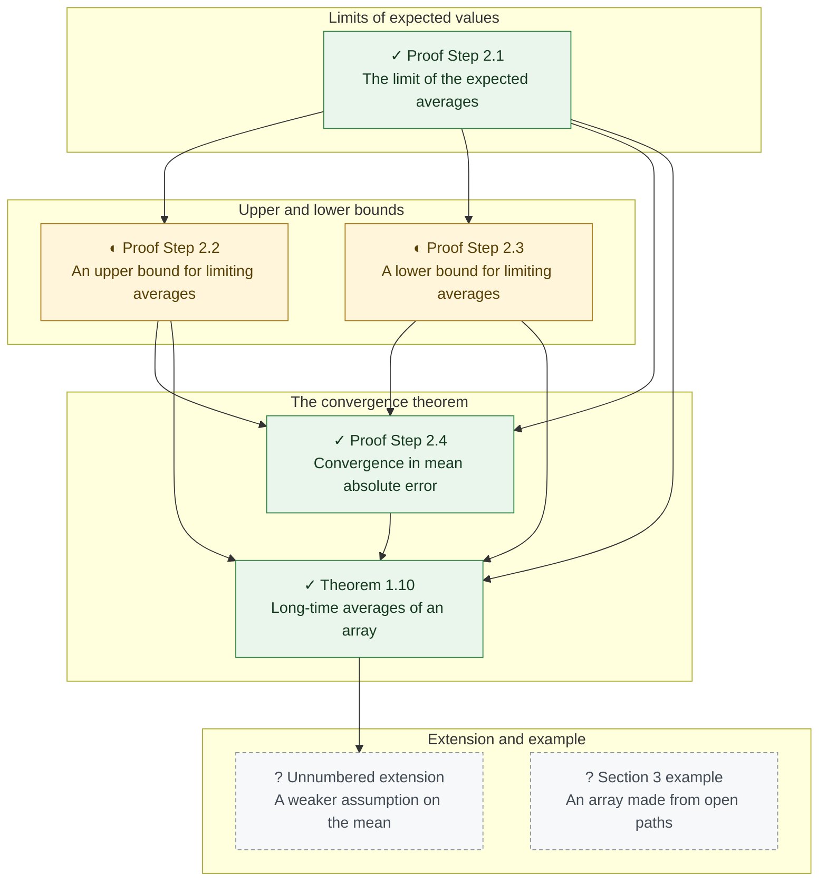

# An improved subadditive ergodic theorem

**Thomas M. Liggett**

[Formalization guide](../../guides/liggett-1985.md) · [Paper catalogue](../../../README.md)

**✓ Certified** · **◐ Restricted** · **○ Not in this release** · **? Not assessed**

A status applies to the scope stated below. Arrows point from a result to a result whose proof uses it.

Graph presentation based on Scott Armstrong’s visual paper design for [*Homogenization at a polynomial scale in high contrast*](https://scottnarmstrong.github.io/hcp-visual-paper/).

## Progress

| Paper result | Formalization |
| --- | --- |
| **Proof Step 2.1** The limit of the expected averages | **✓ Certified** [Lean certificate](https://github.com/cjanjigi/LPP/blob/5a3c7a612144b68468559ea1800bf7f39a5d3ef1/ProbabilityBasics/Probability/LiggettExpectedRate.lean#L96) · [Complete original-row formulation](https://github.com/cjanjigi/LPP/blob/5a3c7a612144b68468559ea1800bf7f39a5d3ef1/ProbabilityBasics/Statements/Liggett.lean#L104) |
| **Proof Step 2.2** An upper bound for limiting averages | **◐ Restricted** [Fixed-block upper comparison](https://github.com/cjanjigi/LPP/blob/5a3c7a612144b68468559ea1800bf7f39a5d3ef1/ProbabilityBasics/Probability/LiggettBlockUpper.lean#L133) · [Complete theorem](https://github.com/cjanjigi/LPP/blob/5a3c7a612144b68468559ea1800bf7f39a5d3ef1/ProbabilityBasics/Statements/Liggett.lean#L104) |
| **Proof Step 2.3** A lower bound for limiting averages | **◐ Restricted** [Auxiliary lower comparison](https://github.com/cjanjigi/LPP/blob/5a3c7a612144b68468559ea1800bf7f39a5d3ef1/ProbabilityBasics/Probability/LiggettLowerComparison.lean#L32) · [Complete theorem](https://github.com/cjanjigi/LPP/blob/5a3c7a612144b68468559ea1800bf7f39a5d3ef1/ProbabilityBasics/Statements/Liggett.lean#L104) |
| **Proof Step 2.4** Convergence in mean absolute error | **✓ Certified** [Lean certificate](https://github.com/cjanjigi/LPP/blob/5a3c7a612144b68468559ea1800bf7f39a5d3ef1/ProbabilityBasics/Probability/LiggettConvergence.lean#L33) · [Original-row theorem](https://github.com/cjanjigi/LPP/blob/5a3c7a612144b68468559ea1800bf7f39a5d3ef1/ProbabilityBasics/Statements/Liggett.lean#L104) |
| **Theorem 1.10** Long-time averages of an array | **✓ Certified** [Lean certificate](https://github.com/cjanjigi/LPP/blob/5a3c7a612144b68468559ea1800bf7f39a5d3ef1/ProbabilityBasics/Statements/Liggett.lean#L104) |
| **Unnumbered extension** A weaker assumption on the mean | **? Not assessed** |
| **Section 3 example** An array made from open paths | **? Not assessed** |

Result statements, notation and certificate scope

### Theorem 1.10

**Long-time averages of an array**

Under the origin inequality, the two distributional conditions and the moment condition defined below, $X_{0,n}/n$ converges almost surely and in mean absolute error to an integrable random variable $X_\infty$. Its mean is the deterministic constant $\gamma=\inf_{n\ge1}\mathbb E X_{0,n}/n$. If every block law is ergodic, then $X_\infty=\gamma$ almost surely.

The probability space is $(\Omega,\mathcal F,\mathbb P)$, and $X_{m,n}$ is a real random variable for each pair of integers $0\le m<n$. The index $m$ is the start time and $n$ is the end time. Write $\mathbb E$ for expectation under $\mathbb P$.

The inequality from the origin is $X_{0,n}\le X_{0,m}+X_{m,n}$ almost surely for all integers $0<m<n$. Here “almost surely” means on an event of probability one.

The row condition says that $(X_{m+1,m+k+1})_{k\ge1}$ and $(X_{m,m+k})_{k\ge1}$ have the same joint distribution for every integer $m\ge0$. Thus shifting the start time by one does not change the distribution of the entire row of future increments.

For an integer $k\ge1$, the $k$-block sequence is $B^{(k)}=(X_{nk,(n+1)k})_{n\ge1}$. Let $\nu_k$ be its probability law on $\mathbb R^{\mathbb N_{\ge1}}$. The shift is $\theta(y_1,y_2,\ldots)=(y_2,y_3,\ldots)$. Stationarity means $\nu_k(\theta^{-1}A)=\nu_k(A)$ for every Borel set $A$.

The moment condition is $\mathbb E|X_{0,n}|<\infty$ for every integer $n\ge1$, together with one constant $c\in\mathbb R$ such that $\mathbb E X_{0,n}\ge-cn$ for all $n\ge1$.

The deterministic constant $\gamma$ is $\inf_{n\ge1}\mathbb E X_{0,n}/n$. The moment condition and the inequality for expectations make $\gamma$ finite.

The block law $\nu_k$ is ergodic if every Borel set $A$ satisfying $\nu_k(A\mathbin{\triangle}\theta^{-1}A)=0$ has probability $\nu_k(A)\in\{0,1\}$. Here $\triangle$ denotes symmetric difference. This says that a shift-invariant event cannot have a probability strictly between zero and one.

Assume the origin inequality, the row condition, stationarity of every $k$-block sequence, and the moment condition. Then $\gamma=\lim_{n\to\infty}\mathbb E X_{0,n}/n=\inf_{n\ge1}\mathbb E X_{0,n}/n\in\mathbb R$. There exists $X_\infty$ with $\mathbb E|X_\infty|<\infty$ such that $X_{0,n}/n\to X_\infty$ almost surely, $\mathbb E|X_{0,n}/n-X_\infty|\to0$, and $\mathbb E X_\infty=\gamma$. If $\nu_k$ is ergodic for every $k\ge1$, then $\mathbb P\{X_\infty=\gamma\}=1$.

**Formalization scope.** The released theorem includes the random limit, convergence in mean absolute error, and the additional conclusion that the limit is constant when every block law is ergodic.

*Source location* Theorem 1.10.

### Proof Step 2.1

**The limit of the expected averages**

The deterministic sequence $\mathbb E X_{0,n}/n$ converges to its infimum. This step concerns expectations; it does not yet assert convergence of the random variables $X_{0,n}/n$.

The probability space is $(\Omega,\mathcal F,\mathbb P)$, and $X_{m,n}$ is a real random variable for each pair of integers $0\le m<n$. The index $m$ is the start time and $n$ is the end time. Write $\mathbb E$ for expectation under $\mathbb P$.

The inequality from the origin is $X_{0,n}\le X_{0,m}+X_{m,n}$ almost surely for all integers $0<m<n$. Here “almost surely” means on an event of probability one.

The row condition says that $(X_{m+1,m+k+1})_{k\ge1}$ and $(X_{m,m+k})_{k\ge1}$ have the same joint distribution for every integer $m\ge0$. Thus shifting the start time by one does not change the distribution of the entire row of future increments.

The moment condition is $\mathbb E|X_{0,n}|<\infty$ for every integer $n\ge1$, together with one constant $c\in\mathbb R$ such that $\mathbb E X_{0,n}\ge-cn$ for all $n\ge1$.

The deterministic constant $\gamma$ is $\inf_{n\ge1}\mathbb E X_{0,n}/n$. The moment condition and the inequality for expectations make $\gamma$ finite.

Set $y_n=\mathbb E X_{0,n}$ for $n\ge1$. Taking expectations in the origin inequality and using the row condition gives $y_{m+n}\le y_m+y_n$. Stationarity of the block sequences is not needed for this step.

Under the origin inequality, the row condition and the moment condition, $\lim_{n\to\infty}y_n/n=\inf_{n\ge1}y_n/n=\gamma\in\mathbb R$.

**Formalization scope.** The expected-average limit and its infimum formula are certified. The supporting declaration uses measurable versions of the origin row; the complete theorem transfers the conclusion back to the original random quantities.

*Source location* Proof Step 2.1.

### Proof Step 2.2

**An upper bound for limiting averages**

Let $\overline X=\limsup_{n\to\infty}X_{0,n}/n$. The proof shows $\mathbb E\overline X\le\gamma$. If each block law is ergodic, it obtains the stronger pointwise conclusion $\overline X\le\gamma$ almost surely.

The probability space is $(\Omega,\mathcal F,\mathbb P)$, and $X_{m,n}$ is a real random variable for each pair of integers $0\le m<n$. The index $m$ is the start time and $n$ is the end time. Write $\mathbb E$ for expectation under $\mathbb P$.

The inequality from the origin is $X_{0,n}\le X_{0,m}+X_{m,n}$ almost surely for all integers $0<m<n$. Here “almost surely” means on an event of probability one.

The row condition says that $(X_{m+1,m+k+1})_{k\ge1}$ and $(X_{m,m+k})_{k\ge1}$ have the same joint distribution for every integer $m\ge0$. Thus shifting the start time by one does not change the distribution of the entire row of future increments.

For an integer $k\ge1$, the $k$-block sequence is $B^{(k)}=(X_{nk,(n+1)k})_{n\ge1}$. Let $\nu_k$ be its probability law on $\mathbb R^{\mathbb N_{\ge1}}$. The shift is $\theta(y_1,y_2,\ldots)=(y_2,y_3,\ldots)$. Stationarity means $\nu_k(\theta^{-1}A)=\nu_k(A)$ for every Borel set $A$.

The moment condition is $\mathbb E|X_{0,n}|<\infty$ for every integer $n\ge1$, together with one constant $c\in\mathbb R$ such that $\mathbb E X_{0,n}\ge-cn$ for all $n\ge1$.

The deterministic constant $\gamma$ is $\inf_{n\ge1}\mathbb E X_{0,n}/n$. The moment condition and the inequality for expectations make $\gamma$ finite.

The block law $\nu_k$ is ergodic if every Borel set $A$ satisfying $\nu_k(A\mathbin{\triangle}\theta^{-1}A)=0$ has probability $\nu_k(A)\in\{0,1\}$. Here $\triangle$ denotes symmetric difference. This says that a shift-invariant event cannot have a probability strictly between zero and one.

For a real sequence $(a_n)$, $\limsup_{n\to\infty}a_n=\lim_{N\to\infty}\sup_{n\ge N}a_n$, with values allowed in $[-\infty,\infty]$. Apply this definition to $a_n=X_{0,n}(\omega)/n$ for each outcome $\omega$ to define $\overline X$.

For a fixed integer $k\ge1$, averages of the stationary sequence $B^{(k)}$ give an integrable random variable $V_k$ with $\overline X\le V_k$ almost surely and $\mathbb E V_k=\mathbb E X_{0,k}/k$. Taking expectations and then the infimum over $k$ gives the claimed bound.

Under all four hypotheses of Theorem 1.10, $\mathbb E\overline X\le\gamma$. If $\nu_k$ is ergodic for every $k\ge1$, then $\mathbb P\{\overline X\le\gamma\}=1$.

**Formalization scope.** For each fixed block length $k$, a released certificate constructs an integrable upper bound $V_k$ with the stated mean. The displayed expected-limit and ergodic conclusions belong to the full theorem; they are not both conclusions of that fixed-$k$ supporting declaration.

*Source location* Proof Step 2.2.

### Proof Step 2.3

**A lower bound for limiting averages**

Let $\underline X=\liminf_{n\to\infty}X_{0,n}/n$. The proof shows $\mathbb E\underline X\ge\gamma$. Together with the upper bound for $\overline X$, this forces the lower and upper limits to agree almost surely.

The probability space is $(\Omega,\mathcal F,\mathbb P)$, and $X_{m,n}$ is a real random variable for each pair of integers $0\le m<n$. The index $m$ is the start time and $n$ is the end time. Write $\mathbb E$ for expectation under $\mathbb P$.

The inequality from the origin is $X_{0,n}\le X_{0,m}+X_{m,n}$ almost surely for all integers $0<m<n$. Here “almost surely” means on an event of probability one.

The row condition says that $(X_{m+1,m+k+1})_{k\ge1}$ and $(X_{m,m+k})_{k\ge1}$ have the same joint distribution for every integer $m\ge0$. Thus shifting the start time by one does not change the distribution of the entire row of future increments.

For an integer $k\ge1$, the $k$-block sequence is $B^{(k)}=(X_{nk,(n+1)k})_{n\ge1}$. Let $\nu_k$ be its probability law on $\mathbb R^{\mathbb N_{\ge1}}$. The shift is $\theta(y_1,y_2,\ldots)=(y_2,y_3,\ldots)$. Stationarity means $\nu_k(\theta^{-1}A)=\nu_k(A)$ for every Borel set $A$.

The moment condition is $\mathbb E|X_{0,n}|<\infty$ for every integer $n\ge1$, together with one constant $c\in\mathbb R$ such that $\mathbb E X_{0,n}\ge-cn$ for all $n\ge1$.

The deterministic constant $\gamma$ is $\inf_{n\ge1}\mathbb E X_{0,n}/n$. The moment condition and the inequality for expectations make $\gamma$ finite.

The block law $\nu_k$ is ergodic if every Borel set $A$ satisfying $\nu_k(A\mathbin{\triangle}\theta^{-1}A)=0$ has probability $\nu_k(A)\in\{0,1\}$. Here $\triangle$ denotes symmetric difference. This says that a shift-invariant event cannot have a probability strictly between zero and one.

For a real sequence $(a_n)$, $\liminf_{n\to\infty}a_n=\lim_{N\to\infty}\inf_{n\ge N}a_n$. Thus $\underline X(\omega)=\liminf_{n\to\infty}X_{0,n}(\omega)/n$. Always $\underline X\le\overline X$, where $\overline X$ is the corresponding upper limit.

The proof constructs an integrable random variable $Y$ on an auxiliary probability space such that $\mathbb E Y\ge\gamma$ and $\mathbb P\{Y\ge a\}\le\mathbb P\{\underline X\ge a\}$ for every $a\in\mathbb R$. The probabilities in this display are taken on the respective spaces of $Y$ and $\underline X$. The displayed inequalities compare their distributions without assuming that the two variables were originally defined on the same space.

Under all four hypotheses of Theorem 1.10, $\mathbb E\underline X\ge\gamma$. Combining this with $\underline X\le\overline X$ and $\mathbb E\overline X\le\gamma$ yields $\underline X=\overline X$ almost surely and expectation $\gamma$ for their common value.

**Formalization scope.** A released certificate constructs the auxiliary variable $Y$ and proves the mean and distribution comparisons stated in the definitions. The final inequality for the expected lower limit is not itself the conclusion of that supporting declaration.

*Source location* Proof Step 2.3.

### Proof Step 2.4

**Convergence in mean absolute error**

The almost-sure limit $X_\infty=\lim_{n\to\infty}X_{0,n}/n$ also satisfies $\mathbb E|X_{0,n}/n-X_\infty|\to0$. This is what convergence in $L^1$ means.

The probability space is $(\Omega,\mathcal F,\mathbb P)$, and $X_{m,n}$ is a real random variable for each pair of integers $0\le m<n$. The index $m$ is the start time and $n$ is the end time. Write $\mathbb E$ for expectation under $\mathbb P$.

The inequality from the origin is $X_{0,n}\le X_{0,m}+X_{m,n}$ almost surely for all integers $0<m<n$. Here “almost surely” means on an event of probability one.

The row condition says that $(X_{m+1,m+k+1})_{k\ge1}$ and $(X_{m,m+k})_{k\ge1}$ have the same joint distribution for every integer $m\ge0$. Thus shifting the start time by one does not change the distribution of the entire row of future increments.

For an integer $k\ge1$, the $k$-block sequence is $B^{(k)}=(X_{nk,(n+1)k})_{n\ge1}$. Let $\nu_k$ be its probability law on $\mathbb R^{\mathbb N_{\ge1}}$. The shift is $\theta(y_1,y_2,\ldots)=(y_2,y_3,\ldots)$. Stationarity means $\nu_k(\theta^{-1}A)=\nu_k(A)$ for every Borel set $A$.

The moment condition is $\mathbb E|X_{0,n}|<\infty$ for every integer $n\ge1$, together with one constant $c\in\mathbb R$ such that $\mathbb E X_{0,n}\ge-cn$ for all $n\ge1$.

The deterministic constant $\gamma$ is $\inf_{n\ge1}\mathbb E X_{0,n}/n$. The moment condition and the inequality for expectations make $\gamma$ finite.

The block law $\nu_k$ is ergodic if every Borel set $A$ satisfying $\nu_k(A\mathbin{\triangle}\theta^{-1}A)=0$ has probability $\nu_k(A)\in\{0,1\}$. Here $\triangle$ denotes symmetric difference. This says that a shift-invariant event cannot have a probability strictly between zero and one.

The preceding upper and lower bounds show that $\limsup_n X_{0,n}/n$ and $\liminf_n X_{0,n}/n$ agree almost surely. Denote their common value by $X_\infty$. It is integrable and $\mathbb E X_\infty=\gamma$.

For a real number $a$, write $a^+=\max\{a,0\}$. A family $(Z_n)$ of integrable random variables is uniformly integrable if $\lim_{M\to\infty}\sup_n\mathbb E[|Z_n|\mathbf1_{\{|Z_n|>M\}}]=0$. The proof controls the positive parts $(X_{0,n}/n)^+$ this way, then uses convergence of the expectations to control the remaining absolute error.

Under all four hypotheses of Theorem 1.10, the almost-sure limit $X_\infty$ satisfies $\lim_{n\to\infty}\mathbb E\bigl|X_{0,n}/n-X_\infty\bigr|=0$.

**Formalization scope.** Convergence in mean absolute error is included in the complete released theorem.

*Source location* Proof Step 2.4.

### Unnumbered extension

**A weaker assumption on the mean**

The paper states that the same almost-sure convergence conclusion holds if the full moment condition is replaced by $\mathbb E(X_{0,1})^+<\infty$. The expected rate and the limit may then equal $-\infty$, and convergence in mean absolute error is not asserted. The paper omits the proof and points to a truncation argument in Subadditive Processes.

The probability space is $(\Omega,\mathcal F,\mathbb P)$, and $X_{m,n}$ is a real random variable for each pair of integers $0\le m<n$. The index $m$ is the start time and $n$ is the end time. Write $\mathbb E$ for expectation under $\mathbb P$.

The inequality from the origin is $X_{0,n}\le X_{0,m}+X_{m,n}$ almost surely for all integers $0<m<n$. Here “almost surely” means on an event of probability one.

The row condition says that $(X_{m+1,m+k+1})_{k\ge1}$ and $(X_{m,m+k})_{k\ge1}$ have the same joint distribution for every integer $m\ge0$. Thus shifting the start time by one does not change the distribution of the entire row of future increments.

For an integer $k\ge1$, the $k$-block sequence is $B^{(k)}=(X_{nk,(n+1)k})_{n\ge1}$. Let $\nu_k$ be its probability law on $\mathbb R^{\mathbb N_{\ge1}}$. The shift is $\theta(y_1,y_2,\ldots)=(y_2,y_3,\ldots)$. Stationarity means $\nu_k(\theta^{-1}A)=\nu_k(A)$ for every Borel set $A$.

For a real number $a$, its positive part is $a^+=\max\{a,0\}$. The new assumption controls only the positive part of $X_{0,1}$; it does not require a finite negative mean or a common linear lower bound on $\mathbb E X_{0,n}$.

Keep the origin inequality, the row condition, and stationarity of every $k$-block sequence. Set $\gamma=\inf_{n\ge1}\mathbb E X_{0,n}/n$, now with values in $[-\infty,\infty)$. The expectations are extended expectations; the positive parts are integrable.

Convergence to $-\infty$ means that for every real $M$, the sequence is eventually less than $M$. There is no $L^1$ conclusion in this extension.

With the three structural hypotheses retained and $\mathbb E(X_{0,1})^+<\infty$, the stated extension allows $\gamma=\lim_n\mathbb E X_{0,n}/n=-\infty$. It asserts almost-sure convergence of $X_{0,n}/n$ and equality of the expected limit with $\gamma$, but drops the $L^1$ assertion. This is an unnumbered extension stated in the 1985 paper, not an additional proved step in its written proof.

**Formalization scope.** This weaker-moment extension has not yet been matched to a released certificate.

*Source location* Unnumbered extension.

### Section 3 example

**An array made from open paths**

On a lattice with independent open or closed directed edges, let $X_{0,n}$ be the rightmost point reachable at time $n$ from the half-line at time zero. The paper defines $X_{m,n}$ from the rightmost point reachable from a half-line placed at $X_{0,m}$. This array satisfies the hypotheses about the origin and the distributions, although the corresponding inequality can fail when the initial time is positive.

The lattice is $\mathcal L=\{(x,t)\in\mathbb Z^2:t\ge0,\ x+t\text{ is even}\}$. There are directed edges from $(x,t)$ to $(x-1,t+1)$ and $(x+1,t+1)$. Each edge is independently open with probability $p\in(0,1)$. A path is open if every edge it uses is open.

Write $(x,s)\leadsto(y,t)$ if an open directed path joins these two vertices. Define $R_n=\max\{y:\exists x\le0\text{ with }(x,0)\in\mathcal L\text{ and }(x,0)\leadsto(y,n)\}$ for $n\ge1$, and put $R_0=0$. Then $X_{0,n}=R_n$.

For $0\le m<n$, set $X_{m,n}=\max\{y:\exists x\le R_m\text{ with }(x,m)\in\mathcal L\text{ and }(x,m)\leadsto(y,n)\}-R_m$. Thus $X_{m,n}$ is a displacement measured from the current rightmost point, using all lattice sites to its left as possible new starting sites.

The origin inequality is $X_{0,n}\le X_{0,m}+X_{m,n}$. It holds because the sites actually reached at time $m$ are contained in the half-line $\{x:x\le R_m\}$.

The stronger inequality would require $X_{\ell,n}\le X_{\ell,m}+X_{m,n}$ for every $0\le\ell<m<n$. The paper exhibits an edge configuration where this fails with $\ell=1$. It follows that the entire array is not invariant in distribution under a simultaneous time shift either.

For each fixed $k\ge1$, the increments $(X_{nk,(n+1)k})_{n\ge1}$ are independent and identically distributed, so they form a stationary block sequence. Also $R_n\le n$, which gives $\mathbb E(R_1)^+<\infty$. The full integrability and linear lower-mean bound hold when $p$ is sufficiently close to one, as stated with a citation to Oriented Percolation in Two Dimensions.

The array just defined satisfies the origin inequality, equal adjacent-row laws and stationarity of every fixed-length block sequence. It need not satisfy $X_{\ell,n}\le X_{\ell,m}+X_{m,n}$ for positive $\ell$, nor invariance of the full two-parameter array under time shifts. The weaker positive-part assumption holds for every $p\in(0,1)$; the full moment condition is stated for $p$ sufficiently close to one.

**Formalization scope.** This open-path construction and verification of its hypotheses have not yet been matched to a released certificate.

*Source location* Section 3 example.

Source locations for dependency arrows

| Use | Reason | Consumer location |
| --- | --- | --- |
| Proof Step 2.1 → Proof Step 2.2 | The proof of Proof Step 2.2 uses Proof Step 2.1. | Proof of Proof Step 2.2 |
| Proof Step 2.1 → Proof Step 2.3 | The proof of Proof Step 2.3 uses Proof Step 2.1. | Proof of Proof Step 2.3 |
| Proof Step 2.1 → Proof Step 2.4 | The proof of Proof Step 2.4 uses Proof Step 2.1. | Proof of Proof Step 2.4 |
| Proof Step 2.2 → Proof Step 2.4 | The proof of Proof Step 2.4 uses Proof Step 2.2. | Proof of Proof Step 2.4 |
| Proof Step 2.3 → Proof Step 2.4 | The proof of Proof Step 2.4 uses Proof Step 2.3. | Proof of Proof Step 2.4 |
| Proof Step 2.1 → Theorem 1.10 | The proof of Theorem 1.10 uses Proof Step 2.1. | Proof of Theorem 1.10 |
| Proof Step 2.2 → Theorem 1.10 | The proof of Theorem 1.10 uses Proof Step 2.2. | Proof of Theorem 1.10 |
| Proof Step 2.3 → Theorem 1.10 | The proof of Theorem 1.10 uses Proof Step 2.3. | Proof of Theorem 1.10 |
| Proof Step 2.4 → Theorem 1.10 | The proof of Theorem 1.10 uses Proof Step 2.4. | Proof of Theorem 1.10 |
| Theorem 1.10 → Unnumbered extension | The proof of Unnumbered extension uses Theorem 1.10. | Proof of Unnumbered extension |

