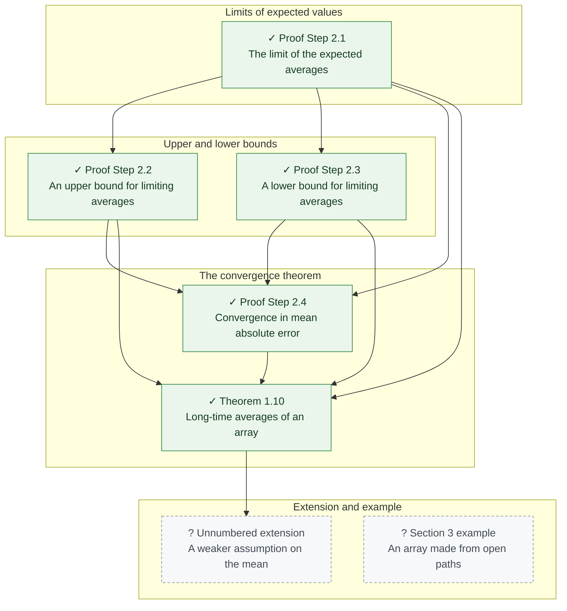

# An improved subadditive ergodic theorem

**Thomas M. Liggett**

[Interactive dependency graph](https://cjanjigi.github.io/LPP/?paper=liggett-1985) · [Formalization guide](../../guides/liggett-1985.md) · [Paper catalogue](../../../README.md)

**✓ Certified** · **◐ Restricted** · **○ Not in this release** · **? Not assessed**

A status applies to the scope stated below. Arrows point from a result to a result whose proof uses it.

## Progress

| Paper result | Formalization |
| --- | --- |
| **[Proof Step 2.1](#proof-step-21)** The limit of the expected averages | **✓ Certified** [Coverage note](#proof-step-21) [Lean certificate](https://github.com/cjanjigi/LPP/blob/5a3c7a612144b68468559ea1800bf7f39a5d3ef1/ProbabilityBasics/Probability/LiggettExpectedRate.lean#L96) · [Complete original-row formulation](https://github.com/cjanjigi/LPP/blob/5a3c7a612144b68468559ea1800bf7f39a5d3ef1/ProbabilityBasics/Statements/Liggett.lean#L104) |
| **[Proof Step 2.2](#proof-step-22)** An upper bound for limiting averages | **✓ Certified** [Coverage note](#proof-step-22) [Fixed-block upper comparison](https://github.com/cjanjigi/LPP/blob/5a3c7a612144b68468559ea1800bf7f39a5d3ef1/ProbabilityBasics/Probability/LiggettBlockUpper.lean#L133) · [Complete theorem](https://github.com/cjanjigi/LPP/blob/5a3c7a612144b68468559ea1800bf7f39a5d3ef1/ProbabilityBasics/Statements/Liggett.lean#L104) |
| **[Proof Step 2.3](#proof-step-23)** A lower bound for limiting averages | **✓ Certified** [Coverage note](#proof-step-23) [Auxiliary lower comparison](https://github.com/cjanjigi/LPP/blob/5a3c7a612144b68468559ea1800bf7f39a5d3ef1/ProbabilityBasics/Probability/LiggettLowerComparison.lean#L32) · [Complete theorem](https://github.com/cjanjigi/LPP/blob/5a3c7a612144b68468559ea1800bf7f39a5d3ef1/ProbabilityBasics/Statements/Liggett.lean#L104) |
| **[Proof Step 2.4](#proof-step-24)** Convergence in mean absolute error | **✓ Certified** [Coverage note](#proof-step-24) [Lean certificate](https://github.com/cjanjigi/LPP/blob/5a3c7a612144b68468559ea1800bf7f39a5d3ef1/ProbabilityBasics/Probability/LiggettConvergence.lean#L33) · [Original-row theorem](https://github.com/cjanjigi/LPP/blob/5a3c7a612144b68468559ea1800bf7f39a5d3ef1/ProbabilityBasics/Statements/Liggett.lean#L104) |
| **[Theorem 1.10](#theorem-110)** Long-time averages of an array | **✓ Certified** [Coverage note](#theorem-110) [Lean certificate](https://github.com/cjanjigi/LPP/blob/5a3c7a612144b68468559ea1800bf7f39a5d3ef1/ProbabilityBasics/Statements/Liggett.lean#L104) |
| **[Unnumbered extension](#unnumbered-extension)** A weaker assumption on the mean | **? Not assessed** [Coverage note](#unnumbered-extension) |
| **[Section 3 example](#section-3-example)** An array made from open paths | **? Not assessed** [Coverage note](#section-3-example) |

## Coverage notes

These short descriptions locate the results and explain certificate coverage. Consult the paper for the full statements and proofs; the formalization guide states the main certified theorems.

### Proof Step 2.1

**The limit of the expected averages**

The normalized expected entries have a finite limit, equal to their infimum. This is the mean of the eventual random limit.

The normalized expected entries are $`\mathbb E X_{0,n}/n`$, for integers $`n\ge1`$, where $`X_{m,n}`$ is the paper's real random array. Their infimum is the greatest real number below every one of them.

**✓ Certified**

The expected-average limit and its infimum formula are certified. The supporting declaration uses measurable versions of the origin row; the complete theorem transfers the conclusion back to the original random quantities.

[Lean certificate](https://github.com/cjanjigi/LPP/blob/5a3c7a612144b68468559ea1800bf7f39a5d3ef1/ProbabilityBasics/Probability/LiggettExpectedRate.lean#L96) · [Complete original-row formulation](https://github.com/cjanjigi/LPP/blob/5a3c7a612144b68468559ea1800bf7f39a5d3ef1/ProbabilityBasics/Statements/Liggett.lean#L104)

*Source location* Proof Step 2.1.

### Proof Step 2.2

**An upper bound for limiting averages**

The expected upper limit of the normalized entries is bounded by the limit of their expectations. With ergodic block processes, the upper limit has the same bound almost surely.

Normalized entries are $`X_{0,n}/n`$. Their upper limit is $`\limsup_{n\to\infty}X_{0,n}/n`$, and the limit of their expectations is $`\gamma=\lim_{n\to\infty}\mathbb E X_{0,n}/n`$.

For each positive integer $`k`$, the block process is $`(X_{jk,(j+1)k})_{j\ge1}`$. Ergodic means that its shift-invariant events have probability zero or one. Almost surely means outside an event of probability zero.

**✓ Certified**

The complete released Theorem 1.10 covers the printed upper-limit claim under the paper’s hypotheses. The limit is integrable with mean $`\gamma`$ and equals $`\gamma`$ almost surely under block ergodicity. The fixed-block proof is an intermediate ingredient.

[Fixed-block upper comparison](https://github.com/cjanjigi/LPP/blob/5a3c7a612144b68468559ea1800bf7f39a5d3ef1/ProbabilityBasics/Probability/LiggettBlockUpper.lean#L133) · [Complete theorem](https://github.com/cjanjigi/LPP/blob/5a3c7a612144b68468559ea1800bf7f39a5d3ef1/ProbabilityBasics/Statements/Liggett.lean#L104)

*Source location* Proof Step 2.2.

### Proof Step 2.3

**A lower bound for limiting averages**

The expected lower limit of the normalized entries is at least the limiting expected value.

Normalized entries are $`X_{0,n}/n`$. Their lower limit is $`\liminf_{n\to\infty}X_{0,n}/n`$, and the limiting expected value is $`\gamma=\lim_{n\to\infty}\mathbb E X_{0,n}/n`$.

Almost surely means outside an event of probability zero.

**✓ Certified**

The complete released Theorem 1.10 covers the printed lower-limit claim under the paper’s hypotheses. Its integrable almost-sure limit has mean $`\gamma`$, so the expected lower limit equals $`\gamma`$. The auxiliary comparison is an intermediate ingredient.

[Auxiliary lower comparison](https://github.com/cjanjigi/LPP/blob/5a3c7a612144b68468559ea1800bf7f39a5d3ef1/ProbabilityBasics/Probability/LiggettLowerComparison.lean#L32) · [Complete theorem](https://github.com/cjanjigi/LPP/blob/5a3c7a612144b68468559ea1800bf7f39a5d3ef1/ProbabilityBasics/Statements/Liggett.lean#L104)

*Source location* Proof Step 2.3.

### Proof Step 2.4

**Convergence in mean absolute error**

The normalized entries converge to their almost-sure limit in mean absolute error. The expected limit equals the limiting expected rate.

Almost-sure convergence means convergence outside an event of probability zero. Convergence in mean absolute error means $`\mathbb E|X_{0,n}/n-X_\infty|\to0`$, where $`X_{0,n}/n`$ are the normalized entries and $`X_\infty`$ is their limit.

**✓ Certified**

Convergence in mean absolute error is included in the complete released theorem.

[Lean certificate](https://github.com/cjanjigi/LPP/blob/5a3c7a612144b68468559ea1800bf7f39a5d3ef1/ProbabilityBasics/Probability/LiggettConvergence.lean#L33) · [Original-row theorem](https://github.com/cjanjigi/LPP/blob/5a3c7a612144b68468559ea1800bf7f39a5d3ef1/ProbabilityBasics/Statements/Liggett.lean#L104)

*Source location* Proof Step 2.4.

### Theorem 1.10

**Long-time averages of an array**

For an array satisfying the paper's subadditivity, distribution and moment assumptions, normalized entries converge almost surely and in mean absolute error. Their limit has the limiting expected value. It is constant when every block process is ergodic; otherwise it may be random.

The array consists of real random variables $`X_{m,n}`$ indexed by integers $`0\le m<n`$; normalized entries are $`X_{0,n}/n`$. The assumptions are listed precisely in the formalization guide.

Almost-sure convergence means convergence outside an event of probability zero. Convergence in mean absolute error to $`X_\infty`$ means $`\mathbb E|X_{0,n}/n-X_\infty|\to0`$.

For each positive integer $`k`$, a block process is $`(X_{jk,(j+1)k})_{j\ge1}`$. Ergodic means that every event unchanged by shifting this stationary process has probability zero or one.

**✓ Certified**

The released theorem includes the random limit, convergence in mean absolute error, and the additional conclusion that the limit is constant when every block law is ergodic.

[Lean certificate](https://github.com/cjanjigi/LPP/blob/5a3c7a612144b68468559ea1800bf7f39a5d3ef1/ProbabilityBasics/Statements/Liggett.lean#L104)

*Source location* Theorem 1.10.

### Unnumbered extension

**A weaker assumption on the mean**

The paper describes a version requiring only integrability of the positive part of the first entry. The limiting expected rate may then be minus infinity, and convergence in mean absolute error is no longer claimed.

The positive part of the first entry is $`X_{0,1}^{+}=\max(X_{0,1},0)`$; its integrability means $`\mathbb E X_{0,1}^{+}<\infty`$. The expected rate is the limit of $`\mathbb E X_{0,n}/n`$.

**? Not assessed**

This weaker-moment extension has not yet been matched to a released certificate.

*Source location* Unnumbered extension.

### Section 3 example

**An array made from open paths**

An array made from directed open paths illustrates the theorem’s weaker structural assumptions. It satisfies the stated distributional conditions while failing the stronger full-array conditions discussed in the paper; the moment conditions apply in the regime specified there.

A directed open path follows the allowed edge directions and uses only open edges. Its percolation states are independent. The array is the family of real random quantities constructed from these paths in Section 3.

**? Not assessed**

This open-path construction and verification of its hypotheses have not yet been matched to a released certificate.

*Source location* Section 3 example.

Source locations for dependency arrows

| Use | Source location |
| --- | --- |
| Proof Step 2.1 → Proof Step 2.2 | Proof of Proof Step 2.2 |
| Proof Step 2.1 → Proof Step 2.3 | Proof of Proof Step 2.3 |
| Proof Step 2.1 → Proof Step 2.4 | Proof of Proof Step 2.4 |
| Proof Step 2.2 → Proof Step 2.4 | Proof of Proof Step 2.4 |
| Proof Step 2.3 → Proof Step 2.4 | Proof of Proof Step 2.4 |
| Proof Step 2.1 → Theorem 1.10 | Proof of Theorem 1.10 |
| Proof Step 2.2 → Theorem 1.10 | Proof of Theorem 1.10 |
| Proof Step 2.3 → Theorem 1.10 | Proof of Theorem 1.10 |
| Proof Step 2.4 → Theorem 1.10 | Proof of Theorem 1.10 |
| Theorem 1.10 → Unnumbered extension | Proof of Unnumbered extension |

