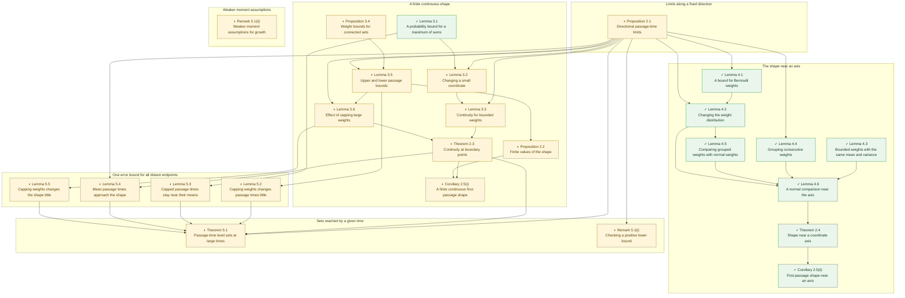

# Limiting shape for directed percolation models

**James B. Martin**

[Formalization guide](../../guides/martin-2004.md) · [Paper catalogue](../../../README.md)

**✓ Certified** · **◐ Restricted** · **○ Not in this release** · **? Not assessed**

A status applies to the scope stated below. Arrows point from a result to a result whose proof uses it.

Graph presentation based on Scott Armstrong’s visual paper design for [*Homogenization at a polynomial scale in high contrast*](https://scottnarmstrong.github.io/hcp-visual-paper/).

## Progress

| Paper result | Formalization |
| --- | --- |
| **[Proposition 2.1](#proposition-21)** Directional passage-time limits | **◐ Restricted** [Planar case only](#proposition-21) [Lean certificate](https://github.com/cjanjigi/LPP/blob/5a3c7a612144b68468559ea1800bf7f39a5d3ef1/Martin2004/Statements/LimitShape.lean#L73) |
| **[Proposition 2.2](#proposition-22)** Finite values of the shape | **◐ Restricted** [Planar case only](#proposition-22) [Lean certificate](https://github.com/cjanjigi/LPP/blob/5a3c7a612144b68468559ea1800bf7f39a5d3ef1/Martin2004/Statements/LimitShape.lean#L135) |
| **[Theorem 2.3](#theorem-23)** Continuity at boundary points | **◐ Restricted** [Planar case only](#theorem-23) [Lean certificate](https://github.com/cjanjigi/LPP/blob/5a3c7a612144b68468559ea1800bf7f39a5d3ef1/Martin2004/Statements/LimitShape.lean#L135) |
| **[Corollary 2.5(i)](#corollary-25i)** A finite continuous first-passage shape | **◐ Restricted** [Planar case only](#corollary-25i) [Lean certificate](https://github.com/cjanjigi/LPP/blob/5a3c7a612144b68468559ea1800bf7f39a5d3ef1/Martin2004/Statements/BoundaryAsymptotics.lean#L141) |
| **[Lemma 3.1](#lemma-31)** A probability bound for a maximum of sums | **✓ Certified** [Coverage note](#lemma-31) [Lean certificate](https://github.com/cjanjigi/LPP/blob/5a3c7a612144b68468559ea1800bf7f39a5d3ef1/ProbabilityBasics/Statements/Concentration.lean#L81) |
| **[Lemma 3.2](#lemma-32)** Changing a small coordinate | **◐ Restricted** [Planar case only](#lemma-32) [Bounded continuity and face estimate](https://github.com/cjanjigi/LPP/blob/5a3c7a612144b68468559ea1800bf7f39a5d3ef1/Martin2004/Probability/MartinBoundedContinuity.lean#L131) |
| **[Lemma 3.3](#lemma-33)** Continuity for bounded weights | **◐ Restricted** [Planar case only](#lemma-33) [Lean certificate](https://github.com/cjanjigi/LPP/blob/5a3c7a612144b68468559ea1800bf7f39a5d3ef1/Martin2004/Probability/MartinBoundedContinuity.lean#L131) |
| **[Proposition 3.4](#proposition-34)** Weight bounds for connected sets | **◐ Restricted** [Planar case only](#proposition-34) [Expected bound for connected sets](https://github.com/cjanjigi/LPP/blob/5a3c7a612144b68468559ea1800bf7f39a5d3ef1/Martin2004/Probability/AnimalPositiveMean.lean#L75) · [Almost-sure bound for connected sets](https://github.com/cjanjigi/LPP/blob/5a3c7a612144b68468559ea1800bf7f39a5d3ef1/Martin2004/Probability/GreedyAnimalAlmostSureBound.lean#L143) |
| **[Lemma 3.5](#lemma-35)** Upper and lower passage bounds | **◐ Restricted** [Planar case only](#lemma-35) [Mean and directional-shape upper bounds](https://github.com/cjanjigi/LPP/blob/5a3c7a612144b68468559ea1800bf7f39a5d3ef1/Martin2004/Probability/MartinPassageMean.lean#L33) · [Uniform passage upper bound](https://github.com/cjanjigi/LPP/blob/5a3c7a612144b68468559ea1800bf7f39a5d3ef1/Martin2004/Probability/UniformPassageUpper.lean#L57) · [Mean lower bound under a first moment](https://github.com/cjanjigi/LPP/blob/5a3c7a612144b68468559ea1800bf7f39a5d3ef1/Martin2004/Probability/ERealFloorRateGeometry.lean#L58) · [Directional expected-rate limits](https://github.com/cjanjigi/LPP/blob/5a3c7a612144b68468559ea1800bf7f39a5d3ef1/Martin2004/Statements/LimitShape.lean#L73) |
| **[Lemma 3.6](#lemma-36)** Effect of capping large weights | **◐ Restricted** [Planar case only](#lemma-36) [Two-sided shape comparison](https://github.com/cjanjigi/LPP/blob/5a3c7a612144b68468559ea1800bf7f39a5d3ef1/Martin2004/Probability/RealExpectedTruncation.lean#L158) · [Compact uniform approximation](https://github.com/cjanjigi/LPP/blob/5a3c7a612144b68468559ea1800bf7f39a5d3ef1/Martin2004/Probability/MartinWeakContinuity.lean#L85) |
| **[Theorem 2.4](#theorem-24)** Shape near a coordinate axis | **✓ Certified** [Coverage note](#theorem-24) [Lean certificate](https://github.com/cjanjigi/LPP/blob/5a3c7a612144b68468559ea1800bf7f39a5d3ef1/Martin2004/Statements/BoundaryAsymptotics.lean#L82) |
| **[Corollary 2.5(ii)](#corollary-25ii)** First-passage shape near an axis | **✓ Certified** [Coverage note](#corollary-25ii) [Lean certificate](https://github.com/cjanjigi/LPP/blob/5a3c7a612144b68468559ea1800bf7f39a5d3ef1/Martin2004/Statements/BoundaryAsymptotics.lean#L211) |
| **[Lemma 4.1](#lemma-41)** A bound for Bernoulli weights | **✓ Certified** [Coverage note](#lemma-41) [Lean certificate](https://github.com/cjanjigi/LPP/blob/5a3c7a612144b68468559ea1800bf7f39a5d3ef1/Martin2004/Probability/BernoulliShapeBound.lean#L88) |
| **[Lemma 4.2](#lemma-42)** Changing the weight distribution | **✓ Certified** [Coverage note](#lemma-42) [Lean certificate](https://github.com/cjanjigi/LPP/blob/5a3c7a612144b68468559ea1800bf7f39a5d3ef1/Martin2004/Probability/ShapeComparison.lean#L119) |
| **[Lemma 4.3](#lemma-43)** Bounded weights with the same mean and variance | **✓ Certified** [Coverage note](#lemma-43) [Lean certificate](https://github.com/cjanjigi/LPP/blob/5a3c7a612144b68468559ea1800bf7f39a5d3ef1/Martin2004/Probability/MeanVarianceTruncationTail.lean#L289) |
| **[Lemma 4.4](#lemma-44)** Grouping consecutive weights | **✓ Certified** [Coverage note](#lemma-44) [Lean certificate](https://github.com/cjanjigi/LPP/blob/5a3c7a612144b68468559ea1800bf7f39a5d3ef1/Martin2004/Probability/BlockingComparison.lean#L185) |
| **[Lemma 4.5](#lemma-45)** Comparing grouped weights with normal weights | **✓ Certified** [Coverage note](#lemma-45) [Lean certificate](https://github.com/cjanjigi/LPP/blob/5a3c7a612144b68468559ea1800bf7f39a5d3ef1/Martin2004/Probability/GaussianBlockComparison.lean#L270) |
| **[Lemma 4.6](#lemma-46)** A normal comparison near the axis | **✓ Certified** [Coverage note](#lemma-46) [Lean certificate](https://github.com/cjanjigi/LPP/blob/5a3c7a612144b68468559ea1800bf7f39a5d3ef1/Martin2004/Probability/BoundaryUniversality.lean#L156) |
| **[Lemma 5.2](#lemma-52)** Capping weights changes passage times little | **◐ Restricted** [Planar case only](#lemma-52) [Lean certificate](https://github.com/cjanjigi/LPP/blob/5a3c7a612144b68468559ea1800bf7f39a5d3ef1/Martin2004/Probability/UniformTruncationApproximation.lean#L89) |
| **[Lemma 5.3](#lemma-53)** Capped passage times stay near their means | **◐ Restricted** [Planar case only](#lemma-53) [Lean certificate](https://github.com/cjanjigi/LPP/blob/5a3c7a612144b68468559ea1800bf7f39a5d3ef1/Martin2004/Probability/BoundedPassageFluctuations.lean#L192) |
| **[Lemma 5.4](#lemma-54)** Mean passage times approach the shape | **◐ Restricted** [Planar case only](#lemma-54) [Lean certificate](https://github.com/cjanjigi/LPP/blob/5a3c7a612144b68468559ea1800bf7f39a5d3ef1/Martin2004/Probability/BoundedExpectedUniform.lean#L53) |
| **[Lemma 5.5](#lemma-55)** Capping weights changes the shape little | **◐ Restricted** [Planar case only](#lemma-55) [Lean certificate](https://github.com/cjanjigi/LPP/blob/5a3c7a612144b68468559ea1800bf7f39a5d3ef1/Martin2004/Probability/MartinWeakContinuity.lean#L32) |
| **[Theorem 5.1](#theorem-51)** Passage-time level sets at large times | **◐ Restricted** [Planar case only](#theorem-51) [Last-passage growth sets](https://github.com/cjanjigi/LPP/blob/5a3c7a612144b68468559ea1800bf7f39a5d3ef1/Martin2004/Statements/GrowthSets.lean#L86) · [First-passage growth sets](https://github.com/cjanjigi/LPP/blob/5a3c7a612144b68468559ea1800bf7f39a5d3ef1/Martin2004/Statements/GrowthSets.lean#L157) |
| **[Remark 5.1(i)](#remark-51i)** Checking a positive lower bound | **◐ Restricted** [Planar inequality only](#remark-51i) [Lean certificate](https://github.com/cjanjigi/LPP/blob/5a3c7a612144b68468559ea1800bf7f39a5d3ef1/Martin2004/Statements/GrowthSets.lean#L200) |
| **[Remark 5.1(ii)](#remark-51ii)** Weaker moment assumptions for growth | **◐ Restricted** [Planar forms with stronger moments](#remark-51ii) [Weak-negative uniform shape theorem](https://github.com/cjanjigi/LPP/blob/5a3c7a612144b68468559ea1800bf7f39a5d3ef1/Martin2004/Probability/WeakNegativeShape.lean#L161) · [Shape lower bound under the same moments](https://github.com/cjanjigi/LPP/blob/5a3c7a612144b68468559ea1800bf7f39a5d3ef1/Martin2004/Probability/ShapeAboveMean.lean#L32) · [Growth sets from uniform approximation](https://github.com/cjanjigi/LPP/blob/5a3c7a612144b68468559ea1800bf7f39a5d3ef1/Martin2004/Analysis/GrowthSetInclusion.lean#L350) · [First-passage sign change](https://github.com/cjanjigi/LPP/blob/5a3c7a612144b68468559ea1800bf7f39a5d3ef1/Martin2004/Shape/FirstPassageShape.lean#L73) |

## Coverage notes

These short descriptions locate the results and explain certificate coverage. Consult the paper for the full statements and proofs; the formalization guide states the main certified theorems.

### Proposition 2.1

**Directional passage-time limits**

Establishes the deterministic directional shape from almost-sure passage-time limits. It also proves convergence in mean when the limit is finite, scaling under multiplication of the direction, invariance under coordinate permutations, and superadditivity.

Superadditivity means $`g(x+y)\ge g(x)+g(y)`$. The common notation page defines the directional shape $`g`$.

**◐ Restricted**

**Planar case only**

**Paper scope**

For every integer $`d\ge2`$, all four directional-limit and shape-property claims assume $`\mathbb E|\omega_0|<\infty`$.

**Certified scope**

All four claims hold on $`\mathbb R_{\ge0}^2`$ with the same finite-first-moment hypothesis, allowing $`g(x)=+\infty`$.

**Remaining gap**

Directions in $`\mathbb R_{\ge0}^d`$ for $`d\ge3`$ are outside this certificate.

**Why this scope**

The released model uses the lattice $`\mathbb Z^2`$ and two-coordinate directions. Its certificates have no dimension parameter. The limitation is the omission of higher dimensions; all planar cases under the paper’s assumptions are covered.

**Effect on main results**

Every planar conclusion is covered. Finiteness and continuity under further assumptions are separate certified results; they are not assumed in this proposition.

[Lean certificate](https://github.com/cjanjigi/LPP/blob/5a3c7a612144b68468559ea1800bf7f39a5d3ef1/Martin2004/Statements/LimitShape.lean#L73)

*Source location* Proposition 2.1.

### Proposition 2.2

**Finite values of the shape**

Gives a sufficient condition for the directional shape to take finite values in every direction. The condition controls large positive weights; the negative part needs only the first moment already used to define the shape.

For the weight law $`\mu`$, write $`I_+^{(d)}(\mu)=\int_0^\infty\mathbb P\{\omega_0>t\}^{1/d}\,dt`$. At $`d=2`$ this is the positive square-root-tail integral.

**◐ Restricted**

**Planar case only**

**Paper scope**

For every $`d\ge2`$, finiteness of the directional shape follows from $`\mathbb E|\omega_0|<\infty`$ and $`I_+^{(d)}(\mu)<\infty`$.

**Certified scope**

Finiteness in every planar direction is certified under $`\mathbb E|\omega_0|<\infty`$ and $`I_+^{(2)}(\mu)<\infty`$.

**Remaining gap**

The corresponding $`d\ge3`$ finiteness result is outside this certificate.

**Why this scope**

The released model uses the lattice $`\mathbb Z^2`$ and two-coordinate directions. Its certificates have no dimension parameter. The limitation is the omission of higher dimensions; all planar cases under the paper’s assumptions are covered.

**Effect on main results**

The full planar finiteness conclusion used in Theorem 2.3 is covered. No stronger planar moment condition is imposed.

[Lean certificate](https://github.com/cjanjigi/LPP/blob/5a3c7a612144b68468559ea1800bf7f39a5d3ef1/Martin2004/Statements/LimitShape.lean#L135)

*Source location* Proposition 2.2.

### Theorem 2.3

**Continuity at boundary points**

Proves that the directional shape is continuous throughout its domain, including the coordinate axes. Thus approaching an axis from the interior gives the same limiting value as the directional limit defined directly on that axis.

For the weight law $`\mu`$, write $`I_+^{(d)}(\mu)=\int_0^\infty\mathbb P\{\omega_0>t\}^{1/d}\,dt`$. At $`d=2`$ this is the positive square-root-tail integral.

**◐ Restricted**

**Planar case only**

**Paper scope**

Continuity throughout $`\mathbb R_{\ge0}^d`$ for every $`d\ge2`$, assuming $`\mathbb E|\omega_0|<\infty`$ and $`I_+^{(d)}(\mu)<\infty`$.

**Certified scope**

Continuity on all of $`\mathbb R_{\ge0}^2`$, including both axes and the origin, under $`\mathbb E|\omega_0|<\infty`$ and $`I_+^{(2)}(\mu)<\infty`$.

**Remaining gap**

Continuity in dimensions $`d\ge3`$ is outside this certificate.

**Why this scope**

The released model uses the lattice $`\mathbb Z^2`$ and two-coordinate directions. Its certificates have no dimension parameter. The limitation is the omission of higher dimensions; all planar cases under the paper’s assumptions are covered.

**Effect on main results**

The planar main theorem is covered in full, including boundary continuity.

[Lean certificate](https://github.com/cjanjigi/LPP/blob/5a3c7a612144b68468559ea1800bf7f39a5d3ef1/Martin2004/Statements/LimitShape.lean#L135)

*Source location* Theorem 2.3.

### Corollary 2.5(i)

**A finite continuous first-passage shape**

Transfers finiteness and continuity to the first-passage shape by changing the signs of the weights. Here first passage means minimizing, rather than maximizing, the weight of a directed path between the same endpoints.

For the weight law $`\mu`$, write $`I_-^{(d)}(\mu)=\int_{-\infty}^0\mathbb P\{\omega_0\le t\}^{1/d}\,dt`$. At $`d=2`$ this is the negative square-root-tail integral.

**◐ Restricted**

**Planar case only**

**Paper scope**

Finiteness and continuity of the first-passage shape on $`\mathbb R_{\ge0}^d`$ for every $`d\ge2`$, assuming $`\mathbb E|\omega_0|<\infty`$ and $`I_-^{(d)}(\mu)<\infty`$.

**Certified scope**

The same conclusions hold on $`\mathbb R_{\ge0}^2`$ under $`\mathbb E|\omega_0|<\infty`$ and $`I_-^{(2)}(\mu)<\infty`$.

**Remaining gap**

The $`d\ge3`$ cases are outside this certificate.

**Why this scope**

The released model uses the lattice $`\mathbb Z^2`$ and two-coordinate directions. Its certificates have no dimension parameter. The limitation is the omission of higher dimensions; all planar cases under the paper’s assumptions are covered.

**Effect on main results**

The planar corollary is covered in full. The certificate uses expected passage-time limits; Proposition 2.1 applied to negated weights identifies the same directional almost-sure shape. This is a change of presentation, not a lost conclusion.

[Lean certificate](https://github.com/cjanjigi/LPP/blob/5a3c7a612144b68468559ea1800bf7f39a5d3ef1/Martin2004/Statements/BoundaryAsymptotics.lean#L141)

*Source location* Corollary 2.5(i).

### Lemma 3.1

**A probability bound for a maximum of sums**

Controls the probability that a maximum of sums differs from its expectation. The random variables are independent and bounded, and every permitted sum uses only a bounded number of them; the estimate applies beyond percolation.

**✓ Certified**

The full conclusion of Lemma 3.1 is certified.

[Lean certificate](https://github.com/cjanjigi/LPP/blob/5a3c7a612144b68468559ea1800bf7f39a5d3ef1/ProbabilityBasics/Statements/Concentration.lean#L81)

*Source location* Lemma 3.1.

### Lemma 3.2

**Changing a small coordinate**

For bounded weights, adding a sufficiently small missing coordinate changes the shape by a small amount. One choice of how small works uniformly over all starting points on a bounded part of the coordinate face.

A coordinate face consists of points in $`\mathbb R_{\ge0}^d`$ at which one specified coordinate is zero.

**◐ Restricted**

**Planar case only**

**Paper scope**

For bounded weights in every $`d\ge2`$, one neighborhood size works uniformly near any coordinate face within a prescribed bounded region.

**Certified scope**

The full uniform conclusion holds near both planar axes under the same bounded-weight assumption $`\mathbb P\{|\omega_0|\le b\}=1`$ for some finite $`b`$.

**Remaining gap**

Coordinate faces in dimensions $`d\ge3`$ are outside the certificate.

**Why this scope**

The released model uses the lattice $`\mathbb Z^2`$ and two-coordinate directions. Its certificates have no dimension parameter. The limitation is the omission of higher dimensions; all planar cases under the paper’s assumptions are covered.

**Effect on main results**

Both axis estimates needed for the planar continuity proof are covered. There is no unproved planar boundary case.

[Bounded continuity and face estimate](https://github.com/cjanjigi/LPP/blob/5a3c7a612144b68468559ea1800bf7f39a5d3ef1/Martin2004/Probability/MartinBoundedContinuity.lean#L131)

*Source location* Lemma 3.2.

### Lemma 3.3

**Continuity for bounded weights**

Proves continuity of the shape throughout its closed nonnegative domain when the weights lie in a fixed bounded interval. Boundary directions are included.

A coordinate face consists of points in $`\mathbb R_{\ge0}^d`$ at which one specified coordinate is zero.

**◐ Restricted**

**Planar case only**

**Paper scope**

For bounded weights, continuity on $`\mathbb R_{\ge0}^d`$ for every $`d\ge2`$.

**Certified scope**

Continuity on all of $`\mathbb R_{\ge0}^2`$ for every law satisfying $`\mathbb P\{|\omega_0|\le b\}=1`$ for some finite $`b`$.

**Remaining gap**

Continuity in dimensions $`d\ge3`$ is outside this certificate.

**Why this scope**

The released model uses the lattice $`\mathbb Z^2`$ and two-coordinate directions. Its certificates have no dimension parameter. The limitation is the omission of higher dimensions; all planar cases under the paper’s assumptions are covered.

**Effect on main results**

The entire bounded-weight planar statement is covered and supplies the planar truncation argument.

[Lean certificate](https://github.com/cjanjigi/LPP/blob/5a3c7a612144b68468559ea1800bf7f39a5d3ef1/Martin2004/Probability/MartinBoundedContinuity.lean#L131)

*Source location* Lemma 3.3.

### Proposition 3.4

**Weight bounds for connected sets**

Bounds the largest total weight of a connected set containing the origin, both in expectation and almost surely after division by the set size. A constant depending only on dimension controls every weight law satisfying the positive-tail condition.

For the weight law $`\mu`$, write $`I_+^{(d)}(\mu)=\int_0^\infty\mathbb P\{\omega_0>t\}^{1/d}\,dt`$. At $`d=2`$ this is the positive square-root-tail integral.

The positive part is $`\omega_z^+=\max\{\omega_z,0\}`$. Connected sets use lattice edges joining vertices that differ by one in exactly one coordinate.

**◐ Restricted**

**Planar case only**

**Paper scope**

Expected and almost-sure upper bounds for the maximum total weight of connected sets of a given size containing the origin in $`\mathbb Z^d`$, for every $`d\ge2`$, under $`I_+^{(d)}(\mu)<\infty`$.

**Certified scope**

Both bounds are covered on $`\mathbb Z^2`$ under $`I_+^{(2)}(\mu)<\infty`$, with a constant independent of the law and set size. The expectation certificate bounds the larger maximum obtained from positive-part weights, so it also bounds the signed maximum.

**Remaining gap**

The bounds for connected sets in $`\mathbb Z^d`$ with $`d\ge3`$ are outside these certificates.

**Why this scope**

The released model uses the lattice $`\mathbb Z^2`$ and two-coordinate directions. Its certificates have no dimension parameter. The limitation is the omission of higher dimensions; all planar cases under the paper’s assumptions are covered.

**Effect on main results**

The complete planar upper estimates are available. No negative-tail moment is added by replacing weights by their positive parts for an upper bound.

[Expected bound for connected sets](https://github.com/cjanjigi/LPP/blob/5a3c7a612144b68468559ea1800bf7f39a5d3ef1/Martin2004/Probability/AnimalPositiveMean.lean#L75) · [Almost-sure bound for connected sets](https://github.com/cjanjigi/LPP/blob/5a3c7a612144b68468559ea1800bf7f39a5d3ef1/Martin2004/Probability/GreedyAnimalAlmostSureBound.lean#L143)

*Source location* Proposition 3.4.

### Lemma 3.5

**Upper and lower passage bounds**

Converts the connected-set bounds into upper bounds for directed passage times and the shape. It also bounds the shape below by the path length times the mean weight, keeping the positive-tail and first-moment assumptions distinct.

For the weight law $`\mu`$, write $`I_+^{(d)}(\mu)=\int_0^\infty\mathbb P\{\omega_0>t\}^{1/d}\,dt`$. At $`d=2`$ this is the positive square-root-tail integral.

**◐ Restricted**

**Planar case only**

**Paper scope**

For every $`d\ge2`$, expected and almost-sure passage upper bounds under $`I_+^{(d)}(\mu)<\infty`$, and the stated shape bounds with the finite first moment used to define $`g`$.

**Certified scope**

The planar upper bounds and both planar shape bounds are covered. The mean lower bound uses only $`\mathbb E|\omega_0|<\infty`$; the upper bounds use $`I_+^{(2)}(\mu)<\infty`$.

**Remaining gap**

The $`d\ge3`$ versions are outside the linked certificates.

**Why this scope**

The released model uses the lattice $`\mathbb Z^2`$ and two-coordinate directions. Its certificates have no dimension parameter. The limitation is the omission of higher dimensions; all planar cases under the paper’s assumptions are covered.

**Effect on main results**

Every planar bound used by the main theorems is covered. The released first-moment lower-bound proof avoids the extra negative moment present in a different standalone helper.

[Mean and directional-shape upper bounds](https://github.com/cjanjigi/LPP/blob/5a3c7a612144b68468559ea1800bf7f39a5d3ef1/Martin2004/Probability/MartinPassageMean.lean#L33) · [Uniform passage upper bound](https://github.com/cjanjigi/LPP/blob/5a3c7a612144b68468559ea1800bf7f39a5d3ef1/Martin2004/Probability/UniformPassageUpper.lean#L57) · [Mean lower bound under a first moment](https://github.com/cjanjigi/LPP/blob/5a3c7a612144b68468559ea1800bf7f39a5d3ef1/Martin2004/Probability/ERealFloorRateGeometry.lean#L58) · [Directional expected-rate limits](https://github.com/cjanjigi/LPP/blob/5a3c7a612144b68468559ea1800bf7f39a5d3ef1/Martin2004/Statements/LimitShape.lean#L73)

*Source location* Lemma 3.5.

### Lemma 3.6

**Effect of capping large weights**

Quantifies how the shape changes when weights outside a bounded interval are moved to its endpoints. Separate errors account for the lower and upper tails, and both vanish uniformly over bounded sets of directions as the interval expands.

For the weight law $`\mu`$, write $`I_+^{(d)}(\mu)=\int_0^\infty\mathbb P\{\omega_0>t\}^{1/d}\,dt`$. At $`d=2`$ this is the positive square-root-tail integral.

**◐ Restricted**

**Planar case only**

**Paper scope**

In every $`d\ge2`$, the two shape comparisons and convergence uniform on bounded direction sets assume $`\mathbb E|\omega_0|<\infty`$ and $`I_+^{(d)}(\mu)<\infty`$.

**Certified scope**

Both comparisons and the full uniform approximation on bounded subsets of $`\mathbb R_{\ge0}^2`$ hold under $`\mathbb E|\omega_0|<\infty`$ and $`I_+^{(2)}(\mu)<\infty`$.

**Remaining gap**

Directions in dimensions $`d\ge3`$ are outside these certificates.

**Why this scope**

The released model uses the lattice $`\mathbb Z^2`$ and two-coordinate directions. Its certificates have no dimension parameter. The limitation is the omission of higher dimensions; all planar cases under the paper’s assumptions are covered.

**Effect on main results**

The complete planar truncation comparison is covered, including signed unbounded weights under the stated conditions.

[Two-sided shape comparison](https://github.com/cjanjigi/LPP/blob/5a3c7a612144b68468559ea1800bf7f39a5d3ef1/Martin2004/Probability/RealExpectedTruncation.lean#L158) · [Compact uniform approximation](https://github.com/cjanjigi/LPP/blob/5a3c7a612144b68468559ea1800bf7f39a5d3ef1/Martin2004/Probability/MartinWeakContinuity.lean#L85)

*Source location* Lemma 3.6.

### Theorem 2.4

**Shape near a coordinate axis**

Identifies the leading change in the planar last-passage shape near a coordinate axis. Its first correction is determined by the weight variance and has square-root order, with a smaller remainder under the stated tail assumptions.

**✓ Certified**

The full conclusion of Theorem 2.4 is certified.

[Lean certificate](https://github.com/cjanjigi/LPP/blob/5a3c7a612144b68468559ea1800bf7f39a5d3ef1/Martin2004/Statements/BoundaryAsymptotics.lean#L82)

*Source location* Theorem 2.4.

### Corollary 2.5(ii)

**First-passage shape near an axis**

Gives the corresponding square-root correction for the planar first-passage shape near an axis. The correction has the opposite sign from last passage, while its size is again determined by the weight variance.

**✓ Certified**

The full conclusion of Corollary 2.5(ii) is certified.

[Lean certificate](https://github.com/cjanjigi/LPP/blob/5a3c7a612144b68468559ea1800bf7f39a5d3ef1/Martin2004/Statements/BoundaryAsymptotics.lean#L211)

*Source location* Corollary 2.5(ii).

### Lemma 4.1

**A bound for Bernoulli weights**

Gives an explicit upper bound on the planar shape for weights that are either zero or one. The bound separates the mean contribution from a square-root correction and supplies the estimate used to compare general weight distributions.

**✓ Certified**

The full conclusion of Lemma 4.1 is certified.

[Lean certificate](https://github.com/cjanjigi/LPP/blob/5a3c7a612144b68468559ea1800bf7f39a5d3ef1/Martin2004/Probability/BernoulliShapeBound.lean#L88)

*Source location* Lemma 4.1.

### Lemma 4.2

**Changing the weight distribution**

Bounds the difference between two planar shapes after subtracting the contribution of their different mean weights. The remaining error is controlled by an integral comparing their distribution functions and becomes smaller near a coordinate axis.

**✓ Certified**

The full conclusion of Lemma 4.2 is certified.

[Lean certificate](https://github.com/cjanjigi/LPP/blob/5a3c7a612144b68468559ea1800bf7f39a5d3ef1/Martin2004/Probability/ShapeComparison.lean#L119)

*Source location* Lemma 4.2.

### Lemma 4.3

**Bounded weights with the same mean and variance**

Approximates an unbounded weight law by bounded laws while preserving its mean and variance exactly. Closeness is measured by integrating the square root of the difference between distribution functions, so the shape comparison can be applied.

A bounded law assigns probability one to some finite interval.

**✓ Certified**

The full conclusion of Lemma 4.3 is certified.

[Lean certificate](https://github.com/cjanjigi/LPP/blob/5a3c7a612144b68468559ea1800bf7f39a5d3ef1/Martin2004/Probability/MeanVarianceTruncationTail.lean#L289)

*Source location* Lemma 4.3.

### Lemma 4.4

**Grouping consecutive weights**

Compares the original shape with the shape obtained by summing weights in horizontal groups. As the direction approaches an axis, suitable increasing group sizes make the rescaled shape error smaller than the square-root correction of interest.

For a group of size $`r`$, its weight law is that of the sum of $`r`$ independent original weights.

**✓ Certified**

The full conclusion of Lemma 4.4 is certified.

[Lean certificate](https://github.com/cjanjigi/LPP/blob/5a3c7a612144b68468559ea1800bf7f39a5d3ef1/Martin2004/Probability/BlockingComparison.lean#L185)

*Source location* Lemma 4.4.

### Lemma 4.5

**Comparing grouped weights with normal weights**

For bounded weights, compares the shape of large sums with the shape for normal weights. After adjusting for the original mean and variance, the error is smaller than the square-root correction near the axis.

Normal comparison weights have mean zero and variance one before the stated mean and variance adjustments.

**✓ Certified**

The full conclusion of Lemma 4.5 is certified.

[Lean certificate](https://github.com/cjanjigi/LPP/blob/5a3c7a612144b68468559ea1800bf7f39a5d3ef1/Martin2004/Probability/GaussianBlockComparison.lean#L270)

*Source location* Lemma 4.5.

### Lemma 4.6

**A normal comparison near the axis**

Extends the normal comparison from bounded weights to all laws satisfying the paper's two tail conditions. This isolates the mean and variance as the distribution-dependent quantities in the leading near-axis behavior of the shape.

Normal comparison weights have mean zero and variance one before adjustment to the original mean and variance.

**✓ Certified**

The full conclusion of Lemma 4.6 is certified.

[Lean certificate](https://github.com/cjanjigi/LPP/blob/5a3c7a612144b68468559ea1800bf7f39a5d3ef1/Martin2004/Probability/BoundaryUniversality.lean#L156)

*Source location* Lemma 4.6.

### Lemma 5.2

**Capping weights changes passage times little**

Shows that moving weights into a sufficiently large bounded interval changes long passage times by a small fraction of their length. For each chosen interval, the bound holds almost surely for all sufficiently distant lattice endpoints together.

Write $`I_+^{(d)}(\mu)=\int_0^\infty\mathbb P\{\omega_0>t\}^{1/d}\,dt`$ and $`I_-^{(d)}(\mu)=\int_{-\infty}^0\mathbb P\{\omega_0\le t\}^{1/d}\,dt`$. Here $`\mu`$ is the common weight law.

**◐ Restricted**

**Planar case only**

**Paper scope**

For every $`d\ge2`$, clipping the weights approximates passage times uniformly over all sufficiently distant lattice endpoints under $`I_+^{(d)}(\mu),I_-^{(d)}(\mu)<\infty`$.

**Certified scope**

The same almost-sure, endpoint-uniform estimate holds on $`\mathbb Z_{\ge0}^2`$ under $`I_+^{(2)}(\mu),I_-^{(2)}(\mu)<\infty`$. One deterministic cutoff works before the environment is sampled.

**Remaining gap**

The uniform endpoint estimate for $`d\ge3`$ is outside this certificate.

**Why this scope**

The released model uses the lattice $`\mathbb Z^2`$ and two-coordinate directions. Its certificates have no dimension parameter. The limitation is the omission of higher dimensions; all planar cases under the paper’s assumptions are covered.

**Effect on main results**

The complete planar approximation needed by the uniform shape and growth theorems is covered.

[Lean certificate](https://github.com/cjanjigi/LPP/blob/5a3c7a612144b68468559ea1800bf7f39a5d3ef1/Martin2004/Probability/UniformTruncationApproximation.lean#L89)

*Source location* Lemma 5.2.

### Lemma 5.3

**Capped passage times stay near their means**

For weights moved into a fixed bounded interval, random passage times differ little from their expectations relative to path length. Almost surely, one distance threshold works for every endpoint, and this holds for every positive error tolerance.

**◐ Restricted**

**Planar case only**

**Paper scope**

For every $`d\ge2`$ and each fixed clipping level, clipped passage times approach their expectations almost surely, uniformly over sufficiently distant endpoints. No moment condition on the original law is assumed.

**Certified scope**

The same common-event estimate holds over all sufficiently distant endpoints in $`\mathbb Z_{\ge0}^2`$, for every original probability law.

**Remaining gap**

Endpoints in dimensions $`d\ge3`$ are outside the certificate.

**Why this scope**

The released model uses the lattice $`\mathbb Z^2`$ and two-coordinate directions. Its certificates have no dimension parameter. The limitation is the omission of higher dimensions; all planar cases under the paper’s assumptions are covered.

**Effect on main results**

The planar statement is covered in full; boundedness comes from clipping, so the original weights need not be bounded or integrable.

[Lean certificate](https://github.com/cjanjigi/LPP/blob/5a3c7a612144b68468559ea1800bf7f39a5d3ef1/Martin2004/Probability/BoundedPassageFluctuations.lean#L192)

*Source location* Lemma 5.3.

### Lemma 5.4

**Mean passage times approach the shape**

For bounded weights, expected passage times approach the directional shape uniformly over sufficiently distant endpoints. The error is small relative to path length, and the distance threshold is deterministic rather than dependent on the random environment.

**◐ Restricted**

**Planar case only**

**Paper scope**

For every $`d\ge2`$ and fixed clipping level, expected clipped passage times approach the clipped shape uniformly over sufficiently distant endpoints.

**Certified scope**

The full deterministic uniform approximation holds on $`\mathbb Z_{\ge0}^2`$, for every clipped probability law.

**Remaining gap**

The uniform expectation estimate for endpoints in $`d\ge3`$ is outside this certificate.

**Why this scope**

The released model uses the lattice $`\mathbb Z^2`$ and two-coordinate directions. Its certificates have no dimension parameter. The limitation is the omission of higher dimensions; all planar cases under the paper’s assumptions are covered.

**Effect on main results**

The entire planar statement is covered. The certificate applies to every bounded law, which includes every clipped law.

[Lean certificate](https://github.com/cjanjigi/LPP/blob/5a3c7a612144b68468559ea1800bf7f39a5d3ef1/Martin2004/Probability/BoundedExpectedUniform.lean#L53)

*Source location* Lemma 5.4.

### Lemma 5.5

**Capping weights changes the shape little**

Shows that the shapes for increasingly large bounded weight intervals converge uniformly to the original shape after division by direction length. A single interval size works in every direction.

Write $`I_+^{(d)}(\mu)=\int_0^\infty\mathbb P\{\omega_0>t\}^{1/d}\,dt`$ and $`I_-^{(d)}(\mu)=\int_{-\infty}^0\mathbb P\{\omega_0\le t\}^{1/d}\,dt`$. Here $`\mu`$ is the common weight law.

**◐ Restricted**

**Planar case only**

**Paper scope**

For every $`d\ge2`$, the shapes of clipped laws approximate the original shape with error small relative to direction length, under $`I_+^{(d)}(\mu),I_-^{(d)}(\mu)<\infty`$.

**Certified scope**

The full relative approximation holds in every planar real direction. It needs only $`\mathbb E|\omega_0|<\infty`$ and $`I_+^{(2)}(\mu)<\infty`$, which are weaker than the paper's two-tail assumptions.

**Remaining gap**

Directions in $`d\ge3`$ are outside the certificate.

**Why this scope**

The released model uses the lattice $`\mathbb Z^2`$ and two-coordinate directions. Its certificates have no dimension parameter. The limitation is the omission of higher dimensions; all planar cases under the paper’s assumptions are covered.

**Effect on main results**

All planar approximation needed by the main proof is covered under at least the paper's assumptions. The non-strict bound gives the printed strict bound at nonzero directions after reducing the tolerance; both shapes are zero at the origin.

[Lean certificate](https://github.com/cjanjigi/LPP/blob/5a3c7a612144b68468559ea1800bf7f39a5d3ef1/Martin2004/Probability/MartinWeakContinuity.lean#L32)

*Source location* Lemma 5.5.

### Theorem 5.1

**Passage-time level sets at large times**

Turns uniform passage-time approximation into almost-sure convergence of rescaled passage-time level sets. Last passage requires a positive mean; first passage requires a uniform positive linear lower bound on its directional shape.

Write $`I_+^{(d)}(\mu)=\int_0^\infty\mathbb P\{\omega_0>t\}^{1/d}\,dt`$ and $`I_-^{(d)}(\mu)=\int_{-\infty}^0\mathbb P\{\omega_0\le t\}^{1/d}\,dt`$. Here $`\mu`$ is the common weight law.

**◐ Restricted**

**Planar case only**

**Paper scope**

For every $`d\ge2`$, last- and first-passage growth-set convergence under $`I_+^{(d)}(\mu),I_-^{(d)}(\mu)<\infty`$. Last passage also assumes $`m=\mathbb E\omega_0>0`$; first passage assumes $`h(x)\ge c\sum_i x_i`$ for all nonnegative $`x`$, with some $`c>0`$.

**Certified scope**

Both growth-set conclusions hold in dimension two under the same tail and positivity assumptions.

**Remaining gap**

The growth-set conclusions in dimensions $`d\ge3`$ are outside the certificates.

**Why this scope**

The released model uses the lattice $`\mathbb Z^2`$ and two-coordinate directions. Its certificates have no dimension parameter. The limitation is the omission of higher dimensions; all planar cases under the paper’s assumptions are covered.

**Effect on main results**

Both planar main growth theorems are covered. The positive linear lower bound for first passage remains a premise, exactly as in the paper; it is not silently derived from the tail assumptions.

[Last-passage growth sets](https://github.com/cjanjigi/LPP/blob/5a3c7a612144b68468559ea1800bf7f39a5d3ef1/Martin2004/Statements/GrowthSets.lean#L86) · [First-passage growth sets](https://github.com/cjanjigi/LPP/blob/5a3c7a612144b68468559ea1800bf7f39a5d3ef1/Martin2004/Statements/GrowthSets.lean#L157)

*Source location* Theorem 5.1.

### Remark 5.1(i)

**Checking a positive lower bound**

Reduces a uniform positive lower bound for the first-passage shape to positivity in the diagonal direction. The remark also gives a sufficient condition using directed percolation when weights are nonnegative; the linked certificate covers only the deterministic inequality.

Here $`h:\mathbb R_{\ge0}^2\to\mathbb R`$ satisfies $`h(cx)=ch(x)`$ for $`c\ge0`$, $`h(x_2,x_1)=h(x_1,x_2)`$ and $`h(x+y)\le h(x)+h(y)`$.

For nonnegative weights, $`\mu(\{0\})`$ is the probability of a zero-weight site. The number $`p_c^{(d)}`$ is the critical probability for an infinite directed open-site path in dimension $`d`$.

**◐ Restricted**

**Planar inequality only**

**Paper scope**

In every dimension $`d\ge2`$, the diagonal value determines whether $`h`$ has a positive linear lower bound. For nonnegative weights, the paper also asserts that $`\mu(\{0\})<p_c^{(d)}`$ guarantees this positivity.

**Certified scope**

For $`x\in\mathbb R_{\ge0}^2`$, the certificate proves $`h(x)\ge(x_1+x_2)h(1,1)/2`$ from homogeneity, coordinate symmetry and subadditivity. Hence $`h(1,1)>0`$ gives the required planar linear lower bound.

**Remaining gap**

The linked proof does not establish the inequality for $`d\ge3`$ or derive $`h(1,1)>0`$ from the zero-weight probability. The latter is a separate probabilistic assertion, rather than an assumption of the deterministic inequality.

**Why this scope**

The proof combines the two coordinates of an arbitrary deterministic function. It neither constructs a percolation model nor relates its critical probability to the first-passage shape.

**Effect on main results**

The certified planar first-passage growth theorem still applies when its positive linear lower bound is supplied. This entry does not justify replacing that premise by the zero-weight criterion. The planar last-passage and differentiability theorems are unaffected.

[Lean certificate](https://github.com/cjanjigi/LPP/blob/5a3c7a612144b68468559ea1800bf7f39a5d3ef1/Martin2004/Statements/GrowthSets.lean#L200)

*Source location* Remark 5.1(i).

### Remark 5.1(ii)

**Weaker moment assumptions for growth**

States growth-set conclusions with only a first moment for the negative part in last passage, or the positive part in first passage, retaining the other tail’s integral condition. Released lemmas give both planar conclusions with a moment of some order above one for that part.

Write $`\omega_0^+=\max\{\omega_0,0\}`$, $`\omega_0^-=\max\{-\omega_0,0\}`$, $`I_+^{(d)}(\mu)=\int_0^\infty\mathbb P\{\omega_0>t\}^{1/d}\,dt`$ and $`I_-^{(d)}(\mu)=\int_{-\infty}^0\mathbb P\{\omega_0\le t\}^{1/d}\,dt`$.

A positive linear lower bound means $`h(x)\ge c\sum_{i=1}^d x_i`$ for all $`x\in\mathbb R_{\ge0}^d`$, with one constant $`c>0`$.

**◐ Restricted**

**Planar forms with stronger moments**

**Paper scope**

For every $`d\ge2`$, last-passage growth retains $`I_+^{(d)}(\mu)<\infty`$ but needs only $`\mathbb E\omega_0^-<\infty`$, together with $`\mathbb E\omega_0>0`$. First-passage growth retains $`I_-^{(d)}(\mu)<\infty`$ but needs only $`\mathbb E\omega_0^+<\infty`$, together with a positive linear lower bound for $`h`$.

**Certified scope**

The planar last-passage growth conclusion follows from released lemmas under $`I_+^{(2)}(\mu)<\infty`$, $`\mathbb E[(\omega_0^-)^p]<\infty`$ for some $`p>1`$, and a positive mean. Sign change gives the first-passage counterpart under $`I_-^{(2)}(\mu)<\infty`$, $`\mathbb E[(\omega_0^+)^p]<\infty`$ for some $`p>1`$, and the paper's positive linear lower bound for $`h`$.

**Remaining gap**

A finite first moment alone need not give any moment of order $`p>1`$. Thus the paper's first-moment extensions are not obtained by these proofs; neither are dimensions $`d\ge3`$. Negating the weights swaps the positive and negative moments, so it does not remove the stronger moment requirement.

**Why this scope**

The uniform lower estimate controls sums of negative weights along grid edges of lengths $`2^k`$, where $`k\ge1`$. Its failure-probability bound decays geometrically only when $`p>1`$, making the sum over all scales finite. At $`p=1`$ that bound has no decay. This explains the proof's stronger assumption; it does not show the assumption is necessary for the theorem.

**Effect on main results**

This restriction does not weaken Differentiability of the shape function in the planar corner growth model. That theorem already assumes a negative moment above one, and its positive moment above four gives the positive square-root-tail condition. The standard two-tail planar growth theorem is also covered. The remaining gap is the first-moment generality claimed in this remark.

[Weak-negative uniform shape theorem](https://github.com/cjanjigi/LPP/blob/5a3c7a612144b68468559ea1800bf7f39a5d3ef1/Martin2004/Probability/WeakNegativeShape.lean#L161) · [Shape lower bound under the same moments](https://github.com/cjanjigi/LPP/blob/5a3c7a612144b68468559ea1800bf7f39a5d3ef1/Martin2004/Probability/ShapeAboveMean.lean#L32) · [Growth sets from uniform approximation](https://github.com/cjanjigi/LPP/blob/5a3c7a612144b68468559ea1800bf7f39a5d3ef1/Martin2004/Analysis/GrowthSetInclusion.lean#L350) · [First-passage sign change](https://github.com/cjanjigi/LPP/blob/5a3c7a612144b68468559ea1800bf7f39a5d3ef1/Martin2004/Shape/FirstPassageShape.lean#L73)

*Source location* Remark 5.1(ii).

Source locations for dependency arrows

| Use | Source location |
| --- | --- |
| Kingman subadditive ergodic theorem → Proposition 2.1 | Proof of Proposition 2.1 |
| Lemma 3.5 → Proposition 2.2 | Proof of Proposition 2.2 |
| Lemma 3.3 → Theorem 2.3 | Proof of Theorem 2.3 |
| Lemma 3.6 → Theorem 2.3 | Proof of Theorem 2.3 |
| Proposition 2.1 → Lemma 3.2 | Proof of Lemma 3.2 |
| Lemma 3.1 → Lemma 3.2 | Proof of Lemma 3.2 |
| Borel–Cantelli lemma → Lemma 3.2 | Proof of Lemma 3.2 |
| Stirling formula → Lemma 3.2 | Proof of Lemma 3.2 |
| Proposition 2.1 → Lemma 3.3 | Proof of Lemma 3.3 |
| Lemma 3.2 → Lemma 3.3 | Proof of Lemma 3.3 |
| Interior continuity of finite concave functions → Lemma 3.3 | Proof of Lemma 3.3 |
| Concentration of measure and isoperimetric inequalities in product spaces → Lemma 3.1 | Proof of Lemma 3.1 |
| Linear growth for greedy lattice animals → Proposition 3.4 | Proof of Proposition 3.4 |
| Proposition 3.4 → Lemma 3.5 | Proof of Lemma 3.5 |
| Proposition 2.1 → Lemma 3.5 | Proof of Lemma 3.5 |
| Lemma 3.5 → Lemma 3.6 | Proof of Lemma 3.6 |
| Proposition 2.1 → Lemma 3.6 | Proof of Lemma 3.6 |
| Exact limiting shape for a simplified model of first-passage percolation on the plane → Lemma 4.1 | Proof of Lemma 4.1 |
| Proposition 2.1 → Lemma 4.1 | Proof of Lemma 4.1 |
| Lemma 4.1 → Lemma 4.2 | Proof of Lemma 4.2 |
| Proposition 2.1 → Lemma 4.2 | Proof of Lemma 4.2 |
| Proposition 2.1 → Lemma 4.4 | Proof of Lemma 4.4 |
| Lemma 4.2 → Lemma 4.5 | Proof of Lemma 4.5 |
| Limit Theorems of Probability Theory → Lemma 4.5 | Proof of Lemma 4.5 |
| Lemma 4.3 → Lemma 4.6 | Proof of Lemma 4.6 |
| Lemma 4.4 → Lemma 4.6 | Proof of Lemma 4.6 |
| Lemma 4.5 → Lemma 4.6 | Proof of Lemma 4.6 |
| Lemma 4.2 → Lemma 4.6 | Proof of Lemma 4.6 |
| Lemma 4.6 → Theorem 2.4 | Proof of Theorem 2.4 |
| Nonequilibrium behaviour of a many particle process: Density profile and local equilibria → Theorem 2.4 | Proof of Theorem 2.4 |
| Theorem 2.3 → Corollary 2.5(i) | Proof of Corollary 2.5(i) |
| Proposition 2.2 → Corollary 2.5(i) | Proof of Corollary 2.5(i) |
| Theorem 2.4 → Corollary 2.5(ii) | Proof of Corollary 2.5(ii) |
| Proposition 2.1 → Theorem 5.1 | Proof of Theorem 5.1 |
| Theorem 2.3 → Theorem 5.1 | Proof of Theorem 5.1 |
| Lemma 5.2 → Theorem 5.1 | Proof of Theorem 5.1 |
| Lemma 5.3 → Theorem 5.1 | Proof of Theorem 5.1 |
| Lemma 5.4 → Theorem 5.1 | Proof of Theorem 5.1 |
| Lemma 5.5 → Theorem 5.1 | Proof of Theorem 5.1 |
| Lemma 3.5 → Lemma 5.2 | Proof of Lemma 5.2 |
| Lemma 3.5 → Lemma 5.2 | Proof of Lemma 5.2 |
| Lemma 3.1 → Lemma 5.3 | Proof of Lemma 5.3 |
| Borel–Cantelli lemma → Lemma 5.3 | Proof of Lemma 5.3 |
| Theorem 2.3 → Lemma 5.4 | Proof of Lemma 5.4 |
| Proposition 2.1 → Lemma 5.4 | Proof of Lemma 5.4 |
| Lemma 3.6 → Lemma 5.5 | Proof of Lemma 5.5 |
| Proposition 2.1 → Remark 5.1(i) | Proof of Remark 5.1(i) |
| Asymptotic behavior of the critical probability for ρ-percolation in high dimensions → Remark 5.1(i) | Proof of Remark 5.1(i) |

