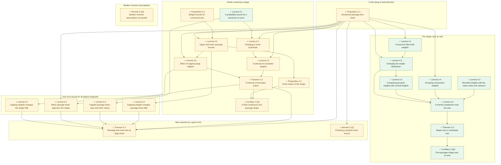

# Limiting shape for directed percolation models

**James B. Martin**

[Formalization guide](../../guides/martin-2004.md) · [Paper catalogue](../../../README.md)

**✓ Certified** · **◐ Restricted** · **○ Not in this release** · **? Not assessed**

A status applies to the scope stated below. Arrows point from a result to a result whose proof uses it.

Graph presentation based on Scott Armstrong’s visual paper design for [*Homogenization at a polynomial scale in high contrast*](https://scottnarmstrong.github.io/hcp-visual-paper/).

## Progress

| Paper result | Formalization |
| --- | --- |
| **Proposition 2.1** Directional passage-time limits | **◐ Restricted** [Lean certificate](https://github.com/cjanjigi/LPP/blob/5a3c7a612144b68468559ea1800bf7f39a5d3ef1/Martin2004/Statements/LimitShape.lean#L73) |
| **Proposition 2.2** Finite values of the shape | **◐ Restricted** [Lean certificate](https://github.com/cjanjigi/LPP/blob/5a3c7a612144b68468559ea1800bf7f39a5d3ef1/Martin2004/Statements/LimitShape.lean#L135) |
| **Theorem 2.3** Continuity at boundary points | **◐ Restricted** [Lean certificate](https://github.com/cjanjigi/LPP/blob/5a3c7a612144b68468559ea1800bf7f39a5d3ef1/Martin2004/Statements/LimitShape.lean#L135) |
| **Corollary 2.5(i)** A finite continuous first-passage shape | **◐ Restricted** [Lean certificate](https://github.com/cjanjigi/LPP/blob/5a3c7a612144b68468559ea1800bf7f39a5d3ef1/Martin2004/Statements/BoundaryAsymptotics.lean#L141) |
| **Lemma 3.1** A probability bound for a maximum of sums | **✓ Certified** [Lean certificate](https://github.com/cjanjigi/LPP/blob/5a3c7a612144b68468559ea1800bf7f39a5d3ef1/ProbabilityBasics/Statements/Concentration.lean#L81) |
| **Lemma 3.2** Changing a small coordinate | **◐ Restricted** [Bounded continuity and face estimate](https://github.com/cjanjigi/LPP/blob/5a3c7a612144b68468559ea1800bf7f39a5d3ef1/Martin2004/Probability/MartinBoundedContinuity.lean#L131) |
| **Lemma 3.3** Continuity for bounded weights | **◐ Restricted** [Lean certificate](https://github.com/cjanjigi/LPP/blob/5a3c7a612144b68468559ea1800bf7f39a5d3ef1/Martin2004/Probability/MartinBoundedContinuity.lean#L131) |
| **Proposition 3.4** Weight bounds for connected sets | **◐ Restricted** [Expected animal bound](https://github.com/cjanjigi/LPP/blob/5a3c7a612144b68468559ea1800bf7f39a5d3ef1/Martin2004/Probability/AnimalPositiveMean.lean#L75) · [Almost-sure animal bound](https://github.com/cjanjigi/LPP/blob/5a3c7a612144b68468559ea1800bf7f39a5d3ef1/Martin2004/Probability/GreedyAnimalAlmostSureBound.lean#L143) |
| **Lemma 3.5** Upper and lower passage bounds | **◐ Restricted** [Mean and ray-shape upper bounds](https://github.com/cjanjigi/LPP/blob/5a3c7a612144b68468559ea1800bf7f39a5d3ef1/Martin2004/Probability/MartinPassageMean.lean#L33) · [Uniform passage upper bound](https://github.com/cjanjigi/LPP/blob/5a3c7a612144b68468559ea1800bf7f39a5d3ef1/Martin2004/Probability/UniformPassageUpper.lean#L57) · [Shape lower bound under a negative moment](https://github.com/cjanjigi/LPP/blob/5a3c7a612144b68468559ea1800bf7f39a5d3ef1/Martin2004/Probability/ShapeAboveMean.lean#L32) |
| **Lemma 3.6** Effect of capping large weights | **◐ Restricted** [Two-sided shape comparison](https://github.com/cjanjigi/LPP/blob/5a3c7a612144b68468559ea1800bf7f39a5d3ef1/Martin2004/Probability/RealExpectedTruncation.lean#L158) · [Compact uniform approximation](https://github.com/cjanjigi/LPP/blob/5a3c7a612144b68468559ea1800bf7f39a5d3ef1/Martin2004/Probability/MartinWeakContinuity.lean#L85) |
| **Theorem 2.4** Shape near a coordinate axis | **✓ Certified** [Lean certificate](https://github.com/cjanjigi/LPP/blob/5a3c7a612144b68468559ea1800bf7f39a5d3ef1/Martin2004/Statements/BoundaryAsymptotics.lean#L82) |
| **Corollary 2.5(ii)** First-passage shape near an axis | **✓ Certified** [Lean certificate](https://github.com/cjanjigi/LPP/blob/5a3c7a612144b68468559ea1800bf7f39a5d3ef1/Martin2004/Statements/BoundaryAsymptotics.lean#L211) |
| **Lemma 4.1** A bound for Bernoulli weights | **✓ Certified** [Lean certificate](https://github.com/cjanjigi/LPP/blob/5a3c7a612144b68468559ea1800bf7f39a5d3ef1/Martin2004/Probability/BernoulliShapeBound.lean#L88) |
| **Lemma 4.2** Changing the weight distribution | **✓ Certified** [Lean certificate](https://github.com/cjanjigi/LPP/blob/5a3c7a612144b68468559ea1800bf7f39a5d3ef1/Martin2004/Probability/ShapeComparison.lean#L119) |
| **Lemma 4.3** Bounded weights with the same mean and variance | **✓ Certified** [Lean certificate](https://github.com/cjanjigi/LPP/blob/5a3c7a612144b68468559ea1800bf7f39a5d3ef1/Martin2004/Probability/MeanVarianceTruncationTail.lean#L289) |
| **Lemma 4.4** Grouping consecutive weights | **✓ Certified** [Lean certificate](https://github.com/cjanjigi/LPP/blob/5a3c7a612144b68468559ea1800bf7f39a5d3ef1/Martin2004/Probability/BlockingComparison.lean#L185) |
| **Lemma 4.5** Comparing grouped weights with normal weights | **✓ Certified** [Lean certificate](https://github.com/cjanjigi/LPP/blob/5a3c7a612144b68468559ea1800bf7f39a5d3ef1/Martin2004/Probability/GaussianBlockComparison.lean#L270) |
| **Lemma 4.6** A normal comparison near the axis | **✓ Certified** [Lean certificate](https://github.com/cjanjigi/LPP/blob/5a3c7a612144b68468559ea1800bf7f39a5d3ef1/Martin2004/Probability/BoundaryUniversality.lean#L156) |
| **Lemma 5.2** Capping weights changes passage times little | **◐ Restricted** [Lean certificate](https://github.com/cjanjigi/LPP/blob/5a3c7a612144b68468559ea1800bf7f39a5d3ef1/Martin2004/Probability/UniformTruncationApproximation.lean#L89) |
| **Lemma 5.3** Capped passage times stay near their means | **◐ Restricted** [Lean certificate](https://github.com/cjanjigi/LPP/blob/5a3c7a612144b68468559ea1800bf7f39a5d3ef1/Martin2004/Probability/BoundedPassageFluctuations.lean#L192) |
| **Lemma 5.4** Mean passage times approach the shape | **◐ Restricted** [Lean certificate](https://github.com/cjanjigi/LPP/blob/5a3c7a612144b68468559ea1800bf7f39a5d3ef1/Martin2004/Probability/BoundedExpectedUniform.lean#L53) |
| **Lemma 5.5** Capping weights changes the shape little | **◐ Restricted** [Lean certificate](https://github.com/cjanjigi/LPP/blob/5a3c7a612144b68468559ea1800bf7f39a5d3ef1/Martin2004/Probability/MartinWeakContinuity.lean#L32) |
| **Theorem 5.1** Passage-time level sets at large times | **◐ Restricted** [Last-passage growth sets](https://github.com/cjanjigi/LPP/blob/5a3c7a612144b68468559ea1800bf7f39a5d3ef1/Martin2004/Statements/GrowthSets.lean#L86) · [First-passage growth sets](https://github.com/cjanjigi/LPP/blob/5a3c7a612144b68468559ea1800bf7f39a5d3ef1/Martin2004/Statements/GrowthSets.lean#L157) |
| **Remark 5.1(i)** Checking a positive lower bound | **◐ Restricted** [Lean certificate](https://github.com/cjanjigi/LPP/blob/5a3c7a612144b68468559ea1800bf7f39a5d3ef1/Martin2004/Statements/GrowthSets.lean#L200) |
| **Remark 5.1(ii)** Weaker moment assumptions for growth | **◐ Restricted** [Weak-negative uniform shape theorem](https://github.com/cjanjigi/LPP/blob/5a3c7a612144b68468559ea1800bf7f39a5d3ef1/Martin2004/Probability/WeakNegativeShape.lean#L161) |

Result statements, notation and certificate scope

### Proposition 2.1

**Directional passage-time limits**

For each fixed $x\in \mathbb{R}_{\geq 0}^d$, the scaled passage time $n^{-1}L_{0,\lfloor nx\rfloor}$ has a deterministic limit $g(x)$. The proposition also identifies how that limit changes under scaling, coordinate permutations and addition of directions.

Let $d\ge2$ be an integer. The order $u\le v$ means $u_j\le v_j$ for every coordinate $j$. Write $|x|_1=\sum_{j=1}^d|x_j|$, and let $e_j$ be the $j$th coordinate vector.

The weights $(\omega_z)_{z\in\mathbb Z^d}$ are independent with common distribution function $F(t)=\mathbb P(\omega_0\le t)$. A directed path takes steps in $\{e_1,\ldots,e_d\}$. Its weight includes its first vertex and excludes its last vertex. $L_{u,v}$ is the largest weight of such a path from $u$ to $v$.

The shape $g$ is defined by $g(x)=\lim_{n\to\infty}n^{-1}L_{0,\lfloor nx\rfloor}$ almost surely for each fixed $x\in \mathbb{R}_{\geq 0}^d$, when these deterministic limits exist. Here $\lfloor nx\rfloor$ means coordinatewise rounding down; the probability-one event may depend on $x$.

Assume $\mathbb E|\omega_0|<\infty$. There is a deterministic function $g:\mathbb{R}_{\geq 0}^d\to\mathbb R\cup\{+\infty\}$ such that, for every fixed $x\in \mathbb{R}_{\geq 0}^d$, $n^{-1}L_{0,\lfloor nx\rfloor}\to g(x)$ almost surely. If $g(x)<\infty$, then $\mathbb E|n^{-1}L_{0,\lfloor nx\rfloor}-g(x)|\to0$. For $a\ge0$ and $x,y\in \mathbb{R}_{\geq 0}^d$, $g(ax)=a g(x)$ and $g(x+y)\ge g(x)+g(y)$. Permuting the coordinates of $x$ leaves $g(x)$ unchanged. Use $0\cdot(+\infty)=0$.

**Formalization scope.** The released certificate proves the case $d=2$. The paper states the result for every integer $d\ge2$.

*Source location* Proposition 2.1.

### Proposition 2.2

**Finite values of the shape**

An integrable weight and a finite explicit upper-tail integral ensure that every value of $g$ is a real number.

Let $d\ge2$ be an integer. The order $u\le v$ means $u_j\le v_j$ for every coordinate $j$. Write $|x|_1=\sum_{j=1}^d|x_j|$, and let $e_j$ be the $j$th coordinate vector.

The weights $(\omega_z)_{z\in\mathbb Z^d}$ are independent with common distribution function $F(t)=\mathbb P(\omega_0\le t)$. A directed path takes steps in $\{e_1,\ldots,e_d\}$. Its weight includes its first vertex and excludes its last vertex. $L_{u,v}$ is the largest weight of such a path from $u$ to $v$.

The shape $g$ is defined by $g(x)=\lim_{n\to\infty}n^{-1}L_{0,\lfloor nx\rfloor}$ almost surely for each fixed $x\in \mathbb{R}_{\geq 0}^d$, when these deterministic limits exist. Here $\lfloor nx\rfloor$ means coordinatewise rounding down; the probability-one event may depend on $x$.

Define $I_+^{(d)}(F)=\int_0^\infty(1-F(t))^{1/d}\,dt$ and $I_-^{(d)}(F)=\int_{-\infty}^0F(t)^{1/d}\,dt$. These are explicit upper- and lower-tail integrals, respectively.

If $\mathbb E|\omega_0|<\infty$ and $I_+^{(d)}(F)<\infty$, then $g(x)\in\mathbb R$ for every $x\in \mathbb{R}_{\geq 0}^d$.

**Formalization scope.** The released certificate proves the case $d=2$. The paper states the result for every integer $d\ge2$.

*Source location* Proposition 2.2.

### Theorem 2.3

**Continuity at boundary points**

The shape changes continuously with direction, even when one or more coordinates tend to zero.

Let $d\ge2$ be an integer. The order $u\le v$ means $u_j\le v_j$ for every coordinate $j$. Write $|x|_1=\sum_{j=1}^d|x_j|$, and let $e_j$ be the $j$th coordinate vector.

The weights $(\omega_z)_{z\in\mathbb Z^d}$ are independent with common distribution function $F(t)=\mathbb P(\omega_0\le t)$. A directed path takes steps in $\{e_1,\ldots,e_d\}$. Its weight includes its first vertex and excludes its last vertex. $L_{u,v}$ is the largest weight of such a path from $u$ to $v$.

The shape $g$ is defined by $g(x)=\lim_{n\to\infty}n^{-1}L_{0,\lfloor nx\rfloor}$ almost surely for each fixed $x\in \mathbb{R}_{\geq 0}^d$, when these deterministic limits exist. Here $\lfloor nx\rfloor$ means coordinatewise rounding down; the probability-one event may depend on $x$.

Define $I_+^{(d)}(F)=\int_0^\infty(1-F(t))^{1/d}\,dt$ and $I_-^{(d)}(F)=\int_{-\infty}^0F(t)^{1/d}\,dt$. These are explicit upper- and lower-tail integrals, respectively.

Assume $\mathbb E|\omega_0|<\infty$ and $I_+^{(d)}(F)<\infty$. If $x_n,x\in \mathbb{R}_{\geq 0}^d$ and $|x_n-x|_1\to0$, then $g(x_n)\to g(x)$.

**Formalization scope.** The released certificate proves the case $d=2$. The paper states the result for every integer $d\ge2$.

*Source location* Theorem 2.3.

### Theorem 2.4

**Shape near a coordinate axis**

Near the horizontal axis, the first correction to the mean weight is $2\sigma\sqrt\alpha$. Its coefficient depends only on the weight variance.

Here $d=2$. The order $u\le v$ means $u_j\le v_j$ for every coordinate $j$. Write $|x|_1=\sum_{j=1}^d|x_j|$, and let $e_j$ be the $j$th coordinate vector.

The weights $(\omega_z)_{z\in\mathbb Z^d}$ are independent with common distribution function $F(t)=\mathbb P(\omega_0\le t)$. A directed path takes steps in $\{e_1,\ldots,e_d\}$. Its weight includes its first vertex and excludes its last vertex. $L_{u,v}$ is the largest weight of such a path from $u$ to $v$.

The shape $g$ is defined by $g(x)=\lim_{n\to\infty}n^{-1}L_{0,\lfloor nx\rfloor}$ almost surely for each fixed $x\in \mathbb{R}_{\geq 0}^2$, when these deterministic limits exist. Here $\lfloor nx\rfloor$ means coordinatewise rounding down; the probability-one event may depend on $x$.

Define $I_+^{(d)}(F)=\int_0^\infty(1-F(t))^{1/d}\,dt$ and $I_-^{(d)}(F)=\int_{-\infty}^0F(t)^{1/d}\,dt$. These are explicit upper- and lower-tail integrals, respectively.

Write $m=\mathbb E\omega_0$ and $\sigma^2=\mathbb E[(\omega_0-m)^2]$, with $\sigma\ge0$. In this result $d=2$; finiteness of both $I_+^{(2)}(F)$ and $I_-^{(2)}(F)$ implies these moments are finite.

Here $\alpha>0$ is the second coordinate in the direction $(1,\alpha)$; $\alpha\downarrow0$ approaches the horizontal axis.

Assume $I_+^{(2)}(F)<\infty$ and $I_-^{(2)}(F)<\infty$. Then $\displaystyle\lim_{\alpha\downarrow0}\frac{g(1,\alpha)-m-2\sigma\sqrt\alpha}{\sqrt\alpha}=0$.

**Formalization scope.** The released certificate covers the full stated result, which is already a two-dimensional statement in the paper.

*Source location* Theorem 2.4.

### Corollary 2.5(i)

**A finite continuous first-passage shape**

The minimum path weight has a finite directional limit, and this first-passage shape is continuous up to the coordinate boundaries.

Let $d\ge2$ be an integer. The order $u\le v$ means $u_j\le v_j$ for every coordinate $j$. Write $|x|_1=\sum_{j=1}^d|x_j|$, and let $e_j$ be the $j$th coordinate vector.

The weights $(\omega_z)_{z\in\mathbb Z^d}$ are independent with common distribution function $F(t)=\mathbb P(\omega_0\le t)$. A directed path takes steps in $\{e_1,\ldots,e_d\}$. Its weight includes its first vertex and excludes its last vertex. $L_{u,v}$ is the largest weight of such a path from $u$ to $v$.

The shape $g$ is defined by $g(x)=\lim_{n\to\infty}n^{-1}L_{0,\lfloor nx\rfloor}$ almost surely for each fixed $x\in \mathbb{R}_{\geq 0}^d$, when these deterministic limits exist. Here $\lfloor nx\rfloor$ means coordinatewise rounding down; the probability-one event may depend on $x$.

$S_{u,v}$ is the smallest weight of a directed path from $u$ to $v$, with the same terminal-excluded convention as $L_{u,v}$. Its directional shape is $h(x)=\lim_{n\to\infty}n^{-1}S_{0,\lfloor nx\rfloor}$ almost surely for each fixed $x$.

Define $I_+^{(d)}(F)=\int_0^\infty(1-F(t))^{1/d}\,dt$ and $I_-^{(d)}(F)=\int_{-\infty}^0F(t)^{1/d}\,dt$. These are explicit upper- and lower-tail integrals, respectively.

If $\mathbb E|\omega_0|<\infty$ and $I_-^{(d)}(F)<\infty$, then $h(x)\in\mathbb R$ for every $x\in \mathbb{R}_{\geq 0}^d$, and $h$ is continuous on $\mathbb{R}_{\geq 0}^d$.

**Formalization scope.** The release proves $d=2$. The linked first-passage certificate states convergence of expected passage times; Proposition 2.1, applied to the negated weights, identifies this function with the almost-sure directional shape.

*Source location* Corollary 2.5(i).

### Corollary 2.5(ii)

**First-passage shape near an axis**

For minimum path weights, the correction near the horizontal axis is $-2\sigma\sqrt\alpha$, with the opposite sign from last passage.

Here $d=2$. The order $u\le v$ means $u_j\le v_j$ for every coordinate $j$. Write $|x|_1=\sum_{j=1}^d|x_j|$, and let $e_j$ be the $j$th coordinate vector.

The weights $(\omega_z)_{z\in\mathbb Z^d}$ are independent with common distribution function $F(t)=\mathbb P(\omega_0\le t)$. A directed path takes steps in $\{e_1,\ldots,e_d\}$. Its weight includes its first vertex and excludes its last vertex. $L_{u,v}$ is the largest weight of such a path from $u$ to $v$.

The shape $g$ is defined by $g(x)=\lim_{n\to\infty}n^{-1}L_{0,\lfloor nx\rfloor}$ almost surely for each fixed $x\in \mathbb{R}_{\geq 0}^2$, when these deterministic limits exist. Here $\lfloor nx\rfloor$ means coordinatewise rounding down; the probability-one event may depend on $x$.

$S_{u,v}$ is the smallest weight of a directed path from $u$ to $v$, with the same terminal-excluded convention as $L_{u,v}$. Its directional shape is $h(x)=\lim_{n\to\infty}n^{-1}S_{0,\lfloor nx\rfloor}$ almost surely for each fixed $x$.

Define $I_+^{(d)}(F)=\int_0^\infty(1-F(t))^{1/d}\,dt$ and $I_-^{(d)}(F)=\int_{-\infty}^0F(t)^{1/d}\,dt$. These are explicit upper- and lower-tail integrals, respectively.

Write $m=\mathbb E\omega_0$ and $\sigma^2=\mathbb E[(\omega_0-m)^2]$, with $\sigma\ge0$. In this result $d=2$; finiteness of both $I_+^{(2)}(F)$ and $I_-^{(2)}(F)$ implies these moments are finite.

Here $\alpha>0$ is the second coordinate in the direction $(1,\alpha)$; $\alpha\downarrow0$ approaches the horizontal axis.

Assume $I_+^{(2)}(F)<\infty$ and $I_-^{(2)}(F)<\infty$. Then $\displaystyle\lim_{\alpha\downarrow0}\frac{h(1,\alpha)-m+2\sigma\sqrt\alpha}{\sqrt\alpha}=0$.

**Formalization scope.** The released certificate covers the full stated result, which is already a two-dimensional statement in the paper.

*Source location* Corollary 2.5(ii).

### Lemma 3.1

**A probability bound for a maximum of sums**

The maximum of finitely many sums of independent bounded variables is unlikely to differ much from its expectation.

$I$ is a finite set. The real random variables $(Y_i)_{i\in I}$ are independent and satisfy $|Y_i|\le b$ almost surely, where $b>0$.

$\mathcal C\ne\varnothing$ is a collection of subsets of $I$. Each $C\in\mathcal C$ has at most $R$ elements, where $R\ge1$ is an integer. Define $Z=\max_{C\in\mathcal C}\sum_{i\in C}Y_i$.

For every $u>0$, $\displaystyle\mathbb P(|Z-\mathbb EZ|\ge u)\le\exp\!\left(64-\frac{u^2}{64Rb^2}\right)$. If $b=0$ or $R=0$, all the permitted sums are zero almost surely and the probability on the left is zero.

**Formalization scope.** The released statement covers an arbitrary probability space and the full finite collection in this lemma. It also treats $b=0$ and $R=0$ explicitly.

*Source location* Lemma 3.1.

### Lemma 3.2

**Changing a small coordinate**

For bounded weights, adding a sufficiently small coordinate changes $g$ by less than a prescribed amount. One choice of the small coordinate works for all bounded points on the coordinate faces.

Let $d\ge2$ be an integer. The order $u\le v$ means $u_j\le v_j$ for every coordinate $j$. Write $|x|_1=\sum_{j=1}^d|x_j|$, and let $e_j$ be the $j$th coordinate vector.

The weights $(\omega_z)_{z\in\mathbb Z^d}$ are independent with common distribution function $F(t)=\mathbb P(\omega_0\le t)$. A directed path takes steps in $\{e_1,\ldots,e_d\}$. Its weight includes its first vertex and excludes its last vertex. $L_{u,v}$ is the largest weight of such a path from $u$ to $v$.

The shape $g$ is defined by $g(x)=\lim_{n\to\infty}n^{-1}L_{0,\lfloor nx\rfloor}$ almost surely for each fixed $x\in \mathbb{R}_{\geq 0}^d$, when these deterministic limits exist. Here $\lfloor nx\rfloor$ means coordinatewise rounding down; the probability-one event may depend on $x$.

A coordinate face is the set of points $x\in \mathbb{R}_{\geq 0}^d$ with one specified coordinate $x_j=0$. Here $1\le j\le d$ and $e_j$ is its coordinate vector.

Suppose $\mathbb P(|\omega_0|\le b)=1$ for some finite $b$. For every $R>0$ and $\varepsilon>0$, there is $\delta>0$ such that $|g(x+t e_j)-g(x)|<\varepsilon$ whenever $x\in \mathbb{R}_{\geq 0}^d$, $|x|_1\le R$, $x_j=0$, $1\le j\le d$ and $0\le t\le\delta$.

**Formalization scope.** The released certificate proves the case $d=2$. The paper states the result for every integer $d\ge2$.

*Source location* Lemma 3.2.

### Lemma 3.3

**Continuity for bounded weights**

If the site weights are bounded, the shape is continuous at every point, including the coordinate boundaries.

Let $d\ge2$ be an integer. The order $u\le v$ means $u_j\le v_j$ for every coordinate $j$. Write $|x|_1=\sum_{j=1}^d|x_j|$, and let $e_j$ be the $j$th coordinate vector.

The weights $(\omega_z)_{z\in\mathbb Z^d}$ are independent with common distribution function $F(t)=\mathbb P(\omega_0\le t)$. A directed path takes steps in $\{e_1,\ldots,e_d\}$. Its weight includes its first vertex and excludes its last vertex. $L_{u,v}$ is the largest weight of such a path from $u$ to $v$.

The shape $g$ is defined by $g(x)=\lim_{n\to\infty}n^{-1}L_{0,\lfloor nx\rfloor}$ almost surely for each fixed $x\in \mathbb{R}_{\geq 0}^d$, when these deterministic limits exist. Here $\lfloor nx\rfloor$ means coordinatewise rounding down; the probability-one event may depend on $x$.

If $\mathbb P(|\omega_0|\le b)=1$ for some finite $b$, then $g:\mathbb{R}_{\geq 0}^d\to\mathbb R$ is continuous.

**Formalization scope.** The released certificate proves the case $d=2$. The paper states the result for every integer $d\ge2$.

*Source location* Lemma 3.3.

### Proposition 3.4

**Weight bounds for connected sets**

Among connected sets with $n$ vertices containing the origin, the largest total weight grows at most linearly in $n$. A finite upper-tail integral bounds its expected and almost-sure rates.

Let $d\ge2$ be an integer. The order $u\le v$ means $u_j\le v_j$ for every coordinate $j$. Write $|x|_1=\sum_{j=1}^d|x_j|$, and let $e_j$ be the $j$th coordinate vector.

The weights $(\omega_z)_{z\in\mathbb Z^d}$ are independent with common distribution function $F(t)=\mathbb P(\omega_0\le t)$. A directed path takes steps in $\{e_1,\ldots,e_d\}$. Its weight includes its first vertex and excludes its last vertex. $L_{u,v}$ is the largest weight of such a path from $u$ to $v$.

The shape $g$ is defined by $g(x)=\lim_{n\to\infty}n^{-1}L_{0,\lfloor nx\rfloor}$ almost surely for each fixed $x\in \mathbb{R}_{\geq 0}^d$, when these deterministic limits exist. Here $\lfloor nx\rfloor$ means coordinatewise rounding down; the probability-one event may depend on $x$.

Define $I_+^{(d)}(F)=\int_0^\infty(1-F(t))^{1/d}\,dt$ and $I_-^{(d)}(F)=\int_{-\infty}^0F(t)^{1/d}\,dt$. These are explicit upper- and lower-tail integrals, respectively.

Let $\mathcal A_n$ consist of all sets $A\subset\mathbb Z^d$ with exactly $n$ vertices, containing $0$, and connected by edges between vertices $u,v$ with $|u-v|_1=1$. These sets are called lattice animals. Define $N(n)=\max_{A\in\mathcal A_n}\sum_{z\in A}\omega_z$.

There is a finite constant $c=c(d)$, independent of the weight law, such that whenever $I_+^{(d)}(F)<\infty$, $\mathbb E N(n)\le c n I_+^{(d)}(F)$ for every integer $n>1$, and $\displaystyle\limsup_{n\to\infty}N(n)/n\le c I_+^{(d)}(F)$ almost surely.

**Formalization scope.** The released certificate proves the case $d=2$. The paper states the result for every integer $d\ge2$.

*Source location* Proposition 3.4.

### Lemma 3.5

**Upper and lower passage bounds**

The upper-tail integral bounds passage-time means and the shape from above. The mean site weight gives the matching elementary lower bound for the shape.

Let $d\ge2$ be an integer. The order $u\le v$ means $u_j\le v_j$ for every coordinate $j$. Write $|x|_1=\sum_{j=1}^d|x_j|$, and let $e_j$ be the $j$th coordinate vector.

The weights $(\omega_z)_{z\in\mathbb Z^d}$ are independent with common distribution function $F(t)=\mathbb P(\omega_0\le t)$. A directed path takes steps in $\{e_1,\ldots,e_d\}$. Its weight includes its first vertex and excludes its last vertex. $L_{u,v}$ is the largest weight of such a path from $u$ to $v$.

The shape $g$ is defined by $g(x)=\lim_{n\to\infty}n^{-1}L_{0,\lfloor nx\rfloor}$ almost surely for each fixed $x\in \mathbb{R}_{\geq 0}^d$, when these deterministic limits exist. Here $\lfloor nx\rfloor$ means coordinatewise rounding down; the probability-one event may depend on $x$.

Define $I_+^{(d)}(F)=\int_0^\infty(1-F(t))^{1/d}\,dt$ and $I_-^{(d)}(F)=\int_{-\infty}^0F(t)^{1/d}\,dt$. These are explicit upper- and lower-tail integrals, respectively.

Write $m=\mathbb E\omega_0$. The constant $c=c(d)$ depends only on the dimension. In the maximum below, $z$ ranges over nonnegative lattice points.

Under $\mathbb E|\omega_0|<\infty$ and $I_+^{(d)}(F)<\infty$, one can choose $c<\infty$ such that $\mathbb E L_{0,z}\le c|z|_1 I_+^{(d)}(F)$ for every $z\in\mathbb Z_{\ge0}^d$; $\displaystyle\limsup_{n\to\infty}\frac1n\max_{|z|_1\le n}L_{0,z}\le c I_+^{(d)}(F)$ almost surely; and $|x|_1m\le g(x)\le c|x|_1 I_+^{(d)}(F)$ for every $x\in \mathbb{R}_{\geq 0}^d$.

**Formalization scope.** The linked upper bounds are proved for $d=2$. The linked export for the shape lower bound additionally assumes $\mathbb E[(\omega_0^-)^p]<\infty$ for some $p>1$, where $\omega_0^-=\max\{-\omega_0,0\}$. The paper's lemma has the weaker first-moment hypothesis.

*Source location* Lemma 3.5.

### Lemma 3.6

**Effect of capping large weights**

Moving all site weights into $[-b,b]$ changes the shape by an amount controlled by the parts of the weight distribution beyond those cutoffs.

Let $d\ge2$ be an integer. The order $u\le v$ means $u_j\le v_j$ for every coordinate $j$. Write $|x|_1=\sum_{j=1}^d|x_j|$, and let $e_j$ be the $j$th coordinate vector.

The weights $(\omega_z)_{z\in\mathbb Z^d}$ are independent with common distribution function $F(t)=\mathbb P(\omega_0\le t)$. A directed path takes steps in $\{e_1,\ldots,e_d\}$. Its weight includes its first vertex and excludes its last vertex. $L_{u,v}$ is the largest weight of such a path from $u$ to $v$.

The shape $g$ is defined by $g(x)=\lim_{n\to\infty}n^{-1}L_{0,\lfloor nx\rfloor}$ almost surely for each fixed $x\in \mathbb{R}_{\geq 0}^d$, when these deterministic limits exist. Here $\lfloor nx\rfloor$ means coordinatewise rounding down; the probability-one event may depend on $x$.

Define $I_+^{(d)}(F)=\int_0^\infty(1-F(t))^{1/d}\,dt$ and $I_-^{(d)}(F)=\int_{-\infty}^0F(t)^{1/d}\,dt$. These are explicit upper- and lower-tail integrals, respectively.

For a cutoff $b>0$, set $\omega_z^{(b)}=\max\{-b,\min\{\omega_z,b\}\}$. Thus all weights are moved into $[-b,b]$. $L_{u,v}^{(b)}$ and $g^{(b)}$ are the passage times and directional shape obtained from these modified weights.

The constant $c=c(d)$ is the one in Lemma 3.5. The integral $\int_{-\infty}^{-b}F(t)\,dt$ equals $\mathbb E[(-b-\omega_0)^+]$, where $a^+=\max\{a,0\}$.

Assume $\mathbb E|\omega_0|<\infty$ and $I_+^{(d)}(F)<\infty$. For every $b>0$ and $x\in \mathbb{R}_{\geq 0}^d$, $\displaystyle g^{(b)}(x)-|x|_1\int_{-\infty}^{-b}F(t)\,dt\le g(x)\le g^{(b)}(x)+c|x|_1\int_b^\infty(1-F(t))^{1/d}\,dt$. Consequently, for every $R>0$, $\displaystyle\sup_{x\in \mathbb{R}_{\geq 0}^d,\ |x|_1\le R}|g^{(b)}(x)-g(x)|\to0$ as $b\to\infty$.

**Formalization scope.** The released certificate proves the case $d=2$. The paper states the result for every integer $d\ge2$.

*Source location* Lemma 3.6.

### Lemma 4.1

**A bound for Bernoulli weights**

For weights that are $1$ with probability $p$ and $0$ otherwise, the shape has an explicit upper bound.

Here $d=2$. The order $u\le v$ means $u_j\le v_j$ for every coordinate $j$. Write $|x|_1=\sum_{j=1}^d|x_j|$, and let $e_j$ be the $j$th coordinate vector.

The weights $(\omega_z)_{z\in\mathbb Z^d}$ are independent with common distribution function $F(t)=\mathbb P(\omega_0\le t)$. A directed path takes steps in $\{e_1,\ldots,e_d\}$. Its weight includes its first vertex and excludes its last vertex. $L_{u,v}$ is the largest weight of such a path from $u$ to $v$.

The shape $g_F$ is defined by $g_F(x)=\lim_{n\to\infty}n^{-1}L_{0,\lfloor nx\rfloor}$ almost surely for each fixed $x\in \mathbb{R}_{\geq 0}^2$, when these deterministic limits exist. Here $\lfloor nx\rfloor$ means coordinatewise rounding down; the probability-one event may depend on $x$.

For $p\in[0,1]$, $\operatorname{Ber}(p)$ is the law with mass $p$ at $1$ and mass $1-p$ at $0$. The function $g_{\operatorname{Ber}(p)}$ is its directional last-passage shape.

For every $\alpha>0$ and $p\in[0,1]$, $\displaystyle g_{\operatorname{Ber}(p)}(1,\alpha)\le (1+\alpha)p+2\sqrt{\alpha(1+\alpha)p(1-p)}$.

**Formalization scope.** The released certificate covers the full stated result, which is already a two-dimensional statement in the paper.

*Source location* Lemma 4.1.

### Lemma 4.2

**Changing the weight distribution**

An explicit integral of the difference between two distribution functions controls the change in their shapes, after accounting for the difference in their means.

Here $d=2$. The order $u\le v$ means $u_j\le v_j$ for every coordinate $j$. Write $|x|_1=\sum_{j=1}^d|x_j|$, and let $e_j$ be the $j$th coordinate vector.

The weights $(\omega_z)_{z\in\mathbb Z^d}$ are independent with common distribution function $F(t)=\mathbb P(\omega_0\le t)$. A directed path takes steps in $\{e_1,\ldots,e_d\}$. Its weight includes its first vertex and excludes its last vertex. $L_{u,v}$ is the largest weight of such a path from $u$ to $v$.

The shape $g_F$ is defined by $g_F(x)=\lim_{n\to\infty}n^{-1}L_{0,\lfloor nx\rfloor}$ almost surely for each fixed $x\in \mathbb{R}_{\geq 0}^2$, when these deterministic limits exist. Here $\lfloor nx\rfloor$ means coordinatewise rounding down; the probability-one event may depend on $x$.

Define $I_+^{(d)}(F)=\int_0^\infty(1-F(t))^{1/d}\,dt$ and $I_-^{(d)}(F)=\int_{-\infty}^0F(t)^{1/d}\,dt$. These are explicit upper- and lower-tail integrals, respectively.

For $i=1,2$, let $F_i$ be a distribution function, $m_i$ its mean, and $g_{F_i}$ its directional shape. Define $D(F_1,F_2)=\int_{\mathbb R}|F_1(t)-F_2(t)|^{1/2}\,dt$.

If $I_+^{(2)}(F_i)$ and $I_-^{(2)}(F_i)$ are finite for $i=1,2$, then for every $\alpha>0$, $\displaystyle|g_{F_1}(1,\alpha)-g_{F_2}(1,\alpha)-(1+\alpha)(m_1-m_2)|\le2\sqrt{\alpha(1+\alpha)}\,D(F_1,F_2)$.

**Formalization scope.** The released certificate covers the full stated result, which is already a two-dimensional statement in the paper.

*Source location* Lemma 4.2.

### Lemma 4.3

**Bounded weights with the same mean and variance**

The distribution can be replaced by one supported in a finite interval while preserving its mean and variance and making a specified integral error as small as desired.

Here $d=2$. The order $u\le v$ means $u_j\le v_j$ for every coordinate $j$. Write $|x|_1=\sum_{j=1}^d|x_j|$, and let $e_j$ be the $j$th coordinate vector.

The weights $(\omega_z)_{z\in\mathbb Z^d}$ are independent with common distribution function $F(t)=\mathbb P(\omega_0\le t)$. A directed path takes steps in $\{e_1,\ldots,e_d\}$. Its weight includes its first vertex and excludes its last vertex. $L_{u,v}$ is the largest weight of such a path from $u$ to $v$.

The shape $g_F$ is defined by $g_F(x)=\lim_{n\to\infty}n^{-1}L_{0,\lfloor nx\rfloor}$ almost surely for each fixed $x\in \mathbb{R}_{\geq 0}^2$, when these deterministic limits exist. Here $\lfloor nx\rfloor$ means coordinatewise rounding down; the probability-one event may depend on $x$.

Define $I_+^{(d)}(F)=\int_0^\infty(1-F(t))^{1/d}\,dt$ and $I_-^{(d)}(F)=\int_{-\infty}^0F(t)^{1/d}\,dt$. These are explicit upper- and lower-tail integrals, respectively.

A distribution $\widetilde F$ has bounded support if $\mathbb P(|\widetilde\omega|\le b)=1$ for some $b<\infty$ when $\widetilde\omega$ has that distribution. Define $D(F,\widetilde F)=\int_{\mathbb R}|F(t)-\widetilde F(t)|^{1/2}\,dt$.

If $I_+^{(2)}(F)<\infty$ and $I_-^{(2)}(F)<\infty$, then for every $\varepsilon>0$ there is a bounded-support distribution $\widetilde F$ with the same mean and variance as $F$ and $D(F,\widetilde F)<\varepsilon$.

**Formalization scope.** The released certificate covers the full stated result, which is already a two-dimensional statement in the paper.

*Source location* Lemma 4.3.

### Lemma 4.4

**Grouping consecutive weights**

Replacing each site weight by a sum of $r(\alpha)$ independent weights gives the same leading shape near the axis after the appropriate change of scale.

Here $d=2$. The order $u\le v$ means $u_j\le v_j$ for every coordinate $j$. Write $|x|_1=\sum_{j=1}^d|x_j|$, and let $e_j$ be the $j$th coordinate vector.

The weights $(\omega_z)_{z\in\mathbb Z^d}$ are independent with common distribution function $F(t)=\mathbb P(\omega_0\le t)$. A directed path takes steps in $\{e_1,\ldots,e_d\}$. Its weight includes its first vertex and excludes its last vertex. $L_{u,v}$ is the largest weight of such a path from $u$ to $v$.

The shape $g_F$ is defined by $g_F(x)=\lim_{n\to\infty}n^{-1}L_{0,\lfloor nx\rfloor}$ almost surely for each fixed $x\in \mathbb{R}_{\geq 0}^2$, when these deterministic limits exist. Here $\lfloor nx\rfloor$ means coordinatewise rounding down; the probability-one event may depend on $x$.

For an integer $k\ge1$, $F^{(k)}$ is the distribution function of $\omega_1+\cdots+\omega_k$, where $\omega_1,\ldots,\omega_k$ are independent with distribution function $F$. The symbol $F^{(k)}$ denotes a sum distribution, not the pointwise power of $F$.

The integer-valued function $r:(0,\infty)\to\{1,2,\ldots\}$ satisfies $r(\alpha)\to\infty$ and $r(\alpha)\sqrt\alpha\to0$ as $\alpha\downarrow0$. In a formula containing $F^{(r)}$, write $F^{(r(\alpha))}$.

Bounded support means that $\mathbb P(|\omega_0|\le b)=1$ for some finite $b$.

Assume $F$ has bounded support. Then $\displaystyle\lim_{\alpha\downarrow0}\frac{g_F(1,\alpha)-r(\alpha)^{-1}g_{F^{(r(\alpha))}}(1,\alpha r(\alpha))}{\sqrt\alpha}=0$.

**Formalization scope.** The released certificate covers the full stated result, which is already a two-dimensional statement in the paper.

*Source location* Lemma 4.4.

### Lemma 4.5

**Comparing grouped weights with normal weights**

For bounded weights, the shape built from long sums can be compared with the shape for normal weights. The error is smaller than $\sqrt\alpha$.

Here $d=2$. The order $u\le v$ means $u_j\le v_j$ for every coordinate $j$. Write $|x|_1=\sum_{j=1}^d|x_j|$, and let $e_j$ be the $j$th coordinate vector.

The weights $(\omega_z)_{z\in\mathbb Z^d}$ are independent with common distribution function $F(t)=\mathbb P(\omega_0\le t)$. A directed path takes steps in $\{e_1,\ldots,e_d\}$. Its weight includes its first vertex and excludes its last vertex. $L_{u,v}$ is the largest weight of such a path from $u$ to $v$.

The shape $g_F$ is defined by $g_F(x)=\lim_{n\to\infty}n^{-1}L_{0,\lfloor nx\rfloor}$ almost surely for each fixed $x\in \mathbb{R}_{\geq 0}^2$, when these deterministic limits exist. Here $\lfloor nx\rfloor$ means coordinatewise rounding down; the probability-one event may depend on $x$.

For an integer $k\ge1$, $F^{(k)}$ is the distribution function of $\omega_1+\cdots+\omega_k$, where $\omega_1,\ldots,\omega_k$ are independent with distribution function $F$. The symbol $F^{(k)}$ denotes a sum distribution, not the pointwise power of $F$.

The integer-valued function $r:(0,\infty)\to\{1,2,\ldots\}$ satisfies $r(\alpha)\to\infty$ and $r(\alpha)\sqrt\alpha\to0$ as $\alpha\downarrow0$. In a formula containing $F^{(r)}$, write $F^{(r(\alpha))}$.

$\Phi(t)=\mathbb P(Z\le t)$ for a real normal random variable $Z$ with mean $0$ and variance $1$. The shape $g_\Phi$ uses independent site weights with this distribution.

Write $m_F=\mathbb E\omega_0$ and $\sigma_F^2=\mathbb E[(\omega_0-m_F)^2]$, with $\sigma_F\ge0$.

Bounded support means that $\mathbb P(|\omega_0|\le b)=1$ for some finite $b$.

Assume $F$ has bounded support. Then $\displaystyle\lim_{\alpha\downarrow0}\frac{r(\alpha)^{-1}g_{F^{(r(\alpha))}}(1,\alpha r(\alpha))-m_F-\sigma_F r(\alpha)^{-1/2}g_\Phi(1,\alpha r(\alpha))}{\sqrt\alpha}=0$.

**Formalization scope.** The released certificate covers the full stated result, which is already a two-dimensional statement in the paper.

*Source location* Lemma 4.5.

### Lemma 4.6

**A normal comparison near the axis**

The comparison with normal weights continues to hold for unbounded weight laws satisfying the two explicit tail integrals.

Here $d=2$. The order $u\le v$ means $u_j\le v_j$ for every coordinate $j$. Write $|x|_1=\sum_{j=1}^d|x_j|$, and let $e_j$ be the $j$th coordinate vector.

The weights $(\omega_z)_{z\in\mathbb Z^d}$ are independent with common distribution function $F(t)=\mathbb P(\omega_0\le t)$. A directed path takes steps in $\{e_1,\ldots,e_d\}$. Its weight includes its first vertex and excludes its last vertex. $L_{u,v}$ is the largest weight of such a path from $u$ to $v$.

The shape $g_F$ is defined by $g_F(x)=\lim_{n\to\infty}n^{-1}L_{0,\lfloor nx\rfloor}$ almost surely for each fixed $x\in \mathbb{R}_{\geq 0}^2$, when these deterministic limits exist. Here $\lfloor nx\rfloor$ means coordinatewise rounding down; the probability-one event may depend on $x$.

Define $I_+^{(d)}(F)=\int_0^\infty(1-F(t))^{1/d}\,dt$ and $I_-^{(d)}(F)=\int_{-\infty}^0F(t)^{1/d}\,dt$. These are explicit upper- and lower-tail integrals, respectively.

Write $m_F=\mathbb E\omega_0$ and $\sigma_F^2=\mathbb E[(\omega_0-m_F)^2]$, with $\sigma_F\ge0$. In this result $d=2$; finiteness of both $I_+^{(2)}(F)$ and $I_-^{(2)}(F)$ implies these moments are finite.

For an integer $k\ge1$, $F^{(k)}$ is the distribution function of $\omega_1+\cdots+\omega_k$, where $\omega_1,\ldots,\omega_k$ are independent with distribution function $F$. The symbol $F^{(k)}$ denotes a sum distribution, not the pointwise power of $F$.

The integer-valued function $r:(0,\infty)\to\{1,2,\ldots\}$ satisfies $r(\alpha)\to\infty$ and $r(\alpha)\sqrt\alpha\to0$ as $\alpha\downarrow0$. In a formula containing $F^{(r)}$, write $F^{(r(\alpha))}$.

$\Phi(t)=\mathbb P(Z\le t)$ for a real normal random variable $Z$ with mean $0$ and variance $1$. The shape $g_\Phi$ uses independent site weights with this distribution.

Assume $I_+^{(2)}(F)<\infty$ and $I_-^{(2)}(F)<\infty$. Then $\displaystyle\lim_{\alpha\downarrow0}\frac{g_F(1,\alpha)-m_F-\sigma_F r(\alpha)^{-1/2}g_\Phi(1,\alpha r(\alpha))}{\sqrt\alpha}=0$.

**Formalization scope.** The released certificate covers the full stated result, which is already a two-dimensional statement in the paper.

*Source location* Lemma 4.6.

### Theorem 5.1

**Passage-time level sets at large times**

After dividing space by time, the random sets of points with passage time at most $t$ approach the deterministic sets defined by $g$ and $h$.

Let $d\ge2$ be an integer. The order $u\le v$ means $u_j\le v_j$ for every coordinate $j$. Write $|x|_1=\sum_{j=1}^d|x_j|$, and let $e_j$ be the $j$th coordinate vector.

The weights $(\omega_z)_{z\in\mathbb Z^d}$ are independent with common distribution function $F(t)=\mathbb P(\omega_0\le t)$. A directed path takes steps in $\{e_1,\ldots,e_d\}$. Its weight includes its first vertex and excludes its last vertex. $L_{u,v}$ is the largest weight of such a path from $u$ to $v$.

The shape $g$ is defined by $g(x)=\lim_{n\to\infty}n^{-1}L_{0,\lfloor nx\rfloor}$ almost surely for each fixed $x\in \mathbb{R}_{\geq 0}^d$, when these deterministic limits exist. Here $\lfloor nx\rfloor$ means coordinatewise rounding down; the probability-one event may depend on $x$.

$S_{u,v}$ is the smallest weight of a directed path from $u$ to $v$, with the same terminal-excluded convention as $L_{u,v}$. Its directional shape is $h(x)=\lim_{n\to\infty}n^{-1}S_{0,\lfloor nx\rfloor}$ almost surely for each fixed $x$.

Define $I_+^{(d)}(F)=\int_0^\infty(1-F(t))^{1/d}\,dt$ and $I_-^{(d)}(F)=\int_{-\infty}^0F(t)^{1/d}\,dt$. These are explicit upper- and lower-tail integrals, respectively.

For $t\ge0$, define $B(t)=\{x\in \mathbb{R}_{\geq 0}^d:L_{0,\lfloor x\rfloor}\le t\}$ and $C(t)=\{x\in \mathbb{R}_{\geq 0}^d:S_{0,\lfloor x\rfloor}\le t\}$. Define $B=\{x\in \mathbb{R}_{\geq 0}^d:g(x)\le1\}$ and $C=\{x\in \mathbb{R}_{\geq 0}^d:h(x)\le1\}$.

For a set $A\subset\mathbb R^d$ and a real number $a\ge0$, $aA=\{ax:x\in A\}$. Thus $t^{-1}B(t)$ is the set $B(t)$ shrunk by a factor $t$.

Assume $I_+^{(d)}(F)<\infty$ and $I_-^{(d)}(F)<\infty$. (i) If $\mathbb E\omega_0>0$, then almost surely, for every $0<\varepsilon<1$, there is $t_0<\infty$ such that $(1-\varepsilon)B\subseteq t^{-1}B(t)\subseteq(1+\varepsilon)B$ for every $t\ge t_0$. (ii) If there is $c>0$ such that $h(x)\ge c|x|_1$ for every $x\in \mathbb{R}_{\geq 0}^d$, the same conclusion holds with $C(t),C$ in place of $B(t),B$.

**Formalization scope.** The release proves $d=2$. Its statements also allow $\varepsilon\ge1$ by replacing the inner factor $1-\varepsilon$ with $\max\{1-\varepsilon,0\}$.

*Source location* Theorem 5.1.

### Remark 5.1(i)

**Checking a positive lower bound**

For the first-passage shape, positivity in the diagonal direction is enough to give a positive lower bound in every direction. For nonnegative weights, the paper also gives a sufficient condition using the probability of zero weight.

Let $d\ge2$ be an integer. The order $u\le v$ means $u_j\le v_j$ for every coordinate $j$. Write $|x|_1=\sum_{j=1}^d|x_j|$, and let $e_j$ be the $j$th coordinate vector.

The weights $(\omega_z)_{z\in\mathbb Z^d}$ are independent with common distribution function $F(t)=\mathbb P(\omega_0\le t)$. A directed path takes steps in $\{e_1,\ldots,e_d\}$. Its weight includes its first vertex and excludes its last vertex. $L_{u,v}$ is the largest weight of such a path from $u$ to $v$.

The shape $g$ is defined by $g(x)=\lim_{n\to\infty}n^{-1}L_{0,\lfloor nx\rfloor}$ almost surely for each fixed $x\in \mathbb{R}_{\geq 0}^d$, when these deterministic limits exist. Here $\lfloor nx\rfloor$ means coordinatewise rounding down; the probability-one event may depend on $x$.

$S_{u,v}$ is the smallest weight of a directed path from $u$ to $v$, with the same terminal-excluded convention as $L_{u,v}$. Its directional shape is $h(x)=\lim_{n\to\infty}n^{-1}S_{0,\lfloor nx\rfloor}$ almost surely for each fixed $x$.

Write $\mathbf1=(1,\ldots,1)\in \mathbb{R}_{\geq 0}^d$. The number $p_c^{\mathrm{dir}}(d)$ is the infimum of $p\in[0,1]$ for which independent open vertices of density $p$ on $\mathbb Z^d$ have positive probability of an infinite path from $0$ taking steps in $\{e_1,\ldots,e_d\}$.

For the finite first-passage shape, $\displaystyle h(x)\ge\frac{|x|_1}{d}h(\mathbf1)$ for every $x\in \mathbb{R}_{\geq 0}^d$. Hence $\inf_{x\in \mathbb{R}_{\geq 0}^d\setminus\{0\}}h(x)/|x|_1>0$ if and only if $h(\mathbf1)>0$. If $\omega_0\ge0$ almost surely, the paper states that $F(0)<p_c^{\mathrm{dir}}(d)$ implies this positivity.

**Formalization scope.** The linked released result proves the deterministic lower bound for $d=2$. It does not cover the whole remark or the condition involving $p_c^{\mathrm{dir}}(d)$.

*Source location* Remark 5.1(i).

### Remark 5.1(ii)

**Weaker moment assumptions for growth**

The paper states that only the tail relevant to maximizing or minimizing needs the stronger integral condition. The other tail needs only a first moment. The paper explicitly omits the proof of this extension.

Let $d\ge2$ be an integer. The order $u\le v$ means $u_j\le v_j$ for every coordinate $j$. Write $|x|_1=\sum_{j=1}^d|x_j|$, and let $e_j$ be the $j$th coordinate vector.

The weights $(\omega_z)_{z\in\mathbb Z^d}$ are independent with common distribution function $F(t)=\mathbb P(\omega_0\le t)$. A directed path takes steps in $\{e_1,\ldots,e_d\}$. Its weight includes its first vertex and excludes its last vertex. $L_{u,v}$ is the largest weight of such a path from $u$ to $v$.

The shape $g$ is defined by $g(x)=\lim_{n\to\infty}n^{-1}L_{0,\lfloor nx\rfloor}$ almost surely for each fixed $x\in \mathbb{R}_{\geq 0}^d$, when these deterministic limits exist. Here $\lfloor nx\rfloor$ means coordinatewise rounding down; the probability-one event may depend on $x$.

$S_{u,v}$ is the smallest weight of a directed path from $u$ to $v$, with the same terminal-excluded convention as $L_{u,v}$. Its directional shape is $h(x)=\lim_{n\to\infty}n^{-1}S_{0,\lfloor nx\rfloor}$ almost surely for each fixed $x$.

Define $I_+^{(d)}(F)=\int_0^\infty(1-F(t))^{1/d}\,dt$ and $I_-^{(d)}(F)=\int_{-\infty}^0F(t)^{1/d}\,dt$. These are explicit upper- and lower-tail integrals, respectively.

For $t\ge0$, define $B(t)=\{x\in \mathbb{R}_{\geq 0}^d:L_{0,\lfloor x\rfloor}\le t\}$ and $C(t)=\{x\in \mathbb{R}_{\geq 0}^d:S_{0,\lfloor x\rfloor}\le t\}$. Define $B=\{x\in \mathbb{R}_{\geq 0}^d:g(x)\le1\}$ and $C=\{x\in \mathbb{R}_{\geq 0}^d:h(x)\le1\}$.

For a set $A\subset\mathbb R^d$ and a real number $a\ge0$, $aA=\{ax:x\in A\}$. Thus $t^{-1}B(t)$ is the set $B(t)$ shrunk by a factor $t$.

Define $\omega_0^+=\max\{\omega_0,0\}$ and $\omega_0^-=\max\{-\omega_0,0\}$. Their expectations measure the positive and negative first moments separately.

For the last-passage conclusion of Theorem 5.1, the paper states that $I_-^{(d)}(F)<\infty$ may be replaced by $\mathbb E\omega_0^-<\infty$, retaining $I_+^{(d)}(F)<\infty$ and the positive-mean condition. For the first-passage conclusion, it states that $I_+^{(d)}(F)<\infty$ may instead be replaced by $\mathbb E\omega_0^+<\infty$, retaining $I_-^{(d)}(F)<\infty$ and the positive lower bound for $h$.

**Formalization scope.** The released two-dimensional last-passage extension assumes $\mathbb E[(\omega_0^-)^p]<\infty$ for some $p>1$, together with $I_+^{(2)}(F)<\infty$. This is stronger than the first negative moment asserted in the remark. It covers the moment assumptions used in Differentiability of the shape function in the planar corner growth model.

*Source location* Remark 5.1(ii).

### Lemma 5.2

**Capping weights changes passage times little**

If both tail integrals are finite, a sufficiently large fixed cutoff makes the error in every distant passage time smaller than a prescribed fraction of its path length.

Let $d\ge2$ be an integer. The order $u\le v$ means $u_j\le v_j$ for every coordinate $j$. Write $|x|_1=\sum_{j=1}^d|x_j|$, and let $e_j$ be the $j$th coordinate vector.

The weights $(\omega_z)_{z\in\mathbb Z^d}$ are independent with common distribution function $F(t)=\mathbb P(\omega_0\le t)$. A directed path takes steps in $\{e_1,\ldots,e_d\}$. Its weight includes its first vertex and excludes its last vertex. $L_{u,v}$ is the largest weight of such a path from $u$ to $v$.

The shape $g$ is defined by $g(x)=\lim_{n\to\infty}n^{-1}L_{0,\lfloor nx\rfloor}$ almost surely for each fixed $x\in \mathbb{R}_{\geq 0}^d$, when these deterministic limits exist. Here $\lfloor nx\rfloor$ means coordinatewise rounding down; the probability-one event may depend on $x$.

Define $I_+^{(d)}(F)=\int_0^\infty(1-F(t))^{1/d}\,dt$ and $I_-^{(d)}(F)=\int_{-\infty}^0F(t)^{1/d}\,dt$. These are explicit upper- and lower-tail integrals, respectively.

For a cutoff $b>0$, set $\omega_z^{(b)}=\max\{-b,\min\{\omega_z,b\}\}$. Thus all weights are moved into $[-b,b]$. $L_{u,v}^{(b)}$ and $g^{(b)}$ are the passage times and directional shape obtained from these modified weights.

Assume $I_+^{(d)}(F)<\infty$ and $I_-^{(d)}(F)<\infty$. For every $\varepsilon>0$, all sufficiently large cutoffs $b$ have the following property: almost surely there is a finite $R$ such that $|L_{0,z}-L_{0,z}^{(b)}|<\varepsilon|z|_1$ for every $z\in\mathbb Z_{\ge0}^d$ with $|z|_1\ge R$.

**Formalization scope.** The released certificate proves the case $d=2$. The paper states the result for every integer $d\ge2$.

*Source location* Lemma 5.2.

### Lemma 5.3

**Capped passage times stay near their means**

For a fixed cutoff, random passage times differ from their expectations by less than a prescribed fraction of distance at every sufficiently distant lattice point.

Let $d\ge2$ be an integer. The order $u\le v$ means $u_j\le v_j$ for every coordinate $j$. Write $|x|_1=\sum_{j=1}^d|x_j|$, and let $e_j$ be the $j$th coordinate vector.

The weights $(\omega_z)_{z\in\mathbb Z^d}$ are independent with common distribution function $F(t)=\mathbb P(\omega_0\le t)$. A directed path takes steps in $\{e_1,\ldots,e_d\}$. Its weight includes its first vertex and excludes its last vertex. $L_{u,v}$ is the largest weight of such a path from $u$ to $v$.

The shape $g$ is defined by $g(x)=\lim_{n\to\infty}n^{-1}L_{0,\lfloor nx\rfloor}$ almost surely for each fixed $x\in \mathbb{R}_{\geq 0}^d$, when these deterministic limits exist. Here $\lfloor nx\rfloor$ means coordinatewise rounding down; the probability-one event may depend on $x$.

For a cutoff $b>0$, set $\omega_z^{(b)}=\max\{-b,\min\{\omega_z,b\}\}$. Thus all weights are moved into $[-b,b]$. $L_{u,v}^{(b)}$ and $g^{(b)}$ are the passage times and directional shape obtained from these modified weights.

For every $b>0$ and $\varepsilon>0$, almost surely there is a finite $R$ such that $|L_{0,z}^{(b)}-\mathbb E L_{0,z}^{(b)}|<\varepsilon|z|_1$ for all $z\in\mathbb Z_{\ge0}^d$ with $|z|_1\ge R$.

**Formalization scope.** The released certificate proves the case $d=2$. The paper states the result for every integer $d\ge2$.

*Source location* Lemma 5.3.

### Lemma 5.4

**Mean passage times approach the shape**

For fixed capped weights, the expected passage time is close to the deterministic shape at every sufficiently distant lattice point.

Let $d\ge2$ be an integer. The order $u\le v$ means $u_j\le v_j$ for every coordinate $j$. Write $|x|_1=\sum_{j=1}^d|x_j|$, and let $e_j$ be the $j$th coordinate vector.

The weights $(\omega_z)_{z\in\mathbb Z^d}$ are independent with common distribution function $F(t)=\mathbb P(\omega_0\le t)$. A directed path takes steps in $\{e_1,\ldots,e_d\}$. Its weight includes its first vertex and excludes its last vertex. $L_{u,v}$ is the largest weight of such a path from $u$ to $v$.

The shape $g$ is defined by $g(x)=\lim_{n\to\infty}n^{-1}L_{0,\lfloor nx\rfloor}$ almost surely for each fixed $x\in \mathbb{R}_{\geq 0}^d$, when these deterministic limits exist. Here $\lfloor nx\rfloor$ means coordinatewise rounding down; the probability-one event may depend on $x$.

For a cutoff $b>0$, set $\omega_z^{(b)}=\max\{-b,\min\{\omega_z,b\}\}$. Thus all weights are moved into $[-b,b]$. $L_{u,v}^{(b)}$ and $g^{(b)}$ are the passage times and directional shape obtained from these modified weights.

For every $b>0$ and $\varepsilon>0$, there is a deterministic finite $R$ such that $|\mathbb E L_{0,z}^{(b)}-g^{(b)}(z)|<\varepsilon|z|_1$ for every $z\in\mathbb Z_{\ge0}^d$ with $|z|_1\ge R$.

**Formalization scope.** The released certificate proves the case $d=2$. The paper states the result for every integer $d\ge2$.

*Source location* Lemma 5.4.

### Lemma 5.5

**Capping weights changes the shape little**

A sufficiently large weight cutoff makes the two deterministic shapes close, with an error proportional to distance.

Let $d\ge2$ be an integer. The order $u\le v$ means $u_j\le v_j$ for every coordinate $j$. Write $|x|_1=\sum_{j=1}^d|x_j|$, and let $e_j$ be the $j$th coordinate vector.

The weights $(\omega_z)_{z\in\mathbb Z^d}$ are independent with common distribution function $F(t)=\mathbb P(\omega_0\le t)$. A directed path takes steps in $\{e_1,\ldots,e_d\}$. Its weight includes its first vertex and excludes its last vertex. $L_{u,v}$ is the largest weight of such a path from $u$ to $v$.

The shape $g$ is defined by $g(x)=\lim_{n\to\infty}n^{-1}L_{0,\lfloor nx\rfloor}$ almost surely for each fixed $x\in \mathbb{R}_{\geq 0}^d$, when these deterministic limits exist. Here $\lfloor nx\rfloor$ means coordinatewise rounding down; the probability-one event may depend on $x$.

Define $I_+^{(d)}(F)=\int_0^\infty(1-F(t))^{1/d}\,dt$ and $I_-^{(d)}(F)=\int_{-\infty}^0F(t)^{1/d}\,dt$. These are explicit upper- and lower-tail integrals, respectively.

For a cutoff $b>0$, set $\omega_z^{(b)}=\max\{-b,\min\{\omega_z,b\}\}$. Thus all weights are moved into $[-b,b]$. $L_{u,v}^{(b)}$ and $g^{(b)}$ are the passage times and directional shape obtained from these modified weights.

Assume $I_+^{(d)}(F)<\infty$ and $I_-^{(d)}(F)<\infty$. For every $\varepsilon>0$, there is $b_0<\infty$ such that for every $b\ge b_0$ and every nonzero $z\in\mathbb Z_{\ge0}^d$, $|g^{(b)}(z)-g(z)|<\varepsilon|z|_1$. At $z=0$ both shapes equal zero.

**Formalization scope.** The released certificate proves the case $d=2$. The paper states the result for every integer $d\ge2$.

*Source location* Lemma 5.5.

Source locations for dependency arrows

| Use | Reason | Consumer location |
| --- | --- | --- |
| Kingman subadditive ergodic theorem → Proposition 2.1 | The proof of Proposition 2.1 uses Kingman subadditive ergodic theorem. | Proof of Proposition 2.1 |
| Lemma 3.5 → Proposition 2.2 | The proof of Proposition 2.2 uses Lemma 3.5. | Proof of Proposition 2.2 |
| Lemma 3.3 → Theorem 2.3 | The proof of Theorem 2.3 uses Lemma 3.3. | Proof of Theorem 2.3 |
| Lemma 3.6 → Theorem 2.3 | The proof of Theorem 2.3 uses Lemma 3.6. | Proof of Theorem 2.3 |
| Proposition 2.1 → Lemma 3.2 | The proof of Lemma 3.2 uses Proposition 2.1. | Proof of Lemma 3.2 |
| Lemma 3.1 → Lemma 3.2 | The proof of Lemma 3.2 uses Lemma 3.1. | Proof of Lemma 3.2 |
| Borel–Cantelli lemma → Lemma 3.2 | The proof of Lemma 3.2 uses Borel–Cantelli lemma. | Proof of Lemma 3.2 |
| Stirling formula → Lemma 3.2 | The proof of Lemma 3.2 uses Stirling formula. | Proof of Lemma 3.2 |
| Proposition 2.1 → Lemma 3.3 | The proof of Lemma 3.3 uses Proposition 2.1. | Proof of Lemma 3.3 |
| Lemma 3.2 → Lemma 3.3 | The proof of Lemma 3.3 uses Lemma 3.2. | Proof of Lemma 3.3 |
| Interior continuity of finite concave functions → Lemma 3.3 | The proof of Lemma 3.3 uses Interior continuity of finite concave functions. | Proof of Lemma 3.3 |
| Concentration of measure and isoperimetric inequalities in product spaces → Lemma 3.1 | The proof of Lemma 3.1 uses Concentration of measure and isoperimetric inequalities in product spaces. | Proof of Lemma 3.1 |
| Linear growth for greedy lattice animals → Proposition 3.4 | The proof of Proposition 3.4 uses Linear growth for greedy lattice animals. | Proof of Proposition 3.4 |
| Proposition 3.4 → Lemma 3.5 | The proof of Lemma 3.5 uses Proposition 3.4. | Proof of Lemma 3.5 |
| Proposition 2.1 → Lemma 3.5 | The proof of Lemma 3.5 uses Proposition 2.1. | Proof of Lemma 3.5 |
| Lemma 3.5 → Lemma 3.6 | The proof of Lemma 3.6 uses Lemma 3.5. | Proof of Lemma 3.6 |
| Proposition 2.1 → Lemma 3.6 | The proof of Lemma 3.6 uses Proposition 2.1. | Proof of Lemma 3.6 |
| Exact limiting shape for a simplified model of first-passage percolation on the plane → Lemma 4.1 | The proof of Lemma 4.1 uses Exact limiting shape for a simplified model of first-passage percolation on the plane. | Proof of Lemma 4.1 |
| Proposition 2.1 → Lemma 4.1 | The proof of Lemma 4.1 uses Proposition 2.1. | Proof of Lemma 4.1 |
| Lemma 4.1 → Lemma 4.2 | The proof of Lemma 4.2 uses Lemma 4.1. | Proof of Lemma 4.2 |
| Proposition 2.1 → Lemma 4.2 | The proof of Lemma 4.2 uses Proposition 2.1. | Proof of Lemma 4.2 |
| Proposition 2.1 → Lemma 4.4 | The proof of Lemma 4.4 uses Proposition 2.1. | Proof of Lemma 4.4 |
| Lemma 4.2 → Lemma 4.5 | The proof of Lemma 4.5 uses Lemma 4.2. | Proof of Lemma 4.5 |
| Limit Theorems of Probability Theory → Lemma 4.5 | The proof of Lemma 4.5 uses Limit Theorems of Probability Theory. | Proof of Lemma 4.5 |
| Lemma 4.3 → Lemma 4.6 | The proof of Lemma 4.6 uses Lemma 4.3. | Proof of Lemma 4.6 |
| Lemma 4.4 → Lemma 4.6 | The proof of Lemma 4.6 uses Lemma 4.4. | Proof of Lemma 4.6 |
| Lemma 4.5 → Lemma 4.6 | The proof of Lemma 4.6 uses Lemma 4.5. | Proof of Lemma 4.6 |
| Lemma 4.2 → Lemma 4.6 | The proof of Lemma 4.6 uses Lemma 4.2. | Proof of Lemma 4.6 |
| Lemma 4.6 → Theorem 2.4 | The proof of Theorem 2.4 uses Lemma 4.6. | Proof of Theorem 2.4 |
| Nonequilibrium behaviour of a many particle process: Density profile and local equilibria → Theorem 2.4 | The proof of Theorem 2.4 uses Nonequilibrium behaviour of a many particle process: Density profile and local equilibria. | Proof of Theorem 2.4 |
| Theorem 2.3 → Corollary 2.5(i) | The proof of Corollary 2.5(i) uses Theorem 2.3. | Proof of Corollary 2.5(i) |
| Proposition 2.2 → Corollary 2.5(i) | The proof of Corollary 2.5(i) uses Proposition 2.2. | Proof of Corollary 2.5(i) |
| Theorem 2.4 → Corollary 2.5(ii) | The proof of Corollary 2.5(ii) uses Theorem 2.4. | Proof of Corollary 2.5(ii) |
| Proposition 2.1 → Theorem 5.1 | The proof of Theorem 5.1 uses Proposition 2.1. | Proof of Theorem 5.1 |
| Theorem 2.3 → Theorem 5.1 | The proof of Theorem 5.1 uses Theorem 2.3. | Proof of Theorem 5.1 |
| Lemma 5.2 → Theorem 5.1 | The proof of Theorem 5.1 uses Lemma 5.2. | Proof of Theorem 5.1 |
| Lemma 5.3 → Theorem 5.1 | The proof of Theorem 5.1 uses Lemma 5.3. | Proof of Theorem 5.1 |
| Lemma 5.4 → Theorem 5.1 | The proof of Theorem 5.1 uses Lemma 5.4. | Proof of Theorem 5.1 |
| Lemma 5.5 → Theorem 5.1 | The proof of Theorem 5.1 uses Lemma 5.5. | Proof of Theorem 5.1 |
| Lemma 3.5 → Lemma 5.2 | The proof of Lemma 5.2 uses Lemma 3.5. | Proof of Lemma 5.2 |
| Lemma 3.5 → Lemma 5.2 | The proof of Lemma 5.2 uses Lemma 3.5. | Proof of Lemma 5.2 |
| Lemma 3.1 → Lemma 5.3 | The proof of Lemma 5.3 uses Lemma 3.1. | Proof of Lemma 5.3 |
| Borel–Cantelli lemma → Lemma 5.3 | The proof of Lemma 5.3 uses Borel–Cantelli lemma. | Proof of Lemma 5.3 |
| Theorem 2.3 → Lemma 5.4 | The proof of Lemma 5.4 uses Theorem 2.3. | Proof of Lemma 5.4 |
| Proposition 2.1 → Lemma 5.4 | The proof of Lemma 5.4 uses Proposition 2.1. | Proof of Lemma 5.4 |
| Lemma 3.6 → Lemma 5.5 | The proof of Lemma 5.5 uses Lemma 3.6. | Proof of Lemma 5.5 |
| Proposition 2.1 → Remark 5.1(i) | The proof of Remark 5.1(i) uses Proposition 2.1. | Proof of Remark 5.1(i) |
| Asymptotic behavior of the critical probability for ρ-percolation in high dimensions → Remark 5.1(i) | The proof of Remark 5.1(i) uses Asymptotic behavior of the critical probability for ρ-percolation in high dimensions. | Proof of Remark 5.1(i) |

