# Strong existence and uniqueness of the tilt-indexed Busemann process in the planar corner growth model

**Christopher Janjigian, Firas Rassoul-Agha, Timo Seppäläinen**

[Formalization guide](../../guides/strong-existence.md) · [Paper catalogue](../../../README.md)

**✓ Certified** · **◐ Restricted** · **○ Not in this release** · **? Not assessed**

A status applies to the scope stated below. Arrows point from a result to a result whose proof uses it.

```mermaid
flowchart TD
  subgraph S0["Shape, cocycles and earlier constructions"]
    R0["? Remark 2.1<br/>Moment assumptions for cited limit-shape results"]
    R1["✓ Lemma 2.6<br/>Negative tilt and the shape superdifferential"]
    R2["✓ Theorem 2.7<br/>A Busemann process on an extended space"]
    R3["? Remark 2.8<br/>Backward independence convention"]
    R4["? Remark 2.9<br/>Direction versus tilt indexing"]
    R5["✓ Theorem 2.11<br/>Coalescence for the extended-space process"]
    R6["? Remark 2.13<br/>Forward measurability as adaptedness"]
    R7["? Remark 2.16<br/>Geodesic-system terminology"]
  end
  subgraph S1["Strong existence at a deterministic tilt"]
    R9["◐ Theorem 3.1<br/>Strong existence at a deterministic tilt"]
    R10["? Remark 3.2<br/>Criterion for strong existence"]
    R11["? Lemma 3.3<br/>A deterministic projection fixes the tilt"]
    R12["? Remark 3.4<br/>Queueing examples for the projection criterion"]
    R34["? Lemma 4.7<br/>A cocycle from sampled paths"]
    R35["✓ Lemma 4.8<br/>Geodesic-generated cocycle recovers the lifted cocycle"]
    R36["? Lemma 4.9<br/>Equality of weight and cocycle laws"]
    R37["? Lemma 4.10<br/>One cocycle for all positive sampling levels"]
  end
  subgraph S2["Strong uniqueness and the set of tilts"]
    R13["? Theorem 3.5<br/>Strong uniqueness and ordering"]
    R14["✓ Proposition 3.6<br/>Which tilts occur on the weight space"]
    R15["? Remark 3.7<br/>Possible gaps in H"]
    R16["? Example 3.8<br/>Mixture with random tilt"]
    R17["? Remark 3.9<br/>Mean tilt outside H"]
    R18["? Remark 3.10<br/>Attainable interior tilt with random tilt"]
    R38["? Lemma 4.11<br/>Three-way comparison of cocycles"]
    R39["? Corollary 4.12<br/>Coalescence and forward measurability"]
  end
  subgraph S3["The canonical tilt-indexed process"]
    R19["✓ Theorem 3.11<br/>Strong existence of the tilt-indexed process"]
    R20["? Remark 3.12<br/>Restrictions of process uniqueness"]
    R21["? Remark 3.13<br/>Covariance of the full process"]
    R22["? Corollary 3.14<br/>Strong mixing of the process"]
    R40["? Lemma 4.13<br/>Ordering by tilt"]
    R41["? Lemma 4.14<br/>Identifying fixed-tilt limits"]
  end
  subgraph S4["Decomposition by a random tilt"]
    R23["○ Theorem 3.15<br/>Ergodic decomposition of extended cocycles"]
    R24["? Remark 3.16<br/>Interpretation of the decomposition"]
  end
  subgraph S5["Cocycles and families of geodesics"]
    R25["? Lemma 3.17<br/>Uniqueness of cocycle geodesics"]
    R26["? Theorem 3.18<br/>Equivalence of geodesic and cocycle approaches"]
    R27["? Remark 3.19<br/>Integrability can fail without ergodicity"]
    R42["? Lemma 5.1<br/>Uniqueness of covariant geodesic systems"]
    R43["? Lemma 5.2<br/>The cocycle-generated system recovers the given system"]
    R44["? Lemma 5.3<br/>Generated cocycle belongs to the coalescing class"]
  end
  subgraph S6["Conditional distributions and path order"]
    R28["? Lemma 4.1<br/>Quantile-process properties"]
    R29["? Example 4.2<br/>Finite-support quantile example"]
    R30["? Lemma 4.3<br/>Conditional-law and quantile-law equality"]
    R31["? Lemma 4.4<br/>Quantile sublevel equivalence for coalescing paths"]
    R32["? Lemma 4.5<br/>Coalescence at almost every sampling level"]
    R33["? Lemma 4.6<br/>Paths determined by forward weights"]
    R45["? Lemma A.1<br/>Measurability of the conditional distribution"]
    R46["? Corollary A.2<br/>Measurability of the quantile geodesic"]
    R47["? Lemma A.3<br/>A generating collection of path events"]
  end
  subgraph S7["Cocycles from passage-time differences"]
    R8["? Lemma 2.17<br/>Covariance of the generated cocycle"]
    R48["? Lemma A.4<br/>Exclusion of a trivial B-geodesic"]
    R49["◐ Theorem B.1<br/>A cocycle from an infinite geodesic"]
    R50["✓ Lemma B.2<br/>Passage differences along a fixed geodesic"]
    R51["? Lemma B.3<br/>Order of geodesic-generated cocycles"]
    R52["✓ Lemma B.4<br/>A coalescing cocycle is recovered by its paths"]
    R53["? Lemma B.5<br/>A path between the two tie-breaking choices"]
  end
  R2 --> R5
  R51 --> R8
  R37 --> R9
  R36 --> R9
  R1 --> R10
  R1 --> R11
  R11 --> R12
  R38 --> R13
  R1 --> R14
  R2 --> R14
  R5 --> R14
  R9 --> R14
  R14 --> R16
  R10 --> R17
  R16 --> R17
  R16 --> R18
  R39 --> R19
  R13 --> R19
  R40 --> R19
  R41 --> R19
  R19 --> R21
  R21 --> R22
  R9 --> R23
  R13 --> R23
  R19 --> R23
  R9 --> R25
  R39 --> R25
  R43 --> R26
  R44 --> R26
  R26 --> R27
  R46 --> R28
  R28 --> R30
  R47 --> R30
  R28 --> R31
  R30 --> R32
  R31 --> R32
  R49 --> R34
  R33 --> R34
  R51 --> R34
  R28 --> R34
  R52 --> R35
  R30 --> R36
  R35 --> R36
  R34 --> R36
  R32 --> R36
  R32 --> R37
  R34 --> R37
  R36 --> R37
  R35 --> R37
  R30 --> R37
  R51 --> R37
  R28 --> R37
  R35 --> R38
  R51 --> R38
  R9 --> R39
  R13 --> R40
  R39 --> R40
  R40 --> R41
  R53 --> R43
  R42 --> R43
  R8 --> R43
  R49 --> R44
  R8 --> R44
  R19 --> R44
  R35 --> R44
  R51 --> R44
  R2 --> R44
  R14 --> R44
  R43 --> R44
  R45 --> R46
  R50 --> R49
  R49 --> R51
  R49 --> R52
  R49 --> R53
  classDef certified fill:#eaf6ec,stroke:#2d8544,color:#163b20
  classDef restricted fill:#fff5db,stroke:#a77815,color:#594005
  classDef not_assessed fill:#f6f8fa,stroke:#8c959f,stroke-dasharray:4 3,color:#424a53
  classDef not_in_release fill:#fff,stroke:#8c959f,color:#59636e
  class R0 not_assessed
  class R1 certified
  class R2 certified
  class R3 not_assessed
  class R4 not_assessed
  class R5 certified
  class R6 not_assessed
  class R7 not_assessed
  class R8 not_assessed
  class R9 restricted
  class R10 not_assessed
  class R11 not_assessed
  class R12 not_assessed
  class R13 not_assessed
  class R14 certified
  class R15 not_assessed
  class R16 not_assessed
  class R17 not_assessed
  class R18 not_assessed
  class R19 certified
  class R20 not_assessed
  class R21 not_assessed
  class R22 not_assessed
  class R23 not_in_release
  class R24 not_assessed
  class R25 not_assessed
  class R26 not_assessed
  class R27 not_assessed
  class R28 not_assessed
  class R29 not_assessed
  class R30 not_assessed
  class R31 not_assessed
  class R32 not_assessed
  class R33 not_assessed
  class R34 not_assessed
  class R35 certified
  class R36 not_assessed
  class R37 not_assessed
  class R38 not_assessed
  class R39 not_assessed
  class R40 not_assessed
  class R41 not_assessed
  class R42 not_assessed
  class R43 not_assessed
  class R44 not_assessed
  class R45 not_assessed
  class R46 not_assessed
  class R47 not_assessed
  class R48 not_assessed
  class R49 restricted
  class R50 certified
  class R51 not_assessed
  class R52 certified
  class R53 not_assessed
```

The numbering follows the accepted manuscript for *Electronic Journal of Probability*, dated October 31, 2026. [The public arXiv v2](https://arxiv.org/abs/2507.08757v2) is an earlier version with different numbering in Section 3.

Read the guide for the main results in the paper’s order and for differences in the Lean proofs.

## Progress

| Paper result | Formalization |
| --- | --- |
| **[Remark 2.1](#remark-21)** Moment assumptions for cited limit-shape results | **? Not assessed** [Coverage note](#remark-21) |
| **[Lemma 2.6](#lemma-26)** Negative tilt and the shape superdifferential | **✓ Certified** [Coverage note](#lemma-26) [Support and invariant tilt](https://github.com/cjanjigi/LPP/blob/a1a2ed304ad2459ea0a0482b1eed72971cc6ddeb/Busemann/Frozen/Process/RecoveringCocycleSupport.lean#L33) |
| **[Theorem 2.7](#theorem-27)** A Busemann process on an extended space | **✓ Certified** [Coverage note](#theorem-27) [Extended-space process](https://github.com/cjanjigi/LPP/blob/a1a2ed304ad2459ea0a0482b1eed72971cc6ddeb/Busemann/Process/NativeFullFamily.lean#L30) · [Equal first coordinates give equal tilts](https://github.com/cjanjigi/LPP/blob/a1a2ed304ad2459ea0a0482b1eed72971cc6ddeb/Busemann/Geometry/SupportOrder.lean#L29) · [Continuous lattice shifts](https://github.com/cjanjigi/LPP/blob/a1a2ed304ad2459ea0a0482b1eed72971cc6ddeb/Busemann/Process/ShiftTopology.lean#L26) · [Expected-rate limit](https://github.com/cjanjigi/LPP/blob/a1a2ed304ad2459ea0a0482b1eed72971cc6ddeb/Martin2004/Shape/MartinShapeExpectedRate.lean#L122) · [No finite supporting slope on the axes](https://github.com/cjanjigi/LPP/blob/a1a2ed304ad2459ea0a0482b1eed72971cc6ddeb/LPP_Foundations/Analysis/ShapeBoundarySuperdifferential.lean#L26) |
| **[Remark 2.8](#remark-28)** Backward independence convention | **? Not assessed** [Coverage note](#remark-28) |
| **[Remark 2.9](#remark-29)** Direction versus tilt indexing | **? Not assessed** [Coverage note](#remark-29) |
| **[Theorem 2.11](#theorem-211)** Coalescence for the extended-space process | **✓ Certified** [Coverage note](#theorem-211) [Coalescing extended-space family](https://github.com/cjanjigi/LPP/blob/a1a2ed304ad2459ea0a0482b1eed72971cc6ddeb/Busemann/Process/NativeCoalescingFullFamily.lean#L21) |
| **[Remark 2.13](#remark-213)** Forward measurability as adaptedness | **? Not assessed** [Coverage note](#remark-213) |
| **[Remark 2.16](#remark-216)** Geodesic-system terminology | **? Not assessed** [Coverage note](#remark-216) |
| **[Theorem 3.1](#theorem-31)** Strong existence at a deterministic tilt | **◐ Restricted** [Specified extended space](#theorem-31) [Original-space representation](https://github.com/cjanjigi/LPP/blob/a1a2ed304ad2459ea0a0482b1eed72971cc6ddeb/Busemann/Process/PinnedOriginalSpaceCocycle.lean#L34) |
| **[Remark 3.2](#remark-32)** Criterion for strong existence | **? Not assessed** [Coverage note](#remark-32) |
| **[Lemma 3.3](#lemma-33)** A deterministic projection fixes the tilt | **? Not assessed** [Coverage note](#lemma-33) |
| **[Remark 3.4](#remark-34)** Queueing examples for the projection criterion | **? Not assessed** [Coverage note](#remark-34) |
| **[Lemma 4.7](#lemma-47)** A cocycle from sampled paths | **? Not assessed** [Coverage note](#lemma-47) |
| **[Lemma 4.8](#lemma-48)** Geodesic-generated cocycle recovers the lifted cocycle | **✓ Certified** [Coverage note](#lemma-48) [Eventual equality of passage-time differences](https://github.com/cjanjigi/LPP/blob/a1a2ed304ad2459ea0a0482b1eed72971cc6ddeb/Busemann/Process/CoalescingCocycleRepresentation.lean#L107) |
| **[Lemma 4.9](#lemma-49)** Equality of weight and cocycle laws | **? Not assessed** [Coverage note](#lemma-49) |
| **[Lemma 4.10](#lemma-410)** One cocycle for all positive sampling levels | **? Not assessed** [Coverage note](#lemma-410) |
| **[Theorem 3.5](#theorem-35)** Strong uniqueness and ordering | **? Not assessed** [Coverage note](#theorem-35) [Equality at the same tilt](https://github.com/cjanjigi/LPP/blob/a1a2ed304ad2459ea0a0482b1eed72971cc6ddeb/Busemann/Process/CanonicalCocycleUniqueness.lean#L29) · [Order of the rightmost paths](https://github.com/cjanjigi/LPP/blob/a1a2ed304ad2459ea0a0482b1eed72971cc6ddeb/Busemann/Process/CoalescingRayGlobalOrder.lean#L116) · [Order of the cocycles along those paths](https://github.com/cjanjigi/LPP/blob/a1a2ed304ad2459ea0a0482b1eed72971cc6ddeb/Busemann/Process/CoalescingRayCocycleOrder.lean#L87) |
| **[Proposition 3.6](#proposition-36)** Which tilts occur on the weight space | **✓ Certified** [Coverage note](#proposition-36) [Negatives of the extreme points belong to the tilt set](https://github.com/cjanjigi/LPP/blob/a1a2ed304ad2459ea0a0482b1eed72971cc6ddeb/Busemann/Process/GradientCoalescingTilts.lean#L24) · [Each negative tilt is a supergradient](https://github.com/cjanjigi/LPP/blob/a1a2ed304ad2459ea0a0482b1eed72971cc6ddeb/Busemann/Process/CoalescingTiltSupport.lean#L29) |
| **[Remark 3.7](#remark-37)** Possible gaps in H | **? Not assessed** [Coverage note](#remark-37) |
| **[Example 3.8](#example-38)** Mixture with random tilt | **? Not assessed** [Coverage note](#example-38) |
| **[Remark 3.9](#remark-39)** Mean tilt outside H | **? Not assessed** [Coverage note](#remark-39) |
| **[Remark 3.10](#remark-310)** Attainable interior tilt with random tilt | **? Not assessed** [Coverage note](#remark-310) |
| **[Lemma 4.11](#lemma-411)** Three-way comparison of cocycles | **? Not assessed** [Coverage note](#lemma-411) |
| **[Corollary 4.12](#corollary-412)** Coalescence and forward measurability | **? Not assessed** [Coverage note](#corollary-412) |
| **[Theorem 3.11](#theorem-311)** Strong existence of the tilt-indexed process | **✓ Certified** [Coverage note](#theorem-311) [Strong existence and uniqueness of the process](https://github.com/cjanjigi/LPP/blob/a1a2ed304ad2459ea0a0482b1eed72971cc6ddeb/Busemann/Frozen/StrongExistence/Process.lean#L12) |
| **[Remark 3.12](#remark-312)** Restrictions of process uniqueness | **? Not assessed** [Coverage note](#remark-312) |
| **[Remark 3.13](#remark-313)** Covariance of the full process | **? Not assessed** [Coverage note](#remark-313) |
| **[Corollary 3.14](#corollary-314)** Strong mixing of the process | **? Not assessed** [Coverage note](#corollary-314) |
| **[Lemma 4.13](#lemma-413)** Ordering by tilt | **? Not assessed** [Coverage note](#lemma-413) |
| **[Lemma 4.14](#lemma-414)** Identifying fixed-tilt limits | **? Not assessed** [Coverage note](#lemma-414) |
| **[Theorem 3.15](#theorem-315)** Ergodic decomposition of extended cocycles | **○ Not in this release** [Coverage note](#theorem-315) |
| **[Remark 3.16](#remark-316)** Interpretation of the decomposition | **? Not assessed** [Coverage note](#remark-316) |
| **[Lemma 3.17](#lemma-317)** Uniqueness of cocycle geodesics | **? Not assessed** [Coverage note](#lemma-317) |
| **[Theorem 3.18](#theorem-318)** Equivalence of geodesic and cocycle approaches | **? Not assessed** [Coverage note](#theorem-318) |
| **[Remark 3.19](#remark-319)** Integrability can fail without ergodicity | **? Not assessed** [Coverage note](#remark-319) |
| **[Lemma 5.1](#lemma-51)** Uniqueness of covariant geodesic systems | **? Not assessed** [Coverage note](#lemma-51) |
| **[Lemma 5.2](#lemma-52)** The cocycle-generated system recovers the given system | **? Not assessed** [Coverage note](#lemma-52) |
| **[Lemma 5.3](#lemma-53)** Generated cocycle belongs to the coalescing class | **? Not assessed** [Coverage note](#lemma-53) |
| **[Lemma 4.1](#lemma-41)** Quantile-process properties | **? Not assessed** [Coverage note](#lemma-41) |
| **[Example 4.2](#example-42)** Finite-support quantile example | **? Not assessed** [Coverage note](#example-42) |
| **[Lemma 4.3](#lemma-43)** Conditional-law and quantile-law equality | **? Not assessed** [Coverage note](#lemma-43) |
| **[Lemma 4.4](#lemma-44)** Quantile sublevel equivalence for coalescing paths | **? Not assessed** [Coverage note](#lemma-44) |
| **[Lemma 4.5](#lemma-45)** Coalescence at almost every sampling level | **? Not assessed** [Coverage note](#lemma-45) |
| **[Lemma 4.6](#lemma-46)** Paths determined by forward weights | **? Not assessed** [Coverage note](#lemma-46) |
| **[Lemma A.1](#lemma-a1)** Measurability of the conditional distribution | **? Not assessed** [Coverage note](#lemma-a1) |
| **[Corollary A.2](#corollary-a2)** Measurability of the quantile geodesic | **? Not assessed** [Coverage note](#corollary-a2) |
| **[Lemma A.3](#lemma-a3)** A generating collection of path events | **? Not assessed** [Coverage note](#lemma-a3) |
| **[Lemma 2.17](#lemma-217)** Covariance of the generated cocycle | **? Not assessed** [Coverage note](#lemma-217) |
| **[Lemma A.4](#lemma-a4)** Exclusion of a trivial B-geodesic | **? Not assessed** [Coverage note](#lemma-a4) |
| **[Theorem B.1](#theorem-b1)** A cocycle from an infinite geodesic | **◐ Restricted** [Weights with a nonconstant law](#theorem-b1) [Finite Busemann limits on a common event](https://github.com/cjanjigi/LPP/blob/a1a2ed304ad2459ea0a0482b1eed72971cc6ddeb/Busemann/Process/RealGeodesicCocycles.lean#L45) |
| **[Lemma B.2](#lemma-b2)** Passage differences along a fixed geodesic | **✓ Certified** [Coverage note](#lemma-b2) [Extended-real limit](https://github.com/cjanjigi/LPP/blob/a1a2ed304ad2459ea0a0482b1eed72971cc6ddeb/Busemann/Geometry/GeodesicPassageDifferenceERealLimit.lean#L64) · [Finite limit above the start](https://github.com/cjanjigi/LPP/blob/a1a2ed304ad2459ea0a0482b1eed72971cc6ddeb/Busemann/Geometry/GeodesicPassageDifferenceLimit.lean#L62) |
| **[Lemma B.3](#lemma-b3)** Order of geodesic-generated cocycles | **? Not assessed** [Coverage note](#lemma-b3) |
| **[Lemma B.4](#lemma-b4)** A coalescing cocycle is recovered by its paths | **✓ Certified** [Coverage note](#lemma-b4) [Eventual equality of passage-time differences](https://github.com/cjanjigi/LPP/blob/a1a2ed304ad2459ea0a0482b1eed72971cc6ddeb/Busemann/Process/CoalescingCocycleRepresentation.lean#L107) |
| **[Lemma B.5](#lemma-b5)** A path between the two tie-breaking choices | **? Not assessed** [Coverage note](#lemma-b5) |

## Coverage notes

These short descriptions locate the results and explain certificate coverage. Consult the paper for the full statements and proofs; the formalization guide states the main certified theorems.

### Remark 2.1

**Moment assumptions for cited limit-shape results**

Explains how the moment hypotheses used here compare with the hypotheses of the cited limit-shape results.

**? Not assessed**

This item gives context for the results in the paper.

*Source location* Remark 2.1.

### Lemma 2.6

**Negative tilt and the shape superdifferential**

The negative tilt is almost surely a supergradient at some interior direction. If its mean is a supergradient at a fixed direction, so is the negative tilt almost surely. If the mean is an extreme point of that superdifferential, the tilt is almost surely constant.

**✓ Certified**

Lean proves all three conclusions for the planar model.

[Support and invariant tilt](https://github.com/cjanjigi/LPP/blob/a1a2ed304ad2459ea0a0482b1eed72971cc6ddeb/Busemann/Frozen/Process/RecoveringCocycleSupport.lean#L33)

*Source location* p. 8.

### Theorem 2.7

**A Busemann process on an extended space**

Constructs both Busemann fields for every negative supporting slope of the limit shape on a probability space that carries the weights and extra variables.

**✓ Certified**

Lean proves all six clauses. Fixed-tilt agreement supplies the equality case of the order clause because the first coordinate determines the tilt. The linked results verify continuity of the shifts and identify the full tilt index set.

[Extended-space process](https://github.com/cjanjigi/LPP/blob/a1a2ed304ad2459ea0a0482b1eed72971cc6ddeb/Busemann/Process/NativeFullFamily.lean#L30) · [Equal first coordinates give equal tilts](https://github.com/cjanjigi/LPP/blob/a1a2ed304ad2459ea0a0482b1eed72971cc6ddeb/Busemann/Geometry/SupportOrder.lean#L29) · [Continuous lattice shifts](https://github.com/cjanjigi/LPP/blob/a1a2ed304ad2459ea0a0482b1eed72971cc6ddeb/Busemann/Process/ShiftTopology.lean#L26) · [Expected-rate limit](https://github.com/cjanjigi/LPP/blob/a1a2ed304ad2459ea0a0482b1eed72971cc6ddeb/Martin2004/Shape/MartinShapeExpectedRate.lean#L122) · [No finite supporting slope on the axes](https://github.com/cjanjigi/LPP/blob/a1a2ed304ad2459ea0a0482b1eed72971cc6ddeb/LPP_Foundations/Analysis/ShapeBoundarySuperdifferential.lean#L26)

*Source location* p. 8.

### Remark 2.8

**Backward independence convention**

Records the backward-independence convention for the process on an extended probability space.

**? Not assessed**

This item gives context for the results in the paper.

*Source location* p. 9.

### Remark 2.9

**Direction versus tilt indexing**

Direction indexing uses only the negatives of the extreme points of each directional superdifferential. The two index sets agree if the shape is differentiable at every interior direction.

**? Not assessed**

This item gives context for the results in the paper.

*Source location* p. 9.

### Theorem 2.11

**Coalescence for the extended-space process**

For each fixed tilt in the extended-space process, almost surely the rightmost cocycle geodesics from all starting sites coalesce.

**✓ Certified**

The certificate covers both branches at each fixed tilt in the extended-space process.

[Coalescing extended-space family](https://github.com/cjanjigi/LPP/blob/a1a2ed304ad2459ea0a0482b1eed72971cc6ddeb/Busemann/Process/NativeCoalescingFullFamily.lean#L21)

*Source location* p. 10.

### Remark 2.13

**Forward measurability as adaptedness**

Interprets measurability from weights northeast of a site as measurability with respect to a forward filtration.

**? Not assessed**

This item gives context for the results in the paper.

*Source location* Remark 2.13.

### Remark 2.16

**Geodesic-system terminology**

Compares the name for a covariant coalescing family of random geodesics with terminology in first-passage percolation.

**? Not assessed**

This item gives context for the results in the paper.

*Source location* Remark 2.16.

### Theorem 3.1

**Strong existence at a deterministic tilt**

A generalized Busemann cocycle with coalescing rightmost geodesics and almost surely constant tilt agrees almost surely with a forward-measurable cocycle on the weight space, evaluated at the same weights.

Forward measurability means that $`B(x,y)`$ for $`x,y\in u+\mathbb Z_{\geq0}^2`$ depends measurably on $`\{\omega_z:z\in u+\mathbb Z_{\geq0}^2\}`$.

**◐ Restricted**

**Specified extended space**

**Paper scope**

Any Polish probability space carrying the weights and equipped with the paper’s shift action.

**Certified scope**

The space $`\Omega\times\mathbb R^{\mathbb N\times\mathbb Z^2\times\{1,2\}}`$ with the coordinate shifts and any invariant law with the prescribed weight marginal on $`\Omega`$.

**Remaining gap**

Representation on arbitrary extensions satisfying the paper’s hypotheses.

**Why this scope**

The certificate takes the space and its shifts as fixed inputs to the conditional path law construction.

**Effect on main results**

This space carries the cocycles used to realize the negatives of the extreme points in Proposition 3.6.

[Original-space representation](https://github.com/cjanjigi/LPP/blob/a1a2ed304ad2459ea0a0482b1eed72971cc6ddeb/Busemann/Process/PinnedOriginalSpaceCocycle.lean#L34)

*Source location* p. 11.

### Remark 3.2

**Criterion for strong existence**

A coalescing cocycle has a version measurable from the weights exactly when its tilt is almost surely constant. This holds when the negative mean tilt is an extreme point of a directional superdifferential.

**? Not assessed**

The correspondence of this item with the Lean declarations has not been assessed.

*Source location* Remark 3.2.

### Lemma 3.3

**A deterministic projection fixes the tilt**

If the projection of the random tilt along a nonzero vector with opposite weak coordinate signs is almost surely constant, the entire tilt is almost surely constant.

**? Not assessed**

The correspondence of this item with the Lean declarations has not been assessed.

*Source location* p. 11.

### Remark 3.4

**Queueing examples for the projection criterion**

Points to queueing fixed points that give cocycles with a deterministic expected-increment coordinate.

**? Not assessed**

The correspondence of this item with the Lean declarations has not been assessed.

*Source location* Remark 3.4.

### Lemma 4.7

**A cocycle from sampled paths**

At a positive sampling level for which paths from all roots coalesce almost surely, the paths give a stationary recovering cocycle. Its increments above a site depend only on weights northeast of that site.

**? Not assessed**

The correspondence of this item with the Lean declarations has not been assessed.

*Source location* p. 21.

### Lemma 4.8

**Geodesic-generated cocycle recovers the lifted cocycle**

Passage-time differences along any rightmost geodesic of a coalescing cocycle recover its values between every pair of lattice sites.

**✓ Certified**

For a recovering cocycle with coalescing rightmost geodesics, the passage-time difference along the path from any root eventually equals the cocycle increment. This applies for all lattice pairs on the same full-probability event as coalescence.

[Eventual equality of passage-time differences](https://github.com/cjanjigi/LPP/blob/a1a2ed304ad2459ea0a0482b1eed72971cc6ddeb/Busemann/Process/CoalescingCocycleRepresentation.lean#L107)

*Source location* p. 21.

### Lemma 4.9

**Equality of weight and cocycle laws**

The original cocycle paired with the weight field has the same distribution as the cocycle from uniformly sampled quantile paths paired with the weight field.

The sampling level is drawn uniformly from $`[0,1]`$, independently of the weights.

**? Not assessed**

The correspondence of this item with the Lean declarations has not been assessed.

*Source location* p. 21.

### Lemma 4.10

**One cocycle for all positive sampling levels**

If the original tilt is deterministic, almost surely all sampling levels $`s\in(0,1]`$ give the same cocycle, with that tilt.

**? Not assessed**

The correspondence of this item with the Lean declarations has not been assessed.

*Source location* p. 21.

### Theorem 3.5

**Strong uniqueness and ordering**

Two cocycles on the weight space with coalescing rightmost geodesics are almost surely equal if their tilts agree. Otherwise they are almost surely strictly ordered in the same direction as their tilts.

The order $`B_1\preceq B_2`$ means $`B_1(x,x+e_1)\geq B_2(x,x+e_1)`$ and $`B_1(x,x+e_2)\leq B_2(x,x+e_2)`$ for all $`x\in\mathbb Z^2`$. Strict order additionally requires $`B_1\ne B_2`$.

**? Not assessed**

Lean proves almost-sure equality at equal tilts and weak order of the increments. The almost-sure strict order at distinct tilts remains to be checked against the certificates.

[Equality at the same tilt](https://github.com/cjanjigi/LPP/blob/a1a2ed304ad2459ea0a0482b1eed72971cc6ddeb/Busemann/Process/CanonicalCocycleUniqueness.lean#L29) · [Order of the rightmost paths](https://github.com/cjanjigi/LPP/blob/a1a2ed304ad2459ea0a0482b1eed72971cc6ddeb/Busemann/Process/CoalescingRayGlobalOrder.lean#L116) · [Order of the cocycles along those paths](https://github.com/cjanjigi/LPP/blob/a1a2ed304ad2459ea0a0482b1eed72971cc6ddeb/Busemann/Process/CoalescingRayCocycleOrder.lean#L87)

*Source location* p. 12.

### Proposition 3.6

**Which tilts occur on the weight space**

The negatives of all extreme points of the directional superdifferentials belong to the set of tilts $`\mathcal H`$.

$`\mathcal H`$ is the set of $`h=-\bigl(\mathbb E B(0,e_1),\mathbb E B(0,e_2)\bigr)`$ for generalized Busemann cocycles on the weight space whose rightmost geodesics coalesce.

$`\{-\nabla g(\xi\pm):\xi\in\textup{ri}\,\mathcal U\}\subseteq\mathcal H\subseteq-\partial g(\mathcal U)`$. Here $`g`$ is the limit shape, $`\mathcal U=\{(t,1-t):0\leq t\leq1\}`$, and $`\partial g(\mathcal U)=\bigcup_{\xi\in\mathcal U}\partial g(\xi)`$. The extreme points of $`\partial g(\xi)`$ at an interior direction are $`\nabla g(\xi-)`$ and $`\nabla g(\xi+)`$.

**✓ Certified**

The linked certificates prove both inclusions.

[Negatives of the extreme points belong to the tilt set](https://github.com/cjanjigi/LPP/blob/a1a2ed304ad2459ea0a0482b1eed72971cc6ddeb/Busemann/Process/GradientCoalescingTilts.lean#L24) · [Each negative tilt is a supergradient](https://github.com/cjanjigi/LPP/blob/a1a2ed304ad2459ea0a0482b1eed72971cc6ddeb/Busemann/Process/CoalescingTiltSupport.lean#L29)

*Source location* Proposition 3.6.

### Remark 3.7

**Possible gaps in H**

Asks whether either inclusion in Proposition 3.6 can be strict.

**? Not assessed**

This item gives context for the results in the paper.

*Source location* Remark 3.7.

### Example 3.8

**Mixture with random tilt**

Constructs an extended-space cocycle by mixing two canonical cocycles with a Bernoulli selector, yielding a nonconstant tilt.

**? Not assessed**

The correspondence of this item with the Lean declarations has not been assessed.

*Source location* p. 12.

### Remark 3.9

**Mean tilt outside H**

Uses the mixture example to show that a nonattainable average tilt prevents a weight-measurable version.

**? Not assessed**

The correspondence of this item with the Lean declarations has not been assessed.

*Source location* Remark 3.9.

### Remark 3.10

**Attainable interior tilt with random tilt**

Shows that an attainable interior point of a supergradient segment can still arise as the mean of a nonconstant random tilt.

**? Not assessed**

The correspondence of this item with the Lean declarations has not been assessed.

*Source location* Remark 3.10.

### Lemma 4.11

**Three-way comparison of cocycles**

Two canonical cocycles with coalescing rightmost geodesics are ordered in one direction, ordered in the other, or equal, almost surely.

**? Not assessed**

The correspondence of this item with the Lean declarations has not been assessed.

*Source location* p. 22.

### Corollary 4.12

**Coalescence and forward measurability**

A canonical recovering integrable cocycle has coalescing rightmost geodesics exactly when its increments are measurable from the forward weights.

**? Not assessed**

The correspondence of this item with the Lean declarations has not been assessed.

*Source location* p. 23.

### Theorem 3.11

**Strong existence of the tilt-indexed process**

There are left and right Busemann fields on the weight space for every tilt in $`\mathcal H`$. The two branches agree almost surely at each fixed tilt. Any two processes with the stated properties agree almost surely for every tilt, sign and pair of sites simultaneously.

Forward measurability means that $`B(x,y)`$ for $`x,y\in u+\mathbb Z_{\geq0}^2`$ depends measurably on $`\{\omega_z:z\in u+\mathbb Z_{\geq0}^2\}`$.

**✓ Certified**

Lean proves the process theorem with the equal-index order clause handled by fixed-tilt agreement. It also proves that the same fields admit a measurable Skorokhod realization.

[Strong existence and uniqueness of the process](https://github.com/cjanjigi/LPP/blob/a1a2ed304ad2459ea0a0482b1eed72971cc6ddeb/Busemann/Frozen/StrongExistence/Process.lean#L12)

*Source location* p. 13.

### Remark 3.12

**Restrictions of process uniqueness**

Uniqueness also holds for the process indexed by negatives of extreme points and for a finite set of tilts.

**? Not assessed**

This item gives context for the results in the paper.

*Source location* Remark 3.12.

### Remark 3.13

**Covariance of the full process**

States that translating the environment translates the full indexed family on a common event of probability one.

**? Not assessed**

The correspondence of this item with the Lean declarations has not been assessed.

*Source location* Remark 3.13.

### Corollary 3.14

**Strong mixing of the process**

For a fixed event of the weights and an event of the full process, the joint probability tends to the product of their probabilities as the latter event is shifted repeatedly by any nonzero lattice vector.

**? Not assessed**

The correspondence of this item with the Lean declarations has not been assessed.

*Source location* Corollary 3.14.

### Lemma 4.13

**Ordering by tilt**

The canonical cocycles at two tilts are ordered almost surely in the same direction as the tilts.

**? Not assessed**

The correspondence of this item with the Lean declarations has not been assessed.

*Source location* p. 23.

### Lemma 4.14

**Identifying fixed-tilt limits**

At each fixed tilt, the extensions from the left and the right agree almost surely with the selected canonical cocycle.

**? Not assessed**

The correspondence of this item with the Lean declarations has not been assessed.

*Source location* p. 23.

### Theorem 3.15

**Ergodic decomposition of extended cocycles**

For an extended-space cocycle with coalescing rightmost geodesics, its tilt $`h`$ belongs to $`\mathcal H`$ almost surely and the cocycle agrees with both canonical fields $`B^{h-}`$ and $`B^{h+}`$ at the same weights.

The tilt $`h`$ is the negative vector of conditional means of the origin increments $`B(0,e_1),B(0,e_2)`$ given the shift-invariant events. It can be random.

**○ Not in this release**

The release covers the canonical process in Theorem 3.11. The representation at a general random tilt is outside its scope.

*Source location* p. 14.

### Remark 3.16

**Interpretation of the decomposition**

The law of the tilt determines the mixture of canonical cocycles in the decomposition.

**? Not assessed**

This item gives context for the results in the paper.

*Source location* Remark 3.16.

### Lemma 3.17

**Uniqueness of cocycle geodesics**

For a coalescing generalized Busemann function, its rightmost path from each site is the only locally rightmost geodesic satisfying its cocycle rule.

A recovering cocycle satisfies $`B(x,y)+B(y,z)=B(x,z)`$ and $`\min\{B(x,x+e_1),B(x,x+e_2)\}=\omega_x`$. Its rightmost geodesic follows the smaller outgoing increment, choosing $`e_1`$ in a tie.

**? Not assessed**

The correspondence of this item with the Lean declarations has not been assessed.

*Source location* p. 14.

### Theorem 3.18

**Equivalence of geodesic and cocycle approaches**

The cocycle generated by a shift-covariant coalescing family recovers the original family. Under ergodicity the cocycle is shift-covariant, recovering and integrable, and its rightmost geodesics coalesce.

**? Not assessed**

The correspondence of this item with the Lean declarations has not been assessed.

*Source location* p. 14.

### Remark 3.19

**Integrability can fail without ergodicity**

An extended-space mixture of canonical fields with tilts approaching the axes can have an infinite first moment.

**? Not assessed**

The correspondence of this item with the Lean declarations has not been assessed.

*Source location* p. 15.

### Lemma 5.1

**Uniqueness of covariant geodesic systems**

Two ordered noncrossing families of geodesics following the minimum increments of one cocycle agree almost surely under the stated coalescence and rightmost-path hypotheses.

**? Not assessed**

The correspondence of this item with the Lean declarations has not been assessed.

*Source location* p. 24.

### Lemma 5.2

**The cocycle-generated system recovers the given system**

For a shift-covariant coalescing geodesic system, its generated cocycle's right-tiebreaking geodesics agree with that system.

**? Not assessed**

The correspondence of this item with the Lean declarations has not been assessed.

*Source location* p. 26.

### Lemma 5.3

**Generated cocycle belongs to the coalescing class**

Under ergodicity the cocycle generated by a shift-covariant coalescing geodesic family is integrable and its rightmost geodesics coalesce.

**? Not assessed**

The correspondence of this item with the Lean declarations has not been assessed.

*Source location* p. 26.

### Lemma 4.1

**Quantile-process properties**

Constructs a measurable path-valued quantile function from the conditional law of a cocycle geodesic and identifies its order with that conditional distribution.

For $`s\in[0,1]`$, a path quantile is the infimum of paths $`\gamma`$ for which the conditional probability that the original path lies weakly to the left of $`\gamma`$ is at least $`s`$.

**? Not assessed**

The correspondence of this item with the Lean declarations has not been assessed.

*Source location* p. 17.

### Example 4.2

**Finite-support quantile example**

Computes the quantile path when the conditional geodesic law has finite ordered support; the text says this example is not used later.

**? Not assessed**

The correspondence of this item with the Lean declarations has not been assessed.

*Source location* Example 4.2.

### Lemma 4.3

**Conditional-law and quantile-law equality**

Shows that sampling a conditional Busemann geodesic has the same joint law with the environment as sampling the quantile process with an independent uniform level.

**? Not assessed**

The correspondence of this item with the Lean declarations has not been assessed.

*Source location* p. 19.

### Lemma 4.4

**Quantile sublevel equivalence for coalescing paths**

For coalescing reference paths, proves equality of the two quantile-process sublevel sets under a coalescing-geodesic hypothesis.

**? Not assessed**

The correspondence of this item with the Lean declarations has not been assessed.

*Source location* p. 19.

### Lemma 4.5

**Coalescence at almost every sampling level**

For almost every sampling level, the two corresponding paths from different roots eventually agree, with probability one.

**? Not assessed**

The correspondence of this item with the Lean declarations has not been assessed.

*Source location* p. 20.

### Lemma 4.6

**Paths determined by forward weights**

In a shift-covariant coalescing family of locally rightmost geodesics, each path can be read from the weights northeast of its starting point.

Two paths coalesce if they eventually take the same sequence of sites after meeting.

A locally rightmost geodesic is rightmost between its own pairs of sites.

**? Not assessed**

The correspondence of this item with the Lean declarations has not been assessed.

*Source location* p. 20.

### Lemma A.1

**Measurability of the conditional distribution**

The conditional probability that the B-geodesic lies below a path is jointly measurable in the environment and path.

**? Not assessed**

The correspondence of this item with the Lean declarations has not been assessed.

*Source location* p. 27.

### Corollary A.2

**Measurability of the quantile geodesic**

The path-valued quantile geodesic defined by the conditional path-order probability is measurable with respect to the weight sigma-field.

**? Not assessed**

The correspondence of this item with the Lean declarations has not been assessed.

*Source location* p. 27.

### Lemma A.3

**A generating collection of path events**

The events that a path lies below a fixed path generate the Borel sigma-field on the rooted path space.

**? Not assessed**

The correspondence of this item with the Lean declarations has not been assessed.

*Source location* p. 27.

### Lemma 2.17

**Covariance of the generated cocycle**

A shift-covariant coalescing geodesic system generates a shift-covariant Busemann cocycle.

**? Not assessed**

The correspondence of this item with the Lean declarations has not been assessed.

*Source location* p. 11.

### Lemma A.4

**Exclusion of a trivial B-geodesic**

With independent identically distributed weights of positive finite variance, the rightmost cocycle geodesic from a fixed site almost surely differs from both coordinate rays.

**? Not assessed**

The correspondence of this item with the Lean declarations has not been assessed.

*Source location* p. 28.

### Theorem B.1

**A cocycle from an infinite geodesic**

On one full-probability event, every semi-infinite geodesic escaping in both coordinates has finite Busemann limits to all lattice points, and these limits recover the weights.

For a semi-infinite geodesic $`\pi`$, the Busemann limit between $`x`$ and $`y`$ is $`\lim_{n\to\infty}(L_{x,\pi_n}-L_{y,\pi_n})`$ when the limit is finite.

**◐ Restricted**

**Weights with a nonconstant law**

**Paper scope**

The appendix theorem assumes independent identically distributed weights with a finite moment of order greater than two. It gives one event of probability one on which all geodesics escaping in both coordinates generate finite recovering cocycles at every pair of lattice sites.

**Certified scope**

Lean gives that event and the finite recovering cocycle for every such geodesic when the weight law is nonconstant.

**Remaining gap**

The stated Lean theorem retains a nonconstant-law hypothesis. The point-mass case of this appendix statement is outside that declaration.

**Why this scope**

The uniform finite-limit theorem takes the nonconstant-law hypothesis used by its geodesic comparison bounds.

**Effect on main results**

The model for the main Busemann process already assumes a nonconstant weight law, so this scope supplies its required finite-limit result.

[Finite Busemann limits on a common event](https://github.com/cjanjigi/LPP/blob/a1a2ed304ad2459ea0a0482b1eed72971cc6ddeb/Busemann/Process/RealGeodesicCocycles.lean#L45)

*Source location* p. 28.

### Lemma B.2

**Passage differences along a fixed geodesic**

For a fixed environment and a geodesic $`\pi`$ escaping in both coordinates, the difference $`L_{x,\pi_n}-L_{\pi_k,\pi_n}`$ has a nondecreasing limit for each $`x`$. Passage differences between points northeast of $`\pi_k`$ have finite limits.

**✓ Certified**

For fixed weights and any maximizing up-right geodesic tending to infinity in both coordinates, Lean proves the nondecreasing limit in $`(-\infty,\infty]`$ at every site and its finiteness in the northeast quadrant of the starting site. Subtracting the two finite limits gives the passage-time difference between any two sites in that quadrant.

[Extended-real limit](https://github.com/cjanjigi/LPP/blob/a1a2ed304ad2459ea0a0482b1eed72971cc6ddeb/Busemann/Geometry/GeodesicPassageDifferenceERealLimit.lean#L64) · [Finite limit above the start](https://github.com/cjanjigi/LPP/blob/a1a2ed304ad2459ea0a0482b1eed72971cc6ddeb/Busemann/Geometry/GeodesicPassageDifferenceLimit.lean#L62)

*Source location* p. 29.

### Lemma B.3

**Order of geodesic-generated cocycles**

Ordered nontrivial geodesics generate ordered cocycles; coalescing geodesics generate the same cocycle.

**? Not assessed**

The correspondence of this item with the Lean declarations has not been assessed.

*Source location* p. 30.

### Lemma B.4

**A coalescing cocycle is recovered by its paths**

If a recovering cocycle has a coalescing family of semi-infinite geodesics from every vertex, each path generates that same cocycle.

**✓ Certified**

For a recovering cocycle followed by a coalescing family from every site, the passage differences along each path eventually equal the corresponding cocycle increment. This stronger eventual equality directly gives the limiting claim.

[Eventual equality of passage-time differences](https://github.com/cjanjigi/LPP/blob/a1a2ed304ad2459ea0a0482b1eed72971cc6ddeb/Busemann/Process/CoalescingCocycleRepresentation.lean#L107)

*Source location* p. 31.

### Lemma B.5

**A path between the two tie-breaking choices**

A nontrivial geodesic is a geodesic for its generated cocycle and lies between the e2- and e1-tiebreaking paths of that cocycle.

**? Not assessed**

The correspondence of this item with the Lean declarations has not been assessed.

*Source location* p. 31.

Source locations for dependency arrows

| Use | Source location |
| --- | --- |
| Theorem 2.7 → Theorem 2.11 | Proof or discussion of Theorem 2.11, accepted manuscript lines 459 |
| Lemma B.3 → Lemma 2.17 | Proof or discussion of Lemma 2.17, accepted manuscript lines 1241 |
| Lemma 4.10 → Theorem 3.1 | Proof or discussion of Theorem 3.1, accepted manuscript lines 1144 |
| Lemma 4.9 → Theorem 3.1 | Proof or discussion of Theorem 3.1, accepted manuscript lines 1144 |
| Lemma 2.6 → Remark 3.2 | Remark 3.2, accepted manuscript lines 550 |
| Lemma 2.6 → Lemma 3.3 | Proof or discussion of Lemma 3.3, accepted manuscript lines 1549 |
| Lemma 3.3 → Remark 3.4 | Remark 3.4, accepted manuscript lines 561 |
| Lemma 4.11 → Theorem 3.5 | Proof or discussion of Theorem 3.5, accepted manuscript lines 1166 |
| Lemma 2.6 → Proposition 3.6 | Proof or discussion of Proposition 3.6, accepted manuscript lines 590–591 |
| Theorem 2.7 → Proposition 3.6 | Proof or discussion of Proposition 3.6, accepted manuscript lines 591 |
| Theorem 2.11 → Proposition 3.6 | Proof or discussion of Proposition 3.6, accepted manuscript lines 591 |
| Theorem 3.1 → Proposition 3.6 | Proof or discussion of Proposition 3.6, accepted manuscript lines 592 |
| Proposition 3.6 → Example 3.8 | Example 3.8, accepted manuscript lines 608 |
| Remark 3.2 → Remark 3.9 | Remark 3.9, accepted manuscript lines 613 |
| Example 3.8 → Remark 3.9 | Remark 3.9, accepted manuscript lines 613 |
| Example 3.8 → Remark 3.10 | Remark 3.10, accepted manuscript lines 619 |
| Corollary 4.12 → Theorem 3.11 | Proof or discussion of Theorem 3.11, accepted manuscript lines 622 |
| Theorem 3.5 → Theorem 3.11 | Proof or discussion of Theorem 3.11, accepted manuscript lines 1221 |
| Lemma 4.13 → Theorem 3.11 | Proof or discussion of Theorem 3.11, accepted manuscript lines 1221 |
| Lemma 4.14 → Theorem 3.11 | Proof or discussion of Theorem 3.11, accepted manuscript lines 1220 |
| Theorem 3.11 → Remark 3.13 | Remark 3.13, accepted manuscript lines 662 |
| Remark 3.13 → Corollary 3.14 | Proof or discussion of Corollary 3.14, accepted manuscript lines 671–678 |
| Theorem 3.1 → Theorem 3.15 | Proof or discussion of Theorem 3.15, accepted manuscript lines 1170 |
| Theorem 3.5 → Theorem 3.15 | Proof or discussion of Theorem 3.15, accepted manuscript lines 1170 |
| Theorem 3.11 → Theorem 3.15 | Proof or discussion of Theorem 3.15, accepted manuscript lines 1172 |
| Theorem 3.1 → Lemma 3.17 | Proof or discussion of Lemma 3.17, accepted manuscript lines 1262 |
| Corollary 4.12 → Lemma 3.17 | Proof or discussion of Lemma 3.17, accepted manuscript lines 1265 |
| Lemma 5.2 → Theorem 3.18 | Proof or discussion of Theorem 3.18, accepted manuscript lines 1430 |
| Lemma 5.3 → Theorem 3.18 | Proof or discussion of Theorem 3.18, accepted manuscript lines 1430 |
| Theorem 3.18 → Remark 3.19 | Remark 3.19, accepted manuscript lines 712 |
| Corollary A.2 → Lemma 4.1 | Proof or discussion of Lemma 4.1, accepted manuscript lines 760, 831 |
| Lemma 4.1 → Lemma 4.3 | Proof or discussion of Lemma 4.3, accepted manuscript lines 892–895 |
| Lemma A.3 → Lemma 4.3 | Proof or discussion of Lemma 4.3, accepted manuscript lines 879 |
| Lemma 4.1 → Lemma 4.4 | Proof or discussion of Lemma 4.4, accepted manuscript lines 915, 927 |
| Lemma 4.3 → Lemma 4.5 | Proof or discussion of Lemma 4.5, accepted manuscript lines 939–944 |
| Lemma 4.4 → Lemma 4.5 | Proof or discussion of Lemma 4.5, accepted manuscript lines 964–967 |
| Theorem B.1 → Lemma 4.7 | Proof or discussion of Lemma 4.7, accepted manuscript lines 1022 |
| Lemma 4.6 → Lemma 4.7 | Proof or discussion of Lemma 4.7, accepted manuscript lines 1022–1023 |
| Lemma B.3 → Lemma 4.7 | Proof or discussion of Lemma 4.7, accepted manuscript lines 1024–1028 |
| Lemma 4.1 → Lemma 4.7 | Proof or discussion of Lemma 4.7, accepted manuscript lines 1022, 1037 |
| Lemma B.4 → Lemma 4.8 | Proof or discussion of Lemma 4.8, accepted manuscript lines 1042 |
| Lemma 4.3 → Lemma 4.9 | Proof or discussion of Lemma 4.9, accepted manuscript lines 1061 |
| Lemma 4.8 → Lemma 4.9 | Proof or discussion of Lemma 4.9, accepted manuscript lines 1061 |
| Lemma 4.7 → Lemma 4.9 | Proof or discussion of Lemma 4.9, accepted manuscript lines 1025–1032, 1061 |
| Lemma 4.5 → Lemma 4.9 | Proof or discussion of Lemma 4.9, accepted manuscript lines 938–968, 1061 |
| Lemma 4.5 → Lemma 4.10 | Proof or discussion of Lemma 4.10, accepted manuscript lines 1080–1082 |
| Lemma 4.7 → Lemma 4.10 | Proof or discussion of Lemma 4.10, accepted manuscript lines 1080–1082 |
| Lemma 4.9 → Lemma 4.10 | Proof or discussion of Lemma 4.10, accepted manuscript lines 1080–1082 |
| Lemma 4.8 → Lemma 4.10 | Proof or discussion of Lemma 4.10, accepted manuscript lines 1085–1087 |
| Lemma 4.3 → Lemma 4.10 | Proof or discussion of Lemma 4.10, accepted manuscript lines 1088–1089 |
| Lemma B.3 → Lemma 4.10 | Proof or discussion of Lemma 4.10, accepted manuscript lines 1097–1099 |
| Lemma 4.1 → Lemma 4.10 | Proof or discussion of Lemma 4.10, accepted manuscript lines 1097–1099 |
| Lemma 4.8 → Lemma 4.11 | Proof or discussion of Lemma 4.11, accepted manuscript lines 1158 |
| Lemma B.3 → Lemma 4.11 | Proof or discussion of Lemma 4.11, accepted manuscript lines 1158 |
| Theorem 3.1 → Corollary 4.12 | Proof or discussion of Corollary 4.12, accepted manuscript lines 1187–1188 |
| Theorem 3.5 → Lemma 4.13 | Proof or discussion of Lemma 4.13, accepted manuscript lines 1197 |
| Corollary 4.12 → Lemma 4.13 | Proof or discussion of Lemma 4.13, accepted manuscript lines 1194–1202 |
| Lemma 4.13 → Lemma 4.14 | Proof or discussion of Lemma 4.14, accepted manuscript lines 1203–1217 |
| Lemma B.5 → Lemma 5.2 | Proof or discussion of Lemma 5.2, accepted manuscript lines 1380 |
| Lemma 5.1 → Lemma 5.2 | Proof or discussion of Lemma 5.2, accepted manuscript lines 1380 |
| Lemma 2.17 → Lemma 5.2 | Proof or discussion of Lemma 5.2, accepted manuscript lines 1380 |
| Theorem B.1 → Lemma 5.3 | Proof or discussion of Lemma 5.3, accepted manuscript lines 1387 |
| Lemma 2.17 → Lemma 5.3 | Proof or discussion of Lemma 5.3, accepted manuscript lines 1387 |
| Theorem 3.11 → Lemma 5.3 | Proof or discussion of Lemma 5.3, accepted manuscript lines 1399 |
| Lemma 4.8 → Lemma 5.3 | Proof or discussion of Lemma 5.3, accepted manuscript lines 1408 |
| Lemma B.3 → Lemma 5.3 | Proof or discussion of Lemma 5.3, accepted manuscript lines 1408 |
| Theorem 2.7 → Lemma 5.3 | Proof or discussion of Lemma 5.3, accepted manuscript lines 1419 |
| Proposition 3.6 → Lemma 5.3 | Proof or discussion of Lemma 5.3, accepted manuscript lines 1399 |
| Lemma 5.2 → Lemma 5.3 | Proof or discussion of Lemma 5.3, accepted manuscript lines 1385–1430 |
| Lemma A.1 → Corollary A.2 | Proof or discussion of Corollary A.2, accepted manuscript lines 1483–1487 |
| Lemma B.2 → Theorem B.1 | Proof or discussion of Theorem B.1, accepted manuscript lines 1613; 1669 |
| Theorem B.1 → Lemma B.3 | Proof or discussion of Lemma B.3, accepted manuscript lines 1699–1712 |
| Theorem B.1 → Lemma B.4 | Proof or discussion of Lemma B.4, accepted manuscript lines 1725; 1734–1735 |
| Theorem B.1 → Lemma B.5 | Proof or discussion of Lemma B.5, accepted manuscript lines 1741; 1748–1755 |
| Busemann functions and Gibbs measures in directed polymer models on $`\mathbb Z^2`$ → Lemma 2.6 | Proof or discussion of Lemma 2.6, accepted manuscript lines 365 |
| Busemann functions and Gibbs measures in directed polymer models on $`\mathbb Z^2`$ → Theorem 2.7 | Proof or discussion of Theorem 2.7, accepted manuscript lines 384 |
| Geodesics and the competition interface for the corner growth model → Theorem 2.11 | Proof or discussion of Theorem 2.11, accepted manuscript lines 458–464 |
| Geodesics and the competition interface for the corner growth model → Corollary 4.12 | Proof or discussion of Corollary 4.12, accepted manuscript lines 1186–1187 |
| Geodesics and the competition interface for the corner growth model → Lemma 3.17 | Proof or discussion of Lemma 3.17, accepted manuscript lines 1257 |
| A course on large deviations with an introduction to Gibbs measures → Lemma 3.17 | Proof or discussion of Lemma 3.17, accepted manuscript lines 1260 |
| A course on large deviations with an introduction to Gibbs measures → Theorem 3.15 | Proof or discussion of Theorem 3.15, accepted manuscript lines 1176 |
| Busemann functions and Gibbs measures in directed polymer models on $`\mathbb Z^2`$ → Lemma 3.3 | Proof or discussion of Lemma 3.3, accepted manuscript lines 1558 |
| Limiting shape for directed percolation models → Lemma 3.3 | Proof or discussion of Lemma 3.3, accepted manuscript lines 1547–1559 |
| Poincaré recurrence theorem → Lemma 5.1 | Proof or discussion of Lemma 5.1, accepted manuscript lines 1327 |
| Non-existence of non-trivial bi-infinite geodesics in Geometric Last Passage Percolation → Lemma 5.3 | Proof or discussion of Lemma 5.3, accepted manuscript lines 1393 |
| Limiting shape for directed percolation models → Lemma 5.3 | Proof or discussion of Lemma 5.3, accepted manuscript lines 1393–1397 |
| Geodesics and the competition interface for the corner growth model → Lemma 5.3 | Proof or discussion of Lemma 5.3, accepted manuscript lines 1400 |
| Geodesics and the competition interface for the corner growth model → Theorem B.1 | Proof or discussion of Theorem B.1, accepted manuscript lines 1661, 1681 |
| Non-existence of non-trivial bi-infinite geodesics in Geometric Last Passage Percolation → Theorem B.1 | Proof or discussion of Theorem B.1, accepted manuscript lines 1662 |
| Limiting shape for directed percolation models → Theorem B.1 | Proof or discussion of Theorem B.1, accepted manuscript lines 1675 |
| Passage-time difference bounds along prescribed directions → Theorem B.1 | Proof or discussion of Theorem B.1, accepted manuscript lines 1666 |

