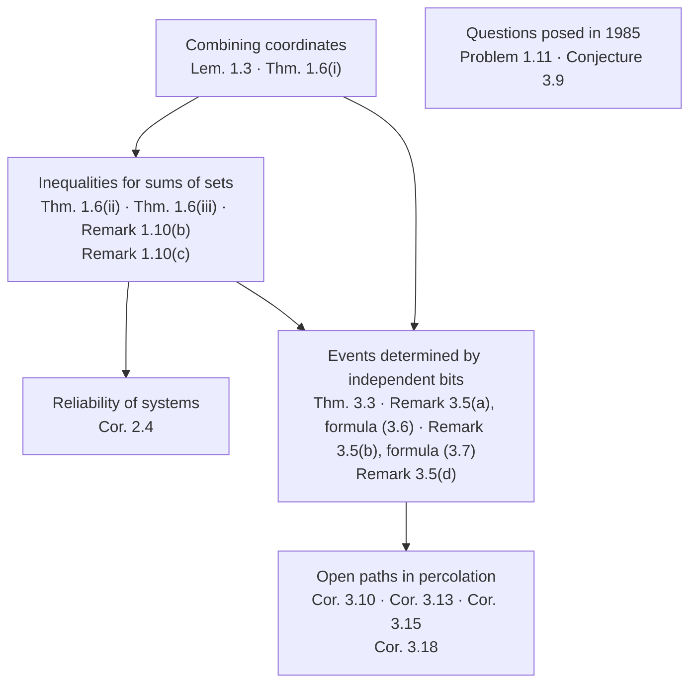
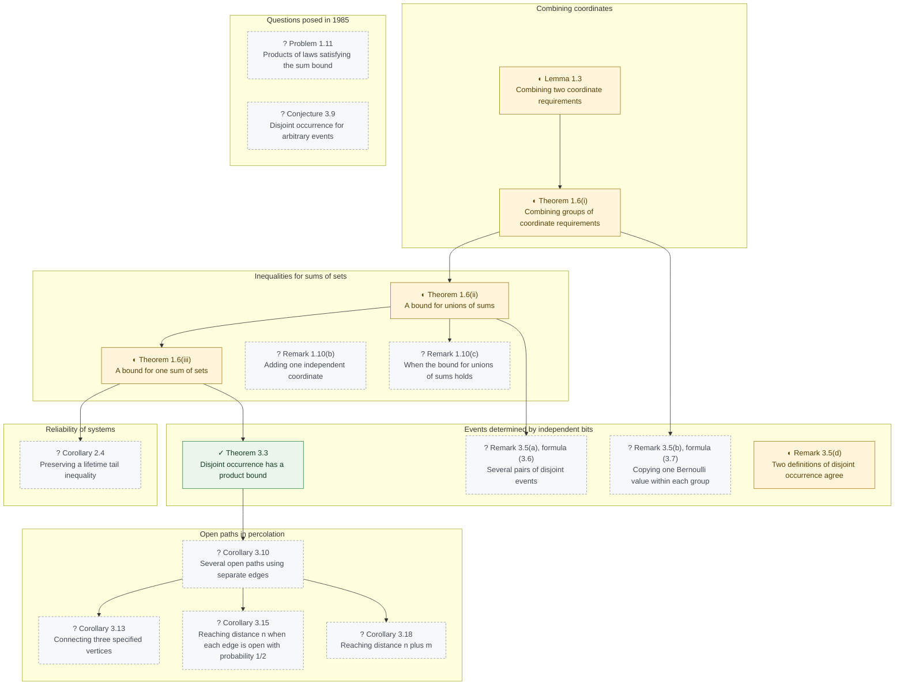

[Paper catalogue](../../README.md) · [Common LPP notation](../notation.md)

# Inequalities with applications to percolation and reliability

**J. van den Berg and H. Kesten**<br>
*Journal of Applied Probability* **22** (3), 556–569 (1985).<br>
[Published paper](https://doi.org/10.2307/3213860) · [Author-institution bibliographic record](https://ir.cwi.nl/pub/16873)

## What this paper contributes

Two increasing events can occur using separate sets of coordinates. The BK inequality bounds the probability of this **disjoint occurrence** by the product of their probabilities. In LPP, path events with disjoint sets of collected vertices have witnesses that specify exactly which weights each event uses.

The released library contains the paper's Bernoulli-cube theorem and four extensions to ordered coordinate spaces and finite families of events. The supporting results from Section 1 are formalized for nonnegative integer coordinates. This is selected coverage of the paper.

## The certified statements

### Disjoint occurrence

Let $`E=\prod_{i\in I}E_i`$ be the configuration space. For $`\omega\in E`$ and finite $`K\subset I`$, put

```math
[\omega]_K=\{\eta\in E:\eta_i=\omega_i\text{ for every }i\in K\}.
```

The set $`K`$ **witnesses** $`A\subseteq E`$ at $`\omega`$ when $`[\omega]_K\subseteq A`$. Define

```math
A\mathbin{\square}B
=\{\omega\in E:\exists K,H\subset I\text{ finite},\ K\cap H=\varnothing,
\ [\omega]_K\subseteq A,\ [\omega]_H\subseteq B\}.
```

An event is **increasing** when changing any coordinates upward preserves membership. This order is an assumption about the events; it does not require the coordinate laws to be identical.

### Theorem 3.3

*Independent Bernoulli coordinates.*

Let $`I=\{1,\ldots,n\}`$, let $`\omega_i`$ be independent Bernoulli variables with arbitrary parameters $`p_i\in[0,1]`$, and let $`A,B\subset\{0,1\}^I`$ be increasing. Then

```math
\mathbb P(A\mathbin{\square}B)
\leq \mathbb P(A)\mathbb P(B).
```

The certificate uses the paper's operation $`A\circ B`$. For increasing events on the Bernoulli cube, it agrees with the finite-witness operation $`A\square B`$ described above, as discussed in Remark 3.5(d).

[Lean certificate](https://github.com/cjanjigi/LPP/blob/5a3c7a612144b68468559ea1800bf7f39a5d3ef1/ProbabilityBasics/Statements/BK.lean#L326)

### Two-event extensions

*Finite or countable ordered products.*

Let $`I`$ be finite or countable. For each $`i\in I`$, let $`E_i`$ be a linearly ordered space with a second countable order topology, equipped with its Borel sigma-algebra and a probability law $`\mu_i`$. Under the product law $`\mathbb P=\bigotimes_{i\in I}\mu_i`$, every pair of measurable increasing events satisfies

```math
\mathbb P^*(A\mathbin{\square}B)
\leq \mathbb P(A)\mathbb P(B).
```

Here

```math
\mathbb P^*(D)=\inf\{\mathbb P(M):D\subseteq M,\ M\text{ measurable}\}
```

is outer measure. No measurability of $`A\square B`$ is assumed. If it is measurable, its outer measure equals its probability. The two released statements concern finite $`I`$ and countable $`I`$, respectively. No identical-distribution assumption is imposed. In particular, all $`E_i`$ may equal $`\mathbb R`$ and the laws may have atoms.

[Finite-coordinate certificate](https://github.com/cjanjigi/LPP/blob/5a3c7a612144b68468559ea1800bf7f39a5d3ef1/ProbabilityBasics/Statements/BK.lean#L106) · [Countable-coordinate certificate](https://github.com/cjanjigi/LPP/blob/5a3c7a612144b68468559ea1800bf7f39a5d3ef1/ProbabilityBasics/Statements/BK.lean#L221)

### Finite-family extensions

*Finite or countable ordered products.*

In either ordered-product setting above, let $`m\ge0`$ be an integer and let $`A_1,\ldots,A_m\subseteq E`$ be measurable increasing events. Define

```math
\mathop{\square}_{j=1}^m A_j
=\left\{\omega:\begin{array}{l}
\text{there are pairwise disjoint finite }K_1,\ldots,K_m\subset I\\
\text{with }[\omega]_{K_j}\subseteq A_j\text{ for every }j
\end{array}\right\}.
```

Then

```math
\mathbb P^*\!\left(\mathop{\square}_{j=1}^{m}A_j\right)
\leq \prod_{j=1}^{m}\mathbb P(A_j).
```

[Finite-coordinate certificate](https://github.com/cjanjigi/LPP/blob/5a3c7a612144b68468559ea1800bf7f39a5d3ef1/ProbabilityBasics/Statements/BK.lean#L163) · [Countable-coordinate certificate](https://github.com/cjanjigi/LPP/blob/5a3c7a612144b68468559ea1800bf7f39a5d3ef1/ProbabilityBasics/Statements/BK.lean#L279)

For $`m=0`$, the occurrence set is $`E`$ and the empty product is $`1`$. The two-event and family statements above are formalization extensions. Their full coordinate hypotheses are shared; Theorem 3.3 itself is the Bernoulli statement.

<!-- PAPER_MAP_START -->
## Progress and dependencies

[Dependency graph and coverage notes](../graphs/paper-results/bk-1985.md)

The graph and progress list cover every named result. Follow a result link to read its coverage and open its certificates.

<details>
<summary>Dependency overview</summary>



</details>

<details>
<summary>Every result and its status</summary>

**✓ Certified** · **◐ Restricted** · **○ Not in this release** · **? Not assessed**



| Paper result | Formalization |
| --- | --- |
| **[Lemma 1.3](../graphs/paper-results/bk-1985.md#lemma-13)**<br/>Combining two coordinate requirements | **◐ Restricted**<br/>[Integer coordinates only](../graphs/paper-results/bk-1985.md#lemma-13)<br/>[Lean certificate](https://github.com/cjanjigi/LPP/blob/5a3c7a612144b68468559ea1800bf7f39a5d3ef1/ProbabilityBasics/Foundations/BK/Lemma13.lean#L194) · [Discrete tail condition and its equivalence](https://github.com/cjanjigi/LPP/blob/5a3c7a612144b68468559ea1800bf7f39a5d3ef1/ProbabilityBasics/Foundations/BK/NBU.lean#L71) |
| **[Theorem 1.6(i)](../graphs/paper-results/bk-1985.md#theorem-16i)**<br/>Combining groups of coordinate requirements | **◐ Restricted**<br/>[Integer coordinates only](../graphs/paper-results/bk-1985.md#theorem-16i)<br/>[Lean certificate](https://github.com/cjanjigi/LPP/blob/5a3c7a612144b68468559ea1800bf7f39a5d3ef1/ProbabilityBasics/Foundations/BK/Theorem16.lean#L135) |
| **[Theorem 1.6(ii)](../graphs/paper-results/bk-1985.md#theorem-16ii)**<br/>A bound for unions of sums | **◐ Restricted**<br/>[Integer coordinates only](../graphs/paper-results/bk-1985.md#theorem-16ii)<br/>[Lean certificate](https://github.com/cjanjigi/LPP/blob/5a3c7a612144b68468559ea1800bf7f39a5d3ef1/ProbabilityBasics/Foundations/BK/Theorem16.lean#L220) |
| **[Theorem 1.6(iii)](../graphs/paper-results/bk-1985.md#theorem-16iii)**<br/>A bound for one sum of sets | **◐ Restricted**<br/>[Integer coordinates only](../graphs/paper-results/bk-1985.md#theorem-16iii)<br/>[Lean certificate](https://github.com/cjanjigi/LPP/blob/5a3c7a612144b68468559ea1800bf7f39a5d3ef1/ProbabilityBasics/Foundations/BK/Theorem16.lean#L232) |
| **[Remark 1.10(b)](../graphs/paper-results/bk-1985.md#remark-110b)**<br/>Adding one independent coordinate | **? Not assessed**<br/>[Coverage note](../graphs/paper-results/bk-1985.md#remark-110b) |
| **[Remark 1.10(c)](../graphs/paper-results/bk-1985.md#remark-110c)**<br/>When the bound for unions of sums holds | **? Not assessed**<br/>[Coverage note](../graphs/paper-results/bk-1985.md#remark-110c) |
| **[Corollary 2.4](../graphs/paper-results/bk-1985.md#corollary-24)**<br/>Preserving a lifetime tail inequality | **? Not assessed**<br/>[Coverage note](../graphs/paper-results/bk-1985.md#corollary-24) |
| **[Theorem 3.3](../graphs/paper-results/bk-1985.md#theorem-33)**<br/>Disjoint occurrence has a product bound | **✓ Certified**<br/>[Coverage note](../graphs/paper-results/bk-1985.md#theorem-33)<br/>[Lean certificate](https://github.com/cjanjigi/LPP/blob/5a3c7a612144b68468559ea1800bf7f39a5d3ef1/ProbabilityBasics/Statements/BK.lean#L326) |
| **[Remark 3.5(a), formula (3.6)](../graphs/paper-results/bk-1985.md#remark-35a-formula-36)**<br/>Several pairs of disjoint events | **? Not assessed**<br/>[Coverage note](../graphs/paper-results/bk-1985.md#remark-35a-formula-36) |
| **[Remark 3.5(b), formula (3.7)](../graphs/paper-results/bk-1985.md#remark-35b-formula-37)**<br/>Copying one Bernoulli value within each group | **? Not assessed**<br/>[Coverage note](../graphs/paper-results/bk-1985.md#remark-35b-formula-37) |
| **[Remark 3.5(d)](../graphs/paper-results/bk-1985.md#remark-35d)**<br/>Two definitions of disjoint occurrence agree | **◐ Restricted**<br/>[Only the two-increasing-event identity](../graphs/paper-results/bk-1985.md#remark-35d)<br/>[Box occurrence is contained in the paper operation](https://github.com/cjanjigi/LPP/blob/5a3c7a612144b68468559ea1800bf7f39a5d3ef1/ProbabilityBasics/Foundations/BK/Witness.lean#L205) · [Reverse inclusion for increasing events](https://github.com/cjanjigi/LPP/blob/5a3c7a612144b68468559ea1800bf7f39a5d3ef1/ProbabilityBasics/Foundations/BK/Witness.lean#L229) |
| **[Corollary 3.10](../graphs/paper-results/bk-1985.md#corollary-310)**<br/>Several open paths using separate edges | **? Not assessed**<br/>[Coverage note](../graphs/paper-results/bk-1985.md#corollary-310)<br/>[Finite-coordinate family inequality](https://github.com/cjanjigi/LPP/blob/5a3c7a612144b68468559ea1800bf7f39a5d3ef1/ProbabilityBasics/Statements/BK.lean#L163) · [Countable-coordinate family inequality](https://github.com/cjanjigi/LPP/blob/5a3c7a612144b68468559ea1800bf7f39a5d3ef1/ProbabilityBasics/Statements/BK.lean#L279) |
| **[Corollary 3.13](../graphs/paper-results/bk-1985.md#corollary-313)**<br/>Connecting three specified vertices | **? Not assessed**<br/>[Coverage note](../graphs/paper-results/bk-1985.md#corollary-313) |
| **[Corollary 3.15](../graphs/paper-results/bk-1985.md#corollary-315)**<br/>Reaching distance n when each edge is open with probability 1/2 | **? Not assessed**<br/>[Coverage note](../graphs/paper-results/bk-1985.md#corollary-315) |
| **[Corollary 3.18](../graphs/paper-results/bk-1985.md#corollary-318)**<br/>Reaching distance n plus m | **? Not assessed**<br/>[Coverage note](../graphs/paper-results/bk-1985.md#corollary-318) |
| **[Problem 1.11](../graphs/paper-results/bk-1985.md#problem-111)**<br/>Products of laws satisfying the sum bound | **? Not assessed**<br/>[Coverage note](../graphs/paper-results/bk-1985.md#problem-111) |
| **[Conjecture 3.9](../graphs/paper-results/bk-1985.md#conjecture-39)**<br/>Disjoint occurrence for arbitrary events | **? Not assessed**<br/>[Coverage note](../graphs/paper-results/bk-1985.md#conjecture-39) |

</details>

<!-- PAPER_MAP_END -->

## Auxiliary coverage

Lemma 1.3 and Theorem 1.6(i)–(iii) are certified for nonnegative integer coordinates. The paper also treats nonnegative real coordinates, which the linked supporting certificates do not cover. Integer coordinates suffice for the complete Bernoulli-cube Theorem 3.3 above.

Remark 3.5(d) has a certificate for two increasing events, while its additional assertion for an increasing and a decreasing event is outside the checked correspondence. For Corollary 3.10, the release supplies the finite-family probability inequality, but the translation to the paper's open-path applications has not been matched to a certificate.

Each difference is explained separately in the [full progress list](../graphs/paper-results/bk-1985.md#coverage-notes), with links to the source result and the certified part.

## Deviations and their reasons

### Correct printed proofs replaced to simplify formalization

No deliberate replacement of the printed proof of Theorem 3.3 is recorded in this guide.

### Extensions

The finite-family and ordered-product extensions are completed additional results. Their precise hypotheses are stated above. They support general increasing events, including path events under signed real LPP weight laws.

### Formulation and conventions

| Location | Formalization change | Reason |
| --- | --- | --- |
| Disjoint occurrence | Uses finite coordinate witnesses. | Records the coordinates that guarantee each event. |
| Ordered-product extensions | Bounds outer measure on the left side. | States the inequality without adding a measurability assumption for disjoint occurrence. |
| Integer-coordinate helpers | Uses a half-line form of the tail condition, with a proved equivalence to the source's formulation. | Connects the condition on the laws to the released helper statements. |

The integer-coordinate restriction of Lemma 1.3 and Theorem 1.6 is recorded under auxiliary coverage. It preserves the full scope of the Bernoulli-cube Theorem 3.3.

### Corrections to the source

This guide identifies no confirmed error in the paper. The narrower helper scope and the additional extensions are not source corrections.

## What remains outside the assessed coverage

- The real-coordinate versions of the supporting Section 1 results are not supplied by the linked integer-coordinate certificates.
- The full collection of percolation and reliability applications and corollaries has not been inventoried for this guide. Their absence from this page is not an assertion that every associated ingredient is absent from the library.
- The general disjoint-occurrence inequality for arbitrary, possibly non-increasing events is outside this release's advertised BK scope.
