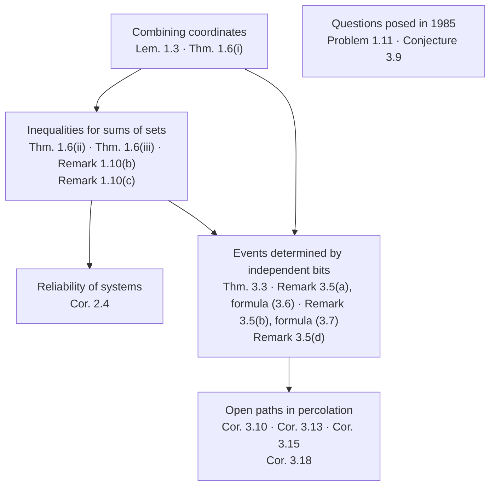
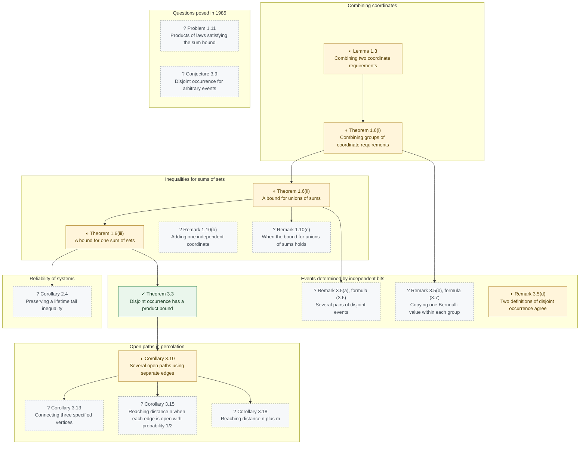

[Paper catalogue](../../README.md) · [Common LPP notation](../notation.md)

# Inequalities with applications to percolation and reliability

**J. van den Berg and H. Kesten** 
*Journal of Applied Probability* **22** (3), 556–569 (1985). 
[Published paper](https://doi.org/10.2307/3213860) · [Author-institution bibliographic record](https://ir.cwi.nl/pub/16873)

## What this paper contributes

Two increasing events can occur using separate sets of coordinates. The BK inequality bounds the probability of this **disjoint occurrence** by the product of their probabilities. In LPP, path events with disjoint sets of collected vertices have witnesses that specify exactly which weights each event uses.

The released library contains the paper's Bernoulli-cube theorem and four extensions to ordered coordinate spaces and finite families of events. The supporting results from Section 1 are formalized for nonnegative integer coordinates. This is selected coverage of the paper.

## The certified statements

### Disjoint occurrence

Let $E=\prod_{i\in I}E_i$ be the configuration space. For $\omega\in E$ and finite $K\subset I$, put

$$
[\omega]_K=\{\eta\in E:\eta_i=\omega_i\text{ for every }i\in K\}.
$$

The set $K$ **witnesses** $A\subseteq E$ at $\omega$ when $[\omega]_K\subseteq A$. Define

$$
A\mathbin{\square}B
=\{\omega\in E:\exists K,H\subset I\text{ finite},\ K\cap H=\varnothing,
\ [\omega]_K\subseteq A,\ [\omega]_H\subseteq B\}.
$$

An event is **increasing** when changing any coordinates upward preserves membership. This order is an assumption about the events; it does not require the coordinate laws to be identical.

### Theorem 3.3

*Independent Bernoulli coordinates.*

Let $I=\{1,\ldots,n\}$, let $\omega_i$ be independent Bernoulli variables with arbitrary parameters $p_i\in[0,1]$, and let $A,B\subset\{0,1\}^I$ be increasing. Then

$$
\mathbb P(A\mathbin{\square}B)
\leq \mathbb P(A)\mathbb P(B).
$$

The certificate uses the paper's operation $A\circ B$. For increasing events on the Bernoulli cube, it agrees with the finite-witness operation $A\square B$ described above, as discussed in Remark 3.5(d).

[Lean certificate](https://github.com/cjanjigi/LPP/blob/5a3c7a612144b68468559ea1800bf7f39a5d3ef1/ProbabilityBasics/Statements/BK.lean#L326)

### Two-event extensions

*Finite or countable ordered products.*

Let $I$ be finite or countable. For each $i\in I$, let $E_i$ be a linearly ordered space with a second countable order topology, equipped with its Borel sigma-algebra and a probability law $\mu_i$. Under the product law $\mathbb P=\bigotimes_{i\in I}\mu_i$, every pair of measurable increasing events satisfies

$$
\mathbb P^*(A\mathbin{\square}B)
\leq \mathbb P(A)\mathbb P(B).
$$

Here

$$
\mathbb P^*(D)=\inf\{\mathbb P(M):D\subseteq M,\ M\text{ measurable}\}
$$

is outer measure. No measurability of $A\square B$ is assumed. If it is measurable, its outer measure equals its probability. The two released statements concern finite $I$ and countable $I$, respectively. No identical-distribution assumption is imposed. In particular, all $E_i$ may equal $\mathbb R$ and the laws may have atoms.

[Finite-coordinate certificate](https://github.com/cjanjigi/LPP/blob/5a3c7a612144b68468559ea1800bf7f39a5d3ef1/ProbabilityBasics/Statements/BK.lean#L106) · [Countable-coordinate certificate](https://github.com/cjanjigi/LPP/blob/5a3c7a612144b68468559ea1800bf7f39a5d3ef1/ProbabilityBasics/Statements/BK.lean#L221)

### Finite-family extensions

*Finite or countable ordered products.*

In either ordered-product setting above, let $m\ge0$ be an integer and let $A_1,\ldots,A_m\subseteq E$ be measurable increasing events. Define

$$
\mathop{\square}_{j=1}^m A_j
=\left\{\omega:\begin{array}{l}
\text{there are pairwise disjoint finite }K_1,\ldots,K_m\subset I\\
\text{with }[\omega]_{K_j}\subseteq A_j\text{ for every }j
\end{array}\right\}.
$$

Then

$$
\mathbb P^*\!\left(\mathop{\square}_{j=1}^{m}A_j\right)
\leq \prod_{j=1}^{m}\mathbb P(A_j).
$$

[Finite-coordinate certificate](https://github.com/cjanjigi/LPP/blob/5a3c7a612144b68468559ea1800bf7f39a5d3ef1/ProbabilityBasics/Statements/BK.lean#L163) · [Countable-coordinate certificate](https://github.com/cjanjigi/LPP/blob/5a3c7a612144b68468559ea1800bf7f39a5d3ef1/ProbabilityBasics/Statements/BK.lean#L279)

For $m=0$, the occurrence set is $E$ and the empty product is $1$. The two-event and family statements above are formalization extensions. Their full coordinate hypotheses are shared; Theorem 3.3 itself is the Bernoulli statement.

<!-- PAPER_MAP_START -->
## Progress and dependencies

The map groups the paper's results. Open the full graph to see each named result and its formalization status.

Graph presentation based on Scott Armstrong’s visual paper design for [*Homogenization at a polynomial scale in high contrast*](https://scottnarmstrong.github.io/hcp-visual-paper/).

[Full result graph and progress list](../graphs/paper-results/bk-1985.md)

Every result and its status

**✓ Certified** · **◐ Restricted** · **○ Not in this release** · **? Not assessed**

| Paper result | Formalization |
| --- | --- |
| **Lemma 1.3** Combining two coordinate requirements | **◐ Restricted** [Lean certificate](https://github.com/cjanjigi/LPP/blob/5a3c7a612144b68468559ea1800bf7f39a5d3ef1/ProbabilityBasics/Foundations/BK/Lemma13.lean#L194) |
| **Theorem 1.6(i)** Combining groups of coordinate requirements | **◐ Restricted** [Lean certificate](https://github.com/cjanjigi/LPP/blob/5a3c7a612144b68468559ea1800bf7f39a5d3ef1/ProbabilityBasics/Foundations/BK/Theorem16.lean#L135) |
| **Theorem 1.6(ii)** A bound for unions of sums | **◐ Restricted** [Lean certificate](https://github.com/cjanjigi/LPP/blob/5a3c7a612144b68468559ea1800bf7f39a5d3ef1/ProbabilityBasics/Foundations/BK/Theorem16.lean#L220) |
| **Theorem 1.6(iii)** A bound for one sum of sets | **◐ Restricted** [Lean certificate](https://github.com/cjanjigi/LPP/blob/5a3c7a612144b68468559ea1800bf7f39a5d3ef1/ProbabilityBasics/Foundations/BK/Theorem16.lean#L232) |
| **Remark 1.10(b)** Adding one independent coordinate | **? Not assessed** |
| **Remark 1.10(c)** When the bound for unions of sums holds | **? Not assessed** |
| **Corollary 2.4** Preserving a lifetime tail inequality | **? Not assessed** |
| **Theorem 3.3** Disjoint occurrence has a product bound | **✓ Certified** [Lean certificate](https://github.com/cjanjigi/LPP/blob/5a3c7a612144b68468559ea1800bf7f39a5d3ef1/ProbabilityBasics/Statements/BK.lean#L326) |
| **Remark 3.5(a), formula (3.6)** Several pairs of disjoint events | **? Not assessed** |
| **Remark 3.5(b), formula (3.7)** Copying one Bernoulli value within each group | **? Not assessed** |
| **Remark 3.5(d)** Two definitions of disjoint occurrence agree | **◐ Restricted** [Box occurrence is contained in the paper operation](https://github.com/cjanjigi/LPP/blob/5a3c7a612144b68468559ea1800bf7f39a5d3ef1/ProbabilityBasics/Foundations/BK/Witness.lean#L205) · [Reverse inclusion for increasing events](https://github.com/cjanjigi/LPP/blob/5a3c7a612144b68468559ea1800bf7f39a5d3ef1/ProbabilityBasics/Foundations/BK/Witness.lean#L229) |
| **Corollary 3.10** Several open paths using separate edges | **◐ Restricted** [Finite-coordinate family inequality](https://github.com/cjanjigi/LPP/blob/5a3c7a612144b68468559ea1800bf7f39a5d3ef1/ProbabilityBasics/Statements/BK.lean#L163) · [Countable-coordinate family inequality](https://github.com/cjanjigi/LPP/blob/5a3c7a612144b68468559ea1800bf7f39a5d3ef1/ProbabilityBasics/Statements/BK.lean#L279) |
| **Corollary 3.13** Connecting three specified vertices | **? Not assessed** |
| **Corollary 3.15** Reaching distance n when each edge is open with probability 1/2 | **? Not assessed** |
| **Corollary 3.18** Reaching distance n plus m | **? Not assessed** |
| **Problem 1.11** Products of laws satisfying the sum bound | **? Not assessed** |
| **Conjecture 3.9** Disjoint occurrence for arbitrary events | **? Not assessed** |

<!-- PAPER_MAP_END -->

## Supporting results

Integer-coordinate forms of Lemma 1.3 and Theorem 1.6

These are the precise restricted forms of Lemma 1.3 and Theorem 1.6 certified by the links in the coverage table. They do not assert the paper's real-coordinate versions.

Let $I$ be finite, let $\mu_i$ be probability measures on $\mathbb N_0$, and let $P=\bigotimes_{i\in I}\mu_i$. In this section assume every coordinate law is **new better than used**, meaning

$$
\mu_i([s+t,\infty))\le
\mu_i([s,\infty))\mu_i([t,\infty))
\qquad(s,t\in\mathbb N_0).
$$

All sets in $\mathbb N_0^I$ are measurable. Increasing always refers to the coordinatewise order.

### Lemma 1.3

*Identification of two integer coordinates.*

Let $i\ne j$ satisfy $\mu_i=\mu_j$, and let $A\subseteq\mathbb N_0^I$ be increasing. Define

$$
A^*_{ij}=\{x:\exists a\in A,\ a_i+a_j\le x_i,
\ a_k\le x_k\text{ for every }k\notin\{i,j\}\}.
$$

There is no condition on $x_j$. Then $P(A^*_{ij})\le P(A)$. [Certificate](https://github.com/cjanjigi/LPP/blob/5a3c7a612144b68468559ea1800bf7f39a5d3ef1/ProbabilityBasics/Foundations/BK/Lemma13.lean#L194)

### Theorem 1.6(i)

*Identification along a partition.*

Let $\mathcal F$ partition $I$, choose $r_F\in F$ for each $F\in\mathcal F$, and suppose $\mu_j=\mu_{r_F}$ for $j\in F$. For increasing $A\subseteq\mathbb N_0^I$, define

$$
A^*=\left\{x:\exists a\in A,\ \sum_{j\in F}a_j\le x_{r_F}
\text{ for every }F\in\mathcal F\right\}.
$$

Coordinates that are not representatives are unrestricted. Then $P(A^*)\le P(A)$. [Certificate](https://github.com/cjanjigi/LPP/blob/5a3c7a612144b68468559ea1800bf7f39a5d3ef1/ProbabilityBasics/Foundations/BK/Theorem16.lean#L135)

### Theorem 1.6(ii)–(iii)

*Product inequalities for increasing integer-coordinate sets.*

For every integer $q\ge0$ and increasing $A_1,\ldots,A_q,B_1,\ldots,B_q\subseteq\mathbb N_0^I$,

$$
P\left(\bigcup_{\ell=1}^q(A_\ell+B_\ell)\right)
\le(P\otimes P)\left(\bigcup_{\ell=1}^q(A_\ell\times B_\ell)\right),
$$

where $A+B=\{a+b:a\in A,b\in B\}$ is the coordinatewise Minkowski sum. In particular, for any increasing $A,B\subseteq\mathbb N_0^I$,

$$
P(A+B)\le P(A)P(B).
$$

[Certificate for (ii)](https://github.com/cjanjigi/LPP/blob/5a3c7a612144b68468559ea1800bf7f39a5d3ef1/ProbabilityBasics/Foundations/BK/Theorem16.lean#L220) · [Certificate for (iii)](https://github.com/cjanjigi/LPP/blob/5a3c7a612144b68468559ea1800bf7f39a5d3ef1/ProbabilityBasics/Foundations/BK/Theorem16.lean#L232)

## Deviations and their reasons

### Correct printed proofs replaced to simplify formalization

**No replacement of the printed proof of Theorem 3.3 is recorded here.** The released implementation follows its identification argument through Lemma 1.3 and Theorem 1.6, then embeds the Bernoulli cube into the nonnegative integer lattice.

Restricting the supporting lemmas to integer coordinates avoids the measurable-projection machinery needed for the paper's real-coordinate setting. Integer coordinates already suffice for Theorem 3.3. The restricted supporting scope is recorded above; it does not weaken the certified Bernoulli-cube theorem.

### Extensions and additional proof detail

The ordered-product statements go beyond the Bernoulli-cube statement of Theorem 3.3. Their proof introduces finite-chain encodings by independent bits, finite-level rounding upward, and one-coordinate limits. Rounding upward gives the required occurrence inclusion directly and avoids a harder multidimensional boundary argument in an earlier formalization design. That earlier design was an internal proposal, rather than the printed proof.

Finite-family statements use repeated application of the two-event inequality, following the principle used for Corollary 3.10. The countable-coordinate extension supplies a detailed finite-witness reduction using conditional-probability-one events, making the passage from finite coordinate sets precise.

These extensions were chosen to support general increasing events, including path events under signed real LPP weight laws. They are completed results, and are displayed separately from the paper's original statements.

### Formulation and conventions

- The finite-witness box operation makes the coordinates used by each event explicit.
- Outer measure on the left side preserves the general inequality without adding an unproved measurability hypothesis.
- The new-better-than-used condition in the integer-coordinate helpers is expressed using half-lines; a proved equivalence connects it to the increasing-set formulation.

### Corrections to the source

This guide identifies no confirmed error in the paper. The narrower helper scope and the extension arguments above are not presented as source corrections.

## What remains outside the assessed coverage

- The real-coordinate versions of the supporting Section 1 results are not supplied by the linked integer-coordinate certificates.
- The full collection of percolation and reliability applications and corollaries has not been inventoried for this guide. Their absence from this page is not an assertion that every associated ingredient is absent from the library.
- The general disjoint-occurrence inequality for arbitrary, possibly non-increasing events is outside this release's advertised BK scope.
