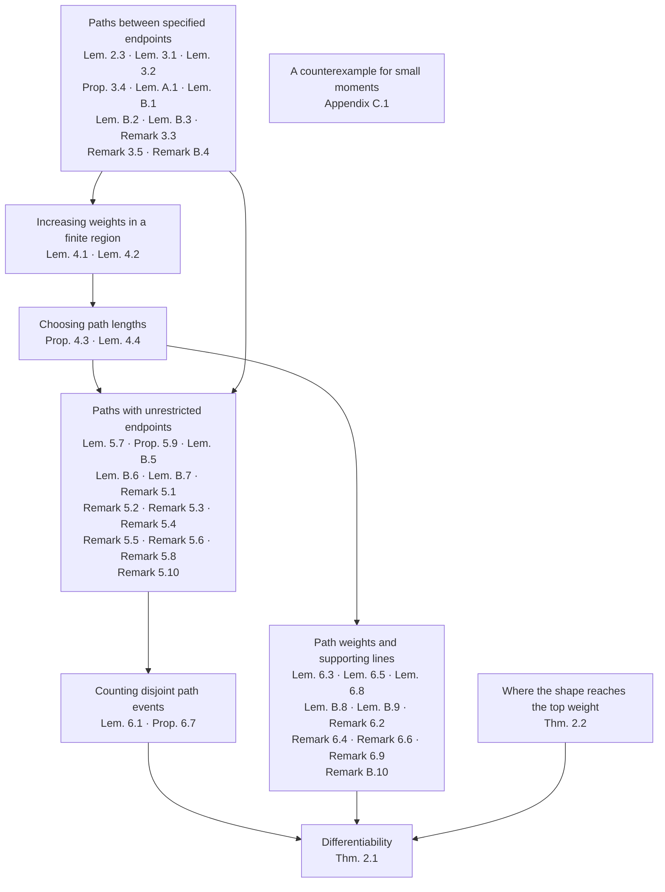

# Differentiability of the shape function in the planar corner growth model

**Christopher Janjigian, Firas Rassoul-Agha and Timo Seppäläinen** 
Preprint. This guide follows the author draft of 3 November 2026.

[All papers](../../README.md) · [Common LPP notation](../notation.md) · [Main Lean certificate](https://github.com/cjanjigi/LPP/blob/5a3c7a612144b68468559ea1800bf7f39a5d3ef1/Differentiability/Statements.lean#L110)

The limit shape describes the leading-order passage time over a long distance. This paper asks whether that shape can have a corner at an interior direction. Under separate moment assumptions on the positive and negative parts of the weights, its main theorem rules out every such corner.

## The certified main theorem

### Theorem 2.1

*Differentiability of the shape.*

Let the site weights be i.i.d. with a probability law $\mu$ on $\mathbb R$ that is not a point mass, meaning $\mu(\{c\})<1$ for every $c\in\mathbb R$. Suppose there are real exponents $p_->1$ and $p_+>4$ such that

$$
\mathbb E[(\omega_0^-)^{p_-}]<\infty,
\qquad
\mathbb E[(\omega_0^+)^{p_+}]<\infty.
$$

Then the deterministic [shape function](../notation.md#shape-functions) $g$ exists and is finite on $\mathbb{R}_{\geq 0}^2$. It is continuous on the closed quadrant, positively homogeneous of degree one and concave, and it satisfies the [uniform shape approximation (U)](../notation.md#uniform-shape-approximation). Moreover, $g$ is differentiable at every point of $\mathbb R^2_{>0}$, equivalently at every direction in $\operatorname{ri}\mathcal U$. The fixed-direction limits determine $g$ uniquely.

Weights may be signed, unbounded, and atomic. The two moment exponents may differ.

[Read the statement and certificate](https://github.com/cjanjigi/LPP/blob/5a3c7a612144b68468559ea1800bf7f39a5d3ef1/Differentiability/Statements.lean#L100) · [Read the assembled proof](https://github.com/cjanjigi/LPP/blob/5a3c7a612144b68468559ea1800bf7f39a5d3ef1/Differentiability/Full/Differentiability.lean#L53)

The paper obtains the shape theorem from Theorem 5.1 and the weaker-negative-tail extension in Remark 5.1(ii) of [*Limiting shape for directed percolation models*](martin-2004.md). The two-sided square-root-tail version stated in that guide alone does not cover every law allowed here.

<!-- PAPER_MAP_START -->
## Progress and dependencies

The map groups the paper's results. Open the full graph to see each named result and its formalization status.

Graph presentation based on Scott Armstrong’s visual paper design for [*Homogenization at a polynomial scale in high contrast*](https://scottnarmstrong.github.io/hcp-visual-paper/).

[Full result graph and progress list](../graphs/paper-results/differentiability.md)

Section 6 first proves the bounded-weight case. The full theorem under the stated moment assumptions uses Appendix B.

Lemma B.2 supplies the general-weight proof of Lemma 3.2. Remark 5.8 changes the endpoints and intervals in the general-weight version of Lemma 5.7.

Every result and its status

**✓ Certified** · **◐ Restricted** · **○ Not in this release** · **? Not assessed**

```mermaid
flowchart TD
  subgraph S0["Where the shape reaches the top weight"]
    R1["◐ Theorem 2.2<br/>Where the shape equals the largest weight"]
  end
  subgraph S1["Paths between specified endpoints"]
    R2["✓ Lemma 2.3<br/>Two linear bounds for the shape"]
    R3["✓ Lemma 3.1<br/>High-weight paths near a prescribed segment"]
    R4["✓ Lemma 3.2<br/>High-weight paths for all endpoint pairs"]
    R5["✓ Proposition 3.4<br/>Paths rarely exceed either linear bound"]
    R17["✓ Lemma A.1<br/>An infinite up-right path through likely events"]
    R18["◐ Lemma B.1<br/>A lower bound for selected path weights"]
    R19["✓ Lemma B.2<br/>Paths joining every pair of endpoints"]
    R20["◐ Lemma B.3<br/>Short paths reaching prescribed points"]
    R26["? Remark 3.3<br/>Choosing short paths after observing low weights"]
    R27["◐ Remark 3.5<br/>The same bound for strips with any center"]
    R40["? Remark B.4<br/>Why this proof needs a moment above one"]
  end
  subgraph S2["Increasing weights in a finite region"]
    R6["✓ Lemma 4.1<br/>Raising finitely many weights at small probability cost"]
    R7["✓ Lemma 4.2<br/>Crossings of length ⌈s³⌉ become unlikely"]
  end
  subgraph S3["Choosing path lengths"]
    R8["✓ Proposition 4.3<br/>The length where crossing probability becomes small"]
    R9["✓ Lemma 4.4<br/>Infinitely many scales with comparable earlier lengths"]
  end
  subgraph S4["Paths with unrestricted endpoints"]
    R10["◐ Lemma 5.7<br/>Paths between prescribed grid points"]
    R11["✓ Proposition 5.9<br/>An upper weight bound for every path in a rectangle"]
    R21["✓ Lemma B.5<br/>Paths can go around the very negative vertices"]
    R22["✓ Lemma B.6<br/>A lower weight bound for many chosen paths"]
    R23["✓ Lemma B.7<br/>Large positive weights do not spoil the connections"]
    R28["? Remark 5.1<br/>Which connections require changes for unbounded weights"]
    R29["◐ Remark 5.2<br/>The connecting paths are shorter than the proof needs"]
    R30["✓ Remark 5.3<br/>Choose the connecting paths after locating negative weights"]
    R31["◐ Remark 5.4<br/>The weight error on a short connecting interval"]
    R32["✓ Remark 5.5<br/>Independent crossings with no very large weight"]
    R33["◐ Remark 5.6<br/>The weight error when a crossing needs two connections"]
    R34["✓ Remark 5.8<br/>The grid statement with random endpoints"]
    R35["✓ Remark 5.10<br/>Removing a few endpoint vertices preserves the path bound"]
  end
  subgraph S5["Counting disjoint path events"]
    R12["✓ Lemma 6.1<br/>Probability bound for disjoint path events"]
    R15["✓ Proposition 6.7<br/>Long paths contain few rare subpaths"]
  end
  subgraph S6["Path weights and supporting lines"]
    R13["✓ Lemma 6.3<br/>Paths containing no rare subpath"]
    R14["✓ Lemma 6.5<br/>Weight bound from a count of rare subpaths"]
    R16["✓ Lemma 6.8<br/>Path-weight bounds when the shape has a corner"]
    R24["✓ Lemma B.8<br/>The path bounds with unbounded weights"]
    R25["✓ Lemma B.9<br/>Bounding the contribution of large positive weights"]
    R36["? Remark 6.2<br/>Choosing a scale for unbounded weights"]
    R37["✓ Remark 6.4<br/>The cost of moving across a corner"]
    R38["✓ Remark 6.6<br/>Subtracting the weight above a threshold"]
    R39["✓ Remark 6.9<br/>The large-weight correction stays small"]
    R41["? Remark B.10<br/>Why this proof requires a positive moment above four"]
  end
  subgraph S7["Differentiability"]
    R0["✓ Theorem 2.1<br/>The shape is differentiable"]
  end
  subgraph S8["A counterexample for small moments"]
    R42["✓ Appendix C.1<br/>A law with no finite uniform shape limit"]
  end
  R3 -->|bounded case| R4
  R18 --> R20
  R20 --> R19
  R3 --> R19
  R2 --> R5
  R4 --> R5
  R17 --> R5
  R6 --> R7
  R5 --> R7
  R3 --> R8
  R7 --> R8
  R8 --> R9
  R8 --> R10
  R9 --> R10
  R17 --> R21
  R18 --> R22
  R8 --> R23
  R9 --> R23
  R21 -->|general weights| R10
  R22 -->|general weights| R10
  R23 -->|general weights| R10
  R10 --> R11
  R5 --> R11
  R21 -->|general weights| R11
  R23 -->|general weights| R11
  R12 --> R15
  R11 --> R15
  R8 --> R15
  R13 --> R16
  R14 --> R16
  R13 --> R24
  R8 --> R25
  R1 --> R0
  R15 -->|bounded case| R0
  R16 -->|bounded case| R0
  R24 -->|general weights| R0
  R25 -->|general weights| R0
  R9 --> R15
  R5 --> R27
  R27 --> R11
  R22 --> R30
  R30 --> R31
  R23 --> R32
  R32 --> R33
  R21 --> R33
  R22 --> R33
  R31 --> R34
  R33 --> R34
  R21 --> R34
  R23 --> R34
  R34 --> R35
  R21 --> R35
  R23 --> R35
  R13 --> R37
  R37 --> R16
  R24 --> R38
  R24 --> R39
  R25 --> R39
  classDef certified fill:#eaf6ec,stroke:#2d8544,color:#163b20
  classDef restricted fill:#fff5db,stroke:#a77815,color:#594005
  classDef not_assessed fill:#f6f8fa,stroke:#8c959f,stroke-dasharray:4 3,color:#424a53
  classDef not_in_release fill:#fff,stroke:#8c959f,color:#59636e
  class R0 certified
  class R1 restricted
  class R2 certified
  class R3 certified
  class R4 certified
  class R5 certified
  class R6 certified
  class R7 certified
  class R8 certified
  class R9 certified
  class R10 restricted
  class R11 certified
  class R12 certified
  class R13 certified
  class R14 certified
  class R15 certified
  class R16 certified
  class R17 certified
  class R18 restricted
  class R19 certified
  class R20 restricted
  class R21 certified
  class R22 certified
  class R23 certified
  class R24 certified
  class R25 certified
  class R26 not_assessed
  class R27 restricted
  class R28 not_assessed
  class R29 restricted
  class R30 certified
  class R31 restricted
  class R32 certified
  class R33 restricted
  class R34 certified
  class R35 certified
  class R36 not_assessed
  class R37 certified
  class R38 certified
  class R39 certified
  class R40 not_assessed
  class R41 not_assessed
  class R42 certified
```

| Paper result | Formalization |
| --- | --- |
| **Theorem 2.2** Where the shape equals the largest weight | **◐ Restricted** [Flat-segment theorem](https://github.com/cjanjigi/LPP/blob/5a3c7a612144b68468559ea1800bf7f39a5d3ef1/Differentiability/Probability/FlatTopRouteH.lean#L64) · [Differentiability at every flat direction](https://github.com/cjanjigi/LPP/blob/5a3c7a612144b68468559ea1800bf7f39a5d3ef1/Differentiability/Probability/FlatTopDifferentiability.lean#L60) |
| **Lemma 2.3** Two linear bounds for the shape | **✓ Certified** [Supporting functionals and contact](https://github.com/cjanjigi/LPP/blob/5a3c7a612144b68468559ea1800bf7f39a5d3ef1/LPP_Foundations/Analysis/ShapeSupportingFunctionals.lean#L119) |
| **Lemma 3.1** High-weight paths near a prescribed segment | **✓ Certified** [Travel estimate](https://github.com/cjanjigi/LPP/blob/5a3c7a612144b68468559ea1800bf7f39a5d3ef1/Differentiability/Probability/Travel.lean#L29) |
| **Lemma 3.2** High-weight paths for all endpoint pairs | **✓ Certified** [General-weight interval connections](https://github.com/cjanjigi/LPP/blob/5a3c7a612144b68468559ea1800bf7f39a5d3ef1/Differentiability/Probability/GeneralIntervals.lean#L51) |
| **Proposition 3.4** Paths rarely exceed either linear bound | **✓ Certified** [Uniform rare-fast-crossing bound](https://github.com/cjanjigi/LPP/blob/5a3c7a612144b68468559ea1800bf7f39a5d3ef1/Differentiability/Probability/RareFastCrossings.lean#L40) |
| **Lemma A.1** An infinite up-right path through likely events | **✓ Certified** [High-density oriented-path theorem](https://github.com/cjanjigi/LPP/blob/5a3c7a612144b68468559ea1800bf7f39a5d3ef1/Differentiability/Probability/HighDensityOrientedPaths.lean#L68) |
| **Lemma B.1** A lower bound for selected path weights | **◐ Restricted** [Mask-dependent family bound](https://github.com/cjanjigi/LPP/blob/5a3c7a612144b68468559ea1800bf7f39a5d3ef1/Differentiability/Probability/GlobalMaskFamilyWeights.lean#L245) · [Conditional single-path bound](https://github.com/cjanjigi/LPP/blob/5a3c7a612144b68468559ea1800bf7f39a5d3ef1/Differentiability/Probability/ConditionalFinitePathWeights.lean#L67) |
| **Lemma B.2** Paths joining every pair of endpoints | **✓ Certified** [General-weight interval connections](https://github.com/cjanjigi/LPP/blob/5a3c7a612144b68468559ea1800bf7f39a5d3ef1/Differentiability/Probability/GeneralIntervals.lean#L51) |
| **Lemma B.3** Short paths reaching prescribed points | **◐ Restricted** [Forward common-net attachments](https://github.com/cjanjigi/LPP/blob/5a3c7a612144b68468559ea1800bf7f39a5d3ef1/Differentiability/Probability/ForwardHeavyAttachmentAsymptotics.lean#L27) · [Backward common-net attachments](https://github.com/cjanjigi/LPP/blob/5a3c7a612144b68468559ea1800bf7f39a5d3ef1/Differentiability/Probability/BackwardHeavyAttachmentAsymptotics.lean#L20) |
| **Remark 3.3** Choosing short paths after observing low weights | **? Not assessed** |
| **Remark 3.5** The same bound for strips with any center | **◐ Restricted** [Translation of strip crossings](https://github.com/cjanjigi/LPP/blob/5a3c7a612144b68468559ea1800bf7f39a5d3ef1/Differentiability/Probability/RarefastTranslation.lean#L96) · [Endpoint argument using translated strip bounds](https://github.com/cjanjigi/LPP/blob/5a3c7a612144b68468559ea1800bf7f39a5d3ef1/Differentiability/Probability/ArbitraryEndpointsGeneral.lean#L77) |
| **Remark B.4** Why this proof needs a moment above one | **? Not assessed** |
| **Lemma 4.1** Raising finitely many weights at small probability cost | **✓ Certified** [Modified-field monotonicity and product law](https://github.com/cjanjigi/LPP/blob/5a3c7a612144b68468559ea1800bf7f39a5d3ef1/Differentiability/Probability/MaximumModifiedFieldLaw.lean#L93) · [Absolute continuity and density bound](https://github.com/cjanjigi/LPP/blob/5a3c7a612144b68468559ea1800bf7f39a5d3ef1/Differentiability/Probability/MaximumKernelRN.lean#L87) · [Good set and conditional independent boosts](https://github.com/cjanjigi/LPP/blob/5a3c7a612144b68468559ea1800bf7f39a5d3ef1/Differentiability/Probability/MaximumKernelGoodSet.lean#L33) · [Strict quantile-gap positivity](https://github.com/cjanjigi/LPP/blob/5a3c7a612144b68468559ea1800bf7f39a5d3ef1/ProbabilityBasics/Probability/MaximumQuantileGap.lean#L120) |
| **Lemma 4.2** Crossings of length ⌈s³⌉ become unlikely | **✓ Certified** [Cubic-length crossing rarity](https://github.com/cjanjigi/LPP/blob/5a3c7a612144b68468559ea1800bf7f39a5d3ef1/Differentiability/Probability/TiltLimit.lean#L66) |
| **Proposition 4.3** The length where crossing probability becomes small | **✓ Certified** [Short-crossing abundance](https://github.com/cjanjigi/LPP/blob/5a3c7a612144b68468559ea1800bf7f39a5d3ef1/Differentiability/Probability/ShortCrossingAbundance.lean#L336) · [Characteristic lengths and records](https://github.com/cjanjigi/LPP/blob/5a3c7a612144b68468559ea1800bf7f39a5d3ef1/Differentiability/Probability/CharacteristicLengths.lean#L45) |
| **Lemma 4.4** Infinitely many scales with comparable earlier lengths | **✓ Certified** [Actual characteristic-length records](https://github.com/cjanjigi/LPP/blob/5a3c7a612144b68468559ea1800bf7f39a5d3ef1/Differentiability/Probability/CharacteristicLengths.lean#L45) · [Deterministic record-scale lemma](https://github.com/cjanjigi/LPP/blob/5a3c7a612144b68468559ea1800bf7f39a5d3ef1/Differentiability/Analysis/RecordScales.lean#L62) |
| **Lemma 5.7** Paths between prescribed grid points | **◐ Restricted** [Bounded grid connections](https://github.com/cjanjigi/LPP/blob/5a3c7a612144b68468559ea1800bf7f39a5d3ef1/Differentiability/Probability/GridSimultaneous.lean#L138) · [General-weight entrance and exit connections](https://github.com/cjanjigi/LPP/blob/5a3c7a612144b68468559ea1800bf7f39a5d3ef1/Differentiability/Probability/GridSimultaneousGeneral.lean#L50) |
| **Proposition 5.9** An upper weight bound for every path in a rectangle | **✓ Certified** [General-weight endpoint estimate](https://github.com/cjanjigi/LPP/blob/5a3c7a612144b68468559ea1800bf7f39a5d3ef1/Differentiability/Probability/ArbitraryEndpointsGeneral.lean#L77) · [Bounded-grid endpoint estimate](https://github.com/cjanjigi/LPP/blob/5a3c7a612144b68468559ea1800bf7f39a5d3ef1/Differentiability/Probability/ArbitraryEndpoints.lean#L151) · [Assembly supplying the grid estimate](https://github.com/cjanjigi/LPP/blob/5a3c7a612144b68468559ea1800bf7f39a5d3ef1/Differentiability/Probability/GeneralOffFlatDifferentiability.lean#L163) |
| **Lemma B.5** Paths can go around the very negative vertices | **✓ Certified** [Geometry-event probability](https://github.com/cjanjigi/LPP/blob/5a3c7a612144b68468559ea1800bf7f39a5d3ef1/Differentiability/Probability/StairGeometryEvent.lean#L361) · [Trapped component bounds](https://github.com/cjanjigi/LPP/blob/5a3c7a612144b68468559ea1800bf7f39a5d3ef1/Differentiability/Model/StairTrappedComponents.lean#L277) · [Forward greedy path](https://github.com/cjanjigi/LPP/blob/5a3c7a612144b68468559ea1800bf7f39a5d3ef1/Differentiability/Model/Paths/StairGreedyForward.lean#L350) · [Backward greedy path](https://github.com/cjanjigi/LPP/blob/5a3c7a612144b68468559ea1800bf7f39a5d3ef1/Differentiability/Model/Paths/StairGreedyBackward.lean#L69) · [Arrival at the target](https://github.com/cjanjigi/LPP/blob/5a3c7a612144b68468559ea1800bf7f39a5d3ef1/Differentiability/Model/Paths/StairArrival.lean#L148) · [Crossing paths merge](https://github.com/cjanjigi/LPP/blob/5a3c7a612144b68468559ea1800bf7f39a5d3ef1/Differentiability/Model/Paths/TransverseMerge.lean#L107) · [Trimming vertices](https://github.com/cjanjigi/LPP/blob/5a3c7a612144b68468559ea1800bf7f39a5d3ef1/Differentiability/Model/StairTrim.lean#L167) |
| **Lemma B.6** A lower weight bound for many chosen paths | **✓ Certified** [General-weight staircase path-family theorem](https://github.com/cjanjigi/LPP/blob/5a3c7a612144b68468559ea1800bf7f39a5d3ef1/Differentiability/Probability/StaircaseGeneral.lean#L270) |
| **Lemma B.7** Large positive weights do not spoil the connections | **✓ Certified** [No heavy vertex in working region](https://github.com/cjanjigi/LPP/blob/5a3c7a612144b68468559ea1800bf7f39a5d3ef1/Differentiability/Probability/HeavyVertexEvents.lean#L65) · [Uniform coarse-block decay](https://github.com/cjanjigi/LPP/blob/5a3c7a612144b68468559ea1800bf7f39a5d3ef1/Differentiability/Probability/HeavyVertexEvents.lean#L255) · [Heavy-trimmed crossing trials](https://github.com/cjanjigi/LPP/blob/5a3c7a612144b68468559ea1800bf7f39a5d3ef1/Differentiability/Probability/HeavyCrossingTrials.lean#L66) |
| **Remark 5.1** Which connections require changes for unbounded weights | **? Not assessed** |
| **Remark 5.2** The connecting paths are shorter than the proof needs | **◐ Restricted** [Dyadic length arithmetic](https://github.com/cjanjigi/LPP/blob/5a3c7a612144b68468559ea1800bf7f39a5d3ef1/Differentiability/Analysis/RecordScales.lean#L135) · [Staircase lower-tail bound with the retained length budget](https://github.com/cjanjigi/LPP/blob/5a3c7a612144b68468559ea1800bf7f39a5d3ef1/Differentiability/Probability/GridStaircaseBad.lean#L30) |
| **Remark 5.3** Choose the connecting paths after locating negative weights | **✓ Certified** [General-weight staircase bound](https://github.com/cjanjigi/LPP/blob/5a3c7a612144b68468559ea1800bf7f39a5d3ef1/Differentiability/Probability/StaircaseGeneral.lean#L270) · [Avoiding-path geometry event](https://github.com/cjanjigi/LPP/blob/5a3c7a612144b68468559ea1800bf7f39a5d3ef1/Differentiability/Probability/StairGeometryEvent.lean#L361) |
| **Remark 5.4** The weight error on a short connecting interval | **◐ Restricted** [General fine-grid paths](https://github.com/cjanjigi/LPP/blob/5a3c7a612144b68468559ea1800bf7f39a5d3ef1/Differentiability/Model/Paths/GridFineGeneral.lean#L226) |
| **Remark 5.5** Independent crossings with no very large weight | **✓ Certified** [Heavy-trimmed crossing trials](https://github.com/cjanjigi/LPP/blob/5a3c7a612144b68468559ea1800bf7f39a5d3ef1/Differentiability/Probability/HeavyCrossingTrials.lean#L66) · [Coarse heavy-vertex bounds](https://github.com/cjanjigi/LPP/blob/5a3c7a612144b68468559ea1800bf7f39a5d3ef1/Differentiability/Probability/HeavyVertexEvents.lean#L255) |
| **Remark 5.6** The weight error when a crossing needs two connections | **◐ Restricted** [General coarse-grid paths](https://github.com/cjanjigi/LPP/blob/5a3c7a612144b68468559ea1800bf7f39a5d3ef1/Differentiability/Model/Paths/GridCoarseGeneralCost.lean#L27) · [Heavy-trimmed independent trials](https://github.com/cjanjigi/LPP/blob/5a3c7a612144b68468559ea1800bf7f39a5d3ef1/Differentiability/Probability/HeavyCrossingTrials.lean#L66) |
| **Remark 5.8** The grid statement with random endpoints | **✓ Certified** [General-weight grid connections](https://github.com/cjanjigi/LPP/blob/5a3c7a612144b68468559ea1800bf7f39a5d3ef1/Differentiability/Probability/GridSimultaneousGeneral.lean#L50) |
| **Remark 5.10** Removing a few endpoint vertices preserves the path bound | **✓ Certified** [General-weight endpoints](https://github.com/cjanjigi/LPP/blob/5a3c7a612144b68468559ea1800bf7f39a5d3ef1/Differentiability/Probability/ArbitraryEndpointsGeneral.lean#L77) · [Endpoint reduction with trimmed paths](https://github.com/cjanjigi/LPP/blob/5a3c7a612144b68468559ea1800bf7f39a5d3ef1/Differentiability/Model/Paths/EndpointReductionGeneral.lean#L138) |
| **Lemma 6.1** Probability bound for disjoint path events | **✓ Certified** [Path-event BK inequality](https://github.com/cjanjigi/LPP/blob/5a3c7a612144b68468559ea1800bf7f39a5d3ef1/Differentiability/Probability/PathEventBK.lean#L90) |
| **Proposition 6.7** Long paths contain few rare subpaths | **✓ Certified** [Few disjoint stage witnesses](https://github.com/cjanjigi/LPP/blob/5a3c7a612144b68468559ea1800bf7f39a5d3ef1/Differentiability/Probability/LongPathWitnessBound.lean#L46) |
| **Lemma 6.3** Paths containing no rare subpath | **✓ Certified** [Witness-free stage defects](https://github.com/cjanjigi/LPP/blob/5a3c7a612144b68468559ea1800bf7f39a5d3ef1/Differentiability/Model/Paths/WitnessFreeStage.lean#L137) |
| **Lemma 6.5** Weight bound from a count of rare subpaths | **✓ Certified** [Stage split and defect bound](https://github.com/cjanjigi/LPP/blob/5a3c7a612144b68468559ea1800bf7f39a5d3ef1/Differentiability/Model/Paths/WitnessFreeStage.lean#L58) |
| **Lemma 6.8** Path-weight bounds when the shape has a corner | **✓ Certified** [Full-stage estimate](https://github.com/cjanjigi/LPP/blob/5a3c7a612144b68468559ea1800bf7f39a5d3ef1/Differentiability/Model/Paths/StageDefectTotal.lean#L26) · [Total-path estimate](https://github.com/cjanjigi/LPP/blob/5a3c7a612144b68468559ea1800bf7f39a5d3ef1/Differentiability/Model/Paths/StageDefectTotal.lean#L166) |
| **Lemma B.8** The path bounds with unbounded weights | **✓ Certified** [Stage estimate with excess](https://github.com/cjanjigi/LPP/blob/5a3c7a612144b68468559ea1800bf7f39a5d3ef1/Differentiability/Model/Paths/WitnessFreeStage.lean#L58) · [Full-stage estimate with excess](https://github.com/cjanjigi/LPP/blob/5a3c7a612144b68468559ea1800bf7f39a5d3ef1/Differentiability/Model/Paths/StageDefectTotal.lean#L26) · [Total defect](https://github.com/cjanjigi/LPP/blob/5a3c7a612144b68468559ea1800bf7f39a5d3ef1/Differentiability/Model/Paths/StageDefectTotal.lean#L166) · [Excess bounded by itinerary block sum](https://github.com/cjanjigi/LPP/blob/5a3c7a612144b68468559ea1800bf7f39a5d3ef1/Differentiability/Probability/StageExcessItinerary.lean#L113) |
| **Lemma B.9** Bounding the contribution of large positive weights | **✓ Certified** [Uniform excess-animal bound](https://github.com/cjanjigi/LPP/blob/5a3c7a612144b68468559ea1800bf7f39a5d3ef1/Differentiability/Probability/ExcessAnimalBound.lean#L51) · [Actual path itineraries](https://github.com/cjanjigi/LPP/blob/5a3c7a612144b68468559ea1800bf7f39a5d3ef1/Differentiability/Probability/StageExcessItinerary.lean#L113) |
| **Remark 6.2** Choosing a scale for unbounded weights | **? Not assessed** [General scale assembly](https://github.com/cjanjigi/LPP/blob/5a3c7a612144b68468559ea1800bf7f39a5d3ef1/Differentiability/Probability/GeneralOffFlatDifferentiability.lean#L175) · [Excess scale eventually small](https://github.com/cjanjigi/LPP/blob/5a3c7a612144b68468559ea1800bf7f39a5d3ef1/Differentiability/Analysis/CornerDefectExcess.lean#L54) |
| **Remark 6.4** The cost of moving across a corner | **✓ Certified** [Extreme and average defect identity](https://github.com/cjanjigi/LPP/blob/5a3c7a612144b68468559ea1800bf7f39a5d3ef1/Differentiability/Model/Paths/DefectAlgebra.lean#L68) · [Witness-free extreme-defect bounds](https://github.com/cjanjigi/LPP/blob/5a3c7a612144b68468559ea1800bf7f39a5d3ef1/Differentiability/Model/Paths/WitnessFreeStage.lean#L137) · [Transverse corner-cost step](https://github.com/cjanjigi/LPP/blob/5a3c7a612144b68468559ea1800bf7f39a5d3ef1/Differentiability/Model/Paths/StageDefectTotal.lean#L87) |
| **Remark 6.6** Subtracting the weight above a threshold | **✓ Certified** [Stage estimate with excess](https://github.com/cjanjigi/LPP/blob/5a3c7a612144b68468559ea1800bf7f39a5d3ef1/Differentiability/Model/Paths/WitnessFreeStage.lean#L58) |
| **Remark 6.9** The large-weight correction stays small | **✓ Certified** [Total defect with excess](https://github.com/cjanjigi/LPP/blob/5a3c7a612144b68468559ea1800bf7f39a5d3ef1/Differentiability/Model/Paths/StageDefectTotal.lean#L166) · [Eventual excess bound](https://github.com/cjanjigi/LPP/blob/5a3c7a612144b68468559ea1800bf7f39a5d3ef1/Differentiability/Probability/StageExcessItinerary.lean#L182) · [Positive linear defect](https://github.com/cjanjigi/LPP/blob/5a3c7a612144b68468559ea1800bf7f39a5d3ef1/Differentiability/Analysis/CornerDefectExcess.lean#L36) |
| **Remark B.10** Why this proof requires a positive moment above four | **? Not assessed** [Current cubic-scale excess bound](https://github.com/cjanjigi/LPP/blob/5a3c7a612144b68468559ea1800bf7f39a5d3ef1/Differentiability/Probability/ExcessAnimalBound.lean#L51) · [Current heavy-vertex estimates](https://github.com/cjanjigi/LPP/blob/5a3c7a612144b68468559ea1800bf7f39a5d3ef1/Differentiability/Probability/HeavyVertexEvents.lean#L65) |
| **Theorem 2.1** The shape is differentiable | **✓ Certified** [Theorem 2.1](https://github.com/cjanjigi/LPP/blob/5a3c7a612144b68468559ea1800bf7f39a5d3ef1/Differentiability/Statements.lean#L110) · [Assembled proof](https://github.com/cjanjigi/LPP/blob/5a3c7a612144b68468559ea1800bf7f39a5d3ef1/Differentiability/Full/Differentiability.lean#L53) |
| **Appendix C.1** A law with no finite uniform shape limit | **✓ Certified** [Construction of the lower-tail law](https://github.com/cjanjigi/LPP/blob/5a3c7a612144b68468559ea1800bf7f39a5d3ef1/Differentiability/Probability/LowerTailExampleLaw.lean#L42) · [Lower-tail counterexample](https://github.com/cjanjigi/LPP/blob/5a3c7a612144b68468559ea1800bf7f39a5d3ef1/Differentiability/Probability/LowerTailExample.lean#L383) |

<!-- PAPER_MAP_END -->

## Deviations from the written argument

### Alternative proofs chosen to reduce formalization work

These changes replace arguments treated as correct, while preserving the conclusions needed by the main theorem.

| Location | Written route and formalized route | Why the change was made |
|---|---|---|
| Passage from the homogeneous profile to planar differentiability | Replace a general convex partial-derivative criterion by the identity $F(y)=(y_1+y_2)H(y_1/(y_1+y_2)-a)$ on a positive neighborhood and the chain/product rules. | Prove the homogeneous specialization actually needed, avoiding formalization of the broader convex theorem. |
| High-density oriented-path estimate, Lemma A.1 | Select the relevant boundary circuit using a signed-crossing count instead of an additive winding-number argument. | Keep the contour geometry and probability bound while reducing the topological infrastructure required. |
| Directed-passage concentration used by the shape argument | Use independent antidiagonal blocks and a Doob–Hoeffding exponential-moment argument for this directed-path instance. | Exploit the fact that every path collects one site per level and reuse bounded-difference machinery. This specialized replacement does not by itself prove the general concentration lemma. |

The general concentration lemma also has an entropy proof, described in the guide to [*Limiting shape for directed percolation models*](martin-2004.md#deviations-from-the-printed-text).

### Formulations and conventions

- The formalization uses the canonical product environment. This gives a concrete probability space carrying the stated i.i.d. law.
- Terminal weights are excluded, as in the selected author draft. The common notation page makes this convention explicit.

Reading the formal statement

The released predicate `IsShapeFunction` packages the proved regularity and uniform approximation. Here the shape is introduced by its fixed-direction limit, and these properties are theorem conclusions. The [statement module](https://github.com/cjanjigi/LPP/blob/5a3c7a612144b68468559ea1800bf7f39a5d3ef1/Differentiability/Statements.lean#L91) proves the named and literal formal statements equivalent.

### Corrections recorded during work on the evolving preprint

- A contact calculation in an earlier draft had the sign of the supporting error reversed. The intended error is

  $$
  H(0)+dh-H(h)=-h\left(\frac{H(h)-H(0)}h-d\right).
  $$

  The correction preserves the theorem and its proof route.
- Translating a crossing block to a lattice level requires room for a transverse displacement of less than one. The endpoint proof uses the corresponding enlarged band; this was incorporated into the subsequent author draft without changing the statement.
- The general-weight staircase appendix was revised during formalization. The released proof follows the repaired argument rather than certifying the superseded draft's wording.

These changes concern earlier drafts. Exact before/after source locations remain to be added.

## What remains to document or formalize

The main theorem is certified. The progress list distinguishes linked auxiliary results from results whose coverage has not been assessed. Further consequences about Busemann functions, geodesics and competition interfaces are not included in this guide's coverage claim.
