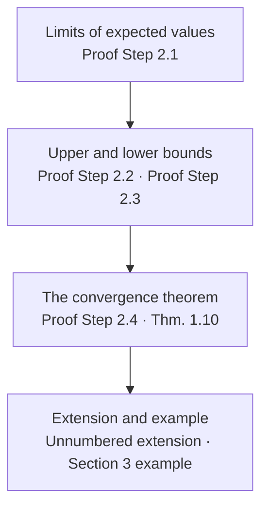
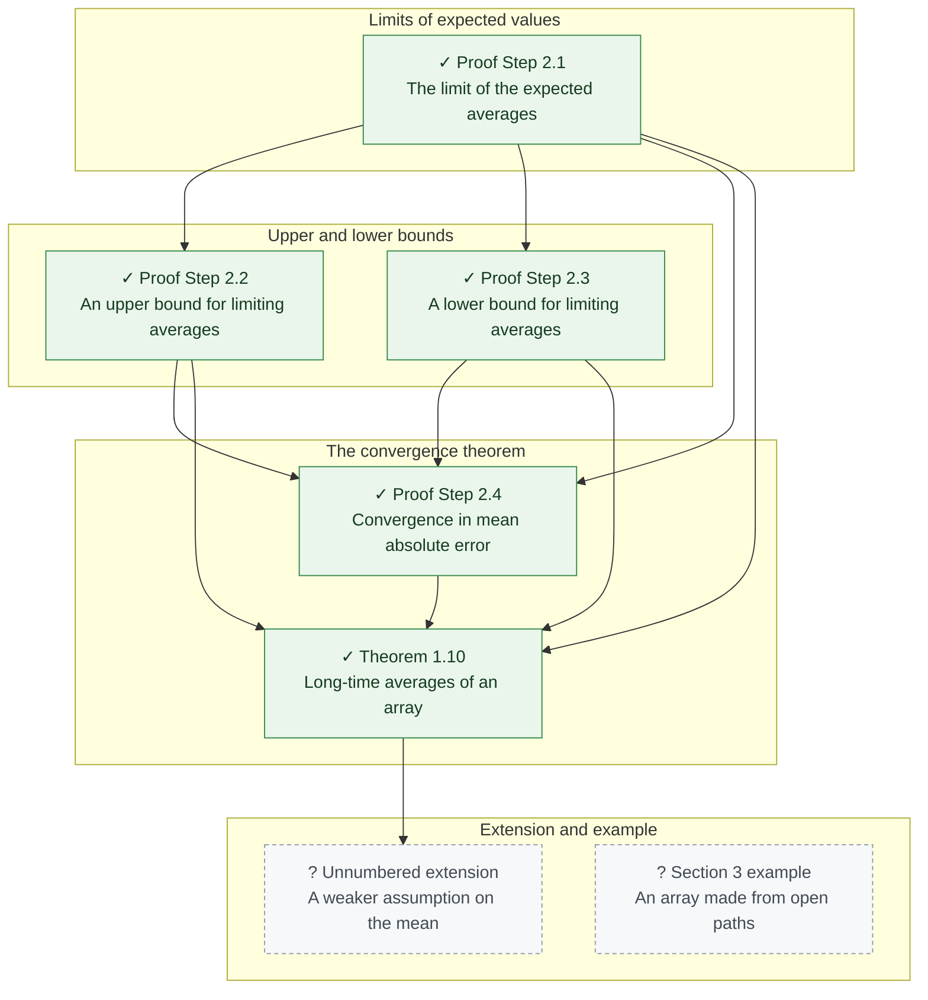

# An improved subadditive ergodic theorem

**Thomas M. Liggett**<br>
*The Annals of Probability* **13** (4), 1279–1285 (1985).<br>
[Published paper](https://doi.org/10.1214/aop/1176992811) · [Paper catalogue](../../README.md) · [Common notation](../notation.md)

## What this paper contributes

Passage times naturally break into pieces. Subadditivity turns that geometry into a long-distance law of large numbers. Liggett's theorem permits weaker distributional assumptions than full stationarity of the entire two-parameter array. This flexibility is useful when constructing limit shapes.

For LPP, one applies a subadditive theorem to the negatives of superadditive passage times. The theorem on this page is stated for a general array, so it can also be used beyond LPP.

## The certified theorem

### Theorem 1.10

*Convergence of a subadditive array.*

Let $`(\Omega,\mathcal F,\mathbb P)`$ be a probability space and let $`X_{m,n}:\Omega\to\mathbb R`$ be functions for integers $`0\le m<n`$. The sequence laws below are laws on $`\mathbb R^{\mathbb N_{\ge1}}`$ with its product Borel sigma-algebra. A map described as having a law is assumed to admit a measurable representative agreeing with it almost surely. Literal measurability of every array entry is not an additional hypothesis. Assume the following four conditions.

1. **Subadditivity from the origin.** Condition (1.7) requires, for every $`0<m<n`$,

   ```math
   X_{0,n}\le X_{0,m}+X_{m,n}\qquad\mathbb P\text{-almost surely}.
   ```

2. **Stationarity of row laws.** In condition (1.8), for each $`m\ge0`$, the two sequence-valued maps

   ```math
   (X_{m+1,m+k+1})_{k\ge1}
   \quad\text{and}\quad
   (X_{m,m+k})_{k\ge1}
   ```

   have the same joint distribution.

3. **Stationarity of block processes.** In condition (1.9), for every integer $`k\ge1`$, the sequence-valued map

   ```math
   (X_{nk,(n+1)k})_{n\ge1}
   ```

   admits a measurable representative and has a law $`\nu_k`$ invariant under the left shift $`\theta((y_n)_{n\ge1})=(y_{n+1})_{n\ge1}`$. Equivalently, every shifted block sequence has the same joint law. The sequence begins at $`n=1`$.

4. **Moment bound.** Condition (1.3) requires $`X_{0,n}\in L^1(\mathbb P)`$ for every $`n\ge1`$, and one constant $`c\in\mathbb R`$ such that

   ```math
   \mathbb E X_{0,n}\ge-cn\qquad(n\ge1).
   ```

Then there is a finite constant

```math
\gamma=\lim_{n\to\infty}\frac{\mathbb E X_{0,n}}n
       =\inf_{n\ge1}\frac{\mathbb E X_{0,n}}n
```

and a measurable integrable random variable $`X_\infty`$ such that

```math
\frac{X_{0,n}}n\longrightarrow X_\infty
\quad\text{almost surely and in }L^1,
\qquad
\mathbb E X_\infty=\gamma.
```

Here $`L^1`$ convergence means $`\mathbb E|X_{0,n}/n-X_\infty|\to0`$. If the left shift $`\theta`$ is ergodic under $`\nu_k`$ for every $`k\ge1`$, then $`X_\infty=\gamma`$ almost surely. Without this additional assumption the limit may be random.

[Lean certificate](https://github.com/cjanjigi/LPP/blob/5a3c7a612144b68468559ea1800bf7f39a5d3ef1/ProbabilityBasics/Statements/Liggett.lean#L104) · [Exact hypothesis definitions](https://github.com/cjanjigi/LPP/blob/5a3c7a612144b68468559ea1800bf7f39a5d3ef1/ProbabilityBasics/Statements/ProbabilityDefinitions.lean#L120)

<!-- PAPER_MAP_START -->
## Progress and dependencies

[Interactive dependency graph](https://cjanjigi.github.io/LPP/?paper=liggett-1985) · [Static graph and coverage notes](../graphs/paper-results/liggett-1985.md)

The graph and progress list cover every named result. Follow a result link to read its coverage and open its certificates.

<details>
<summary>Dependency overview</summary>



</details>

<details>
<summary>Every result and its status</summary>

**✓ Certified** · **◐ Restricted** · **○ Not in this release** · **? Not assessed**



| Paper result | Formalization |
| --- | --- |
| **[Proof Step 2.1](../graphs/paper-results/liggett-1985.md#proof-step-21)**<br/>The limit of the expected averages | **✓ Certified**<br/>[Coverage note](../graphs/paper-results/liggett-1985.md#proof-step-21)<br/>[Lean certificate](https://github.com/cjanjigi/LPP/blob/5a3c7a612144b68468559ea1800bf7f39a5d3ef1/ProbabilityBasics/Probability/LiggettExpectedRate.lean#L96) · [Complete original-row formulation](https://github.com/cjanjigi/LPP/blob/5a3c7a612144b68468559ea1800bf7f39a5d3ef1/ProbabilityBasics/Statements/Liggett.lean#L104) |
| **[Proof Step 2.2](../graphs/paper-results/liggett-1985.md#proof-step-22)**<br/>An upper bound for limiting averages | **✓ Certified**<br/>[Coverage note](../graphs/paper-results/liggett-1985.md#proof-step-22)<br/>[Fixed-block upper comparison](https://github.com/cjanjigi/LPP/blob/5a3c7a612144b68468559ea1800bf7f39a5d3ef1/ProbabilityBasics/Probability/LiggettBlockUpper.lean#L133) · [Complete theorem](https://github.com/cjanjigi/LPP/blob/5a3c7a612144b68468559ea1800bf7f39a5d3ef1/ProbabilityBasics/Statements/Liggett.lean#L104) |
| **[Proof Step 2.3](../graphs/paper-results/liggett-1985.md#proof-step-23)**<br/>A lower bound for limiting averages | **✓ Certified**<br/>[Coverage note](../graphs/paper-results/liggett-1985.md#proof-step-23)<br/>[Auxiliary lower comparison](https://github.com/cjanjigi/LPP/blob/5a3c7a612144b68468559ea1800bf7f39a5d3ef1/ProbabilityBasics/Probability/LiggettLowerComparison.lean#L32) · [Complete theorem](https://github.com/cjanjigi/LPP/blob/5a3c7a612144b68468559ea1800bf7f39a5d3ef1/ProbabilityBasics/Statements/Liggett.lean#L104) |
| **[Proof Step 2.4](../graphs/paper-results/liggett-1985.md#proof-step-24)**<br/>Convergence in mean absolute error | **✓ Certified**<br/>[Coverage note](../graphs/paper-results/liggett-1985.md#proof-step-24)<br/>[Lean certificate](https://github.com/cjanjigi/LPP/blob/5a3c7a612144b68468559ea1800bf7f39a5d3ef1/ProbabilityBasics/Probability/LiggettConvergence.lean#L33) · [Original-row theorem](https://github.com/cjanjigi/LPP/blob/5a3c7a612144b68468559ea1800bf7f39a5d3ef1/ProbabilityBasics/Statements/Liggett.lean#L104) |
| **[Theorem 1.10](../graphs/paper-results/liggett-1985.md#theorem-110)**<br/>Long-time averages of an array | **✓ Certified**<br/>[Coverage note](../graphs/paper-results/liggett-1985.md#theorem-110)<br/>[Lean certificate](https://github.com/cjanjigi/LPP/blob/5a3c7a612144b68468559ea1800bf7f39a5d3ef1/ProbabilityBasics/Statements/Liggett.lean#L104) |
| **[Unnumbered extension](../graphs/paper-results/liggett-1985.md#unnumbered-extension)**<br/>A weaker assumption on the mean | **? Not assessed**<br/>[Coverage note](../graphs/paper-results/liggett-1985.md#unnumbered-extension) |
| **[Section 3 example](../graphs/paper-results/liggett-1985.md#section-3-example)**<br/>An array made from open paths | **? Not assessed**<br/>[Coverage note](../graphs/paper-results/liggett-1985.md#section-3-example) |

</details>

<!-- PAPER_MAP_END -->

## Auxiliary coverage

Proof Steps (2.1)–(2.4) are covered under the paper's theorem hypotheses. In particular, the released complete theorem proves convergence to an integrable limit with mean $`\gamma`$, so its upper- and lower-limit conclusions cover (2.2) and (2.3).

The supporting declarations use different hypotheses and intermediate quantities. These are differences in how the proof is assembled, rather than restrictions on those two mathematical claims. The [full progress list](../graphs/paper-results/liggett-1985.md#coverage-notes) gives short descriptions and links to both the helpers and the complete theorem.

## Deviations from the printed text

### Alternative proofs chosen to simplify formalization

No deliberate replacement of a correct printed argument is recorded in this guide.

### Formulation details

| Location | Formalization change | Reason |
| --- | --- | --- |
| Measurability | Uses measurable representatives agreeing almost surely. | Connects existing measure-theory interfaces without strengthening the theorem's hypotheses. |
| Stationarity | States the row and block conditions through sequence laws. | Expresses the paper's distributional assumptions directly. |
| Indices | Retains the paper's mathematical indexing in the statement. | Keeps the source correspondence clear despite internal sequence conventions. |

[Measurable representatives](https://github.com/cjanjigi/LPP/blob/5a3c7a612144b68468559ea1800bf7f39a5d3ef1/ProbabilityBasics/Full/Foundations/LiggettSubadditiveErgodic.lean#L24) · [Row-law definition](https://github.com/cjanjigi/LPP/blob/5a3c7a612144b68468559ea1800bf7f39a5d3ef1/ProbabilityBasics/Frozen/Foundations/Liggett/LiggettRowLaws.lean#L14) · [Block-process definition](https://github.com/cjanjigi/LPP/blob/5a3c7a612144b68468559ea1800bf7f39a5d3ef1/ProbabilityBasics/Frozen/Foundations/Liggett/LiggettBlockProcess.lean#L13)

### Corrections or repairs to the source

No correction to the printed theorem is recorded.

## Remaining coverage

Theorem 1.10 is certified. The progress list separates this theorem from the earlier results and examples in the paper. Their certificate coverage has not been assessed here.
