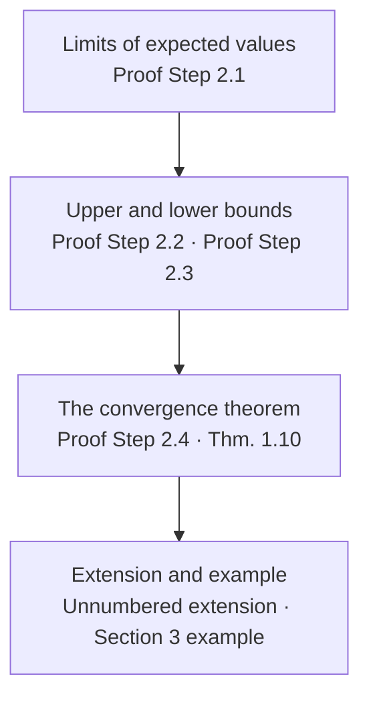
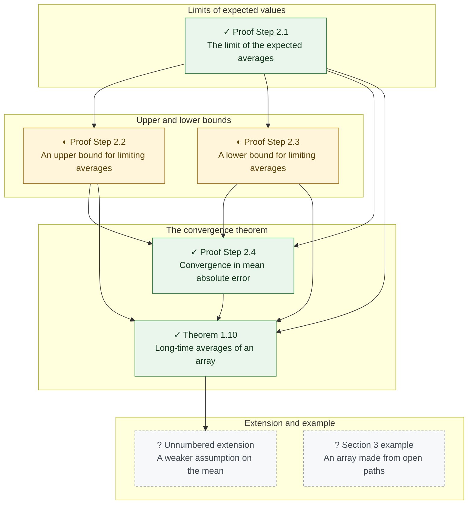

# An improved subadditive ergodic theorem

**Thomas M. Liggett** 
*The Annals of Probability* **13** (4), 1279–1285 (1985). 
[Published paper](https://doi.org/10.1214/aop/1176992811) · [Paper catalogue](../../README.md) · [Common notation](../notation.md)

## What this paper contributes

Passage times naturally break into pieces. Subadditivity turns that geometry into a long-distance law of large numbers. Liggett's theorem permits weaker distributional assumptions than full stationarity of the entire two-parameter array. This flexibility is useful when constructing limit shapes.

For LPP, one applies a subadditive theorem to the negatives of superadditive passage times. The theorem on this page is stated for a general array, so it can also be used beyond LPP.

## The certified theorem

### Theorem 1.10

*Convergence of a subadditive array.*

Let $(\Omega,\mathcal F,\mathbb P)$ be a probability space and let $X_{m,n}:\Omega\to\mathbb R$ be functions for integers $0\le m<n$. The sequence laws below are laws on $\mathbb R^{\mathbb N_{\ge1}}$ with its product Borel sigma-algebra. A map described as having a law is assumed to admit a measurable representative agreeing with it almost surely. Literal measurability of every array entry is not an additional hypothesis. Assume the following four conditions.

1. **Subadditivity from the origin.** Condition (1.7) requires, for every $0<m<n$,

   $$
   X_{0,n}\le X_{0,m}+X_{m,n}\qquad\mathbb P\text{-almost surely}.
   $$

2. **Stationarity of row laws.** In condition (1.8), for each $m\ge0$, the two sequence-valued maps

   $$
   (X_{m+1,m+k+1})_{k\ge1}
   \quad\text{and}\quad
   (X_{m,m+k})_{k\ge1}
   $$

   have the same joint distribution.

3. **Stationarity of block processes.** In condition (1.9), for every integer $k\ge1$, the sequence-valued map

   $$
   (X_{nk,(n+1)k})_{n\ge1}
   $$

   admits a measurable representative and has a law $\nu_k$ invariant under the left shift $\theta((y_n)_{n\ge1})=(y_{n+1})_{n\ge1}$. Equivalently, every shifted block sequence has the same joint law. The sequence begins at $n=1$.

4. **Moment bound.** Condition (1.3) requires $X_{0,n}\in L^1(\mathbb P)$ for every $n\ge1$, and one constant $c\in\mathbb R$ such that

   $$
   \mathbb E X_{0,n}\ge-cn\qquad(n\ge1).
   $$

Then there is a finite constant

$$
\gamma=\lim_{n\to\infty}\frac{\mathbb E X_{0,n}}n
       =\inf_{n\ge1}\frac{\mathbb E X_{0,n}}n
$$

and a measurable integrable random variable $X_\infty$ such that

$$
\frac{X_{0,n}}n\longrightarrow X_\infty
\quad\text{almost surely and in }L^1,
\qquad
\mathbb E X_\infty=\gamma.
$$

Here $L^1$ convergence means $\mathbb E|X_{0,n}/n-X_\infty|\to0$. If the left shift $\theta$ is ergodic under $\nu_k$ for every $k\ge1$, then $X_\infty=\gamma$ almost surely. Without this additional assumption the limit may be random.

[Lean certificate](https://github.com/cjanjigi/LPP/blob/5a3c7a612144b68468559ea1800bf7f39a5d3ef1/ProbabilityBasics/Statements/Liggett.lean#L104) · [Exact hypothesis definitions](https://github.com/cjanjigi/LPP/blob/5a3c7a612144b68468559ea1800bf7f39a5d3ef1/ProbabilityBasics/Statements/ProbabilityDefinitions.lean#L120)

<!-- PAPER_MAP_START -->
## Progress and dependencies

The map groups the paper's results. Open the full graph to see each named result and its formalization status.

Graph presentation based on Scott Armstrong’s visual paper design for [*Homogenization at a polynomial scale in high contrast*](https://scottnarmstrong.github.io/hcp-visual-paper/).

[Full result graph and progress list](../graphs/paper-results/liggett-1985.md)

Every result and its status

**✓ Certified** · **◐ Restricted** · **○ Not in this release** · **? Not assessed**

| Paper result | Formalization |
| --- | --- |
| **Proof Step 2.1** The limit of the expected averages | **✓ Certified** [Lean certificate](https://github.com/cjanjigi/LPP/blob/5a3c7a612144b68468559ea1800bf7f39a5d3ef1/ProbabilityBasics/Probability/LiggettExpectedRate.lean#L96) · [Complete original-row formulation](https://github.com/cjanjigi/LPP/blob/5a3c7a612144b68468559ea1800bf7f39a5d3ef1/ProbabilityBasics/Statements/Liggett.lean#L104) |
| **Proof Step 2.2** An upper bound for limiting averages | **◐ Restricted** [Fixed-block upper comparison](https://github.com/cjanjigi/LPP/blob/5a3c7a612144b68468559ea1800bf7f39a5d3ef1/ProbabilityBasics/Probability/LiggettBlockUpper.lean#L133) · [Complete theorem](https://github.com/cjanjigi/LPP/blob/5a3c7a612144b68468559ea1800bf7f39a5d3ef1/ProbabilityBasics/Statements/Liggett.lean#L104) |
| **Proof Step 2.3** A lower bound for limiting averages | **◐ Restricted** [Auxiliary lower comparison](https://github.com/cjanjigi/LPP/blob/5a3c7a612144b68468559ea1800bf7f39a5d3ef1/ProbabilityBasics/Probability/LiggettLowerComparison.lean#L32) · [Complete theorem](https://github.com/cjanjigi/LPP/blob/5a3c7a612144b68468559ea1800bf7f39a5d3ef1/ProbabilityBasics/Statements/Liggett.lean#L104) |
| **Proof Step 2.4** Convergence in mean absolute error | **✓ Certified** [Lean certificate](https://github.com/cjanjigi/LPP/blob/5a3c7a612144b68468559ea1800bf7f39a5d3ef1/ProbabilityBasics/Probability/LiggettConvergence.lean#L33) · [Original-row theorem](https://github.com/cjanjigi/LPP/blob/5a3c7a612144b68468559ea1800bf7f39a5d3ef1/ProbabilityBasics/Statements/Liggett.lean#L104) |
| **Theorem 1.10** Long-time averages of an array | **✓ Certified** [Lean certificate](https://github.com/cjanjigi/LPP/blob/5a3c7a612144b68468559ea1800bf7f39a5d3ef1/ProbabilityBasics/Statements/Liggett.lean#L104) |
| **Unnumbered extension** A weaker assumption on the mean | **? Not assessed** |
| **Section 3 example** An array made from open paths | **? Not assessed** |

<!-- PAPER_MAP_END -->

## Supporting statements

Expected rate, block upper bound and lower comparison

These are the exact mathematical conclusions of the three linked supporting certificates. They are recorded separately because their hypotheses differ from those of the complete theorem.

### Expected rate

*Equation (2.1).*

Assume conditions (1.7), (1.8) and (1.3) above, and assume in addition that $X_{0,n}$ itself is measurable for each $n\ge1$. Block stationarity is unnecessary. There is $\gamma\in\mathbb R$ such that

$$
\lim_{n\to\infty}\frac{\mathbb E X_{0,n}}n
=\gamma
=\inf_{n\ge1}\frac{\mathbb E X_{0,n}}n.
$$

This conclusion contains no almost-sure or $L^1$ convergence assertion. [Certificate](https://github.com/cjanjigi/LPP/blob/5a3c7a612144b68468559ea1800bf7f39a5d3ef1/ProbabilityBasics/Probability/LiggettExpectedRate.lean#L96)

### Block upper estimate

*The fixed-block comparison in (2.5)–(2.8).*

Fix an integer $k\ge1$. Assume (1.7) and (1.8), that $X_{0,n}$ is measurable and integrable for every $n\ge1$, and that the $k$-block process in (1.9) is stationary. There exists an integrable function $V_k:\Omega\to\mathbb R$ such that

$$
\mathbb E V_k=\frac{\mathbb E X_{0,k}}k,
\qquad
\limsup_{n\to\infty}\frac{X_{0,n}}n\le V_k
\quad\text{almost surely}.
$$

The limsup is taken in the extended reals. Neither the lower expectation bound in (1.3) nor stationarity for other block lengths is required by this supporting statement. [Certificate](https://github.com/cjanjigi/LPP/blob/5a3c7a612144b68468559ea1800bf7f39a5d3ef1/ProbabilityBasics/Probability/LiggettBlockUpper.lean#L133)

### Lower comparison

*The comparison following (2.14).*

Assume the hypotheses of the expected-rate statement above. With the same finite expected rate $\gamma$, there exist a probability measure $\kappa$ on $\mathbb R^{\mathbb N}$ and a measurable, $\kappa$-integrable function $Y:\mathbb R^{\mathbb N}\to\mathbb R$ such that

$$
\gamma\le\int Y\,d\kappa,
\qquad
\kappa\{Y\ge a\}\le
\mathbb P\left\{\liminf_{n\to\infty}\frac{X_{0,n}}n\ge a\right\}
\quad(a\in\mathbb R).
$$

The liminf may be extended-real. No block-stationarity hypothesis or finiteness of that liminf is assumed. [Certificate](https://github.com/cjanjigi/LPP/blob/5a3c7a612144b68468559ea1800bf7f39a5d3ef1/ProbabilityBasics/Probability/LiggettLowerComparison.lean#L32)

## Deviations from the printed text

### Alternative proofs chosen to simplify formalization

No deliberate replacement of a correct printed argument is recorded in this guide.

### Formulation and measure-theoretic details

**Measurable representatives.** The public statement assumes integrability of $X_{0,n}$. Some internal convergence lemmas take measurable functions as explicit inputs. The proof therefore replaces row zero by measurable representatives that agree almost surely, proves the result for this version, and transfers all conclusions back. This preserves the theorem's hypotheses and conclusions. The reason is to bridge the measurable-function interfaces used by the formal proof.

[Explanation and construction in the released proof](https://github.com/cjanjigi/LPP/blob/5a3c7a612144b68468559ea1800bf7f39a5d3ef1/ProbabilityBasics/Full/Foundations/LiggettSubadditiveErgodic.lean#L24)

**Stationarity as a statement about laws.** The row and block conditions are expressed through equality of sequence laws and the left shift on sequence space. This makes the printed distributional conditions explicit without assuming a measure-preserving transformation on the original probability space. The source indices $k\ge1$ and $n\ge1$ are represented internally by zero-based sequences; the mathematical indexing above retains the paper's convention.

[Row-law definition](https://github.com/cjanjigi/LPP/blob/5a3c7a612144b68468559ea1800bf7f39a5d3ef1/ProbabilityBasics/Frozen/Foundations/Liggett/LiggettRowLaws.lean#L14) · [Block-process definition](https://github.com/cjanjigi/LPP/blob/5a3c7a612144b68468559ea1800bf7f39a5d3ef1/ProbabilityBasics/Frozen/Foundations/Liggett/LiggettBlockProcess.lean#L13)

### Corrections or repairs to the source

No correction to the printed theorem is recorded.

## Remaining coverage

Theorem 1.10 is certified. The progress list separates this theorem from the earlier results and examples in the paper. Their certificate coverage has not been assessed here.
