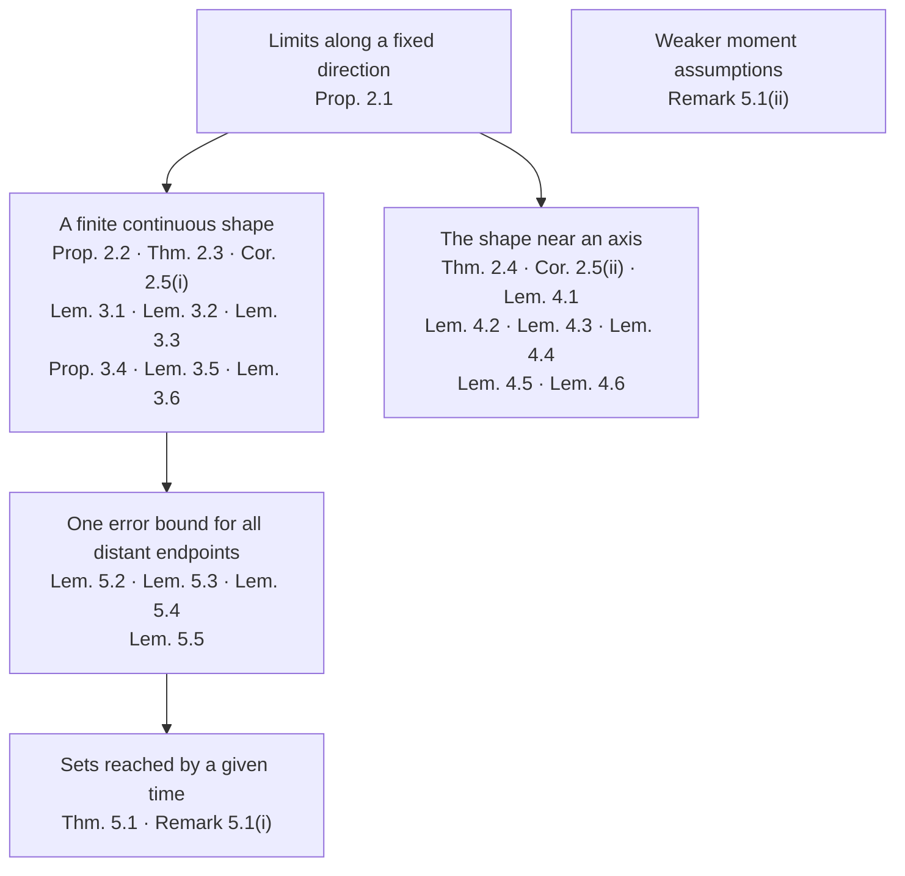
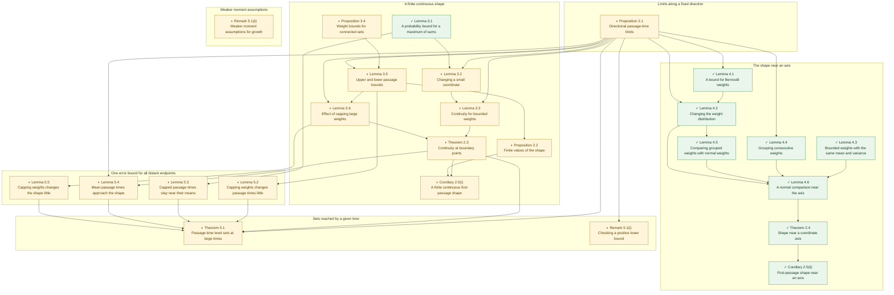

# Limiting shape for directed percolation models

**James B. Martin**<br>
*The Annals of Probability* **32** (4), 2908–2937 (2004).<br>
[Published paper](https://doi.org/10.1214/009117904000000838) · [Author's preprint](https://arxiv.org/abs/math/0301055) · [Paper catalogue](../../README.md) · [Common notation](../notation.md)

This paper provides the shape theory used throughout the library. Its results give directional passage-time limits, continuity up to the axes, a universal square-root expansion near an axis, and convergence of associated growth sets. It also supplies concentration and truncation tools used in later LPP arguments.

The released shape results cover **dimension two**. Supporting concentration and directional-limit statements are included below.

## Certified results

Use the [common LPP model](../notation.md), with i.i.d. real weights of law $`\mu`$ and terminal-excluded passage times $`L_{u,v}`$. Write $`|x|_1=x_1+x_2`$ for $`x\in \mathbb{R}_{\geq 0}^2`$. For $`u\le v`$, define $`S_{u,v}`$ by taking the minimum of the same path weights used to define $`L_{u,v}`$. We write

```math
I_+(\mu)=\int_0^\infty\mathbb P\{\omega_0>s\}^{1/2}\,ds,
\qquad
I_-(\mu)=\int_{-\infty}^0\mathbb P\{\omega_0\le s\}^{1/2}\,ds.
```

The paper writes $`T`$ for our $`L`$ and $`\mu`$ for the mean. Here $`\mu`$ denotes the weight law, $`m=\mathbb E\omega_0`$, and $`\sigma^2=\mathbb E[(\omega_0-m)^2]`$. The terminal-excluded path convention agrees with ours.

The [shape functions](../notation.md#shape-functions) $`g`$ and $`h`$ are defined by fixed-direction almost-sure limits. The results below prove their existence, finiteness and further properties under the indicated hypotheses. The [uniform shape approximation (U)](../notation.md#uniform-shape-approximation) is a separate conclusion, with one common probability-one event and a bound over all sufficiently distant lattice points.

### Theorem 2.3

*Finiteness and continuity.*

If $`\mathbb E|\omega_0|<\infty`$ and $`I_+(\mu)<\infty`$, the directional shape $`g`$ exists, is finite and continuous on the closed quadrant, and is symmetric, positively homogeneous and concave. For every fixed $`x\in \mathbb{R}_{\geq 0}^2`$,

```math
\frac{\mathbb E L_{0,\lfloor nx\rfloor}}n\longrightarrow g(x),
\qquad
\mathbb E\left|\frac{L_{0,\lfloor nx\rfloor}}n-g(x)\right|\longrightarrow0.
```

[Finite-continuity certificate](https://github.com/cjanjigi/LPP/blob/5a3c7a612144b68468559ea1800bf7f39a5d3ef1/Martin2004/Statements/LimitShape.lean#L135) · [Directional-limit certificate](https://github.com/cjanjigi/LPP/blob/5a3c7a612144b68468559ea1800bf7f39a5d3ef1/Martin2004/Statements/LimitShape.lean#L73)

The first certificate combines Propositions 2.1–2.2 with Theorem 2.3 and states almost-sure and $`L^1`$ convergence on lattice rays. Proposition 2.1 supplies convergence in every fixed real direction. The directional definition determines $`g`$ uniquely.

### Section 5.3

*Uniform shape theorem in dimension two.*

If $`I_+(\mu)<\infty`$ and $`I_-(\mu)<\infty`$, the shape $`g`$ satisfies [the uniform approximation (U)](../notation.md#uniform-shape-approximation). This strengthens fixed-direction convergence to a common almost-sure bound over all sufficiently distant lattice points.

No positivity or nondegeneracy assumption is needed for this statement. [Lean certificate](https://github.com/cjanjigi/LPP/blob/5a3c7a612144b68468559ea1800bf7f39a5d3ef1/Martin2004/Statements/LimitShape.lean#L187)

### Theorem 2.4

*Square-root boundary expansion in dimension two.*

If $`I_+(\mu)<\infty`$ and $`I_-(\mu)<\infty`$, then $`\mathbb E\omega_0^2<\infty`$ and

```math
g(1,\alpha)=m+2\sigma\sqrt\alpha+o(\sqrt\alpha)
\qquad\text{as }\alpha\downarrow0.
```

The leading correction depends on the law only through its variance. The zero-variance case is included. [Lean certificate](https://github.com/cjanjigi/LPP/blob/5a3c7a612144b68468559ea1800bf7f39a5d3ef1/Martin2004/Statements/BoundaryAsymptotics.lean#L82)

### Corollary 2.5(i)

*Finite continuous first-passage expected-rate limit in dimension two.*

If $`\mathbb E|\omega_0|<\infty`$ and $`I_-(\mu)<\infty`$, there is exactly one function $`h:\mathbb{R}_{\geq 0}^2\to\mathbb R`$ such that, for every $`x\in \mathbb{R}_{\geq 0}^2`$,

```math
\frac{\mathbb E S_{0,\lfloor nx\rfloor}}n\longrightarrow h(x),
```

and for all $`c\ge0`$ and $`x,y\in \mathbb{R}_{\geq 0}^2`$,

```math
h(cx)=ch(x),\qquad h(x_2,x_1)=h(x_1,x_2),\qquad
h(x+y)\le h(x)+h(y).
```

This function is continuous on all of $`\mathbb{R}_{\geq 0}^2`$. It is the first-passage directional shape because $`S_\omega=-L_{-\omega}`$ and [Proposition 2.1](https://github.com/cjanjigi/LPP/blob/5a3c7a612144b68468559ea1800bf7f39a5d3ef1/Martin2004/Statements/LimitShape.lean#L73), applied to the negated weight law, identifies its expected-rate limits with its almost-sure limits in every fixed direction. The [certificate for Corollary 2.5(i)](https://github.com/cjanjigi/LPP/blob/5a3c7a612144b68468559ea1800bf7f39a5d3ef1/Martin2004/Statements/BoundaryAsymptotics.lean#L141) itself states only the displayed expected-rate and deterministic properties. No uniform approximation is asserted in this part.

### Corollary 2.5(ii)

*First-passage boundary expansion in dimension two.*

If $`I_+(\mu)<\infty`$ and $`I_-(\mu)<\infty`$, the finite continuous first-passage shape $`h`$ also satisfies the first-passage version of [the uniform approximation (U)](../notation.md#uniform-shape-approximation), and

```math
h(1,\alpha)=m-2\sigma\sqrt\alpha+o(\sqrt\alpha)
\qquad\text{as }\alpha\downarrow0.
```

[Lean certificate](https://github.com/cjanjigi/LPP/blob/5a3c7a612144b68468559ea1800bf7f39a5d3ef1/Martin2004/Statements/BoundaryAsymptotics.lean#L211)

For last-passage and first-passage shape functions $`g,h`$ and $`t\ge0`$, all four sets below are subsets of $`\mathbb{R}_{\geq 0}^2`$.

```math
\begin{aligned}
B&=\{x\in \mathbb{R}_{\geq 0}^2:g(x)\le1\},&
B(t)&=\{x\in \mathbb{R}_{\geq 0}^2:L_{0,\lfloor x\rfloor}\le t\},\\
C&=\{x\in \mathbb{R}_{\geq 0}^2:h(x)\le1\},&
C(t)&=\{x\in \mathbb{R}_{\geq 0}^2:S_{0,\lfloor x\rfloor}\le t\}.
\end{aligned}
```

### Theorem 5.1(i)

*Last-passage growth sets in dimension two.*

If $`I_+(\mu)<\infty`$, $`I_-(\mu)<\infty`$ and $`m>0`$, then on one event of probability one, for every $`\varepsilon>0`$ there is $`t_0>0`$ such that for every real $`t\ge t_0`$,

```math
(1-\varepsilon)_+B\subseteq t^{-1}B(t)\subseteq(1+\varepsilon)B,
\qquad (1-\varepsilon)_+=\max\{1-\varepsilon,0\}.
```

[Lean certificate](https://github.com/cjanjigi/LPP/blob/5a3c7a612144b68468559ea1800bf7f39a5d3ef1/Martin2004/Statements/GrowthSets.lean#L86)

For $`0<\varepsilon<1`$, the inner factor is the usual $`1-\varepsilon`$. The truncated factor records the release's nonnegative-scalar convention for larger $`\varepsilon`$.

### Theorem 5.1(ii)

*First-passage growth sets in dimension two.*

Assume $`I_+(\mu)<\infty`$ and $`I_-(\mu)<\infty`$. If

```math
\exists c>0\ \forall x\in \mathbb{R}_{\geq 0}^2,\qquad h(x)\ge c|x|_1,
```

then on one event of probability one, for every $`\varepsilon>0`$ there is $`t_0>0`$ such that for every real $`t\ge t_0`$,

```math
(1-\varepsilon)_+C\subseteq t^{-1}C(t)\subseteq(1+\varepsilon)C.
```

The shape exists without the positive lower bound; the growth-set conclusion is conditional on it. The lower bound is equivalent to $`\inf_{x\in \mathbb{R}_{\geq 0}^2\setminus\{0\}}h(x)/|x|_1>0`$. [Lean certificate](https://github.com/cjanjigi/LPP/blob/5a3c7a612144b68468559ea1800bf7f39a5d3ef1/Martin2004/Statements/GrowthSets.lean#L157)

<!-- PAPER_MAP_START -->
## Progress and dependencies

[Dependency graph and coverage notes](../graphs/paper-results/martin-2004.md)

The graph and progress list cover every named result. Follow a result link to read its coverage and open its certificates.

Graph presentation based on Scott Armstrong’s visual paper design for [*Homogenization at a polynomial scale in high contrast*](https://scottnarmstrong.github.io/hcp-visual-paper/).

<details>
<summary>Dependency overview</summary>



</details>

<details>
<summary>Every result and its status</summary>

**✓ Certified** · **◐ Restricted** · **○ Not in this release** · **? Not assessed**



| Paper result | Formalization |
| --- | --- |
| **[Proposition 2.1](../graphs/paper-results/martin-2004.md#proposition-21)**<br/>Directional passage-time limits | **◐ Restricted**<br/>[Planar case only](../graphs/paper-results/martin-2004.md#proposition-21)<br/>[Lean certificate](https://github.com/cjanjigi/LPP/blob/5a3c7a612144b68468559ea1800bf7f39a5d3ef1/Martin2004/Statements/LimitShape.lean#L73) |
| **[Proposition 2.2](../graphs/paper-results/martin-2004.md#proposition-22)**<br/>Finite values of the shape | **◐ Restricted**<br/>[Planar case only](../graphs/paper-results/martin-2004.md#proposition-22)<br/>[Lean certificate](https://github.com/cjanjigi/LPP/blob/5a3c7a612144b68468559ea1800bf7f39a5d3ef1/Martin2004/Statements/LimitShape.lean#L135) |
| **[Theorem 2.3](../graphs/paper-results/martin-2004.md#theorem-23)**<br/>Continuity at boundary points | **◐ Restricted**<br/>[Planar case only](../graphs/paper-results/martin-2004.md#theorem-23)<br/>[Lean certificate](https://github.com/cjanjigi/LPP/blob/5a3c7a612144b68468559ea1800bf7f39a5d3ef1/Martin2004/Statements/LimitShape.lean#L135) |
| **[Corollary 2.5(i)](../graphs/paper-results/martin-2004.md#corollary-25i)**<br/>A finite continuous first-passage shape | **◐ Restricted**<br/>[Planar case only](../graphs/paper-results/martin-2004.md#corollary-25i)<br/>[Lean certificate](https://github.com/cjanjigi/LPP/blob/5a3c7a612144b68468559ea1800bf7f39a5d3ef1/Martin2004/Statements/BoundaryAsymptotics.lean#L141) |
| **[Lemma 3.1](../graphs/paper-results/martin-2004.md#lemma-31)**<br/>A probability bound for a maximum of sums | **✓ Certified**<br/>[Coverage note](../graphs/paper-results/martin-2004.md#lemma-31)<br/>[Lean certificate](https://github.com/cjanjigi/LPP/blob/5a3c7a612144b68468559ea1800bf7f39a5d3ef1/ProbabilityBasics/Statements/Concentration.lean#L81) |
| **[Lemma 3.2](../graphs/paper-results/martin-2004.md#lemma-32)**<br/>Changing a small coordinate | **◐ Restricted**<br/>[Planar case only](../graphs/paper-results/martin-2004.md#lemma-32)<br/>[Bounded continuity and face estimate](https://github.com/cjanjigi/LPP/blob/5a3c7a612144b68468559ea1800bf7f39a5d3ef1/Martin2004/Probability/MartinBoundedContinuity.lean#L131) |
| **[Lemma 3.3](../graphs/paper-results/martin-2004.md#lemma-33)**<br/>Continuity for bounded weights | **◐ Restricted**<br/>[Planar case only](../graphs/paper-results/martin-2004.md#lemma-33)<br/>[Lean certificate](https://github.com/cjanjigi/LPP/blob/5a3c7a612144b68468559ea1800bf7f39a5d3ef1/Martin2004/Probability/MartinBoundedContinuity.lean#L131) |
| **[Proposition 3.4](../graphs/paper-results/martin-2004.md#proposition-34)**<br/>Weight bounds for connected sets | **◐ Restricted**<br/>[Planar case only](../graphs/paper-results/martin-2004.md#proposition-34)<br/>[Expected bound for connected sets](https://github.com/cjanjigi/LPP/blob/5a3c7a612144b68468559ea1800bf7f39a5d3ef1/Martin2004/Probability/AnimalPositiveMean.lean#L75) · [Almost-sure bound for connected sets](https://github.com/cjanjigi/LPP/blob/5a3c7a612144b68468559ea1800bf7f39a5d3ef1/Martin2004/Probability/GreedyAnimalAlmostSureBound.lean#L143) |
| **[Lemma 3.5](../graphs/paper-results/martin-2004.md#lemma-35)**<br/>Upper and lower passage bounds | **◐ Restricted**<br/>[Planar case only](../graphs/paper-results/martin-2004.md#lemma-35)<br/>[Mean and directional-shape upper bounds](https://github.com/cjanjigi/LPP/blob/5a3c7a612144b68468559ea1800bf7f39a5d3ef1/Martin2004/Probability/MartinPassageMean.lean#L33) · [Uniform passage upper bound](https://github.com/cjanjigi/LPP/blob/5a3c7a612144b68468559ea1800bf7f39a5d3ef1/Martin2004/Probability/UniformPassageUpper.lean#L57) · [Mean lower bound under a first moment](https://github.com/cjanjigi/LPP/blob/5a3c7a612144b68468559ea1800bf7f39a5d3ef1/Martin2004/Probability/ERealFloorRateGeometry.lean#L58) · [Directional expected-rate limits](https://github.com/cjanjigi/LPP/blob/5a3c7a612144b68468559ea1800bf7f39a5d3ef1/Martin2004/Statements/LimitShape.lean#L73) |
| **[Lemma 3.6](../graphs/paper-results/martin-2004.md#lemma-36)**<br/>Effect of capping large weights | **◐ Restricted**<br/>[Planar case only](../graphs/paper-results/martin-2004.md#lemma-36)<br/>[Two-sided shape comparison](https://github.com/cjanjigi/LPP/blob/5a3c7a612144b68468559ea1800bf7f39a5d3ef1/Martin2004/Probability/RealExpectedTruncation.lean#L158) · [Compact uniform approximation](https://github.com/cjanjigi/LPP/blob/5a3c7a612144b68468559ea1800bf7f39a5d3ef1/Martin2004/Probability/MartinWeakContinuity.lean#L85) |
| **[Theorem 2.4](../graphs/paper-results/martin-2004.md#theorem-24)**<br/>Shape near a coordinate axis | **✓ Certified**<br/>[Coverage note](../graphs/paper-results/martin-2004.md#theorem-24)<br/>[Lean certificate](https://github.com/cjanjigi/LPP/blob/5a3c7a612144b68468559ea1800bf7f39a5d3ef1/Martin2004/Statements/BoundaryAsymptotics.lean#L82) |
| **[Corollary 2.5(ii)](../graphs/paper-results/martin-2004.md#corollary-25ii)**<br/>First-passage shape near an axis | **✓ Certified**<br/>[Coverage note](../graphs/paper-results/martin-2004.md#corollary-25ii)<br/>[Lean certificate](https://github.com/cjanjigi/LPP/blob/5a3c7a612144b68468559ea1800bf7f39a5d3ef1/Martin2004/Statements/BoundaryAsymptotics.lean#L211) |
| **[Lemma 4.1](../graphs/paper-results/martin-2004.md#lemma-41)**<br/>A bound for Bernoulli weights | **✓ Certified**<br/>[Coverage note](../graphs/paper-results/martin-2004.md#lemma-41)<br/>[Lean certificate](https://github.com/cjanjigi/LPP/blob/5a3c7a612144b68468559ea1800bf7f39a5d3ef1/Martin2004/Probability/BernoulliShapeBound.lean#L88) |
| **[Lemma 4.2](../graphs/paper-results/martin-2004.md#lemma-42)**<br/>Changing the weight distribution | **✓ Certified**<br/>[Coverage note](../graphs/paper-results/martin-2004.md#lemma-42)<br/>[Lean certificate](https://github.com/cjanjigi/LPP/blob/5a3c7a612144b68468559ea1800bf7f39a5d3ef1/Martin2004/Probability/ShapeComparison.lean#L119) |
| **[Lemma 4.3](../graphs/paper-results/martin-2004.md#lemma-43)**<br/>Bounded weights with the same mean and variance | **✓ Certified**<br/>[Coverage note](../graphs/paper-results/martin-2004.md#lemma-43)<br/>[Lean certificate](https://github.com/cjanjigi/LPP/blob/5a3c7a612144b68468559ea1800bf7f39a5d3ef1/Martin2004/Probability/MeanVarianceTruncationTail.lean#L289) |
| **[Lemma 4.4](../graphs/paper-results/martin-2004.md#lemma-44)**<br/>Grouping consecutive weights | **✓ Certified**<br/>[Coverage note](../graphs/paper-results/martin-2004.md#lemma-44)<br/>[Lean certificate](https://github.com/cjanjigi/LPP/blob/5a3c7a612144b68468559ea1800bf7f39a5d3ef1/Martin2004/Probability/BlockingComparison.lean#L185) |
| **[Lemma 4.5](../graphs/paper-results/martin-2004.md#lemma-45)**<br/>Comparing grouped weights with normal weights | **✓ Certified**<br/>[Coverage note](../graphs/paper-results/martin-2004.md#lemma-45)<br/>[Lean certificate](https://github.com/cjanjigi/LPP/blob/5a3c7a612144b68468559ea1800bf7f39a5d3ef1/Martin2004/Probability/GaussianBlockComparison.lean#L270) |
| **[Lemma 4.6](../graphs/paper-results/martin-2004.md#lemma-46)**<br/>A normal comparison near the axis | **✓ Certified**<br/>[Coverage note](../graphs/paper-results/martin-2004.md#lemma-46)<br/>[Lean certificate](https://github.com/cjanjigi/LPP/blob/5a3c7a612144b68468559ea1800bf7f39a5d3ef1/Martin2004/Probability/BoundaryUniversality.lean#L156) |
| **[Lemma 5.2](../graphs/paper-results/martin-2004.md#lemma-52)**<br/>Capping weights changes passage times little | **◐ Restricted**<br/>[Planar case only](../graphs/paper-results/martin-2004.md#lemma-52)<br/>[Lean certificate](https://github.com/cjanjigi/LPP/blob/5a3c7a612144b68468559ea1800bf7f39a5d3ef1/Martin2004/Probability/UniformTruncationApproximation.lean#L89) |
| **[Lemma 5.3](../graphs/paper-results/martin-2004.md#lemma-53)**<br/>Capped passage times stay near their means | **◐ Restricted**<br/>[Planar case only](../graphs/paper-results/martin-2004.md#lemma-53)<br/>[Lean certificate](https://github.com/cjanjigi/LPP/blob/5a3c7a612144b68468559ea1800bf7f39a5d3ef1/Martin2004/Probability/BoundedPassageFluctuations.lean#L192) |
| **[Lemma 5.4](../graphs/paper-results/martin-2004.md#lemma-54)**<br/>Mean passage times approach the shape | **◐ Restricted**<br/>[Planar case only](../graphs/paper-results/martin-2004.md#lemma-54)<br/>[Lean certificate](https://github.com/cjanjigi/LPP/blob/5a3c7a612144b68468559ea1800bf7f39a5d3ef1/Martin2004/Probability/BoundedExpectedUniform.lean#L53) |
| **[Lemma 5.5](../graphs/paper-results/martin-2004.md#lemma-55)**<br/>Capping weights changes the shape little | **◐ Restricted**<br/>[Planar case only](../graphs/paper-results/martin-2004.md#lemma-55)<br/>[Lean certificate](https://github.com/cjanjigi/LPP/blob/5a3c7a612144b68468559ea1800bf7f39a5d3ef1/Martin2004/Probability/MartinWeakContinuity.lean#L32) |
| **[Theorem 5.1](../graphs/paper-results/martin-2004.md#theorem-51)**<br/>Passage-time level sets at large times | **◐ Restricted**<br/>[Planar case only](../graphs/paper-results/martin-2004.md#theorem-51)<br/>[Last-passage growth sets](https://github.com/cjanjigi/LPP/blob/5a3c7a612144b68468559ea1800bf7f39a5d3ef1/Martin2004/Statements/GrowthSets.lean#L86) · [First-passage growth sets](https://github.com/cjanjigi/LPP/blob/5a3c7a612144b68468559ea1800bf7f39a5d3ef1/Martin2004/Statements/GrowthSets.lean#L157) |
| **[Remark 5.1(i)](../graphs/paper-results/martin-2004.md#remark-51i)**<br/>Checking a positive lower bound | **◐ Restricted**<br/>[Planar inequality only](../graphs/paper-results/martin-2004.md#remark-51i)<br/>[Lean certificate](https://github.com/cjanjigi/LPP/blob/5a3c7a612144b68468559ea1800bf7f39a5d3ef1/Martin2004/Statements/GrowthSets.lean#L200) |
| **[Remark 5.1(ii)](../graphs/paper-results/martin-2004.md#remark-51ii)**<br/>Weaker moment assumptions for growth | **◐ Restricted**<br/>[Planar forms with stronger moments](../graphs/paper-results/martin-2004.md#remark-51ii)<br/>[Weak-negative uniform shape theorem](https://github.com/cjanjigi/LPP/blob/5a3c7a612144b68468559ea1800bf7f39a5d3ef1/Martin2004/Probability/WeakNegativeShape.lean#L161) · [Shape lower bound under the same moments](https://github.com/cjanjigi/LPP/blob/5a3c7a612144b68468559ea1800bf7f39a5d3ef1/Martin2004/Probability/ShapeAboveMean.lean#L32) · [Growth sets from uniform approximation](https://github.com/cjanjigi/LPP/blob/5a3c7a612144b68468559ea1800bf7f39a5d3ef1/Martin2004/Analysis/GrowthSetInclusion.lean#L350) · [First-passage sign change](https://github.com/cjanjigi/LPP/blob/5a3c7a612144b68468559ea1800bf7f39a5d3ef1/Martin2004/Shape/FirstPassageShape.lean#L73) |

</details>

<!-- PAPER_MAP_END -->

## Auxiliary coverage

Most restricted entries in this guide cover the full planar conclusion of a result that Martin proves for every dimension $`d\ge2`$. Those labels do not indicate gaps in the planar theorems stated above. Each entry in the [full progress list](../graphs/paper-results/martin-2004.md#coverage-notes) identifies its exact scope.

Two remarks have additional limitations. Remark 5.1(i) is certified for its planar deterministic diagonal inequality; the percolation criterion for positivity is outside the checked claim. Remark 5.1(ii) is covered in the plane when the less restrictive tail has a moment of some order $`p>1`$, rather than only a first moment. Both last- and first-passage growth conclusions follow from the linked released lemmas under those stronger moments. The grid-edge probability estimates explain where $`p>1`$ enters.

This restriction does not weaken the theorem in [*Differentiability of the shape function in the planar corner growth model*](differentiability.md). That theorem already assumes a negative moment above one, and its positive moment above four supplies the positive square-root-tail condition.

Supporting concentration, continuity and truncation results have short descriptions and certificate links in the progress list. Their full statements and proofs should be read in the paper and the linked Lean files.

## Deviations from the printed text

### Alternative arguments for correct statements

These changes preserve the required conclusions of arguments treated as correct.

| Location | Formalization change | Reason |
| --- | --- | --- |
| Lemma 3.1 | Proves concentration directly and obtains the paper's bound. | Covers signed bounded variables without formalizing the cited concentration theorem. |
| Lemma 4.5 | Uses a qualitative normal approximation. | No convergence rate is needed downstream; the cited quantitative source was unavailable during formalization. |
| Lemma 4.1 | Proves the required bound for the column model. | Limits the external model theory to the input used here. |
| Theorem 2.4 | Uses a direct stationary-model proof of the exponential shape formula. | Reuses existing formalized constructions. |

The release also proves a stronger concentration bound; it is separate from the source-facing certificate for Lemma 3.1.

### Formulation changes

| Location | Formalization change | Reason |
| --- | --- | --- |
| LPP probability space | Uses a canonical product environment. | Gives the library a common representation of i.i.d. weights. |
| Proposition 2.1 | Makes rounding for real directions explicit. | Fills a detail omitted in the paper. |
| First-passage results | Transfers statements by negating weights. | Makes the relation described in the paper explicit. |
| Lemma 4.2 | Reorders an integration and scaling-limit step. | Avoids an unstated domination assumption. |

### A formula-level correction for signed weights

For signed weights, the off-lattice supremum in printed equation (2.3) can differ from the directional shape. For constant weights $`\omega_z=-1`$ and $`x=(1/2,0)`$, its first term is zero while the limiting rate is $`-1/2`$. The guide and certificates characterize the shape by directional limits.

### The origin in Lemma 5.5

The printed strict relative-error bound must exclude the origin, where both sides are zero. The certificate uses a non-strict bound valid there. A smaller positive tolerance recovers the printed strict bound at nonzero directions. This endpoint qualification is separate from the dimension restriction.

## Remaining coverage

The paper also treats higher dimensions; the released shape certificates described here are planar. The progress list records the remaining numbered results and whether a matching certificate has been assessed. Examples, simulations and the rest of the remarks are outside this guide's coverage claim.
