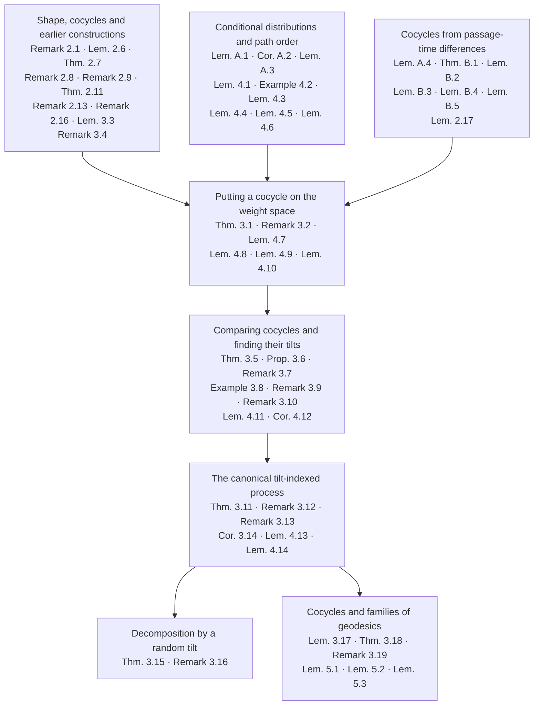

# Strong existence and uniqueness of the tilt-indexed Busemann process in the planar corner growth model

**Christopher Janjigian, Firas Rassoul-Agha and Timo Seppäläinen**<br>
This guide uses the numbering of the manuscript accepted for *Electronic Journal of Probability*, dated 31 October 2026. The [earlier arXiv version, 2507.08757v2](https://arxiv.org/abs/2507.08757v2), numbers Theorem 3.5, Proposition 3.6, Theorem 3.11 and Theorem 3.15 as Theorem 3.4, Proposition 3.5, Theorem 3.10 and Theorem 3.14, respectively.

[All papers](../../README.md) · [Common LPP notation](../notation.md) · [Main Lean certificate](https://github.com/cjanjigi/LPP/blob/a1a2ed304ad2459ea0a0482b1eed72971cc6ddeb/Busemann/Frozen/StrongExistence/Process.lean)

The public theorem in that file has a historical comment saying its proof remains open. The [proved implementation](https://github.com/cjanjigi/LPP/blob/a1a2ed304ad2459ea0a0482b1eed72971cc6ddeb/Busemann/Full/StrongExistence.lean) supplies the proof used by the public theorem.

A Busemann cocycle assigns passage-time increments to pairs of lattice sites. Its increments determine geodesics and encode supporting slopes of the limit shape. This paper constructs the whole family indexed by attainable tilts directly from the i.i.d. weights. Any two such processes agree on one probability-one event, simultaneously for every tilt and every pair of sites.

## Model and tilts

Use the planar site-weight model with environment space $`\Omega=\mathbb R^{\mathbb Z^2}`$, product law $`\mathbb P=\mu^{\otimes\mathbb Z^2}`$ and shifts $`(T_z\omega)_x=\omega_{x+z}`$. Assume $`\mu`$ is not a point mass and $`\mathbb E|\omega_0|^p<\infty`$ for some $`p>2`$. Weights may be signed, unbounded and atomic.

Here a generalized Busemann cocycle $`B(x,y;\omega)`$ is measurable and integrable at each pair of sites and has the following identities almost surely for all $`x,y,z\in\mathbb Z^2`$.

```math
\begin{aligned}
B(x,y;\omega)+B(y,z;\omega)&=B(x,z;\omega),\\
B(x+z,y+z;\omega)&=B(x,y;T_z\omega),\\
\min\{B(x,x+e_1;\omega),B(x,x+e_2;\omega)\}&=\omega_x.
\end{aligned}
```

Starting from any site, follow the smaller outgoing increment, choosing $`e_1`$ at a tie. The weight recovery and additivity identities make these paths geodesics. The paths **coalesce** if any two agree from some common level onward. A cocycle is **forward measurable** if $`B(x,y;\cdot)`$ is measurable with respect to $`\sigma(\omega_v:v\ge u)`$ whenever $`u\le x,y`$, with coordinatewise inequalities.

Let $`\mathcal H`$ consist of the vectors

```math
h=-\bigl(\mathbb E B(0,e_1),\mathbb E B(0,e_2)\bigr)
```

for generalized Busemann cocycles defined on $`\Omega`$ whose chosen geodesics coalesce almost surely. The paper defines the tilt by conditioning the two negative increments on the shift-invariant events. On $`\Omega`$, i.i.d. shift ergodicity makes that tilt the deterministic vector above.

## The certified main results

### Theorem 3.11

*Strong existence and uniqueness of the process.*

Under the stated assumptions, there exist fields $`B^{h-}(x,y;\omega)`$ and $`B^{h+}(x,y;\omega)`$ for $`h\in\mathcal H`$ and $`x,y\in\mathbb Z^2`$ with these properties.

1. For each fixed $`h`$, the two branches agree almost surely for all $`x,y`$. The minus branch is a forward measurable generalized Busemann cocycle with coalescing chosen geodesics, and the plus branch is jointly measurable in the pair of sites and the environment at each fixed tilt. For $`i=1,2`$, $`\mathbb E B^{h-}(0,e_i)=-h_i`$.
2. At a fixed $`h`$ and $`x`$, almost surely the increments satisfy

   ```math
   B^{h-}(x,x+e_1)\ge B^{h+}(x,x+e_1),
   \qquad
   B^{h-}(x,x+e_2)\le B^{h+}(x,x+e_2).
   ```

   For fixed $`h,k\in\mathcal H`$ with $`h_1<k_1`$ and any $`x`$, almost surely

   ```math
   B^{h+}(x,x+e_1)\ge B^{k-}(x,x+e_1),
   \qquad
   B^{h+}(x,x+e_2)\le B^{k-}(x,x+e_2).
   ```

3. On one probability-one event, for every $`h`$ and $`x,y`$, both branches along any sequence $`h_n\to h`$ in $`\mathcal H`$ with $`(h_n)_1<h_1`$ converge to $`B^{h-}(x,y)`$. If $`(h_n)_1>h_1`$ for every $`n`$, both converge to $`B^{h+}(x,y)`$.

Any two pairs with these properties agree almost surely simultaneously for both signs, all $`h\in\mathcal H`$ and all $`x,y`$. The construction also gives a measurable random element of the paired Skorokhod path space on the closed time set $`\{h_1-h_2:h\in\mathcal H\}`$. Its two evaluations at time $`h_1-h_2`$ recover the same two fields on one probability-one event.

[Path space and evaluation clause](https://github.com/cjanjigi/LPP/blob/a1a2ed304ad2459ea0a0482b1eed72971cc6ddeb/Busemann/Frozen/StrongExistence/Definitions/SkorokhodRealization.lean)

### Proposition 3.6

*Which tilts index the process.*

Let $`g`$ be the [directional limit shape](../notation.md#shape-functions) and let $`\partial g(\xi)`$ denote its superdifferential. Thus $`v\in\partial g(\xi)`$ means $`g(z)\le g(\xi)+v\cdot(z-\xi)`$ for every $`z\in\mathbb R_{\geq 0}^2`$. For an interior direction $`\xi\in\textup{ri}\,\mathcal U`$, let $`\nabla g(\xi-)`$ and $`\nabla g(\xi+)`$ denote the endpoints obtained from the left and right along $`(t,1-t)`$ as $`t`$ increases. In coordinate form, with $`D_i^-g,D_i^+g`$ the left and right derivatives along $`e_i`$, they are $`(D_1^-g,D_2^+g)`$ and $`(D_1^+g,D_2^-g)`$, evaluated at $`\xi`$. Then

```math
\{-\nabla g(\xi\pm):\xi\in\textup{ri}\,\mathcal U\}
\subseteq \mathcal H
\subseteq
\bigcup_{\xi\in\textup{ri}\,\mathcal U} \bigl(-\partial g(\xi)\bigr).
```

The first inclusion constructs an original-space cocycle with coalescing chosen geodesics for each endpoint tilt. The second gives an interior contact direction for each tilt in $`\mathcal H`$. The certificates use the expected-rate description of $`g`$, which agrees with the directional limit under the stated moment condition by the planar shape theorem in [*Limiting shape for directed percolation models*](martin-2004.md).

[Endpoint tilts belong to $`\mathcal H`$](https://github.com/cjanjigi/LPP/blob/a1a2ed304ad2459ea0a0482b1eed72971cc6ddeb/Busemann/Process/GradientCoalescingTilts.lean) · [Every $`\mathcal H`$ tilt supports $`g`$](https://github.com/cjanjigi/LPP/blob/a1a2ed304ad2459ea0a0482b1eed72971cc6ddeb/Busemann/Process/CoalescingTiltSupport.lean)

## Other main results and coverage

### Theorem 3.1

*Representation on the original space.*

The paper starts with a generalized Busemann cocycle $`\widehat B`$ with coalescing chosen geodesics on a probability space carrying the i.i.d. environment and equipped with measure-preserving lattice shifts. It assumes that the conditional tilt is almost surely a fixed vector $`h`$. Here the conditional tilt is the pair of negative conditional means of the two origin edge increments given the shift-invariant events.

The Lean theorem works on the concrete coupled space $`\Omega\times\mathbb R^{\mathbb N\times\mathbb Z^2\times\{1,2\}}`$. Its additional coordinates form a countable array of nearest-neighbor edge values. The same shift translates the lattice index in both the weights and the array. For **every** probability law on this space invariant under those shifts and with weight marginal $`\mathbb P`$, and **every** such cocycle with fixed conditional tilt $`h`$, Lean constructs a forward measurable generalized Busemann cocycle $`C`$ on $`\Omega`$. Its chosen geodesics coalesce, its origin edge means are $`-h_i`$, and

```math
\widehat B(x,y;a)=C(x,y;\omega(a))
\quad\text{almost surely in }a,\text{ simultaneously for all }x,y\in\mathbb Z^2.
```

Here $`\omega(a)`$ is the weight component of the same sample $`a`$. The certificate is **Restricted** because its hypotheses specify the coupled space and its shifts, while the paper allows a general Polish probability space with the stated shift action and weights. The fixed-tilt representation on this concrete space suffices for the attainment of the endpoint tilts in Proposition 3.6.

[Lean representation theorem](https://github.com/cjanjigi/LPP/blob/a1a2ed304ad2459ea0a0482b1eed72971cc6ddeb/Busemann/Process/PinnedOriginalSpaceCocycle.lean)

### Theorem 3.5

*Comparison of two canonical cocycles.*

The paper gives a trichotomy for two generalized Busemann cocycles with coalescing chosen geodesics on the weight space. Lean proves that matching tilts give equality of all increments on one probability-one event.

For arbitrary cocycles in this class, two further certificates give one almost-sure orientation of the weak edge inequalities. Thus, after ordering the fields as $`B,C`$, we have $`C(x,x+e_1)\le B(x,x+e_1)`$ and $`B(x,x+e_2)\le C(x,x+e_2)`$ for every $`x`$ almost surely. Comparing the origin means orders the tilts in the same orientation. The paper’s strict-order cases additionally require that the fields differ almost surely. The full strict-trichotomy correspondence remains unassessed. The full process has its own simultaneous uniqueness conclusion in Theorem 3.11.

[Equal-tilt certificate](https://github.com/cjanjigi/LPP/blob/a1a2ed304ad2459ea0a0482b1eed72971cc6ddeb/Busemann/Process/CanonicalCocycleUniqueness.lean) · [Order of the paths](https://github.com/cjanjigi/LPP/blob/a1a2ed304ad2459ea0a0482b1eed72971cc6ddeb/Busemann/Process/CoalescingRayGlobalOrder.lean) · [Order of the increments](https://github.com/cjanjigi/LPP/blob/a1a2ed304ad2459ea0a0482b1eed72971cc6ddeb/Busemann/Process/CoalescingRayCocycleOrder.lean)

### Remaining scope

Theorem 2.11 concerns the extended-space process of Theorem 2.7. For each fixed supporting tilt at an interior direction, Lean proves coalescence for both one-sided fields in its constructed process. The backward independence of this family supplies the coalescing fields needed for Proposition 3.6. [Lean coalescing family](https://github.com/cjanjigi/LPP/blob/a1a2ed304ad2459ea0a0482b1eed72971cc6ddeb/Busemann/Process/NativeCoalescingFullFamily.lean)

Theorem 3.15 treats a cocycle on an extended space whose conditional tilt can itself be random. It identifies the cocycle with the canonical process evaluated at that random tilt. That decomposition is outside this release. The release also establishes no strict concavity claim for the limit shape. The graph records certificate coverage for the other results individually.

<!-- PAPER_MAP_START -->
## Progress and dependencies

[Dependency graph and coverage notes](../graphs/paper-results/strong-existence.md)

The graph and progress list cover every named result. Follow a result link to read its coverage and open its certificates.

<details>
<summary>Dependency overview</summary>



</details>

The numbering follows the accepted manuscript for *Electronic Journal of Probability*, dated October 31, 2026. [The public arXiv v2](https://arxiv.org/abs/2507.08757v2) is an earlier version with different numbering in Section 3.

Remarks and examples appear as individual entries. Arrows identify mathematical prerequisites in the accepted manuscript; the guide records differences in the Lean proofs.

<details>
<summary>Every result and its status</summary>

**✓ Certified** · **◐ Restricted** · **○ Not in this release** · **? Not assessed**

```mermaid
flowchart TD
  subgraph S0["Shape, cocycles and earlier constructions"]
    R0["? Remark 2.1<br/>Moment assumptions for cited limit-shape results"]
    R1["✓ Lemma 2.6<br/>Tilt lies in the shape superdifferential"]
    R2["✓ Theorem 2.7<br/>A Busemann process on an extended space"]
    R3["? Remark 2.8<br/>Backward independence convention"]
    R4["? Remark 2.9<br/>Direction versus tilt indexing"]
    R5["✓ Theorem 2.11<br/>Coalescence for the extended-space process"]
    R6["? Remark 2.13<br/>Forward measurability as adaptedness"]
    R7["? Remark 2.16<br/>Geodesic-system terminology"]
    R11["? Lemma 3.3<br/>A deterministic projection fixes the tilt"]
    R12["? Remark 3.4<br/>Queueing examples for the projection criterion"]
  end
  subgraph S1["Conditional distributions and path order"]
    R45["? Lemma A.1<br/>Measurability of the conditional distribution"]
    R46["? Corollary A.2<br/>Measurability of the quantile geodesic"]
    R47["? Lemma A.3<br/>A generating collection of path events"]
    R28["? Lemma 4.1<br/>Quantile-process properties"]
    R29["? Example 4.2<br/>Finite-support quantile example"]
    R30["? Lemma 4.3<br/>Conditional-law and quantile-law equality"]
    R31["? Lemma 4.4<br/>Quantile sublevel equivalence for coalescing paths"]
    R32["? Lemma 4.5<br/>Coalescence at almost every sampling level"]
    R33["? Lemma 4.6<br/>Paths determined by forward weights"]
  end
  subgraph S2["Cocycles from passage-time differences"]
    R48["? Lemma A.4<br/>Exclusion of a trivial B-geodesic"]
    R49["◐ Theorem B.1<br/>A cocycle from an infinite geodesic"]
    R50["✓ Lemma B.2<br/>Passage differences along a fixed geodesic"]
    R51["? Lemma B.3<br/>Order of geodesic-generated cocycles"]
    R52["✓ Lemma B.4<br/>A coalescing cocycle is recovered by its paths"]
    R53["? Lemma B.5<br/>A path between the two tie-breaking choices"]
    R8["? Lemma 2.17<br/>Covariance of the generated cocycle"]
  end
  subgraph S3["Putting a cocycle on the weight space"]
    R9["◐ Theorem 3.1<br/>Strong existence on the canonical space"]
    R10["? Remark 3.2<br/>Criterion for strong existence"]
    R34["? Lemma 4.7<br/>A cocycle from sampled paths"]
    R35["✓ Lemma 4.8<br/>Geodesic-generated cocycle recovers the lifted cocycle"]
    R36["? Lemma 4.9<br/>Equality of weight and cocycle laws"]
    R37["? Lemma 4.10<br/>One cocycle for all positive sampling levels"]
  end
  subgraph S4["Comparing cocycles and finding their tilts"]
    R13["? Theorem 3.5<br/>Strong uniqueness and ordering"]
    R14["✓ Proposition 3.6<br/>Which tilts occur on the weight space"]
    R15["? Remark 3.7<br/>Possible gaps in H"]
    R16["? Example 3.8<br/>Mixture with random tilt"]
    R17["? Remark 3.9<br/>Mean tilt outside H"]
    R18["? Remark 3.10<br/>Attainable interior tilt with random tilt"]
    R38["? Lemma 4.11<br/>Three-way comparison of cocycles"]
    R39["? Corollary 4.12<br/>Coalescence and forward measurability"]
  end
  subgraph S5["The canonical tilt-indexed process"]
    R19["✓ Theorem 3.11<br/>Strong existence of the tilt-indexed process"]
    R20["? Remark 3.12<br/>Restrictions of process uniqueness"]
    R21["? Remark 3.13<br/>Covariance of the full process"]
    R22["? Corollary 3.14<br/>Strong mixing of the process"]
    R40["? Lemma 4.13<br/>Ordering by tilt"]
    R41["? Lemma 4.14<br/>Identifying fixed-tilt limits"]
  end
  subgraph S6["Decomposition by a random tilt"]
    R23["○ Theorem 3.15<br/>Ergodic decomposition of extended cocycles"]
    R24["? Remark 3.16<br/>Interpretation of the decomposition"]
  end
  subgraph S7["Cocycles and families of geodesics"]
    R25["? Lemma 3.17<br/>Uniqueness of cocycle geodesics"]
    R26["? Theorem 3.18<br/>Equivalence of geodesic and cocycle approaches"]
    R27["? Remark 3.19<br/>Integrability can fail without ergodicity"]
    R42["? Lemma 5.1<br/>Uniqueness of covariant geodesic systems"]
    R43["? Lemma 5.2<br/>The cocycle-generated system recovers the given system"]
    R44["? Lemma 5.3<br/>Generated cocycle belongs to the coalescing class"]
  end
  R2 --> R5
  R51 --> R8
  R37 --> R9
  R36 --> R9
  R1 --> R10
  R1 --> R11
  R11 --> R12
  R38 --> R13
  R1 --> R14
  R2 --> R14
  R5 --> R14
  R9 --> R14
  R14 --> R16
  R10 --> R17
  R16 --> R17
  R16 --> R18
  R39 --> R19
  R13 --> R19
  R40 --> R19
  R41 --> R19
  R19 --> R21
  R21 --> R22
  R9 --> R23
  R13 --> R23
  R19 --> R23
  R9 --> R25
  R39 --> R25
  R43 --> R26
  R44 --> R26
  R26 --> R27
  R46 --> R28
  R28 --> R30
  R47 --> R30
  R28 --> R31
  R30 --> R32
  R31 --> R32
  R49 --> R34
  R33 --> R34
  R51 --> R34
  R28 --> R34
  R52 --> R35
  R30 --> R36
  R35 --> R36
  R34 --> R36
  R32 --> R36
  R32 --> R37
  R34 --> R37
  R36 --> R37
  R35 --> R37
  R30 --> R37
  R51 --> R37
  R28 --> R37
  R35 --> R38
  R51 --> R38
  R9 --> R39
  R13 --> R40
  R39 --> R40
  R40 --> R41
  R53 --> R43
  R42 --> R43
  R8 --> R43
  R49 --> R44
  R8 --> R44
  R19 --> R44
  R35 --> R44
  R51 --> R44
  R2 --> R44
  R14 --> R44
  R43 --> R44
  R45 --> R46
  R50 --> R49
  R49 --> R51
  R49 --> R52
  R49 --> R53
  classDef certified fill:#eaf6ec,stroke:#2d8544,color:#163b20
  classDef restricted fill:#fff5db,stroke:#a77815,color:#594005
  classDef not_assessed fill:#f6f8fa,stroke:#8c959f,stroke-dasharray:4 3,color:#424a53
  classDef not_in_release fill:#fff,stroke:#8c959f,color:#59636e
  class R0 not_assessed
  class R1 certified
  class R2 certified
  class R3 not_assessed
  class R4 not_assessed
  class R5 certified
  class R6 not_assessed
  class R7 not_assessed
  class R8 not_assessed
  class R9 restricted
  class R10 not_assessed
  class R11 not_assessed
  class R12 not_assessed
  class R13 not_assessed
  class R14 certified
  class R15 not_assessed
  class R16 not_assessed
  class R17 not_assessed
  class R18 not_assessed
  class R19 certified
  class R20 not_assessed
  class R21 not_assessed
  class R22 not_assessed
  class R23 not_in_release
  class R24 not_assessed
  class R25 not_assessed
  class R26 not_assessed
  class R27 not_assessed
  class R28 not_assessed
  class R29 not_assessed
  class R30 not_assessed
  class R31 not_assessed
  class R32 not_assessed
  class R33 not_assessed
  class R34 not_assessed
  class R35 certified
  class R36 not_assessed
  class R37 not_assessed
  class R38 not_assessed
  class R39 not_assessed
  class R40 not_assessed
  class R41 not_assessed
  class R42 not_assessed
  class R43 not_assessed
  class R44 not_assessed
  class R45 not_assessed
  class R46 not_assessed
  class R47 not_assessed
  class R48 not_assessed
  class R49 restricted
  class R50 certified
  class R51 not_assessed
  class R52 certified
  class R53 not_assessed
```



| Paper result | Formalization |
| --- | --- |
| **[Remark 2.1](../graphs/paper-results/strong-existence.md#remark-21)**<br/>Moment assumptions for cited limit-shape results | **? Not assessed**<br/>[Coverage note](../graphs/paper-results/strong-existence.md#remark-21) |
| **[Lemma 2.6](../graphs/paper-results/strong-existence.md#lemma-26)**<br/>Tilt lies in the shape superdifferential | **✓ Certified**<br/>[Coverage note](../graphs/paper-results/strong-existence.md#lemma-26)<br/>[Support and invariant tilt](https://github.com/cjanjigi/LPP/blob/a1a2ed304ad2459ea0a0482b1eed72971cc6ddeb/Busemann/Frozen/Process/RecoveringCocycleSupport.lean#L33) |
| **[Theorem 2.7](../graphs/paper-results/strong-existence.md#theorem-27)**<br/>A Busemann process on an extended space | **✓ Certified**<br/>[Coverage note](../graphs/paper-results/strong-existence.md#theorem-27)<br/>[Extended-space process](https://github.com/cjanjigi/LPP/blob/a1a2ed304ad2459ea0a0482b1eed72971cc6ddeb/Busemann/Process/NativeFullFamily.lean#L30) · [Equal first coordinates give equal tilts](https://github.com/cjanjigi/LPP/blob/a1a2ed304ad2459ea0a0482b1eed72971cc6ddeb/Busemann/Geometry/SupportOrder.lean#L29) · [Continuous lattice shifts](https://github.com/cjanjigi/LPP/blob/a1a2ed304ad2459ea0a0482b1eed72971cc6ddeb/Busemann/Process/ShiftTopology.lean#L26) · [Expected-rate limit](https://github.com/cjanjigi/LPP/blob/a1a2ed304ad2459ea0a0482b1eed72971cc6ddeb/Martin2004/Shape/MartinShapeExpectedRate.lean#L122) · [No finite supporting slope on the axes](https://github.com/cjanjigi/LPP/blob/a1a2ed304ad2459ea0a0482b1eed72971cc6ddeb/LPP_Foundations/Analysis/ShapeBoundarySuperdifferential.lean#L26) |
| **[Remark 2.8](../graphs/paper-results/strong-existence.md#remark-28)**<br/>Backward independence convention | **? Not assessed**<br/>[Coverage note](../graphs/paper-results/strong-existence.md#remark-28) |
| **[Remark 2.9](../graphs/paper-results/strong-existence.md#remark-29)**<br/>Direction versus tilt indexing | **? Not assessed**<br/>[Coverage note](../graphs/paper-results/strong-existence.md#remark-29) |
| **[Theorem 2.11](../graphs/paper-results/strong-existence.md#theorem-211)**<br/>Coalescence for the extended-space process | **✓ Certified**<br/>[Coverage note](../graphs/paper-results/strong-existence.md#theorem-211)<br/>[Coalescing extended-space family](https://github.com/cjanjigi/LPP/blob/a1a2ed304ad2459ea0a0482b1eed72971cc6ddeb/Busemann/Process/NativeCoalescingFullFamily.lean#L21) |
| **[Remark 2.13](../graphs/paper-results/strong-existence.md#remark-213)**<br/>Forward measurability as adaptedness | **? Not assessed**<br/>[Coverage note](../graphs/paper-results/strong-existence.md#remark-213) |
| **[Remark 2.16](../graphs/paper-results/strong-existence.md#remark-216)**<br/>Geodesic-system terminology | **? Not assessed**<br/>[Coverage note](../graphs/paper-results/strong-existence.md#remark-216) |
| **[Lemma 3.3](../graphs/paper-results/strong-existence.md#lemma-33)**<br/>A deterministic projection fixes the tilt | **? Not assessed**<br/>[Coverage note](../graphs/paper-results/strong-existence.md#lemma-33) |
| **[Remark 3.4](../graphs/paper-results/strong-existence.md#remark-34)**<br/>Queueing examples for the projection criterion | **? Not assessed**<br/>[Coverage note](../graphs/paper-results/strong-existence.md#remark-34) |
| **[Lemma A.1](../graphs/paper-results/strong-existence.md#lemma-a1)**<br/>Measurability of the conditional distribution | **? Not assessed**<br/>[Coverage note](../graphs/paper-results/strong-existence.md#lemma-a1) |
| **[Corollary A.2](../graphs/paper-results/strong-existence.md#corollary-a2)**<br/>Measurability of the quantile geodesic | **? Not assessed**<br/>[Coverage note](../graphs/paper-results/strong-existence.md#corollary-a2) |
| **[Lemma A.3](../graphs/paper-results/strong-existence.md#lemma-a3)**<br/>A generating collection of path events | **? Not assessed**<br/>[Coverage note](../graphs/paper-results/strong-existence.md#lemma-a3) |
| **[Lemma 4.1](../graphs/paper-results/strong-existence.md#lemma-41)**<br/>Quantile-process properties | **? Not assessed**<br/>[Coverage note](../graphs/paper-results/strong-existence.md#lemma-41) |
| **[Example 4.2](../graphs/paper-results/strong-existence.md#example-42)**<br/>Finite-support quantile example | **? Not assessed**<br/>[Coverage note](../graphs/paper-results/strong-existence.md#example-42) |
| **[Lemma 4.3](../graphs/paper-results/strong-existence.md#lemma-43)**<br/>Conditional-law and quantile-law equality | **? Not assessed**<br/>[Coverage note](../graphs/paper-results/strong-existence.md#lemma-43) |
| **[Lemma 4.4](../graphs/paper-results/strong-existence.md#lemma-44)**<br/>Quantile sublevel equivalence for coalescing paths | **? Not assessed**<br/>[Coverage note](../graphs/paper-results/strong-existence.md#lemma-44) |
| **[Lemma 4.5](../graphs/paper-results/strong-existence.md#lemma-45)**<br/>Coalescence at almost every sampling level | **? Not assessed**<br/>[Coverage note](../graphs/paper-results/strong-existence.md#lemma-45) |
| **[Lemma 4.6](../graphs/paper-results/strong-existence.md#lemma-46)**<br/>Paths determined by forward weights | **? Not assessed**<br/>[Coverage note](../graphs/paper-results/strong-existence.md#lemma-46) |
| **[Lemma A.4](../graphs/paper-results/strong-existence.md#lemma-a4)**<br/>Exclusion of a trivial B-geodesic | **? Not assessed**<br/>[Coverage note](../graphs/paper-results/strong-existence.md#lemma-a4) |
| **[Theorem B.1](../graphs/paper-results/strong-existence.md#theorem-b1)**<br/>A cocycle from an infinite geodesic | **◐ Restricted**<br/>[Weights with a nonconstant law](../graphs/paper-results/strong-existence.md#theorem-b1)<br/>[Finite Busemann limits on a common event](https://github.com/cjanjigi/LPP/blob/a1a2ed304ad2459ea0a0482b1eed72971cc6ddeb/Busemann/Process/RealGeodesicCocycles.lean#L45) |
| **[Lemma B.2](../graphs/paper-results/strong-existence.md#lemma-b2)**<br/>Passage differences along a fixed geodesic | **✓ Certified**<br/>[Coverage note](../graphs/paper-results/strong-existence.md#lemma-b2)<br/>[Extended-real limit](https://github.com/cjanjigi/LPP/blob/a1a2ed304ad2459ea0a0482b1eed72971cc6ddeb/Busemann/Geometry/GeodesicPassageDifferenceERealLimit.lean#L64) · [Finite limit above the start](https://github.com/cjanjigi/LPP/blob/a1a2ed304ad2459ea0a0482b1eed72971cc6ddeb/Busemann/Geometry/GeodesicPassageDifferenceLimit.lean#L62) |
| **[Lemma B.3](../graphs/paper-results/strong-existence.md#lemma-b3)**<br/>Order of geodesic-generated cocycles | **? Not assessed**<br/>[Coverage note](../graphs/paper-results/strong-existence.md#lemma-b3) |
| **[Lemma B.4](../graphs/paper-results/strong-existence.md#lemma-b4)**<br/>A coalescing cocycle is recovered by its paths | **✓ Certified**<br/>[Coverage note](../graphs/paper-results/strong-existence.md#lemma-b4)<br/>[Eventual equality of passage-time differences](https://github.com/cjanjigi/LPP/blob/a1a2ed304ad2459ea0a0482b1eed72971cc6ddeb/Busemann/Process/CoalescingCocycleRepresentation.lean#L107) |
| **[Lemma B.5](../graphs/paper-results/strong-existence.md#lemma-b5)**<br/>A path between the two tie-breaking choices | **? Not assessed**<br/>[Coverage note](../graphs/paper-results/strong-existence.md#lemma-b5) |
| **[Lemma 2.17](../graphs/paper-results/strong-existence.md#lemma-217)**<br/>Covariance of the generated cocycle | **? Not assessed**<br/>[Coverage note](../graphs/paper-results/strong-existence.md#lemma-217) |
| **[Theorem 3.1](../graphs/paper-results/strong-existence.md#theorem-31)**<br/>Strong existence on the canonical space | **◐ Restricted**<br/>[Specified space carrying the weights and cocycle](../graphs/paper-results/strong-existence.md#theorem-31)<br/>[Original-space representation](https://github.com/cjanjigi/LPP/blob/a1a2ed304ad2459ea0a0482b1eed72971cc6ddeb/Busemann/Process/PinnedOriginalSpaceCocycle.lean#L34) |
| **[Remark 3.2](../graphs/paper-results/strong-existence.md#remark-32)**<br/>Criterion for strong existence | **? Not assessed**<br/>[Coverage note](../graphs/paper-results/strong-existence.md#remark-32) |
| **[Lemma 4.7](../graphs/paper-results/strong-existence.md#lemma-47)**<br/>A cocycle from sampled paths | **? Not assessed**<br/>[Coverage note](../graphs/paper-results/strong-existence.md#lemma-47) |
| **[Lemma 4.8](../graphs/paper-results/strong-existence.md#lemma-48)**<br/>Geodesic-generated cocycle recovers the lifted cocycle | **✓ Certified**<br/>[Coverage note](../graphs/paper-results/strong-existence.md#lemma-48)<br/>[Eventual equality of passage-time differences](https://github.com/cjanjigi/LPP/blob/a1a2ed304ad2459ea0a0482b1eed72971cc6ddeb/Busemann/Process/CoalescingCocycleRepresentation.lean#L107) |
| **[Lemma 4.9](../graphs/paper-results/strong-existence.md#lemma-49)**<br/>Equality of weight and cocycle laws | **? Not assessed**<br/>[Coverage note](../graphs/paper-results/strong-existence.md#lemma-49) |
| **[Lemma 4.10](../graphs/paper-results/strong-existence.md#lemma-410)**<br/>One cocycle for all positive sampling levels | **? Not assessed**<br/>[Coverage note](../graphs/paper-results/strong-existence.md#lemma-410) |
| **[Theorem 3.5](../graphs/paper-results/strong-existence.md#theorem-35)**<br/>Strong uniqueness and ordering | **? Not assessed**<br/>[Coverage note](../graphs/paper-results/strong-existence.md#theorem-35)<br/>[Equality at the same tilt](https://github.com/cjanjigi/LPP/blob/a1a2ed304ad2459ea0a0482b1eed72971cc6ddeb/Busemann/Process/CanonicalCocycleUniqueness.lean#L29) · [Order of the rightmost paths](https://github.com/cjanjigi/LPP/blob/a1a2ed304ad2459ea0a0482b1eed72971cc6ddeb/Busemann/Process/CoalescingRayGlobalOrder.lean#L116) · [Order of the cocycles along those paths](https://github.com/cjanjigi/LPP/blob/a1a2ed304ad2459ea0a0482b1eed72971cc6ddeb/Busemann/Process/CoalescingRayCocycleOrder.lean#L87) |
| **[Proposition 3.6](../graphs/paper-results/strong-existence.md#proposition-36)**<br/>Which tilts occur on the weight space | **✓ Certified**<br/>[Coverage note](../graphs/paper-results/strong-existence.md#proposition-36)<br/>[Both one-sided gradient tilts](https://github.com/cjanjigi/LPP/blob/a1a2ed304ad2459ea0a0482b1eed72971cc6ddeb/Busemann/Process/GradientCoalescingTilts.lean#L24) · [Support of every canonical tilt](https://github.com/cjanjigi/LPP/blob/a1a2ed304ad2459ea0a0482b1eed72971cc6ddeb/Busemann/Process/CoalescingTiltSupport.lean#L29) |
| **[Remark 3.7](../graphs/paper-results/strong-existence.md#remark-37)**<br/>Possible gaps in H | **? Not assessed**<br/>[Coverage note](../graphs/paper-results/strong-existence.md#remark-37) |
| **[Example 3.8](../graphs/paper-results/strong-existence.md#example-38)**<br/>Mixture with random tilt | **? Not assessed**<br/>[Coverage note](../graphs/paper-results/strong-existence.md#example-38) |
| **[Remark 3.9](../graphs/paper-results/strong-existence.md#remark-39)**<br/>Mean tilt outside H | **? Not assessed**<br/>[Coverage note](../graphs/paper-results/strong-existence.md#remark-39) |
| **[Remark 3.10](../graphs/paper-results/strong-existence.md#remark-310)**<br/>Attainable interior tilt with random tilt | **? Not assessed**<br/>[Coverage note](../graphs/paper-results/strong-existence.md#remark-310) |
| **[Lemma 4.11](../graphs/paper-results/strong-existence.md#lemma-411)**<br/>Three-way comparison of cocycles | **? Not assessed**<br/>[Coverage note](../graphs/paper-results/strong-existence.md#lemma-411) |
| **[Corollary 4.12](../graphs/paper-results/strong-existence.md#corollary-412)**<br/>Coalescence and forward measurability | **? Not assessed**<br/>[Coverage note](../graphs/paper-results/strong-existence.md#corollary-412) |
| **[Theorem 3.11](../graphs/paper-results/strong-existence.md#theorem-311)**<br/>Strong existence of the tilt-indexed process | **✓ Certified**<br/>[Coverage note](../graphs/paper-results/strong-existence.md#theorem-311)<br/>[Strong existence and uniqueness of the process](https://github.com/cjanjigi/LPP/blob/a1a2ed304ad2459ea0a0482b1eed72971cc6ddeb/Busemann/Frozen/StrongExistence/Process.lean#L12) |
| **[Remark 3.12](../graphs/paper-results/strong-existence.md#remark-312)**<br/>Restrictions of process uniqueness | **? Not assessed**<br/>[Coverage note](../graphs/paper-results/strong-existence.md#remark-312) |
| **[Remark 3.13](../graphs/paper-results/strong-existence.md#remark-313)**<br/>Covariance of the full process | **? Not assessed**<br/>[Coverage note](../graphs/paper-results/strong-existence.md#remark-313) |
| **[Corollary 3.14](../graphs/paper-results/strong-existence.md#corollary-314)**<br/>Strong mixing of the process | **? Not assessed**<br/>[Coverage note](../graphs/paper-results/strong-existence.md#corollary-314) |
| **[Lemma 4.13](../graphs/paper-results/strong-existence.md#lemma-413)**<br/>Ordering by tilt | **? Not assessed**<br/>[Coverage note](../graphs/paper-results/strong-existence.md#lemma-413) |
| **[Lemma 4.14](../graphs/paper-results/strong-existence.md#lemma-414)**<br/>Identifying fixed-tilt limits | **? Not assessed**<br/>[Coverage note](../graphs/paper-results/strong-existence.md#lemma-414) |
| **[Theorem 3.15](../graphs/paper-results/strong-existence.md#theorem-315)**<br/>Ergodic decomposition of extended cocycles | **○ Not in this release**<br/>[Coverage note](../graphs/paper-results/strong-existence.md#theorem-315) |
| **[Remark 3.16](../graphs/paper-results/strong-existence.md#remark-316)**<br/>Interpretation of the decomposition | **? Not assessed**<br/>[Coverage note](../graphs/paper-results/strong-existence.md#remark-316) |
| **[Lemma 3.17](../graphs/paper-results/strong-existence.md#lemma-317)**<br/>Uniqueness of cocycle geodesics | **? Not assessed**<br/>[Coverage note](../graphs/paper-results/strong-existence.md#lemma-317) |
| **[Theorem 3.18](../graphs/paper-results/strong-existence.md#theorem-318)**<br/>Equivalence of geodesic and cocycle approaches | **? Not assessed**<br/>[Coverage note](../graphs/paper-results/strong-existence.md#theorem-318) |
| **[Remark 3.19](../graphs/paper-results/strong-existence.md#remark-319)**<br/>Integrability can fail without ergodicity | **? Not assessed**<br/>[Coverage note](../graphs/paper-results/strong-existence.md#remark-319) |
| **[Lemma 5.1](../graphs/paper-results/strong-existence.md#lemma-51)**<br/>Uniqueness of covariant geodesic systems | **? Not assessed**<br/>[Coverage note](../graphs/paper-results/strong-existence.md#lemma-51) |
| **[Lemma 5.2](../graphs/paper-results/strong-existence.md#lemma-52)**<br/>The cocycle-generated system recovers the given system | **? Not assessed**<br/>[Coverage note](../graphs/paper-results/strong-existence.md#lemma-52) |
| **[Lemma 5.3](../graphs/paper-results/strong-existence.md#lemma-53)**<br/>Generated cocycle belongs to the coalescing class | **? Not assessed**<br/>[Coverage note](../graphs/paper-results/strong-existence.md#lemma-53) |

</details>

<!-- PAPER_MAP_END -->

## Differences from the manuscript

- **Order at equal indices.** The cross-tilt chain in Theorem 3.11 uses $`h_1<k_1`$. At a single tilt, separate two-branch inequalities and fixed-tilt almost-sure equality apply. The author approved this correction so that the order clause does not force equality of the two branches at every random tilt on one event.
- **Path-valued measurability.** The formal statement adds closedness of the actual time set and a Borel measurable realization of the same paired fields in the specified Skorokhod space. This is an approved strengthening of the process interface.
- **Coalescence criterion.** The proof states the finite-block condition explicitly. The conditioning sigma algebra contains all weights outside a finite set, as well as outgoing cocycle increments rooted outside every southwest orthant based at a site of the set. For any finite set $`V`$, the probability conditioned on that sigma algebra that every weight in $`V`$ is at most $`K`$ is positive almost surely whenever $`\mu((-\infty,K])>0`$. The proof verifies this condition using backward independence for the coupled family and forward measurability for the canonical fields. [Lean criterion](https://github.com/cjanjigi/LPP/blob/a1a2ed304ad2459ea0a0482b1eed72971cc6ddeb/Busemann/Process/RightmostPathCoalescence.lean)
- **Choice of canonical version.** In the fixed-tilt representation, the checked proof uses one suitable forward field and a measurable joint environment–field graph in place of averaging over the auxiliary parameter. The existential conclusion only requires one measurable version. This proof choice preserves the stated fixed-tilt conclusion on the certified coupled space.
